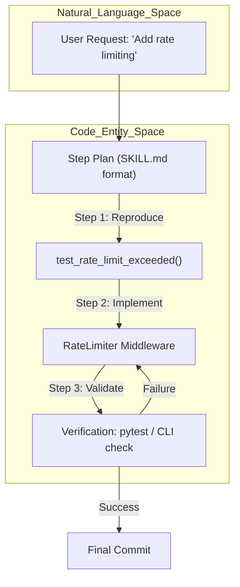
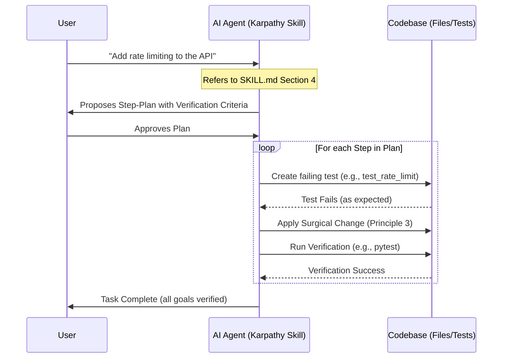

<!-- source: DeepWiki mcp.deepwiki.com · repo multica-ai/andrej-karpathy-skills · page 2.4 Principle 4: Goal-Driven Execution · fetched 2026-10-30 -->

# Principle 4: Goal-Driven Execution

<details>
<summary>Relevant source files</summary>

The following files were used as context for generating this wiki page:

- [CLAUDE.md](CLAUDE.md)
- [EXAMPLES.md](EXAMPLES.md)
- [skills/karpathy-guidelines/SKILL.md](skills/karpathy-guidelines/SKILL.md)

</details>


This page provides a technical deep dive into the fourth principle of the Karpathy Guidelines: **Goal-Driven Execution**. The core objective of this principle is to shift from executing vague, imperative commands ("fix this") to achieving verifiable, declarative success criteria. By defining what "done" looks like before writing code, the AI agent can operate with higher autonomy and lower error rates.

## Core Mechanics: Verifiable Success Criteria

Goal-Driven Execution requires transforming natural language requests into a series of testable milestones. This prevents "hallucinated progress" where code is written but the underlying problem remains unsolved.

### The Success Criteria Transformation
The guidelines mandate specific transformations for common development tasks:

| Original Task | Goal-Driven Transformation |
| :--- | :--- |
| "Add validation" | "Write tests for invalid inputs, then make them pass" |
| "Fix the bug" | "Write a test that reproduces it, then make it pass" |
| "Refactor X" | "Ensure tests pass before and after the change" |

**Sources:** [CLAUDE.md:49-52](), [skills/karpathy-guidelines/SKILL.md:55-58]()

### Step-Plan Format
For multi-step features, the agent must output a plan using a specific verification syntax before execution:
1. `[Step Description]` → `verify: [Specific Check]`

This format ensures that every incremental change is validated before the next one begins, preventing the accumulation of errors across a large diff.

**Sources:** [CLAUDE.md:54-59](), [skills/karpathy-guidelines/SKILL.md:60-65]()

## Implementation: Natural Language to Verification Loop

The following diagram illustrates how the "Natural Language Space" of a user request is mapped into the "Code Entity Space" through the creation of `tests` and `step-plans`.

### Logic Flow: Task to Verification
The diagram shows how a request like "Add rate limiting" is broken down into specific code entities and verification steps.


**Sources:** [CLAUDE.md:54-61](), [EXAMPLES.md:321-345]()

## Technical Examples

### 1. The Test-First Loop (Bug Fixing)
When a user reports a bug, such as "Duplicate scores are being saved," the goal-driven approach forbids immediate patching. Instead, it requires a reproduction script first.

**Scenario: Duplicate Scores in Leaderboard**
- **Incorrect Approach:** Manually adding a `unique` check to the database model without a test.
- **Correct Approach:** 
    1. Create a test case that attempts to insert `{'user': 'A', 'score': 100}` twice.
    2. Observe the test failing (confirming the bug).
    3. Implement the fix in the logic.
    4. Run the test to verify it passes.

**Sources:** [EXAMPLES.md:321-345](), [CLAUDE.md:51-51]()

### 2. Incremental Verification (Feature Addition)
For complex features like "Add authentication," the agent must decompose the task into a verifiable sequence.

**Example Plan for Authentication:**
```text
1. Create User model with password_hash -> verify: database migration succeeds
2. Implement login endpoint -> verify: returns 401 for wrong credentials
3. Add JWT generation -> verify: token is returned on successful login
4. Add @login_required decorator -> verify: protected routes return 401 without token
```

**Sources:** [EXAMPLES.md:288-318](), [skills/karpathy-guidelines/SKILL.md:60-65]()

## Data Flow: Goal Enforcement

The following diagram maps the enforcement of Principle 4 within the agent's execution lifecycle, specifically showing how the `SKILL.md` instructions influence the interaction between the `User` and the `Codebase`.

### Execution Lifecycle Diagram


**Sources:** [CLAUDE.md:45-61](), [skills/karpathy-guidelines/SKILL.md:51-68](), [EXAMPLES.md:321-345]()

## Key Indicators of Success
The principle is considered successfully applied when:
- Diffs are accompanied by test results or CLI output demonstrating the change works.
- The agent stops to ask for a reproduction case if a bug is not immediately reproducible.
- Complex tasks are preceded by a numbered list of `[Step] → verify: [Check]`.

**Sources:** [CLAUDE.md:65-66](), [skills/karpathy-guidelines/SKILL.md:67-68]()

---

