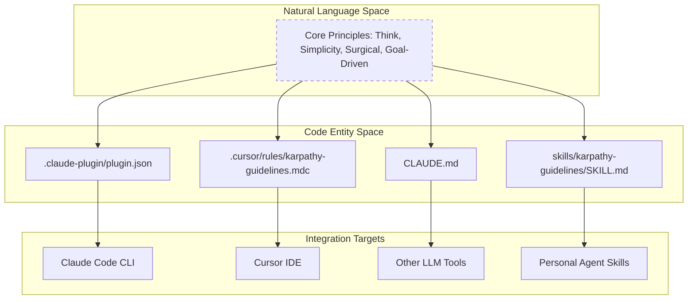
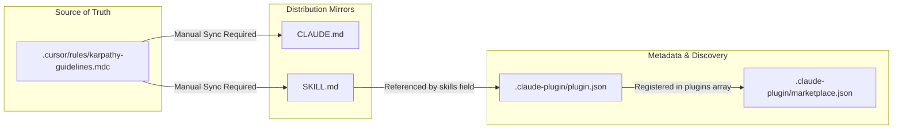

<!-- source: DeepWiki mcp.deepwiki.com · repo multica-ai/andrej-karpathy-skills · page 3 Integration & Distribution · fetched 2026-10-30 -->

# Integration & Distribution

Relevant source files

The following files were used as context for generating this wiki page:

- [.claude-plugin/marketplace.json](.claude-plugin/marketplace.json)
- [.claude-plugin/plugin.json](.claude-plugin/plugin.json)
- [CURSOR.md](CURSOR.md)
- [README.md](README.md)

This page provides a high-level overview of how the Karpathy-inspired behavioral guidelines are packaged and distributed across different AI-assisted development environments. The project maintains three distinct distribution formats to ensure compatibility with various LLM interfaces, ranging from CLI tools like Claude Code to IDE-integrated agents like Cursor.

### Distribution Ecosystem

The guidelines are distributed through a centralized repository structure that maps natural language principles into environment-specific configuration files. This allows developers to enforce the same "Think Before Coding" and "Simplicity First" behaviors regardless of their choice of AI tool.

#### Technical Mapping: Principles to Integration Targets

The following diagram illustrates how the core guidelines are projected from the conceptual space into specific file entities used by different platforms.

**Guideline Distribution Flow**

Sources: [.claude-plugin/plugin.json:1-11](), [CURSOR.md:1-29](), [README.md:23-30]()

---

### Claude Code Plugin

The primary distribution method for the Claude Code CLI is via a dedicated plugin architecture. This integration allows the guidelines to be registered as a "skill" that the AI agent can invoke or reference during a session.

*   **Manifest Structure**: The plugin is defined by `plugin.json` which specifies the metadata and the relative path to the skill content in the `skills` array [[.claude-plugin/plugin.json:1-11]()].
*   **Marketplace Registration**: The `marketplace.json` file handles the registration within the Claude Code ecosystem, defining the plugin ID `karpathy-skills` and its source location [[.claude-plugin/marketplace.json:1-29]()].
*   **Skill Injection**: The actual logic is stored in `skills/karpathy-guidelines/`, which is resolved by the CLI during plugin initialization [[.claude-plugin/plugin.json:10-10]()].

For details, see [Claude Code Plugin](#3.1).

Sources: [.claude-plugin/plugin.json:1-11](), [.claude-plugin/marketplace.json:1-29](), [README.md:101-113]()

---

### Cursor Integration

For developers using the Cursor IDE, the guidelines are distributed as a **Cursor Project Rule** (`.mdc` format). This integration is designed for zero-config enforcement within the repository.

*   **Auto-Enforcement**: By using the `alwaysApply: true` flag in the `.mdc` file, the guidelines are automatically injected into the Cursor Agent's context [[CURSOR.md:8-8]()].
*   **Portability**: The rule can be exported to other projects by copying the `.cursor/rules/` directory or by setting up a personal skill under `~/.cursor/skills` [[CURSOR.md:11-20]()].
*   **IDE Visibility**: Users can verify the active status of these guidelines via the **Settings → Rules** UI in Cursor [[CURSOR.md:9-9]()].

For details, see [Cursor Integration](#3.2).

Sources: [CURSOR.md:3-13](), [CURSOR.md:17-20](), [README.md:128-130]()

---

### Portable Plain-Text Formats

The project maintains two "fallback" or portable formats for environments that do not support specialized plugin architectures or `.mdc` rules.

| Format | File Path | Primary Use Case |
| :--- | :--- | :--- |
| **CLAUDE.md** | `CLAUDE.md` | Root-level instructions for generic LLM tools and Claude Code project-specific overrides [[README.md:115-126]()]. |
| **SKILL.md** | `skills/karpathy-guidelines/SKILL.md` | A reusable snippet for personal agent libraries or manual copy-pasting [[CURSOR.md:17-20]()]. |

These files contain the identical core principles found in the more structured formats. A key maintenance requirement for contributors is ensuring that any changes to the behavioral guidelines are synchronized across all three primary file types: `.mdc`, `CLAUDE.md`, and `SKILL.md` [[CURSOR.md:27-29]()].

For details, see [CLAUDE.md & SKILL.md Reference](#3.3).

Sources: [CURSOR.md:15-16](), [CURSOR.md:27-29](), [README.md:115-126]()

---

### Synchronization Lifecycle

Because the guidelines exist in multiple formats, the project follows a strict synchronization pattern to prevent behavioral drift between tools.

**Entity Relationship & Sync Diagram**

Sources: [CURSOR.md:27-29](), [.claude-plugin/plugin.json:10-10](), [.claude-plugin/marketplace.json:11-28]()

---

