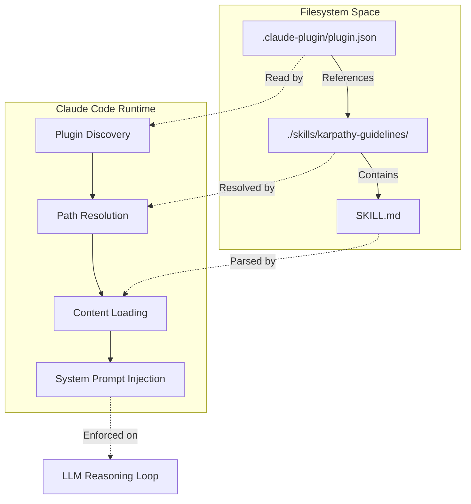
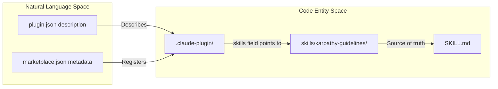

<!-- source: DeepWiki mcp.deepwiki.com · repo multica-ai/andrej-karpathy-skills · page 3.1 Claude Code Plugin · fetched 2026-10-30 -->

# Claude Code Plugin

Relevant source files

The following files were used as context for generating this wiki page:

- [.claude-plugin/marketplace.json](.claude-plugin/marketplace.json)
- [.claude-plugin/plugin.json](.claude-plugin/plugin.json)

The Claude Code plugin integration allows the Andrej Karpathy coding guidelines to be natively injected into the **Claude Code** CLI environment. This integration leverages the `.claude-plugin/` architecture to register behavioral skills that the model must follow during interactive coding sessions.

## Plugin Structure and Manifests

The plugin is defined by a specific directory structure that allows Claude Code to discover, validate, and load the skill definitions.

### The `.claude-plugin/` Directory
The root of the integration resides in the `.claude-plugin/` directory, which contains the metadata necessary for the Claude Code ecosystem to recognize the repository as a valid plugin source [`.claude-plugin/plugin.json`:1-11]().

### Plugin Manifest (`plugin.json`)
The `plugin.json` file serves as the primary configuration for the plugin. It defines the identity of the plugin and, most importantly, the location of the skills to be injected into the agent's context.

| Field | Description | Value |
| :--- | :--- | :--- |
| `name` | Unique identifier for the plugin | `"andrej-karpathy-skills"` |
| `description` | Summary of the plugin's purpose | `"Behavioral guidelines to reduce common LLM coding mistakes..."` |
| `version` | Semantic versioning of the skill set | `"1.0.0"` |
| `skills` | Array of paths to skill directories | `["./skills/karpathy-guidelines"]` |

**Sources:** [`.claude-plugin/plugin.json`:1-11]()

### Marketplace Registration (`marketplace.json`)
To support installation via the plugin marketplace, the `marketplace.json` file provides extended metadata used by the Claude Code registry. This includes categorization and ownership details that facilitate discovery via `claude plugin` commands [`.claude-plugin/marketplace.json`:1-29]().

**Sources:** [`.claude-plugin/marketplace.json`:1-29]()

## Skill Injection Lifecycle

The lifecycle of the plugin involves moving from a static definition on disk to an active behavioral constraint within the Claude Code session.

### Lifecycle Flow: From Manifest to Enforcement

The following diagram illustrates how the Claude Code environment processes the plugin files to activate the Karpathy guidelines.

**Diagram: Plugin Loading and Injection Lifecycle**

**Sources:** [`.claude-plugin/plugin.json`:1-11](), [`.claude-plugin/marketplace.json`:11-28]()

### Data Flow: Natural Language to Code Entity
This diagram bridges the gap between the high-level plugin metadata and the actual skill content used to govern the AI's coding behavior.

**Diagram: Skill Content Mapping**

**Sources:** [`.claude-plugin/plugin.json`:1-11](), [`.claude-plugin/marketplace.json`:1-29]()

## Marketplace Commands

Users interact with the plugin through the `claude` CLI. The configuration in `.claude-plugin/` enables the following standard operations:

1.  **Discovery**: The `marketplace.json` allows the plugin to appear in searches via the `name` and `keywords` fields [`.claude-plugin/marketplace.json`:2-3, 20-25]().
2.  **Installation**: When a user installs the plugin, the CLI resolves the `source` path (defined as `./` in the marketplace manifest) to locate the `plugin.json` [`.claude-plugin/marketplace.json`:14]().
3.  **Activation**: Claude Code reads the `skills` array in `plugin.json` and loads the markdown content from the specified directory [`.claude-plugin/plugin.json`:10]().

**Sources:** [`.claude-plugin/plugin.json`:1-11](), [`.claude-plugin/marketplace.json`:1-29]()

---

