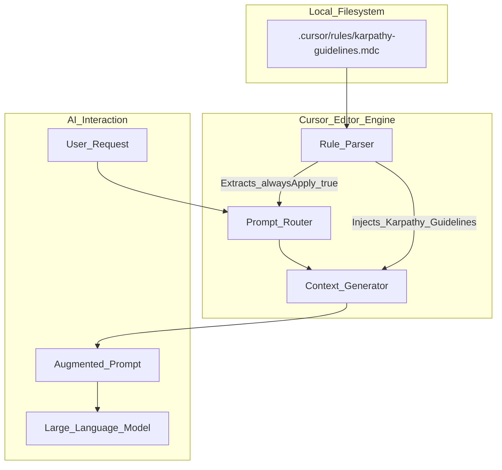
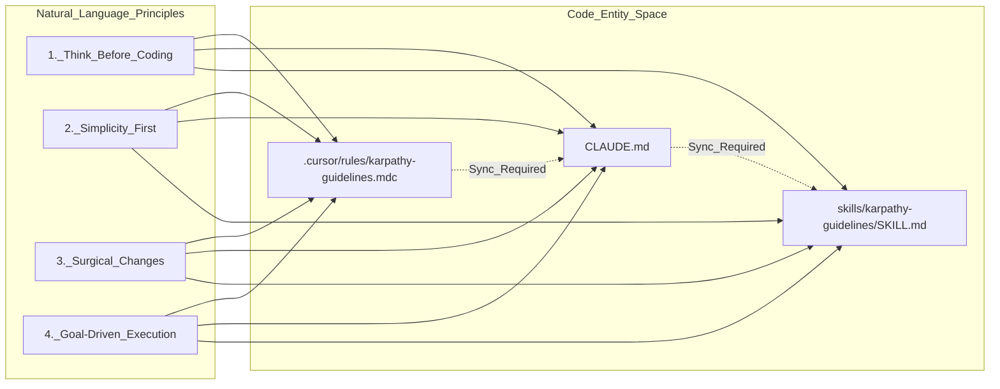

<!-- source: DeepWiki mcp.deepwiki.com · repo multica-ai/andrej-karpathy-skills · page 3.2 Cursor Integration · fetched 2026-10-30 -->

# Cursor Integration

Relevant source files

The following files were used as context for generating this wiki page:

- [.cursor/rules/karpathy-guidelines.mdc](.cursor/rules/karpathy-guidelines.mdc)
- [CURSOR.md](CURSOR.md)

The Cursor integration provides a native way to enforce the Karpathy behavioral guidelines within the Cursor AI code editor. Unlike other integrations that might rely on root-level markdown files, Cursor uses a specific rule system located in the `.cursor/rules/` directory to provide context-aware instructions to its internal agent.

## The Cursor Project Rule

The primary mechanism for Cursor integration is the `.cursor/rules/karpathy-guidelines.mdc` file. This file uses Cursor's proprietary `.mdc` format, which combines Markdown content with frontmatter metadata to control rule application.

### Implementation Details
The rule is configured with specific frontmatter that ensures the guidelines are active for every interaction within the repository.

| Property | Value | Purpose |
| :--- | :--- | :--- |
| `description` | "Behavioral guidelines to reduce common LLM coding mistakes..." | Helps Cursor's router understand when this rule is relevant. [ .cursor/rules/karpathy-guidelines.mdc:2-2]() |
| `alwaysApply` | `true` | Forces the rule to be included in every prompt sent to the model, regardless of file context. [ .cursor/rules/karpathy-guidelines.mdc:3-3]() |

### Rule Structure
The rule content is structured to address the four core principles directly within the editor's prompt window:
1.  **Think Before Coding**: Mandates explicit assumption stating and pushing back on complexity. [ .cursor/rules/karpathy-guidelines.mdc:12-20]()
2.  **Simplicity First**: Enforces a "senior engineer" heuristic and rejects speculative features. [ .cursor/rules/karpathy-guidelines.mdc:22-32]()
3.  **Surgical Changes**: Restricts edits to the specific lines required by the request. [ .cursor/rules/karpathy-guidelines.mdc:34-48]()
4.  **Goal-Driven Execution**: Requires a step-plan with verifiable success criteria. [ .cursor/rules/karpathy-guidelines.mdc:50-66]()

**Sources:**
- [ .cursor/rules/karpathy-guidelines.mdc:1-71]()
- [ CURSOR.md:3-9]()

## Data Flow: Instruction Injection

The following diagram illustrates how the `.mdc` file is processed by Cursor to influence the AI Agent's behavior during a coding task.

**Cursor Rule Application Flow**

**Sources:**
- [ .cursor/rules/karpathy-guidelines.mdc:1-4]()
- [ CURSOR.md:8-9]()

## Portability and External Projects

The guidelines are designed to be portable. To use these behaviors in a different Cursor project, the `.mdc` file must be manually copied into the target project's structure.

### Migration Paths
- **Internal to Cursor:** Copy the `.mdc` file to `[new-project]/.cursor/rules/`. [ CURSOR.md:13-13]()
- **Cross-Tool Compatibility:** While Cursor uses `.mdc` files, other tools (like Claude Code) often rely on `CLAUDE.md`. Cursor does not read `CLAUDE.md` by default, necessitating the specific `.cursor/rules/` setup. [ CURSOR.md:23-24]()

### Personal Agent Skills
For users who want these guidelines available globally across all projects without copying files into every repository, Cursor supports personal skills.
- **Location:** `~/.cursor/skills/`
- **Setup:** Users can copy or symlink `skills/karpathy-guidelines/SKILL.md` into their personal skills directory. [ CURSOR.md:17-19]()

**Sources:**
- [ CURSOR.md:11-19]()
- [ CURSOR.md:21-25]()

## Maintenance and Synchronization

Because the project supports multiple integration methods (Claude Code, Cursor, and raw Markdown), contributors must ensure parity across the different file formats when updating the core principles.

**Entity Mapping: Natural Language to Implementation**

### Synchronization Requirements
When the behavioral logic is modified, the following files must be updated simultaneously to prevent divergence:
1.  `CLAUDE.md`: The primary reference for Claude Code and generic tools. [ CURSOR.md:28-28]()
2.  `.cursor/rules/karpathy-guidelines.mdc`: The specific implementation for Cursor. [ CURSOR.md:28-28]()
3.  `skills/karpathy-guidelines/SKILL.md`: The format used for personal skills and plugin distribution. [ CURSOR.md:29-29]()

**Sources:**
- [ CURSOR.md:26-30]()
- [ .cursor/rules/karpathy-guidelines.mdc:1-68]()

---

