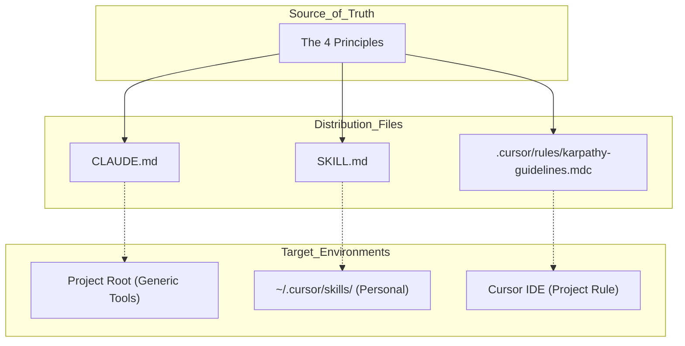
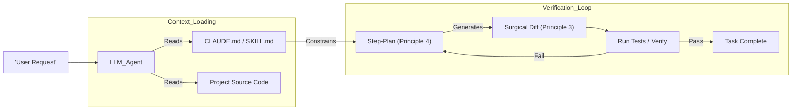

<!-- source: DeepWiki mcp.deepwiki.com · repo multica-ai/andrej-karpathy-skills · page 3.3 CLAUDE.md & SKILL.md Reference · fetched 2026-10-30 -->

# CLAUDE.md & SKILL.md Reference

<details>
<summary>Relevant source files</summary>

The following files were used as context for generating this wiki page:

- [CLAUDE.md](CLAUDE.md)
- [CURSOR.md](CURSOR.md)
- [skills/karpathy-guidelines/SKILL.md](skills/karpathy-guidelines/SKILL.md)

</details>


This page provides a technical reference for the two portable plain-text formats used to distribute the Karpathy Guidelines: `CLAUDE.md` and `SKILL.md`. While the project also supports specialized formats like Cursor rules and Claude Code plugins, these two files serve as the universal foundation for integrating the guidelines into any LLM-assisted development environment.

## Purpose and Relationship

The `CLAUDE.md` and `SKILL.md` files contain identical behavioral logic but serve different deployment patterns. `CLAUDE.md` is designed for per-project enforcement within a specific repository root, while `SKILL.md` is formatted as a reusable "Agent Skill" for personal configuration directories.

### Comparison Table

| Feature | `CLAUDE.md` | `SKILL.md` |
| :--- | :--- | :--- |
| **Primary Target** | Project-specific root directory | Personal `~/.cursor/skills` or agent library |
| **Format** | Standard Markdown | Markdown with YAML Frontmatter |
| **Scope** | Applies to all users of a specific repo | Applies to a specific user across all repos |
| **Tool Support** | Claude Desktop, generic IDE plugins | Cursor Personal Skills, custom agents |
| **File Path** | `[CLAUDE.md]()` | `[skills/karpathy-guidelines/SKILL.md]()` |

**Sources:** `[CLAUDE.md:1-66]()`, `[skills/karpathy-guidelines/SKILL.md:1-68]()`, `[CURSOR.md:15-19]()`

---

## Technical Implementation

### YAML Frontmatter (SKILL.md)
Unlike the standard `CLAUDE.md`, the `SKILL.md` file includes a metadata header (Frontmatter) that allows agentic systems to categorize and load the skill dynamically. This is required for systems that scan directories for reusable capabilities.

```yaml
---
name: karpathy-guidelines
description: Behavioral guidelines to reduce common LLM coding mistakes...
license: MIT
---
```
**Sources:** `[skills/karpathy-guidelines/SKILL.md:1-5]()`

### Data Flow: Content Synchronization
The repository maintains three primary sources of truth for the guidelines. When a contributor modifies a core principle, they must ensure synchronization across the following entities to prevent "behavioral drift" between platforms.

**Guideline Synchronization Architecture**

**Sources:** `[CURSOR.md:26-29]()`, `[CLAUDE.md:1-66]()`, `[skills/karpathy-guidelines/SKILL.md:1-68]()`

---

## Content Structure

Both files implement the four behavioral pillars. The LLM interprets these as system-level constraints that override its default "helpful assistant" persona (which often defaults to over-coding or speculative implementation).

### 1. Think Before Coding
Forces the agent to surface assumptions and stop at ambiguity before any file modifications occur.
*   **Key Logic:** "If something is unclear, stop. Name what's confusing. Ask."
*   **Citations:** `[CLAUDE.md:7-15]()`, `[skills/karpathy-guidelines/SKILL.md:13-21]()`

### 2. Simplicity First
Enforces a "Senior Engineer" heuristic to prevent architectural bloat and speculative features.
*   **Key Logic:** "If you write 200 lines and it could be 50, rewrite it."
*   **Citations:** `[CLAUDE.md:17-27]()`, `[skills/karpathy-guidelines/SKILL.md:23-33]()`

### 3. Surgical Changes
Minimizes the "blast radius" of edits to prevent unrelated regressions or style drift.
*   **Key Logic:** "Every changed line should trace directly to the user's request."
*   **Citations:** `[CLAUDE.md:29-43]()`, `[skills/karpathy-guidelines/SKILL.md:35-49]()`

### 4. Goal-Driven Execution
Transitions the agent from imperative "doing" to declarative "verifying" using a structured planning format.
*   **Key Logic:** Use a step-plan format: `1. [Step] → verify: [check]`.
*   **Citations:** `[CLAUDE.md:45-61]()`, `[skills/karpathy-guidelines/SKILL.md:51-67]()`

---

## Integration Workflows

### Manual Project Integration
For tools that do not support the `.claude-plugin` or `.cursor/rules` formats, the `CLAUDE.md` file is the standard fallback. It is placed in the project root where agents are trained to look for project-specific context.

**Workflow: Bridging Natural Language to Code Context**

**Sources:** `[CLAUDE.md:49-61]()`, `[skills/karpathy-guidelines/SKILL.md:55-67]()`, `[CURSOR.md:15-16]()`

### Contributor Requirements
When updating the principles, developers must manually verify that the logic remains consistent across the flat-file versions. The project does not currently use an automated build script to sync these, making manual verification essential.

1.  **Modify Principle:** Update the text in `[CLAUDE.md]()`.
2.  **Sync Skill:** Copy changes to `[skills/karpathy-guidelines/SKILL.md]()`, preserving the YAML header `[skills/karpathy-guidelines/SKILL.md:1-5]()`.
3.  **Sync Cursor:** Update `[.cursor/rules/karpathy-guidelines.mdc]()`.

**Sources:** `[CURSOR.md:26-29]()`

---

