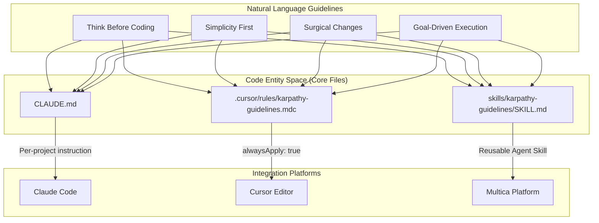
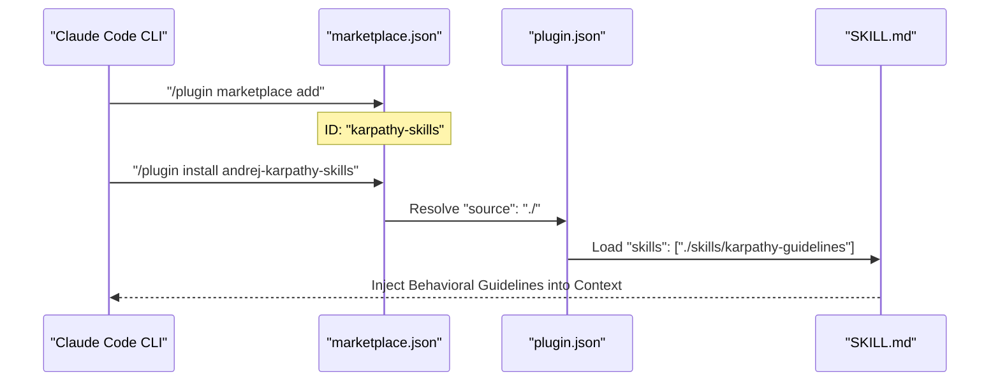

<!-- source: DeepWiki mcp.deepwiki.com · repo multica-ai/andrej-karpathy-skills · page 4 Glossary · fetched 2026-10-30 -->

# Glossary

Relevant source files

The following files were used as context for generating this wiki page:

- [.claude-plugin/marketplace.json](.claude-plugin/marketplace.json)
- [.claude-plugin/plugin.json](.claude-plugin/plugin.json)
- [.cursor/rules/karpathy-guidelines.mdc](.cursor/rules/karpathy-guidelines.mdc)
- [CLAUDE.md](CLAUDE.md)
- [EXAMPLES.md](EXAMPLES.md)
- [README.md](README.md)
- [skills/karpathy-guidelines/SKILL.md](skills/karpathy-guidelines/SKILL.md)

This page provides technical definitions for terms, jargon, and domain concepts specific to the `andrej-karpathy-skills` project. It maps natural language concepts used in the guidelines to their respective implementations in the codebase.

## Core Concepts

### 1. Behavioral Guidelines
The primary logic of the repository, consisting of four principles designed to mitigate common Large Language Model (LLM) coding pitfalls such as over-engineering and "drive-by" refactoring [README.md:21-30](). These are implemented as text-based instructions in multiple formats to ensure compatibility across different AI IDEs [README.md:99-130]().

### 2. Think Before Coding (Principle 1)
A protocol requiring the agent to surface hidden assumptions and present multiple interpretations of a request before writing any code [CLAUDE.md:7-15](). It forces a pause in the execution loop to clarify scope, format, and volume [EXAMPLES.md:38-55]().

### 3. Simplicity First (Principle 2)
An enforcement mechanism against "speculative features" and "over-abstraction" [EXAMPLES.md:97-103](). It includes a "Senior Engineer" heuristic: if a senior developer would find the code overcomplicated, the agent must simplify it [README.md:57-58]().

### 4. Surgical Changes (Principle 3)
A strict constraint on the diffing process where the agent is forbidden from "improving" adjacent code or formatting that is orthogonal to the task [README.md:59-69](). The goal is to produce minimal, clean Pull Requests [README.md:147-147]().

### 5. Goal-Driven Execution (Principle 4)
The transformation of imperative instructions (e.g., "Fix the bug") into declarative, verifiable success criteria (e.g., "Write a test that reproduces the bug, then make it pass") [CLAUDE.md:45-53]().

### 6. Verification Loop
The process where an agent states a multi-step plan with explicit check-steps and iterates until those checks are satisfied [README.md:89-95]().

### 7. Orphan Management
A specific subset of **Surgical Changes** regarding dead code. Agents must remove unused code created by *their* changes but must leave pre-existing dead code untouched unless explicitly asked [CLAUDE.md:39-42]().

---

## Technical Entities & Integration Space

The following diagram bridges the conceptual guidelines to the physical files and integration points within the codebase.

**System Architecture and File Mapping**

Sources: [README.md:99-130](), [.cursor/rules/karpathy-guidelines.mdc:1-4](), [CLAUDE.md:1-63](), [skills/karpathy-guidelines/SKILL.md:1-68]()

---

## Glossary Table

| Term | Definition | Code Pointer |
|:---|:---|:---|
| **AlwaysApply** | A metadata flag in Cursor rules that ensures the guidelines are active for every prompt without manual invocation. | [.cursor/rules/karpathy-guidelines.mdc:3-3]() |
| **Claude Code Plugin** | A packaged version of the guidelines that can be installed via the marketplace command. | [.claude-plugin/plugin.json:1-11]() |
| **Drive-by Refactoring** | The anti-pattern of changing unrelated code while fixing a specific bug. | [EXAMPLES.md:227-232]() |
| **Skill Injection** | The process of loading the guidelines from `SKILL.md` into an agent's context. | [.claude-plugin/plugin.json:10-10]() |
| **Success Criteria** | Verifiable outcomes (usually tests) that allow an LLM to loop independently. | [README.md:97-97]() |
| **Tradeoff Note** | The explicit policy biasing the system toward **caution over speed**. | [README.md:163-167]() |

---

## Data Flow: Plugin Registration

This diagram illustrates how the `andrej-karpathy-skills` are registered and resolved within the Claude Code ecosystem.

**Plugin Lifecycle and Path Resolution**

Sources: [.claude-plugin/marketplace.json:1-15](), [.claude-plugin/plugin.json:1-10](), [README.md:101-111]()