# Page: Overview

# Overview

<details>
<summary>Relevant source files</summary>

The following files were used as context for generating this wiki page:

- [CLAUDE.md](CLAUDE.md)
- [README.md](README.md)

</details>


The `andrej-karpathy-skills` project provides a set of behavioral guidelines for AI coding assistants (like Claude Code and Cursor) to mitigate common Large Language Model (LLM) coding pitfalls. These guidelines are derived from observations by Andrej Karpathy regarding how LLMs often fail in software engineering tasks—such as making silent assumptions, over-engineering solutions, and performing unnecessary "drive-by" refactoring [README.md:7-20]().

The repository centralizes these behavioral corrections into a single set of instructions that can be integrated as a global plugin, a per-project `CLAUDE.md` file, or a Cursor rule [README.md:101-130]().

## The Core Problems

The project addresses three primary failure modes observed in LLM-assisted development:
1.  **Hidden Confusion:** Models often pick an interpretation of an ambiguous prompt silently and proceed without seeking clarification [README.md:13-15]().
2.  **Architectural Bloat:** LLMs tend to overcomplicate APIs and implement 1000-line solutions where 100 lines would suffice [README.md:17-18]().
3.  **Unrelated Edits:** Models frequently change comments or code orthogonal to the task, leading to "noisy" diffs [README.md:19-20]().

For a deeper look at the origins of these principles, see **[Background & Motivation](#1.2)**.

## The Solution: Four Principles

The repository organizes its instructions into four core principles designed to transform the AI from an impulsive coder into a disciplined engineer [README.md:23-30]().

| Principle | Behavioral Shift |
| :--- | :--- |
| **Think Before Coding** | Forces explicit reasoning, assumption checking, and push-back on complexity [README.md:34-44](). |
| **Simplicity First** | Enforces a "senior engineer" heuristic: no speculative features or over-abstraction [README.md:45-58](). |
| **Surgical Changes** | Limits edits strictly to the requested task to ensure clean, minimal PRs [README.md:59-76](). |
| **Goal-Driven Execution** | Shifts from imperative instructions to declarative, verifiable success criteria [README.md:77-98](). |

For detailed implementation details and examples of each, see **[The Four Principles](#2)**.

## Key Insight: Declarative vs. Imperative

The fundamental insight of this project is that LLMs perform significantly better when given **success criteria** rather than just a list of steps. By transforming a task like "Fix the bug" into "Write a test that reproduces the bug, then make it pass," the AI can enter a self-correcting loop [README.md:132-138]().

### Mapping Natural Language Goals to Code Execution

The following diagram illustrates how the project translates high-level Karpathy observations into specific code-enforced behaviors within the AI's context window.

**Logic Flow: From Observations to Skill Enforcement**
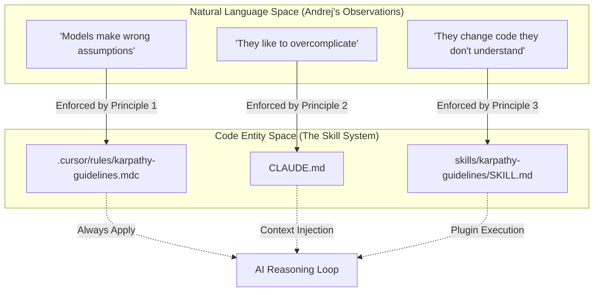
Sources: [README.md:13-30](), [README.md:101-130](), [CLAUDE.md:1-66]()

## Repository Organization

The project is structured to support multiple AI development environments simultaneously, ensuring that the same "Karpathy-inspired" logic is applied regardless of the tool used.

**System Architecture: Distribution Formats**
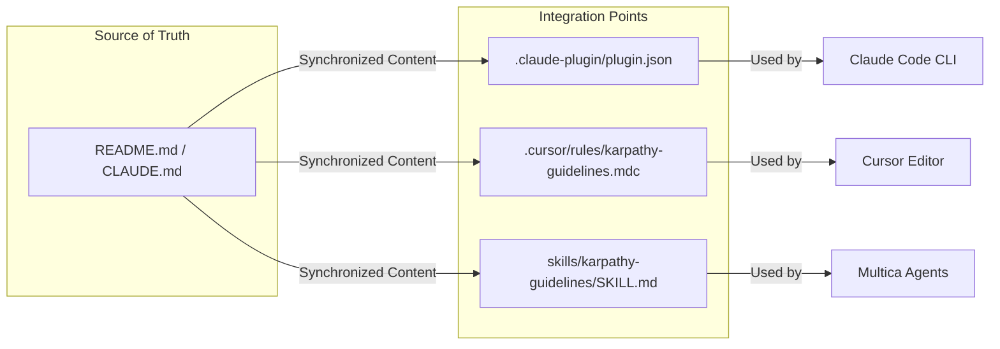
Sources: [README.md:101-130](), [README.md:1-7](), [CLAUDE.md:1-3]()

### Installation & Integration
The project supports three main installation paths:
*   **Claude Code Plugin:** Installed via `/plugin marketplace add` and `/plugin install` for global availability across projects [README.md:101-113]().
*   **CLAUDE.md:** A portable file placed in a project root to guide Claude's behavior locally [README.md:115-126]().
*   **Cursor Rules:** A `.mdc` file located in `.cursor/rules/` for native integration with the Cursor editor [README.md:128-130]().

For step-by-step setup instructions, see **[Getting Started & Installation](#1.1)**.

---

# Page: Getting Started & Installation

# Getting Started & Installation

<details>
<summary>Relevant source files</summary>

The following files were used as context for generating this wiki page:

- [.claude-plugin/marketplace.json](.claude-plugin/marketplace.json)
- [.claude-plugin/plugin.json](.claude-plugin/plugin.json)
- [README.md](README.md)

</details>


This page provides a technical guide for integrating the Andrej Karpathy-inspired behavioral guidelines into your AI-assisted development workflow. The guidelines are designed to mitigate common LLM failure modes—such as hidden assumptions and architectural bloat—by enforcing four core principles: Think Before Coding, Simplicity First, Surgical Changes, and Goal-Driven Execution [README.md:23-30]().

The repository supports three primary installation methods: a global Claude Code plugin, a per-project `CLAUDE.md` file, and Cursor project rules.

## Installation Methods

### Option A: Claude Code Plugin (Recommended)
This method installs the guidelines as a global skill within the Claude Code CLI environment. It utilizes the `.claude-plugin/` architecture to inject instructions across all sessions where the plugin is active [README.md:101-113]().

**Implementation Flow:**
1. **Marketplace Registration**: Add the remote repository as a source via the `/plugin marketplace add` command [README.md:103-105]().
2. **Skill Installation**: Download and register the `karpathy-skills` package using the plugin identifier `andrej-karpathy-skills@karpathy-skills` [README.md:108-110]().

```bash
# Add the marketplace source
/plugin marketplace add forrestchang/andrej-karpathy-skills

# Install the specific skill
/plugin install andrej-karpathy-skills@karpathy-skills
```

### Option B: Per-Project CLAUDE.md
For environments that rely on root-level instruction files (like the standard Claude.ai web interface or basic Claude Code setups), the `CLAUDE.md` file serves as the source of truth [README.md:115-126]().

| Project State | Command |
| :--- | :--- |
| **New Project** | `curl -o CLAUDE.md https://raw.githubusercontent.com/forrestchang/andrej-karpathy-skills/main/CLAUDE.md` |
| **Existing Project** | `echo "" >> CLAUDE.md && curl https://raw.githubusercontent.com/forrestchang/andrej-karpathy-skills/main/CLAUDE.md >> CLAUDE.md` |

### Option C: Cursor Project Rules
Cursor uses a specialized format (`.mdc`) located in the `.cursor/rules/` directory. This project includes a pre-configured rule ([`.cursor/rules/karpathy-guidelines.mdc`](.cursor/rules/karpathy-guidelines.mdc)) that is set to `alwaysApply: true`, ensuring the guidelines are active for every chat or composer session within the editor [README.md:128-130]().

**Manual Setup for Other Projects:**
To use these guidelines in a different Cursor project, copy the rule file to the target project's `.cursor/rules/` directory.

---

## Data Flow & Enforcement Logic

The following diagram illustrates how the natural language principles defined in the repository are ingested by different AI entities and transformed into enforced coding behaviors.

**Principle Ingestion and Execution Flow**
```mermaid
graph TD
    subgraph "Natural Language Space"
        [README.md] --> |"Defines"| P1["Principle 1: Think Before Coding"]
        [README.md] --> |"Defines"| P2["Principle 2: Simplicity First"]
        [README.md] --> |"Defines"| P3["Principle 3: Surgical Changes"]
        [README.md] --> |"Defines"| P4["Principle 4: Goal-Driven Execution"]
    end

    subgraph "Code Entity Space (Distribution)"
        P1 & P2 & P3 & P4 --> CL["CLAUDE.md"]
        P1 & P2 & P3 & P4 --> MDC[".cursor/rules/karpathy-guidelines.mdc"]
        P1 & P2 & P3 & P4 --> SKILL["skills/karpathy-guidelines/SKILL.md"]
    end

    subgraph "Execution Environment"
        CL --> |"Root Context"| ClaudeCode["Claude Code CLI"]
        MDC --> |"alwaysApply: true"| CursorAgent["Cursor Agent/Composer"]
        SKILL --> |"Plugin Injection"| ClaudeMarketplace["Claude Marketplace Plugin"]
    end

    ClaudeCode --> Behavior["Surgical Diffs & Minimal Code"]
    CursorAgent --> Behavior
    ClaudeMarketplace --> Behavior
```
**Sources:** [README.md:23-30](), [README.md:101-113](), [README.md:128-130]()

---

## Integration Architecture

The repository maintains synchronization between three primary formats to ensure consistent behavior across different tools. The `plugin.json` manifest acts as the entry point for the Claude Code plugin system, pointing to the skill definition [/.claude-plugin/plugin.json:1-11]().

**System Component Mapping**
```mermaid
graph LR
    subgraph "Source of Truth"
        "README.md"
    end

    subgraph "Claude Code Ecosystem"
        "CLAUDE.md"
        "SKILL_md"["skills/karpathy-guidelines/SKILL.md"]
        "plugin_json"["/.claude-plugin/plugin.json"]
        "marketplace_json"["/.claude-plugin/marketplace.json"]
    end

    subgraph "Cursor Ecosystem"
        "MDC_file"[".cursor/rules/karpathy-guidelines.mdc"]
    end

    "README.md" -.-> |"Manual Sync"| "CLAUDE.md"
    "README.md" -.-> |"Manual Sync"| "SKILL_md"
    "README.md" -.-> |"Manual Sync"| "MDC_file"
    
    "plugin_json" --> |"Defines Skills"| "SKILL_md"
    "marketplace_json" --> |"Registers"| "plugin_json"

    "CLAUDE.md" --- |"Project-Level Instructions"| UserProject["User Codebase"]
    "MDC_file" --- |"Project Rules"| CursorIDE["Cursor IDE"]
```
**Sources:** [README.md:101-113](), [/.claude-plugin/plugin.json:10-10](), [/.claude-plugin/marketplace.json:11-14]()

---

## Customization & Tradeoffs

### Project-Specific Guidelines
The guidelines are designed to be additive. Users are encouraged to append project-specific technical requirements (e.g., "Use TypeScript strict mode") to the existing `CLAUDE.md` or Cursor rule [README.md:149-161]().

### The Speed vs. Caution Tradeoff
A critical technical note for users is the bias toward **caution over speed** [README.md:163-167]().
*   **High Rigor**: Applied to non-trivial logic, architectural changes, and bug fixes.
*   **Low Rigor**: For trivial tasks like typo fixes or obvious one-liners, the LLM is permitted to bypass the full verification loop to maintain developer velocity [README.md:165-167]().

**Sources:** [README.md:149-167]()

---

# Page: Background & Motivation

# Background & Motivation

<details>
<summary>Relevant source files</summary>

The following files were used as context for generating this wiki page:

- [README.md](README.md)
- [README.zh.md](README.zh.md)

</details>


This section details the theoretical and practical foundations of the `andrej-karpathy-skills` project. It explores the specific Large Language Model (LLM) behaviors identified by Andrej Karpathy that lead to degraded code quality and explains how this repository's guidelines codify solutions to those failure modes.

## Origin: The Karpathy Observations

The guidelines in this repository are derived from public observations made by Andrej Karpathy regarding the pitfalls of using LLMs for software engineering [README.md:7-13](). Karpathy identified that while LLMs are powerful, they often default to "path of least resistance" behaviors that introduce technical debt, architectural complexity, and instability into codebases [README.md:15-20]().

### The Three Core Failure Modes

The project specifically targets three recurring failure modes observed in LLM-assisted coding:

1.  **Hidden Confusion**: Models often make incorrect assumptions on the user's behalf without seeking clarification [README.md:15-16](). They may pick one interpretation of an ambiguous prompt and proceed silently, leading to logic that deviates from the user's actual intent.
2.  **Architectural Bloat**: There is a strong tendency for LLMs to overcomplicate APIs and implementations [README.md:17-18](). This manifests as bloated abstractions (e.g., implementing 1000 lines of code where 100 would suffice) and speculative features that were never requested.
3.  **Unrelated Edits (Side Effects)**: Models frequently perform "drive-by" refactoring—changing comments, formatting, or orthogonal code they do not fully understand—while attempting to solve a specific task [README.md:19-20]().

### LLM Behavior Mapping

The following diagram bridges the "Natural Language Space" (Karpathy's observations) to the "Code Entity Space" (the principles enforced in `CLAUDE.md` and the Cursor rule `.cursor/rules/karpathy-guidelines.mdc`).

**Mapping Observations to Enforcement Principles**
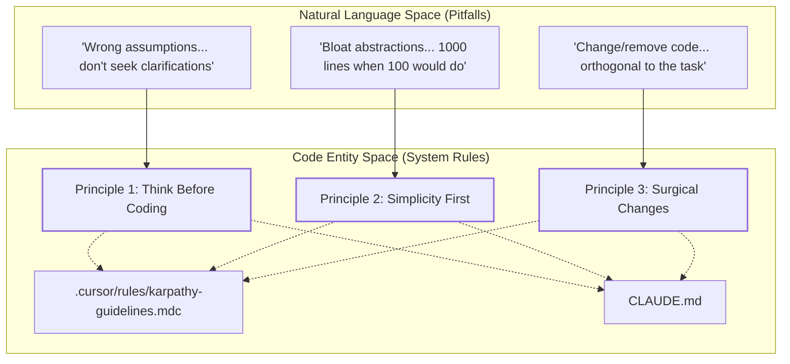
Sources: [README.md:15-30](), [README.md:34-75](), [README.md:130-130]()

## Key Insight: Declarative vs. Imperative

The foundational technical insight of this project is the shift from **imperative instructions** (telling the LLM *how* to do something) to **declarative goals** (telling the LLM *what* success looks like) [README.md:132-138]().

Karpathy noted that LLMs are exceptionally effective at "looping" until they meet specific, verifiable criteria [README.md:134-136](). By providing the LLM with a definition of success—such as a failing test case—the developer leverages the model's ability to iterate independently toward a correct solution.

### The Verification Loop
This insight is implemented as **Principle 4: Goal-Driven Execution** [README.md:77-79](). It transforms vague requests into a structured step-plan format used by the agent during task execution.

**Implementation of the Verification Loop**
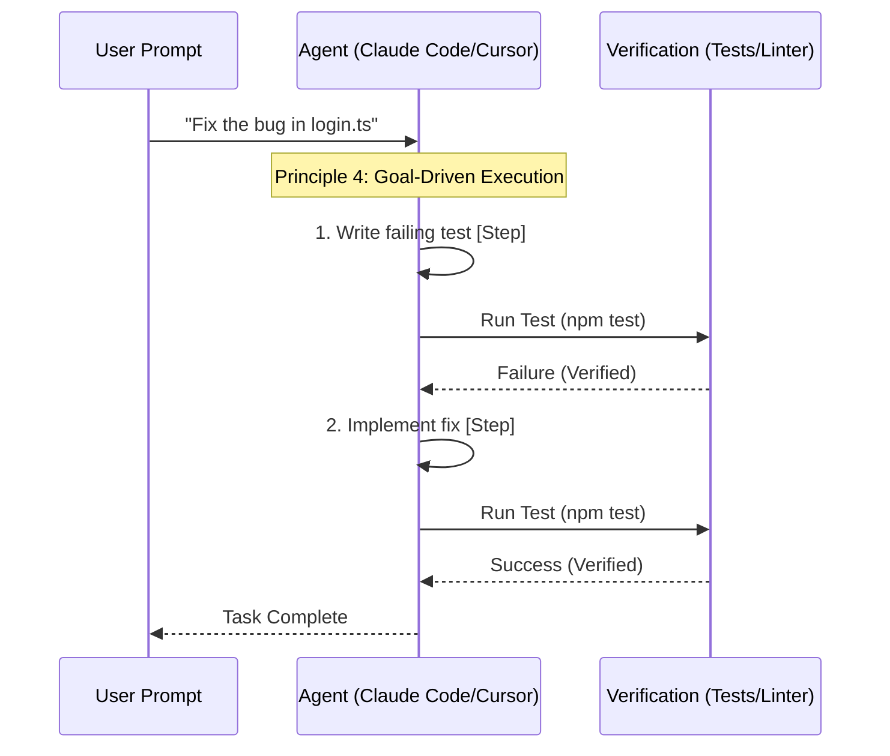
Sources: [README.md:77-98](), [README.md:134-138]()

## Problem-Solution Framework

The project organizes these insights into a table that maps specific problems to the principles defined in the core skill files like `CLAUDE.md` and the `karpathy-skills` plugin [README.md:110-115]().

| Problem Category | Specific LLM Pitfall | Enforcement Principle |
| :--- | :--- | :--- |
| **Ambiguity** | Hidden assumptions, missing tradeoffs | **Think Before Coding** |
| **Complexity** | Overengineering, speculative features | **Simplicity First** |
| **Stability** | Side effects, style drift, orphan code | **Surgical Changes** |
| **Reliability** | Weak success criteria, lack of verification | **Goal-Driven Execution** |

Sources: [README.md:25-30](), [README.md:140-148]()

## Technical Tradeoffs

The implementation of these guidelines biases the AI assistant toward **caution over speed** [README.md:163-165](). 

*   **Latency**: Users may experience slightly higher latency as the model is forced to output explicit reasoning and step-plans before writing code [README.md:38-44](), [README.md:89-95]().
*   **Rigor**: For trivial one-line fixes, the guidelines suggest using developer judgment to bypass full rigor, but for non-trivial work, the guidelines mandate a "stop and ask" approach when confusion arises [README.md:43-44](), [README.md:165-167]().

Sources: [README.md:163-168]()

---

# Page: The Four Principles

# The Four Principles

<details>
<summary>Relevant source files</summary>

The following files were used as context for generating this wiki page:

- [.cursor/rules/karpathy-guidelines.mdc](.cursor/rules/karpathy-guidelines.mdc)
- [CLAUDE.md](CLAUDE.md)
- [skills/karpathy-guidelines/SKILL.md](skills/karpathy-guidelines/SKILL.md)

</details>


The core of this repository is a system of four behavioral principles designed to mitigate common pitfalls in AI-assisted coding. These principles prioritize caution, simplicity, and precision over raw speed, ensuring that the AI agent acts as a disciplined engineer rather than an over-eager assistant.

These guidelines are implemented across multiple formats, including the [skills/karpathy-guidelines/SKILL.md](), [.cursor/rules/karpathy-guidelines.mdc](), and [CLAUDE.md]() files, to provide consistent enforcement in various development environments.

### System Overview Diagram
This diagram illustrates how the behavioral principles in the "Natural Language Space" (the guidelines) map to the "Code Entity Space" (the configuration files and enforcement mechanisms).

**Guideline-to-Code Mapping**
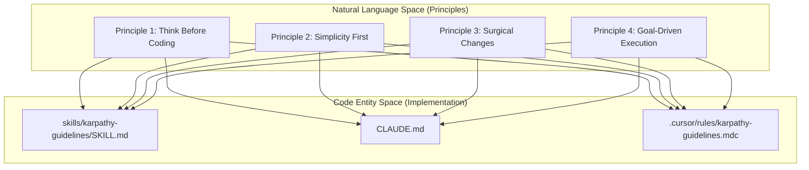
Sources: [skills/karpathy-guidelines/SKILL.md:1-68](), [CLAUDE.md:1-62](), [.cursor/rules/karpathy-guidelines.mdc:1-67]()

---

## Principle 1: Think Before Coding
The first principle focuses on eliminating ambiguity before any code is written. It mandates that the AI agent surfaces assumptions, presents multiple interpretations of a prompt, and pushes back on over-complicated requests. The goal is to ensure that "clarifying questions come before implementation rather than after mistakes" [.cursor/rules/karpathy-guidelines.mdc:70-70]().

For details, see [Principle 1: Think Before Coding](#2.1).

Sources: [skills/karpathy-guidelines/SKILL.md:13-21](), [CLAUDE.md:7-15](), [.cursor/rules/karpathy-guidelines.mdc:12-20]()

## Principle 2: Simplicity First
This principle enforces the "Minimum Viable Code" philosophy. It explicitly forbids speculative features, unnecessary abstractions for single-use code, and unrequested "flexibility" [skills/karpathy-guidelines/SKILL.md:25-30](). It introduces a "senior engineer" heuristic to evaluate if a solution is over-engineered, specifically targeting the reduction of bloated implementations (e.g., rewriting 200 lines into 50) [CLAUDE.md:25-27]().

For details, see [Principle 2: Simplicity First](#2.2).

Sources: [skills/karpathy-guidelines/SKILL.md:23-33](), [CLAUDE.md:17-27](), [.cursor/rules/karpathy-guidelines.mdc:22-32]()

## Principle 3: Surgical Changes
Surgical Changes is a constraint on the scope of edits. It requires that every changed line must trace directly to the user's request [.cursor/rules/karpathy-guidelines.mdc:48-48](). It prevents "drive-by refactoring"—the habit of fixing adjacent code, comments, or formatting that is unrelated to the task at hand [CLAUDE.md:33-35]().

For details, see [Principle 3: Surgical Changes](#2.3).

Sources: [skills/karpathy-guidelines/SKILL.md:35-50](), [CLAUDE.md:29-44](), [.cursor/rules/karpathy-guidelines.mdc:34-49]()

## Principle 4: Goal-Driven Execution
The final principle transforms imperative instructions into declarative, verifiable success criteria. Instead of simply "fixing a bug," the agent is instructed to write a reproduction test first [CLAUDE.md:51-52](). It also mandates a step-by-step verification plan for multi-step tasks using a specific `[Step] → verify: [check]` format [.cursor/rules/karpathy-guidelines.mdc:60-64]().

For details, see [Principle 4: Goal-Driven Execution](#2.4).

Sources: [skills/karpathy-guidelines/SKILL.md:51-67](), [CLAUDE.md:45-61](), [.cursor/rules/karpathy-guidelines.mdc:50-67]()

---

### Workflow Integration Diagram
This diagram shows how these principles interact during a standard development cycle within the `karpathy-guidelines` framework.

**Behavioral Lifecycle**
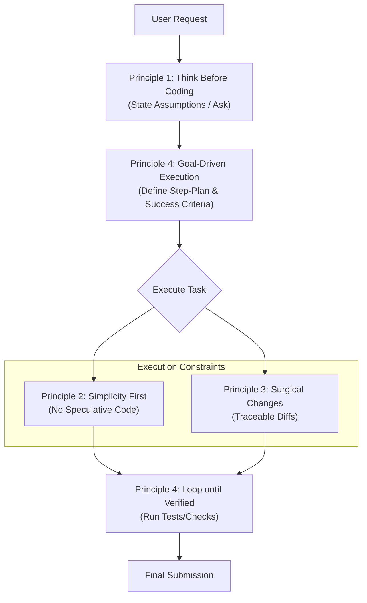
Sources: [skills/karpathy-guidelines/SKILL.md:7-68](), [CLAUDE.md:1-66](), [.cursor/rules/karpathy-guidelines.mdc:6-70]()

---

# Page: Principle 1: Think Before Coding

# Principle 1: Think Before Coding

<details>
<summary>Relevant source files</summary>

The following files were used as context for generating this wiki page:

- [CLAUDE.md](CLAUDE.md)
- [EXAMPLES.md](EXAMPLES.md)
- [skills/karpathy-guidelines/SKILL.md](skills/karpathy-guidelines/SKILL.md)

</details>


This page provides a deep dive into the first principle of the Karpathy Guidelines. The core objective is to shift the AI's behavior from immediate, imperative execution to a deliberative phase where assumptions are surfaced, multiple interpretations are explored, and complexity is challenged before any code is written [skills/karpathy-guidelines/SKILL.md:13-21]().

## Core Objectives

The "Think Before Coding" principle is designed to prevent the common LLM failure mode of "picking silently" [EXAMPLES.md:61-62](). By enforcing a clarification step, the system reduces the likelihood of implementing the wrong solution efficiently.

### 1. Surface Hidden Assumptions
LLMs often make implicit decisions about scope, data privacy, and infrastructure [EXAMPLES.md:32-37](). This principle requires stating these assumptions explicitly.

### 2. Present Multiple Interpretations
Vague requests (e.g., "make it faster") can be solved at different layers: database, network, or UI [EXAMPLES.md:74-90](). The AI must present these options rather than guessing.

### 3. Push Back on Complexity
If a user request leads to an over-engineered solution, the AI is instructed to suggest a simpler alternative [skills/karpathy-guidelines/SKILL.md:20]().

### 4. Stop When Confused
If the request is ambiguous or the codebase state is unclear, the AI must halt and name the specific source of confusion [CLAUDE.md:15]().

Sources: [skills/karpathy-guidelines/SKILL.md:13-21](), [CLAUDE.md:7-15](), [EXAMPLES.md:9-57]()

---

## Implementation Logic

The following diagram illustrates how a user request is processed under Principle 1 before reaching the "Code Entity Space."

### Logic Flow: Natural Language to Deliberation
This diagram shows the decision gates an agent must pass through as defined in the `karpathy-guidelines` skill.

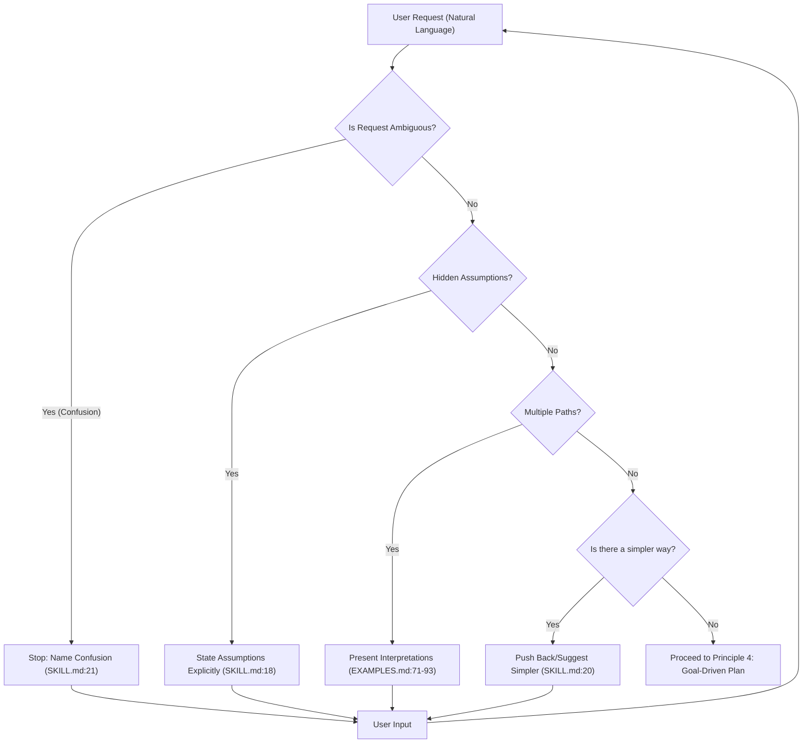
Sources: [skills/karpathy-guidelines/SKILL.md:13-21](), [EXAMPLES.md:71-93]()

---

## Technical Examples & Anti-Patterns

### Example 1: The "Export" Assumption
When asked to "Add a feature to export user data," a standard LLM might immediately write a script to dump the entire database to a local CSV file [EXAMPLES.md:11-30]().

**The Anti-Pattern (Picking Silently):**
- **File Path:** The LLM assumes `users.json` or `users.csv` in the root directory [EXAMPLES.md:21-24]().
- **Scope:** It queries `User.query.all()`, ignoring potential performance or privacy issues with large datasets [EXAMPLES.md:18]().
- **Format:** It assumes hardcoded fieldnames like `['id', 'email', 'name']` without verifying the model schema [EXAMPLES.md:25]().

**The Corrective Action (Surfacing Assumptions):**
The AI must ask about **Scope** (filtered subset?), **Format** (API vs. File?), **Fields** (sensitive data?), and **Volume** (pagination requirements?) [EXAMPLES.md:41-54]().

### Example 2: The "Faster" Interpretation
A request to "Make the search faster" is a high-level goal that maps to multiple technical implementations [EXAMPLES.md:59-60]().

**Interpretations to Present:**
| Interpretation | Technical Implementation | Estimated Effort |
| :--- | :--- | :--- |
| **Response Time** | Database indexes, `@lru_cache` [EXAMPLES.md:66-79]() | ~2 hours |
| **Throughput** | `async/await`, connection pooling [EXAMPLES.md:81-84]() | ~4 hours |
| **Perceived Speed** | Progressive loading, partial results [EXAMPLES.md:86-89]() | ~3 hours |

Sources: [EXAMPLES.md:9-93]()

---

## Data Flow: Clarification to Execution

This diagram bridges the gap between the "Natural Language Space" (Clarification) and the "Code Entity Space" (Implementation) by showing how specific code symbols are protected by the "Think" phase.

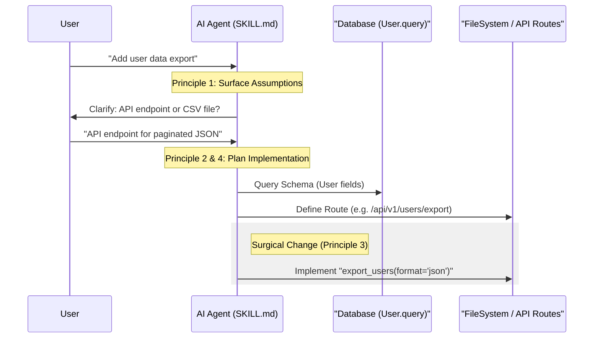
Sources: [EXAMPLES.md:16-51](), [skills/karpathy-guidelines/SKILL.md:13-21](), [CLAUDE.md:39-43]()

## Summary Table: Principle 1 Checklist

| Action | When to use | Source |
| :--- | :--- | :--- |
| **Explicit Assumptions** | Whenever a default choice is made (e.g., file format, library). | [SKILL.md:18]() |
| **Interpretation Menu** | When the goal is qualitative (e.g., "better," "faster," "cleaner"). | [EXAMPLES.md:74]() |
| **Complexity Push-back** | When the requested feature implies heavy abstraction (ABC, Protocols). | [EXAMPLES.md:105-147]() |
| **The "Stop" Command** | When the current codebase state contradicts the user request. | [CLAUDE.md:15]() |

Sources: [skills/karpathy-guidelines/SKILL.md:13-21](), [CLAUDE.md:7-15](), [EXAMPLES.md:1-93]()

---

# Page: Principle 2: Simplicity First

# Principle 2: Simplicity First

<details>
<summary>Relevant source files</summary>

The following files were used as context for generating this wiki page:

- [CLAUDE.md](CLAUDE.md)
- [EXAMPLES.md](EXAMPLES.md)
- [skills/karpathy-guidelines/SKILL.md](skills/karpathy-guidelines/SKILL.md)

</details>


This page provides a technical deep dive into the second core principle of the Karpathy Guidelines: **Simplicity First**. The primary goal is to produce the minimum viable code required to satisfy a request while explicitly rejecting speculative features, over-abstraction, and architectural bloat.

## Core Directives

The principle is defined by a set of constraints designed to prevent the "up-leveling" of simple tasks into complex systems [CLAUDE.md:19-25]().

*   **Minimum Viable Code**: Only implement features explicitly requested by the user [skills/karpathy-guidelines/SKILL.md:27]().
*   **Zero Speculation**: Do not add "flexibility" or "configurability" for future use cases that have not been defined [CLAUDE.md:23]().
*   **Anti-Abstraction**: Avoid creating classes, interfaces, or decorators for code that is currently only used in one place [skills/karpathy-guidelines/SKILL.md:28]().
*   **The 200-to-50 Rule**: If an implementation reaches 200 lines but the logic could be expressed in 50, the agent must rewrite it for conciseness [CLAUDE.md:25]().
*   **The Senior Engineer Heuristic**: Before committing, the agent must evaluate if a senior engineer would view the solution as overcomplicated [skills/karpathy-guidelines/SKILL.md:33]().

### Logic Flow: Simplicity Enforcement

The following diagram illustrates how the "Simplicity First" principle filters a user request into a final code implementation.

**Request Processing Pipeline**
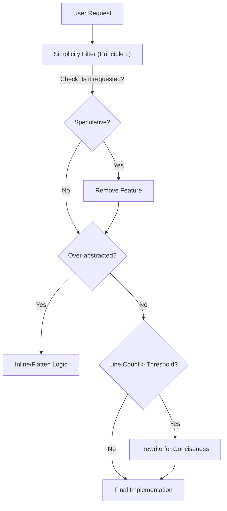
Sources: [CLAUDE.md:19-27](), [skills/karpathy-guidelines/SKILL.md:25-33]()

---

## Anti-Pattern: The DiscountCalculator

A common failure mode in LLM coding is the introduction of "Enterprise Patterns" (Strategy, Factory, Dependency Injection) for trivial logic. 

### Over-Engineered Approach
When asked to "calculate a discount," LLMs often generate a complex hierarchy involving `DiscountStrategy`, `PercentageDiscount`, and `DiscountCalculator` [EXAMPLES.md:105-147](). This results in 30+ lines of setup for a single mathematical operation.

### Simple Approach
The guidelines mandate a direct functional approach until complexity is strictly required.

**Code Entity Mapping: Discount Logic**
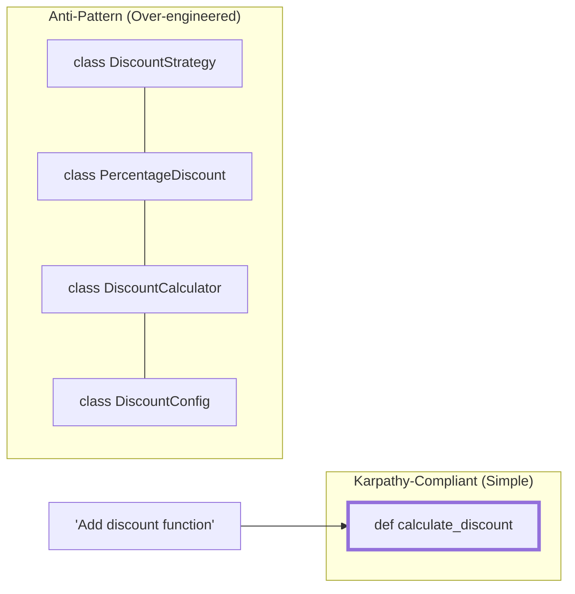
Sources: [EXAMPLES.md:101-160]()

| Feature | `DiscountCalculator` (Wrong) | `calculate_discount` (Right) |
| :--- | :--- | :--- |
| **Lines of Code** | ~40 lines [EXAMPLES.md:105-146]() | 2 lines [EXAMPLES.md:152-154]() |
| **Complexity** | High (ABC, Dataclasses, Enums) | Low (Pure function) |
| **Maintenance** | Requires updating interfaces | Single point of change |

---

## Anti-Pattern: The PreferenceManager

Speculative features—adding code "just in case"—is a primary driver of technical debt. The `PreferenceManager` example demonstrates how LLMs often add validation, caching, and notification systems that were never requested [EXAMPLES.md:169-208]().

### Speculative Bloat Analysis
In the `PreferenceManager.save` method, the following unrequested features are typically injected:
1.  **Validation**: `self.validator.validate(prefs)` [EXAMPLES.md:182-184]()
2.  **Merging Logic**: `existing.update(prefs)` [EXAMPLES.md:188-190]()
3.  **Caching**: `self.cache.set(...)` [EXAMPLES.md:197-198]()
4.  **Notifications**: `self.notify_preference_change(...)` [EXAMPLES.md:200-201]()

### Minimal Implementation
The compliant version performs exactly one task: executing the SQL `UPDATE` statement [EXAMPLES.md:213-219]().

**Entity Interaction: Preference Management**
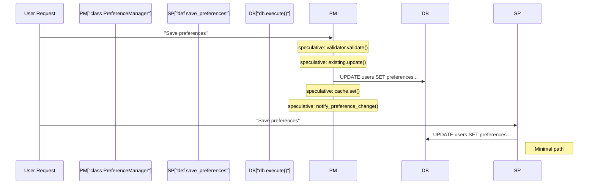
Sources: [EXAMPLES.md:164-221]()

## Summary of Implementation Rules

| Rule | Instruction | Source |
| :--- | :--- | :--- |
| **No Speculation** | Add caching/validation only when bad data or performance issues appear. | [EXAMPLES.md:221-222]() |
| **No Abstraction** | Avoid ABCs/Protocols for single-use logic. | [EXAMPLES.md:160]() |
| **Conciseness** | Prefer 50 lines over 200. | [CLAUDE.md:25]() |
| **Directness** | Every line must trace to a specific user requirement. | [skills/karpathy-guidelines/SKILL.md:49]() |

Sources: [CLAUDE.md:19-27](), [skills/karpathy-guidelines/SKILL.md:25-33](), [EXAMPLES.md:97-224]()

---

# Page: Principle 3: Surgical Changes

# Principle 3: Surgical Changes

<details>
<summary>Relevant source files</summary>

The following files were used as context for generating this wiki page:

- [CLAUDE.md](CLAUDE.md)
- [EXAMPLES.md](EXAMPLES.md)
- [skills/karpathy-guidelines/SKILL.md](skills/karpathy-guidelines/SKILL.md)

</details>


The third principle focuses on minimizing the "blast radius" of code modifications. It mandates that every changed line must trace directly back to the user's specific request, preventing common LLM failure modes like "drive-by refactoring" or stylistic drift that complicates pull reviews and introduces regression risks.

## Core Directives

The principle is built on the philosophy: **"Touch only what you must. Clean up only your own mess."** [skills/karpathy-guidelines/SKILL.md:37-37]().

### Editing Existing Code
When modifying a file, the system follows these constraints:
*   **No Adjacent Improvements:** Do not update comments, formatting, or logic in lines that are not required for the task [skills/karpathy-guidelines/SKILL.md:40-40]().
*   **No Proactive Refactoring:** If a piece of code is not broken and not directly related to the task, it should not be refactored [skills/karpathy-guidelines/SKILL.md:41-41]().
*   **Style Matching:** Match the existing codebase's style, even if you would do it differently [skills/karpathy-guidelines/SKILL.md:42-42]().
*   **Dead Code Reporting:** If unrelated dead code is discovered, mention it to the user rather than deleting it [skills/karpathy-guidelines/SKILL.md:43-43]().

### Managing Orphans
The guidelines distinguish between pre-existing technical debt and debt created by the current change:
*   **Cleanup Own Mess:** If a change makes an import, variable, or function unused, it **must** be removed [skills/karpathy-guidelines/SKILL.md:46-46]().
*   **Ignore Pre-existing Orphans:** Do not remove dead code that was already present before the current session unless explicitly instructed [skills/karpathy-guidelines/SKILL.md:47-47]().

**Sources:** [skills/karpathy-guidelines/SKILL.md:35-49](), [CLAUDE.md:29-43]()

## Data Flow: Surgical Change Validation

The following diagram illustrates the decision logic applied when an LLM prepares a diff to ensure it adheres to Principle 3.

**Surgical Change Decision Logic**
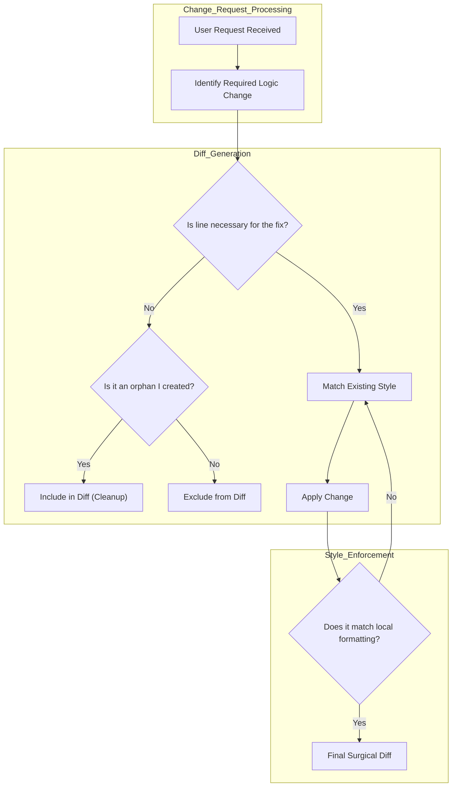
**Sources:** [skills/karpathy-guidelines/SKILL.md:35-49](), [EXAMPLES.md:225-231]()

## Anti-Pattern: Drive-by Refactoring

A common failure mode is "Drive-by Refactoring," where an LLM attempts to "improve" a function while fixing a minor bug. This often involves changing docstrings, variable names, or adding more complex validation logic that wasn't requested.

### Example: `validate_user` Bug Fix
In this scenario, the user asks to fix a crash caused by empty emails [EXAMPLES.md:229-229]().

| Aspect | Incorrect (Non-Surgical) | Correct (Surgical) |
| :--- | :--- | :--- |
| **Logic** | Rewrites validation logic and adds complex splitting [EXAMPLES.md:238-246](). | Only adds the necessary check for the email field [EXAMPLES.md:261-265](). |
| **Formatting** | Changes docstring style and adds whitespace [EXAMPLES.md:237-239](). | Keeps original comments and spacing [EXAMPLES.md:260-261](). |
| **Scope** | Modifies/Adds 10+ lines [EXAMPLES.md:233-252](). | Modifies 2 lines [EXAMPLES.md:258-266](). |

**Code Entity Mapping: `validate_user`**
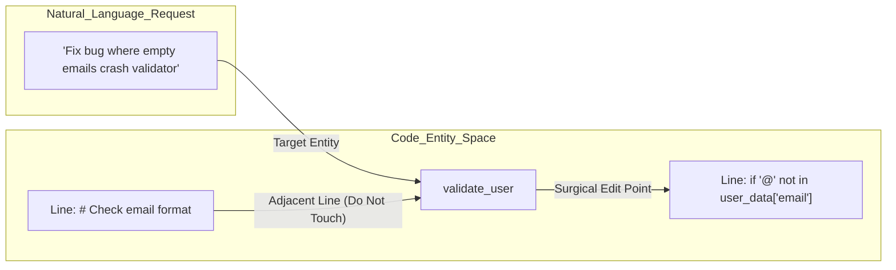
**Sources:** [EXAMPLES.md:229-268]()

## Anti-Pattern: Style Drift

Style drift occurs when the LLM imposes its own preferred library or syntax over the one already established in the file.

### Example: `upload_file` Implementation
If a file uses `os.path` and the user asks to add a path check, a non-surgical change might introduce `pathlib` [EXAMPLES.md:275-285](). While `pathlib` is modern, mixing both in a single file creates inconsistency.

*   **Non-Surgical:** Imports `pathlib` and converts existing `os` calls [EXAMPLES.md:280-285]().
*   **Surgical:** Uses `os.path.exists()` to match the surrounding context [EXAMPLES.md:294-298]().

**Style Matching Logic**
| File Context | Surgical Choice | Non-Surgical Choice |
| :--- | :--- | :--- |
| Uses `os.path` | `os.path.join()` [EXAMPLES.md:295-295]() | `Path() / "..."` [EXAMPLES.md:284-284]() |
| Uses `dict()` | `dict(a=1)` | `{"a": 1}` |
| Uses `var` (JS) | `var x = 1` | `const x = 1` |

**Sources:** [EXAMPLES.md:270-305](), [skills/karpathy-guidelines/SKILL.md:42-42]()

## The "Surgical" Test
To verify if a change is surgical, the developer or the LLM must answer "Yes" to the following:
> **"Does every changed line trace directly to the user's request?"** [skills/karpathy-guidelines/SKILL.md:49-49]()

If a line was changed to "make it cleaner" or "fix a typo in a comment," it fails the test and should be reverted.

**Sources:** [skills/karpathy-guidelines/SKILL.md:49-49](), [CLAUDE.md:43-43]()

---

# Page: Principle 4: Goal-Driven Execution

# Principle 4: Goal-Driven Execution

<details>
<summary>Relevant source files</summary>

The following files were used as context for generating this wiki page:

- [CLAUDE.md](CLAUDE.md)
- [EXAMPLES.md](EXAMPLES.md)
- [skills/karpathy-guidelines/SKILL.md](skills/karpathy-guidelines/SKILL.md)

</details>


This page provides a technical deep dive into the fourth principle of the Karpathy Guidelines: **Goal-Driven Execution**. The core objective of this principle is to shift from executing vague, imperative commands ("fix this") to achieving verifiable, declarative success criteria. By defining what "done" looks like before writing code, the AI agent can operate with higher autonomy and lower error rates.

## Core Mechanics: Verifiable Success Criteria

Goal-Driven Execution requires transforming natural language requests into a series of testable milestones. This prevents "hallucinated progress" where code is written but the underlying problem remains unsolved.

### The Success Criteria Transformation
The guidelines mandate specific transformations for common development tasks:

| Original Task | Goal-Driven Transformation |
| :--- | :--- |
| "Add validation" | "Write tests for invalid inputs, then make them pass" |
| "Fix the bug" | "Write a test that reproduces it, then make it pass" |
| "Refactor X" | "Ensure tests pass before and after the change" |

**Sources:** [CLAUDE.md:49-52](), [skills/karpathy-guidelines/SKILL.md:55-58]()

### Step-Plan Format
For multi-step features, the agent must output a plan using a specific verification syntax before execution:
1. `[Step Description]` → `verify: [Specific Check]`

This format ensures that every incremental change is validated before the next one begins, preventing the accumulation of errors across a large diff.

**Sources:** [CLAUDE.md:54-59](), [skills/karpathy-guidelines/SKILL.md:60-65]()

## Implementation: Natural Language to Verification Loop

The following diagram illustrates how the "Natural Language Space" of a user request is mapped into the "Code Entity Space" through the creation of `tests` and `step-plans`.

### Logic Flow: Task to Verification
The diagram shows how a request like "Add rate limiting" is broken down into specific code entities and verification steps.

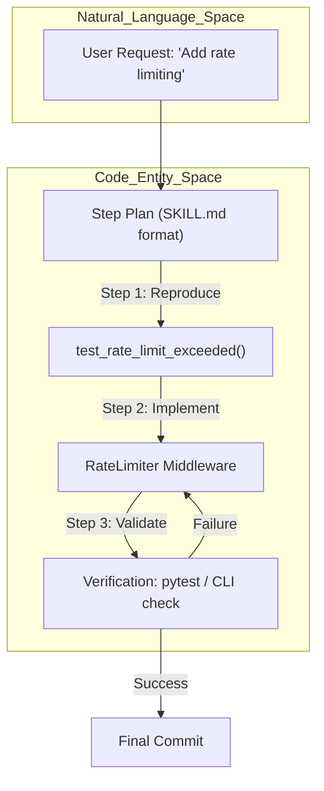
**Sources:** [CLAUDE.md:54-61](), [EXAMPLES.md:321-345]()

## Technical Examples

### 1. The Test-First Loop (Bug Fixing)
When a user reports a bug, such as "Duplicate scores are being saved," the goal-driven approach forbids immediate patching. Instead, it requires a reproduction script first.

**Scenario: Duplicate Scores in Leaderboard**
- **Incorrect Approach:** Manually adding a `unique` check to the database model without a test.
- **Correct Approach:** 
    1. Create a test case that attempts to insert `{'user': 'A', 'score': 100}` twice.
    2. Observe the test failing (confirming the bug).
    3. Implement the fix in the logic.
    4. Run the test to verify it passes.

**Sources:** [EXAMPLES.md:321-345](), [CLAUDE.md:51-51]()

### 2. Incremental Verification (Feature Addition)
For complex features like "Add authentication," the agent must decompose the task into a verifiable sequence.

**Example Plan for Authentication:**
```text
1. Create User model with password_hash -> verify: database migration succeeds
2. Implement login endpoint -> verify: returns 401 for wrong credentials
3. Add JWT generation -> verify: token is returned on successful login
4. Add @login_required decorator -> verify: protected routes return 401 without token
```

**Sources:** [EXAMPLES.md:288-318](), [skills/karpathy-guidelines/SKILL.md:60-65]()

## Data Flow: Goal Enforcement

The following diagram maps the enforcement of Principle 4 within the agent's execution lifecycle, specifically showing how the `SKILL.md` instructions influence the interaction between the `User` and the `Codebase`.

### Execution Lifecycle Diagram

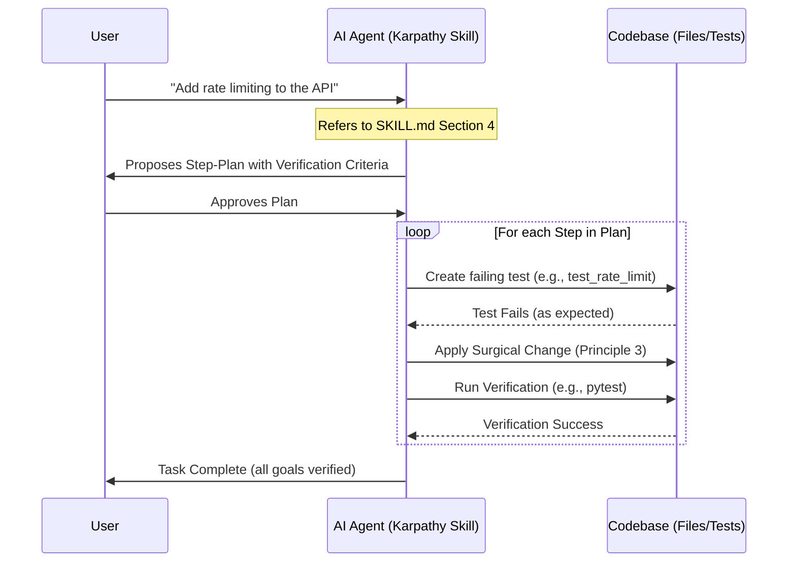
**Sources:** [CLAUDE.md:45-61](), [skills/karpathy-guidelines/SKILL.md:51-68](), [EXAMPLES.md:321-345]()

## Key Indicators of Success
The principle is considered successfully applied when:
- Diffs are accompanied by test results or CLI output demonstrating the change works.
- The agent stops to ask for a reproduction case if a bug is not immediately reproducible.
- Complex tasks are preceded by a numbered list of `[Step] → verify: [Check]`.

**Sources:** [CLAUDE.md:65-66](), [skills/karpathy-guidelines/SKILL.md:67-68]()

---

# Page: Integration & Distribution

# Integration & Distribution

<details>
<summary>Relevant source files</summary>

The following files were used as context for generating this wiki page:

- [.claude-plugin/marketplace.json](.claude-plugin/marketplace.json)
- [.claude-plugin/plugin.json](.claude-plugin/plugin.json)
- [CURSOR.md](CURSOR.md)
- [README.md](README.md)

</details>


This page provides a high-level overview of how the Karpathy-inspired behavioral guidelines are packaged and distributed across different AI-assisted development environments. The project maintains three distinct distribution formats to ensure compatibility with various LLM interfaces, ranging from CLI tools like Claude Code to IDE-integrated agents like Cursor.

### Distribution Ecosystem

The guidelines are distributed through a centralized repository structure that maps natural language principles into environment-specific configuration files. This allows developers to enforce the same "Think Before Coding" and "Simplicity First" behaviors regardless of their choice of AI tool.

#### Technical Mapping: Principles to Integration Targets

The following diagram illustrates how the core guidelines are projected from the conceptual space into specific file entities used by different platforms.

**Guideline Distribution Flow**
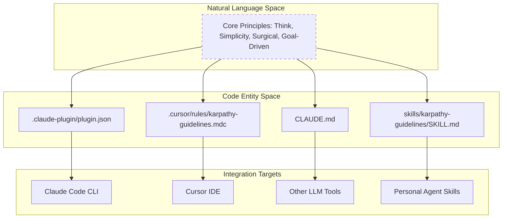
Sources: [.claude-plugin/plugin.json:1-11](), [CURSOR.md:1-29](), [README.md:23-30]()

---

### Claude Code Plugin

The primary distribution method for the Claude Code CLI is via a dedicated plugin architecture. This integration allows the guidelines to be registered as a "skill" that the AI agent can invoke or reference during a session.

*   **Manifest Structure**: The plugin is defined by `plugin.json` which specifies the metadata and the relative path to the skill content in the `skills` array [[.claude-plugin/plugin.json:1-11]()].
*   **Marketplace Registration**: The `marketplace.json` file handles the registration within the Claude Code ecosystem, defining the plugin ID `karpathy-skills` and its source location [[.claude-plugin/marketplace.json:1-29]()].
*   **Skill Injection**: The actual logic is stored in `skills/karpathy-guidelines/`, which is resolved by the CLI during plugin initialization [[.claude-plugin/plugin.json:10-10]()].

For details, see [Claude Code Plugin](#3.1).

Sources: [.claude-plugin/plugin.json:1-11](), [.claude-plugin/marketplace.json:1-29](), [README.md:101-113]()

---

### Cursor Integration

For developers using the Cursor IDE, the guidelines are distributed as a **Cursor Project Rule** (`.mdc` format). This integration is designed for zero-config enforcement within the repository.

*   **Auto-Enforcement**: By using the `alwaysApply: true` flag in the `.mdc` file, the guidelines are automatically injected into the Cursor Agent's context [[CURSOR.md:8-8]()].
*   **Portability**: The rule can be exported to other projects by copying the `.cursor/rules/` directory or by setting up a personal skill under `~/.cursor/skills` [[CURSOR.md:11-20]()].
*   **IDE Visibility**: Users can verify the active status of these guidelines via the **Settings → Rules** UI in Cursor [[CURSOR.md:9-9]()].

For details, see [Cursor Integration](#3.2).

Sources: [CURSOR.md:3-13](), [CURSOR.md:17-20](), [README.md:128-130]()

---

### Portable Plain-Text Formats

The project maintains two "fallback" or portable formats for environments that do not support specialized plugin architectures or `.mdc` rules.

| Format | File Path | Primary Use Case |
| :--- | :--- | :--- |
| **CLAUDE.md** | `CLAUDE.md` | Root-level instructions for generic LLM tools and Claude Code project-specific overrides [[README.md:115-126]()]. |
| **SKILL.md** | `skills/karpathy-guidelines/SKILL.md` | A reusable snippet for personal agent libraries or manual copy-pasting [[CURSOR.md:17-20]()]. |

These files contain the identical core principles found in the more structured formats. A key maintenance requirement for contributors is ensuring that any changes to the behavioral guidelines are synchronized across all three primary file types: `.mdc`, `CLAUDE.md`, and `SKILL.md` [[CURSOR.md:27-29]()].

For details, see [CLAUDE.md & SKILL.md Reference](#3.3).

Sources: [CURSOR.md:15-16](), [CURSOR.md:27-29](), [README.md:115-126]()

---

### Synchronization Lifecycle

Because the guidelines exist in multiple formats, the project follows a strict synchronization pattern to prevent behavioral drift between tools.

**Entity Relationship & Sync Diagram**
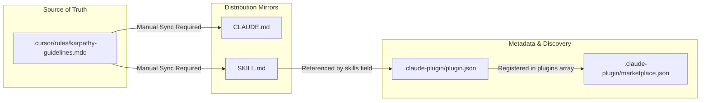
Sources: [CURSOR.md:27-29](), [.claude-plugin/plugin.json:10-10](), [.claude-plugin/marketplace.json:11-28]()

---

# Page: Claude Code Plugin

# Claude Code Plugin

<details>
<summary>Relevant source files</summary>

The following files were used as context for generating this wiki page:

- [.claude-plugin/marketplace.json](.claude-plugin/marketplace.json)
- [.claude-plugin/plugin.json](.claude-plugin/plugin.json)

</details>


The Claude Code plugin integration allows the Andrej Karpathy coding guidelines to be natively injected into the **Claude Code** CLI environment. This integration leverages the `.claude-plugin/` architecture to register behavioral skills that the model must follow during interactive coding sessions.

## Plugin Structure and Manifests

The plugin is defined by a specific directory structure that allows Claude Code to discover, validate, and load the skill definitions.

### The `.claude-plugin/` Directory
The root of the integration resides in the `.claude-plugin/` directory, which contains the metadata necessary for the Claude Code ecosystem to recognize the repository as a valid plugin source [`.claude-plugin/plugin.json`:1-11]().

### Plugin Manifest (`plugin.json`)
The `plugin.json` file serves as the primary configuration for the plugin. It defines the identity of the plugin and, most importantly, the location of the skills to be injected into the agent's context.

| Field | Description | Value |
| :--- | :--- | :--- |
| `name` | Unique identifier for the plugin | `"andrej-karpathy-skills"` |
| `description` | Summary of the plugin's purpose | `"Behavioral guidelines to reduce common LLM coding mistakes..."` |
| `version` | Semantic versioning of the skill set | `"1.0.0"` |
| `skills` | Array of paths to skill directories | `["./skills/karpathy-guidelines"]` |

**Sources:** [`.claude-plugin/plugin.json`:1-11]()

### Marketplace Registration (`marketplace.json`)
To support installation via the plugin marketplace, the `marketplace.json` file provides extended metadata used by the Claude Code registry. This includes categorization and ownership details that facilitate discovery via `claude plugin` commands [`.claude-plugin/marketplace.json`:1-29]().

**Sources:** [`.claude-plugin/marketplace.json`:1-29]()

## Skill Injection Lifecycle

The lifecycle of the plugin involves moving from a static definition on disk to an active behavioral constraint within the Claude Code session.

### Lifecycle Flow: From Manifest to Enforcement

The following diagram illustrates how the Claude Code environment processes the plugin files to activate the Karpathy guidelines.

**Diagram: Plugin Loading and Injection Lifecycle**
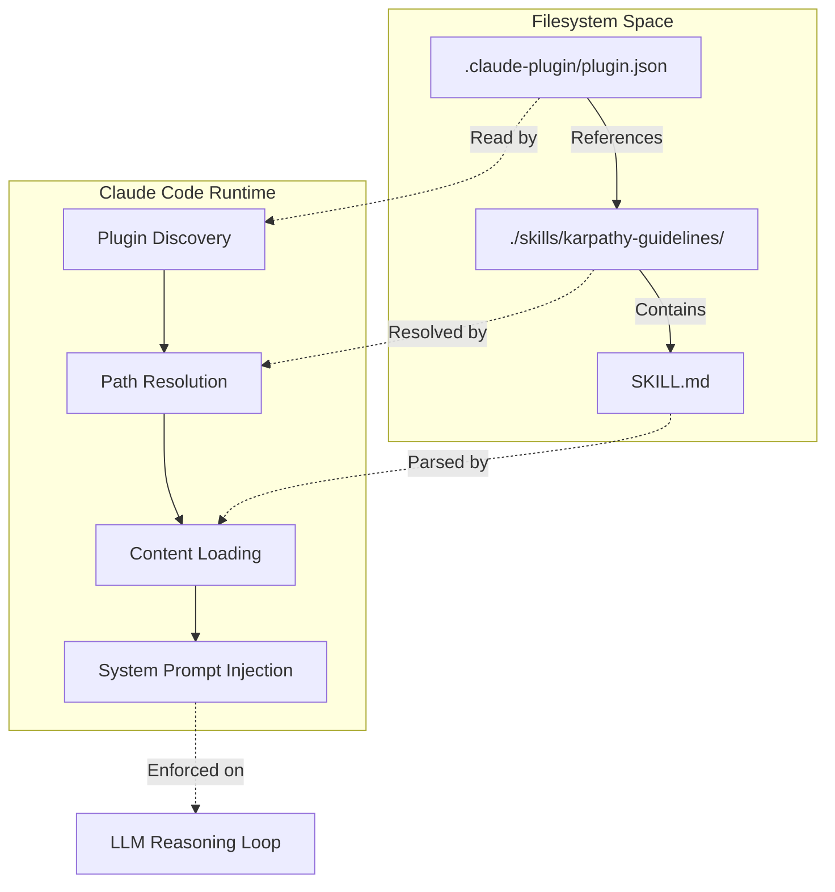
**Sources:** [`.claude-plugin/plugin.json`:1-11](), [`.claude-plugin/marketplace.json`:11-28]()

### Data Flow: Natural Language to Code Entity
This diagram bridges the gap between the high-level plugin metadata and the actual skill content used to govern the AI's coding behavior.

**Diagram: Skill Content Mapping**
```mermaid
graph LR
    subgraph "Natural Language Space"
        Manifest["plugin.json description"]
        Marketplace["marketplace.json metadata"]
    end

    subgraph "Code Entity Space"
        PluginRoot[".claude-plugin/"]
        SkillDir["skills/karpathy-guidelines/"]
        SkillFile["SKILL.md"]
    end

    Manifest -- "Describes" --> PluginRoot
    Marketplace -- "Registers" --> PluginRoot
    PluginRoot -- "skills field points to" --> SkillDir
    SkillDir -- "Source of truth" --> SkillFile
```
**Sources:** [`.claude-plugin/plugin.json`:1-11](), [`.claude-plugin/marketplace.json`:1-29]()

## Marketplace Commands

Users interact with the plugin through the `claude` CLI. The configuration in `.claude-plugin/` enables the following standard operations:

1.  **Discovery**: The `marketplace.json` allows the plugin to appear in searches via the `name` and `keywords` fields [`.claude-plugin/marketplace.json`:2-3, 20-25]().
2.  **Installation**: When a user installs the plugin, the CLI resolves the `source` path (defined as `./` in the marketplace manifest) to locate the `plugin.json` [`.claude-plugin/marketplace.json`:14]().
3.  **Activation**: Claude Code reads the `skills` array in `plugin.json` and loads the markdown content from the specified directory [`.claude-plugin/plugin.json`:10]().

**Sources:** [`.claude-plugin/plugin.json`:1-11](), [`.claude-plugin/marketplace.json`:1-29]()

---

# Page: Cursor Integration

# Cursor Integration

<details>
<summary>Relevant source files</summary>

The following files were used as context for generating this wiki page:

- [.cursor/rules/karpathy-guidelines.mdc](.cursor/rules/karpathy-guidelines.mdc)
- [CURSOR.md](CURSOR.md)

</details>


The Cursor integration provides a native way to enforce the Karpathy behavioral guidelines within the Cursor AI code editor. Unlike other integrations that might rely on root-level markdown files, Cursor uses a specific rule system located in the `.cursor/rules/` directory to provide context-aware instructions to its internal agent.

## The Cursor Project Rule

The primary mechanism for Cursor integration is the `.cursor/rules/karpathy-guidelines.mdc` file. This file uses Cursor's proprietary `.mdc` format, which combines Markdown content with frontmatter metadata to control rule application.

### Implementation Details
The rule is configured with specific frontmatter that ensures the guidelines are active for every interaction within the repository.

| Property | Value | Purpose |
| :--- | :--- | :--- |
| `description` | "Behavioral guidelines to reduce common LLM coding mistakes..." | Helps Cursor's router understand when this rule is relevant. [ .cursor/rules/karpathy-guidelines.mdc:2-2]() |
| `alwaysApply` | `true` | Forces the rule to be included in every prompt sent to the model, regardless of file context. [ .cursor/rules/karpathy-guidelines.mdc:3-3]() |

### Rule Structure
The rule content is structured to address the four core principles directly within the editor's prompt window:
1.  **Think Before Coding**: Mandates explicit assumption stating and pushing back on complexity. [ .cursor/rules/karpathy-guidelines.mdc:12-20]()
2.  **Simplicity First**: Enforces a "senior engineer" heuristic and rejects speculative features. [ .cursor/rules/karpathy-guidelines.mdc:22-32]()
3.  **Surgical Changes**: Restricts edits to the specific lines required by the request. [ .cursor/rules/karpathy-guidelines.mdc:34-48]()
4.  **Goal-Driven Execution**: Requires a step-plan with verifiable success criteria. [ .cursor/rules/karpathy-guidelines.mdc:50-66]()

**Sources:**
- [ .cursor/rules/karpathy-guidelines.mdc:1-71]()
- [ CURSOR.md:3-9]()

## Data Flow: Instruction Injection

The following diagram illustrates how the `.mdc` file is processed by Cursor to influence the AI Agent's behavior during a coding task.

**Cursor Rule Application Flow**
```mermaid
graph TD
    subgraph "Local_Filesystem"
        RULE_FILE[".cursor/rules/karpathy-guidelines.mdc"]
    end

    subgraph "Cursor_Editor_Engine"
        PARSER["Rule_Parser"]
        CONTEXT_GEN["Context_Generator"]
        ROUTER["Prompt_Router"]
    end

    subgraph "AI_Interaction"
        USER_PROMPT["User_Request"]
        FINAL_PROMPT["Augmented_Prompt"]
        LLM["Large_Language_Model"]
    end

    RULE_FILE --> PARSER
    PARSER -- "Extracts_alwaysApply_true" --> ROUTER
    USER_PROMPT --> ROUTER
    ROUTER --> CONTEXT_GEN
    PARSER -- "Injects_Karpathy_Guidelines" --> CONTEXT_GEN
    CONTEXT_GEN --> FINAL_PROMPT
    FINAL_PROMPT --> LLM
```
**Sources:**
- [ .cursor/rules/karpathy-guidelines.mdc:1-4]()
- [ CURSOR.md:8-9]()

## Portability and External Projects

The guidelines are designed to be portable. To use these behaviors in a different Cursor project, the `.mdc` file must be manually copied into the target project's structure.

### Migration Paths
- **Internal to Cursor:** Copy the `.mdc` file to `[new-project]/.cursor/rules/`. [ CURSOR.md:13-13]()
- **Cross-Tool Compatibility:** While Cursor uses `.mdc` files, other tools (like Claude Code) often rely on `CLAUDE.md`. Cursor does not read `CLAUDE.md` by default, necessitating the specific `.cursor/rules/` setup. [ CURSOR.md:23-24]()

### Personal Agent Skills
For users who want these guidelines available globally across all projects without copying files into every repository, Cursor supports personal skills.
- **Location:** `~/.cursor/skills/`
- **Setup:** Users can copy or symlink `skills/karpathy-guidelines/SKILL.md` into their personal skills directory. [ CURSOR.md:17-19]()

**Sources:**
- [ CURSOR.md:11-19]()
- [ CURSOR.md:21-25]()

## Maintenance and Synchronization

Because the project supports multiple integration methods (Claude Code, Cursor, and raw Markdown), contributors must ensure parity across the different file formats when updating the core principles.

**Entity Mapping: Natural Language to Implementation**
```mermaid
graph LR
    subgraph "Natural_Language_Principles"
        P1["1._Think_Before_Coding"]
        P2["2._Simplicity_First"]
        P3["3._Surgical_Changes"]
        P4["4._Goal-Driven_Execution"]
    end

    subgraph "Code_Entity_Space"
        MDC[".cursor/rules/karpathy-guidelines.mdc"]
        CLAUDE["CLAUDE.md"]
        SKILL["skills/karpathy-guidelines/SKILL.md"]
    end

    P1 & P2 & P3 & P4 --> MDC
    P1 & P2 & P3 & P4 --> CLAUDE
    P1 & P2 & P3 & P4 --> SKILL

    MDC -. "Sync_Required" .-> CLAUDE
    CLAUDE -. "Sync_Required" .-> SKILL
```

### Synchronization Requirements
When the behavioral logic is modified, the following files must be updated simultaneously to prevent divergence:
1.  `CLAUDE.md`: The primary reference for Claude Code and generic tools. [ CURSOR.md:28-28]()
2.  `.cursor/rules/karpathy-guidelines.mdc`: The specific implementation for Cursor. [ CURSOR.md:28-28]()
3.  `skills/karpathy-guidelines/SKILL.md`: The format used for personal skills and plugin distribution. [ CURSOR.md:29-29]()

**Sources:**
- [ CURSOR.md:26-30]()
- [ .cursor/rules/karpathy-guidelines.mdc:1-68]()

---

# Page: CLAUDE.md & SKILL.md Reference

# CLAUDE.md & SKILL.md Reference

<details>
<summary>Relevant source files</summary>

The following files were used as context for generating this wiki page:

- [CLAUDE.md](CLAUDE.md)
- [CURSOR.md](CURSOR.md)
- [skills/karpathy-guidelines/SKILL.md](skills/karpathy-guidelines/SKILL.md)

</details>


This page provides a technical reference for the two portable plain-text formats used to distribute the Karpathy Guidelines: `CLAUDE.md` and `SKILL.md`. While the project also supports specialized formats like Cursor rules and Claude Code plugins, these two files serve as the universal foundation for integrating the guidelines into any LLM-assisted development environment.

## Purpose and Relationship

The `CLAUDE.md` and `SKILL.md` files contain identical behavioral logic but serve different deployment patterns. `CLAUDE.md` is designed for per-project enforcement within a specific repository root, while `SKILL.md` is formatted as a reusable "Agent Skill" for personal configuration directories.

### Comparison Table

| Feature | `CLAUDE.md` | `SKILL.md` |
| :--- | :--- | :--- |
| **Primary Target** | Project-specific root directory | Personal `~/.cursor/skills` or agent library |
| **Format** | Standard Markdown | Markdown with YAML Frontmatter |
| **Scope** | Applies to all users of a specific repo | Applies to a specific user across all repos |
| **Tool Support** | Claude Desktop, generic IDE plugins | Cursor Personal Skills, custom agents |
| **File Path** | `[CLAUDE.md]()` | `[skills/karpathy-guidelines/SKILL.md]()` |

**Sources:** `[CLAUDE.md:1-66]()`, `[skills/karpathy-guidelines/SKILL.md:1-68]()`, `[CURSOR.md:15-19]()`

---

## Technical Implementation

### YAML Frontmatter (SKILL.md)
Unlike the standard `CLAUDE.md`, the `SKILL.md` file includes a metadata header (Frontmatter) that allows agentic systems to categorize and load the skill dynamically. This is required for systems that scan directories for reusable capabilities.

```yaml
---
name: karpathy-guidelines
description: Behavioral guidelines to reduce common LLM coding mistakes...
license: MIT
---
```
**Sources:** `[skills/karpathy-guidelines/SKILL.md:1-5]()`

### Data Flow: Content Synchronization
The repository maintains three primary sources of truth for the guidelines. When a contributor modifies a core principle, they must ensure synchronization across the following entities to prevent "behavioral drift" between platforms.

**Guideline Synchronization Architecture**
```mermaid
graph TD
    subgraph "Source_of_Truth"
        CORE["The 4 Principles"]
    end

    subgraph "Distribution_Files"
        CL["CLAUDE.md"]
        SK["SKILL.md"]
        CR[".cursor/rules/karpathy-guidelines.mdc"]
    end

    subgraph "Target_Environments"
        T1["Project Root (Generic Tools)"]
        T2["~/.cursor/skills/ (Personal)"]
        T3["Cursor IDE (Project Rule)"]
    end

    CORE --> CL
    CORE --> SK
    CORE --> CR

    CL -.-> T1
    SK -.-> T2
    CR -.-> T3
```
**Sources:** `[CURSOR.md:26-29]()`, `[CLAUDE.md:1-66]()`, `[skills/karpathy-guidelines/SKILL.md:1-68]()`

---

## Content Structure

Both files implement the four behavioral pillars. The LLM interprets these as system-level constraints that override its default "helpful assistant" persona (which often defaults to over-coding or speculative implementation).

### 1. Think Before Coding
Forces the agent to surface assumptions and stop at ambiguity before any file modifications occur.
*   **Key Logic:** "If something is unclear, stop. Name what's confusing. Ask."
*   **Citations:** `[CLAUDE.md:7-15]()`, `[skills/karpathy-guidelines/SKILL.md:13-21]()`

### 2. Simplicity First
Enforces a "Senior Engineer" heuristic to prevent architectural bloat and speculative features.
*   **Key Logic:** "If you write 200 lines and it could be 50, rewrite it."
*   **Citations:** `[CLAUDE.md:17-27]()`, `[skills/karpathy-guidelines/SKILL.md:23-33]()`

### 3. Surgical Changes
Minimizes the "blast radius" of edits to prevent unrelated regressions or style drift.
*   **Key Logic:** "Every changed line should trace directly to the user's request."
*   **Citations:** `[CLAUDE.md:29-43]()`, `[skills/karpathy-guidelines/SKILL.md:35-49]()`

### 4. Goal-Driven Execution
Transitions the agent from imperative "doing" to declarative "verifying" using a structured planning format.
*   **Key Logic:** Use a step-plan format: `1. [Step] → verify: [check]`.
*   **Citations:** `[CLAUDE.md:45-61]()`, `[skills/karpathy-guidelines/SKILL.md:51-67]()`

---

## Integration Workflows

### Manual Project Integration
For tools that do not support the `.claude-plugin` or `.cursor/rules` formats, the `CLAUDE.md` file is the standard fallback. It is placed in the project root where agents are trained to look for project-specific context.

**Workflow: Bridging Natural Language to Code Context**
```mermaid
graph LR
    UserRequest["'User Request'"] --> LLM["LLM_Agent"]
    
    subgraph "Context_Loading"
        LLM -- "Reads" --> Rules["CLAUDE.md / SKILL.md"]
        LLM -- "Reads" --> Code["Project Source Code"]
    end

    Rules -- "Constrains" --> Plan["Step-Plan (Principle 4)"]
    Plan -- "Generates" --> Diff["Surgical Diff (Principle 3)"]
    
    subgraph "Verification_Loop"
        Diff --> Test["Run Tests / Verify"]
        Test -- "Fail" --> Plan
        Test -- "Pass" --> Done["Task Complete"]
    end
```
**Sources:** `[CLAUDE.md:49-61]()`, `[skills/karpathy-guidelines/SKILL.md:55-67]()`, `[CURSOR.md:15-16]()`

### Contributor Requirements
When updating the principles, developers must manually verify that the logic remains consistent across the flat-file versions. The project does not currently use an automated build script to sync these, making manual verification essential.

1.  **Modify Principle:** Update the text in `[CLAUDE.md]()`.
2.  **Sync Skill:** Copy changes to `[skills/karpathy-guidelines/SKILL.md]()`, preserving the YAML header `[skills/karpathy-guidelines/SKILL.md:1-5]()`.
3.  **Sync Cursor:** Update `[.cursor/rules/karpathy-guidelines.mdc]()`.

**Sources:** `[CURSOR.md:26-29]()`

---

# Page: Glossary

# Glossary

<details>
<summary>Relevant source files</summary>

The following files were used as context for generating this wiki page:

- [.claude-plugin/marketplace.json](.claude-plugin/marketplace.json)
- [.claude-plugin/plugin.json](.claude-plugin/plugin.json)
- [.cursor/rules/karpathy-guidelines.mdc](.cursor/rules/karpathy-guidelines.mdc)
- [CLAUDE.md](CLAUDE.md)
- [EXAMPLES.md](EXAMPLES.md)
- [README.md](README.md)
- [skills/karpathy-guidelines/SKILL.md](skills/karpathy-guidelines/SKILL.md)

</details>


This page provides technical definitions for terms, jargon, and domain concepts specific to the `andrej-karpathy-skills` project. It maps natural language concepts used in the guidelines to their respective implementations in the codebase.

## Core Concepts

### 1. Behavioral Guidelines
The primary logic of the repository, consisting of four principles designed to mitigate common Large Language Model (LLM) coding pitfalls such as over-engineering and "drive-by" refactoring [README.md:21-30](). These are implemented as text-based instructions in multiple formats to ensure compatibility across different AI IDEs [README.md:99-130]().

### 2. Think Before Coding (Principle 1)
A protocol requiring the agent to surface hidden assumptions and present multiple interpretations of a request before writing any code [CLAUDE.md:7-15](). It forces a pause in the execution loop to clarify scope, format, and volume [EXAMPLES.md:38-55]().

### 3. Simplicity First (Principle 2)
An enforcement mechanism against "speculative features" and "over-abstraction" [EXAMPLES.md:97-103](). It includes a "Senior Engineer" heuristic: if a senior developer would find the code overcomplicated, the agent must simplify it [README.md:57-58]().

### 4. Surgical Changes (Principle 3)
A strict constraint on the diffing process where the agent is forbidden from "improving" adjacent code or formatting that is orthogonal to the task [README.md:59-69](). The goal is to produce minimal, clean Pull Requests [README.md:147-147]().

### 5. Goal-Driven Execution (Principle 4)
The transformation of imperative instructions (e.g., "Fix the bug") into declarative, verifiable success criteria (e.g., "Write a test that reproduces the bug, then make it pass") [CLAUDE.md:45-53]().

### 6. Verification Loop
The process where an agent states a multi-step plan with explicit check-steps and iterates until those checks are satisfied [README.md:89-95]().

### 7. Orphan Management
A specific subset of **Surgical Changes** regarding dead code. Agents must remove unused code created by *their* changes but must leave pre-existing dead code untouched unless explicitly asked [CLAUDE.md:39-42]().

---

## Technical Entities & Integration Space

The following diagram bridges the conceptual guidelines to the physical files and integration points within the codebase.

**System Architecture and File Mapping**

```mermaid
graph TD
    subgraph "NaturalLanguageSpace" ["Natural Language Guidelines"]
        P1["Think Before Coding"]
        P2["Simplicity First"]
        P3["Surgical Changes"]
        P4["Goal-Driven Execution"]
    end

    subgraph "CodeEntitySpace" ["Code Entity Space (Core Files)"]
        CLAUDE_MD["CLAUDE.md"]
        SKILL_MD["skills/karpathy-guidelines/SKILL.md"]
        MDC_RULE[".cursor/rules/karpathy-guidelines.mdc"]
    end

    subgraph "IntegrationPlatforms" ["Integration Platforms"]
        CC["Claude Code"]
        CR["Cursor Editor"]
        MC["Multica Platform"]
    end

    P1 & P2 & P3 & P4 --> CLAUDE_MD
    P1 & P2 & P3 & P4 --> SKILL_MD
    P1 & P2 & P3 & P4 --> MDC_RULE

    CLAUDE_MD -- "Per-project instruction" --> CC
    SKILL_MD -- "Reusable Agent Skill" --> MC
    MDC_RULE -- "alwaysApply: true" --> CR
```
Sources: [README.md:99-130](), [.cursor/rules/karpathy-guidelines.mdc:1-4](), [CLAUDE.md:1-63](), [skills/karpathy-guidelines/SKILL.md:1-68]()

---

## Glossary Table

| Term | Definition | Code Pointer |
|:---|:---|:---|
| **AlwaysApply** | A metadata flag in Cursor rules that ensures the guidelines are active for every prompt without manual invocation. | [.cursor/rules/karpathy-guidelines.mdc:3-3]() |
| **Claude Code Plugin** | A packaged version of the guidelines that can be installed via the marketplace command. | [.claude-plugin/plugin.json:1-11]() |
| **Drive-by Refactoring** | The anti-pattern of changing unrelated code while fixing a specific bug. | [EXAMPLES.md:227-232]() |
| **Skill Injection** | The process of loading the guidelines from `SKILL.md` into an agent's context. | [.claude-plugin/plugin.json:10-10]() |
| **Success Criteria** | Verifiable outcomes (usually tests) that allow an LLM to loop independently. | [README.md:97-97]() |
| **Tradeoff Note** | The explicit policy biasing the system toward **caution over speed**. | [README.md:163-167]() |

---

## Data Flow: Plugin Registration

This diagram illustrates how the `andrej-karpathy-skills` are registered and resolved within the Claude Code ecosystem.

**Plugin Lifecycle and Path Resolution**

```mermaid
sequenceDiagram
    participant CLI as "Claude Code CLI"
    participant MK as "marketplace.json"
    participant PJ as "plugin.json"
    participant SK as "SKILL.md"

    CLI->>MK: "/plugin marketplace add"
    Note over MK: ID: "karpathy-skills"
    CLI->>MK: "/plugin install andrej-karpathy-skills"
    MK->>PJ: Resolve "source": "./"
    PJ->>SK: Load "skills": ["./skills/karpathy-guidelines"]
    SK-->>CLI: Inject Behavioral Guidelines into Context
```
Sources: [.claude-plugin/marketplace.json:1-15](), [.claude-plugin/plugin.json:1-10](), [README.md:101-111]()