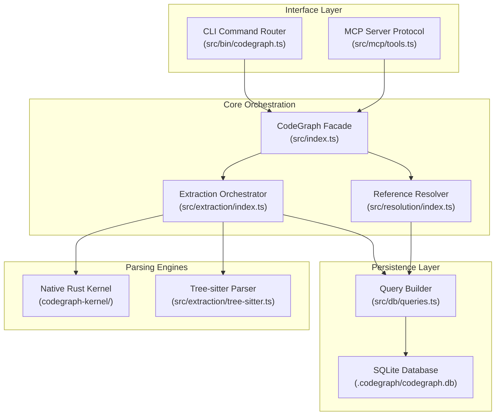
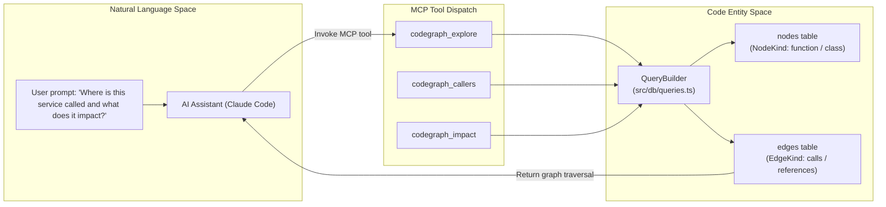
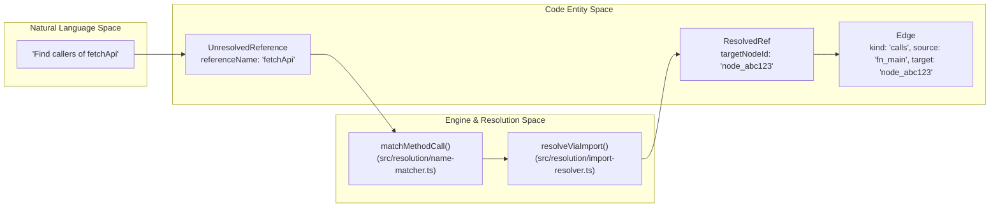

<!-- source: DeepWiki mcp.deepwiki.com · repo colbymchenry/codegraph · page 1 Overview · fetched 2026-10-30 -->

# Overview

Relevant source files

The following files were used as context for generating this wiki page:

- [CHANGELOG.md](CHANGELOG.md)
- [CLAUDE.md](CLAUDE.md)
- [README.md](README.md)
- [__tests__/extraction.test.ts](__tests__/extraction.test.ts)
- [__tests__/installer.test.ts](__tests__/installer.test.ts)
- [__tests__/resolution.test.ts](__tests__/resolution.test.ts)
- [package-lock.json](package-lock.json)
- [package.json](package.json)
- [src/bin/codegraph.ts](src/bin/codegraph.ts)
- [src/db/queries.ts](src/db/queries.ts)
- [src/extraction/index.ts](src/extraction/index.ts)
- [src/extraction/tree-sitter.ts](src/extraction/tree-sitter.ts)
- [src/index.ts](src/index.ts)
- [src/installer/config-writer.ts](src/installer/config-writer.ts)
- [src/installer/index.ts](src/installer/index.ts)
- [src/mcp/tools.ts](src/mcp/tools.ts)
- [src/resolution/import-resolver.ts](src/resolution/import-resolver.ts)
- [src/resolution/index.ts](src/resolution/index.ts)
- [src/resolution/name-matcher.ts](src/resolution/name-matcher.ts)
- [src/resolution/types.ts](src/resolution/types.ts)

CodeGraph is a local-first code intelligence system that builds a semantic knowledge graph from source code to accelerate AI-assisted development [README.md:3-4](). By pre-indexing code structure, relationships, and semantics into a local SQLite database, CodeGraph enables AI coding assistants (such as Claude Code, Cursor, and GitHub Copilot) to query the graph directly instead of repeatedly scanning files with raw `grep` or `glob` tool loops [README.md:9-12]().

---

## Purpose and Key Benefits

When AI agents explore a codebase without structural support, they typically launch iterative file-scanning loops that consume significant context window tokens and require numerous tool invocations. CodeGraph shifts this paradigm by maintaining a persistent, real-time code property graph.

**Key Benefits:**
*   **Token Efficiency:** Achieves **30% fewer tokens** consumed per task by retrieving surgical context (e.g., exact method declarations and call sites) rather than dumping full source files [README.md:11-12]().
*   **Fewer Tool Calls:** Reduces tool invocation overhead by **25%** through single-query graph traversal of callers, callees, and impact paths [README.md:11-12]().
*   **Cross-File Precision:** Resolves complex dependencies—including polymorphic method dispatches, framework-specific routing, and import re-exports—via multi-stage reference resolution [src/extraction/tree-sitter.ts:34-45](), [src/resolution/index.ts:1-50]().
*   **100% Local-First:** Operates entirely offline within the project's `.codegraph/` directory with zero external API calls or data exfiltration [README.md:11-12](), [README.md:116-117]().
*   **Smart Deduping:** The exploration engine (`codegraph_explore`) automatically deduplicates code spans already served earlier in the conversation session [CHANGELOG.md:28-30]().

Sources: [README.md:3-12](), [CHANGELOG.md:28-30](), [src/extraction/tree-sitter.ts:34-45]()

---

## High-Level Repository Map

The CodeGraph repository is structured into distinct modular packages and directories:

| Directory / Subsystem | Description & Key Components |
|-----------------------|------------------------------|
| `src/` | Main TypeScript engine, CLI command router (`src/bin/codegraph.ts`), Model Context Protocol (MCP) server (`src/mcp/`), extraction orchestrator (`src/extraction/`), reference resolution engine (`src/resolution/`), and database query builder (`src/db/queries.ts`) [src/bin/codegraph.ts:1-30](), [src/db/queries.ts:1-25](), [src/extraction/index.ts:1-25](). |
| `codegraph-kernel/` | High-performance native Rust extraction kernel used for fast parsing and AST symbol emission [README.md:14-16](), [package.json:29-29](). |
| `ui/` | Svelte-based frontend application for the local browser graph viewer (`ui/src/`) [package.json:19-20](). |
| `site/` | Astro and Starlight documentation site source files and configuration collections. |
| `src/telemetry/` / `telemetry-*` | First-party opt-out telemetry collector, Cloudflare Worker ingest endpoints, and analytics reporting dashboard [src/telemetry/](). |

Sources: [README.md:14-16](), [package.json:19-41](), [src/bin/codegraph.ts:1-30](), [src/db/queries.ts:1-25]()

---

## System Architecture & Data Flow

CodeGraph executes a deterministic multi-stage processing pipeline that converts raw source files into an interconnected network of `Node` and `Edge` database records [src/types.ts:130-280](). 

### System Component Architecture

Sources: [src/bin/codegraph.ts:1-30](), [src/index.ts:1-105](), [src/extraction/index.ts:1-25](), [src/resolution/index.ts:1-50](), [src/db/queries.ts:1-25]()

### Pipeline Execution Phases

1.  **Scanning & Parsing:** `scanDirectory` in `src/extraction/index.ts` walks the file tree respecting `.gitignore` rules, feeding source buffers into `extractFromSource` using either the native Rust kernel or `web-tree-sitter` Wasm parsers [src/extraction/index.ts:13-25](), [src/extraction/tree-sitter.ts:40-45]().
2.  **Extraction & Storage:** Extracted symbols become `Node` entities (such as classes, functions, variables, and files) connected by `Edge` entities (such as `contains`, `calls`, `extends`) persisted via `StoreWriter` [src/types.ts:130-228](), [src/extraction/store-writer.ts:1-30]().
3.  **Reference Resolution:** `ReferenceResolver` resolves `UnresolvedReference` entries against stored symbol tables using name matchers, import mappings, and framework-specific resolver plugins [src/resolution/index.ts:1-50](), [src/resolution/name-matcher.ts:1-70]().
4.  **Querying & Traversal:** The MCP server or CLI queries SQLite via `QueryBuilder` using full-text search (FTS5) and graph traversal algorithms to provide surgical context to agents [src/db/queries.ts:1-50](), [src/mcp/tools.ts:1-50]().

Sources: [src/extraction/index.ts:1-50](), [src/extraction/store-writer.ts:1-30](), [src/resolution/index.ts:1-50](), [src/db/queries.ts:1-50](), [src/mcp/tools.ts:1-50]()

---

## Bridging Natural Language to Code Entities

The diagrams below demonstrate how natural language queries translate into code entity traversals within CodeGraph's internal architecture.

### Diagram: Semantic Query Translation Flow

Sources: [src/mcp/tools.ts:1-100](), [src/db/queries.ts:1-100]()

### Diagram: Concrete Symbol Resolution and Traversal

Sources: [src/resolution/name-matcher.ts:60-123](), [src/resolution/import-resolver.ts:1-45](), [src/resolution/index.ts:24-50]()

---

