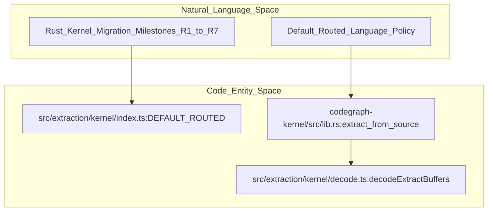
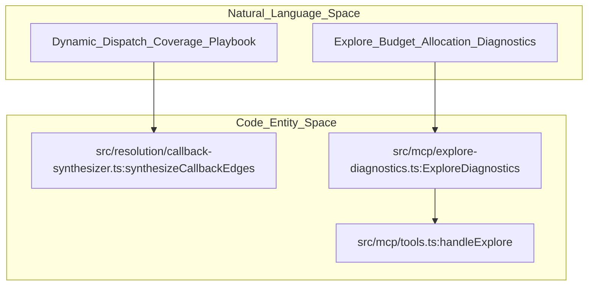

<!-- source: DeepWiki mcp.deepwiki.com · repo colbymchenry/codegraph · page 10.2 In-Repo Design Notes and Plans · fetched 2026-10-30 -->

# In-Repo Design Notes and Plans

Relevant source files

The following files were used as context for generating this wiki page:

- [.claude/skills/agent-eval/SKILL.md](.claude/skills/agent-eval/SKILL.md)
- [__tests__/explore-allocation-1500.test.ts](__tests__/explore-allocation-1500.test.ts)
- [__tests__/explore-allocation-e2e.test.ts](__tests__/explore-allocation-e2e.test.ts)
- [__tests__/explore-diagnostics.test.ts](__tests__/explore-diagnostics.test.ts)
- [__tests__/explore-isolated-named-cluster.test.ts](__tests__/explore-isolated-named-cluster.test.ts)
- [__tests__/explore-merged-spine-cluster.test.ts](__tests__/explore-merged-spine-cluster.test.ts)
- [__tests__/explore-named-file-valve.test.ts](__tests__/explore-named-file-valve.test.ts)
- [__tests__/explore-proportional-allocation.test.ts](__tests__/explore-proportional-allocation.test.ts)
- [__tests__/explore-relevance-scoring.test.ts](__tests__/explore-relevance-scoring.test.ts)
- [__tests__/explore-reservation-invariant.test.ts](__tests__/explore-reservation-invariant.test.ts)
- [__tests__/kernel-grammar-parity.test.ts](__tests__/kernel-grammar-parity.test.ts)
- [__tests__/kernel-scaffold.test.ts](__tests__/kernel-scaffold.test.ts)
- [__tests__/mcp-tool-annotations.test.ts](__tests__/mcp-tool-annotations.test.ts)
- [codegraph-kernel/Cargo.lock](codegraph-kernel/Cargo.lock)
- [codegraph-kernel/Cargo.toml](codegraph-kernel/Cargo.toml)
- [codegraph-kernel/src/langs.rs](codegraph-kernel/src/langs.rs)
- [codegraph-kernel/src/lib.rs](codegraph-kernel/src/lib.rs)
- [docs/benchmarks/agent-eval-feedback-metrics.md](docs/benchmarks/agent-eval-feedback-metrics.md)
- [docs/benchmarks/answer-directly-vs-explore-agent.md](docs/benchmarks/answer-directly-vs-explore-agent.md)
- [docs/benchmarks/call-sequence-analysis.md](docs/benchmarks/call-sequence-analysis.md)
- [docs/benchmarks/explore-allocation-ab-1500.md](docs/benchmarks/explore-allocation-ab-1500.md)
- [docs/benchmarks/explore-allocation-efficiency.md](docs/benchmarks/explore-allocation-efficiency.md)
- [docs/benchmarks/explore-sufficiency.md](docs/benchmarks/explore-sufficiency.md)
- [docs/benchmarks/residual-context-occupancy.md](docs/benchmarks/residual-context-occupancy.md)
- [docs/design/dynamic-dispatch-coverage-playbook.md](docs/design/dynamic-dispatch-coverage-playbook.md)
- [docs/design/explore-budget-allocation.md](docs/design/explore-budget-allocation.md)
- [docs/design/rust-kernel-migration-plan.md](docs/design/rust-kernel-migration-plan.md)
- [scripts/agent-eval/allocation-fixtures.json](scripts/agent-eval/allocation-fixtures.json)
- [scripts/agent-eval/probe-allocation.mjs](scripts/agent-eval/probe-allocation.mjs)
- [scripts/agent-eval/probe-suite-envelope.mjs](scripts/agent-eval/probe-suite-envelope.mjs)
- [scripts/kernel-parity.mjs](scripts/kernel-parity.mjs)
- [src/extraction/kernel/index.ts](src/extraction/kernel/index.ts)
- [src/mcp/explore-diagnostics.ts](src/mcp/explore-diagnostics.ts)

## Purpose and Scope
This document serves as a technical guide to the in-repo documentation system housed under `docs/design`, `docs/plans`, `docs/grammars`, and `docs/benchmarks`. These directories contain the authoritative architectural plans, feature coverage playbooks, grammar vendor notes, and agent evaluation reports that drive CodeGraph's development lifecycle. Developers and automated agents use these documents to track port migrations (such as the native Rust extraction kernel), enforce grammar parity between WebAssembly and native runtimes, systematically close static analysis coverage gaps, and evaluate retrieval performance.

Sources:
- `docs/design/rust-kernel-migration-plan.md:1-12` 
- `docs/design/dynamic-dispatch-coverage-playbook.md:1-14` 

---

## Design Port Checklists and Migration Plans
The `docs/design/` directory contains migration roadmaps and architectural specs for major subsystems. A prominent example is the Rust extraction kernel migration plan (`docs/design/rust-kernel-migration-plan.md`), which outlines milestones R1 through R6 (and follow-on R7a/R7b ports) for transitioning CPU-intensive tree-sitter extraction paths from WebAssembly to a native `napi-rs` extension (`codegraph-kernel`) [docs/design/rust-kernel-migration-plan.md:1-38]().

Routing policy is managed TypeScript-side in `src/extraction/kernel/index.ts`, which defines `DEFAULT_ROUTED` languages and implements per-file safety valves (such as falling back to WASM if parse trees contain syntax errors) [src/extraction/kernel/index.ts:1-51](). The native kernel interface is exposed via `codegraph-kernel/src/lib.rs`, exporting flat-buffer extraction contracts and batched helpers like `cfnptr_scan_files` [codegraph-kernel/src/lib.rs:1-183]().

### Diagram: Kernel Routing and Extraction Natural Language to Code Entity Mapping

*Figure 1: Mapping natural language migration plans to concrete kernel routing and buffer decoding code entities.*

Sources:
- `docs/design/rust-kernel-migration-plan.md:1-38` 
- `src/extraction/kernel/index.ts:1-51` 
- `codegraph-kernel/src/lib.rs:1-183` 

---

## Coverage Playbooks and Feature Synthesis
The repository utilizes coverage playbooks to systematically eliminate static extraction gaps. The Dynamic-Dispatch Coverage Playbook (`docs/design/dynamic-dispatch-coverage-playbook.md`) targets indirect calls, attribute-based descriptors, string-keyed event emitters, and closure-collection dispatches across languages [docs/design/dynamic-dispatch-coverage-playbook.md:1-63](). It defines two primary mitigation mechanisms:
1. **Framework Resolvers**: Resolve named references (`claimsReference` on `FrameworkResolver`) [docs/design/dynamic-dispatch-coverage-playbook.md:53-77]().
2. **Callback Synthesizers**: Whole-graph passes (`src/resolution/callback-synthesizer.ts`) that correlate registrar and dispatcher channels to synthesize execution edges [docs/design/dynamic-dispatch-coverage-playbook.md:54-91]().

Complementing coverage playbooks, telemetry and diagnostic plans like `docs/design/explore-budget-allocation.md` document how tool output budgets are enforced. The allocation diagnostic instrument (`src/mcp/explore-diagnostics.ts`) measures per-file relevance scores, graph mass, and byte quotas when `CODEGRAPH_EXPLORE_DEBUG` is active, ensuring zero production overhead when disabled [src/mcp/explore-diagnostics.ts:1-35]().

### Diagram: Dynamic Dispatch and Explore Diagnostics Natural Language to Code Entity Mapping

*Figure 2: Associating feature playbooks and budget allocation concepts with their respective callback synthesizers and diagnostic telemetry modules.*

Sources:
- `docs/design/dynamic-dispatch-coverage-playbook.md:1-92` 
- `docs/design/explore-budget-allocation.md:1-35` 
- `src/mcp/explore-diagnostics.ts:1-35` 

---

## Grammar Systems and Parity Validation Harnesses
Because CodeGraph supports dual extraction paths (native Rust kernel versus WebAssembly fallbacks), maintaining grammar revision parity is critical. The grammar registry in `codegraph-kernel/src/langs.rs` maps string identifiers to native tree-sitter grammars (leveraging vendored C sources or crates.io dependencies) [codegraph-kernel/src/langs.rs:1-107](). 

Parity is enforced automatically by test harnesses and validation scripts:
- **Grammar-Source Parity Test**: `__tests__/kernel-grammar-parity.test.ts` loads both the WebAssembly parser and the native kernel `grammarInfo()`, asserting identical ABI versions, node-kind counts, and field ID mappings [__tests__/kernel-grammar-parity.test.ts:1-70]().
- **Extraction Parity Harness**: `scripts/kernel-parity.mjs` runs both extraction paths over test files, canonicalizing nodes, edges, and references to catch behavioral gaps before merging native ports [scripts/kernel-parity.mjs:1-154]().

Sources:
- `codegraph-kernel/src/langs.rs:1-107` 
- `__tests__/kernel-grammar-parity.test.ts:1-70` 
- `scripts/kernel-parity.mjs:1-24` 

---

## Benchmark Reports and Agent Evaluation Infrastructure
The `docs/benchmarks/` directory houses empirical reports assessing retrieval quality, excalidraw/gin corpus runs, and feedback metrics [docs/benchmarks/residual-context-occupancy.md:1-37](). A key performance indicator documented in `docs/benchmarks/residual-context-occupancy.md` is **residual context occupancy**, which measures how many tokens of an agent's context window tool responses consume over multi-turn sessions after answering a question [docs/benchmarks/residual-context-occupancy.md:1-21]().

The evaluation harness measures token delta calculations directly from assistant request payloads (`usage.input_tokens + cache_read_input_tokens + cache_creation_input_tokens`), distinguishing tool result density (such as line-numbered source code averaging ~2.2–2.3 chars/token) from generic conversation prose [docs/benchmarks/residual-context-occupancy.md:73-95]().

Sources:
- `docs/benchmarks/residual-context-occupancy.md:1-98` 

---

