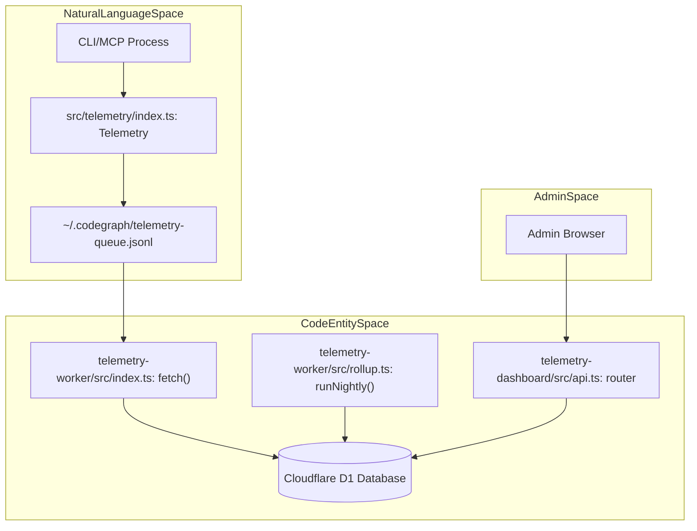
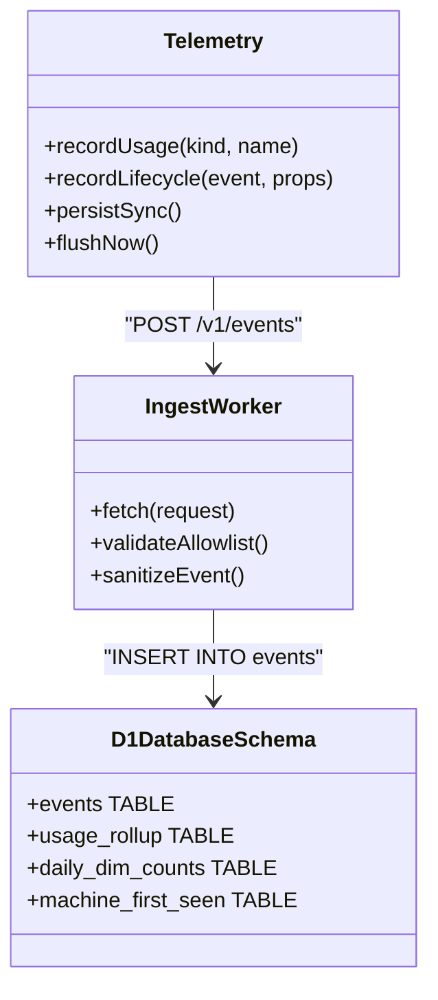

<!-- source: DeepWiki mcp.deepwiki.com · repo colbymchenry/codegraph · page 11 Telemetry Infrastructure · fetched 2026-10-30 -->

# Telemetry Infrastructure

Relevant source files

The following files were used as context for generating this wiki page:

- [TELEMETRY.md](TELEMETRY.md)
- [__tests__/telemetry-optout.test.ts](__tests__/telemetry-optout.test.ts)
- [__tests__/telemetry.test.ts](__tests__/telemetry.test.ts)
- [docs/design/telemetry.md](docs/design/telemetry.md)
- [src/telemetry/index.ts](src/telemetry/index.ts)

## Purpose and Scope

CodeGraph is a local-first code intelligence system designed with the core principle that user source code never leaves the local machine. The telemetry infrastructure provides aggregate, anonymous usage statistics to guide feature prioritization (such as language extractors and agent integrations) while strictly preserving user privacy. 

This page provides a high-level overview of the telemetry system, encompassing the client-side collector, ingest worker, and analytics dashboard. For detailed implementation mechanics, refer to the respective child pages:
- [Telemetry Ingest Worker](#11.1)
- [Telemetry Dashboard](#11.2)
- [Client Telemetry Collector](#11.3)

Sources: [docs/design/telemetry.md:7-13](), [TELEMETRY.md:3-9]()

## Privacy and Guarantees

The telemetry system operates under a strict auditable contract defined in [docs/design/telemetry.md:9-13]() and summarized in [TELEMETRY.md:43-98](). Key guarantees include:
- **No Source Code:** File paths, repository names, symbol names, search queries, or content-derived strings are never collected [TELEMETRY.md:87-92]().
- **No IP Addresses:** Client IP addresses are never read or stored at the edge or downstream [docs/design/telemetry.md:28-31]().
- **First-Party Storage:** Events are written exclusively to a private Cloudflare D1 database. The ingest worker makes no outbound network requests to third-party analytics vendors [docs/design/telemetry.md:32-33]().
- **Local Aggregation:** Usage events are aggregated locally into daily rollups before transmission [src/telemetry/index.ts:21-23]().

Telemetry opt-out follows a strict precedence order evaluated in `src/telemetry/index.ts`:
1. `DO_NOT_TRACK=1` environment variable [TELEMETRY.md:20]()
2. `CODEGRAPH_TELEMETRY=0|1` environment variable [TELEMETRY.md:19]()
3. Global configuration file at `~/.codegraph/telemetry.json` [TELEMETRY.md:23]()
4. Default: **On** (gated by an initial stderr notice) [TELEMETRY.md:24-26]()

Sources: [docs/design/telemetry.md:26-38](), [TELEMETRY.md:10-42](), [src/telemetry/index.ts:21-23]()

## System Architecture

The following diagram illustrates the flow of anonymous telemetry from local processes through the network edge to storage and analytics, bridging natural language concepts to concrete code entities.

### Telemetry Data Flow Architecture

Sources: [src/telemetry/index.ts:30-41](), [docs/design/telemetry.md:4-6]()

## Component Overview

### Telemetry Ingest Worker
The Cloudflare Worker hosted at `telemetry.getcodegraph.com` validates incoming JSON batches against a strict allowlist (`install`, `index`, `usage_rollup`, `uninstall`), strips unknown properties, and batches writes to Cloudflare D1 [docs/design/telemetry.md:41-43](). 

For details, see [Telemetry Ingest Worker](#11.1).
Sources: [docs/design/telemetry.md:41-43](), [TELEMETRY.md:101-108]()

### Telemetry Dashboard
The private analytics dashboard hosted at `stats.getcodegraph.com` reads from pre-computed daily rollup tables in D1 to render administrative chart panels and metrics without scanning raw event logs [docs/design/telemetry.md:5]().

For details, see [Telemetry Dashboard](#11.2).
Sources: [docs/design/telemetry.md:5]()

### Client Telemetry Collector
The client package (`src/telemetry/`) manages local usage aggregation, consent resolution, fallback queueing in `telemetry-queue.jsonl`, and opportunistic fire-and-forget transmissions [src/telemetry/index.ts:1-23]().

For details, see [Client Telemetry Collector](#11.3).
Sources: [src/telemetry/index.ts:1-23](), [docs/design/telemetry.md:3-6]()

## Data Lifecycle and Storage

Telemetry data transitions through local buffering, ingest sanitization, nightly rollups, and retention pruning.

| Phase | Description | Code Entity / Mechanism |
| :--- | :--- | :--- |
| **Buffering** | Offline or pending events accumulate locally in JSONL format. | `telemetry-queue.jsonl` [__tests__/telemetry-optout.test.ts:15]() |
| **Ingestion** | Incoming payloads undergo allowlist validation and sanitization. | `sanitizeEvent` [docs/design/telemetry.md:41-43]() |
| **Rollup** | A nightly cron job aggregates raw events into daily statistics. | `runNightly` [docs/design/telemetry.md:4-5]() |
| **Retention** | Raw individual events are purged after a 90-day window. | `retentionDays` [docs/design/telemetry.md:102-106]() |

Sources: [docs/design/telemetry.md:100-106](), [__tests__/telemetry-optout.test.ts:15]()

### Event to Storage Mapping

Sources: [src/telemetry/index.ts:105-122](), [docs/design/telemetry.md:41-43](), [docs/design/telemetry.md:98-101]()

## Related Pages
* [Telemetry Ingest Worker](#11.1) — Detailed event schema, allowlist validation, and D1 storage mechanics.
* [Telemetry Dashboard](#11.2) — API endpoints, authentication, and chart visualizations.
* [Client Telemetry Collector](#11.3) — Emitted events, opt-out flags, and privacy-by-default behavior.

---

