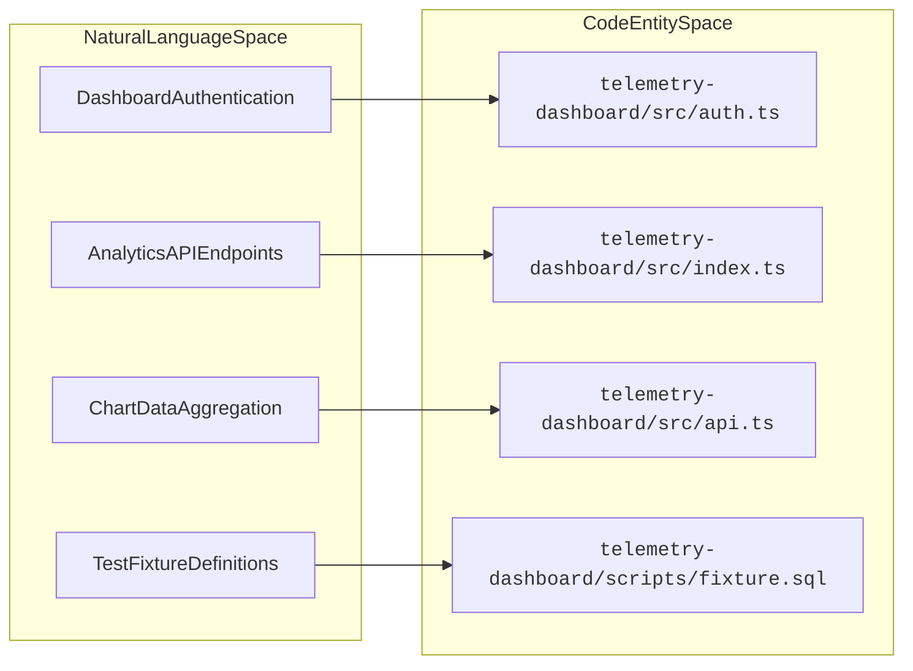
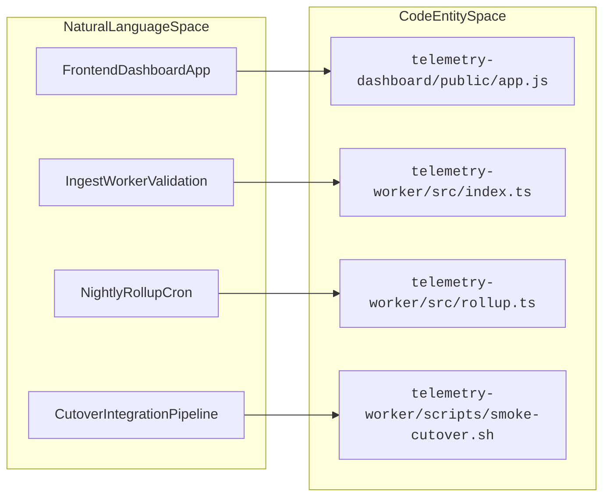

<!-- source: DeepWiki mcp.deepwiki.com · repo colbymchenry/codegraph · page 11.2 Telemetry Dashboard · fetched 2026-10-30 -->

# Telemetry Dashboard

<details>
<summary>Relevant source files</summary>

The following files were used as context for generating this wiki page:

- [TELEMETRY.md](TELEMETRY.md)
- [__tests__/telemetry-optout.test.ts](__tests__/telemetry-optout.test.ts)
- [__tests__/telemetry.test.ts](__tests__/telemetry.test.ts)
- [docs/design/telemetry.md](docs/design/telemetry.md)
- [src/telemetry/index.ts](src/telemetry/index.ts)

</details>


The Telemetry Dashboard (`stats.getcodegraph.com`) is a private, first-party administrative analytics interface built to consume aggregate usage metrics without compromising CodeGraph's local-first privacy guarantees [docs/design/telemetry.md:9-13](), [telemetry-dashboard/README.md:3-8]().

## Overview and Architecture

The dashboard serves as the visualization layer for telemetry data stored in Cloudflare D1 via the ingest worker [`telemetry-worker/src/index.ts`](). It queries rollups (`daily_*`, `machine_days`, `machine_first_seen`) directly rather than raw event streams to maintain high performance and isolate resource contention [telemetry-dashboard/src/api.ts:5-10]().

```mermaid
graph TD
    subgraph "IngestPipeline"
        Client["CLI/MCPClient"] -->|"POST /v1/events"| Worker["telemetry-worker/src/index.ts"]
        Worker -->|"d1.batch()"| DB[(("Cloudflare D1"))]
        Cron["rollup.ts runNightly()"] -->|"Aggregates"| DB
    end
    subgraph "DashboardServer"
        Browser["DashboardUI app.js"] -->|"GET /api/*"| IndexTS["telemetry-dashboard/src/index.ts"]
        IndexTS -->|"Auth Check"| AuthTS["telemetry-dashboard/src/auth.ts"]
        AuthTS -->|"Forward Valid"| ApiTS["telemetry-dashboard/src/api.ts"]
        ApiTS -->|"SQL Select"| DB
    end

    classDef code font-family:monospace;
    class Worker,IndexTS,AuthTS,ApiTS code;
```
**Sources:** [docs/design/telemetry.md:1-6](), [telemetry-worker/src/index.ts:1-18](), [telemetry-dashboard/src/api.ts:5-14]()

## Authentication Mechanism

Administrative access is protected by a lightweight shared-password session mechanism implemented directly in the Cloudflare Worker [telemetry-dashboard/README.md:3-8](). 

### Key Security Properties
- **Constant-Time Comparison**: Passwords are verified using SHA-256 digests and timing-safe equal checks to prevent side-channel timing leaks [telemetry-dashboard/README.md:84-85]().
- **HMAC-Signed Cookies**: Sessions are stored in `cg_admin_session` cookies containing a signed assertion (`base64url(payload).base64url(HMAC-SHA256)`). There is no server-side session store [telemetry-dashboard/README.md:86-87]().
- **Revocation**: The session payload embeds a password fingerprint; rotating `ADMIN_PASSWORD` instantly invalidates all issued cookies [telemetry-dashboard/README.md:90-91]().
- **Rate Limiting**: Login endpoints cap attempts per IP address using transient memory limits [telemetry-dashboard/README.md:92-94]().

**Sources:** [telemetry-dashboard/README.md:82-94]()

## API Endpoints

The dashboard backend exposes a read-only JSON API under `/api/*`, all governed by the date range parameters `?from=YYYY-MM-DD&to=YYYY-MM-DD` [telemetry-dashboard/README.md:34-39]().

| Endpoint | Description | Cache Policy |
| :--- | :--- | :--- |
| `/api/meta` | Data freshness, latest rollup day, and stall indicators. | Private, max-age=60 |
| `/api/summary` | Aggregate metrics (production users, active/new machines, tool calls). | Private, max-age=300 [telemetry-dashboard/src/api.ts:48]() |
| `/api/timeseries` | Dense daily points for metric series (installs, tool calls, duration buckets). | Private, max-age=300 [telemetry-dashboard/src/api.ts:48]() |
| `/api/breakdown` | Dimension slices (`os`, `arch`, `version`, `language`, `target`, `name`, etc.). | Private, max-age=300 [telemetry-dashboard/src/api.ts:48]() |
| `/api/activation` | Funnel metrics mapping install events to first-index activation windows. | Private, max-age=300 [telemetry-dashboard/src/api.ts:48]() |
| `/api/retention` | Day 0–14 cohort retention curves. | Private, max-age=300 [telemetry-dashboard/src/api.ts:48]() |
| `/api/health` | Liveness check and latest event/rollup markers. | `no-store` [telemetry-dashboard/scripts/smoke-api.sh:91-92]() |

**Sources:** [telemetry-dashboard/README.md:41-49](), [telemetry-dashboard/src/api.ts:48-55]()

## Chart Panels and Fixtures

The dashboard frontend [`telemetry-dashboard/public/app.js`]() coordinates a grid of chart panels that fetch data independently [telemetry-dashboard/public/app.js:1-19](). To facilitate local validation, a comprehensive fixture defines deterministic test datasets representing 12 machines across 10 days [telemetry-dashboard/scripts/fixture.sql:1-32]().

```mermaid
graph TD
    subgraph "FrontendUI"
        AppJS["telemetry-dashboard/public/app.js"] -->|"fetch()"| ApiTS["telemetry-dashboard/src/api.ts"]
        ApiTS -->|"Query daily_*"| Database[(("D1 Database"))]
    end
    subgraph "FixtureValidation"
        SeedSQL["telemetry-dashboard/scripts/fixture.sql"] -->|"Seed Local DB"| Database
        SmokeScript["telemetry-dashboard/scripts/smoke-api.sh"] -->|"Assert Expected vs Actual"| AppJS
    end

    classDef code font-family:monospace;
    class AppJS,ApiTS,SeedSQL,SmokeScript code;
```
**Sources:** [telemetry-dashboard/public/app.js:1-22](), [telemetry-dashboard/scripts/fixture.sql:1-12](), [telemetry-dashboard/scripts/smoke-api.sh:1-10]()

## Local Development Workflow and Smoke Testing

Developers run the dashboard locally using Wrangler with isolated D1 database bindings [telemetry-dashboard/README.md:95-109](). Automated test suites verify both API invariants and end-to-end integration:
- `npm run seed`: Applies `telemetry-dashboard/scripts/fixture.sql` to the local wrangler state [telemetry-dashboard/scripts/fixture.sql:5-11]().
- `./scripts/smoke-api.sh`: Starts a local wrangler instance, authenticates against the fixture, and asserts expected metric totals against [`telemetry-dashboard/scripts/smoke-api.sh`]().
- `./scripts/smoke-cutover.sh`: Validates the complete pipeline from ingest worker through nightly rollups to dashboard API endpoints [telemetry-worker/scripts/smoke-cutover.sh:1-14]().

**Sources:** [telemetry-dashboard/README.md:95-110](), [telemetry-dashboard/scripts/smoke-api.sh:1-15](), [telemetry-worker/scripts/smoke-cutover.sh:1-18]()

## System-to-Code Mappings


**Sources:** [telemetry-dashboard/src/auth.ts:1-20](), [telemetry-dashboard/src/api.ts:1-30](), [telemetry-dashboard/scripts/fixture.sql:1-15]()


**Sources:** [telemetry-dashboard/public/app.js:1-25](), [telemetry-worker/src/index.ts:1-20](), [telemetry-worker/scripts/smoke-cutover.sh:1-20]()

---

