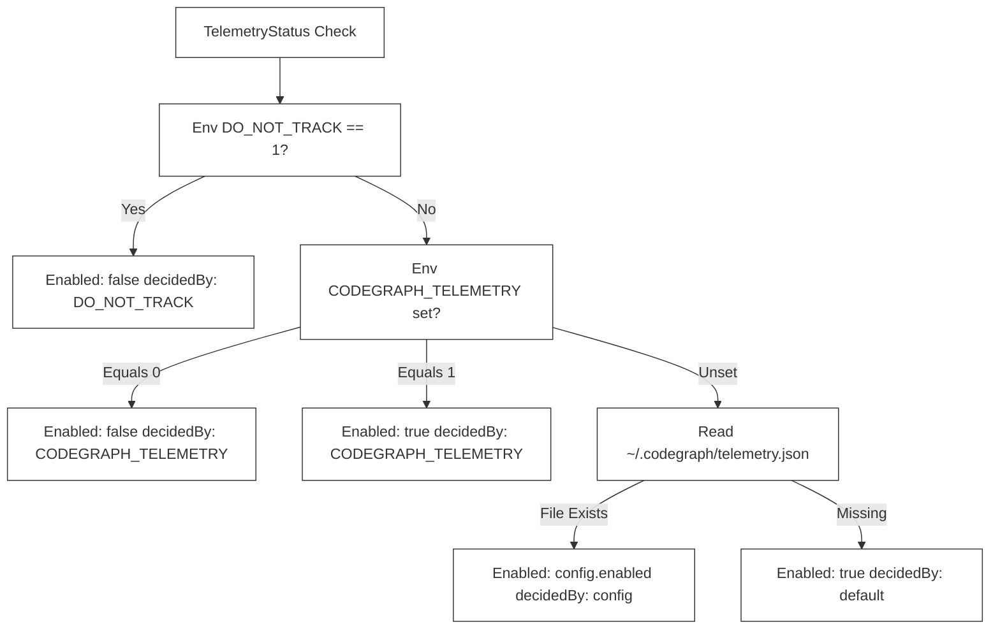
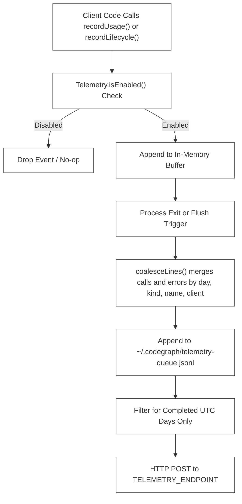

<!-- source: DeepWiki mcp.deepwiki.com · repo colbymchenry/codegraph · page 11.3 Client Telemetry Collector · fetched 2026-10-30 -->

# Client Telemetry Collector

Relevant source files

The following files were used as context for generating this wiki page:

- [TELEMETRY.md](TELEMETRY.md)
- [__tests__/telemetry-optout.test.ts](__tests__/telemetry-optout.test.ts)
- [__tests__/telemetry.test.ts](__tests__/telemetry.test.ts)
- [docs/design/telemetry.md](docs/design/telemetry.md)
- [src/telemetry/index.ts](src/telemetry/index.ts)

## Purpose and Scope

The `src/telemetry/` module implements CodeGraph's client-side telemetry collection layer [src/telemetry/index.ts:1-](). Its primary objective is to capture anonymous usage statistics—such as command execution counts, language presence during indexing, active agent integrations, prompt hook decision funnels, and lifecycle events—while strictly adhering to a privacy-by-default design model [TELEMETRY.md:3-6](). 

This page documents the internal mechanics of the telemetry collector, including core runtime invariants, the precedence hierarchy for consent and opt-out mechanisms (`CODEGRAPH_TELEMETRY` and `DO_NOT_TRACK`), envelope and event schemas (including Claude Code prompt hook telemetry), and the local daily aggregation/coalescing pipeline.

Sources: [TELEMETRY.md:1-9](), [src/telemetry/index.ts:1-24](), [docs/design/telemetry.md:1-8]()

---

## Architectural Invariants

The `Telemetry` class operates under four strict runtime invariants implemented in `src/telemetry/index.ts`:

1. **Synchronous Exit Appends & Opportunistic Networking**: Usage metrics are aggregated in memory. Disk writes occur via a compact synchronous append when the process exits (ensuring compatibility with `process.exit()` where `beforeExit` hooks are bypassed). Network transmits occur opportunistically on startup of long-running processes, via daemon intervals, or bounded awaits during CLI initialization [src/telemetry/index.ts:8-12]().
2. **Zero Stdout Pollution**: Standard output (`stdout`) is strictly reserved for the MCP protocol channel. All notices, warnings, and debug logs originating from telemetry are routed exclusively to standard error (`stderr`) [src/telemetry/index.ts:13-14]().
3. **Off is Off**: When disabled, the collector records no events, opens no network sockets, and transmits no pings. Disabling telemetry immediately purges any buffered or unsent data queues [src/telemetry/index.ts:15-17]().
4. **Fail-Silent Behavior**: Network timeouts, down endpoints, or full disk states result in silent abandonment of the operation. Telemetry never enters retry loops or surfaces errors to the user or AI agent [src/telemetry/index.ts:18-19]().

Sources: [src/telemetry/index.ts:1-23]()

---

## Consent Hierarchy and Opt-Out Mechanism

CodeGraph evaluates telemetry consent by checking environment variables and persistent configuration files in a strict precedence order. This logic is exposed through `Telemetry.getStatus()` [src/telemetry/index.ts:97-103]() and tested in `__tests__/telemetry.test.ts` [__tests__/telemetry.test.ts:54-81]().

Title: Consent Evaluation State Machine

*Figure 1: Consent evaluation order spanning environment variables and configuration files in `Telemetry.getStatus()` [src/telemetry/index.ts:97-103]().*

Sources: [TELEMETRY.md:12-37](), [src/telemetry/index.ts:89-103](), [__tests__/telemetry.test.ts:54-81]()

---

## Event Types and Envelope Schema

Every telemetry payload sent to `https://telemetry.getcodegraph.com/v1/events` [src/telemetry/index.ts:30]() consists of a standardized envelope paired with one of four event types [TELEMETRY.md:45-71]().

### Envelope Properties
- `machine_id`: A random UUID minted on the first transmission, stored in `~/.codegraph/telemetry.json` [TELEMETRY.md:49,94]().
- `codegraph_version`: Current semantic version string of the package [TELEMETRY.md:50]().
- `os` / `arch`: Platform identifiers from Node's `os` module [TELEMETRY.md:51]().
- `node_major`: Major Node.js runtime version [TELEMETRY.md:52]().
- `ci`: Boolean flag indicating whether the `CI` environment variable was detected [TELEMETRY.md:53]().
- `schema_version`: Pinned integer version (currently `2`, reflecting removal of redundant SQLite backend fields) [TELEMETRY.md:54](), [src/telemetry/index.ts:33-36]().

### Event Payloads
1. **`install`**: Emitted during `codegraph install` [TELEMETRY.md:58](). Includes targeted agents (`["claude", "cursor", ...]`), installation scope (`global` vs `local`), and install kind (`fresh`, `upgrade`, `rerun`).
2. **`index`**: Emitted when an index or re-index completes via `recordIndexEvent` [src/telemetry/index.ts:66-82](). Contains language names present, along with coarse buckets for file count (`bucketFileCount`) and duration (`bucketDuration`) [TELEMETRY.md:61-63](), [src/telemetry/index.ts:47-59]().
3. **`usage_rollup`**: Aggregated daily lines per tool/command name, call count, error count, and MCP client metadata (`cn`, `cv`) [src/telemetry/index.ts:106-114](). Additionally, the Claude Code prompt hook records its gate decision outcomes as `cli_command` counters named `prompt-hook-gate-<outcome>` (e.g., `high-keyword`, `high-token`, `medium-segment`, `nudge-projects`, `noop-shape`, `noop-no-index`, `noop-unverified`, `noop-explore-keyword`, `noop-explore-token`, `noop-vocab-empty`), capturing evaluation telemetry without ever reading prompt content [docs/design/telemetry.md:79-91]().
4. **`uninstall`**: Emitted when `codegraph uninstall` or `uninit` runs, tracking removed agent targets [TELEMETRY.md:71]().

Sources: [TELEMETRY.md:43-71](), [src/telemetry/index.ts:33-82](), [docs/design/telemetry.md:75-93]()

---

Data Flow and Local Aggregation

To prevent high-volume tracking of individual operations, `src/telemetry/index.ts` aggregates usage metrics locally into daily rollups. Only completed UTC days are transmitted [src/telemetry/index.ts:21-22]().

Title: Telemetry Aggregation and Transmission Pipeline

*Figure 2: Data flow pipeline from local recording to ingestion via `coalesceLines()` [src/telemetry/index.ts:133-153]() and `flushNow()`.*

Sources: [TELEMETRY.md:72-74](), [src/telemetry/index.ts:133-168](), [__tests__/telemetry.test.ts:156-172]()

---

