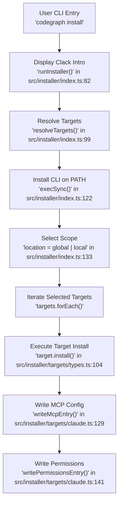
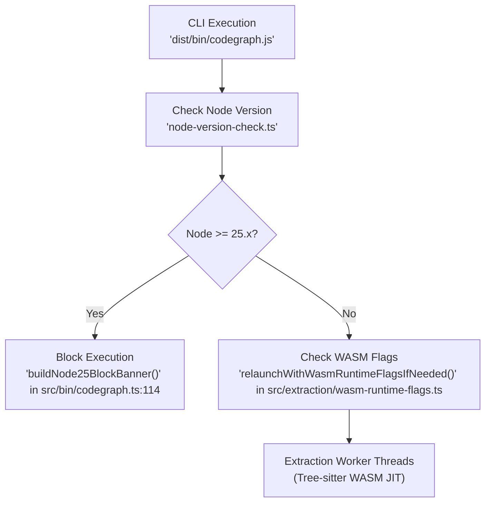

<!-- source: DeepWiki mcp.deepwiki.com · repo colbymchenry/codegraph · page 2.1 Installation · fetched 2026-10-30 -->

# Installation

Relevant source files

The following files were used as context for generating this wiki page:

- [CLAUDE.md](CLAUDE.md)
- [README.md](README.md)
- [__tests__/install-sh-prune.test.ts](__tests__/install-sh-prune.test.ts)
- [__tests__/installer-links-simulated.test.ts](__tests__/installer-links-simulated.test.ts)
- [__tests__/installer-targets.test.ts](__tests__/installer-targets.test.ts)
- [__tests__/installer.test.ts](__tests__/installer.test.ts)
- [__tests__/upgrade.test.ts](__tests__/upgrade.test.ts)
- [install.ps1](install.ps1)
- [install.sh](install.sh)
- [package-lock.json](package-lock.json)
- [package.json](package.json)
- [src/bin/codegraph.ts](src/bin/codegraph.ts)
- [src/installer/config-writer.ts](src/installer/config-writer.ts)
- [src/installer/index.ts](src/installer/index.ts)
- [src/installer/targets/claude.ts](src/installer/targets/claude.ts)
- [src/installer/targets/codex.ts](src/installer/targets/codex.ts)
- [src/installer/targets/copilot-cli.ts](src/installer/targets/copilot-cli.ts)
- [src/installer/targets/copilot-jetbrains.ts](src/installer/targets/copilot-jetbrains.ts)
- [src/installer/targets/copilot-vscode.ts](src/installer/targets/copilot-vscode.ts)
- [src/installer/targets/cursor.ts](src/installer/targets/cursor.ts)
- [src/installer/targets/hermes.ts](src/installer/targets/hermes.ts)
- [src/installer/targets/kiro.ts](src/installer/targets/kiro.ts)
- [src/installer/targets/registry.ts](src/installer/targets/registry.ts)
- [src/installer/targets/shared.ts](src/installer/targets/shared.ts)
- [src/installer/targets/toml.ts](src/installer/targets/toml.ts)
- [src/installer/targets/types.ts](src/installer/targets/types.ts)
- [src/mcp/tools.ts](src/mcp/tools.ts)
- [src/upgrade/index.ts](src/upgrade/index.ts)

## Purpose and Scope

This page provides a technical walkthrough of installing and configuring CodeGraph for use with AI code assistants. It covers the interactive installer (`runInstallerWithOptions()` in [src/installer/index.ts:86-210]()), the multi-target architecture (`AgentTarget` interface in [src/installer/targets/types.ts:80-120]()), global vs. local installation scopes, auto-allow permission configurations, and hook setup. Supported target systems include Claude Code, Cursor, Codex CLI, opencode, Hermes, Gemini CLI, Kiro, Antigravity IDE, and GitHub Copilot (VS Code, CLI, JetBrains) [README.md:9-10]().

---

## Installation Overview

CodeGraph operates via a thin-installer pattern. The primary package `@colbymchenry/codegraph` acts as a CLI shim [package.json:11-13]() that delegates execution to a precompiled runtime environment complete with `node:sqlite` and extraction kernel assets [package.json:27-27](). 

Installation involves the following architectural phases:
1. **CLI Provisioning**: Installing the executable on the system `PATH` via `npm install -g` [src/installer/index.ts:117-123]() or standalone shell scripts [__tests__/installer-targets.test.ts:38-72]().
2. **Target Resolution**: Detecting and selecting agent targets via `resolveTargetFlag()` and `getTarget()` [src/installer/index.ts:99-99](), [src/installer/targets/registry.ts]().
3. **Scope Determination**: Selecting between `global` (user-wide configuration directories) and `local` (project-scoped `.mcp.json` or equivalent) [src/installer/index.ts:133-162]().
4. **Configuration & Permission Writing**: Invoking `target.install()` to write MCP server declarations, instructions blocks, and permission wildcards [src/installer/targets/types.ts:80-120]().

Sources: [src/installer/index.ts:86-183](), [src/installer/targets/types.ts:80-120](), [package.json:11-27]()

---

## Interactive Installer Workflow

The interactive setup is driven by `runInstallerWithOptions()` inside [src/installer/index.ts:86](), leveraging `@clack/prompts` for the terminal UI [src/installer/index.ts:87]().

### Interactive Installer Execution Map

Sources: [src/installer/index.ts:82-174](), [src/installer/targets/claude.ts:125-143](), [src/installer/targets/types.ts:80-120]()

---

## Supported Agent Targets

CodeGraph implements the `AgentTarget` abstraction [src/installer/targets/types.ts:80-120]() to support multiple AI assistants without duplicating configuration plumbing. 

### Target Configuration Table

| Agent Target | Target ID | Primary Config Path | Scope Support |
| :--- | :--- | :--- | :--- |
| **Claude Code** | `claude` | `~/.claude.json` / `./.mcp.json` | Global & Local [src/installer/targets/claude.ts:74-84]() |
| **Cursor** | `cursor` | `~/.cursor/mcp.json` / `./.cursor/mcp.json` | Global & Local |
| **Codex CLI** | `codex` | `$CODEX_HOME/config.toml` / `.codex/config.toml` | Global & Local [src/installer/targets/codex.ts:52-79]() |
| **opencode** | `opencode` | `~/.config/opencode/opencode.jsonc` | Global & Local |
| **Hermes Agent** | `hermes` | Hermes config directory | Global & Local |
| **Gemini CLI** | `gemini` | Gemini MCP config path | Global & Local |
| **Kiro** | `kiro` | Kiro configuration file | Global & Local |
| **Antigravity IDE** | `antigravity` | Antigravity settings path | Global & Local |
| **VS Code (Copilot)** | `copilot-vscode` | `mcp.json` in VS Code User Dir | Global & Local [src/installer/targets/copilot-vscode.ts:80-98]() |
| **GitHub Copilot CLI** | `copilot-cli` | Copilot CLI configuration | Global Only |
| **JetBrains (Copilot)** | `copilot-jetbrains` | JetBrains application directory | Global Only |

### Target Implementation Details
- **Claude Code**: Manages user-scope (`~/.claude.json`) or project-scope (`./.mcp.json`) files [src/installer/targets/claude.ts:74-84](). Automatically migrates legacy `./.claude.json` entries [src/installer/targets/claude.ts:18-20]() and configures auto-allow permissions in `settings.json` [src/installer/targets/claude.ts:139-141]().
- **Codex CLI**: Employs a narrow TOML builder (`upsertTomlTable`) to inject `[mcp_servers.codegraph]` tables into `config.toml` [__tests__/installer-targets.test.ts:25-25]().
- **VS Code (Copilot Chat)**: Writes to `.vscode/mcp.json` locally (pinning absolute `--path` via `buildVscodeServerEntry()`) and user-level `mcp.json` globally (omitting `--path` to prevent workspace resolution errors) [src/installer/targets/copilot-vscode.ts:80-98]().

Sources: [src/installer/targets/types.ts:22-120](), [src/installer/targets/claude.ts:74-141](), [src/installer/targets/copilot-vscode.ts:80-98](), [__tests__/installer-targets.test.ts:25-25]()

---

## Critical Runtime Requirements & WASM Flags

CodeGraph parses code using Tree-sitter WebAssembly modules. On Node.js versions >= 25, V8's Turboshaft optimizing compiler can trigger a fatal Zone out-of-memory exception during grammar parsing [src/bin/codegraph.ts:111-119]().

### Runtime Flag Enforcement Architecture

Sources: [src/bin/codegraph.ts:111-131](), [src/extraction/wasm-runtime-flags.ts]()

---

## Hook Configuration

When initializing inside a repository, the installer configures automated synchronization hooks [src/installer/index.ts:28-30]().

- **Git Sync Hooks**: Managed via `installGitSyncHook()` [src/installer/index.ts:30]() to maintain graph freshness across branch switches.
- **Hook Cleanup**: Upgrades automatically remove deprecated hooks (such as legacy `sync-if-dirty` hooks) to prevent runtime invocation failures [src/installer/targets/claude.ts:147-151]().
- **Prompt Hooks**: For Claude Code, an optional `UserPromptSubmit` prompt hook can be installed to inject structural context via `codegraph_explore` [src/installer/targets/claude.ts:157-158](), [src/installer/targets/types.ts:72-78]().

Sources: [src/installer/index.ts:28-30](), [src/installer/targets/claude.ts:147-162](), [src/installer/targets/types.ts:72-78]()

---

## Upgrading and Uninstallation

### Upgrading
CodeGraph supports self-upgrading through the `codegraph upgrade` command [src/bin/codegraph.ts:24-24](). 
- **Detection**: Identifies installation origin (npm package, standalone bundle, or source repository) via path inspection [src/upgrade/index.ts:109-144]().
- **Bundle Execution**: Standalone bundle upgrades re-fetch and execute `install.sh` or `install.ps1` to update vendored binaries in place [src/upgrade/index.ts:35-39]().
- **Windows File Locks**: On Windows platforms, upgrade routines spawn a detached child process to bypass file locks on `node.exe` [src/upgrade/index.ts:20-27]().

### Uninstallation
- **Target Rollback**: Each `AgentTarget` implements an `uninstall(location)` method that surgically removes CodeGraph entries while leaving sibling server configurations intact [src/installer/targets/types.ts:80-120]().
- **Permission Cleanup**: Strips `mcp__codegraph__*` permission wildcards from agent settings files [src/installer/targets/claude.ts:173-180]().

Sources: [src/bin/codegraph.ts:24-24](), [src/upgrade/index.ts:16-39](), [src/installer/targets/types.ts:80-120](), [src/installer/targets/claude.ts:173-180]()

---

