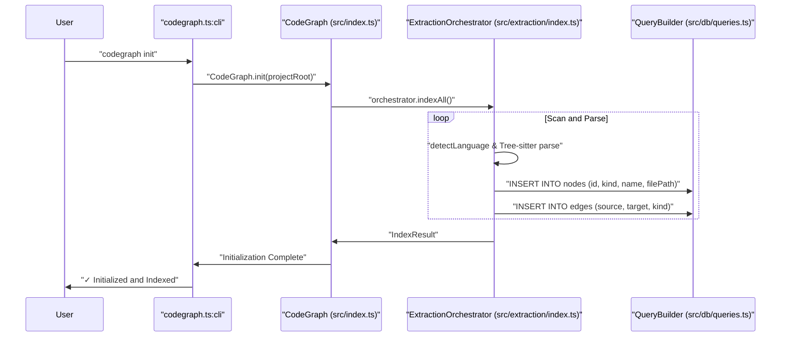
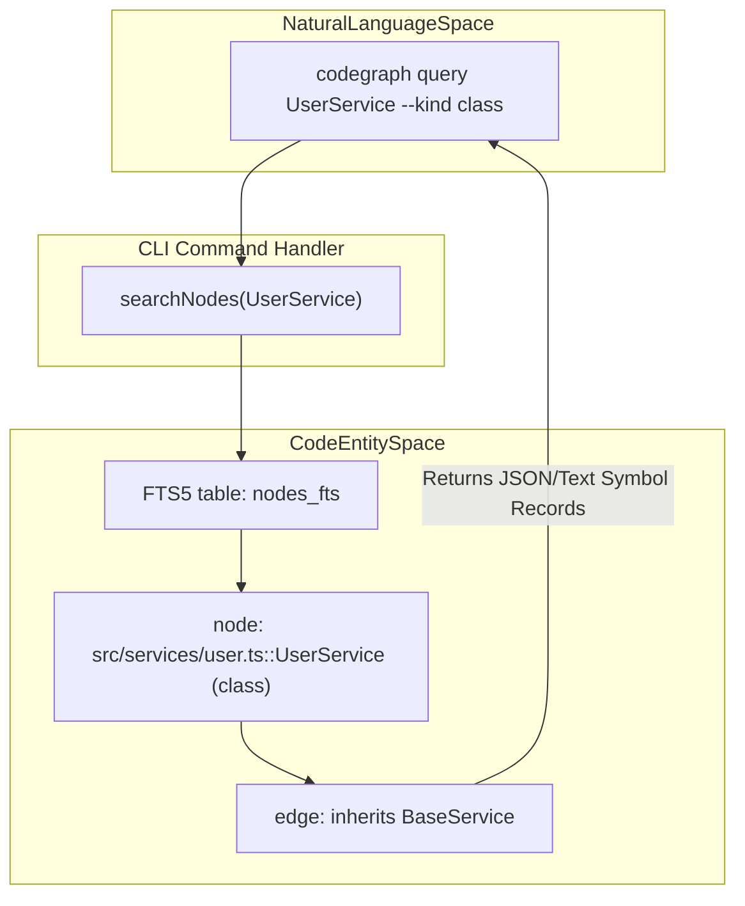
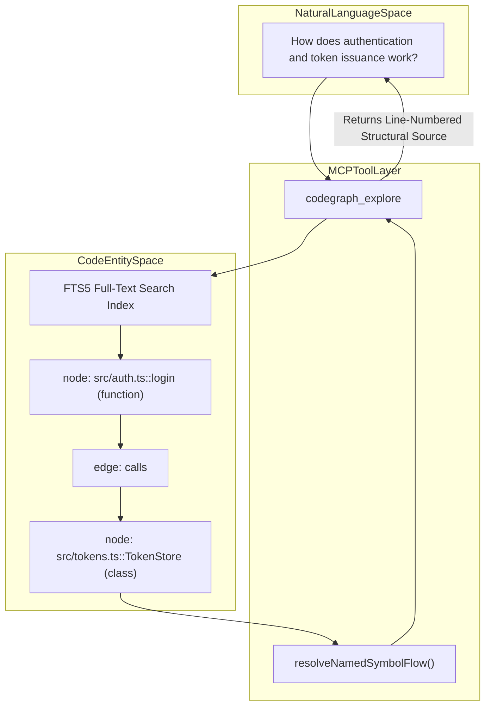

<!-- source: DeepWiki mcp.deepwiki.com · repo colbymchenry/codegraph · page 2.2 Quick Start Guide · fetched 2026-10-30 -->

# Quick Start Guide

Relevant source files

The following files were used as context for generating this wiki page:

- [__tests__/cli-ui-command.test.ts](__tests__/cli-ui-command.test.ts)
- [__tests__/viewer-gate.test.ts](__tests__/viewer-gate.test.ts)
- [assets/codegraph-ui-symbol-view.png](assets/codegraph-ui-symbol-view.png)
- [site/astro.config.mjs](site/astro.config.mjs)
- [site/src/content/docs/core-concepts/how-it-works.md](site/src/content/docs/core-concepts/how-it-works.md)
- [site/src/content/docs/core-concepts/resolution.md](site/src/content/docs/core-concepts/resolution.md)
- [site/src/content/docs/getting-started/installation.md](site/src/content/docs/getting-started/installation.md)
- [site/src/content/docs/getting-started/introduction.md](site/src/content/docs/getting-started/introduction.md)
- [site/src/content/docs/getting-started/next-steps.md](site/src/content/docs/getting-started/next-steps.md)
- [site/src/content/docs/getting-started/quickstart.md](site/src/content/docs/getting-started/quickstart.md)
- [site/src/content/docs/getting-started/your-first-graph.md](site/src/content/docs/getting-started/your-first-graph.md)
- [site/src/content/docs/guides/framework-routes.md](site/src/content/docs/guides/framework-routes.md)
- [site/src/content/docs/guides/indexing.md](site/src/content/docs/guides/indexing.md)
- [site/src/content/docs/reference/api.md](site/src/content/docs/reference/api.md)
- [site/src/content/docs/reference/cli.md](site/src/content/docs/reference/cli.md)
- [site/src/content/docs/reference/integrations.md](site/src/content/docs/reference/integrations.md)
- [site/src/content/docs/reference/mcp-server.md](site/src/content/docs/reference/mcp-server.md)
- [src/bin/command-supervision.ts](src/bin/command-supervision.ts)
- [src/bin/viewer-gate.ts](src/bin/viewer-gate.ts)

This page covers the technical workflows required to initialize projects, execute indexing pipelines, run fundamental queries, and integrate with AI agents like Claude Code via the Model Context Protocol (MCP). It assumes installation is complete [site/src/content/docs/getting-started/installation.md:6-21]().

For deeper architectural context, see [System Architecture Overview](6.1); for configuration parameters, see [Configuration](2.3).

Sources: [site/src/content/docs/getting-started/installation.md:6-21]()

---

## Project Initialization (`codegraph init`)

To attach CodeGraph to a target codebase, the project directory must be initialized. This creates the local `.codegraph/` workspace storing the SQLite database, locks, and indexing metadata [site/src/content/docs/getting-started/quickstart.md:32-37]().

The CLI command `codegraph init` executes project detection, directory creation, and triggers the initial indexing pass synchronously [site/src/content/docs/guides/indexing.md:9-13](). Programmatically, this is handled through the `CodeGraph` facade [site/src/content/docs/reference/api.md:11-17]() and extraction routines [src/extraction/index.ts:41-124]().

### Diagram: Initialization and Extraction Data Flow

Sources: [site/src/content/docs/getting-started/quickstart.md:32-37](), [site/src/content/docs/guides/indexing.md:9-13](), [site/src/content/docs/reference/api.md:11-17](), [src/extraction/index.ts:41-124]()

---

## Indexing & Incremental Synchronization

CodeGraph manages project state through distinct indexing modes managed by `ExtractionOrchestrator` [src/extraction/index.ts:41-152]().

### Full vs. Incremental Indexing

| Command | Action | Implementation / Target |
|---------|--------|-------------------------|
| `codegraph index` | Full Index | Re-scans all files, re-parses sources, and updates nodes/edges [site/src/content/docs/guides/indexing.md:18]() |
| `codegraph index --force` | Force Re-index | Drops existing tables, clears caches, and rebuilds from scratch [site/src/content/docs/guides/indexing.md:19]() |
| `codegraph sync` | Incremental Sync | Reconciles filesystem diffs (`modifiedAt`, `size`, content hashes) and updates only changed files [src/extraction/index.ts:129-152](), [site/src/content/docs/guides/indexing.md:20]() |

### Auto-Sync with File Watcher

When running under an agent process via `codegraph serve --mcp`, a native file watcher monitors the project root [site/src/content/docs/guides/indexing.md:27-35](). 
1. **Event Capture:** File modifications trigger event delivery [site/src/content/docs/guides/indexing.md:33-35]().
2. **Debounce Windows:** Bursts of edits are coalesced by a configurable debounce timer (default `2000ms`, tunable via `CODEGRAPH_WATCH_DEBOUNCE_MS`) [site/src/content/docs/guides/indexing.md:36-41]().
3. **Staleness Banners:** During the debounce window, any MCP tool response referencing stale files prepends a warning banner, forcing direct file reads if necessary [site/src/content/docs/guides/indexing.md:45-58]().

Sources: [src/extraction/index.ts:41-152](), [site/src/content/docs/guides/indexing.md:15-89]()

---

## CLI Query Operations & Natural Language Translation

Once indexed, developers and scripts can query the graph directly from the command line interface [site/src/content/docs/reference/cli.md:17-23]().

* **Symbol Search:** `codegraph query "<search>"` executes FTS5 full-text search combined with identifier segment matching [site/src/content/docs/reference/cli.md:17]().
* **Call Graphs:** `codegraph callers "<symbol>"` and `codegraph callees "<symbol>"` leverage graph traversal to trace inbound and outbound references [site/src/content/docs/reference/cli.md:21-22]().
* **Impact Analysis:** `codegraph impact "<symbol>"` analyzes downstream dependency disruption caused by modifying a specific code entity [site/src/content/docs/reference/cli.md:23]().

### Diagram: CLI Query Natural Language Space to Code Entity Space

Sources: [site/src/content/docs/reference/cli.md:17-23](), [site/src/content/docs/reference/api.md:19-26]()

---

## Agent Integration & MCP Workflows

CodeGraph exposes semantic code intelligence to AI agents (such as Claude Code, Cursor, and Codex) through the Model Context Protocol (MCP) server [site/src/content/docs/getting-started/introduction.md:6-8]().

### Diagram: MCP Natural Language to Code Entity Space

Sources: [site/src/content/docs/getting-started/introduction.md:6-28](), [site/src/content/docs/reference/mcp-server.md:6-18]()

### The `codegraph_explore` Tool

The primary MCP tool, `codegraph_explore`, abstracts complex multi-file lookups into a single call. It evaluates natural language intents, resolves symbol identifiers, traverses relevant edges (`calls`, `imports`, `extends`), and formats surgical, line-numbered source extractions for the agent context window [site/src/content/docs/reference/mcp-server.md:14-18]().

Sources: [site/src/content/docs/reference/mcp-server.md:14-46]()

---

## Maintenance: Upgrading and Uninitializing

* **Upgrading:** Execute `codegraph upgrade` to check for and apply in-place updates based on the original installation vector [site/src/content/docs/reference/cli.md:27]().
* **Uninitializing:** Execute `codegraph uninit` to purge the local `.codegraph/` directory and SQLite database files without altering global agent configurations [site/src/content/docs/reference/cli.md:11](), [site/src/content/docs/getting-started/installation.md:62-70]().

Sources: [site/src/content/docs/reference/cli.md:11](), [site/src/content/docs/reference/cli.md:27](), [site/src/content/docs/getting-started/installation.md:62-70]()

---

