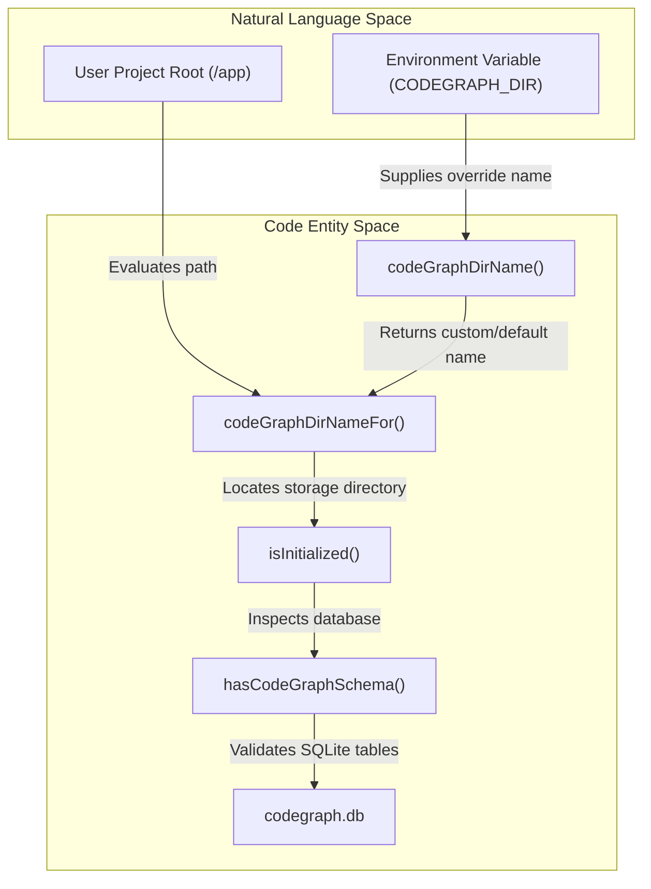
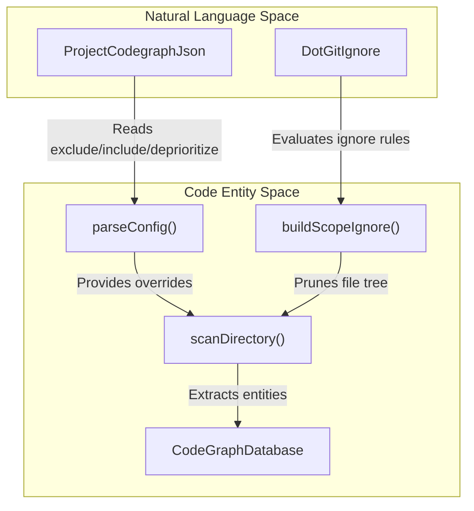

<!-- source: DeepWiki mcp.deepwiki.com · repo colbymchenry/codegraph · page 2.3 Configuration · fetched 2026-10-30 -->

# Configuration

<details>
<summary>Relevant source files</summary>

The following files were used as context for generating this wiki page:

- [__tests__/deprioritize-config.test.ts](__tests__/deprioritize-config.test.ts)
- [__tests__/frontload-hook.test.ts](__tests__/frontload-hook.test.ts)
- [__tests__/include-config.test.ts](__tests__/include-config.test.ts)
- [__tests__/include-ignored-config.test.ts](__tests__/include-ignored-config.test.ts)
- [__tests__/js-local-binding-backtracking.test.ts](__tests__/js-local-binding-backtracking.test.ts)
- [__tests__/jsx-child-disambiguation.test.ts](__tests__/jsx-child-disambiguation.test.ts)
- [__tests__/jsx-render-work.test.ts](__tests__/jsx-render-work.test.ts)
- [__tests__/mcp-unindexed.test.ts](__tests__/mcp-unindexed.test.ts)
- [__tests__/multi-repo-workspace.test.ts](__tests__/multi-repo-workspace.test.ts)
- [__tests__/react-router-lazy-barrel.test.ts](__tests__/react-router-lazy-barrel.test.ts)
- [__tests__/schemaless-db-not-initialized.test.ts](__tests__/schemaless-db-not-initialized.test.ts)
- [__tests__/src-build-folders.test.ts](__tests__/src-build-folders.test.ts)
- [__tests__/sync-jsx-import-forwarding.test.ts](__tests__/sync-jsx-import-forwarding.test.ts)
- [__tests__/sync-lazy-route-value.test.ts](__tests__/sync-lazy-route-value.test.ts)
- [site/src/content/docs/getting-started/configuration.md](site/src/content/docs/getting-started/configuration.md)
- [src/db/index.ts](src/db/index.ts)
- [src/directory.ts](src/directory.ts)
- [src/project-config.ts](src/project-config.ts)
- [src/resolution/jsx-code.ts](src/resolution/jsx-code.ts)

</details>


## Purpose and Scope

This page documents the configuration architecture of CodeGraph, detailing how project environments are structured, how zero-config defaults operate, and how optional overrides in `codegraph.json` customize extraction, file filtering, search ranking, and multi-repo workspace composition [src/directory.ts:4-5](), [src/project-config.ts:3-11]().

---

## The `.codegraph` Directory Structure and Environment Isolation

When a project is initialized, CodeGraph creates a local metadata and database directory [src/directory.ts:4-5](). By default, this directory is named `.codegraph`, but it can be overridden via the `CODEGRAPH_DIR` environment variable to support concurrent multi-environment setups (such as Windows-native and WSL sharing a single working tree) [src/directory.ts:25-35]().

### Directory Layout and Implementation

The data directory isolates SQLite database storage, transaction logs, shared memory segments, and daemon lock files from version control [src/directory.ts:187-191](). The active directory name is resolved dynamically by `codeGraphDirName()` and `codeGraphDirNameFor(projectRoot)`, which handle WSL/Windows boundary isolation by falling back to `.codegraph-wsl` when necessary [src/directory.ts:44-65](), [src/directory.ts:107-116](). Initialization state is validated through `isInitialized()`, ensuring that `codegraph.db` exists and carries a valid schema rather than being an empty stub [src/directory.ts:142-156]().

Title: Directory Resolution and Initialization Architecture

Sources: [src/directory.ts:44-65](), [src/directory.ts:107-116](), [src/directory.ts:142-156]()

| File / Artifact | Purpose | Version Control Status |
|-----------------|---------|------------------------|
| `codegraph.db` | Primary SQLite database storing nodes, edges, and symbol tables [src/directory.ts:99-101]() | Ignored |
| `codegraph.db-wal` | Write-Ahead Log for concurrent read/write access and transactional safety [src/db/index.ts:36-36]() | Ignored |
| `codegraph.db-shm` | Shared memory file for SQLite cache coordination | Ignored |
| `daemon.pid` | Lockfile containing process ID and communication socket metadata [src/directory.ts:23-27]() | Ignored |

Sources: [src/directory.ts:25-35](), [src/db/index.ts:33-48]()

---

## Project-Scoped Configuration (`codegraph.json`)

Projects requiring custom extensions, explicit pruning, or specialized whitelisting can commit an optional `codegraph.json` file at the project root [src/project-config.ts:3-11](). The configuration parser (`parseConfig()`) reads and validates this file, caching parsed values using file modification times (`mtimeMs`) via `cache` to prevent redundant disk reads during hot-path operations like incremental syncs and file watching [src/project-config.ts:96-107](), [src/project-config.ts:144-161]().

### Configuration Interface (`ProjectConfig`)

The `ProjectConfig` interface defines all supported configuration properties [src/project-config.ts:34-85]().

```typescript
export interface ProjectConfig {
  extensions?: Record<string, string>;
  includeIgnored?: string[];
  exclude?: string[];
  include?: string[];
  deprioritize?: string[];
}
```

### Custom File Extensions
For non-standard file extensions mapped to supported languages (e.g., `.dota_lua` for Lua), the `extensions` dictionary overrides or extends built-in language detection rules [src/project-config.ts:9-17](). Invalid or malformed extension keys are normalized via `normalizeExtKey()` and safely ignored without failing extraction [src/project-config.ts:128-137](), [src/project-config.ts:20-24]().

```json
{
  "extensions": {
    ".dota_lua": "lua",
    ".tpl": "php"
  }
}
```

Sources: [src/project-config.ts:3-85](), [src/project-config.ts:128-161]()

---

## File Filtering, Inclusion, Exclusion, and Deprioritization Rules

CodeGraph employs strict filtering layers to ensure that extracted graphs contain application code rather than third-party dependencies, build output, or framework noise [site/src/content/docs/getting-started/configuration.md:8-13]().

### Filtering Precedence

1. **Built-in Skips**: Automatically ignores directories like `node_modules`, `vendor`, `dist`, `build`, `target`, and `.venv` [site/src/content/docs/getting-started/configuration.md:10-10]().
2. **Size Thresholds**: Skips files larger than 1 MB, such as minified bundles or binary assets [site/src/content/docs/getting-started/configuration.md:12-12]().
3. **Gitignore Rules**: Honored via `git ls-files` or by directly parsing `.gitignore` trees through `buildScopeIgnore()` and `buildDefaultIgnore()` [site/src/content/docs/getting-started/configuration.md:11-11](), [__tests__/src-build-folders.test.ts:120-123]().
4. **Explicit Exclusions (`exclude`)**: Gitignore-style patterns in `codegraph.json` take precedence over all other discovery rules, dropping committed directories (like vendored themes) from the index [src/project-config.ts:45-55]().
5. **Whitelisting (`include` / `includeIgnored`)**: Bypasses gitignore restrictions for alternative VCS sources (`include`) or nested repository super-projects (`includeIgnored`) [src/project-config.ts:56-69](), [__tests__/multi-repo-workspace.test.ts:6-22]().
6. **Deprioritization (`deprioritize`)**: Keeps helper, script, or fixture files findable while demoting their ranking so they do not outrank first-party code [src/project-config.ts:70-84]().

Title: Filtering and Configuration Pipeline

Sources: [src/project-config.ts:34-85](), [__tests__/multi-repo-workspace.test.ts:23-31](), [site/src/content/docs/getting-started/configuration.md:8-13]()

---

## Multi-Repo Workspaces and Nested Git Repositories

By default, `.gitignore` hides nested git repositories within ignored parent directories [__tests__/multi-repo-workspace.test.ts:6-22](). To index workspaces containing multiple independent repositories (super-repos), projects configure `includeIgnored` in `codegraph.json` [src/project-config.ts:37-44](). Functions such as `discoverEmbeddedRepoRoots()` and `findUnindexedIgnoredRepos()` scan and validate opted-in sub-paths [__tests__/multi-repo-workspace.test.ts:29-31]().

Sources: [src/project-config.ts:37-44](), [__tests__/multi-repo-workspace.test.ts:6-22]()

---

## Claude Integration and Agent Files

CodeGraph writes integration blocks into agent instruction files (such as `CLAUDE.md`, `AGENTS.md`, or custom targets) using delimiter fences [src/installer/instructions-template.ts:28-30](). These instructions ensure AI assistants query the knowledge graph via MCP tools rather than executing raw string searches like `grep` or `find`.

```markdown
<!-- CODEGRAPH_START -->
## CodeGraph
In repositories indexed by CodeGraph, use codegraph_explore and related tools before executing raw grep or find commands.
<!-- CODEGRAPH_END -->
```

Sources: [src/installer/instructions-template.ts:10-30](), [src/installer/instructions-template.ts:42-51]()

---

