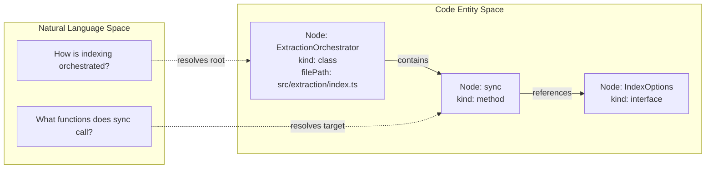
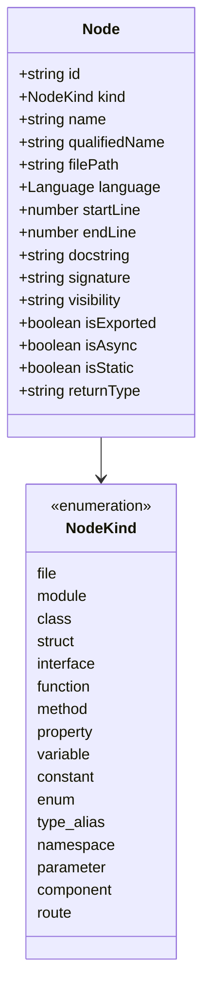
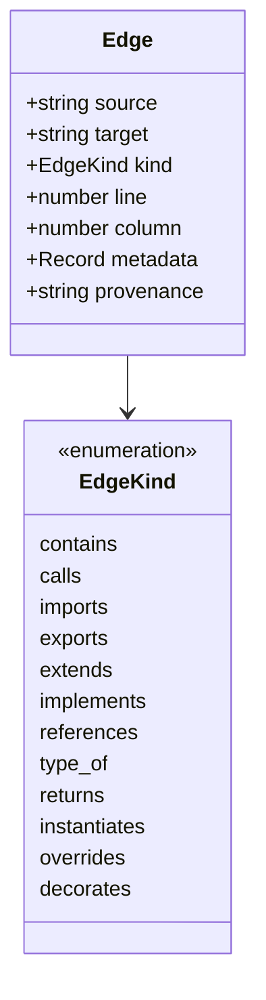
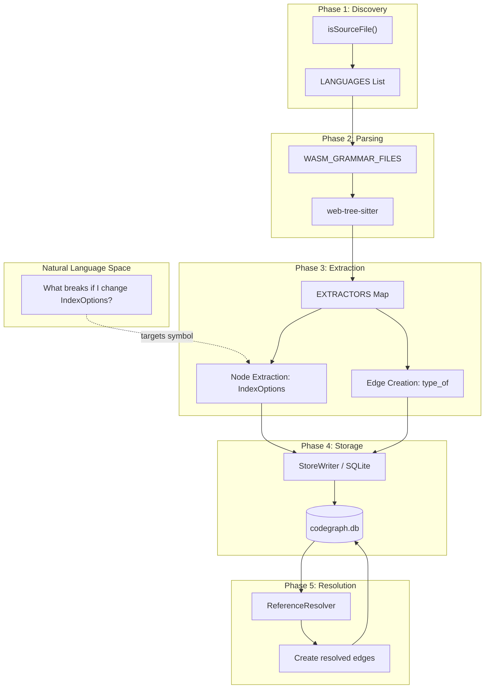

<!-- source: DeepWiki mcp.deepwiki.com · repo colbymchenry/codegraph · page 3 Core Concepts · fetched 2026-10-30 -->

# Core Concepts

Relevant source files

The following files were used as context for generating this wiki page:

- [.claude/skills/agent-eval/corpus.json](.claude/skills/agent-eval/corpus.json)
- [src/extraction/grammars.ts](src/extraction/grammars.ts)
- [src/extraction/languages/index.ts](src/extraction/languages/index.ts)
- [src/types.ts](src/types.ts)

This page explains the fundamental principles underlying CodeGraph's knowledge graph approach. It introduces the core abstractions—nodes, edges, and the graph model—and describes how source code is transformed into a queryable graph structure.

For detailed graph model semantics, see [Knowledge Graph Model](#3.1). For specific language support details, see [Supported Languages](#3.2). For database schema and storage implementation, see [Project Structure and Database](#3.3).

---

## Code Represented as a Knowledge Graph

CodeGraph transforms source code into a **directed graph** where code symbols are nodes and relationships between them are edges. This representation enables structural queries that would be difficult with text-based tools.

### Natural Language to Code Entity Mapping

To bridge high-level intent with concrete implementation, CodeGraph translates natural language queries into traversals over specific code entities defined in the codebase, such as `ExtractionOrchestrator` [src/extraction/index.ts:37-37]() and `CodeGraph` [src/index.ts:149-149]().

Title: "CodeGraph Knowledge Graph Bridging Natural Language to Code Entities"

Sources: [src/types.ts:22-46](), [src/types.ts:57-72](), [src/types.ts:132-201](), [src/extraction/index.ts:37-37](), [src/index.ts:149-149]()

This graph structure provides instant answers to questions that would require scanning multiple files with traditional text search:
- **Call graphs**: "What functions does `sync()` call?" [src/extraction/index.ts:111-133]()
- **Dependency analysis**: "What code depends on `QueryBuilder`?" [src/extraction/index.ts:23-23]()
- **Impact analysis**: "If I change `NodeKind`, what breaks?" [src/types.ts:48-48]()

The graph is stored in SQLite and queried using algorithms implemented in the core engine.

Sources: [src/db/queries.ts:216-218](), [src/types.ts:206-227]()

---

## Nodes: Code Symbols

A **node** represents a discrete code symbol—a function, class, method, variable, or other named entity extracted from source code. Each node has a unique ID, type classification, location information, and metadata.

### Node Structure

The `Node` interface defines the structure stored in the database:

Title: "Node Data Structure and Enumeration"

Sources: [src/types.ts:22-46](), [src/types.ts:132-201]()

### Node Kinds

The `NODE_KINDS` array defines all extractable symbol types [src/types.ts:22-46](). CodeGraph supports modern architectural patterns including UI components and HTTP routes.

| Kind | Description | Example Languages |
|------|-------------|-------------------|
| `function` | Top-level function | TypeScript, Python, Go, Rust |
| `method` | Class/struct method | Java, C#, Ruby, Swift |
| `class` | Class definition | TypeScript, Python, Java, C# |
| `struct` | Struct type | Go, Rust, C, Pascal |
| `interface` | Interface/trait/protocol | TypeScript, Java, Go, Rust |
| `property` | Class property/field | TypeScript, C#, Kotlin |
| `variable` | Module-level variable | All languages |
| `constant` | Const/final/immutable | Java `static final`, C# `const` |
| `enum` | Enumeration type | TypeScript, Rust, Java, C# |
| `type_alias` | Type alias/typedef | TypeScript, Rust, Kotlin |
| `namespace` | Namespace/package | C#, PHP, Pascal |
| `component` | UI component | React, Svelte, Vue |
| `route` | HTTP route handler | Express, Laravel, Django |

Sources: [src/types.ts:22-46]()

### Node Identity and Qualified Names

Each node has a deterministic `id` generated by hashing its `qualifiedName` and file path. The `qualifiedName` provides a hierarchical path to the symbol, such as `src/extraction/index.ts::ExtractionOrchestrator.sync`.

Sources: [src/types.ts:132-143](), [src/extraction/index.ts:138-140]()

---

## Edges: Relationships Between Symbols

An **edge** represents a directed relationship between two nodes. Edges capture how code symbols interact: function calls, inheritance, imports, containment, and type references.

### Edge Structure

The `Edge` interface defines relationships between nodes:

Title: "Edge Data Structure and Enumeration"

Sources: [src/types.ts:57-72](), [src/types.ts:206-227]()

### Edge Kinds

The `EDGE_KINDS` type enumerates all relationship types [src/types.ts:57-72]():

| Kind | Direction | Meaning | Example |
|------|-----------|---------|---------|
| `contains` | Parent → Child | Symbol contains another | File contains class, class contains method |
| `calls` | Caller → Callee | Function invocation | `sync()` calls `hashContent()` |
| `imports` | Importer → Imported | Module import | `index.ts` imports `detectLanguage` |
| `exports` | File → Symbol | Symbol exported | `index.ts` exports `ExtractionOrchestrator` |
| `extends` | Child → Parent | Class inheritance | `DatabaseError` extends `CodeGraphError` |
| `implements` | Class → Interface | Interface implementation | `SqliteDatabase` implements `DatabaseConnection` |
| `references` | User → Target | Generic reference | `index.ts` references `MAX_FILE_SIZE` |
| `type_of` | Value → Type | Type annotation | Parameter `options` has type `IndexOptions` |
| `returns` | Function → Type | Return type | `sync()` returns `SyncResult` |
| `instantiates` | Caller → Class | Object creation | `new Mutex()` |
| `overrides` | Child → Parent | Method override | Subclass overrides parent method |
| `decorates` | Decorator → Target | Decorator application | `@Injectable` on class |

Sources: [src/types.ts:57-72](), [src/extraction/index.ts:1-133]()

---

## The Data Transformation Pipeline

CodeGraph processes source code through a multi-phase pipeline involving discovery, parsing, and reference resolution.

### Task-Specific Context Bridging

When agents request task context or impact analysis, natural language intents are mapped to exact code entities using the following data flow:

Title: "Task-Specific Query Resolution from Natural Language Space to Code Entity Space"

Sources: [src/types.ts:78-121](), [src/extraction/languages/index.ts:40-72](), [src/extraction/grammars.ts:20-53](), [src/extraction/store-writer.ts:26-26]()

### File Discovery and Parsing

The system identifies source files based on the `LANGUAGES` supported [src/types.ts:78-121](). Each file is parsed using `web-tree-sitter` and the appropriate language grammar defined in `WASM_GRAMMAR_FILES` [src/extraction/grammars.ts:20-53]().

Sources: [src/types.ts:78-121](), [src/extraction/grammars.ts:20-53]()

### Node and Edge Extraction

The extraction system uses the `EXTRACTORS` map to apply language-specific logic [src/extraction/languages/index.ts:40-72](). It visits the AST and extracts `Node` and `Edge` objects. References that cannot be resolved immediately (e.g., cross-file calls) are captured as `UnresolvedReference` for the resolution phase [src/types.ts:274-282]().

Sources: [src/extraction/languages/index.ts:40-72](), [src/types.ts:274-282]()

### Storage and Resolution

Data is persisted to a SQLite database via `QueryBuilder` [src/db/queries.ts:216-218](). CodeGraph tracks file hashes in `FileRecord` to support incremental updates via `ExtractionOrchestrator.sync()` [src/types.ts:232-265](), [src/extraction/index.ts:111-133](). The `ReferenceResolver` processes unresolved references to link symbols across the entire project [src/resolution/index.ts:45-48]().

Sources: [src/types.ts:232-265](), [src/db/queries.ts:216-218](), [src/extraction/index.ts:111-133](), [src/resolution/index.ts:45-48]()

---

## Summary

CodeGraph's core concepts focus on transforming static code into a queryable semantic model:

1. **Graph Model**: Nodes represent symbols; Edges represent relationships.
2. **Deterministic Extraction**: AST-based parsing via Tree-sitter ensures accuracy.
3. **Reference Resolution**: Linking symbols across files to build a global graph.
4. **Local-First**: All data stays in the `.codegraph/` directory in a SQLite database.

For detailed exploration of child topics, see:
- [Knowledge Graph Model](#3.1)
- [Supported Languages](#3.2)
- [Project Structure and Database](#3.3)

Sources: [src/types.ts:1-227](), [src/index.ts:4-6]()

---

