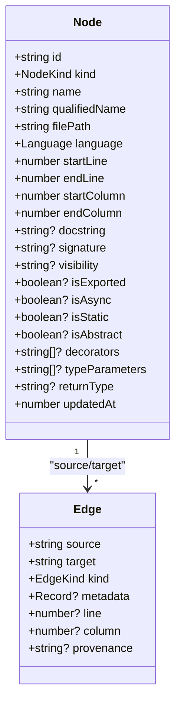
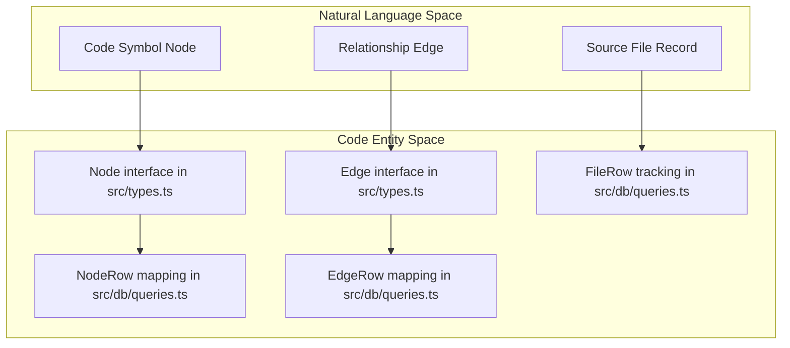
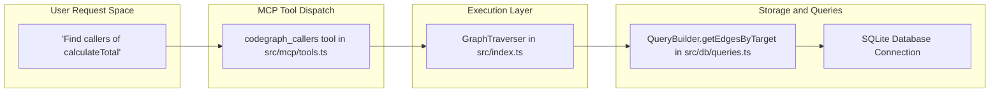
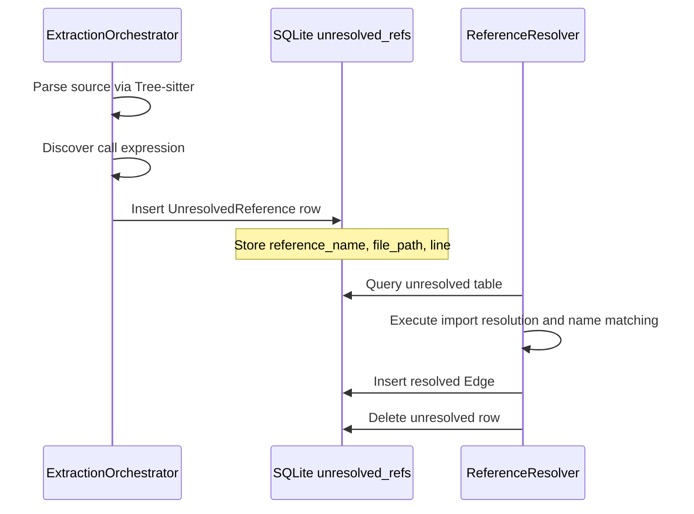

<!-- source: DeepWiki mcp.deepwiki.com · repo colbymchenry/codegraph · page 3.1 Knowledge Graph Model · fetched 2026-10-30 -->

# Knowledge Graph Model

<details>
<summary>Relevant source files</summary>

The following files were used as context for generating this wiki page:

- [.claude/skills/agent-eval/corpus.json](.claude/skills/agent-eval/corpus.json)
- [CHANGELOG.md](CHANGELOG.md)
- [__tests__/extraction.test.ts](__tests__/extraction.test.ts)
- [__tests__/resolution.test.ts](__tests__/resolution.test.ts)
- [src/db/queries.ts](src/db/queries.ts)
- [src/extraction/grammars.ts](src/extraction/grammars.ts)
- [src/extraction/index.ts](src/extraction/index.ts)
- [src/extraction/languages/index.ts](src/extraction/languages/index.ts)
- [src/extraction/tree-sitter.ts](src/extraction/tree-sitter.ts)
- [src/index.ts](src/index.ts)
- [src/resolution/import-resolver.ts](src/resolution/import-resolver.ts)
- [src/resolution/index.ts](src/resolution/index.ts)
- [src/resolution/name-matcher.ts](src/resolution/name-matcher.ts)
- [src/resolution/types.ts](src/resolution/types.ts)
- [src/types.ts](src/types.ts)

</details>


This page provides a technical deep dive into CodeGraph's knowledge graph data model, explaining how code symbols are represented as **nodes**, how relationships between symbols are represented as **edges**, how database persistence is structured, and how this graph model drives semantic code analysis.

---

## Core Data Model

CodeGraph represents a codebase as a directed property graph where code symbols are nodes and relationships are edges. The schema is defined in TypeScript interfaces that serve as the canonical data contract across all extraction, resolution, and query layers.

### Node and Edge Structure



**Sources:** [src/types.ts:133-201](), [src/types.ts:206-227]()

A **`Node`** represents an individual code symbol (such as a function, class, variable, or interface) with attributes capturing its semantic role and precise source location. The unique `id` is typically derived from a hash of the file path and qualified name [src/types.ts:133-134](). The `returnType` attribute captures normalized result types for method returns to assist in receiver-type inference [src/types.ts:190-197]().

An **`Edge`** connects a `source` node to a `target` node with a specific `kind`, alongside optional line/column offsets and a `provenance` tag (`tree-sitter`, `scip`, or `heuristic`) [src/types.ts:206-227]().

---

## Node Kinds

CodeGraph defines 23 distinct node kinds in the `NODE_KINDS` array to categorize every syntactic construct extracted from source files [src/types.ts:22-46]().

### Complete Node Kind Taxonomy

```mermaid
graph TD
    NodeKind["NodeKind"]
    
    Structural["Structural Containers"]
    Declarations["Type Declarations"]
    Callables["Callable Units"]
    DataMembers["Data Members"]
    TypeSystem["Type System"]
    ModuleSystem["Module System"]
    FrameworkSpecific["Framework-Specific"]
    
    NodeKind --> Structural
    NodeKind --> Declarations
    NodeKind --> Callables
    NodeKind --> DataMembers
    NodeKind --> TypeSystem
    NodeKind --> ModuleSystem
    NodeKind --> FrameworkSpecific
    
    Structural --> file["file"]
    Structural --> module["module"]
    Structural --> namespace["namespace"]
    
    Declarations --> class["class"]
    Declarations --> struct["struct"]
    Declarations --> interface["interface"]
    Declarations --> trait["trait"]
    Declarations --> protocol["protocol"]
    Declarations --> enum["enum"]
    
    Callables --> function["function"]
    Callables --> method["method"]
    
    DataMembers --> property["property"]
    DataMembers --> field["field"]
    DataMembers --> variable["variable"]
    DataMembers --> constant["constant"]
    DataMembers --> parameter["parameter"]
    DataMembers --> enum_member["enum_member"]
    
    TypeSystem --> type_alias["type_alias"]
    
    ModuleSystem --> import["import"]
    ModuleSystem --> export["export"]
    
    FrameworkSpecific --> route["route"]
    FrameworkSpecific --> component["component"]
    FrameworkSpecific --> union["union"]
```

**Sources:** [src/types.ts:22-46]()

Each language extractor maps language-specific AST elements into these canonical node kinds. Files themselves are instantiated as `file` nodes [src/types.ts:23]() backed by `FileRecord` metadata [src/types.ts:232-265]().

---

## Edge Kinds

CodeGraph defines 12 fundamental relationship types in `EDGE_KINDS` [src/types.ts:57-70]().

| Kind | Description |
|------|-------------|
| `contains` | Parent contains child (e.g., file → class, class → method) [src/types.ts:58]() |
| `calls` | Function or method invokes another [src/types.ts:59]() |
| `imports` | File imports from another module [src/types.ts:60]() |
| `exports` | File exports a symbol [src/types.ts:61]() |
| `extends` | Class or interface inherits from another [src/types.ts:62]() |
| `implements` | Class conforms to an interface or protocol [src/types.ts:63]() |
| `references` | Generic reference to another symbol [src/types.ts:64]() |
| `type_of` | Variable or parameter has a specific type [src/types.ts:65]() |
| `returns` | Function returns a specific type [src/types.ts:66]() |
| `instantiates` | Code constructs an instance of a class [src/types.ts:67]() |
| `overrides` | Method overrides a parent class implementation [src/types.ts:68]() |
| `decorates` | Decorator or annotation applied to a symbol [src/types.ts:69]() |
| `navigates` | Navigation transition to a screen or route (e.g., framework router actions) [src/types.ts:70]() |

### Value-Reference Edges
A specialized `references` edge variant carrying `metadata: { valueRef: true }` links a function or method to module- or file-scope `constant` or `variable` nodes it reads. This ensures impact analysis correctly identifies functions dependent on configuration constants.

**Sources:** [src/types.ts:57-70]()

---

## Bridge: Natural Language to Code Space

The following diagrams bridge high-level system concepts and tool actions to the concrete code entities and query mechanisms implemented in the repository.

### Entity Relationship Mapping



**Sources:** [src/types.ts:133-227](), [src/db/queries.ts:78-152]()

### Retrieval Logic Mapping



**Sources:** [src/mcp/tools.ts:1-162](), [src/index.ts:149-160](), [src/db/queries.ts:1-100]()

---

## Database Representation

The graph is persisted in a local SQLite database and manipulated through the `QueryBuilder` class [src/db/queries.ts:1-20]().

### Storage Row Mappings
- **`NodeRow`**: Maps snake_case database columns in the `nodes` table to the TypeScript `Node` interface [src/db/queries.ts:78-100]().
- **`EdgeRow`**: Maps the `edges` table to the `Edge` interface [src/db/queries.ts:102-111]().
- **`FileRow`**: Tracks file content hashes, sizes, modification timestamps, and extraction error states [src/db/queries.ts:113-124]().
- **`UnresolvedRefRow`**: Persists reference records (`unresolved_refs`) prior to resolution passes [src/db/queries.ts:126-166]().

### Performance Optimizations
- **FTS5 Full-Text Search**: SQLite FTS5 virtual tables index symbol identifiers and docstrings for rapid text queries [src/db/queries.ts:21-22]().
- **Name Tail Indexing**: The `referenceNameTail` utility extracts the trailing segments of dotted identifiers to accelerate lookup matching [src/db/queries.ts:25]() [src/db/reference-tail.ts:1-20]().

**Sources:** [src/db/queries.ts:1-166]()

---

## Unresolved References and Resolution

During initial file extraction, references to symbols defined externally or in other project files cannot immediately be linked to target node IDs. These are captured as `UnresolvedReference` structures [src/resolution/types.ts:12-35]() and stored in the database [src/db/queries.ts:126-166]().



**Sources:** [src/resolution/types.ts:12-35](), [src/db/queries.ts:126-166](), [src/extraction/index.ts:1-24]()

The `ReferenceResolver` coordinates multiple strategies (exact match, import path mapping, qualified name matching, and framework-specific resolvers) to transform unresolved references into valid graph edges [src/index.ts:50-54]().

**Sources:** [src/resolution/types.ts:12-88](), [src/index.ts:50-54]()

---

