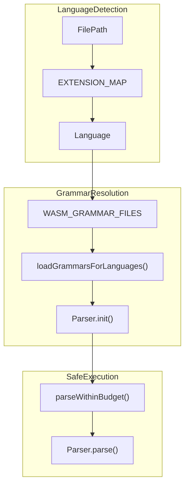
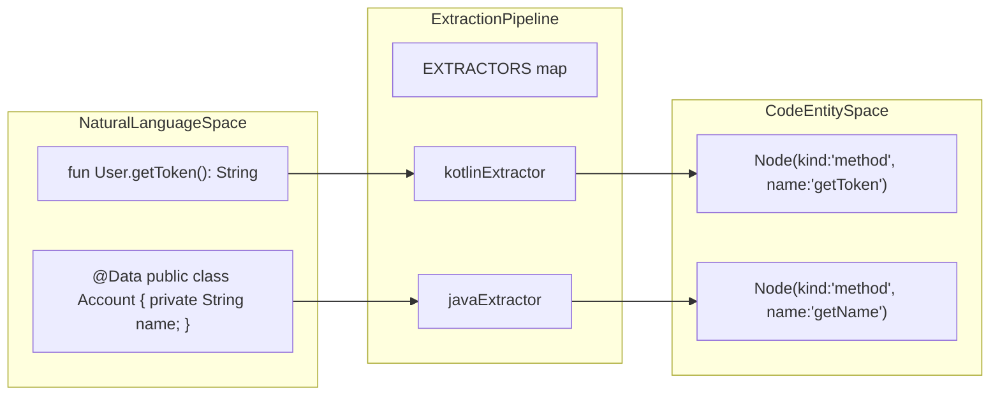
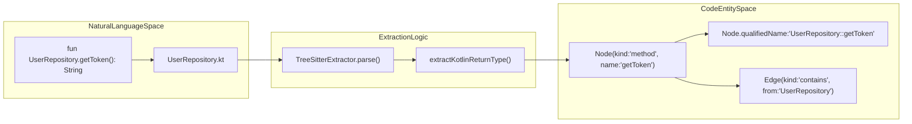
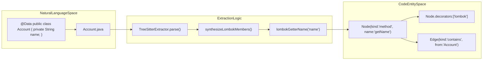

<!-- source: DeepWiki mcp.deepwiki.com · repo colbymchenry/codegraph · page 3.2 Supported Languages · fetched 2026-10-30 -->

# Supported Languages

Relevant source files

The following files were used as context for generating this wiki page:

- [.claude/skills/agent-eval/corpus.json](.claude/skills/agent-eval/corpus.json)
- [__tests__/cobol-sequence-area-period.test.ts](__tests__/cobol-sequence-area-period.test.ts)
- [__tests__/ui-highlight-bounded.test.ts](__tests__/ui-highlight-bounded.test.ts)
- [docs/grammars/tree-sitter-cobol.md](docs/grammars/tree-sitter-cobol.md)
- [docs/grammars/tree-sitter-cobol.patch](docs/grammars/tree-sitter-cobol.patch)
- [src/extraction/grammars.ts](src/extraction/grammars.ts)
- [src/extraction/languages/index.ts](src/extraction/languages/index.ts)
- [src/extraction/parse-budget.ts](src/extraction/parse-budget.ts)
- [src/extraction/wasm/tree-sitter-cobol.wasm](src/extraction/wasm/tree-sitter-cobol.wasm)
- [src/types.ts](src/types.ts)
- [src/ui-server/highlight/bounded-tokenize.ts](src/ui-server/highlight/bounded-tokenize.ts)
- [src/ui-server/highlight/index.ts](src/ui-server/highlight/index.ts)
- [src/ui-server/highlight/tokenize-worker.ts](src/ui-server/highlight/tokenize-worker.ts)

This page documents the programming languages supported by CodeGraph's hybrid extraction pipeline, detailing language detection mechanisms, the Tree-sitter grammar system (including vendored grammars and patches in `docs/grammars`), and advanced language-specific extraction features.

## Overview and Scope

CodeGraph supports over 40 programming languages and formats defined in `LANGUAGES` [src/types.ts:86-130](). Extraction is handled through a dual-engine architecture: a high-performance native Rust kernel and a WASM fallback layer using `web-tree-sitter` [src/extraction/grammars.ts:4-7](). Grammars are loaded lazily to minimize V8 memory pressure on large codebases [src/extraction/grammars.ts:5-7]().

Sources: [src/types.ts:86-130](), [src/extraction/grammars.ts:4-7]()

---

## Language Detection System

CodeGraph maps file extensions to language identifiers via `EXTENSION_MAP` [src/extraction/grammars.ts:59-174](). This map handles standard extensions as well as specialized dialects (such as `.ets` for ArkTS [src/extraction/grammars.ts:65-68](), `.xsjs` for SAP HANA JavaScript [src/extraction/grammars.ts:72-74](), and specialized COBOL/VB.NET/Erlang variants).

### Extension Mapping Table

| Extension(s) | Language | Notes / Dialect Handling |
|-------------|----------|--------------------------|
| `.ts`, `.tsx`, `.mts`, `.cts` | `typescript`, `tsx` | Includes ESM and CJS TypeScript extensions [src/extraction/grammars.ts:59-64]() |
| `.ets` | `arkts` | ArkTS (HarmonyOS/OpenHarmony) declarative UI superset [src/extraction/grammars.ts:65-68]() |
| `.js`, `.mjs`, `.cjs`, `.jsx` | `javascript`, `jsx` | Standard JS/JSX and server-side JS (`.xsjs`) [src/extraction/grammars.ts:69-75]() |
| `.cs` | `csharp` | Preprocessor directive blanking applied [src/extraction/languages/index.ts:18]() |
| `.java` | `java` | Lombok member synthesis supported [src/extraction/languages/index.ts:16]() |
| `.kt`, `.kts` | `kotlin` | Extension methods and property initializers [src/extraction/languages/index.ts:22]() |
| `.metal` | `cpp` | Metal Shading Language with `[[attribute]]` pre-parse blanking [src/extraction/grammars.ts:134-136]() |
| `.cu`, `.cuh` | `cpp` | CUDA execution-space specifier handling [src/extraction/grammars.ts:138-143]() |
| `.cbl`, `.cob`, `.cpy` | `cobol` | Vendored grammar with custom patch for `EXEC` blocks and wide mode [docs/grammars/tree-sitter-cobol.md:1-45]() |
| `.vb` | `vbnet` | Trailing newline normalization and modifier scanning [src/extraction/grammars.ts:155-157]() |

Sources: [src/extraction/grammars.ts:59-174](), [src/extraction/languages/index.ts:16-22](), [docs/grammars/tree-sitter-cobol.md:1-45]()

---

## Tree-sitter Grammar System and WASM Integration

The grammar loading layer (`src/extraction/grammars.ts`) maintains `WASM_GRAMMAR_FILES` mapping each supported `GrammarLanguage` to its corresponding `.wasm` file [src/extraction/grammars.ts:21-54](). Request-time parses and queries are guarded by `parseWithinBudget()` to prevent infinite loops in malformed source files or edge-case grammar hangs [src/extraction/parse-budget.ts:14-23]().

**Diagram: Language Detection to WASM Parsing Flow**

Sources: [src/extraction/grammars.ts:21-54](), [src/extraction/parse-budget.ts:14-23]()

---

## Vendored Grammars and Patches: COBOL Example

Certain enterprise and legacy grammars require custom patches to correctly parse production codebases. For instance, the COBOL grammar (`src/extraction/wasm/tree-sitter-cobol.wasm`) is built from `yutaro-sakamoto/tree-sitter-cobol` with a patch addressing `EXEC` blocks, COPY replacing clauses, single-quote string continuation, and end-of-input sequence area handling [docs/grammars/tree-sitter-cobol.md:1-66]().

Sources: [docs/grammars/tree-sitter-cobol.md:1-66](), [src/extraction/wasm/tree-sitter-cobol.wasm:1-3]()

---

## Language-Specific Extraction Features

Extractors in `src/extraction/languages/` customize AST traversal to extract idiomatic language constructs.

## Data Flow: Kotlin Extension Functions to Code Entities

**Diagram: Kotlin Extension Function Extraction Flow**

Sources: [src/extraction/languages/index.ts:11-39](), [src/types.ts:140-235]()

## Data Flow: Java Lombok Member Synthesis to Code Entities

**Diagram: Java Lombok Synthesis Data Flow**

Sources: [src/types.ts:140-235]()

---

