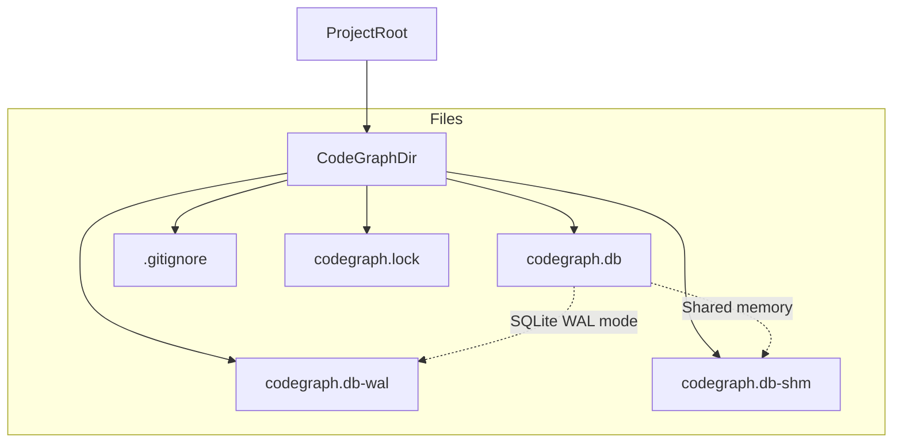
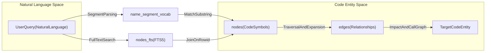

<!-- source: DeepWiki mcp.deepwiki.com · repo colbymchenry/codegraph · page 3.3 Project Structure and Database · fetched 2026-10-30 -->

# Project Structure and Database

<details>
<summary>Relevant source files</summary>

The following files were used as context for generating this wiki page:

- [__tests__/db-perf.test.ts](__tests__/db-perf.test.ts)
- [__tests__/foundation.test.ts](__tests__/foundation.test.ts)
- [__tests__/frontload-hook.test.ts](__tests__/frontload-hook.test.ts)
- [__tests__/mcp-unindexed.test.ts](__tests__/mcp-unindexed.test.ts)
- [__tests__/pr19-improvements.test.ts](__tests__/pr19-improvements.test.ts)
- [__tests__/schemaless-db-not-initialized.test.ts](__tests__/schemaless-db-not-initialized.test.ts)
- [__tests__/sync-import-binding-retry.test.ts](__tests__/sync-import-binding-retry.test.ts)
- [__tests__/sync-import-member-retry.test.ts](__tests__/sync-import-member-retry.test.ts)
- [__tests__/sync-python-import-binding-retry.test.ts](__tests__/sync-python-import-binding-retry.test.ts)
- [src/db/index.ts](src/db/index.ts)
- [src/db/migrations.ts](src/db/migrations.ts)
- [src/db/reference-tail.ts](src/db/reference-tail.ts)
- [src/db/schema.sql](src/db/schema.sql)
- [src/directory.ts](src/directory.ts)

</details>


This page documents the internal file layout of CodeGraph projects, the SQLite database schema, versioned migrations, file tracking mechanisms, and the incremental synchronization pipeline.

---

## Purpose and Scope

CodeGraph stores all project-specific intelligence—including source code symbols, inter-file relationships, full-text search indices, and resolution states—locally within the project tree. This section details how the data directory is managed, how the SQLite schema is structured and migrated, how database connections are optimized, and how incremental sync updates the graph without full re-indexing.

Sources: [src/directory.ts:1-123](), [src/db/index.ts:1-50]()

---

## The .codegraph Directory and Environment Isolation

Every CodeGraph-initialized project contains a local data directory at its root [src/directory.ts:1-15](). By default, this directory is named `.codegraph/`, but its name can be customized via the `CODEGRAPH_DIR` environment variable [src/directory.ts:44-65]().

### Directory Layout and Cross-Environment Safety

When multiple environments share a working tree (most notably Windows-native and WSL accessing the same mount), sharing a single `.codegraph/` directory can cause SQLite file locking failures or permission conflicts over the 9p/DrvFs bridge [src/directory.ts:31-36]() (issue #995). CodeGraph addresses this via environment overrides and WSL-specific directory selection:

- **`CODEGRAPH_DIR` Override:** If set, `codeGraphDirName()` validates that the override is a plain path segment (no path separators, no `..`, not absolute) and uses it [src/directory.ts:44-65]().
- **WSL Windows Drive Detection:** For projects located on Windows drives under WSL without an explicit `CODEGRAPH_DIR`, `codeGraphDirNameFor()` checks for `.codegraph-wsl/` or an existing `.codegraph/codegraph.db` to prevent cross-environment corruption [src/directory.ts:107-116]().

### Directory Structure Diagram



Sources: [src/directory.ts:4-122](), [__tests__/foundation.test.ts:58-71]()

---

## SQLite Database Schema and Migrations

CodeGraph utilizes SQLite (`node:sqlite` DatabaseSync) as its primary storage engine, configured for concurrent reads and writes using Write-Ahead Logging (WAL) [src/db/index.ts:33-36]().

### Schema Architecture

```mermaid
erDiagram
    nodes {
        TEXT id PK
        TEXT kind
        TEXT name
        TEXT qualified_name
        TEXT file_path
        TEXT language
        INTEGER start_line
        INTEGER end_line
        INTEGER start_column
        INTEGER end_column
        TEXT docstring
        TEXT signature
        TEXT visibility
        INTEGER is_exported
        INTEGER is_async
        INTEGER is_static
        INTEGER is_abstract
        TEXT decorators
        TEXT type_parameters
        TEXT return_type
        INTEGER updated_at
    }

    edges {
        INTEGER id PK AUTOINCREMENT
        TEXT source FK
        TEXT target FK
        TEXT kind
        TEXT metadata
        INTEGER line
        INTEGER col
        TEXT provenance
    }

    files {
        TEXT path PK
        TEXT content_hash
        TEXT language
        INTEGER size
        INTEGER modified_at
        INTEGER indexed_at
        INTEGER node_count
        TEXT errors
        INTEGER generated
    }

    unresolved_refs {
        INTEGER id PK AUTOINCREMENT
        TEXT from_node_id FK
        TEXT reference_name
        TEXT reference_kind
        INTEGER line
        INTEGER col
        TEXT candidates
        TEXT file_path
        TEXT language
        TEXT status
        TEXT name_tail
    }

    name_segment_vocab {
        TEXT segment PK
        TEXT name PK
    }

    nodes_fts {
        TEXT id
        TEXT name
        TEXT qualified_name
        TEXT docstring
        TEXT signature
    }

    edges }o--|| nodes : "source"
    edges }o--|| nodes : "target"
    unresolved_refs }o--|| nodes : "from_node_id"
    nodes ||--o{ nodes_fts : "indexed_in"
```

Sources: [src/db/schema.sql:1-160](), [src/db/migrations.ts:1-160]()

### Core Table Definitions

1. **`nodes`**: Stores extracted code symbols (functions, classes, variables, etc.) along with location bounds, signatures, export flags, and `return_type` for receiver-type inference [src/db/schema.sql:20-42]().
2. **`edges`**: Encodes directed relationships between nodes (`source` to `target`) with metadata and provenance. The unique index `idx_edges_identity` on `(source, target, kind, line, col)` enables `INSERT OR IGNORE` to safely deduplicate identical edge writes [src/db/schema.sql:45-56](), [src/db/migrations.ts:82-102]().
3. **`files`**: Tracks file modification states, content hashes, size, and generated-file verdicts (`generated`) used during result ranking [src/db/schema.sql:67-77]().
4. **`unresolved_refs`**: Records cross-file references that could not be immediately resolved. It supports a lifecycle (`pending`, `failed`) and maintains `name_tail` segments so background synchronization passes can retry them when new files are added [src/db/schema.sql:88-101](), [src/db/migrations.ts:123-152]().
5. **`name_segment_vocab`**: Materializes lowercased identifier segments (e.g., `OrderStateMachine` broken into `order`, `state`, `machine`) to support natural language prompt gating [src/db/schema.sql:158-162](), [src/db/migrations.ts:104-121]().

Sources: [src/db/schema.sql:20-162](), [src/db/migrations.ts:30-155]()

### Migration Versioning

Schema changes are managed programmatically via `CURRENT_SCHEMA_VERSION` (currently set to `16`) and an ordered array of migration definitions [src/db/migrations.ts:13-30](). Each migration defines an `up()` function applied sequentially inside transactions when opening an older database [src/db/migrations.ts:18-22]().

Sources: [src/db/migrations.ts:1-40]()

---

## Database Connection, PRAGMAs, and WAL Management

The `DatabaseConnection` class manages connection lifecycles, statement preparation, and PRAGMA configurations [src/db/index.ts:91-118]().

### Connection PRAGMAs and WAL Healing
- **WAL Mode:** `journal_mode = WAL` enables concurrent readers alongside a single active writer [src/db/index.ts:33-36]().
- **Busy Timeout:** Configured to `busy_timeout = 5000` to gracefully handle multi-process write contention between the CLI, MCP server, and auto-sync hooks [src/db/index.ts:34]().
- **Oversized WAL Checkpointing:** At startup, `healOversizedWal()` inspects WAL file sizes and checkpoints/truncates files exceeding limits defined by `WAL_HEAL_THRESHOLD_BYTES` to prevent disk exhaustion [src/db/index.ts:70-87]().

Sources: [src/db/index.ts:33-87]()

---

## Incremental Sync, File Tracking, and Reference Retries

CodeGraph maintains graph freshness through an incremental sync engine that processes modified files, updates nodes/edges via cascade deletions, and retries failed cross-file references.

### Reference Tail Resolution (`reference-tail.ts`)
When references fail to resolve during initial extraction, they are parked in `unresolved_refs` with a `name_tail` derived via `referenceNameTail()` [src/db/reference-tail.ts:40-60](). This function extracts the search key for dotted references, imports, modules, and file paths (e.g., `snippets/price.liquid` mapped to `price.liquid`), allowing subsequent file additions to instantly link pending edges [src/db/reference-tail.ts:40-131](), [__tests__/sync-import-binding-retry.test.ts:1-29]().

Sources: [src/db/reference-tail.ts:40-131](), [__tests__/sync-import-binding-retry.test.ts:1-30]()

---

## Data Flow: Natural Language to Code Entity Space

CodeGraph bridges natural language queries to precise code symbols by combining materialized vocabulary segment indices with FTS5 virtual tables and graph traversal paths.

### Data Flow Diagram: Natural Language to Code Entity Space



Sources: [src/db/schema.sql:116-162](), [src/db/migrations.ts:104-121]()

---

