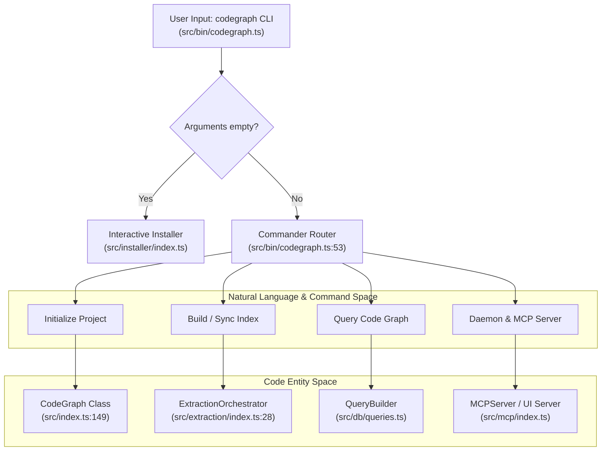
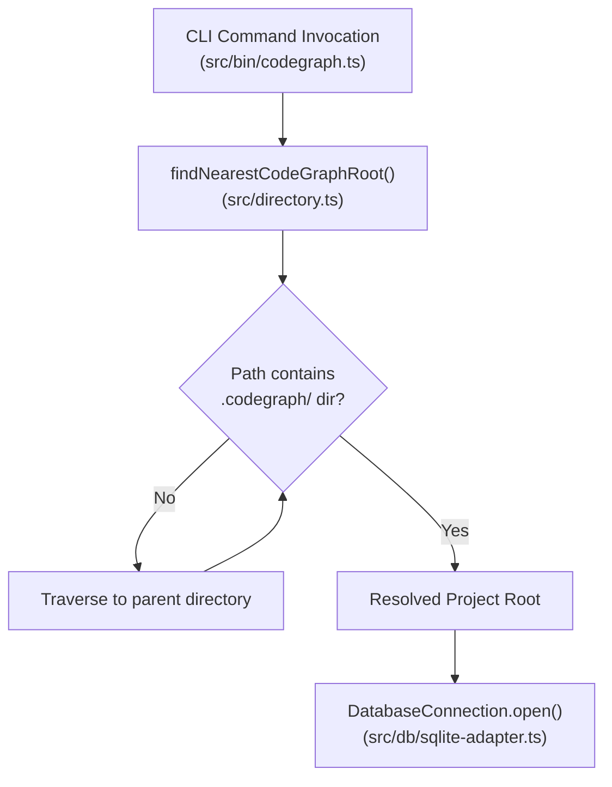

<!-- source: DeepWiki mcp.deepwiki.com · repo colbymchenry/codegraph · page 4 CLI Reference · fetched 2026-10-30 -->

# CLI Reference

Relevant source files

The following files were used as context for generating this wiki page:

- [CLAUDE.md](CLAUDE.md)
- [README.md](README.md)
- [__tests__/cli-ui-command.test.ts](__tests__/cli-ui-command.test.ts)
- [__tests__/installer.test.ts](__tests__/installer.test.ts)
- [__tests__/viewer-gate.test.ts](__tests__/viewer-gate.test.ts)
- [assets/codegraph-ui-symbol-view.png](assets/codegraph-ui-symbol-view.png)
- [package-lock.json](package-lock.json)
- [package.json](package.json)
- [site/astro.config.mjs](site/astro.config.mjs)
- [site/src/content/docs/getting-started/next-steps.md](site/src/content/docs/getting-started/next-steps.md)
- [site/src/content/docs/reference/cli.md](site/src/content/docs/reference/cli.md)
- [src/bin/codegraph.ts](src/bin/codegraph.ts)
- [src/bin/command-supervision.ts](src/bin/command-supervision.ts)
- [src/bin/viewer-gate.ts](src/bin/viewer-gate.ts)
- [src/installer/config-writer.ts](src/installer/config-writer.ts)
- [src/installer/index.ts](src/installer/index.ts)
- [src/mcp/tools.ts](src/mcp/tools.ts)

This page provides comprehensive documentation for the `codegraph` command-line interface. The CLI is the primary user-facing tool for managing CodeGraph projects, running manual and incremental indexing, executing graph queries, and coordinating background server processes for AI agent integration. As a parent page, this overview covers general architecture and command groups; for detailed technical specifications and deep-dive usage, consult the linked child pages: [Project Management Commands](#4.1), [Indexing Commands](#4.2), [Query Commands](#4.3), and [Server and Hook Commands](#4.4) [src/bin/codegraph.ts:3-25]().

## CLI Architecture and Command Routing

The CodeGraph CLI is implemented as a Commander.js application [src/bin/codegraph.ts:53]() that routes incoming terminal inputs to core subsystem classes such as `CodeGraph` [src/index.ts:149]() and `ExtractionOrchestrator` [src/extraction/index.ts:28](). When invoked with no arguments, it launches the interactive multi-agent installer script [src/bin/codegraph.ts:8-9](). Otherwise, it parses arguments, resolves project roots, and executes the target action.

Title: CLI Command Routing and Subsystem Mapping

Sources: [src/bin/codegraph.ts:1-55](), [src/index.ts:149-160](), [src/extraction/index.ts:25-32]()

## Command Groups Overview

The CLI functionality is partitioned into four major command groups, detailed in their respective child pages:

### Project Management Commands (#4.1)
Covers initialization and metadata checks for local repositories. This group includes `codegraph init` (which sets up the `.codegraph/` directory and bootstraps the SQLite database), `codegraph uninit` (which tears down project configurations), and `codegraph status` (which reports node counts, index health, and staleness) [src/bin/codegraph.ts:11-16]().
* For details, see [Project Management Commands](#4.1).

### Indexing Commands (#4.2)
Manages full and incremental code graph generation. Commands include `codegraph index` (force re-indexing of all source files), `codegraph sync` (incremental updates reconciling file mutations since the last run), and `codegraph upgrade` (in-place binary or package updates) [src/bin/codegraph.ts:13-15]().
* For details, see [Indexing Commands](#4.2).

### Query Commands (#4.3)
Provides direct inspection of the knowledge graph via the terminal. Commands include `codegraph query` (FTS5 and identifier segment searches), `codegraph files` (file layout discovery), `codegraph node` (symbol lookup), and `codegraph context` (task-specific context extraction) [src/bin/codegraph.ts:16-22]().
* For details, see [Query Commands](#4.3).

### Server and Hook Commands (#4.4)
Handles background daemons, MCP protocol servers, and synchronization hooks used by AI coding assistants. This group includes `codegraph serve`, `codegraph mark-dirty`, `codegraph sync-if-dirty`, `codegraph ui`, and `codegraph unlock` [src/bin/codegraph.ts:20-24]().
* For details, see [Server and Hook Commands](#4.4).

Sources: [src/bin/codegraph.ts:8-25]()

## Runtime Safety, Path Resolution, and Supervision

Before executing any subcommand, the CLI enforces strict safety guards, including checks against unsupported Node.js versions (blocking Node 25.x due to V8 WASM JIT issues) and applying runtime flags like `--liftoff-only` [src/bin/codegraph.ts:110-130](). 

Path resolution uses `findNearestCodeGraphRoot()` to traverse upwards from the current working directory until an initialized `.codegraph` store is located [src/bin/codegraph.ts:43](), [src/directory.ts:35-45]().

Title: Project Root Discovery and Database Initialization Flow

Sources: [src/bin/codegraph.ts:110-130](), [src/directory.ts:30-50](), [src/db/sqlite-adapter.ts:1-20]()

---

