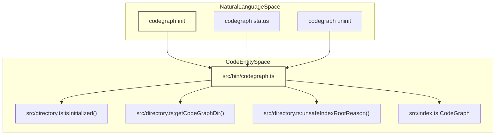
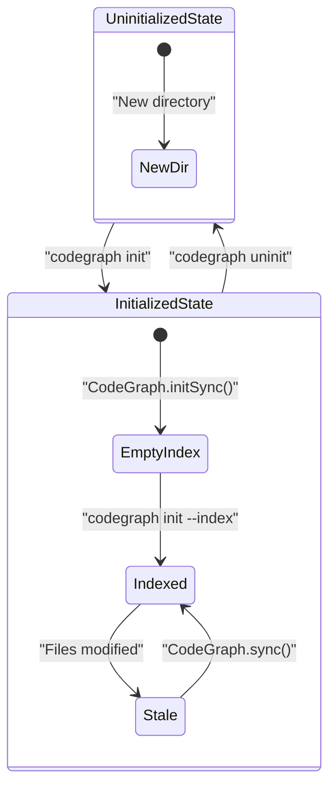
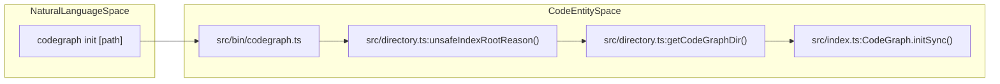
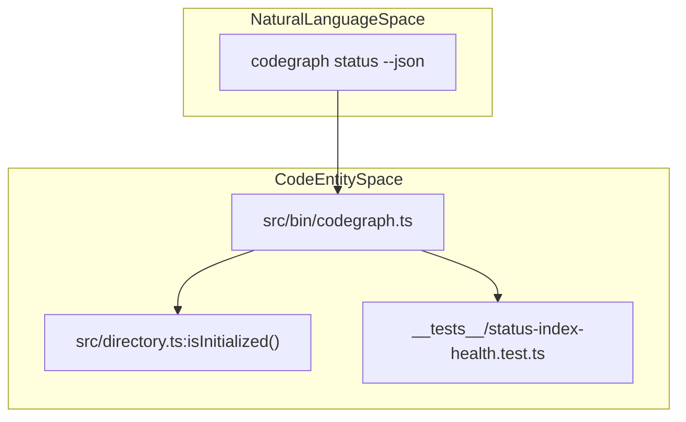

<!-- source: DeepWiki mcp.deepwiki.com · repo colbymchenry/codegraph · page 4.1 Project Management Commands · fetched 2026-10-30 -->

# Project Management Commands

Relevant source files

The following files were used as context for generating this wiki page:

- [CLAUDE.md](CLAUDE.md)
- [README.md](README.md)
- [__tests__/daemon-install-check.test.ts](__tests__/daemon-install-check.test.ts)
- [__tests__/daemon-older-version.test.ts](__tests__/daemon-older-version.test.ts)
- [__tests__/grammar-load-failure.test.ts](__tests__/grammar-load-failure.test.ts)
- [__tests__/installer.test.ts](__tests__/installer.test.ts)
- [__tests__/status-index-health.test.ts](__tests__/status-index-health.test.ts)
- [__tests__/ts-export-type-star.test.ts](__tests__/ts-export-type-star.test.ts)
- [package-lock.json](package-lock.json)
- [package.json](package.json)
- [src/bin/codegraph.ts](src/bin/codegraph.ts)
- [src/installer/config-writer.ts](src/installer/config-writer.ts)
- [src/installer/index.ts](src/installer/index.ts)
- [src/mcp/tools.ts](src/mcp/tools.ts)
- [src/mcp/version.ts](src/mcp/version.ts)

This page documents the CLI commands that manage the lifecycle of CodeGraph projects: `init`, `uninit`, and `status`. These commands control project initialization, uninitialization, and inspection of CodeGraph's local index state within the `.codegraph/` directory structure.

---

## Command Overview and Architecture

CodeGraph project management commands translate user intentions entered via the CLI into filesystem, directory validation, and database operations managed by the core CLI router and directory utility modules.

Title: "CLI Project Management Architecture"

Sources: [src/bin/codegraph.ts:11-25](), [src/directory.ts:85-156](), [src/index.ts:149-183]()

---

## Project Lifecycle Flow

The lifecycle of a CodeGraph project transitions through uninitialized, initialized, and synchronized states as managed by CLI commands.

Title: "Project Lifecycle State Machine"

Sources: [src/bin/codegraph.ts:11-25](), [src/directory.ts:85-101](), [src/index.ts:149-183]()

---

## codegraph init

### Purpose
The `init` command creates the local `.codegraph/` directory and initializes the SQLite database schema. It guards against unsafe execution paths (such as the system root or user home directory) using `unsafeIndexRootReason()` [src/directory.ts:126-156]().

Sources: [src/bin/codegraph.ts:11-15](), [src/directory.ts:126-200]()

### Syntax and Implementation Mapping

Title: "Init Command Mapping to Code Entities"

Sources: [src/bin/codegraph.ts:11-15](), [src/directory.ts:126-200](), [src/index.ts:149-183]()

### Created File Layout
| Path | Description |
|:---|:---|
| `.codegraph/` | Local metadata and index root directory [src/directory.ts:35-56]() |
| `.codegraph/codegraph.db` | SQLite database storing nodes, edges, and file records |
| `.codegraph/.gitignore` | Local exclusion rules ignoring generated index contents [src/directory.ts:192-198]() |

Sources: [src/directory.ts:35-56](), [src/directory.ts:192-198]()

---

## codegraph uninit

### Purpose
The `uninit` command tears down CodeGraph metadata by deleting the `.codegraph/` directory for a project. It verifies initialization state via `isInitialized()` before invoking removal routines.

Sources: [src/bin/codegraph.ts:11-15](), [src/directory.ts:93-101]()

### Execution Flow
1. Validates that the target path contains an active `.codegraph/` directory using `isInitialized()`.
2. Prompts for user confirmation via interactive prompts unless forced.
3. Recursively deletes the `.codegraph/` directory from disk.

Sources: [src/bin/codegraph.ts:11-15](), [src/directory.ts:93-101]()

---

## codegraph status

### Purpose
The `status` command inspects the SQLite database underlying the project knowledge graph, outputting metrics such as total nodes, edges, storage size, index freshness, and index health (including parse errors and missing symbols per issues `#2336` and `#2335`) [__tests__/status-index-health.test.ts:1-164]().

Sources: [src/bin/codegraph.ts:15](), [__tests__/status-index-health.test.ts:1-164]()

### Health Inspection and Metrics Flow

Title: "Status Inspection Mapping"

Sources: [src/bin/codegraph.ts:15](), [src/directory.ts:93-101](), [__tests__/status-index-health.test.ts:80-164]()

### Metrics Collected
- **Initialization State**: Verified via `isInitialized()` [src/directory.ts:93-101]().
- **Node & Edge Counts**: Queried from the SQLite database tables.
- **Files with Parse Errors**: Identifies files where parsing failed (e.g., merge conflict markers or syntax issues) [__tests__/status-index-health.test.ts:108-124]().
- **Files Needing Reindex**: Detects rows stored without their associated symbols, prompting a `codegraph sync` [__tests__/status-index-health.test.ts:141-151]().
- **JSON Output**: Supported via `--json` flags for CI and script integration [__tests__/status-index-health.test.ts:87-90]().

Sources: [src/directory.ts:93-101](), [__tests__/status-index-health.test.ts:75-164]()

---

## Project Path Resolution

Commands automatically traverse parent directories using `findNearestCodeGraphRoot()` to locate the nearest `.codegraph/` directory, allowing seamless execution from any nested subdirectory within a repository.

Sources: [src/directory.ts:158-177]()

---

