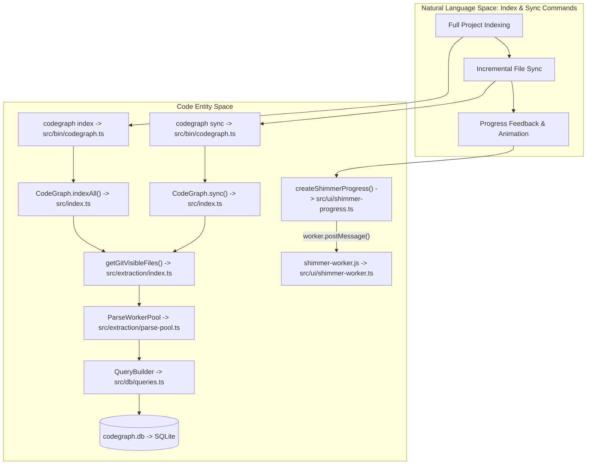
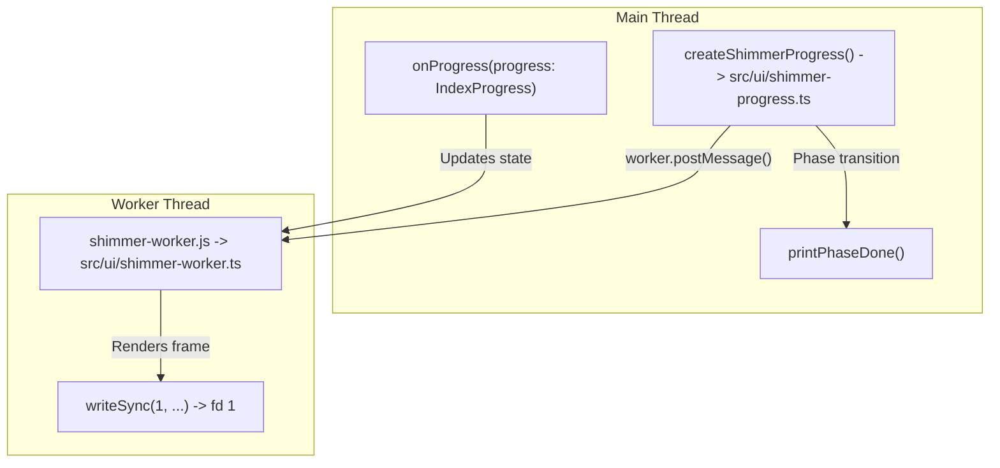
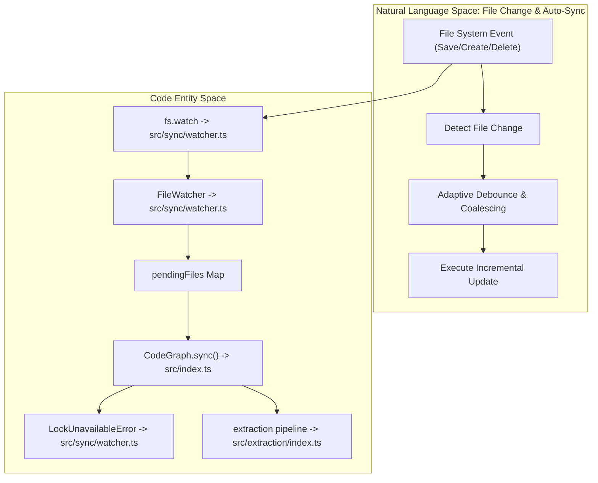

<!-- source: DeepWiki mcp.deepwiki.com · repo colbymchenry/codegraph · page 4.2 Indexing Commands · fetched 2026-10-30 -->

# Indexing Commands

<details>
<summary>Relevant source files</summary>

The following files were used as context for generating this wiki page:

- [__tests__/cli-no-color.test.ts](__tests__/cli-no-color.test.ts)
- [__tests__/cli-sync.test.ts](__tests__/cli-sync.test.ts)
- [__tests__/concurrent-locking.test.ts](__tests__/concurrent-locking.test.ts)
- [__tests__/glyphs.test.ts](__tests__/glyphs.test.ts)
- [__tests__/install-sh-prune.test.ts](__tests__/install-sh-prune.test.ts)
- [__tests__/installer-links-simulated.test.ts](__tests__/installer-links-simulated.test.ts)
- [__tests__/mcp-staleness-banner.test.ts](__tests__/mcp-staleness-banner.test.ts)
- [__tests__/node-sqlite-backend.test.ts](__tests__/node-sqlite-backend.test.ts)
- [__tests__/node-version-check.test.ts](__tests__/node-version-check.test.ts)
- [__tests__/sync.test.ts](__tests__/sync.test.ts)
- [__tests__/upgrade.test.ts](__tests__/upgrade.test.ts)
- [__tests__/watcher.test.ts](__tests__/watcher.test.ts)
- [install.ps1](install.ps1)
- [install.sh](install.sh)
- [src/bin/node-version-check.ts](src/bin/node-version-check.ts)
- [src/installer/targets/copilot-cli.ts](src/installer/targets/copilot-cli.ts)
- [src/sync/index.ts](src/sync/index.ts)
- [src/sync/watcher.ts](src/sync/watcher.ts)
- [src/ui/color.ts](src/ui/color.ts)
- [src/ui/glyphs.ts](src/ui/glyphs.ts)
- [src/ui/shimmer-progress.ts](src/ui/shimmer-progress.ts)
- [src/ui/shimmer-worker.ts](src/ui/shimmer-worker.ts)
- [src/ui/types.ts](src/ui/types.ts)
- [src/upgrade/index.ts](src/upgrade/index.ts)

</details>


This page documents the indexing and synchronization commands in CodeGraph: `codegraph index`, `codegraph sync`, and `codegraph upgrade`. These commands drive the extraction pipeline, manage incremental synchronization, handle progress reporting via the shimmer UI, and support self-updates across different installation methods.

---

## Overview

CodeGraph provides three main commands for building and maintaining the knowledge graph:
- **`codegraph index`**: Executes a full parse of all project files, building the knowledge graph from scratch [src/bin/codegraph.ts:13-13]().
- **`codegraph sync`**: Executes incremental updates, processing only modified, added, or deleted files [src/bin/codegraph.ts:14-14]().
- **`codegraph upgrade`**: Upgrades the CLI installation depending on how CodeGraph was installed [src/bin/codegraph.ts:23-23](), [src/upgrade/index.ts:1-35]().

Sources: [src/bin/codegraph.ts:11-30](), [src/upgrade/index.ts:1-35]()

---

## Command Architecture and Extraction Pipeline

The CLI entry point coordinates with the core engine and worker pools to parse source files and persist entities into SQLite.

**Diagram 1: Natural Language Space to Code Entity Space — Extraction & Progress Data Flow**

Sources: [src/bin/codegraph.ts:11-30](), [src/extraction/index.ts:39-75](), [src/index.ts:139-173](), [src/ui/shimmer-progress.ts:25-129](), [src/ui/shimmer-worker.ts:1-134]()

---

## Progress Reporting and Shimmer UI

During heavy extraction phases, CodeGraph provides interactive progress feedback using `createShimmerProgress` [src/ui/shimmer-progress.ts:25-129]() and a dedicated worker thread `shimmer-worker.ts` [src/ui/shimmer-worker.ts:1-134]().

### Phases
The progress reporter tracks five distinct phases defined in `PHASE_NAMES`:
1. `scanning`: Scanning files
2. `parsing`: Parsing code
3. `storing`: Storing data
4. `resolving`: Resolving refs
5. `linking`: Linking dynamic dispatch [src/ui/shimmer-progress.ts:6-12]()

### Implementation Details
- **TTY Detection**: If `process.stdout.isTTY` is true, CodeGraph spawns `shimmer-worker.js` via `worker_threads` [src/ui/shimmer-progress.ts:28-71]().
- **Direct System Calls**: The shimmer worker writes directly to file descriptor 1 (`writeSync(1, ...)`), bypassing Node's event loop congestion if the main thread is blocked on SQLite operations [src/ui/shimmer-worker.ts:6-21]().
- **Non-TTY Fallback**: When redirected or in CI (`process.stdout.isTTY !== true`), it falls back to `createPlainProgress`, emitting one plain line per phase [src/ui/shimmer-progress.ts:28-30](), [src/ui/shimmer-progress.ts:136-151]().

**Progress Reporting Architecture**

Sources: [src/ui/shimmer-progress.ts:1-151](), [src/ui/shimmer-worker.ts:1-134]()

---

## The `index` Command

### Syntax and Options
```bash
codegraph index [path] [options]
```
- `--force` (`-f`): Clears the existing database index and rebuilds from scratch [src/bin/codegraph.ts:354-354]().
- `--verbose` (`-v`): Enables verbose logging and detailed output [src/bin/codegraph.ts:355-355]().

### Execution Flow
1. Scans project files using `getGitVisibleFiles()` or file system traversal [src/extraction/index.ts:180-202]().
2. Dispatches file contents in batches to worker threads running Tree-sitter parsers [src/extraction/index.ts:24-24]().
3. Inserts nodes and edges into SQLite via `QueryBuilder` [src/extraction/index.ts:23-23](), [src/db/queries.ts:214-226]().

Sources: [src/extraction/index.ts:43-74](), [src/bin/codegraph.ts:350-417](), [src/db/queries.ts:214-226]()

---

## The `sync` Command and Incremental Updates

### Syntax
```bash
codegraph sync [path] [options]
```

### Change Detection, Locking, and Sync Logic
The `sync` command invokes `CodeGraph.sync()` [src/index.ts:52-52]() to perform incremental updates:
1. **Git Status Check**: Executes `git status --porcelain` to quickly identify added, modified, or removed files [src/extraction/index.ts:205-230]().
2. **Content Hashing**: Compares SHA256 content hashes against the stored records in the `files` table [src/extraction/index.ts:138-140]().
3. **Lock Protection**: If the project database is locked by another writer, sync operations throw `LockUnavailableError` or retry based on configuration [__tests__/sync.test.ts:128-150](), [src/sync/watcher.ts:46-50]().
4. **File Watcher Integration**: The `FileWatcher` class in `src/sync/watcher.ts` monitors file system changes using native `fs.watch` (recursive on macOS/Windows, per-directory inotify on Linux) with adaptive debouncing (`QUICK_SYNC_MAX_PENDING`, `SCOPED_SYNC_MAX_PENDING`) [src/sync/watcher.ts:1-80]().

**Diagram 2: Natural Language Space to Code Entity Space — File Watcher & Incremental Sync**

Sources: [src/extraction/index.ts:111-280](), [src/bin/codegraph.ts:419-477](), [src/sync/watcher.ts:1-80](), [__tests__/sync.test.ts:128-178]()

---

## The `upgrade` Command

### Syntax
```bash
codegraph upgrade [version] [--check]
```

### Installation Method Detection
`detectInstallMethod` in `src/upgrade/index.ts` determines how CodeGraph was installed by inspecting the running module's filename and path structure [src/upgrade/index.ts:97-146]():
- **Bundle**: Detected by checking for a vendored `node` binary and launcher script relative to the bundle root [src/upgrade/index.ts:130-137](). Unix re-runs `install.sh` [install.sh:1-151](); Windows uses `install.ps1` and `Install-CodeGraphFiles` to rename locked files aside safely [install.ps1:18-90]().
- **NPM**: Detected when running inside a `node_modules` directory (`scope: 'global'` or `'local'`), shelling out to npm [src/upgrade/index.ts:123-127]().
- **NPX**: Detected via `_npx` cache paths [src/upgrade/index.ts:119-121]().
- **Source**: Detected via sibling `package.json` and `.git` directories [src/upgrade/index.ts:139-143]().

Sources: [src/upgrade/index.ts:1-159](), [install.sh:1-151](), [install.ps1:1-132]()

---

