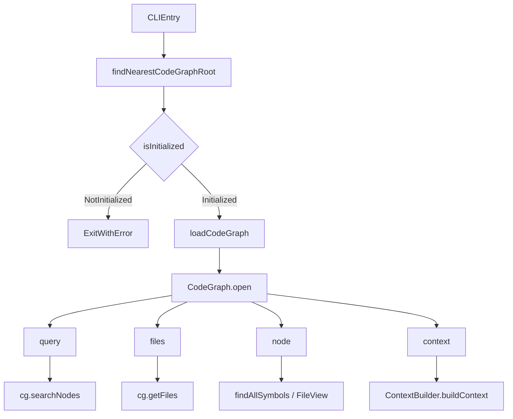
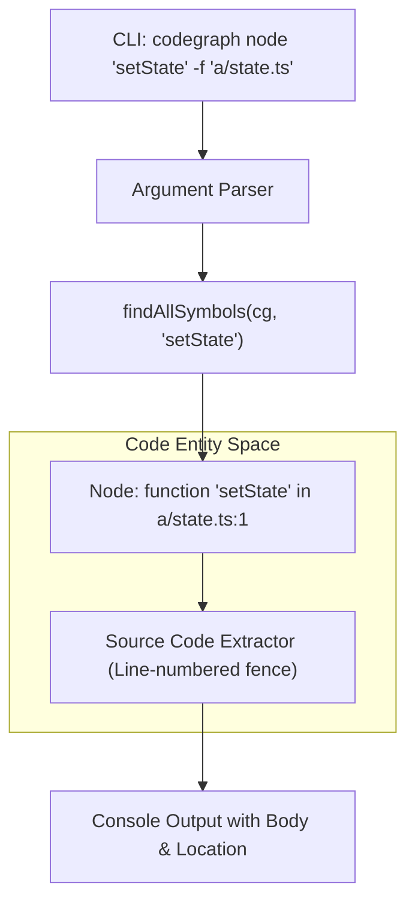
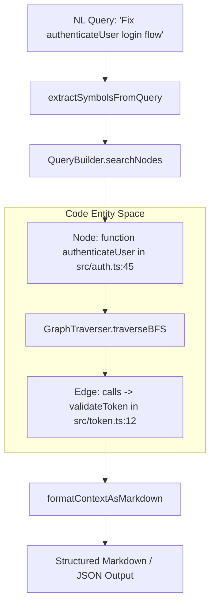

<!-- source: DeepWiki mcp.deepwiki.com · repo colbymchenry/codegraph · page 4.3 Query Commands · fetched 2026-10-30 -->

# Query Commands

<details>
<summary>Relevant source files</summary>

The following files were used as context for generating this wiki page:

- [__tests__/adaptive-explore-sizing.test.ts](__tests__/adaptive-explore-sizing.test.ts)
- [__tests__/cli-node-command.test.ts](__tests__/cli-node-command.test.ts)
- [__tests__/context-ranking.test.ts](__tests__/context-ranking.test.ts)
- [__tests__/context.test.ts](__tests__/context.test.ts)
- [__tests__/explore-blast-radius.test.ts](__tests__/explore-blast-radius.test.ts)
- [__tests__/explore-corroboration-ranking.test.ts](__tests__/explore-corroboration-ranking.test.ts)
- [__tests__/explore-long-query.test.ts](__tests__/explore-long-query.test.ts)
- [__tests__/explore-output-budget.test.ts](__tests__/explore-output-budget.test.ts)
- [__tests__/explore-synth-constant-endpoints.test.ts](__tests__/explore-synth-constant-endpoints.test.ts)
- [__tests__/graph.test.ts](__tests__/graph.test.ts)
- [__tests__/node-file-view.test.ts](__tests__/node-file-view.test.ts)
- [src/context/index.ts](src/context/index.ts)
- [src/db/name-substring-index.ts](src/db/name-substring-index.ts)
- [src/graph/queries.ts](src/graph/queries.ts)
- [src/graph/traversal.ts](src/graph/traversal.ts)
- [src/search/query-utils.ts](src/search/query-utils.ts)

</details>


## Purpose and Scope

This page documents the CLI commands for exploring and querying the CodeGraph knowledge graph: `codegraph query`, `codegraph files`, `codegraph node`, `codegraph context`, `codegraph callers`, `codegraph callees`, and `codegraph impact`. These commands provide interactive access to indexed code symbols, file structures, and task-specific context without requiring MCP integration.

For information about programmatic query APIs, see [src/index.ts:1-20](). For MCP tool equivalents used by AI agents, see [src/context/index.ts:1-30]().

**Sources:** [src/context/index.ts:1-22](), [src/search/query-utils.ts:1-15]()

---

## Overview of Query Commands

The query commands provide distinct ways to interact with the indexed codebase:

| Command | Purpose | Primary Use Case | Output Format |
|---------|---------|------------------|---------------|
| `query <search>` | Search for code symbols by name | Finding functions, classes, or specific identifiers | List of matching nodes with scores |
| `files` | Explore project file structure | Understanding codebase organization | Tree, flat list, or language-grouped |
| `node <symbol/file>` | Inspect a specific node or read a source file | Symbol details, location, or Read-parity file view | Source text with line numbers or metadata |
| `context <task>` | Build task-specific context | Gathering relevant code for AI-assisted tasks | Markdown or JSON with code blocks |
| `callers <symbol>`| Find what calls a function | Impact analysis and call graph exploration | List of calling nodes |
| `callees <symbol>`| Find what a function calls | Dependency and implementation exploration | List of called nodes |
| `impact <symbol>` | Analyze affected code | Assessing blast radius of changes | Graph of affected symbols |

All commands require an initialized CodeGraph project (`.codegraph/` directory must exist). They operate as read-only queries and do not modify the index.

**Sources:** [src/context/index.ts:1-35](), [src/search/query-utils.ts:1-20]()

---

## Command Execution Flow

Title: "Query Command Execution Architecture"


The execution flow begins with path resolution, which walks up parent directories to find the nearest `.codegraph/` directory [src/context/index.ts:8-30](). After validating initialization, the CLI loads the `CodeGraph` module and opens the SQLite database storage backend, then dispatches to the appropriate command handler [src/context/index.ts:8-30](), [src/index.ts:1-25]().

**Sources:** [src/context/index.ts:8-30](), [src/index.ts:1-25]()

---

## codegraph query

### Syntax

```bash
codegraph query <search> [options]

Options:
  -p, --path <path>       Project path (default: current directory)
  -l, --limit <number>    Maximum results (default: 10)
  -k, --kind <kind>       Filter by node kind (function, class, etc.)
  -j, --json              Output as JSON
```

### Search Strategy

The `query` command implements a prefix-aware search using SQLite's FTS5. The query is pre-processed using `extractSearchTerms` to generate stem variants (e.g., `caching` -> `cache`) and split compound identifiers (`camelCase`, `snake_case`) into individual search tokens [src/search/query-utils.ts:156-177]().

**Scoring and Ranking**
The search applies multi-signal scoring:
- **Identifier Match**: Exact matches on symbol names receive a significant boost.
- **Path Relevance**: Matches in the file path are scored based on depth and directory name relevance, down-weighting project root name tokens via `deriveProjectNameTokens` [src/search/query-utils.ts:29-54]().
- **Distinctive Identifiers**: Common dictionary words are filtered using `STOP_WORDS` to avoid noise [src/search/query-utils.ts:60-78]().

**Sources:** [src/search/query-utils.ts:29-177]()

---

## codegraph files

### Syntax

```bash
codegraph files [options]

Options:
  -p, --path <path>           Project path
  --filter <dir>              Filter to files under directory
  --pattern <glob>            Filter files matching glob pattern
  --format <format>           Output format: tree, flat, grouped (default: tree)
  -j, --json                  Output as JSON
```

The `files` command retrieves tracked files from the database storage layer. It respects the project's include and exclude glob patterns configured in the project manifest.

**Sources:** [src/search/query-utils.ts:1-20]()

---

## codegraph node

### Syntax

```bash
codegraph node [name] [options]

Options:
  -p, --path <path>           Project path
  -f, --file <file>           Pin lookup or read file
  -s, --symbols-only          Return structural symbol map for file mode
  -j, --json                  Output as JSON
```

### Implementation Details

The `node` command handles dual modes:
1. **Symbol Mode**: Locates a specific symbol by name, supporting qualification (e.g., `stage_apply::run` or `Session.request`) via `findAllSymbols` and `matchesSymbol` [src/graph/named-symbol-flow.ts:52-124](). If pinned to a file with `-f`, it resolves the exact overload and outputs the source code body fence [__tests__/cli-node-command.test.ts:129-141]().
2. **File-Read Mode**: When passed a file path (or via `-f`), it operates as a Read tool replacement—rendering source content with byte-for-byte `<n>\t<line>` line numbering, offset/limit pagination, blast-radius header info, and safety filters withholding raw secrets from config/properties files [__tests__/node-file-view.test.ts:58-98](). Line-suffixed paths (e.g., `src/util.ts:1-10`) are automatically parsed into read windows [__tests__/cli-node-command.test.ts:70-82]().

Title: "Natural Language to Code Entity Space: Node Pinned Lookup"


**Sources:** [src/graph/named-symbol-flow.ts:52-124](), [__tests__/cli-node-command.test.ts:51-141](), [__tests__/node-file-view.test.ts:58-98]()

---

## codegraph context

### Syntax

```bash
codegraph context <task> [options]

Options:
  -p, --path <path>           Project path
  -n, --max-nodes <number>    Maximum nodes to include (default: 20)
  -c, --max-code <number>     Maximum code blocks (default: 5)
  -j, --json                  Output as JSON
```

### Context Building Pipeline

The `context` command coordinates semantic search and graph traversal via the `ContextBuilder` class to construct focused code bundles.

Title: "Natural Language to Code Entity Space: Context Construction"


**Phase 1: Symbol Extraction**
The system identifies potential code symbols using `extractSymbolsFromQuery`, parsing `CamelCase`, `snake_case`, and `dot.notation` while filtering out common English noise words [src/context/index.ts:44-141]().

**Phase 2: Graph Expansion**
Starting from matching search nodes, `GraphTraverser` executes a Breadth-First Search (BFS) prioritizing structural edges (`contains`, `calls`) over raw references [src/graph/traversal.ts:92-99]().

**Sources:** [src/context/index.ts:44-141](), [src/graph/traversal.ts:92-99]()

---

## Callers, Callees, and Impact Commands

### Syntax

```bash
codegraph callers <symbol> [options]
codegraph callees <symbol> [options]
codegraph impact <symbol> [options]
```

- **`callers`**: Aggregates all incoming `calls` and `navigates` edges pointing to the specified symbol across all matching overloads using `findAllSymbols` [src/graph/named-symbol-flow.ts:52-124]().
- **`callees`**: Traverses outgoing call edges from the target symbol to identify downstream dependencies and invoked functions.
- **`impact`**: Performs a traversal across dependency and reference edges to assess the blast radius of changes to a given symbol or file.

**Sources:** [src/graph/named-symbol-flow.ts:52-124](), [src/graph/traversal.ts:1-50]()

---

## Search Implementation and Traversal Details

### Stemming and Expansion
Query terms are expanded via `getStemVariants` to cover suffixes (`-ing`, `-tion`, `-es`, `-ed`, `-er`), ensuring prefix matching succeeds across morphological variations [src/search/query-utils.ts:85-141]().

### Low-Confidence Handling
When queries yield only weak dictionary matches, results include low-confidence markers to inform callers that exploration tools should be preferred over direct context injection [src/context/index.ts:29-30]().

### Traversal Optimization
All graph traversal operations (`traverseBFS` and `traverseDFS`) enforce node budgets (`limit`) and depth ceilings (`maxDepth`), utilizing batch neighbor fetches to prevent $N+1$ SQLite query overhead [src/graph/traversal.ts:13-107]().

**Sources:** [src/search/query-utils.ts:85-141](), [src/context/index.ts:29-30](), [src/graph/traversal.ts:13-107]()

---

