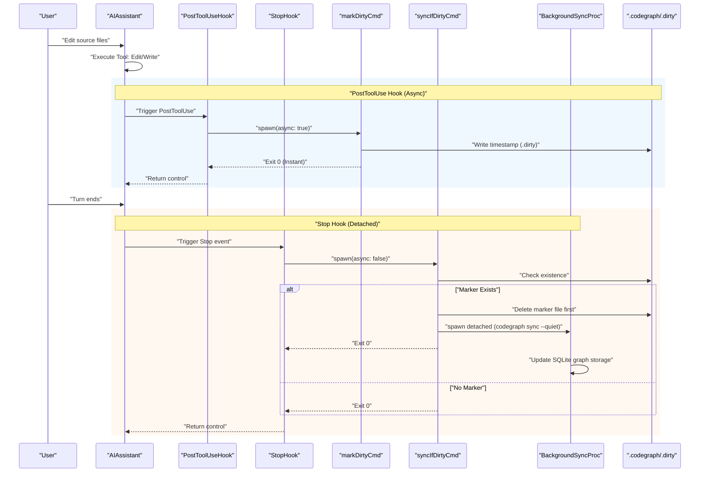
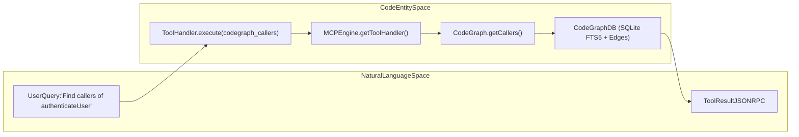
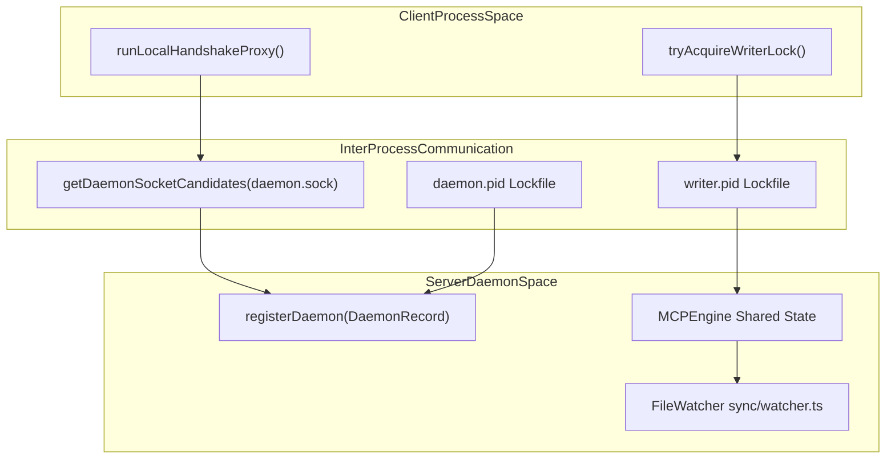

<!-- source: DeepWiki mcp.deepwiki.com · repo colbymchenry/codegraph · page 4.4 Server and Hook Commands · fetched 2026-10-30 -->

# Server and Hook Commands

Relevant source files

The following files were used as context for generating this wiki page:

- [__tests__/cli-unlock.test.ts](__tests__/cli-unlock.test.ts)
- [__tests__/daemon-lock-holder.test.ts](__tests__/daemon-lock-holder.test.ts)
- [__tests__/daemon-registry.test.ts](__tests__/daemon-registry.test.ts)
- [__tests__/git-hooks.test.ts](__tests__/git-hooks.test.ts)
- [__tests__/index-command.test.ts](__tests__/index-command.test.ts)
- [__tests__/mcp-nested-repo-projectpath.test.ts](__tests__/mcp-nested-repo-projectpath.test.ts)
- [__tests__/subprocess-timeouts.test.ts](__tests__/subprocess-timeouts.test.ts)
- [__tests__/worktree-detection.test.ts](__tests__/worktree-detection.test.ts)
- [__tests__/writer-lock.test.ts](__tests__/writer-lock.test.ts)
- [src/mcp/daemon-registry.ts](src/mcp/daemon-registry.ts)
- [src/mcp/process-identity.ts](src/mcp/process-identity.ts)
- [src/mcp/writer-lock.ts](src/mcp/writer-lock.ts)
- [src/sync/git-hooks.ts](src/sync/git-hooks.ts)
- [src/sync/worktree.ts](src/sync/worktree.ts)

This page documents the CodeGraph CLI commands and internal subsystems used for AI agent integration, background process management, and session supervision: `codegraph serve`, `codegraph mark-dirty`, `codegraph sync-if-dirty`, `codegraph ui`, `codegraph unlock`, and `codegraph daemon`. These commands coordinate agent interactions, local file watchers, shared database writer locks, and background graph synchronizations.

---

## 1. Command Reference and Overview

The server and hook commands form a coordinated framework for maintaining code graph freshness across AI assistant sessions and concurrent client processes:

| Command | Purpose | Invocation | Blocking |
|---------|---------|------------|----------|
| `codegraph serve --mcp` | Start Model Context Protocol (MCP) server for AI integration | Agent startup or manual | Yes (runs until terminated) |
| `codegraph mark-dirty [path]` | Record project modification timestamp for deferred sync | PostToolUse hook (Edit/Write tools) | No (async, instant exit) |
| `codegraph sync-if-dirty [path]` | Trigger background synchronization if marked dirty | Stop hook (conversation turn boundary) | No (spawns detached process) |
| `codegraph ui [path]` | Start the local web viewer (Graph Viewer UI) | Manual / Developer workflow | Yes (HTTP server) |
| `codegraph unlock [path]` | Clear stale writer locks or daemon records when wedged | Manual recovery | Yes (synchronous cleanup) |
| `codegraph daemon` | Interactive daemon process manager and liveness registry | Manual (`codegraph daemon` / `list`) | Varies (interactive CLI prompt) |

Sources: [src/bin/codegraph.ts:8-24](), [src/mcp/index.ts:17-35]()

---

## 2. Hook Lifecycle & Background Synchronization

Agent tool integrations (such as Claude Code) execute lightweight hook scripts to signal graph invalidation without blocking conversational latency.

### Hook Execution Flow

Title: "Hook Execution and Deferred Sync Sequence"

Sources: [src/bin/codegraph.ts:964-1037](), [src/sync/git-hooks.ts:30-35]()

### `codegraph mark-dirty` and `sync-if-dirty` Implementation
- **`mark-dirty`**: Resolves the target directory, locates the nearest `.codegraph/` root, and writes an epoch timestamp to `.codegraph/.dirty` [src/bin/codegraph.ts:964-981](). It exits immediately to avoid adding overhead to agent loops.
- **`sync-if-dirty`**: Verifies the existence of `.codegraph/.dirty`, unlinks it immediately to prevent race conditions during concurrent runs, and spawns `codegraph sync --quiet` as a fully detached child process [src/bin/codegraph.ts:983-1037]().

Sources: [src/bin/codegraph.ts:964-1037]()

---

## 3. MCP Server Architecture and Modes (`codegraph serve`)

The `codegraph serve --mcp` command launches the Model Context Protocol server. To avoid redundant file watchers and memory overhead across multiple terminal tabs or IDE integrations, the server supports three operational modes:

1. **Direct Mode**: A single-process server running an in-process engine and file watcher. Used when `CODEGRAPH_NO_DAEMON=1` is set or when IPC rendezvous fails [src/mcp/index.ts:19-21]().
2. **Daemon Mode**: A background process bound to a Unix domain socket or Windows named pipe that multiplexes requests from multiple client proxies [src/mcp/index.ts:25-29]().
3. **Proxy Mode**: A thin stdio-to-socket bridge instantiated by AI hosts. It forwards JSON-RPC messages to the shared daemon [src/mcp/proxy.ts:4-19]().

### Process Supervision and Watchdogs
- **PPID Watchdog**: Polls the parent process ID to ensure that if the host IDE or CLI runner is abruptly terminated via `SIGKILL`, the proxy or server does not become an orphaned background zombie [src/mcp/index.ts:31-35](), [src/mcp/proxy.ts:120-120]().
- **Liveness Watchdog**: A dedicated thread monitor (`installMainThreadWatchdog`) terminates processes whose event loops stall during heavy synchronous extractions [src/mcp/index.ts:56-56](), [src/bin/command-supervision.ts:54-78]().
- **WASM Runtime Flags**: Automatically re-executes with `--liftoff-only` via `relaunchWithWasmRuntimeFlagsIfNeeded` to mitigate Tree-sitter V8 memory ceiling constraints [src/bin/codegraph.ts:109-114]().

Sources: [src/mcp/index.ts:17-56](), [src/bin/codegraph.ts:89-114](), [src/mcp/proxy.ts:1-35](), [src/mcp/liveness-watchdog.ts:1-20]()

---

## 4. Shared Daemon Management and Discovery

Daemons coordinate multiple sessions via persistent lockfiles and a global discovery registry.

### Rendezvous Paths and Writer Locks
- **`daemon.pid` & `writer.pid`**: Located in `<root>/.codegraph/`, these lockfiles record the active writer process ID (`DaemonLockInfo` / `WriterLockInfo`) [src/mcp/daemon-registry.ts:5-9](), [src/mcp/writer-lock.ts:33-47]().
- **`writer.pid` Acquisition**: Ensures at most one writer (either a shared daemon or direct-mode engine owning the file watcher) actively synchronizes the database. `tryAcquireWriterLock` attempts atomic file creation (`O_EXCL` / link fallback) and reclaims stale locks if the recorded PID is dead (`isProcessAlive`) [src/mcp/writer-lock.ts:76-152]().
- **Global Daemon Registry**: Each daemon registers itself under `~/.codegraph/daemons/<hash>.json` on startup [src/mcp/daemon-registry.ts:8-9](), [src/mcp/daemon-registry.ts:91-99](). Functions like `listDaemons` and `listVerifiedDaemons` prune records associated with dead PIDs or failed socket identity probes [src/mcp/daemon-registry.ts:114-161]().

Sources: [src/mcp/daemon-registry.ts:5-161](), [src/mcp/writer-lock.ts:33-166]()

### Interactive Daemon Control (`codegraph daemon`)
The interactive CLI daemon manager inspects running daemons across projects, displays uptimes, and safely terminates selected daemon instances (`stopDaemonAt`) [__tests__/daemon-registry.test.ts:99-160](), [src/mcp/daemon-registry.ts:148-161]().

Sources: [src/mcp/daemon-registry.ts:148-161](), [__tests__/daemon-registry.test.ts:99-160]()

---

## 5. Process Supervision, Liveness, and Worktree Awareness

### Command Supervision
Long-running CLI commands (`codegraph index`, `codegraph init --index`) install command supervision to protect against wedged extractions or parent process detachment [__tests__/index-command.test.ts:144-165](). 
- Parent process checks monitor execution state and exit immediately if the invoking shell or host process terminates unexpectedly [src/sync/worktree.ts:40-48]().

Sources: [src/sync/worktree.ts:40-48](), [__tests__/index-command.test.ts:144-165]()

### Git Worktree Awareness
When executing queries or server commands inside a linked git worktree nested under a main checkout (e.g. `.claude/worktrees/<name>/`), the up-walk for `.codegraph/` can inadvertently resolve to the main checkout's index [src/sync/worktree.ts:1-15]().
- `detectWorktreeIndexMismatch` compares `gitWorktreeRoot` and `gitCommonDir` to warn developers when a session borrows an incorrect branch index [src/sync/worktree.ts:93-123]().

Sources: [src/sync/worktree.ts:1-123]()

---

## 6. Architecture & Data Flow Diagrams

### Natural Language Space to Code Entity Space: Tool Execution

Title: "ToolExecutionDataFlow"

Sources: [src/mcp/engine.ts:1-130](), [src/mcp/tools.ts:1-40]()

### Daemon and Writer Lock Rendezvous Architecture

Title: "DaemonAndWriterLockArchitecture"

Sources: [src/mcp/daemon-registry.ts:47-99](), [src/mcp/writer-lock.ts:33-152]()

Sources: [src/bin/codegraph.ts:8-24](), [src/mcp/daemon-registry.ts:47-161](), [src/mcp/writer-lock.ts:33-166](), [src/sync/worktree.ts:1-123]()

---

