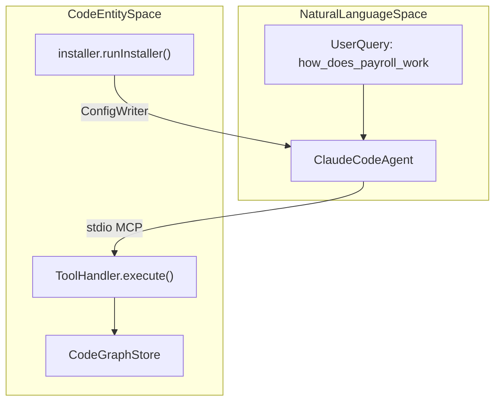
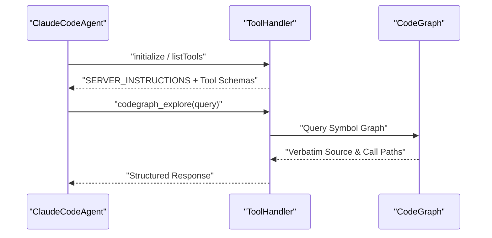
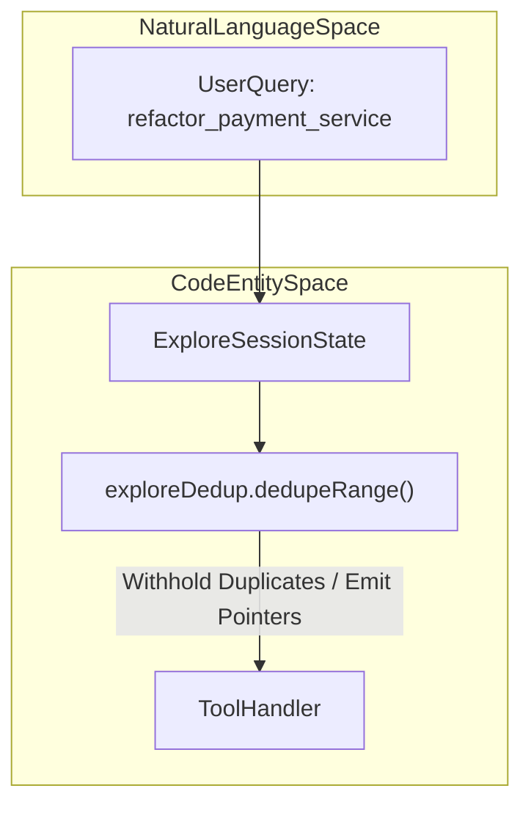

<!-- source: DeepWiki mcp.deepwiki.com · repo colbymchenry/codegraph · page 5 Claude Code Integration · fetched 2026-10-30 -->

# Claude Code Integration

Relevant source files

The following files were used as context for generating this wiki page:

- [.cursor/rules/codegraph.mdc](.cursor/rules/codegraph.mdc)
- [CLAUDE.md](CLAUDE.md)
- [README.md](README.md)
- [__tests__/explore-cross-call-dedup.test.ts](__tests__/explore-cross-call-dedup.test.ts)
- [__tests__/explore-session-state.test.ts](__tests__/explore-session-state.test.ts)
- [__tests__/installer.test.ts](__tests__/installer.test.ts)
- [__tests__/mcp-tool-allowlist.test.ts](__tests__/mcp-tool-allowlist.test.ts)
- [package-lock.json](package-lock.json)
- [package.json](package.json)
- [src/bin/codegraph.ts](src/bin/codegraph.ts)
- [src/installer/config-writer.ts](src/installer/config-writer.ts)
- [src/installer/index.ts](src/installer/index.ts)
- [src/installer/instructions-template.ts](src/installer/instructions-template.ts)
- [src/mcp/explore-dedup.ts](src/mcp/explore-dedup.ts)
- [src/mcp/explore-session-state.ts](src/mcp/explore-session-state.ts)
- [src/mcp/server-instructions.ts](src/mcp/server-instructions.ts)
- [src/mcp/tools.ts](src/mcp/tools.ts)

## Purpose and Scope

This document explains how CodeGraph integrates with AI agents via the Model Context Protocol (MCP). The integration allows AI assistants like Claude Code to query a pre-computed SQLite knowledge graph of symbols, edges, and files rather than performing expensive filesystem scans (`Read` and `Grep`), resulting in significantly fewer tokens and round-trips [src/mcp/tools.ts:1-16](), [src/mcp/server-instructions.ts:20-33]().

This is a parent page providing a high-level architectural overview. For detailed technical specifications, refer to the child pages:
- **Tools**: See [MCP Tools Reference](#5.1) for complete documentation of `codegraph_explore`, `codegraph_search`, `codegraph_context`, tool annotations, and allowlists [src/mcp/tools.ts:1-16](), [__tests__/mcp-tool-allowlist.test.ts:1-63]().
- **Sync & Freshness**: See [Auto-Sync Hooks](#5.2) for details on PostToolUse hooks, file watchers, the mark-dirty mechanism, and staleness banners [src/installer/index.ts:26-44]().
- **Context & Dedup**: See [Context Building for AI](#5.3) for semantic search, graph expansion, explore budgets, and cross-call source deduplication [__tests__/explore-cross-call-dedup.test.ts:1-40]().

Sources: [src/mcp/tools.ts:1-16](), [src/mcp/server-instructions.ts:20-33](), [src/installer/index.ts:26-44](), [__tests__/explore-cross-call-dedup.test.ts:1-40](), [__tests__/mcp-tool-allowlist.test.ts:1-63]()

---

## Overview and Runtime Modes

CodeGraph connects AI coding agents to a local code intelligence backend via the MCP protocol. The system is designed to support multiple agent targets (Claude Code, Cursor, Codex CLI, opencode, Hermes Agent, Gemini CLI, Antigravity IDE, Kiro, and GitHub Copilot) through automated installer wiring [src/installer/index.ts:1-14]().

### Diagram: Runtime Mode Architecture

**Description:** The architecture connects AI agents over standard I/O using the MCP protocol, guided by automated installer configurations that wire up server tools and instructions.

Sources: [src/installer/index.ts:1-14](), [src/mcp/tools.ts:1-16]()

---

## MCP Protocol Implementation and Initialization

During the MCP initialization phase, CodeGraph delivers server metadata and system instructions (`SERVER_INSTRUCTIONS`) to inform the agent's workflow [src/mcp/server-instructions.ts:1-20](). The guidance directs agents to prioritize structured exploration over raw file traversal.

### Diagram: Protocol Handshake Flow

**Description:** The initialization exchange establishes protocol capabilities and supplies behavioral prompts that instruct the agent to use `codegraph_explore` as a drop-in replacement for file reads.

Sources: [src/mcp/server-instructions.ts:1-43](), [src/mcp/tools.ts:1-16]()

---

## Tool Integration Summary

CodeGraph exposes specialized tools via MCP handlers managed by `ToolHandler` [src/mcp/tools.ts:1-16](). The primary entry point for agents is `codegraph_explore`, which combines verbatim source retrieval, call graph traversal, and impact analysis into a single round-trip [src/mcp/server-instructions.ts:34-43](). Operators can also control exposed tools via allowlist environment variables like `CODEGRAPH_MCP_TOOLS` [__tests__/mcp-tool-allowlist.test.ts:1-27]().

For detailed parameter definitions, tool annotations, and alternative tools (`codegraph_search`, `codegraph_node`, `codegraph_impact`), see [MCP Tools Reference](#5.1).

Sources: [src/mcp/tools.ts:1-16](), [src/mcp/server-instructions.ts:34-43](), [__tests__/mcp-tool-allowlist.test.ts:1-27]()

---

## Auto-Sync and Freshness Management

To ensure AI assistants never reason over outdated code, CodeGraph tracks file mutations via automated integration hooks and installers [src/installer/index.ts:26-44](). When edits occur outside active sync windows, responses include staleness warnings or freshness gating [src/mcp/server-instructions.ts:62-71]().

For implementation details on the mark-dirty mechanism, PostToolUse hooks, and fallback recovery, see [Auto-Sync Hooks](#5.2).

Sources: [src/installer/index.ts:26-44](), [src/mcp/server-instructions.ts:62-71]()

---

## Context Building, Budgets, and Deduplication

CodeGraph builds task-specific contexts by combining semantic search results, graph expansion, and code extraction into constrained output windows [__tests__/explore-cross-call-dedup.test.ts:1-40](). To prevent token bloat during long conversations, session-scoped state tracks previously emitted code ranges and replaces duplicate blocks with concise back-references [__tests__/explore-cross-call-dedup.test.ts:119-152]().

### Diagram: Context Building & Dedup Pipeline

**Description:** The context building subsystem filters redundant code transmissions using content fingerprints and line range algebra, preserving token budgets for fresh code discovery [__tests__/explore-cross-call-dedup.test.ts:119-152]().

For deep dives into explore budget allocation, diagnostics, and code extraction formatting, see [Context Building for AI](#5.3).

Sources: [__tests__/explore-cross-call-dedup.test.ts:1-152]()

---

