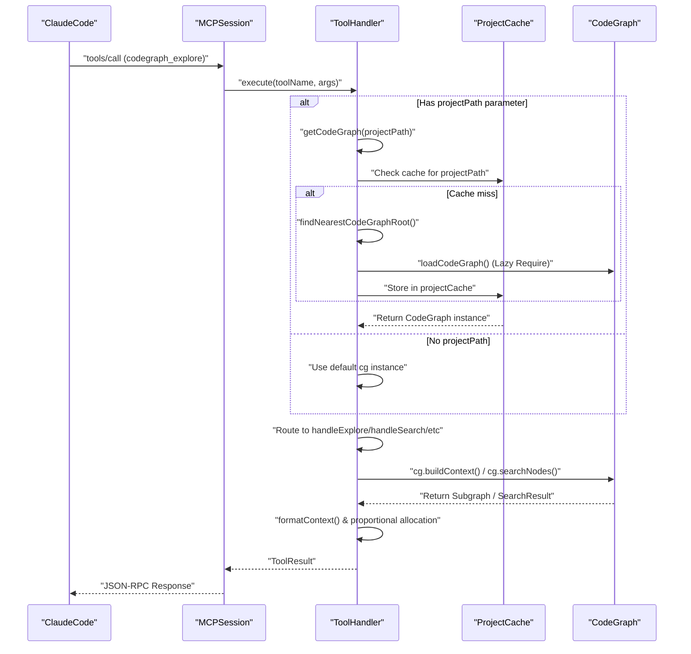
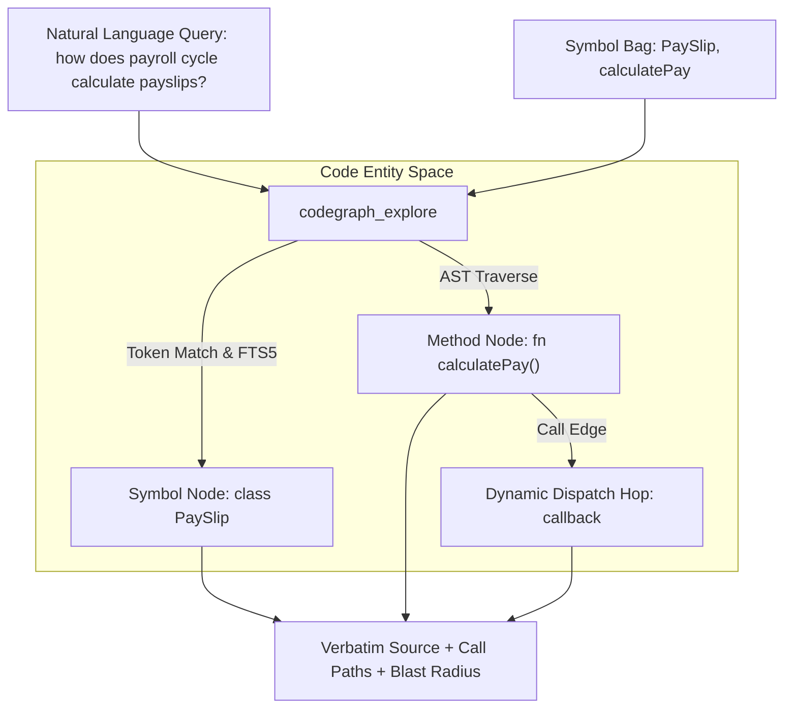

<!-- source: DeepWiki mcp.deepwiki.com · repo colbymchenry/codegraph · page 5.1 MCP Tools Reference · fetched 2026-10-30 -->

# MCP Tools Reference

Relevant source files

The following files were used as context for generating this wiki page:

- [.cursor/rules/codegraph.mdc](.cursor/rules/codegraph.mdc)
- [CLAUDE.md](CLAUDE.md)
- [README.md](README.md)
- [__tests__/explore-cross-call-dedup.test.ts](__tests__/explore-cross-call-dedup.test.ts)
- [__tests__/explore-session-state.test.ts](__tests__/explore-session-state.test.ts)
- [__tests__/installer.test.ts](__tests__/installer.test.ts)
- [__tests__/mcp-tool-allowlist.test.ts](__tests__/mcp-tool-allowlist.test.ts)
- [package-lock.json](package-lock.json)
- [package.json](package.json)
- [src/bin/codegraph.ts](src/bin/codegraph.ts)
- [src/installer/config-writer.ts](src/installer/config-writer.ts)
- [src/installer/index.ts](src/installer/index.ts)
- [src/installer/instructions-template.ts](src/installer/instructions-template.ts)
- [src/mcp/explore-dedup.ts](src/mcp/explore-dedup.ts)
- [src/mcp/explore-session-state.ts](src/mcp/explore-session-state.ts)
- [src/mcp/server-instructions.ts](src/mcp/server-instructions.ts)
- [src/mcp/tools.ts](src/mcp/tools.ts)

## Purpose and Scope

This page provides full technical documentation for all Model Context Protocol (MCP) tools exposed by the CodeGraph server: `codegraph_explore`, `codegraph_search`, `codegraph_context`, `codegraph_callers`, `codegraph_callees`, `codegraph_impact`, `codegraph_node` (including file-read mode), `codegraph_files`, and `codegraph_status`. It also documents tool annotations, validation constraints, and allowlist configurations (`CODEGRAPH_MCP_TOOLS`). These tools establish a low-overhead semantic bridge between AI agent tool calls and the underlying SQLite knowledge graph.

Sources: [src/mcp/tools.ts:1-125](), [src/mcp/server-instructions.ts:20-43]()

## Design Philosophy and Safety Constraints

The MCP tools are engineered to minimize token usage while maximizing semantic information density. To maintain system stability and prevent resource exhaustion under adverse conditions, the `ToolHandler` tier enforces strict validation and output constraints:

- **Output Truncation**: All tool responses are bounded by `MAX_OUTPUT_LENGTH` (15,000 characters) to prevent context bloat [src/mcp/tools.ts:148-148]().
- **Input Length Bounds**: Free-form text fields (`query`, `task`, `symbol`) are capped at `MAX_INPUT_LENGTH` (10,000 characters), while path-like arguments are bounded by `MAX_PATH_LENGTH` (4,096 characters) to protect against malformed payloads or denial-of-service attempts [src/mcp/tools.ts:155-165]().
- **Error Recovery Classification**: Expected or recoverable states—such as an unindexed project (`NotIndexedError`) or WSL shared-index alignment issues (`WslSharedIndexError`)—are returned as success-shaped responses containing descriptive guidance rather than hard JSON-RPC errors (`isError: true`). This prevents client agents from abandoning the MCP integration upon encountering normal operational conditions [src/mcp/tools.ts:92-132]().

Sources: [src/mcp/tools.ts:92-165]()

## Tool Execution Architecture

### MCP Request Flow

This sequence diagram illustrates how a natural language request from an AI agent is translated into a tool invocation and processed by the `CodeGraph` engine.

Title: "MCP Tool Execution Pipeline"

Sources: [src/mcp/tools.ts:7-51](), [src/index.ts:1-20]()

### Natural Language Space to Code Entity Space Bridge

This diagram illustrates how natural language queries or symbol names supplied by an agent are resolved into concrete code graph entities (`PaySlip`, `calculatePay`) and executed against the kernel index.

Title: "Natural Language to Code Entity Mapping"

Sources: [src/mcp/tools.ts:39-65](), [src/mcp/server-instructions.ts:34-42]()

## Complete Tool Reference

| Tool Name | Purpose | Core Engine API |
|---|---|---|
| `codegraph_explore` | Primary tool for architecture, flow, and code exploration. Returns verbatim source grouped by file with call paths and blast radius. | `CodeGraph.buildContext()` [src/index.ts:58-60]() |
| `codegraph_search` | Rapid symbol lookup by name, partial query, or FTS5 match. | `QueryBuilder.searchNodes()` [src/db/queries.ts:15-20]() |
| `codegraph_context` | Build structured task context for complex refactoring tasks. | `CodeGraph.findRelevantContext()` [src/index.ts:25-27]() |
| `codegraph_callers` | Find all incoming callers and references to a given symbol. | `GraphTraverser.getCallers()` [src/graph/index.ts:1-5]() |
| `codegraph_callees` | Find all outgoing calls and references made by a symbol. | `GraphTraverser.getCallees()` [src/graph/index.ts:1-5]() |
| `codegraph_impact` | Analyze the transitive blast radius of modifying a symbol. | `GraphTraverser.getImpactRadius()` [src/graph/index.ts:1-5]() |
| `codegraph_node` | Retrieve symbol definitions, container outlines, or raw file source. | `QueryBuilder.getNode()` / `fs.readFileSync` [src/db/queries.ts:10-15]() |
| `codegraph_files` | List tracked project files and their metadata. | `QueryBuilder.getFiles()` [src/db/queries.ts:10-15]() |
| `codegraph_status` | Report index health, size, and synchronization state. | `CodeGraph.status()` [src/index.ts:28-30]() |

Sources: [src/mcp/tools.ts:1-125](), [src/index.ts:1-60]()

### Detailed Tool Specifications

#### codegraph_explore
- **Behavior**: Executes semantic expansion across the graph using query terms or symbol bags, combining source code extraction with dynamic-dispatch tracing [src/mcp/server-instructions.ts:34-42]().
- **Adaptive Budgeting**: Allocates byte budgets proportionally using graph mass and relevance scores, filtering out peripheral files that fall below the relevance floor [docs/design/explore-budget-allocation.md:91-125]().

Sources: [src/mcp/server-instructions.ts:34-42]()

#### codegraph_search
- **Behavior**: Performs FTS5 full-text search combined with identifier segment parsing and fuzzy matching to locate symbol nodes across the codebase [src/db/queries.ts:15-25]().

Sources: [src/db/queries.ts:15-25]()

#### codegraph_context
- **Behavior**: Aggregates task-oriented subgraphs, gathering relevant symbols, dependencies, and surrounding code blocks into a cohesive context payload [src/index.ts:25-27]().

Sources: [src/index.ts:25-27]()

#### codegraph_callers & codegraph_callees
- **Behavior**: Traverses `calls` and `references` edges in reverse (`codegraph_callers`) or forward (`codegraph_callees`) directions to map dependency chains [src/types.ts:57-73]().

Sources: [src/types.ts:57-73]()

#### codegraph_impact
- **Behavior**: Executes recursive graph traversal starting from a target symbol to compute the full blast radius of breaking signature changes or modifications [src/index.ts:1-20]().

Sources: [src/index.ts:1-20]()

#### codegraph_node
- **Behavior**: Retrieves a specific node by ID or name. When targeting container node kinds (`class`, `struct`, `interface`, `module`, etc.) with `includeCode=true`, it returns a structural outline (member signatures and line numbers) instead of full method bodies to prevent context bloat [src/mcp/tools.ts:154-156](). Supports fallback file-read modes for reading raw file content when symbol matching fails or file paths are supplied directly.

Sources: [src/mcp/tools.ts:154-156]()

#### codegraph_files & codegraph_status
- **Behavior**: `codegraph_files` queries indexed file records. `codegraph_status` evaluates database health, checks for worktree mismatches, and reports pending file changes [src/sync/worktree.ts:28-34]().

Sources: [src/sync/worktree.ts:28-34]()

## Tool Annotations and Allowlists

The MCP server controls tool exposure via configuration constants and environment variables. By default, the system minimizes initial prompt overhead by exposing a focused tool surface:

- **Default Tool Exposure**: The primary tool surface defaults to `codegraph_explore` alone in standard agent system prompts to maximize information density and reduce token consumption [__tests__/mcp-tool-allowlist.test.ts:20-27]().
- **Extended Tool Access & Allowlists**: Additional tools (`codegraph_search`, `codegraph_callers`, `codegraph_callees`, `codegraph_impact`, `codegraph_node`, `codegraph_files`, `codegraph_status`) remain fully defined in the schema. Operators or evaluation harnesses can trim or expand the exposed tool surface using the `CODEGRAPH_MCP_TOOLS` environment variable (e.g., `CODEGRAPH_MCP_TOOLS=explore,impact`), which filters `ListTools` and enforces defense-in-depth checks on execution [__tests__/mcp-tool-allowlist.test.ts:29-54]().

Sources: [__tests__/mcp-tool-allowlist.test.ts:1-63]()

---

