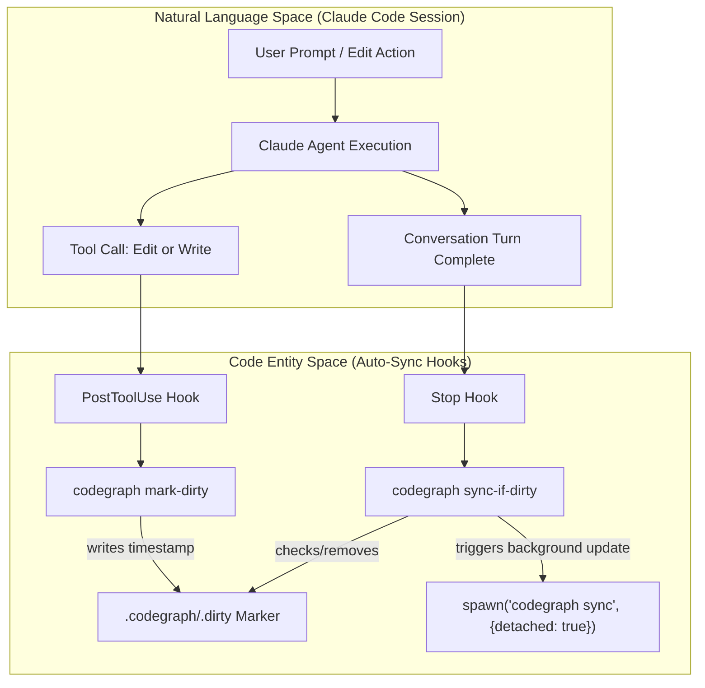
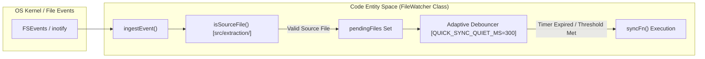
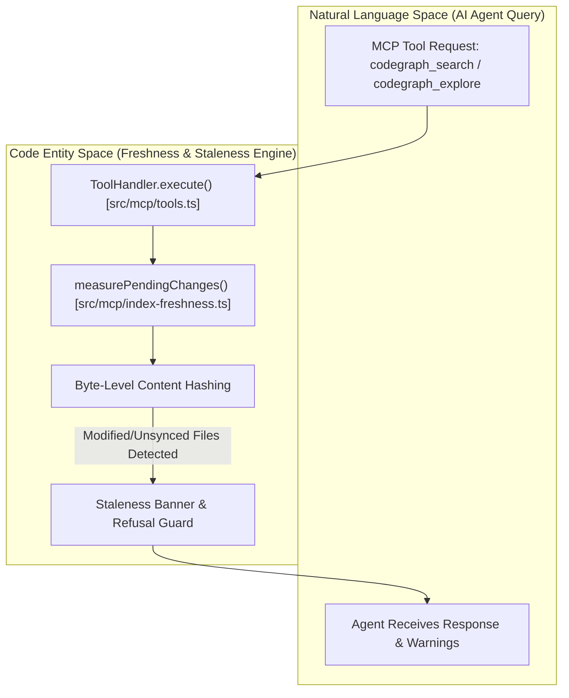
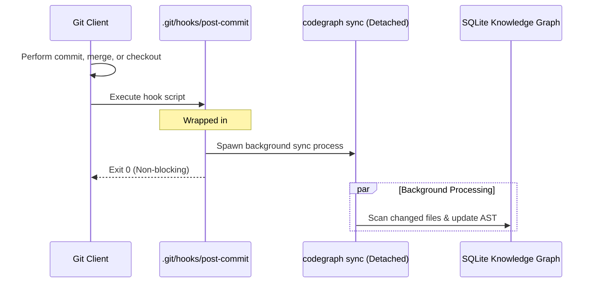

<!-- source: DeepWiki mcp.deepwiki.com · repo colbymchenry/codegraph · page 5.2 Auto-Sync Hooks · fetched 2026-10-30 -->

# Auto-Sync Hooks

Relevant source files

The following files were used as context for generating this wiki page:

- [__tests__/cli-sync.test.ts](__tests__/cli-sync.test.ts)
- [__tests__/git-hooks.test.ts](__tests__/git-hooks.test.ts)
- [__tests__/mcp-freshness-bounds.test.ts](__tests__/mcp-freshness-bounds.test.ts)
- [__tests__/mcp-initialize.test.ts](__tests__/mcp-initialize.test.ts)
- [__tests__/mcp-nested-repo-projectpath.test.ts](__tests__/mcp-nested-repo-projectpath.test.ts)
- [__tests__/mcp-stale-refusal.test.ts](__tests__/mcp-stale-refusal.test.ts)
- [__tests__/mcp-staleness-banner.test.ts](__tests__/mcp-staleness-banner.test.ts)
- [__tests__/mcp-status-freshness.test.ts](__tests__/mcp-status-freshness.test.ts)
- [__tests__/subprocess-timeouts.test.ts](__tests__/subprocess-timeouts.test.ts)
- [__tests__/sync.test.ts](__tests__/sync.test.ts)
- [__tests__/watcher.test.ts](__tests__/watcher.test.ts)
- [__tests__/worker-teardown.test.ts](__tests__/worker-teardown.test.ts)
- [__tests__/worktree-detection.test.ts](__tests__/worktree-detection.test.ts)
- [src/mcp/index-freshness-worker.ts](src/mcp/index-freshness-worker.ts)
- [src/mcp/index-freshness.ts](src/mcp/index-freshness.ts)
- [src/sync/git-hooks.ts](src/sync/git-hooks.ts)
- [src/sync/index.ts](src/sync/index.ts)
- [src/sync/watcher.ts](src/sync/watcher.ts)
- [src/sync/worktree.ts](src/sync/worktree.ts)

**Purpose**: This page documents CodeGraph's automatic index synchronization system. It explains how CodeGraph maintains index freshness through Claude Code lifecycle hooks (`PostToolUse`, `Stop`, and `UserPromptSubmit`), the `mark-dirty` mechanism, a platform-aware file-watching system (`FileWatcher`), MCP freshness gating and staleness banners, and Git-based synchronization fallbacks.

---

## 1. Overview

CodeGraph employs a multi-layered synchronization strategy to ensure the knowledge graph stays consistent with the local filesystem. This is essential for AI assistants like Claude Code, which modify source files and immediately query the graph for contextual insights.

### Synchronization Layers

| Layer | Trigger Mechanism | Target Component |
|-------|-------------------|------------------|
| **Claude Code Hooks** | `PostToolUse`, `Stop`, `UserPromptSubmit` | `codegraph mark-dirty`, `codegraph sync-if-dirty` |
| **File Watcher** | Native OS file events (`fs.watch`) | `FileWatcher` class in `[src/sync/watcher.ts:1-1158]()` |
| **Freshness Gating** | Tool execution intercept / status check | `measurePendingChanges` in `[src/mcp/index-freshness.ts:1-10]()` |
| **Git Sync Hooks** | `post-commit`, `post-merge`, `post-checkout` | `installGitSyncHook` in `[src/sync/git-hooks.ts:1-34]()` |

Sources: `[src/sync/index.ts:1-33]`, `[src/sync/watcher.ts:1-44]()`

---

## 2. Claude Code Hook System

The integration with AI coding agents leverages lifecycle hooks to detect edits and trigger background index synchronizations, bridging the gap between natural language prompts and the underlying code graph.

### Hook Architecture (Natural Language Space to Code Entity Space)

Sources: `[src/sync/index.ts:1-34]`, `[__tests__/sync.test.ts:128-178]()`

### PostToolUse and mark-dirty
- **Trigger**: Fires immediately after `Edit` or `Write` tool executions.
- **Implementation**: Invokes `codegraph mark-dirty`, which writes a current timestamp into `.codegraph/.dirty`.
- **Safety**: Exits silently if no `.codegraph` directory is discovered in parent directories.

### Stop and UserPromptSubmit: sync-if-dirty
- **Trigger**: Fires at the conclusion of a conversation turn (`Stop`) or when submitting a new prompt (`UserPromptSubmit`).
- **Implementation**: Executes `codegraph sync-if-dirty`. If the `.dirty` marker file is present, it removes the marker and spawns a detached `codegraph sync` worker using `.unref()`, allowing the CLI hook runner to exit immediately without blocking the agent workflow `[__tests__/sync.test.ts:128-178]()`.

Sources: `[src/sync/index.ts:1-34]`, `[__tests__/sync.test.ts:128-178]()`

---

## 3. Background File Watcher

When the CodeGraph process remains resident (such as in MCP server or daemon mode), `FileWatcher` observes filesystem mutations directly `[src/sync/watcher.ts:1-6]`.

### Platform-Specific Watch Strategies
To avoid file-descriptor exhaustion and kernel overhead on large monorepos, `FileWatcher` adapts its strategy to the host OS `[src/sync/watcher.ts:7-34]`:
- **macOS and Windows**: Utilizes a single recursive `fs.watch(root, { recursive: true })` `[src/sync/watcher.ts:11-12]`. This costs $O(1)$ file descriptors regardless of repository size, preventing system-wide crashes due to `kern.maxfiles` exhaustion `[src/sync/watcher.ts:13-18]()`.
- **Linux**: Since recursive `fs.watch` is unsupported, it watches each non-ignored directory via `inotify` ($O(\text{directories})$) `[src/sync/watcher.ts:19-25]`. Unrelated or excluded paths (`node_modules/`, `dist/`, `.git/`) are filtered out via `buildScopeIgnore` `[src/sync/watcher.ts:27-33]()`.

### Adaptive Debouncing and Fault Tolerance Pipeline

Sources: `[src/sync/watcher.ts:1-80]`, `[__tests__/watcher.test.ts:1-60]()`

- **Adaptive Debounce**: If pending changes are small ($\le 2$ files, `QUICK_SYNC_MAX_PENDING`), it triggers after a fast 300ms quiet window (`QUICK_SYNC_QUIET_MS`) `[src/sync/watcher.ts:68-73]()`. Large bursts use standard debouncing.
- **Full Scan Ceiling**: If pending changes exceed 500 files (`SCOPED_SYNC_MAX_PENDING`), the watcher triggers a full scan-diff to self-heal coalesced event gaps `[src/sync/watcher.ts:76-80]()`.
- **Error and Lock Recovery**: Tolerates up to 5 consecutive lock contentions (`MAX_LOCK_RETRIES`) or sync failures (`MAX_SYNC_FAILURE_RETRIES`) before degrading auto-sync and notifying via callback `[src/sync/watcher.ts:46-62]()`.

Sources: `[src/sync/watcher.ts:1-1159]`, `[__tests__/watcher.test.ts:1-178]()`

---

## 4. Staleness Banners and Freshness Gating

When code changes outpace index synchronization, CodeGraph enforces strict freshness guarantees to prevent AI agents from consuming outdated graph data.

### Freshness Architecture (Natural Language Space to Code Entity Space)

Sources: `[src/mcp/index-freshness.ts:1-10]`, `[__tests__/mcp-staleness-banner.test.ts:1-25]`, `[__tests__/mcp-stale-refusal.test.ts:1-20]()`

### Staleness Banners and Footers
- **Per-File Staleness Banner**: When a tool response references files modified since the last index sync, CodeGraph prepends a warning banner (`⚠️ Some files referenced below were edited since the last index sync...`) instructing the agent to read the raw files directly `[__tests__/mcp-staleness-banner.test.ts:106-136]()`.
- **Project Footer**: If changes have occurred elsewhere in the project not directly cited in the response, a footer notice details the count of pending files `[__tests__/mcp-staleness-banner.test.ts:138-159]()`.

### Stale Refusal Guard
In degraded auto-sync states (e.g., resource exhaustion where `fs.watch` failed), CodeGraph applies byte-level content hashing rather than relying on stale metadata or mtime timestamps `[__tests__/mcp-stale-refusal.test.ts:58-60]()`. If a queried symbol or contributing file has unindexed modifications, exploration results explicitly refuse to serve stale AST answers (`cannot answer from this index`) while leaving unaffected source files fully accessible `[__tests__/mcp-stale-refusal.test.ts:52-82]()`.

Sources: `[src/mcp/index-freshness.ts:1-10]`, `[__tests__/mcp-staleness-banner.test.ts:1-160]`, `[__tests__/mcp-stale-refusal.test.ts:1-137]()`

---

## 5. Git Sync Hooks Fallback

When live filesystem watching is restricted or disabled (such as WSL2 `/mnt/` directory mounts where `fs.watch` exhibits poor performance), CodeGraph provides Git hook integration `[src/sync/git-hooks.ts:1-18]()`.

### Git Hook Lifecycle

Sources: `[src/sync/git-hooks.ts:1-88]()`

- **Management**: Functions `installGitSyncHook`, `removeGitSyncHook`, and `isSyncHookInstalled` manage hook scripts in `.git/hooks/` for `post-commit`, `post-merge`, and `post-checkout` `[src/sync/git-hooks.ts:31-48]()`.
- **Idempotency**: Hooks are injected between distinct marker comments (`# >>> codegraph sync hook >>>`) to preserve any user-defined git hook logic `[src/sync/git-hooks.ts:24-27]`, `[__tests__/git-hooks.test.ts:60-80]()`.
- **Timeouts**: All `git` subprocess executions enforce a strict 5000ms timeout to prevent hanging the main thread `[src/sync/git-hooks.ts:60-61]`, `[src/sync/git-hooks.ts:80-81]()`.

Sources: `[src/sync/git-hooks.ts:1-183]`, `[__tests__/git-hooks.test.ts:1-189]()`

---

## 6. Watch Policy and Git Worktrees

### WSL2 Watch Policy
CodeGraph evaluates system constraints during initialization. On WSL2 `/mnt/` paths, `watchDisabledReason` detects the performance penalty and recommends Git sync hooks as the primary synchronization fallback `[src/sync/index.ts:17]()`.

### Git Worktree Awareness
When repositories use git worktrees nested within main checkouts (e.g., under `.claude/worktrees/`), parent-directory graph resolution can mistakenly borrow the main checkout's index `[src/sync/worktree.ts:1-18]()`.
- **Mismatch Detection**: `detectWorktreeIndexMismatch` compares the current working tree root (`git rev-parse --show-toplevel`) against the resolved `.codegraph` directory owner `[src/sync/worktree.ts:93-123]()`.
- **Agent Notice**: If a mismatch occurs, read tools prefix a compact warning notice informing the agent that results may reflect a different branch or worktree state `[__tests__/worktree-detection.test.ts:149-157]()`.

Sources: `[src/sync/worktree.ts:1-153]`, `[__tests__/worktree-detection.test.ts:1-166]()`

---

