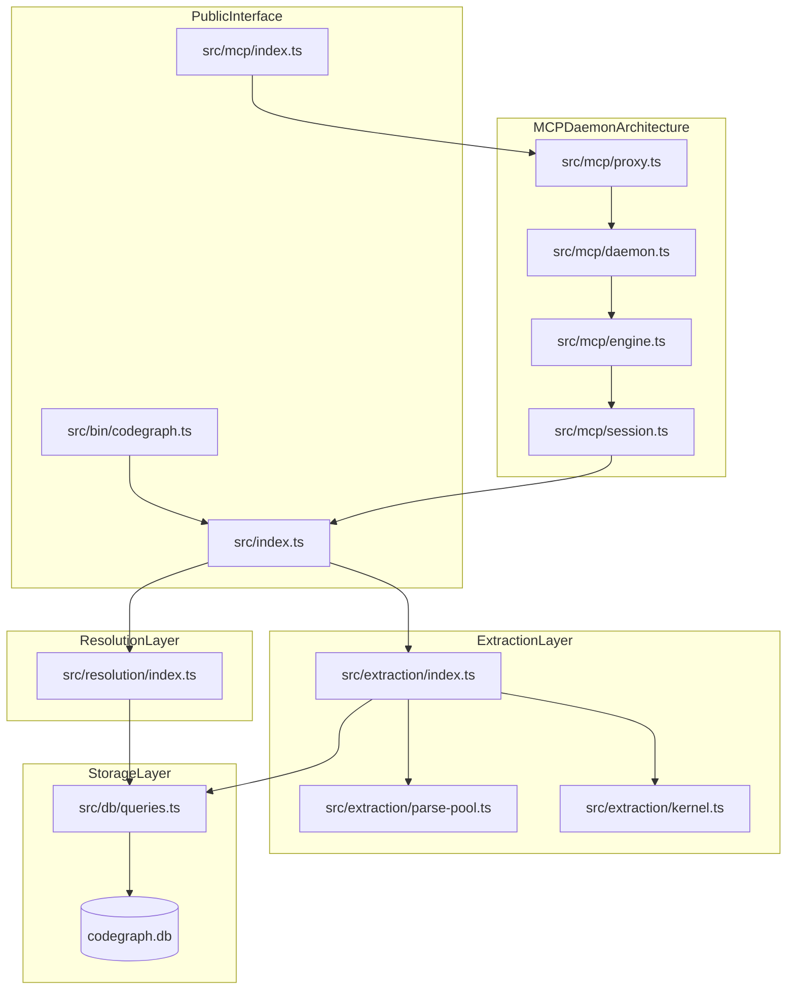
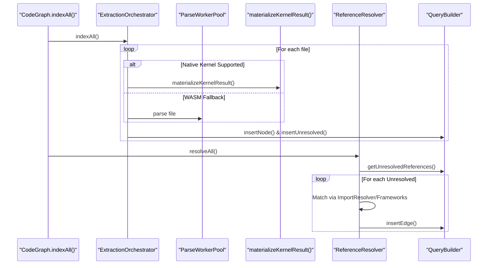

<!-- source: DeepWiki mcp.deepwiki.com · repo colbymchenry/codegraph · page 6 Architecture · fetched 2026-10-30 -->

# Architecture

Relevant source files

The following files were used as context for generating this wiki page:

- [CHANGELOG.md](CHANGELOG.md)
- [__tests__/extraction.test.ts](__tests__/extraction.test.ts)
- [__tests__/resolution.test.ts](__tests__/resolution.test.ts)
- [src/db/queries.ts](src/db/queries.ts)
- [src/extraction/index.ts](src/extraction/index.ts)
- [src/extraction/tree-sitter.ts](src/extraction/tree-sitter.ts)
- [src/index.ts](src/index.ts)
- [src/resolution/import-resolver.ts](src/resolution/import-resolver.ts)
- [src/resolution/index.ts](src/resolution/index.ts)
- [src/resolution/name-matcher.ts](src/resolution/name-matcher.ts)
- [src/resolution/types.ts](src/resolution/types.ts)

This document provides a technical deep dive into CodeGraph's internal architecture and implementation. It covers the major subsystems, core components, data flow patterns, and technology choices that enable local-first code intelligence.

For specific architectural subsystems, see:
- [System Architecture Overview](#6.1) — High-level architecture: major subsystems, data flow, CLI/MCP/library interfaces, daemon mode, proxy/engine/session split, worker pools, locking, and how components interact
- [Extraction Pipeline](#6.2) — Detailed explanation of code extraction: file scanning, Tree-sitter parsing, AST visiting, node/edge creation, worker threads, generated-file detection, extraction versioning, and language-specific extractors (including SFC/template extractors)
- [Reference Resolution System](#6.3) — Explain cross-file reference resolution: unresolved references, import resolution, name matching, type/receiver inference, language-specific scoping (Dart, Go, Swift, C++, VB.NET), and confidence scoring
  - [Framework Resolvers](#6.3.1) — Document the framework resolver plugin system and built-in framework resolvers
  - [Dispatch and Callback Synthesizers](#6.3.2) — Explain heuristic edge synthesis for dynamic dispatch and event emitters
- [Storage Layer](#6.4) — Document SQLite schema, QueryBuilder, migrations, caching, prepared statements, WAL mode/valve, store workers, and database optimization
- [Query and Traversal System](#6.5) — Explain graph query capabilities: search (FTS5, identifier segments, pattern matching), traversal algorithms, call graphs, impact analysis, dead code, branch guards, and ranking
- [Native Rust Kernel](#6.6) — Document the native Rust extraction kernel: architecture, supported languages, ABI/buffer wire contract, parity validation harnesses, performance characteristics, and the defer/fallback mechanism to WASM

---

## System Overview

CodeGraph is structured as a layered pipeline that transforms source files into a semantic knowledge graph. The system is designed to be local-first, performing all parsing and indexing on the user's machine without external dependencies. It utilizes `node:sqlite` for its storage backend, ensuring a zero-native-build footprint by leveraging the SQLite engine bundled with Node.js [src/index.ts:27-29]().

### Core Architecture Diagram

This diagram bridges natural language system roles to the specific codebase entities (`src/bin/codegraph.ts`, `CodeGraph`, `ExtractionOrchestrator`, `ReferenceResolver`, `QueryBuilder`) that implement them.

**Sources:** [src/index.ts:139-198](), [src/mcp/index.ts:17-35](), [src/mcp/daemon.ts:1-41](), [src/mcp/proxy.ts:1-19](), [src/extraction/index.ts:23-28]()

---

## Data Model

CodeGraph represents codebases as a directed property graph with core entities defined in `src/types.ts`.

### Core Data Entities

| Entity | Description | Code Pointer |
|------|-----------|-------------|
| **Node** | Represents code symbols like functions, classes, or routes. Includes metadata like `signature`, `docstring`, and `qualifiedName`. | `Node` [src/types.ts:133-202]() |
| **Edge** | Represents relationships like `calls`, `references`, or `implements`. Includes `provenance` (tree-sitter, scip, or heuristic). | `Edge` [src/types.ts:207-228]() |
| **File** | Metadata about tracked files, including `contentHash` for incremental sync and `nodeCount`. | `FileRecord` [src/types.ts:233-260]() |
| **Unresolved** | A reference (e.g., an import or callback) that hasn't been linked to a target node yet. | `UnresolvedReference` [src/types.ts:1-20]() |

### Node and Edge Kinds

CodeGraph supports 40+ programming languages and dialects. The extraction process identifies specific symbol types and their relationships via well-defined union types.

- **Node Kinds**: Includes structural elements like `class`, `function`, `method`, `struct`, `interface`, and specialized constructs like `route` [src/types.ts:22-48]().
- **Edge Kinds**: Relationships ranging from ownership (`contains`) to behavior (`calls`, `instantiates`, `navigates`) and type hierarchy (`extends`, `implements`) [src/types.ts:57-73]().

**Sources:** [src/types.ts:22-260](), [src/db/queries.ts:78-138]()

---

## Subsystem Interactions

### Indexing and Resolution Data Flow

The indexing process is deterministic and derived from AST analysis via Tree-sitter WASM grammars or the native Rust kernel [src/extraction/index.ts:24-27]().

**Sources:** [src/extraction/index.ts:78-105](), [src/extraction/kernel.ts:25-25](), [src/resolution/index.ts:1-25](), [src/db/queries.ts:216-225]()

---

## Core Components

### Extraction Pipeline
Manages the extraction of symbols from source files. It uses `web-tree-sitter` for universal cross-platform support and a native Rust kernel for performance on supported platforms [src/extraction/index.ts:24-27](). The pipeline employs a `ParseWorkerPool` to parallelize CPU-bound parsing [src/extraction/index.ts:23-23](). For details, see [Extraction Pipeline](#6.2).

### Reference Resolution System
Orchestrates the linking of symbols across file boundaries. It handles complex patterns like TypeScript path aliases, Go modules, and framework-specific routing, supplemented by framework resolvers and callback synthesizers. For details, see [Reference Resolution System](#6.3).

### Storage Layer
Utilizes SQLite with WAL mode and FTS5 for high-performance symbol searching [src/index.ts:27-29](). The `QueryBuilder` provides prepared statements for all CRUD operations [src/db/queries.ts:1-215](). For details, see [Storage Layer](#6.4).

### Query and Traversal System
Powers the intelligence layer used by AI agents. It implements graph traversal algorithms, call graphs, impact analysis, dead code detection, and ranking mechanisms. For details, see [Query and Traversal System](#6.5).

### Native Rust Kernel
A high-performance extraction kernel written in Rust that provides significant speedups for large codebases [src/extraction/kernel.ts:25-25](). For details, see [Native Rust Kernel](#6.6).

**Sources:** [src/extraction/index.ts:23-75](), [src/resolution/index.ts:1-66](), [src/db/queries.ts:216-235](), [src/index.ts:139-198]()

---

## Integration Interfaces

### MCP Server & Daemon
The `MCPServer` supports a Shared Daemon mode where one background process serves multiple clients over a Unix-domain socket [src/mcp/index.ts:17-29](). This allows multiple agent sessions (e.g., Claude Code, Cursor, Copilot) to share a single file watcher and SQLite handle [src/mcp/daemon.ts:1-41]().

### CLI
The `codegraph` CLI (`src/bin/codegraph.ts`) provides a comprehensive command set for project initialization, indexing, syncing, querying, and serving the MCP interface.

### Library API
The `CodeGraph` class in `src/index.ts` serves as the primary programmatic interface for embedding CodeGraph into Node.js applications, wiring together the database, extraction, resolution, and query layers [src/index.ts:139-198]().

**Sources:** [src/index.ts:139-198](), [src/mcp/index.ts:17-29](), [src/mcp/daemon.ts:1-41](), [src/bin/codegraph.ts:1-30]()

---

