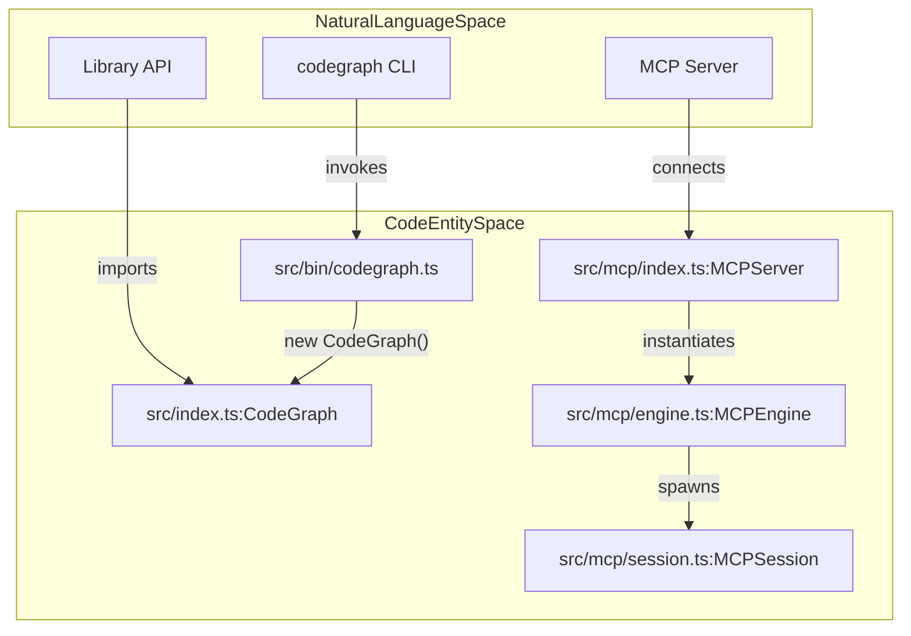
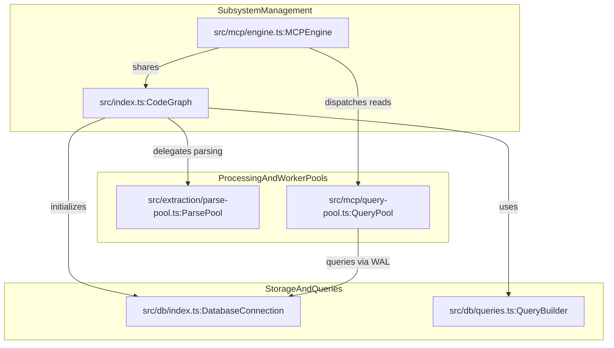
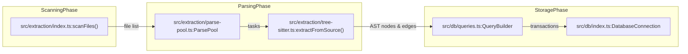

<!-- source: DeepWiki mcp.deepwiki.com · repo colbymchenry/codegraph · page 6.1 System Architecture Overview · fetched 2026-10-30 -->

# System Architecture Overview

Relevant source files

The following files were used as context for generating this wiki page:

- [.dockerignore](.dockerignore)
- [__tests__/daemon-client-liveness.test.ts](__tests__/daemon-client-liveness.test.ts)
- [__tests__/daemon-silent-holder.test.ts](__tests__/daemon-silent-holder.test.ts)
- [__tests__/daemon-socket-fallback.test.ts](__tests__/daemon-socket-fallback.test.ts)
- [__tests__/grammar-wasm-bytes.test.ts](__tests__/grammar-wasm-bytes.test.ts)
- [__tests__/index-recovery-off-thread.test.ts](__tests__/index-recovery-off-thread.test.ts)
- [__tests__/liveness-watchdog-projects.test.ts](__tests__/liveness-watchdog-projects.test.ts)
- [__tests__/liveness-watchdog.test.ts](__tests__/liveness-watchdog.test.ts)
- [__tests__/mcp-catchup-gate.test.ts](__tests__/mcp-catchup-gate.test.ts)
- [__tests__/mcp-daemon.test.ts](__tests__/mcp-daemon.test.ts)
- [__tests__/parse-pool.test.ts](__tests__/parse-pool.test.ts)
- [__tests__/proxy-liveness-watchdog.test.ts](__tests__/proxy-liveness-watchdog.test.ts)
- [__tests__/proxy-shutdown.test.ts](__tests__/proxy-shutdown.test.ts)
- [__tests__/query-pool.test.ts](__tests__/query-pool.test.ts)
- [__tests__/startup-handshake.test.ts](__tests__/startup-handshake.test.ts)
- [__tests__/wal-heal.test.ts](__tests__/wal-heal.test.ts)
- [scripts/agent-eval/repro-concurrent-explore.mjs](scripts/agent-eval/repro-concurrent-explore.mjs)
- [scripts/agent-eval/repro-daemon-clients.mjs](scripts/agent-eval/repro-daemon-clients.mjs)
- [scripts/dump-graph.mjs](scripts/dump-graph.mjs)
- [src/extraction/parse-pool.ts](src/extraction/parse-pool.ts)
- [src/mcp/daemon-paths.ts](src/mcp/daemon-paths.ts)
- [src/mcp/daemon.ts](src/mcp/daemon.ts)
- [src/mcp/engine.ts](src/mcp/engine.ts)
- [src/mcp/index.ts](src/mcp/index.ts)
- [src/mcp/liveness-watchdog.ts](src/mcp/liveness-watchdog.ts)
- [src/mcp/project-lifecycle.ts](src/mcp/project-lifecycle.ts)
- [src/mcp/proxy.ts](src/mcp/proxy.ts)
- [src/mcp/query-pool.ts](src/mcp/query-pool.ts)
- [src/mcp/query-worker.ts](src/mcp/query-worker.ts)
- [src/mcp/session.ts](src/mcp/session.ts)
- [src/mcp/startup-handshake.ts](src/mcp/startup-handshake.ts)

## Purpose and Scope

This document provides a technical overview of CodeGraph's internal architecture, describing the major subsystems, their interactions, and data flows. It covers the entry points (CLI, MCP server, and library API), the core processing pipeline, the shared daemon/proxy/engine split, worker pools, locking mechanisms, and the storage layer.

For detailed information about specific subsystems, see:
- Extraction pipeline implementation: [6.2]()
- Reference resolution system: [6.3]()
- Storage layer details: [6.4]()
- Query and traversal algorithms: [6.5]()

---

## System Entry Points and MCP Runtime Modes

CodeGraph exposes three primary external interfaces that all converge on the core `CodeGraph` orchestrator class (`src/index.ts`) or the shared MCP engine (`src/mcp/engine.ts`).

### Entry Point Architecture

**Sources:** [src/bin/codegraph.ts:1-24](), [src/index.ts:139-177](), [src/mcp/index.ts:37-53](), [src/mcp/engine.ts:82-106](), [src/mcp/session.ts:107-130]()

### MCP Runtime Modes

To support concurrent AI agents (such as Claude Code, Cursor, or Codex) without redundant file watching or database contention, the MCP server (`src/mcp/index.ts`) operates in one of three modes:

*   **Direct Mode**: A single process runs one `MCPServer` directly over `stdio`. It is used when opted out via `CODEGRAPH_NO_DAEMON=1`, when no `.codegraph/` directory is reachable, or if daemon bootstrap fails [src/mcp/index.ts:19-22]().
*   **Proxy Mode**: A thin stdio-to-socket pipe (`src/mcp/proxy.ts`) connecting the AI assistant to the shared background daemon. The proxy verifies the daemon version via a hello handshake and runs a PPID watchdog to reap itself if the host process is terminated with `SIGKILL` [src/mcp/index.ts:22-24](), [src/mcp/proxy.ts:4-19]().
*   **Daemon Mode**: A detached background process (`src/mcp/daemon.ts`) running in its own session group that serves multiple proxy connections over a Unix-domain socket or Windows named pipe. All connected sessions share a single `MCPEngine`, a single file watcher (inotify set), and a single SQLite database handle in WAL mode [src/mcp/index.ts:25-29](), [src/mcp/daemon.ts:1-41]().

**Sources:** [src/mcp/index.ts:17-35](), [src/mcp/proxy.ts:4-19](), [src/mcp/daemon.ts:1-41]()

---

## Core Component Architecture and Subsystems

The internal architecture separates graph extraction, reference resolution, storage, and agent interaction into modular subsystems coordinated through `CodeGraph` and `MCPEngine`.

### Subsystem Interaction Mapping

**Sources:** [src/index.ts:139-177](), [src/mcp/engine.ts:82-106](), [src/extraction/parse-pool.ts:39-45](), [src/mcp/query-pool.ts:155-165]()

### Worker Pools and Concurrency

CodeGraph offloads heavy computational tasks to dedicated worker thread pools to ensure that the main event loop remains responsive:

*   **Parse Worker Pool (`ParsePool`)**: Distributes Tree-sitter AST parsing across multiple worker threads (`src/extraction/parse-pool.ts`). Each worker maintains its own WASM heap and is recycled after a set number of parses (`DEFAULT_RECYCLE_INTERVAL = 250`) to reclaim memory [src/extraction/parse-pool.ts:6-28](), [src/extraction/parse-pool.ts:60-61]().
*   **Query Worker Pool (`QueryPool`)**: Offloads CPU-intensive read-tool executions (such as `codegraph_explore` and `codegraph_search`) in the shared daemon [src/mcp/query-pool.ts:1-24](). It features lazy growth, crash recovery with job retries, and a soft timeout backstop that returns success-shaped busy guidance rather than failing client requests [src/mcp/query-pool.ts:141-153](), [src/mcp/query-pool.ts:155-165]().
*   **Main-Thread Liveness Watchdog (`installMainThreadWatchdog`)**: A separate subprocess monitoring the main event loop via heartbeat checks (`src/mcp/liveness-watchdog.ts`). It includes disk-progress deferral (`progressPaths`), which inspects SQLite WAL file size and modification timestamps to prevent false-positive terminations during heavy synchronous I/O operations [src/mcp/liveness-watchdog.ts:1-52](), [src/mcp/liveness-watchdog.ts:139-152]().

**Sources:** [src/extraction/parse-pool.ts:1-28](), [src/mcp/query-pool.ts:1-24](), [src/mcp/liveness-watchdog.ts:1-52]()

---

## Data Processing Pipeline and Extraction Flow

When a project is indexed or synced, source files travel through a multi-stage pipeline from scanning to SQLite persistence.

### Pipeline Flow Architecture

**Sources:** [src/extraction/index.ts:78-105](), [src/extraction/parse-pool.ts:49-54](), [src/db/queries.ts:216-231]()

---

## Storage Layer and Concurrency Control

The storage layer uses SQLite in WAL mode managed by `DatabaseConnection` (`src/db/index.ts`) and `QueryBuilder` (`src/db/queries.ts`). 

### Concurrency and Locking Mechanisms

*   **In-Process Mutex**: An `indexMutex` inside the `CodeGraph` class prevents concurrent indexing operations within the same process [src/index.ts:155-155]().
*   **Cross-Process File Lock**: A `FileLock` placed at `.codegraph/codegraph.lock` synchronizes writer access across separate CLI invocations or proxy/direct servers [src/index.ts:171-173]().
*   **Daemon Lock Arbitration**: Detached daemons coordinate using atomic `O_EXCL` lockfiles (`.codegraph/daemon.pid`) to ensure exactly one daemon instance runs per project root [src/mcp/daemon.ts:31-33](), [src/mcp/daemon.ts:50-56]().
*   **Project Leasing (`acquireProject`)**: MCP engines manage references to projects using shared leases (`src/mcp/project-lifecycle.ts`), coordinating catch-up syncs, writer slots, and liveness watchdog progress paths [src/mcp/project-lifecycle.ts:38-66](), [src/mcp/project-lifecycle.ts:158-166]().

**Sources:** [src/index.ts:141-173](), [src/mcp/daemon.ts:31-56](), [src/mcp/project-lifecycle.ts:38-66]()

---
Sources: [src/bin/codegraph.ts:1-24](), [src/index.ts:139-177](), [src/mcp/index.ts:17-53](), [src/mcp/engine.ts:82-106](), [src/mcp/proxy.ts:4-19](), [src/mcp/daemon.ts:1-56](), [src/mcp/session.ts:107-130](), [src/extraction/parse-pool.ts:6-61](), [src/mcp/query-pool.ts:1-165](), [src/mcp/liveness-watchdog.ts:1-52](), [src/mcp/project-lifecycle.ts:38-166](), [src/db/queries.ts:216-231]()

---

