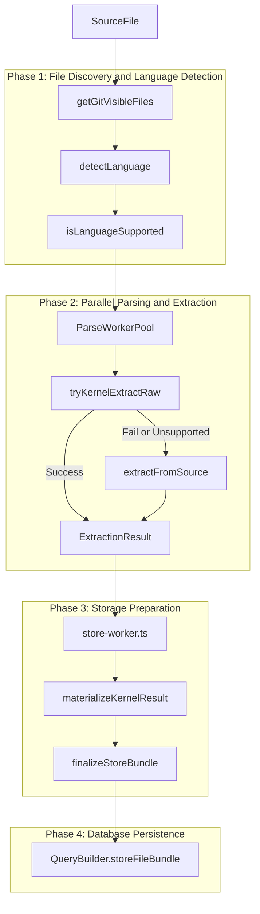
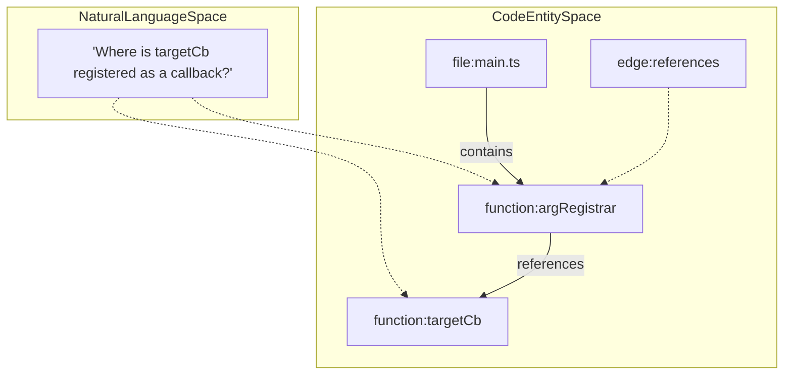
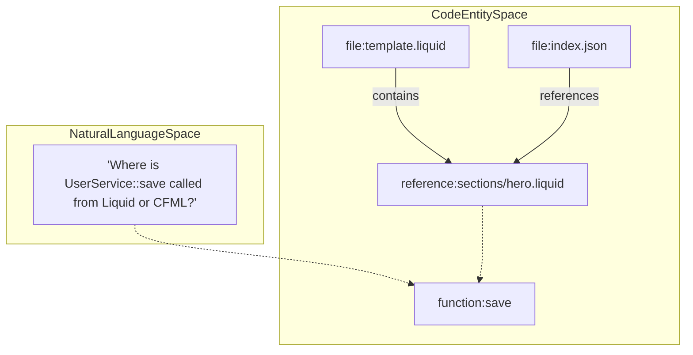

<!-- source: DeepWiki mcp.deepwiki.com · repo colbymchenry/codegraph · page 6.2 Extraction Pipeline · fetched 2026-10-30 -->

# Extraction Pipeline

Relevant source files

The following files were used as context for generating this wiki page:

- [__tests__/c-cpp-declaration-types.test.ts](__tests__/c-cpp-declaration-types.test.ts)
- [__tests__/c-macro-return-types.test.ts](__tests__/c-macro-return-types.test.ts)
- [__tests__/cfml-create-object.test.ts](__tests__/cfml-create-object.test.ts)
- [__tests__/cfml-embedded-parse-warning.test.ts](__tests__/cfml-embedded-parse-warning.test.ts)
- [__tests__/cfml-include.test.ts](__tests__/cfml-include.test.ts)
- [__tests__/cfml-inheritance-resolution.test.ts](__tests__/cfml-inheritance-resolution.test.ts)
- [__tests__/cpp-declarator-clause-names.test.ts](__tests__/cpp-declarator-clause-names.test.ts)
- [__tests__/cpp-written-scope-class-names.test.ts](__tests__/cpp-written-scope-class-names.test.ts)
- [__tests__/fixtures/kernel-parity/torture.c](__tests__/fixtures/kernel-parity/torture.c)
- [__tests__/fixtures/kernel-parity/torture.cpp](__tests__/fixtures/kernel-parity/torture.cpp)
- [__tests__/fixtures/kernel-parity/torture.py](__tests__/fixtures/kernel-parity/torture.py)
- [__tests__/foundation-enum-macros.test.ts](__tests__/foundation-enum-macros.test.ts)
- [__tests__/function-ref.test.ts](__tests__/function-ref.test.ts)
- [__tests__/generated-detection.test.ts](__tests__/generated-detection.test.ts)
- [__tests__/js-class-expressions.test.ts](__tests__/js-class-expressions.test.ts)
- [__tests__/js-static-override-dispatch.test.ts](__tests__/js-static-override-dispatch.test.ts)
- [__tests__/kernel-ccpp-parity.test.ts](__tests__/kernel-ccpp-parity.test.ts)
- [__tests__/kernel-python-call-fabrication.test.ts](__tests__/kernel-python-call-fabrication.test.ts)
- [__tests__/pascal-delphi-syntax.test.ts](__tests__/pascal-delphi-syntax.test.ts)
- [__tests__/pascal-for-in-var.test.ts](__tests__/pascal-for-in-var.test.ts)
- [__tests__/pascal-nested-routines.test.ts](__tests__/pascal-nested-routines.test.ts)
- [__tests__/pascal-param-attributes.test.ts](__tests__/pascal-param-attributes.test.ts)
- [__tests__/pascal-parenless-calls.test.ts](__tests__/pascal-parenless-calls.test.ts)
- [__tests__/pascal-system-calls.test.ts](__tests__/pascal-system-calls.test.ts)
- [__tests__/python-attr-chain.test.ts](__tests__/python-attr-chain.test.ts)
- [__tests__/python-attr-types.test.ts](__tests__/python-attr-types.test.ts)
- [__tests__/resolver-pool-sizing.test.ts](__tests__/resolver-pool-sizing.test.ts)
- [__tests__/same-file-match-confidence.test.ts](__tests__/same-file-match-confidence.test.ts)
- [__tests__/swiftui-viewer-noise.test.ts](__tests__/swiftui-viewer-noise.test.ts)
- [__tests__/ui-effects.test.ts](__tests__/ui-effects.test.ts)
- [__tests__/ui-entry-model.test.ts](__tests__/ui-entry-model.test.ts)
- [__tests__/ui-entrypoints-api.test.ts](__tests__/ui-entrypoints-api.test.ts)
- [__tests__/vue-tsx-script.test.ts](__tests__/vue-tsx-script.test.ts)
- [__tests__/wal-deferral.test.ts](__tests__/wal-deferral.test.ts)
- [codegraph-kernel/src/ccpp/mod.rs](codegraph-kernel/src/ccpp/mod.rs)
- [codegraph-kernel/src/python.rs](codegraph-kernel/src/python.rs)
- [codegraph-kernel/src/tsjs/mod.rs](codegraph-kernel/src/tsjs/mod.rs)
- [docs/design/ccpp-kernel-port-checklist.md](docs/design/ccpp-kernel-port-checklist.md)
- [docs/design/function-ref-capture.md](docs/design/function-ref-capture.md)
- [src/context/formatter.ts](src/context/formatter.ts)
- [src/db/wal-valve.ts](src/db/wal-valve.ts)
- [src/extraction/cfml-extractor.ts](src/extraction/cfml-extractor.ts)
- [src/extraction/extraction-version.ts](src/extraction/extraction-version.ts)
- [src/extraction/function-ref.ts](src/extraction/function-ref.ts)
- [src/extraction/generated-detection.ts](src/extraction/generated-detection.ts)
- [src/extraction/languages/c-cpp.ts](src/extraction/languages/c-cpp.ts)
- [src/extraction/languages/cfscript.ts](src/extraction/languages/cfscript.ts)
- [src/extraction/languages/javascript.ts](src/extraction/languages/javascript.ts)
- [src/extraction/languages/objc.ts](src/extraction/languages/objc.ts)
- [src/extraction/languages/pascal-preparse.ts](src/extraction/languages/pascal-preparse.ts)
- [src/extraction/languages/pascal-system.ts](src/extraction/languages/pascal-system.ts)
- [src/extraction/languages/pascal.ts](src/extraction/languages/pascal.ts)
- [src/extraction/languages/php.ts](src/extraction/languages/php.ts)
- [src/extraction/languages/typescript.ts](src/extraction/languages/typescript.ts)
- [src/extraction/liquid-extractor.ts](src/extraction/liquid-extractor.ts)
- [src/extraction/parse-worker.ts](src/extraction/parse-worker.ts)
- [src/extraction/sfc-script.ts](src/extraction/sfc-script.ts)
- [src/extraction/store-worker.ts](src/extraction/store-worker.ts)
- [src/extraction/store-writer.ts](src/extraction/store-writer.ts)
- [src/extraction/svelte-extractor.ts](src/extraction/svelte-extractor.ts)
- [src/extraction/syntax-tokens.ts](src/extraction/syntax-tokens.ts)
- [src/extraction/tree-sitter-types.ts](src/extraction/tree-sitter-types.ts)
- [src/extraction/vue-extractor.ts](src/extraction/vue-extractor.ts)
- [src/extraction/wasm/tree-sitter-c.wasm](src/extraction/wasm/tree-sitter-c.wasm)
- [src/extraction/wasm/tree-sitter-cpp.wasm](src/extraction/wasm/tree-sitter-cpp.wasm)
- [src/resolution/alias-binding.ts](src/resolution/alias-binding.ts)
- [src/resolution/js-class-expressions.ts](src/resolution/js-class-expressions.ts)
- [src/resolution/memory-budget.ts](src/resolution/memory-budget.ts)
- [src/resolution/pascal-scope.ts](src/resolution/pascal-scope.ts)
- [src/resolution/resolver-pool.ts](src/resolution/resolver-pool.ts)
- [src/resolution/resolver-worker.ts](src/resolution/resolver-worker.ts)
- [src/resolution/shopify-themes.ts](src/resolution/shopify-themes.ts)
- [src/ui-server/api/effects.ts](src/ui-server/api/effects.ts)
- [src/ui-server/api/entrypoints.ts](src/ui-server/api/entrypoints.ts)
- [src/ui-server/highlight/languages.ts](src/ui-server/highlight/languages.ts)

## Purpose and Scope

The Extraction Pipeline is the subsystem responsible for transforming source code files into a knowledge graph representation. It scans project directories, parses code using Tree-sitter grammars and native Rust kernel walkers (`codegraph-kernel`), extracts code symbols (functions, classes, methods, variables, etc.) as nodes, and creates edges representing relationships (`contains`, `calls`, `extends`, `references`). This page covers the extraction process from file discovery through AST traversal to node/edge creation, worker thread management, generated-file detection, extraction versioning (`EXTRACTION_VERSION`), and specialized template/SFC extractors.

Sources: [src/extraction/index.ts:37-43](), [src/extraction/extraction-version.ts:1-24](), [src/extraction/parse-worker.ts:1-24]()

---

## Extraction Pipeline Overview

The extraction pipeline executes in sequential phases for each file, managed by the `ExtractionOrchestrator` [src/extraction/index.ts:37-43](). Parsing and extraction logic is primarily executed in a native Rust kernel for performance (`codegraph-kernel`), with a TypeScript fallback (`extractFromSource`) for unsupported platforms or syntax errors [src/extraction/index.ts:27-33]().

**Diagram: Extraction Pipeline Flow**

Sources: [src/extraction/index.ts:37-106](), [src/extraction/tree-sitter.ts:1-38](), [src/extraction/parse-worker.ts:68-150]()

---

## Phase 1: File Discovery and Language Detection

### File Scanning

The `ExtractionOrchestrator` discovers project files while respecting ignore patterns and size ceilings. Files larger than `MAX_FILE_SIZE_BYTES` are skipped to prevent exhausting memory limits [src/extraction/index.ts:143-147](). The scanner identifies generated files via path patterns (e.g., `.pb.go`, `.g.cs`) and content headers (e.g., `// Code generated ... DO NOT EDIT.`) to down-rank them in search results [src/extraction/generated-detection.ts:46-93](), [src/extraction/generated-detection.ts:159-165]().

### Default Exclusions

CodeGraph excludes common dependency and build directories by default to keep the graph focused on first-party source code [src/extraction/index.ts:163-180]().
- **JS/TS**: `node_modules`, `.next`, `.svelte-kit`, `dist` [src/extraction/index.ts:164-171]().
- **Python**: `__pycache__`, `.venv` [src/extraction/index.ts:175-176]().
- **Build Output**: `build`, `out`, `.output` [src/extraction/index.ts:172-172]().

### Language Detection

The `detectLanguage()` function maps file extensions to language identifiers [src/extraction/grammars.ts:181-191](). It identifies formats including `arkts` (.ets), `erlang` (.erl), and `terraform` (.tf) [src/extraction/grammars.ts:130-172](). Special logic inspects C-style headers (`.h`), which may be C or C++ depending on content signals like `class` or `public:` keywords [__tests__/extraction.test.ts:153-176]().

Sources: [src/extraction/index.ts:143-180](), [src/extraction/grammars.ts:130-191](), [src/extraction/generated-detection.ts:46-165](), [__tests__/extraction.test.ts:153-176]()

---

## Phase 2: Parallel Parsing & Extraction via Worker Threads

Parsing is performed in parallel using `ParseWorkerPool` to maintain responsiveness [src/extraction/parse-pool.ts:2-9]().
1. **Recycling**: Workers are recycled every 250 files (`WORKER_RECYCLE_INTERVAL`) to reclaim non-shrinkable WASM memory [src/extraction/index.ts:68-74]().
2. **Timeouts**: Parses are capped by `PARSE_TIMEOUT_MS` to prevent hanging on malformed files [src/extraction/index.ts:59-65]().
3. **Reset**: Parsers inside workers are reset every 5000 parses (`PARSER_RESET_INTERVAL`) to manage heap growth [src/extraction/parse-worker.ts:67-126]().
4. **Stderr Filtering**: Emscripten `Aborted()` diagnostic noise from WASM crashes is intercepted at `process.stderr.write` to keep the user terminal clean without suppressing real application diagnostics [src/extraction/parse-worker.ts:43-65]().

### Native Rust Kernel (`codegraph-kernel`)

CodeGraph delegates extraction to a native Rust kernel for high-throughput processing:
- **Fast Path**: `tryKernelExtractRaw` extracts flat buffers directly in worker threads and skips structured cloning overhead by passing binary buffers across thread boundaries [src/extraction/parse-worker.ts:101-118]().
- **Parity Architecture**: Language modules like `codegraph-kernel/src/tsjs/mod.rs` and `codegraph-kernel/src/ccpp/mod.rs` replicate the quirk-for-quirk behavior of TypeScript extractors (`TreeSitterExtractor`), verified by parity test suites [codegraph-kernel/src/tsjs/mod.rs:1-12](), [codegraph-kernel/src/ccpp/mod.rs:1-76](), [docs/design/ccpp-kernel-port-checklist.md:1-12]().

Sources: [src/extraction/index.ts:59-74](), [src/extraction/parse-pool.ts:1-121](), [src/extraction/parse-worker.ts:43-150](), [codegraph-kernel/src/tsjs/mod.rs:1-12](), [codegraph-kernel/src/ccpp/mod.rs:1-76]()

---

## Phase 3: Code Element Extraction & Tree-sitter Walkers

When the native kernel is bypassed, the fallback path uses `extractFromSource` via `web-tree-sitter`. Each supported language implements the `LanguageExtractor` interface [src/extraction/tree-sitter-types.ts:71-163]().

### Extractor Context and Hooks

Language extractors interact with the core extractor through `ExtractorContext` [src/extraction/tree-sitter-types.ts:33-62](), which provides methods to:
- `createNode(kind, name, node, extra)`: Mint code entity nodes (`Node`) [src/extraction/tree-sitter-types.ts:35-35]().
- `visitNode(node)`: Dispatch recursive AST visitors [src/extraction/tree-sitter-types.ts:37-37]().
- `visitFunctionBody(body, functionId)`: Walk statements inside functions to discover calls [src/extraction/tree-sitter-types.ts:38-39]().
- `walkInitializer(node, functionId)`: Walk initializers or declaration expressions as executable scope runs [src/extraction/tree-sitter-types.ts:40-47]().
- `addUnresolvedReference(ref)`: Register cross-file reference bindings [src/extraction/tree-sitter-types.ts:48-49]().

Language configurations define node mappings (`functionTypes`, `classTypes`, `methodTypes`, `variableTypes`, `importTypes`, `callTypes`), field name lookups (`nameField`, `bodyField`, `paramsField`), and specialized hooks such as `preParse`, `resolveName`, and `isConst` [src/extraction/tree-sitter-types.ts:71-163](). For instance, C/C++ helpers (`cDeclaratorIdentifier`, `isConstDeclaration`, `unnamedTypeVariableName`, `recoverSingleArgMacroDefinedName`) handle declarator nesting and macro sanitization [src/extraction/languages/c-cpp.ts:13-147]().

**Diagram: Natural Language Space to Code Entity Space (Callback Capture)**

Sources: [src/extraction/tree-sitter-types.ts:33-163](), [src/extraction/languages/c-cpp.ts:13-147](), [__tests__/function-ref.test.ts:1-58]()

---

## Phase 4: Generated-File Detection & Extraction Versioning

### Generated-File Detection

CodeGraph flags generated files using heuristic matchers:
- **Header inspection**: Checks for standard banner comments (`@generated`, `DO NOT EDIT`) [src/extraction/generated-detection.ts:46-93]().
- **Minification detection**: Identifies minified bundles via line-length thresholds [src/extraction/generated-detection.ts:159-165]().

### Extraction Versioning

`EXTRACTION_VERSION` tracks the structural depth and shape of extracted nodes and edges [src/extraction/extraction-version.ts:1-24]().
- Bumping `EXTRACTION_VERSION` (currently set to `28`) signals `codegraph status` and `codegraph upgrade` that existing indexes must be rebuilt to incorporate new extractors, resolvers, or syntax rules [src/extraction/extraction-version.ts:15-24]().

Sources: [src/extraction/generated-detection.ts:46-165](), [src/extraction/extraction-version.ts:1-24]()

---

## Phase 5: Specialized Language & Template Extractors

CodeGraph includes specialized extractors for templating languages, Single File Components (SFCs), and dialect-heavy parsers:
- **LiquidExtractor**: Parses Shopify Liquid template files (.liquid) and OS 2.0 JSON templates, extracting section references (`` and `sections/*.liquid` JSON mapping), snippet render calls (``), schemas, and variable assignments (``, ``) [src/extraction/liquid-extractor.ts:1-137]().
- **CfmlExtractor**: Handles ColdFusion Markup Language (.cfc/.cfm), dynamically dispatching modern bare-script files to `cfscript` and tag-based files to tag walkers while parsing embedded expressions in tags (`<cfset>`, `<cfif>`, `#hash#`) [src/extraction/cfml-extractor.ts:57-178]().
- **objcExtractor**: Objective-C extractor handling multi-part selectors (`greet`, `doThing:with:`), receiver types (`extractObjcReturnType`), and properties in interface and implementation blocks [src/extraction/languages/objc.ts:23-144]().
- **VueExtractor, SvelteExtractor & AstroExtractor**: Parse SFC blocks (`<template>`, `<script setup>`, `<style>`), binding template expressions and scopes to backing script definitions [src/extraction/vue-extractor.ts](), [src/extraction/svelte-extractor.ts]().

**Diagram: Natural Language Space to Code Entity Space (Template and SFC Routing)**

Sources: [src/extraction/liquid-extractor.ts:1-137](), [src/extraction/cfml-extractor.ts:57-178](), [src/extraction/languages/objc.ts:23-144]()

---

## Phase 6: Storage & Persistence (`StoreWriter`)

The `StoreWriter` coordinates data insertion into the SQLite database [src/extraction/store-writer.ts:4-9]().
1. **Materialization**: `materializeKernelResult` converts raw transfer buffers into JS `Node` and `Edge` objects when framework extractors require inspection [src/extraction/index.ts:27-27]().
2. **Finalization**: `finalizeStoreBundle` validates references and ensures referential integrity [src/extraction/store-writer.ts:35-43]().
3. **Persistence**: `QueryBuilder` executes batched `INSERT` operations for nodes, edges, and unresolved references [src/db/queries.ts:213-230]().

Sources: [src/extraction/index.ts:23-27](), [src/extraction/store-writer.ts:1-121](), [src/db/queries.ts:213-230]()

---

