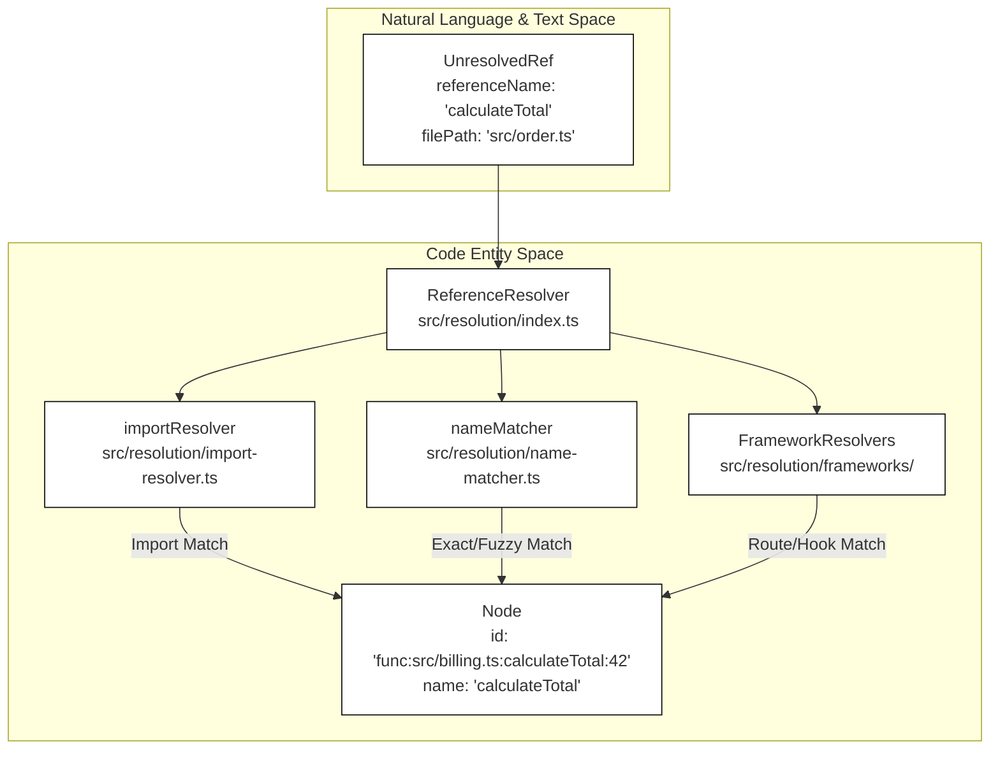
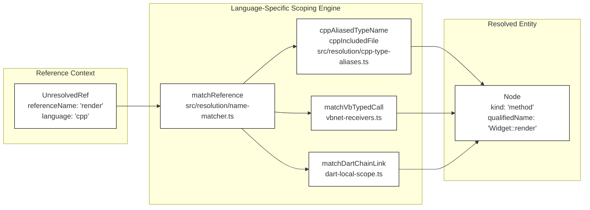

<!-- source: DeepWiki mcp.deepwiki.com · repo colbymchenry/codegraph · page 6.3 Reference Resolution System · fetched 2026-10-30 -->

# Reference Resolution System

Relevant source files

The following files were used as context for generating this wiki page:

- [CHANGELOG.md](CHANGELOG.md)
- [__tests__/ambient-module-imports.test.ts](__tests__/ambient-module-imports.test.ts)
- [__tests__/cpp-alias-inherited-member.test.ts](__tests__/cpp-alias-inherited-member.test.ts)
- [__tests__/cpp-auto-local-receiver.test.ts](__tests__/cpp-auto-local-receiver.test.ts)
- [__tests__/cpp-declared-type-receiver.test.ts](__tests__/cpp-declared-type-receiver.test.ts)
- [__tests__/cpp-global-alias-target.test.ts](__tests__/cpp-global-alias-target.test.ts)
- [__tests__/cpp-gtest-fixture-scope.test.ts](__tests__/cpp-gtest-fixture-scope.test.ts)
- [__tests__/cpp-member-template-returns.test.ts](__tests__/cpp-member-template-returns.test.ts)
- [__tests__/cpp-outside-type-receiver.test.ts](__tests__/cpp-outside-type-receiver.test.ts)
- [__tests__/cpp-overload-constness.test.ts](__tests__/cpp-overload-constness.test.ts)
- [__tests__/cpp-pimpl-member-chains.test.ts](__tests__/cpp-pimpl-member-chains.test.ts)
- [__tests__/cpp-receiver-global-far-library.test.ts](__tests__/cpp-receiver-global-far-library.test.ts)
- [__tests__/cpp-smart-pointer-receiver.test.ts](__tests__/cpp-smart-pointer-receiver.test.ts)
- [__tests__/cpp-undeclared-qualifier.test.ts](__tests__/cpp-undeclared-qualifier.test.ts)
- [__tests__/extraction.test.ts](__tests__/extraction.test.ts)
- [__tests__/override-overload-pairing.test.ts](__tests__/override-overload-pairing.test.ts)
- [__tests__/qualified-name-boundary.test.ts](__tests__/qualified-name-boundary.test.ts)
- [__tests__/resolution.test.ts](__tests__/resolution.test.ts)
- [__tests__/rust-loop-tuple-field-types.test.ts](__tests__/rust-loop-tuple-field-types.test.ts)
- [__tests__/rust-typed-receivers.test.ts](__tests__/rust-typed-receivers.test.ts)
- [__tests__/rust-wrapped-self-calls.test.ts](__tests__/rust-wrapped-self-calls.test.ts)
- [__tests__/sfc-alias-module-imports.test.ts](__tests__/sfc-alias-module-imports.test.ts)
- [__tests__/sync-module-importers.test.ts](__tests__/sync-module-importers.test.ts)
- [__tests__/ts-interface-extends.test.ts](__tests__/ts-interface-extends.test.ts)
- [__tests__/ts-qualified-type-names.test.ts](__tests__/ts-qualified-type-names.test.ts)
- [__tests__/ts-type-reference-scope.test.ts](__tests__/ts-type-reference-scope.test.ts)
- [__tests__/vbnet-bare-member-scope.test.ts](__tests__/vbnet-bare-member-scope.test.ts)
- [__tests__/vbnet-instance-member-refs.test.ts](__tests__/vbnet-instance-member-refs.test.ts)
- [__tests__/vbnet-member-access-scope.test.ts](__tests__/vbnet-member-access-scope.test.ts)
- [__tests__/vbnet-member-access.test.ts](__tests__/vbnet-member-access.test.ts)
- [__tests__/vbnet-project-ties.test.ts](__tests__/vbnet-project-ties.test.ts)
- [__tests__/vbnet-receiver-types.test.ts](__tests__/vbnet-receiver-types.test.ts)
- [__tests__/vbnet-shared-member-refs.test.ts](__tests__/vbnet-shared-member-refs.test.ts)
- [__tests__/vbnet-std-methods.test.ts](__tests__/vbnet-std-methods.test.ts)
- [__tests__/workspace-nested-globs.test.ts](__tests__/workspace-nested-globs.test.ts)
- [__tests__/workspace-package-entries.test.ts](__tests__/workspace-package-entries.test.ts)
- [src/db/queries.ts](src/db/queries.ts)
- [src/extraction/index.ts](src/extraction/index.ts)
- [src/extraction/tree-sitter.ts](src/extraction/tree-sitter.ts)
- [src/index.ts](src/index.ts)
- [src/resolution/ambient-modules.ts](src/resolution/ambient-modules.ts)
- [src/resolution/cpp-namespaces.ts](src/resolution/cpp-namespaces.ts)
- [src/resolution/cpp-supertypes.ts](src/resolution/cpp-supertypes.ts)
- [src/resolution/cpp-type-aliases.ts](src/resolution/cpp-type-aliases.ts)
- [src/resolution/import-resolver.ts](src/resolution/import-resolver.ts)
- [src/resolution/index.ts](src/resolution/index.ts)
- [src/resolution/module-importers.ts](src/resolution/module-importers.ts)
- [src/resolution/name-matcher.ts](src/resolution/name-matcher.ts)
- [src/resolution/override-parameters.ts](src/resolution/override-parameters.ts)
- [src/resolution/rust-scopes.ts](src/resolution/rust-scopes.ts)
- [src/resolution/type-parameters.ts](src/resolution/type-parameters.ts)
- [src/resolution/types.ts](src/resolution/types.ts)
- [src/resolution/vbnet-receivers.ts](src/resolution/vbnet-receivers.ts)
- [src/resolution/workspace-packages.ts](src/resolution/workspace-packages.ts)

The Reference Resolution System is the post-processing subsystem that transforms unresolved cross-file references into concrete edges in the knowledge graph. During extraction (see [Extraction Pipeline](6.2)), the parser captures references to symbols that cannot be immediately resolved to local node IDs. The reference resolution system applies import resolution, name matching, type and receiver inference, language-specific scoping rules (Dart, Go, Swift, C++, VB.NET), framework resolvers, and callback synthesizers to construct a fully connected dependency graph.

For details on framework-specific resolution rules, see [Framework Resolvers](#6.3.1). For details on heuristic edge synthesis for dynamic dispatch, see [Dispatch and Callback Synthesizers](#6.3.2).

---

## Overview and Resolution Flow

The resolver operates on `UnresolvedRef` structures produced during extraction, matching them against known symbols and files to generate `ResolvedRef` records [src/resolution/types.ts:12-48]().

### Natural Language Space to Code Entity Space: Resolution Architecture

Sources: [src/resolution/index.ts:1-25](), [src/resolution/types.ts:12-48](), [src/resolution/import-resolver.ts:1-25]()

---

## Core Resolution Strategies

The resolution orchestrator applies multiple strategies in priority order, backed by cached metadata sets and path alias mappings [src/resolution/index.ts:30-46]().

### 1. Import Resolution
Import resolution traces file imports using language-specific extension rules, barrel files (`index.ts`, `__init__.py`, `mod.rs`), and tsconfig/jsconfig path aliases [src/resolution/import-resolver.ts:11-78](). It validates local monorepo workspace packages to correctly map internal dependencies without falling back to external package stubs [src/resolution/import-resolver.ts:12-14]().

Sources: [src/resolution/import-resolver.ts:1-78]()

### 2. Name Matching and Language-Specific Scoping
When import mappings are absent or ambiguous, name matching resolves symbols using exact matching, qualified name lookups, and language-specific scoping rules [src/resolution/name-matcher.ts:1-18](). To prevent performance degradation on large codebases with ubiquitous method names (e.g., `init`, `render`), an ambiguous name ceiling limits fuzzy fallback matching [src/resolution/name-matcher.ts:47-54]().

Specialized language-specific scoping mechanics include:
*   **Dart:** Resolves dart import prefixes, library visibility scopes, and local block bindings [src/resolution/name-matcher.ts:14-16]().
*   **Go:** Resolves unexported receiver scoping, module package directories, and type-position targets [src/resolution/name-matcher.ts:24]().
*   **Swift:** Handles type path visibility, extended conformances, and scoped method resolution [src/resolution/name-matcher.ts:14]().
*   **C++:** Resolves aliased type names, pointer/reference types, template arguments, include-file relationships, and macro visibility [src/resolution/name-matcher.ts:18-22]().
*   **VB.NET:** Resolves shared member access, project ties, nested types, and receiver type qualifications [src/resolution/name-matcher.ts:17]().

### Natural Language Space to Code Entity Space: Scoping and Disambiguation

Sources: [src/resolution/name-matcher.ts:1-28](), [src/resolution/cpp-type-aliases.ts:47-60](), [src/resolution/vbnet-receivers.ts:1-17]()

---

## Framework Resolvers

Framework resolvers provide specialized matching logic for web frameworks, UI routers, and component libraries. 

For comprehensive documentation on the plugin system and built-in resolvers (React, React Router, Next.js, Expo Router, Vue/Vue Router, Angular, Svelte/SvelteKit, Astro, Express, NestJS, Laravel, Rails, Spring, Go, Rust, Swift, C#), see [Framework Resolvers](#6.3.1).

Sources: [src/extraction/tree-sitter.ts:42-45]()

---

## Dispatch and Callback Synthesizers

To resolve dynamic dispatch relationships where static target identification fails, CodeGraph runs heuristic synthesis passes after primary resolution.

For details on C function-pointer tables, event emitters, observer channels, framework event buses (MediatR, Sidekiq, Spring, Laravel, Celery), and UI render bridges, see [Dispatch and Callback Synthesizers](#6.3.2).

Sources: [src/resolution/index.ts:49-49]()

---

## Confidence Scoring and Built-in Filtering

The resolution system assigns confidence scores to every resolved reference to guide graph traversal and query ranking [src/resolution/types.ts:40-48]().

### Confidence Scoring Summary

| Resolved By | Confidence | Description |
|---|---|---|
| `file-path` | 0.95 | Exact file path match [src/resolution/name-matcher.ts:82-90]() |
| `import` | 0.90 | Direct import mapping resolution [src/resolution/types.ts:40-48]() |
| `file-path` (suffix) | 0.85 | Suffix match resolved via directory proximity [src/resolution/name-matcher.ts:100-110]() |
| `framework` | 0.70 - 0.90 | Framework-specific pattern resolution (routes, hooks) [src/resolution/types.ts:40-48]() |
| `exact-match` | 0.70 - 0.90 | Unambiguous symbol name match within language family [src/resolution/types.ts:40-48]() |

To eliminate noise in the knowledge graph, standard library packages, language built-ins, and primitive types are explicitly filtered out from emitting unresolved reference targets [src/resolution/index.ts:60-67]().

Sources: [src/resolution/types.ts:40-48](), [src/resolution/name-matcher.ts:60-123](), [src/resolution/index.ts:60-67]()

---

