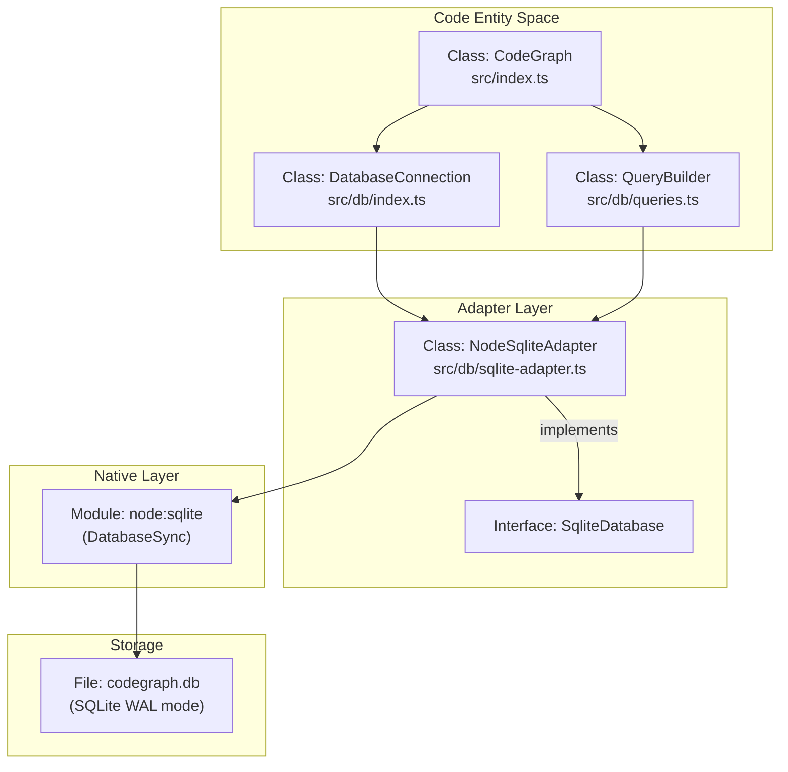
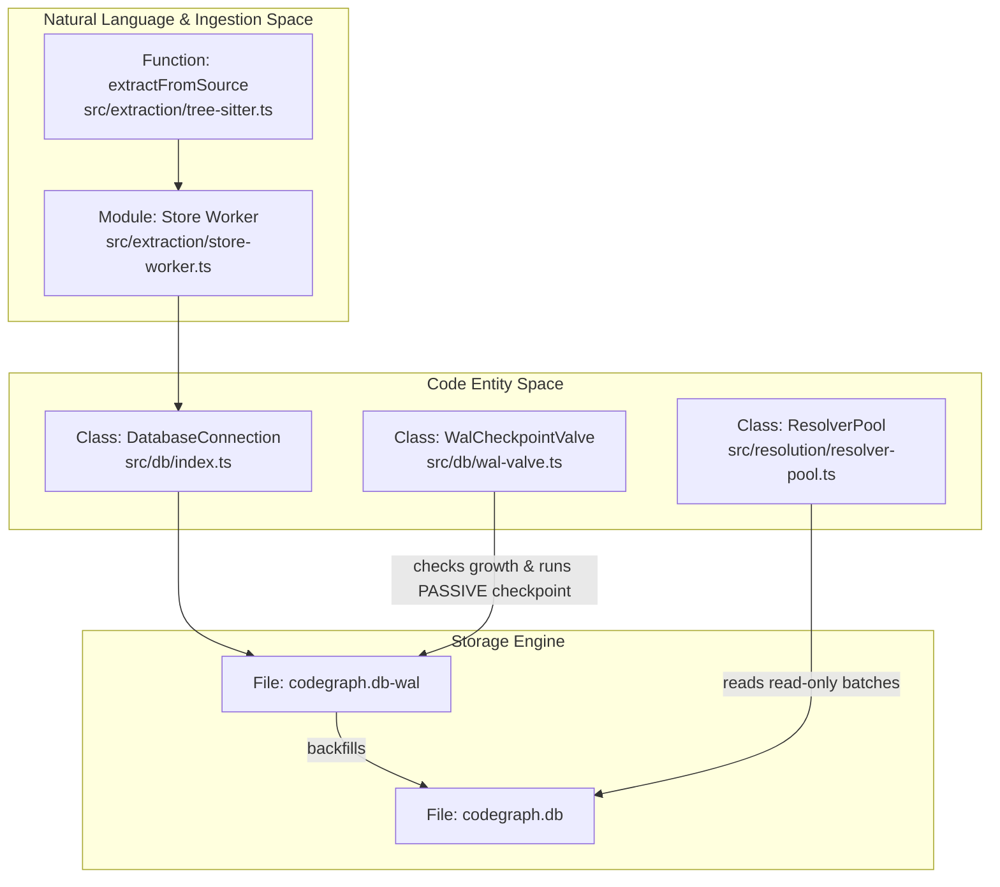
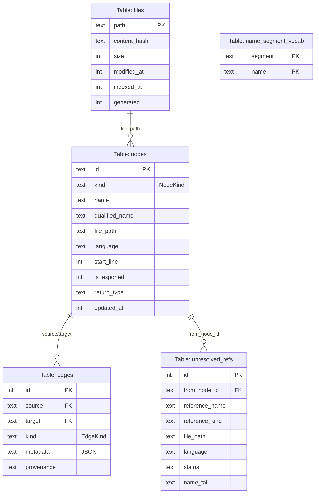

<!-- source: DeepWiki mcp.deepwiki.com · repo colbymchenry/codegraph · page 6.4 Storage Layer · fetched 2026-10-30 -->

# Storage Layer

Relevant source files

The following files were used as context for generating this wiki page:

- [__tests__/db-perf.test.ts](__tests__/db-perf.test.ts)
- [__tests__/foundation.test.ts](__tests__/foundation.test.ts)
- [__tests__/generated-flag-index.test.ts](__tests__/generated-flag-index.test.ts)
- [__tests__/migrations-synthesis-json.test.ts](__tests__/migrations-synthesis-json.test.ts)
- [__tests__/pr19-improvements.test.ts](__tests__/pr19-improvements.test.ts)
- [__tests__/resolver-pool-sizing.test.ts](__tests__/resolver-pool-sizing.test.ts)
- [__tests__/sqlite-open-error.test.ts](__tests__/sqlite-open-error.test.ts)
- [__tests__/sync-import-binding-retry.test.ts](__tests__/sync-import-binding-retry.test.ts)
- [__tests__/sync-import-member-retry.test.ts](__tests__/sync-import-member-retry.test.ts)
- [__tests__/sync-python-import-binding-retry.test.ts](__tests__/sync-python-import-binding-retry.test.ts)
- [__tests__/sync-synthesis-inputs.test.ts](__tests__/sync-synthesis-inputs.test.ts)
- [__tests__/wal-deferral.test.ts](__tests__/wal-deferral.test.ts)
- [__tests__/wsl-shared-index.test.ts](__tests__/wsl-shared-index.test.ts)
- [src/db/migrations.ts](src/db/migrations.ts)
- [src/db/node-sqlite.ts](src/db/node-sqlite.ts)
- [src/db/open-error.ts](src/db/open-error.ts)
- [src/db/reference-tail.ts](src/db/reference-tail.ts)
- [src/db/schema.sql](src/db/schema.sql)
- [src/db/sqlite-adapter.ts](src/db/sqlite-adapter.ts)
- [src/db/synthesis-stage.ts](src/db/synthesis-stage.ts)
- [src/db/wal-valve.ts](src/db/wal-valve.ts)
- [src/extraction/parse-worker.ts](src/extraction/parse-worker.ts)
- [src/extraction/store-worker.ts](src/extraction/store-worker.ts)
- [src/extraction/store-writer.ts](src/extraction/store-writer.ts)
- [src/resolution/memory-budget.ts](src/resolution/memory-budget.ts)
- [src/resolution/resolver-pool.ts](src/resolution/resolver-pool.ts)
- [src/resolution/resolver-worker.ts](src/resolution/resolver-worker.ts)

## Purpose and Scope

The Storage Layer is responsible for persisting the knowledge graph to disk and providing efficient query interfaces. This document covers the SQLite database schema, the `QueryBuilder` implementation, caching strategies, prepared statement management, WAL mode, store workers, and database optimization.

CodeGraph follows a local-first approach, storing data in a SQLite database located at `.codegraph/codegraph.db` [src/db/index.ts:12-13](), [__tests__/foundation.test.ts:51-53](). The schema version is currently at version `16` [src/db/migrations.ts:13]().

Sources: [src/db/index.ts:1-5](), [__tests__/foundation.test.ts:1-14](), [src/db/migrations.ts:10-15]()

---

## SQLite Database Foundation

CodeGraph uses **SQLite** as its persistence layer, specifically leveraging the built-in `node:sqlite` module available in Node.js 22.5+ [src/db/sqlite-adapter.ts:8-11](). This provides a native, high-performance C-backed database without requiring external binary dependencies or WASM fallbacks [src/db/sqlite-adapter.ts:41-49]().

### Database Adapter Architecture

The `SqliteDatabase` and `SqliteBackend` interfaces provide a `better-sqlite3`-compatible surface area, allowing the rest of the codebase to remain agnostic of the underlying driver implementation [src/db/sqlite-adapter.ts:4-6, 13-33]().

**Diagram: Storage Layer Component Mapping**

Sources: [src/db/sqlite-adapter.ts:50-128](), [src/db/index.ts:72-91](), [src/db/index.ts:131-137]()

### Concurrency and Background Management Architecture

To bridge natural language data ingestion workflows with low-latency agent queries, CodeGraph utilizes concurrent database interactions bounded by a WAL valve and parallel resolver workers.

**Diagram: Concurrency and WAL Valve Architecture**

Sources: [src/db/wal-valve.ts:1-138](), [src/resolution/resolver-pool.ts:1-156](), [src/extraction/parse-worker.ts:70-128]()

### Performance Tuning
Upon initialization or opening, the `DatabaseConnection` class applies specific PRAGMAs to optimize for AI-assistant workloads [src/db/index.ts:30-45]():

- **WAL Mode**: `journal_mode = WAL` is enabled to allow concurrent reads while a write is in progress [src/db/index.ts:33]().
- **Busy Timeout**: `busy_timeout = 5000` (5 seconds) is set first to ensure the process waits for locks rather than failing immediately [src/db/index.ts:23, 31]().
- **Synchronous**: `synchronous = NORMAL` provides a balance between integrity and write speed [src/db/index.ts:34]().
- **Memory Optimization**: `temp_store = MEMORY` and `mmap_size = 268435456` (256 MB) reduce disk I/O for temporary operations [src/db/index.ts:36-37]().
- **Page Cache**: `cache_size = -64000` (64 MB) keeps hot segments of the graph in memory [src/db/index.ts:35]().
- **WAL Healing**: `journal_size_limit` is set to `WAL_HEAL_THRESHOLD_BYTES` (default 64MB) to prevent the WAL file from growing indefinitely after crashes [src/db/index.ts:44, 58-67]().

Sources: [src/db/index.ts:16-67](), [src/db/sqlite-adapter.ts:92-108]()

---

## Database Schema and Migrations

The schema is defined in `src/db/schema.sql` and managed via a versioned migration system [src/db/schema.sql:1-9](), [src/db/migrations.ts:1-13](). Current schema version is `16` [src/db/migrations.ts:13]().

### Core Tables

**Diagram: Database Schema (Code Entities)**

#### `nodes` Table
Stores code symbols (functions, classes, variables) with location, signatures, docstrings, and visibility properties [src/db/schema.sql:20-42](). It includes a full-text search (FTS5) virtual table `nodes_fts` with triggers for automatic synchronization [src/db/schema.sql:117-143]().

#### `edges` Table
Represents directed relationships between nodes (`calls`, `references`, `imports`, etc.). The `provenance` column tracks the edge's origin [src/db/schema.sql:45-56](). A unique index `idx_edges_identity` prevents duplicate edge rows during batch insertion [src/db/migrations.ts:98-99]().

#### `files` Table
Tracks source files, hashes, modification timestamps, and index status [src/db/schema.sql:67-77](). The `generated` column stores extraction verdicts to rank search results [src/db/schema.sql:76]().

#### `unresolved_refs` Table
Temporary storage for references found during extraction that require cross-file resolution [src/db/schema.sql:88-101](). The `status` column tracks the lifecycle (`pending` vs `failed`), and `name_tail` optimizes retry matching for dotted references [src/db/schema.sql:98-99](), [src/db/migrations.ts:125-151]().

#### `name_segment_vocab` Table
A specialized lookup table for prose-word to symbol-name mapping, enabling natural-language prompt verification by materializing lowercased segments of symbol names [src/db/schema.sql:158-162](). Version 16 further optimizes module member tails via dedicated expression indexes [src/db/migrations.ts:8-15]().

Sources: [src/db/schema.sql:1-175](), [src/db/migrations.ts:1-172]()

---

## QueryBuilder Implementation and Caching

The `QueryBuilder` class provides a high-level API for knowledge graph operations, abstracting prepared statements and result mapping.

### Caching and Performance
- **Node Cache**: `QueryBuilder` maintains an internal LRU cache to accelerate repeated entity lookups [__tests__/db-perf.test.ts:88-98]().
- **Cache Invalidation**: `insertNode` (and `INSERT OR REPLACE` statements) invalidates corresponding LRU cache entries to prevent serving stale node payloads [__tests__/db-perf.test.ts:161-175]().
- **Batch Lookups**: `getNodesByIds` leverages the internal cache and performs chunked database queries (default chunk size: 500) to avoid SQLite parameter bounds [__tests__/db-perf.test.ts:38-86]().
- **Batch Deletion**: `deleteResolvedReferences` chunks ID lists exceeding `SQLITE_MAX_VARIABLE_NUMBER` limits [__tests__/db-perf.test.ts:117-138]().

Sources: [__tests__/db-perf.test.ts:1-175]()

---

## WAL Checkpoint Valve

To handle bulk indexing efficiently on constrained storage, CodeGraph implements a `WalCheckpointValve` [src/db/wal-valve.ts:1-3]().

### Growth Management
During bulk indexing, SQLite's default `wal_autocheckpoint` interval is disabled to turn random B-tree page writes into sequential WAL appends [src/db/wal-valve.ts:5-10](). The valve monitors WAL growth and triggers off-thread `PASSIVE` checkpoints when thresholds are crossed [src/db/wal-valve.ts:17-21]().

- **Soft Threshold**: Defaults to 256MB (or dynamically scaled based on database file size), triggering background checkpoints [src/db/wal-valve.ts:50, 103-107]().
- **Hard Cap**: At 2× the soft threshold, the valve applies backpressure, pausing writer threads until a full backfill completes [src/db/wal-valve.ts:52, 115]().
- **Baseline Tracking**: Growth is measured against `sizeAtLastFullBackfill` rather than absolute file size to account for WAL frame recycling [src/db/wal-valve.ts:23-32, 117-120]().
- **Fail-Closed Abort**: If a pinned reader prevents checkpoints from progressing while past limits, the valve throws a `WalValveAbortError` rather than risking unbounded disk expansion [src/db/wal-valve.ts:46-54, 63-76]().

Sources: [src/db/wal-valve.ts:1-138](), [__tests__/wal-deferral.test.ts:1-11]()

---

## Store Workers and Database Optimization

1.  **Bulk Loading**: `DatabaseConnection.beginBulkNodeLoad()` temporarily drops FTS triggers during mass inserts to bypass per-row tokenization overhead, followed by `endBulkNodeLoad()` which rebuilds the FTS index wholesale [src/db/index.ts:171-183]().
2.  **Atomic Recreate**: `CodeGraph.recreate` recovers poisoned or oversized indexes by unlinking the database files rather than executing slow in-place DELETE statements [__tests__/foundation.test.ts:193-213]().
3.  **Store Workers**: Extraction and storage phases utilize dedicated worker threads (`store-worker.ts`, `parse-worker.ts`) to offload heavy payload decoding and database serialization from the main control loop.
4.  **Parallel Resolution**: `ResolverPool` distributes reference resolution workloads across worker processes running in `readOnly` mode, avoiding write-lock contention with background checkpointing [src/resolution/resolver-pool.ts:1-10](), [src/resolution/resolver-worker.ts:4-9]().

Sources: [src/db/index.ts:171-183](), [src/resolution/resolver-pool.ts:1-10](), [__tests__/foundation.test.ts:193-213]()

---

