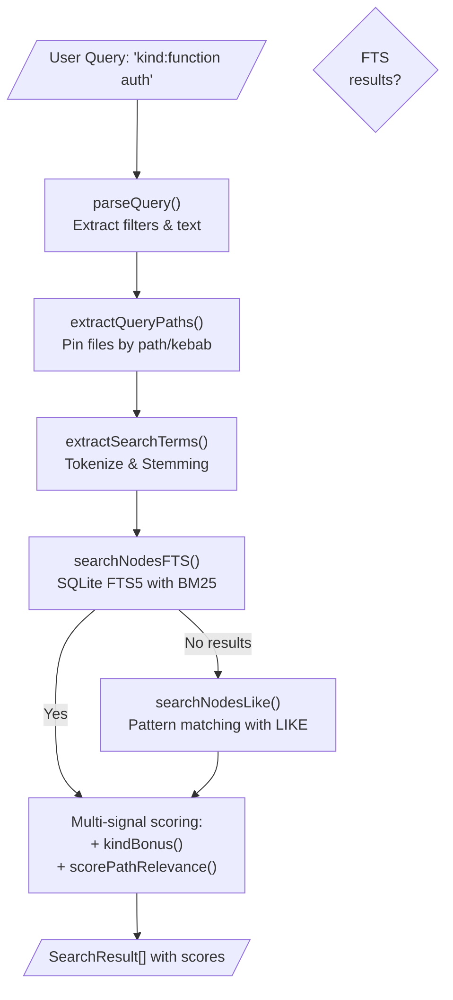
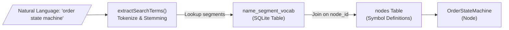
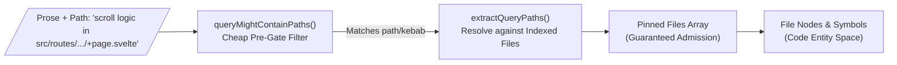
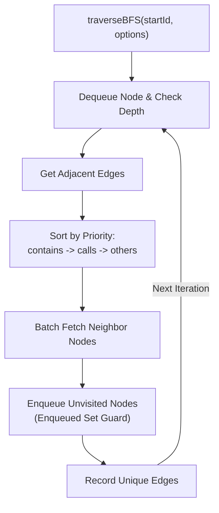
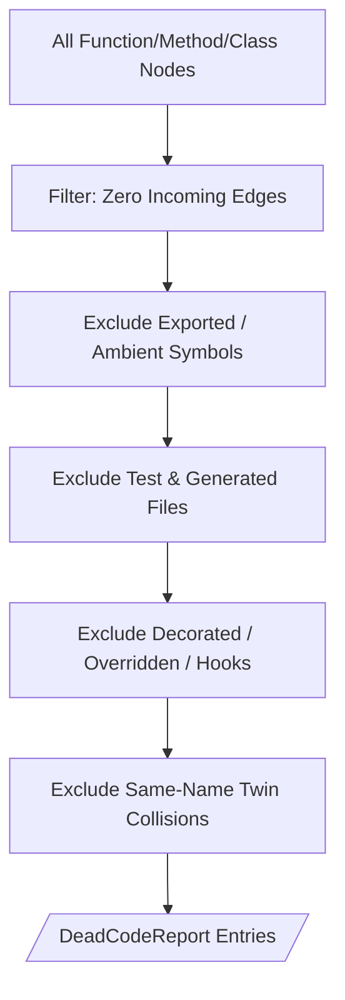
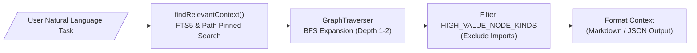

<!-- source: DeepWiki mcp.deepwiki.com · repo colbymchenry/codegraph · page 6.5 Query and Traversal System · fetched 2026-10-30 -->

# Query and Traversal System

Relevant source files

The following files were used as context for generating this wiki page:

- [__tests__/cli-definition-grouping.test.ts](__tests__/cli-definition-grouping.test.ts)
- [__tests__/context-ranking.test.ts](__tests__/context-ranking.test.ts)
- [__tests__/context.test.ts](__tests__/context.test.ts)
- [__tests__/dead-code.test.ts](__tests__/dead-code.test.ts)
- [__tests__/explore-exact-target.test.ts](__tests__/explore-exact-target.test.ts)
- [__tests__/explore-long-query.test.ts](__tests__/explore-long-query.test.ts)
- [__tests__/explore-path-pinning.test.ts](__tests__/explore-path-pinning.test.ts)
- [__tests__/explore-same-basename-pin.test.ts](__tests__/explore-same-basename-pin.test.ts)
- [__tests__/fixtures/explore-path-pinning/src/lib/background-image-table.ts](__tests__/fixtures/explore-path-pinning/src/lib/background-image-table.ts)
- [__tests__/fixtures/explore-path-pinning/src/lib/background-store.ts](__tests__/fixtures/explore-path-pinning/src/lib/background-store.ts)
- [__tests__/flow-directed-exact-names.test.ts](__tests__/flow-directed-exact-names.test.ts)
- [__tests__/flow-named-implementation.test.ts](__tests__/flow-named-implementation.test.ts)
- [__tests__/graph.test.ts](__tests__/graph.test.ts)
- [__tests__/no-silent-fuzzy-symbol.test.ts](__tests__/no-silent-fuzzy-symbol.test.ts)
- [__tests__/query-paths.test.ts](__tests__/query-paths.test.ts)
- [__tests__/symbol-lookup-go-packages.test.ts](__tests__/symbol-lookup-go-packages.test.ts)
- [__tests__/symbol-lookup.test.ts](__tests__/symbol-lookup.test.ts)
- [__tests__/ts-ambient-exports.test.ts](__tests__/ts-ambient-exports.test.ts)
- [docs/design/adaptive-explore-sizing.md](docs/design/adaptive-explore-sizing.md)
- [src/context/index.ts](src/context/index.ts)
- [src/db/name-substring-index.ts](src/db/name-substring-index.ts)
- [src/graph/dead-code.ts](src/graph/dead-code.ts)
- [src/graph/go-package.ts](src/graph/go-package.ts)
- [src/graph/named-symbol-flow.ts](src/graph/named-symbol-flow.ts)
- [src/graph/queries.ts](src/graph/queries.ts)
- [src/graph/symbol-lookup.ts](src/graph/symbol-lookup.ts)
- [src/graph/traversal.ts](src/graph/traversal.ts)
- [src/search/query-paths.ts](src/search/query-paths.ts)
- [src/search/query-utils.ts](src/search/query-utils.ts)
- [src/ui-server/api/deadcode.ts](src/ui-server/api/deadcode.ts)

The Query and Traversal System provides the core graph analysis capabilities of CodeGraph, enabling efficient search, navigation, and relationship analysis across the code knowledge graph. This system transforms natural language queries and technical analysis requests into optimized database operations, advanced graph algorithms, and context-aware symbol lookups.

Sources: [src/context/index.ts:1-6](), [src/graph/traversal.ts:1-5]()

---

## Search Operations Architecture & Natural Language Mapping

CodeGraph implements a multi-tier search strategy using structured parsing, Full-Text Search (FTS5) with BM25 ranking, identifier segments, and pattern matching to maximize result quality.

### Search Strategy Flow

Title: Search Strategy Flow

Sources: [src/db/queries.ts:537-587](), [src/search/query-parser.ts:66-147](), [src/search/query-utils.ts:156-188](), [src/search/query-paths.ts:28-42]()

### Structured Query Parsing, Path Pinning, and Identifier Segments

Natural language inputs are parsed into structured filters via `parseQuery` [src/search/query-parser.ts:66-147](). To handle agent-specified file paths that traditional tokenizers shred, `extractQueryPaths` maps paths and extension-less kebab basenames against the indexed file list [src/search/query-paths.ts:60-137]().

To bridge the gap between "Natural Language Space" and "Code Entity Space", CodeGraph materializes identifier name segments into `name_segment_vocab` (e.g., `OrderStateMachine` split into `order`, `state`, `machine`) [src/search/identifier-segments.ts:1-14]().

Title: Natural Language to Code Entity Space Mapping via Identifier Segments

Sources: [src/search/query-utils.ts:85-142](), [src/search/identifier-segments.ts:1-136](), [src/db/queries.ts:537-587]()

Title: Natural Language to Code Entity Space Mapping via Path Pinning

Sources: [src/search/query-paths.ts:34-91](), [src/search/query-paths.ts:138-150]()

---

## Graph Traversal Algorithms

The `GraphTraverser` class [src/graph/traversal.ts:34-39]() implements breadth-first search (`traverseBFS`) [src/graph/traversal.ts:48-145]() and depth-first search (`traverseDFS`) [src/graph/traversal.ts:154-177]() over the code knowledge graph.

### BFS Traversal and Optimization

`traverseBFS` explores the graph layer by layer while preventing duplicate enqueuing via an explicit `enqueued` set and deduplicating edges via `seenEdges` [src/graph/traversal.ts:58-71](). It prioritizes structural edges (`contains`, `calls`) over external reference edges [src/graph/traversal.ts:96-99]().

Title: BFS Traversal Flow

Sources: [src/graph/traversal.ts:48-145]()

---

## Call Graphs, Impact Analysis, and Dead Code

CodeGraph provides specialized graph views and analysis tools for architectural exploration.

### Call Graphs and Impact Analysis
- **Call Graphs**: `getCallGraph` retrieves call hierarchies and edge paths around focal functions [__tests__/graph.test.ts:213-228]().
- **Impact Analysis**: `getImpactRadius` performs a reverse traversal along incoming reference and call edges to determine the blast radius of potential modifications [src/graph/traversal.ts:478-525]().

### Dead Code Analysis
The dead code subsystem (`src/graph/dead-code.ts`) differentiates between unreferenced symbols (`unreferenced` fact) and genuine dead code (`dead` inference) by applying subtractive heuristic filters [src/graph/dead-code.ts:1-100]():
1. **Exports**: Exported symbols or ambient declarations (`declare module`, `declare global`) [src/graph/dead-code.ts:21-25]().
2. **Tests & Generation**: Symbols in test files, generated sources, or headers (`.h`, `.d.ts`) [src/graph/dead-code.ts:26-28]().
3. **Framework Bindings**: Decorated functions (`@app.route`, `@Component`), overridden members, or framework callback hooks (`ngOnInit`, `constructor`) [src/graph/dead-code.ts:29-46]().
4. **Resolution Gaps & Twin Symbols**: Unresolved reference records or situations where a same-name twin symbol was called instead [src/graph/dead-code.ts:53-68]().

Title: Dead Code Subtractive Filtering

Sources: [src/graph/traversal.ts:336-525](), [src/graph/dead-code.ts:1-124](), [__tests__/graph.test.ts:213-228]()

---

## Context Building, Branch Guards, and Multi-Signal Ranking

The `ContextBuilder` integrates search results with graph traversal to construct task-specific contexts for AI agents [src/context/index.ts:1-6]().

### Multi-Signal Ranking and Project Token Weighting
- **Project Name Down-weighting**: Tokens matching the overall project name or package module are filtered via `deriveProjectNameTokens` to prevent lexical inflation [src/search/query-utils.ts:29-54]().
- **Deprioritization**: Paths matching user-configured `deprioritize` patterns are discounted in ranking [src/project-config.ts:70-84]().

### Branch Guards and High-Value Filtering
During graph traversal and context assembly, the system restricts nodes to `HIGH_VALUE_NODE_KINDS` (functions, methods, classes, interfaces, structs) while ignoring low-density structures like imports [src/context/index.ts:167-170](). Branch guards and budget limits (e.g., `maxNodes`, `maxCodeBlocks`, `traversalDepth`) control the exploration scope [src/context/index.ts:151-160]().

Title: Context Building Pipeline

Sources: [src/context/index.ts:151-170](), [src/search/query-utils.ts:29-54](), [src/graph/traversal.ts:48-145]()

---

