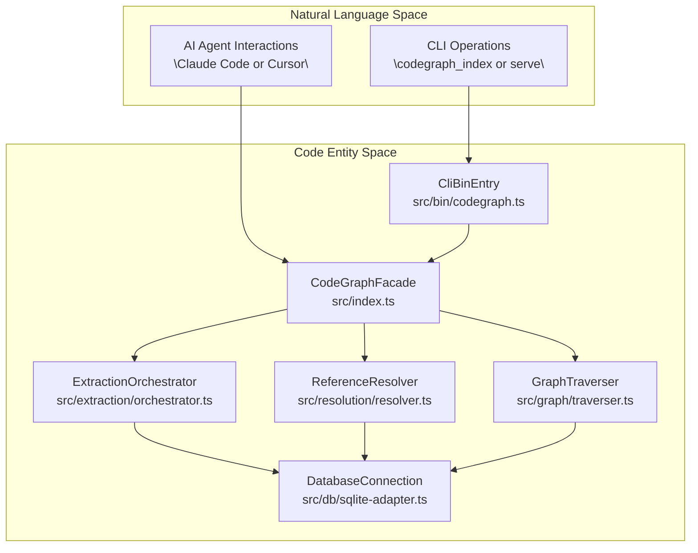
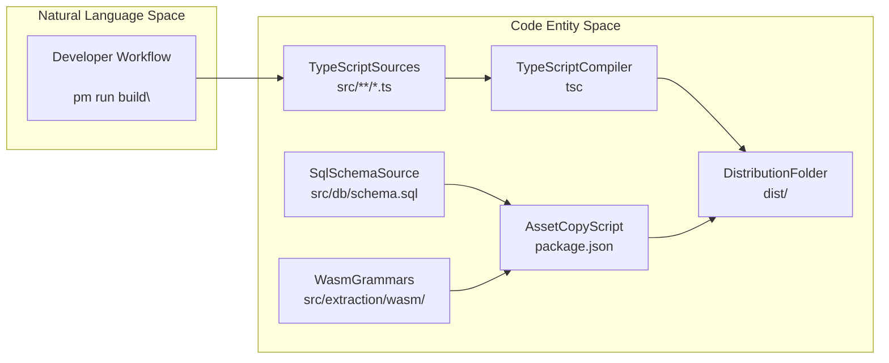

<!-- source: DeepWiki mcp.deepwiki.com · repo colbymchenry/codegraph · page 7 Development Guide · fetched 2026-10-30 -->

# Development Guide

Relevant source files

The following files were used as context for generating this wiki page:

- [AGENTS.md](AGENTS.md)
- [__tests__/go-func-field-dispatch.test.ts](__tests__/go-func-field-dispatch.test.ts)
- [__tests__/synthesized-hop.test.ts](__tests__/synthesized-hop.test.ts)
- [docs/AGENTS.md](docs/AGENTS.md)
- [src/graph/synthesized-hop.ts](src/graph/synthesized-hop.ts)
- [src/installer/targets/gemini.ts](src/installer/targets/gemini.ts)
- [src/installer/targets/opencode.ts](src/installer/targets/opencode.ts)
- [ui/package.json](ui/package.json)

This page serves as the entry point for developers contributing to CodeGraph (`@colbymchenry/codegraph`). It outlines the overall architecture, repository organization, and standard development workflows. As a parent page, it provides a high-level overview of development practices and links to detailed child pages for building, testing, extending language support, and running agent benchmarks.

For information on using CodeGraph programmatically, see [Library API Reference](#8). For CLI usage, refer to [CLI Reference](#4).

---

## Repository Architecture & Subsystem Map

CodeGraph is organized around a layered codebase where core extraction, resolution, and traversal systems communicate through a unified SQLite store [AGENTS.md:7-12](). The system bridges natural language concepts and agent tool calls to precise AST nodes, database queries, and parser workers [AGENTS.md:60-75]().

### Diagram: Subsystem Architecture Mapping

**Sources:** [AGENTS.md:7-75](), [src/index.ts:1-40]()

---

## Building from Source

Building CodeGraph requires Node.js (`>=20.0.0 <25.0.0`) [AGENTS.md:58-59]() and npm [package.json:1-60](). The build process compiles TypeScript source files, copies necessary SQL schemas and WebAssembly grammars, and prepares runtime assets into the `dist/` directory [AGENTS.md:16-34]().

### Diagram: Build Pipeline Workflow

**Sources:** [AGENTS.md:16-34](), [package.json:37-43]()

For comprehensive instructions on building from source, setting up local dependencies, native kernel compilation, and packaging release artifacts, see [Building from Source](#7.1).

**Sources:** [AGENTS.md:16-34](), [package.json:37-43]()

---

## Testing Infrastructure

CodeGraph relies on a robust test suite powered by Vitest [package.json:50-60]() covering unit extractions, reference resolution, integration workflows, and kernel parity suites [docs/AGENTS.md:7-19](). Tests are organized into workspace projects separating Node engine tests from browser-targeted UI packages [AGENTS.md:50-57]().

For details on running test suites, configuring fixtures, security tests, and executing targeted test patterns, see [Testing](#7.2).

**Sources:** [AGENTS.md:50-57](), [package.json:50-60](), [docs/AGENTS.md:7-19]()

---

## Extending Language Support

CodeGraph parses codebases deterministically using Tree-sitter [AGENTS.md:9-10](). Adding support for a new programming language involves obtaining or patching Tree-sitter grammars, configuring language extractors under `src/extraction/languages/`, and integrating verification steps [docs/AGENTS.md:7-19]().

For a complete walkthrough on integrating new grammars, implementing language extractors, and using the addition workflow, see [Adding Language Support](#7.3).

**Sources:** [AGENTS.md:9-10](), [docs/AGENTS.md:7-19]()

---

## Agent Evaluation Harness and Benchmarks

To ensure high retrieval quality and prevent regressions in AI assistant context building, CodeGraph includes an agent evaluation harness located in `scripts/agent-eval/` [docs/AGENTS.md:7-19](). This harness benchmarks retrieval accuracy, query latency, and token efficiency across defined A/B test arms and automated evaluation judges [docs/AGENTS.md:7-19]().

For details on running evaluation scripts, interpreting benchmark metrics, and analyzing reports under `docs/benchmarks`, see [Agent Evaluation Harness and Benchmarks](#7.4).

**Sources:** [docs/AGENTS.md:7-19]()

---

