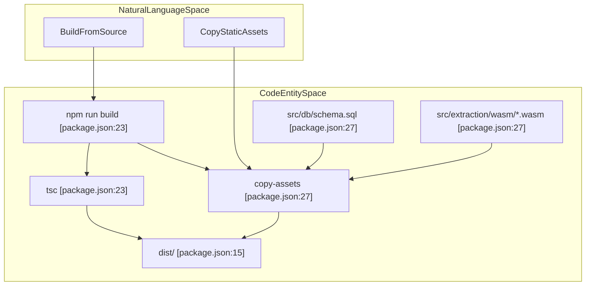
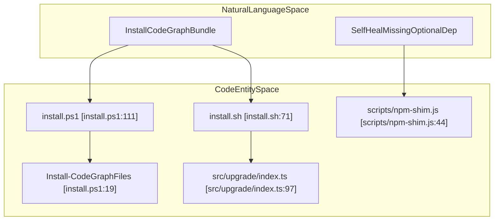

<!-- source: DeepWiki mcp.deepwiki.com · repo colbymchenry/codegraph · page 7.1 Building from Source · fetched 2026-10-30 -->

# Building from Source

<details>
<summary>Relevant source files</summary>

The following files were used as context for generating this wiki page:

- [.github/workflows/release.yml](.github/workflows/release.yml)
- [BUNDLING.md](BUNDLING.md)
- [__tests__/bundle-launcher.test.ts](__tests__/bundle-launcher.test.ts)
- [__tests__/mcp-startup-orphan.test.ts](__tests__/mcp-startup-orphan.test.ts)
- [__tests__/npm-shim.test.ts](__tests__/npm-shim.test.ts)
- [__tests__/prepare-release.test.ts](__tests__/prepare-release.test.ts)
- [__tests__/synthesis-progress.test.ts](__tests__/synthesis-progress.test.ts)
- [__tests__/wasm-runtime-flags.test.ts](__tests__/wasm-runtime-flags.test.ts)
- [scripts/build-bundle.sh](scripts/build-bundle.sh)
- [scripts/npm-sdk.js](scripts/npm-sdk.js)
- [scripts/npm-shim.js](scripts/npm-shim.js)
- [scripts/pack-npm.sh](scripts/pack-npm.sh)
- [scripts/prepare-release.mjs](scripts/prepare-release.mjs)
- [src/extraction/wasm-runtime-flags.ts](src/extraction/wasm-runtime-flags.ts)
- [src/mcp/early-ppid.ts](src/mcp/early-ppid.ts)

</details>


## Purpose and Scope

This page provides full technical documentation for building CodeGraph from source code. It covers system dependencies, TypeScript compilation, static asset copying, native Rust kernel compilation, WASM runtime flags, platform bundling scripts (`scripts/build-bundle.sh`), the npm shim self-heal mechanism (`scripts/npm-shim.js`), and the end-to-end release workflow (`.github/workflows/release.yml`, `install.sh`, `install.ps1`) [package.json:22-36](), [.github/workflows/release.yml:1-141](), [scripts/build-bundle.sh:1-148]().

---

## System Dependencies and Prerequisites

Building CodeGraph requires specific runtime environments, package managers, and compilation tooling to handle both the TypeScript/Node.js application layer and the native Rust extraction kernel.

| Requirement | Version Constraint / Target | Purpose | Code Reference |
|-------------|----------------------------|---------|----------------|
| Node.js | `>=20.0.0 <25.0.0` | Runtime environment; Node.js `>=22.5` preferred for `node:sqlite`. | [package.json:65-67]() |
| npm | `>=11.5.0` | Package manager supporting OIDC trusted publishing. | [.github/workflows/release.yml:100-102]() |
| Rust / Cargo | Latest Stable | Compiling the native extraction kernel `.node` modules. | [.github/workflows/release.yml:38-41]() |
| Git | Any recent version | Source control management and version detection. | [src/upgrade/index.ts:139-143]() |

The Node.js version constraint is strictly enforced. If execution detects unsupported runtimes or versions outside the allowed range, initialization halts [package.json:65-67]().

Sources: [package.json:65-67](), [.github/workflows/release.yml:38-102](), [src/upgrade/index.ts:139-143]()

---

## Repository Structure and Cloning

Clone the repository to begin local development:

```bash
git clone https://github.com/colbymchenry/codegraph.git
cd codegraph
```

The repository layout distributes responsibilities across dedicated directories:
- `src/` — TypeScript source code for the core graph engine, MCP server, and CLI [package.json:22]()
- `ui/` — Svelte frontend application workspace [package.json:19-21]()
- `codegraph-kernel/` — Rust source code for the native extraction kernel [.github/workflows/release.yml:32-41]()
- `scripts/` — Build, bundling, and release utility scripts [package.json:16]()
- `dist/` — Compiled JavaScript and assets output directory [package.json:15]()

Sources: [package.json:15-22](), [.github/workflows/release.yml:32-41]()

---

## TypeScript Compilation and Asset Copying

The build process compiles TypeScript source files into `dist/`, copies database schemas and tree-sitter WASM grammars, and builds the UI workspace [package.json:22-36]().

### Build Commands
Executing `npm run build` performs the following canonical script pipeline [package.json:23-27]():
1. `tsc` — Compiles TypeScript files from `src/` into `dist/`.
2. `npm run copy-assets` — Invokes a Node script that ensures `dist/db/` exists, copies `src/db/schema.sql`, and synchronizes all `.wasm` files from `src/extraction/wasm/` to `dist/extraction/wasm/` [package.json:27]().
3. `npm run build:ui` — Compiles the Svelte workspace in `ui/` and verifies asset output via `scripts/check-ui-build.mjs` [package.json:24]().
4. `chmod 755 dist/bin/codegraph.js` — Sets execution permissions on the CLI entry point [package.json:23]().

### Build Pipeline Architecture



Sources: [package.json:15-36]()

---

## Native Extraction Kernel and WASM Builds

CodeGraph combines a pure-JavaScript/WASM extraction fallback with a native Rust extraction kernel (`codegraph-kernel`) for high-performance symbol parsing [.github/workflows/release.yml:32-41](), [scripts/build-bundle.sh:82-98]().

### Kernel Compilation
Kernel prebuilds are compiled using `scripts/build-kernel.sh` for specific target triples (e.g., `aarch64-apple-darwin`, `x86_64-unknown-linux-gnu`) [.github/workflows/release.yml:43-55](). Vendored-grammar C languages (such as Kotlin, Lua, Scala, and Dart) compile their parser components via the `cc` Rust crate during this phase [.github/workflows/release.yml:38-41]().

### WASM Runtime Flags (`--liftoff-only`)
Tree-sitter grammars are large WebAssembly modules. On Node.js `>=22`, V8's "turboshaft" optimizing compiler can exhaust its internal compilation Zone arena, triggering a fatal process termination (`Fatal process out of memory: Zone`) [src/extraction/wasm-runtime-flags.ts:4-10](). 

To prevent this, CodeGraph enforces the `--liftoff-only` V8 flag across all launch paths [src/extraction/wasm-runtime-flags.ts:41]():
- Defined in `WASM_RUNTIME_FLAGS` [src/extraction/wasm-runtime-flags.ts:41]()
- Applied by bundles via `scripts/build-bundle.sh` [scripts/build-bundle.sh:113-121]() and `scripts/npm-shim.js` [scripts/npm-shim.js:105-107]()
- Automatically re-executed if missing via `relaunchWithWasmRuntimeFlagsIfNeeded()` [src/extraction/wasm-runtime-flags.ts:119-137]()

Sources: [.github/workflows/release.yml:32-55](), [scripts/build-bundle.sh:82-98](), [src/extraction/wasm-runtime-flags.ts:1-137]()

---

## Platform Bundling Scripts

The `scripts/build-bundle.sh` script packages CodeGraph into a self-contained archive containing an official Node.js runtime, compiled application code, production dependencies, and an optional native kernel module [scripts/build-bundle.sh:1-148]().

### Bundling Pipeline Steps
1. **Runtime Fetching:** Downloads the official Node.js distribution (default `v24.22.1`) for the target platform (e.g., `darwin-arm64`, `linux-x64`, `win32-x64`) [scripts/build-bundle.sh:23-55]().
2. **App Staging:** Copies `dist/` into `STAGE/lib/dist` and verifies UI build outputs using `scripts/check-ui-build.mjs` [scripts/build-bundle.sh:82-94]().
3. **Dependency Pruning:** Installs production-only dependencies via `npm ci --omit=dev --ignore-scripts` inside the stage directory, omitting dev-only workspaces [scripts/build-bundle.sh:95-102]().
4. **Kernel Inclusion:** Checks for a prebuilt `codegraph-kernel.node` binary and copies it into `STAGE/lib/kernel/` if present [scripts/build-bundle.sh:111-122]().
5. **Launcher Generation:** Generates platform-specific launchers (`bin/codegraph`, `bin/codegraph.cmd`) configured with `--liftoff-only` and `--disable-warning=ExperimentalWarning` [scripts/build-bundle.sh:124-142]().

Sources: [scripts/build-bundle.sh:1-148]()

---

## Release Workflow and Installer Scripts

CodeGraph release engineering uses GitHub Actions workflows, shell installers (`install.sh`), PowerShell installers (`install.ps1`), and runtime upgrade handlers (`src/upgrade/index.ts`) [ .github/workflows/release.yml:1-141](), [install.sh:1-151](), [install.ps1:1-132](), [src/upgrade/index.ts:1-146]().

### Release Workflow (`.github/workflows/release.yml`)
The GitHub Actions workflow automates release execution:
1. **Kernel Job:** Runs a matrix across macOS, Linux, and Windows runners to compile native prebuilds (`codegraph-kernel.node`), uploading artifacts via `actions/upload-artifact` [.github/workflows/release.yml:42-69]().
2. **Release Job:** Authenticates via OIDC trusted publishing (avoiding static tokens), synchronizes version numbers in `package-lock.json`, executes `npm ci`, and publishes archives and npm packages [.github/workflows/release.yml:71-141]().

### Standalone Installers & Self-Heal
- **Unix Installer (`install.sh`):** Downloads target archives into `~/.codegraph/versions/<version>`, creates symlinks at `~/.local/bin/codegraph`, and prunes stale version directories [install.sh:71-116]().
- **Windows Installer (`install.ps1`):** Unpacks bundles into staging paths and executes atomic file replacement via `Install-CodeGraphFiles`, handling locked file scenarios by renaming replaced binaries aside (`.old-<token>`) [install.ps1:19-89]().
- **npm Shim & Self-Heal (`scripts/npm-shim.js`):** Resolves optional platform dependencies (`@colbymchenry/codegraph-<platform>-<arch>`). If mirrors or proxies omit optional dependencies, it triggers a network self-heal fallback, downloading the matching archive directly from GitHub Releases into `~/.codegraph/bundles` [scripts/npm-shim.js:9-148]().

### Bundle Execution and Installer Architecture



Sources: [.github/workflows/release.yml:1-141](), [install.sh:1-151](), [install.ps1:1-132](), [scripts/npm-shim.js:1-148](), [src/upgrade/index.ts:1-146]()

---

