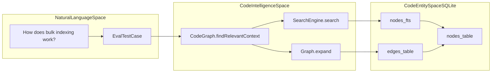
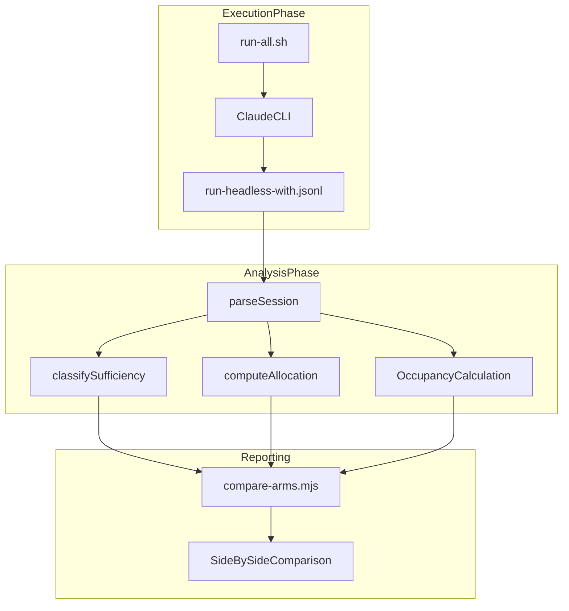

<!-- source: DeepWiki mcp.deepwiki.com · repo colbymchenry/codegraph · page 7.2 Testing · fetched 2026-10-30 -->

# Testing

Relevant source files

The following files were used as context for generating this wiki page:

- [__tests__/child-process-windows-hide.test.ts](__tests__/child-process-windows-hide.test.ts)
- [__tests__/cli-affected-test-conventions.test.ts](__tests__/cli-affected-test-conventions.test.ts)
- [__tests__/global-setup-dist.test.ts](__tests__/global-setup-dist.test.ts)
- [__tests__/global-setup-dist.ts](__tests__/global-setup-dist.ts)
- [__tests__/global-setup-home-sandbox.ts](__tests__/global-setup-home-sandbox.ts)
- [__tests__/is-test-file.test.ts](__tests__/is-test-file.test.ts)
- [__tests__/npm-sdk.test.ts](__tests__/npm-sdk.test.ts)
- [__tests__/security.test.ts](__tests__/security.test.ts)
- [__tests__/setup-home-sandbox.ts](__tests__/setup-home-sandbox.ts)
- [__tests__/test-home-sandbox.test.ts](__tests__/test-home-sandbox.test.ts)
- [__tests__/ts-field-classification.test.ts](__tests__/ts-field-classification.test.ts)
- [__tests__/ui-trails.test.ts](__tests__/ui-trails.test.ts)
- [__tests__/unittest-named-files.test.ts](__tests__/unittest-named-files.test.ts)
- [__tests__/unittests-directories.test.ts](__tests__/unittests-directories.test.ts)
- [src/ui-server/api/trail-store.ts](src/ui-server/api/trail-store.ts)
- [src/ui-server/api/trails.ts](src/ui-server/api/trails.ts)
- [src/utils.ts](src/utils.ts)
- [vitest.config.mts](vitest.config.mts)
- [vitest.workspace.mts](vitest.workspace.mts)

This page documents CodeGraph's test infrastructure, test organization, and how to run and write tests. Testing is implemented using **Vitest** and covers the extraction pipeline, reference resolution, the foundation layer (database, configuration), security validation, kernel parity suites, fixtures, and integration scenarios. It also details the `agent-eval` suite used for benchmarking AI assistant performance and retrieval quality.

---

## Test Framework and Setup

CodeGraph uses **Vitest** as its test framework [vitest.config.mts:1-11](). Vitest provides native TypeScript support and handles the asynchronous nature of Tree-sitter and SQLite operations.

### Test Configuration and Scripts

The test environment is configured via `vitest.config.mts` and `vitest.workspace.mts`. To prevent tests from polluting the host system, the test runner sets up a throwaway home sandbox per test file (`setup-home-sandbox.ts`), overrides node execution checks (`CODEGRAPH_ALLOW_UNSAFE_NODE: '1'`), and disables telemetry (`CODEGRAPH_TELEMETRY: '0'`) [vitest.config.mts:18-42](). Furthermore, V8 flags for Tree-sitter grammar memory management are injected into test forks via `poolOptions` to prevent compiler Zone exhaustion and worker crashes (`Fatal process out of memory: Zone`) [vitest.config.mts:44-58]().

| Script | Command | Purpose |
|--------|---------|---------|
| `test` | `vitest run` | Run all tests once |
| `test:watch` | `vitest` | Run tests in watch mode |
| `test:coverage` | `vitest run --coverage` | Generate coverage report using V8 provider [vitest.config.mts:59-63]() |
| `test:eval` | `vitest run __tests__/evaluation/` | Run evaluation benchmarks |

Sources: [vitest.config.mts:1-64]()

---

## Sandboxing and Global Setup

To ensure test isolation and reproducibility across different developer machines and continuous integration runners, CodeGraph relies on robust global setup and test-file sandboxing.

### Home Directory Sandbox (`setup-home-sandbox.ts`)
The sandbox setup gives every engine test file a throwaway home directory [__tests__/setup-home-sandbox.ts:1-23](). This prevents tests from reading or writing to the developer's real global state (such as Claude prompt hooks in `~/.claude/settings.json`, daemon registries, or agent configs) [__tests__/setup-home-sandbox.ts:1-10](). 
*   `os.homedir()` is redirected by overriding `HOME`, `USERPROFILE`, `HOMEDRIVE`, and `HOMEPATH` [__tests__/setup-home-sandbox.ts:40-47]().
*   Per-agent environment overrides (`CLAUDE_CONFIG_DIR`, `CODEX_HOME`, `COPILOT_HOME`, `HERMES_HOME`) are explicitly cleared [__tests__/setup-home-sandbox.ts:57-59]().
*   Git's global configuration is pinned to a seeded sandbox file (`GIT_CONFIG_GLOBAL`) with preset test user credentials [__tests__/setup-home-sandbox.ts:61-65]().

### Dist Prereq Assurance (`global-setup-dist.ts`)
Suites that spawn the built CLI or viewer rely on a current `dist/` build [vitest.config.mts:15-17](). The `ensureTestDist` utility verifies and rebuilds code in dependency order (engine before viewer) upon detecting missing outputs or modified source files [__tests__/global-setup-dist.test.ts:33-82]().

Sources: [__tests__/setup-home-sandbox.ts:1-74](), [__tests__/test-home-sandbox.test.ts:1-91](), [__tests__/global-setup-dist.test.ts:1-98](), [vitest.config.mts:15-20]()

---

## Foundation, Security, and Upgrade Tests

### Foundation Layer Testing
The foundation tests validate the core lifecycle of a CodeGraph project, including:
*   **Initialization:** Ensuring `CodeGraph.initSync` creates the `.codegraph` directory, the SQLite database, and a `.gitignore` that masks transient files [__tests__/foundation.test.ts:46-71]().
*   **Project Recovery:** Testing the `CodeGraph.recreate` method, which discards a poisoned or oversized index and returns a fresh instance, ensuring the old database file is unlinked [__tests__/foundation.test.ts:157-204]().
*   **Database Operations:** Verifying schema creation, database stats reporting, and maintenance operations like `optimize()` and `clear()` [__tests__/foundation.test.ts:109-152]().

### Security Infrastructure
Security tests in `__tests__/security.test.ts` validate critical protection mechanisms:
*   **FileLock:** Tests cross-process locking (`FileLock`) to prevent index corruption, including stale lock detection for dead PIDs, live holder protection past stale timestamps, and idempotent release behavior [__tests__/security.test.ts:32-153]().
*   **Path Traversal & Symlink Escape:** Validates `validatePathWithinRoot` and `lexicalPathWithinRoot` to ensure the system never operates on sensitive system directories or follows symlinks that escape the project root (issue #527) [__tests__/security.test.ts:138-230](), [src/utils.ts:96-160]().

### Upgrade Tests
Tests in `__tests__/upgrade.test.ts` verify the self-update and install-method detection logic across bundles, global/local npm installations, npx caches, and source checkouts [__tests__/upgrade.test.ts:32-153]().

Sources: [__tests__/foundation.test.ts:1-204](), [__tests__/security.test.ts:1-230](), [src/utils.ts:39-160](), [__tests__/upgrade.test.ts:1-165]()

---

## Extraction, Parity Suites, and Fixtures

### Kernel Parity and Language Extractors
Extraction tests verify that the Tree-sitter-based pipeline (and native kernel extractors when available) correctly identifies symbols and relationships across languages. 
*   **Go Interface Embedding:** Tests in `__tests__/go-interface-embedding.test.ts` ensure embedded interfaces and constraints are correctly parsed into `extends` references across both WebAssembly and native kernel backends [__tests__/go-interface-embedding.test.ts:1-201]().
*   **Go Implements Satisfaction:** Tests in `__tests__/go-implements-embedding.test.ts` validate implicit interface satisfaction involving method sets and embedded structs [__tests__/go-implements-embedding.test.ts:1-176]().
*   **JS/TS Resolution Work Bounds:** Tests in `__tests__/js-resolution-work.test.ts` pin performance properties, ensuring destructuring and minified bundles execute bounded parsing work [__tests__/js-resolution-work.test.ts:24-162]().
*   **Test File Convention Heuristics:** Tests in `__tests__/is-test-file.test.ts` and `__tests__/cli-affected-test-conventions.test.ts` verify that `isTestFile` and `codegraph affected` correctly recognize multi-ecosystem test patterns (such as Kotlin source sets `jvmTest/`, Swift `Tests/`, Go `_test.go`, and Google C++ `_unittest.cc` suites) [__tests__/is-test-file.test.ts:1-128](), [__tests__/cli-affected-test-conventions.test.ts:1-80]().

Sources: [__tests__/go-interface-embedding.test.ts:1-201](), [__tests__/go-implements-embedding.test.ts:1-176](), [__tests__/js-resolution-work.test.ts:1-171](), [__tests__/is-test-file.test.ts:1-128](), [__tests__/cli-affected-test-conventions.test.ts:1-80]()

---

## Integration Testing: Full Pipeline

The integration suite in `__tests__/integration/full-pipeline.test.ts` exercises the complete "happy path" of a CodeGraph project using a synthetic project generator [__tests__/integration/full-pipeline.test.ts:1-73]().

### End-to-End Flow
The primary integration test [__tests__/integration/full-pipeline.test.ts:85-177]() validates:
1.  **Init:** Initialize a project with specific include/exclude patterns [__tests__/integration/full-pipeline.test.ts:90-92]().
2.  **Index:** Run `indexAll()` and verify file and node counts [__tests__/integration/full-pipeline.test.ts:96-102]().
3.  **Resolve:** Wire up cross-file call edges via `resolveReferences()` [__tests__/integration/full-pipeline.test.ts:110-116]().
4.  **Query:** Perform symbol searches and verify caller/callee traversal [__tests__/integration/full-pipeline.test.ts:118-133]().
5.  **Sync:** Perform simultaneous Add, Modify, and Remove operations and verify the graph reflects changes [__tests__/integration/full-pipeline.test.ts:143-173]().

Additionally, feature-specific end-to-end suites like `__tests__/ui-trails.test.ts` validate complex workflows (such as viewer saved trails surviving re-indexing and write boundary security checks) [__tests__/ui-trails.test.ts:1-201]().

Sources: [__tests__/integration/full-pipeline.test.ts:1-181](), [__tests__/ui-trails.test.ts:1-201]()

---

## Agent Evaluation Harness (`scripts/agent-eval/`)

The `agent-eval` suite benchmarks CodeGraph's impact on AI assistant performance using the real `claude` CLI. It focuses on three primary feedback metrics: **Residual Context Occupancy**, **Explore Sufficiency**, and **Allocation Efficiency** [docs/benchmarks/agent-eval-feedback-metrics.md:1-13]().

### The Three Feedback Metrics

| Metric | Code Reference | Description |
| :--- | :--- | :--- |
| **Residual Occupancy** | `parseSession` [scripts/agent-eval/parse-run.mjs:102]() | Measures tokens still resident in the window at the end of a run [docs/benchmarks/residual-context-occupancy.md:8-10](). |
| **Explore Sufficiency** | `classifySufficiency` [scripts/agent-eval/parse-run.mjs:300]() | Buckets what the agent did *next* after an explore call [docs/benchmarks/explore-sufficiency.md:8-21](). |
| **Allocation Efficiency** | `computeAllocation` [scripts/agent-eval/parse-run.mjs:500]() | Share of returned bytes for files the agent's final answer actually cited [docs/benchmarks/explore-allocation-efficiency.md:8-15](). |

### A/B Testing Infrastructure
*   **`run-all.sh`**: Primary entry point for with-vs-without CodeGraph A/B testing [scripts/agent-eval/run-all.sh:1-7]().
*   **`ab-new-vs-baseline.sh`**: Compares two versions of the CodeGraph engine on the same task [scripts/agent-eval/ab-new-vs-baseline.sh:2-14]().
*   **`bench-readme.sh`**: Runs the 7-repo README benchmark corpus [scripts/agent-eval/bench-readme.sh:1-6]().

Sources: [scripts/agent-eval/run-all.sh:1-149](), [scripts/agent-eval/ab-new-vs-baseline.sh:1-130](), [scripts/agent-eval/parse-run.mjs:1-600](), [docs/benchmarks/agent-eval-feedback-metrics.md:1-73]()

---

## Data Flow: Evaluation & Integration

### Natural Language to Code Entity Mapping
This diagram bridges natural language evaluation queries to the underlying code entities stored in SQLite tables via CodeGraph query and traversal components.

Title: "NaturalLanguageToCodeEntityMapping"

Sources: [__tests__/evaluation/test-cases.ts:66-71](), [src/db/queries.ts:20-116]()

### Agent-Eval Processing Flow
This diagram illustrates how raw execution logs are processed through evaluation parser functions to generate side-by-side benchmark comparison reports.

Title: "AgentEvalProcessingFlow"

Sources: [scripts/agent-eval/run-all.sh:93-124](), [scripts/agent-eval/parse-run.mjs:102-132](), [docs/benchmarks/agent-eval-feedback-metrics.md:75-111]()

---

