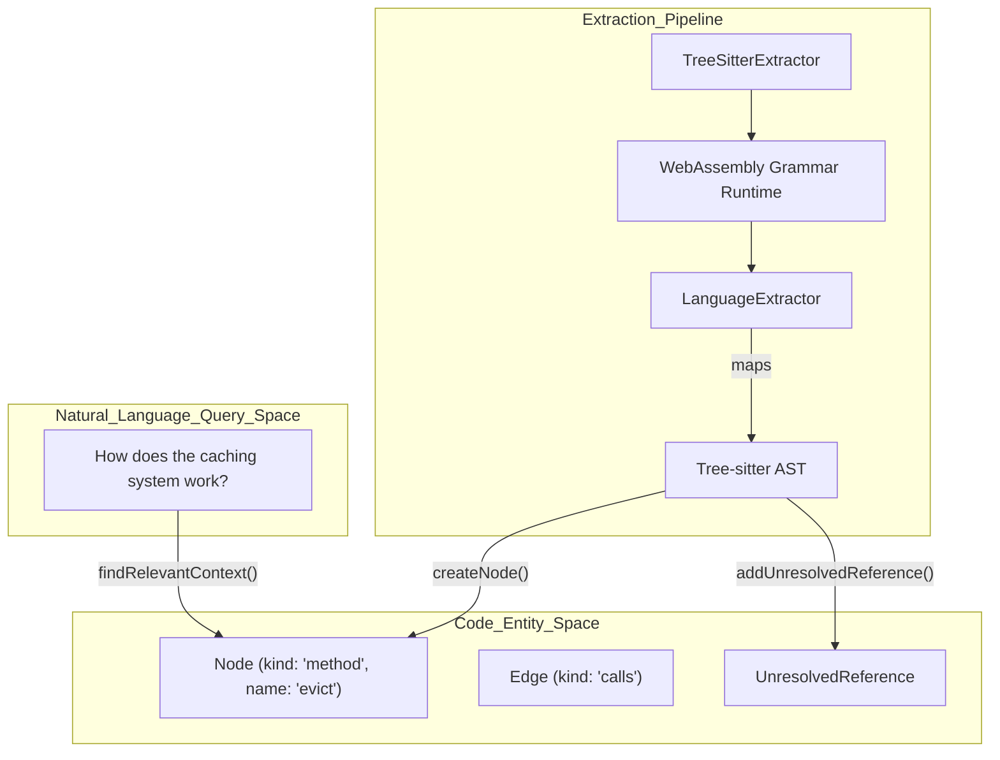
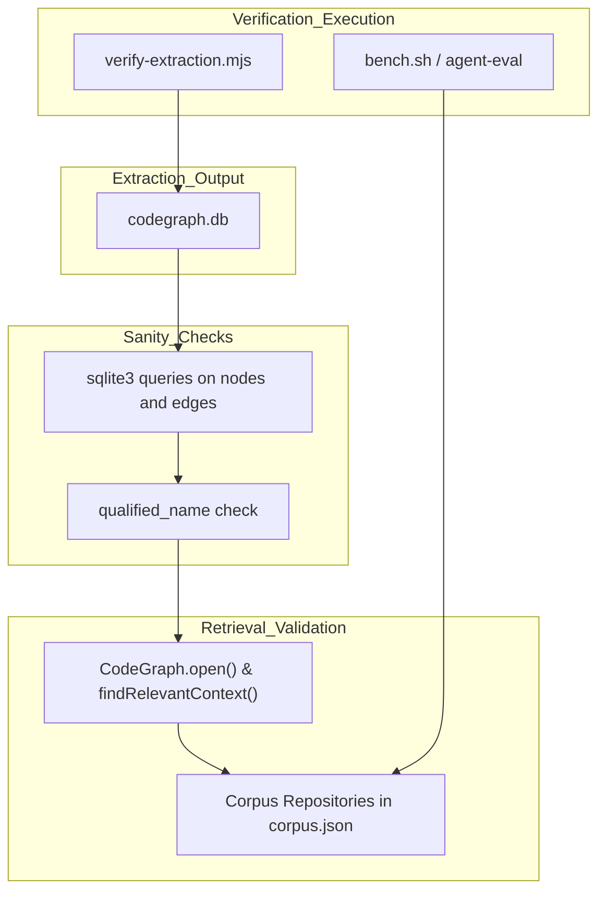

<!-- source: DeepWiki mcp.deepwiki.com · repo colbymchenry/codegraph · page 7.3 Adding Language Support · fetched 2026-10-30 -->

# Adding Language Support

<details>
<summary>Relevant source files</summary>

The following files were used as context for generating this wiki page:

- [.claude/skills/add-lang/SKILL.md](.claude/skills/add-lang/SKILL.md)
- [.claude/skills/agent-eval/corpus.json](.claude/skills/agent-eval/corpus.json)
- [__tests__/add-lang-check-grammar.test.ts](__tests__/add-lang-check-grammar.test.ts)
- [__tests__/cobol-sequence-area-period.test.ts](__tests__/cobol-sequence-area-period.test.ts)
- [__tests__/ui-highlight-bounded.test.ts](__tests__/ui-highlight-bounded.test.ts)
- [docs/grammars/tree-sitter-cobol.md](docs/grammars/tree-sitter-cobol.md)
- [docs/grammars/tree-sitter-cobol.patch](docs/grammars/tree-sitter-cobol.patch)
- [scripts/add-lang/bench.sh](scripts/add-lang/bench.sh)
- [scripts/add-lang/check-grammar.mjs](scripts/add-lang/check-grammar.mjs)
- [scripts/add-lang/dump-ast.mjs](scripts/add-lang/dump-ast.mjs)
- [scripts/add-lang/verify-extraction.mjs](scripts/add-lang/verify-extraction.mjs)
- [src/extraction/grammars.ts](src/extraction/grammars.ts)
- [src/extraction/languages/index.ts](src/extraction/languages/index.ts)
- [src/extraction/parse-budget.ts](src/extraction/parse-budget.ts)
- [src/extraction/wasm/tree-sitter-cobol.wasm](src/extraction/wasm/tree-sitter-cobol.wasm)
- [src/types.ts](src/types.ts)
- [src/ui-server/highlight/bounded-tokenize.ts](src/ui-server/highlight/bounded-tokenize.ts)
- [src/ui-server/highlight/index.ts](src/ui-server/highlight/index.ts)
- [src/ui-server/highlight/tokenize-worker.ts](src/ui-server/highlight/tokenize-worker.ts)

</details>


This page provides a technical guide for developers extending CodeGraph to support additional programming languages. It covers obtaining and patching Tree-sitter grammars (including WebAssembly artifacts and health-checking scripts), configuring the `LanguageExtractor` interface, wiring the language across core modules, utilizing the `/add-lang` skill workflow, and executing verification and benchmarking steps.

## Overview

CodeGraph uses [Tree-sitter](https://tree-sitter.github.io/tree-sitter/) WebAssembly (WASM) grammars for universal cross-platform parsing. Extraction is performed via a multi-language pipeline that maps Abstract Syntax Tree (AST) nodes to the CodeGraph knowledge model.

The language support system is centralized across several core modules:
- `src/types.ts`: Defines the `Language` union and default file include patterns [src/types.ts:86-131]().
- `src/extraction/grammars.ts`: Handles grammar loading, caching, and file extension mapping (`EXTENSION_MAP`, `WASM_GRAMMAR_FILES`) [src/extraction/grammars.ts:21-54]().
- `src/extraction/tree-sitter-types.ts`: Interface definitions for `LanguageExtractor`.
- `src/extraction/languages/`: Directory containing per-language extraction logic and the registry barrel (`src/extraction/languages/index.ts`) [src/extraction/languages/index.ts:40-72]().

Sources: [src/types.ts:86-131](), [src/extraction/grammars.ts:21-54](), [src/extraction/languages/index.ts:40-72]()

---

## Language Support Architecture

The following diagram illustrates how natural language queries bridge through the extraction pipeline and grammar runtimes to resolve code entities in the knowledge graph.

**Diagram: Natural Language Space to Code Entity Space Mapping**


Sources: [.claude/skills/add-lang/SKILL.md:1-37](), [src/extraction/grammars.ts:1-7]()

---

## The `add-lang` Skill Workflow

Adding a new language follows a rigorous, end-to-end autonomous workflow defined in the developer skill toolkit [.claude/skills/add-lang/SKILL.md:1-139](). 

### Step 1 — Resolve and Short-Circuit
Check whether the language is already wired by inspecting the `LANGUAGES` constant in `src/types.ts` and the `EXTRACTORS` map in `src/extraction/languages/index.ts` [.claude/skills/add-lang/SKILL.md:39-45](). If already supported, skip directly to benchmarking.

### Step 2 — Grammar Acquisition and Health Check
Verify whether an official WASM grammar exists in `tree-sitter-wasms` or if a grammar must be vendored into `src/extraction/wasm/` [src/extraction/grammars.ts:21-54](), [.claude/skills/add-lang/SKILL.md:47-78](). 

Before writing any extractor code, run the grammar health-checking harness to catch heap corruption bugs or ABI mismatches:
```bash
node scripts/add-lang/check-grammar.mjs <lang> path/to/valid-sample.<ext>
```
The script runs the grammar in a child process under indexing's V8 flags (`--liftoff-only`), parsing a valid sample repeatedly to detect shared-heap corruption, parsing failures, memory exhaustion, or hanging [scripts/add-lang/check-grammar.mjs:43-52](). If a grammar fails, a newer or patched ABI 14/15 build must be vendored [src/extraction/wasm/]() [.claude/skills/add-lang/SKILL.md:67-78]().

### Step 3 — Discover AST Node Types
Use the AST dump utility with a representative sample source file to analyze node frequencies and field names (`name:`, `parameters:`, `body:`, `return_type:`) [.claude/skills/add-lang/SKILL.md:80-93]():
```bash
node scripts/add-lang/dump-ast.mjs <lang> path/to/sample.<ext>
```

### Step 4 — Wiring the Language (Four Essential Files)
Integrating a new language requires updating four core files (and occasionally a fifth core touch):
1. **`src/types.ts`**: Add the language token to the `LANGUAGES` const and ensure default file include patterns are configured [src/types.ts:86-131](), [.claude/skills/add-lang/SKILL.md:99-103]().
2. **`src/extraction/grammars.ts`**: Register the WASM filename in `WASM_GRAMMAR_FILES`, map file extensions in `EXTENSION_MAP`, and update vendored path branches if necessary [src/extraction/grammars.ts:21-174](), [.claude/skills/add-lang/SKILL.md:104-110]().
3. **`src/extraction/languages/<lang>.ts`**: Implement and export the `LanguageExtractor` interface defining node types (`functionTypes`, `classTypes`, `methodTypes`, `importTypes`, `callTypes`, etc.) and visitor hooks [.claude/skills/add-lang/SKILL.md:111-118]().
4. **`src/extraction/languages/index.ts`**: Import the new extractor and add it to the `EXTRACTORS` record map [src/extraction/languages/index.ts:11-72](), [.claude/skills/add-lang/SKILL.md:119-121]().

Sources: [.claude/skills/add-lang/SKILL.md:39-121](), [scripts/add-lang/check-grammar.mjs:1-65]()

---

## Advanced Extraction Techniques

### Pre-Parse Transformation
Some grammars require text-level modifications prior to parsing to bypass structural limitations or syntax quirks:
- **C#**: `blankCsharpPreprocessorDirectives` replaces conditional compilation directives (`#if`, `#elif`, `#else`, `#endif`) with whitespace while preserving line offsets, preventing AST detachment inside enum member lists [src/extraction/languages/csharp.ts:6-33]().
- **VB.NET**: Appends a trailing newline to files lacking it, avoiding end-of-file parse errors [src/extraction/languages/vbnet.ts:10-14]().
- **COBOL**: Normalizes free-format code structures, pads sequence areas, and handles single-quote string continuations [docs/grammars/tree-sitter-cobol.md:28-45]().

### Member Synthesis
For languages with compile-time or annotation-driven member generation, CodeGraph synthesizes nodes that do not explicitly appear in the source AST:
- **Java (Lombok)**: Inspects class- and field-level annotations (`@Getter`, `@Setter`, `@Data`, `@Value`, `@Builder`, and `@Slf4j`) to generate getter/setter methods and log fields programmatically [src/extraction/languages/java.ts:48-117]().
- **Kotlin & Scala**: Extractors handle extension functions, companion object constants, and type references via dedicated visitor hooks [src/extraction/languages/kotlin.ts:17-43](), [src/extraction/languages/scala.ts:27-45]().

Sources: [src/extraction/languages/csharp.ts:6-33](), [src/extraction/languages/java.ts:48-117](), [docs/grammars/tree-sitter-cobol.md:28-45]()

---

## Verification and Testing

New language support must be verified against real-world repositories to guarantee high retrieval quality and precise symbol resolution.

**Diagram: Verification Workflow and Data Flow**


Sources: [.claude/skills/add-lang/SKILL.md:130-139](), [.claude/skills/agent-eval/corpus.json:1-64]()

### Verification Steps
1. **Build and Test Loop**: Run `npm run build` to compile TypeScript and copy WASM assets into `dist/`, then execute extraction verification on a sample repository [.claude/skills/add-lang/SKILL.md:130-139]() [src/extraction/grammars.ts:1-7]():
   ```bash
   npm run build
   node scripts/add-lang/verify-extraction.mjs <sample-repo> <lang>
   ```
2. **Corpus Benchmarking**: Add popular real-world repositories across size tiers to `.claude/skills/agent-eval/corpus.json` and execute A/B retrieval evaluations [.claude/skills/agent-eval/corpus.json:1-25](), [.claude/skills/add-lang/SKILL.md:33-35]().

Sources: [.claude/skills/add-lang/SKILL.md:130-139](), [.claude/skills/agent-eval/corpus.json:1-25]()

---

