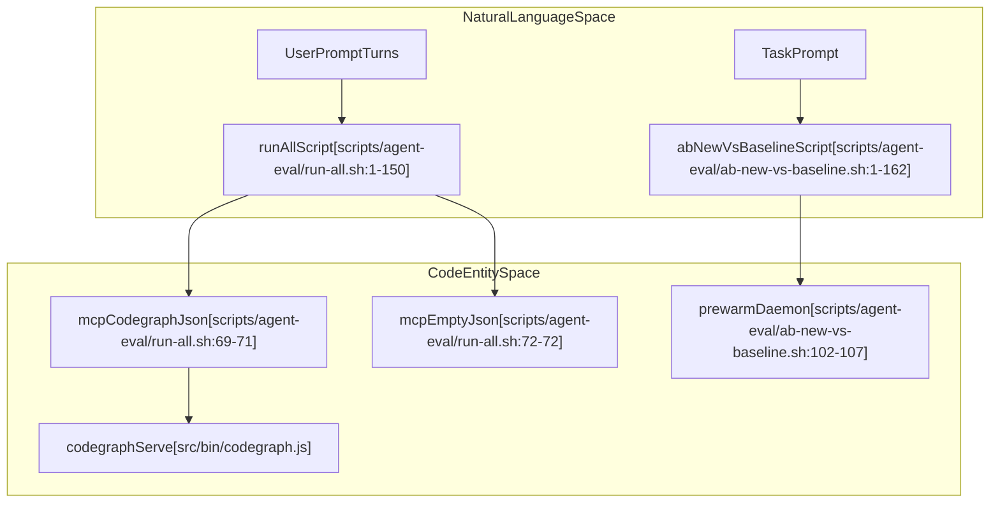
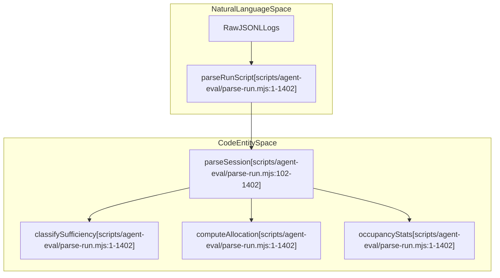

<!-- source: DeepWiki mcp.deepwiki.com · repo colbymchenry/codegraph · page 7.4 Agent Evaluation Harness and Benchmarks · fetched 2026-10-30 -->

# Agent Evaluation Harness and Benchmarks

<details>
<summary>Relevant source files</summary>

The following files were used as context for generating this wiki page:

- [.claude/skills/agent-eval/SKILL.md](.claude/skills/agent-eval/SKILL.md)
- [__tests__/explore-named-symbol-render.test.ts](__tests__/explore-named-symbol-render.test.ts)
- [__tests__/fixtures/kernel-parity/Torture.java](__tests__/fixtures/kernel-parity/Torture.java)
- [__tests__/fixtures/kernel-parity/TortureRecord.java](__tests__/fixtures/kernel-parity/TortureRecord.java)
- [__tests__/fixtures/kernel-parity/torture.kt](__tests__/fixtures/kernel-parity/torture.kt)
- [__tests__/fixtures/tail-render-ts/README.md](__tests__/fixtures/tail-render-ts/README.md)
- [__tests__/fixtures/tail-render-ts/package.json](__tests__/fixtures/tail-render-ts/package.json)
- [__tests__/fixtures/tail-render-ts/src/components/ChatComposer.ts](__tests__/fixtures/tail-render-ts/src/components/ChatComposer.ts)
- [__tests__/fixtures/tail-render-ts/src/lib/message-builder.ts](__tests__/fixtures/tail-render-ts/src/lib/message-builder.ts)
- [__tests__/fixtures/tail-render-ts/src/lib/session-store.ts](__tests__/fixtures/tail-render-ts/src/lib/session-store.ts)
- [__tests__/fixtures/tail-render-ts/src/lib/socket.ts](__tests__/fixtures/tail-render-ts/src/lib/socket.ts)
- [__tests__/fixtures/tail-render-ts/types/worker-configuration.d.ts](__tests__/fixtures/tail-render-ts/types/worker-configuration.d.ts)
- [__tests__/java-records.test.ts](__tests__/java-records.test.ts)
- [codegraph-kernel/src/java.rs](codegraph-kernel/src/java.rs)
- [codegraph-kernel/src/kotlin.rs](codegraph-kernel/src/kotlin.rs)
- [docs/SEARCH_QUALITY_LOOP.md](docs/SEARCH_QUALITY_LOOP.md)
- [docs/benchmarks/agent-eval-feedback-metrics.md](docs/benchmarks/agent-eval-feedback-metrics.md)
- [docs/benchmarks/answer-directly-vs-explore-agent.md](docs/benchmarks/answer-directly-vs-explore-agent.md)
- [docs/benchmarks/call-sequence-analysis.md](docs/benchmarks/call-sequence-analysis.md)
- [docs/benchmarks/explore-allocation-efficiency.md](docs/benchmarks/explore-allocation-efficiency.md)
- [docs/benchmarks/explore-cluster-starvation-cg36.md](docs/benchmarks/explore-cluster-starvation-cg36.md)
- [docs/benchmarks/explore-noise-epic-cg24.md](docs/benchmarks/explore-noise-epic-cg24.md)
- [docs/benchmarks/explore-sufficiency.md](docs/benchmarks/explore-sufficiency.md)
- [docs/benchmarks/explore-tail-render-cg38.md](docs/benchmarks/explore-tail-render-cg38.md)
- [docs/benchmarks/residual-context-occupancy.md](docs/benchmarks/residual-context-occupancy.md)
- [scripts/agent-eval/ab-new-vs-baseline.sh](scripts/agent-eval/ab-new-vs-baseline.sh)
- [scripts/agent-eval/audit.sh](scripts/agent-eval/audit.sh)
- [scripts/agent-eval/bench-readme.sh](scripts/agent-eval/bench-readme.sh)
- [scripts/agent-eval/compare-arms.mjs](scripts/agent-eval/compare-arms.mjs)
- [scripts/agent-eval/no-cli-shim.sh](scripts/agent-eval/no-cli-shim.sh)
- [scripts/agent-eval/parse-bench-readme.mjs](scripts/agent-eval/parse-bench-readme.mjs)
- [scripts/agent-eval/parse-run.mjs](scripts/agent-eval/parse-run.mjs)
- [scripts/agent-eval/parse-session.mjs](scripts/agent-eval/parse-session.mjs)
- [scripts/agent-eval/run-all.sh](scripts/agent-eval/run-all.sh)
- [src/extraction/languages/java.ts](src/extraction/languages/java.ts)
- [src/extraction/languages/kotlin.ts](src/extraction/languages/kotlin.ts)

</details>


## Purpose and Scope

This page documents the agent evaluation harness located in `scripts/agent-eval/` and the benchmark documentation/reports in `docs/benchmarks/`. The harness is engineered to measure, compare, and benchmark retrieval quality, token usage, context occupancy, and explore efficiency for AI coding assistants (such as Claude Code) interacting with CodeGraph via the Model Context Protocol (MCP) [scripts/agent-eval/run-all.sh:1-5](), [docs/benchmarks/agent-eval-feedback-metrics.md:1-16](). It details execution scripts, A/B arm topologies, feedback metrics collection (`parse-run.mjs`), offload evaluation frameworks, judges, and empirical findings from the README and multi-turn corpus benchmarks.

Sources: `scripts/agent-eval/run-all.sh:1-5`, `docs/benchmarks/agent-eval-feedback-metrics.md:1-16`

---

## Harness Script Infrastructure

The evaluation infrastructure provides shell and Node.js automation to test CodeGraph under controlled environments. These scripts isolate variables, enforce strict MCP configs, pre-warm daemon instances, and record precise stream-json telemetry.

### Core Execution Scripts

- `scripts/agent-eval/run-all.sh`: Orchestrates With/Without A/B testing [scripts/agent-eval/run-all.sh:1-149](). It launches Claude Code with `--strict-mcp-config`, configuring the `codegraph` MCP server in the "with" arm and an empty MCP configuration in the "without" arm [scripts/agent-eval/run-all.sh:5-72](). It supports multi-turn sessions by splitting questions separated by `||` and resuming sessions using session IDs [scripts/agent-eval/run-all.sh:18-24, 82-120]().
- `scripts/agent-eval/ab-new-vs-baseline.sh`: Isolates retrieval and steering changes by running two different builds of CodeGraph (the current working tree `HEAD` vs a git `[baseline-ref]`) against identical task prompts [scripts/agent-eval/ab-new-vs-baseline.sh:1-59](). Both arms run with CodeGraph enabled, pre-warming persistent local daemons via `serve --mcp` to eliminate cold-start re-exec latencies [scripts/agent-eval/ab-new-vs-baseline.sh:12-32, 102-107]().
- `scripts/agent-eval/bench-readme.sh`: Automates multi-turn benchmark campaigns across the 7 README repositories (`vscode`, `excalidraw`, `django`, `tokio`, `okhttp`, `gin`, `alamofire`) [scripts/agent-eval/bench-readme.sh:1-48](), [scripts/agent-eval/parse-bench-readme.mjs:1-23]().

### Attribution and Isolation Controls

To prevent test contamination, the harness neutralizes ambient prompt hooks and CLI shell-outs:
- **Prompt Hook Neutralization**: Sets `CODEGRAPH_NO_PROMPT_HOOK=1` to prevent local user prompt hooks from injecting ambient context into the "without" arm or double-injecting into the "with" arm [scripts/agent-eval/run-all.sh:49-54]().
- **CLI Shim**: Invokes `cg_no_cli_setup` from `scripts/agent-eval/no-cli-shim.sh` to sanitize `PATH` and block absolute-path invocations of the `codegraph` binary via Bash tool calls [scripts/agent-eval/run-all.sh:55-62](). This guarantees that retrieval happens strictly through the designated MCP channel rather than untracked shell commands.



Sources: `scripts/agent-eval/run-all.sh:1-150`, `scripts/agent-eval/ab-new-vs-baseline.sh:1-162`, `scripts/agent-eval/bench-readme.sh:1-49`

---

## Transcript Parsers and Feedback Metrics Engine

The evaluation engine measures retrieval performance using three core feedback metrics derived from raw stream-json session logs: **Residual Context Occupancy (CG-7)**, **Explore Sufficiency (CG-8)**, and **Allocation Efficiency (CG-9)** [docs/benchmarks/agent-eval-feedback-metrics.md:1-14]().

### Transcript Parsing (`parse-run.mjs`)

The `scripts/agent-eval/parse-run.mjs` script processes raw JSONL log files [scripts/agent-eval/parse-run.mjs:1-115](). It handles multi-segment session concatenation [scripts/agent-eval/parse-run.mjs:6-10](), filters duplicate assistant events emitted across multiple content blocks by deduplicating `message.id` [scripts/agent-eval/parse-run.mjs:46-50](), and computes exact token counts from prompt deltas [scripts/agent-eval/parse-run.mjs:36-44]().

```
ctx_k = usage.input_tokens + cache_read_input_tokens + cache_creation_input_tokens
gap_k = ctx_k - ctx_{k-1}
```

This measured delta is split across assistant outputs and tool results proportional to their character lengths, accounting for dense source payloads (measured empirically at ~2.3 characters per token) [scripts/agent-eval/parse-run.mjs:36-45]().



Sources: `scripts/agent-eval/parse-run.mjs:1-1402`, `scripts/agent-eval/parse-session.mjs:1-131`, `scripts/agent-eval/parse-bench-readme.mjs:1-239`

---

## The Three Explore Feedback Metrics

### 1. Residual Context Occupancy (CG-7)
Measures how many tokens of the context window a tool's responses still occupy once the task is completed [docs/benchmarks/residual-context-occupancy.md:1-10](). While single-question runs measure throughput, occupancy measures the *stock* of token consumption left in the context window, which penalizes subsequent turns in multi-turn sessions [docs/benchmarks/residual-context-occupancy.md:12-18](). The harness compares CodeGraph's residual footprint against file-access residuals (`Read` + `Grep` + `Glob` + `Bash`) in the comparison arm [docs/benchmarks/residual-context-occupancy.md:50-68]().

### 2. Explore Sufficiency (CG-8)
Evaluates whether a `codegraph_explore` response was sufficient by observing the agent's immediate next action [docs/benchmarks/explore-sufficiency.md:1-13](). Next actions are classified into discrete buckets:
- `explore again`: Insufficient; the response failed to answer [docs/benchmarks/explore-sufficiency.md:15-18]().
- `Read a file we returned`: Allocation error; correct file, but wrong byte selection [docs/benchmarks/explore-sufficiency.md:15-19]().
- `Read a file we did not return`: Recall error; the required file never surfaced [docs/benchmarks/explore-sufficiency.md:15-20]().
- `Grep/Glob`: Recall search proxy; agent is still hunting [docs/benchmarks/explore-sufficiency.md:15-21]().
- `moved on / answered`: Sufficient retrieval [docs/benchmarks/explore-sufficiency.md:15-22]().

### 3. Allocation Efficiency (CG-9)
Calculates the proportion of returned bytes that corresponded to files actually cited by the agent's final answer [docs/benchmarks/explore-allocation-efficiency.md:1-15]().

```
allocation efficiency = bytes returned for files the final answer cited / all bytes returned
```

Citations are tracked via explicit path mentions in code spans or symbol definitions matching header definitions in the returned file envelopes [docs/benchmarks/explore-allocation-efficiency.md:68-95]().

Sources: `docs/benchmarks/agent-eval-feedback-metrics.md:1-125`, `docs/benchmarks/residual-context-occupancy.md:1-143`, `docs/benchmarks/explore-sufficiency.md:1-181`, `docs/benchmarks/explore-allocation-efficiency.md:1-201`

---

## Offload Evaluations and Judges

The evaluation suite includes advanced matrix scripts and LLM-as-a-judge harnesses to validate offloaded workflows and prompt configurations [scripts/agent-eval/offload-eval-judge.mjs]().
- **Offload Matrix Harnesses**: Scripts like `offload-eval-matrix.sh`, `offload-eval-3arm.sh`, and `offload-eval-frontload-matrix.sh` test various prompt injection patterns and pre-indexing strategies across test corpuses.
- **Automated Judges**: `offload-eval-judge.mjs` evaluates assistant output correctness against ground-truth files (`offload-eval-ground-truth.json`), grading adherence, code correctness, and factual retrieval accuracy without human intervention.

Sources: `scripts/agent-eval/offload-eval-judge.mjs`, `scripts/agent-eval/offload-eval-matrix.sh`, `scripts/agent-eval/offload-eval-3arm.sh`

---

## Benchmark Reports and Campaign Findings

The repository maintains detailed benchmark reports and post-mortem analysis documents under `docs/benchmarks/`:

- **Explore Noise Epic (CG-24)**: Investigates a degraded index root cause ("Index drift") where incremental sync divergence inflated edge weights [docs/benchmarks/explore-noise-epic-cg24.md:1-35](). Documents shipped fixes including bounded cluster overshoots (CG-30), displacement guards (CG-31), generated file banner detection (CG-25), and convergence of incremental sync (CG-33/35) [docs/benchmarks/explore-noise-epic-cg24.md:40-52]().
- **Direct vs. Explore Agent A/B**: Evaluates whether answering questions directly via CodeGraph in the main session bloat context compared to spawning disposable Explore sub-agents [docs/benchmarks/answer-directly-vs-explore-agent.md:1-13](). Proves that CodeGraph maintains a scale-invariant main-session context (~47k–50k tokens) across repositories ranging from Excalidraw (643 files) to VS Code (~10.7k files) with zero file reads and ~28% fewer total tokens, invalidating older guidance that forced subagent delegation [docs/benchmarks/answer-directly-vs-explore-agent.md:38-92]().

Sources: `docs/benchmarks/explore-noise-epic-cg24.md:1-113`, `docs/benchmarks/answer-directly-vs-explore-agent.md:1-98`

---

