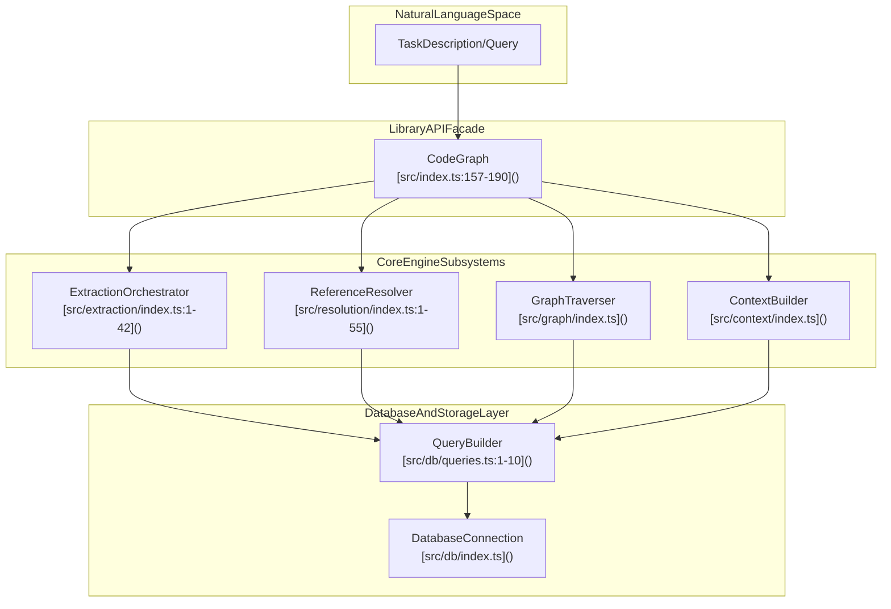

<!-- source: DeepWiki mcp.deepwiki.com · repo colbymchenry/codegraph · page 8 Library API Reference · fetched 2026-10-30 -->

# Library API Reference

<details>
<summary>Relevant source files</summary>

The following files were used as context for generating this wiki page:

- [CHANGELOG.md](CHANGELOG.md)
- [__tests__/extraction.test.ts](__tests__/extraction.test.ts)
- [__tests__/resolution.test.ts](__tests__/resolution.test.ts)
- [src/db/queries.ts](src/db/queries.ts)
- [src/extraction/index.ts](src/extraction/index.ts)
- [src/extraction/tree-sitter.ts](src/extraction/tree-sitter.ts)
- [src/index.ts](src/index.ts)
- [src/resolution/import-resolver.ts](src/resolution/import-resolver.ts)
- [src/resolution/index.ts](src/resolution/index.ts)
- [src/resolution/name-matcher.ts](src/resolution/name-matcher.ts)
- [src/resolution/types.ts](src/resolution/types.ts)

</details>


This document provides an overview of the programmatic Node.js API for embedding CodeGraph into custom tools, editors, or automated agent pipelines [src/index.ts:1-6](). CodeGraph can be imported as a library to build, query, and analyze semantic knowledge graphs programmatically [src/index.ts:157-190]().

For detailed documentation on the primary facade class, see [CodeGraph Facade API](#8.1). For reference on the core type definitions, data contracts, and exported utility helpers, see [Types and Data Contracts](#8.2).

---

## Installation & Imports

CodeGraph is distributed as an npm package that provides high-level abstractions over the underlying SQLite database and Tree-sitter parsing engine [src/index.ts:1-6](). 

Install the package via npm:

```bash
npm install @colbymchenry/codegraph
```

### SDK Architecture

The programmatic entry point re-exports the core `CodeGraph` class alongside essential building blocks for embedded consumers who wish to drive the graph directly (such as opening raw database connections or running prepared queries) [src/index.ts:74-108]().

```typescript
import { CodeGraph, Node, Edge, IndexResult } from '@colbymchenry/codegraph';
```

Sources: [src/index.ts:1-6](), [src/index.ts:74-108]()

---

## Programmatic API Overview

The CodeGraph library API coordinates multiple internal subsystems—such as `ExtractionOrchestrator` for parsing source files, `ReferenceResolver` for cross-file symbol linking, `GraphTraverser` for relational analysis, and `ContextBuilder` for constructing AI task context [src/index.ts:157-190]().

### Natural Language Space to Code Entity Space


*Figure 1: Bridging high-level API invocations to internal system components.*

Sources: [src/index.ts:157-190](), [src/extraction/index.ts:1-42](), [src/db/queries.ts:1-10]()

---

## Sub-Topics and Child Reference

For detailed method signatures, parameter options, and concrete code implementations, refer to the following dedicated child pages:

- **[CodeGraph Facade API](#8.1)**: Covers `CodeGraph.init()`, `CodeGraph.open()`, `CodeGraph.openSync()`, `CodeGraph.recreate()`, indexing routines (`indexAll`, `indexFiles`, `sync`), search/query operations, graph traversals (`getCallers`, `getCallees`, `getImpactRadius`), and instance lifecycle/locking semantics [src/index.ts:112-190]().
- **[Types and Data Contracts](#8.2)**: Covers exported runtime structures including `Node`, `Edge`, `NodeKind`, `UnresolvedReference`, `ResolutionContext`, and helper utilities [src/index.ts:74-108]().

Sources: [src/index.ts:74-108](), [src/index.ts:112-190]()

---

## Error Handling

The library exports specialized error classes to distinguish between configuration, database, parsing, and query failures [src/index.ts:92-104]():

- `CodeGraphError`: Base class for all internal CodeGraph exceptions [src/index.ts:92]()
- `FileError`: Issues reading, validating, or accessing source files [src/index.ts:93]()
- `ParseError`: AST generation failures during Tree-sitter parsing [src/index.ts:94]()
- `DatabaseError`: SQLite constraint violations or query execution issues [src/index.ts:95]()
- `SearchError`: FTS5 query parsing or execution failures [src/index.ts:96]()

Sources: [src/index.ts:92-104]()

---

