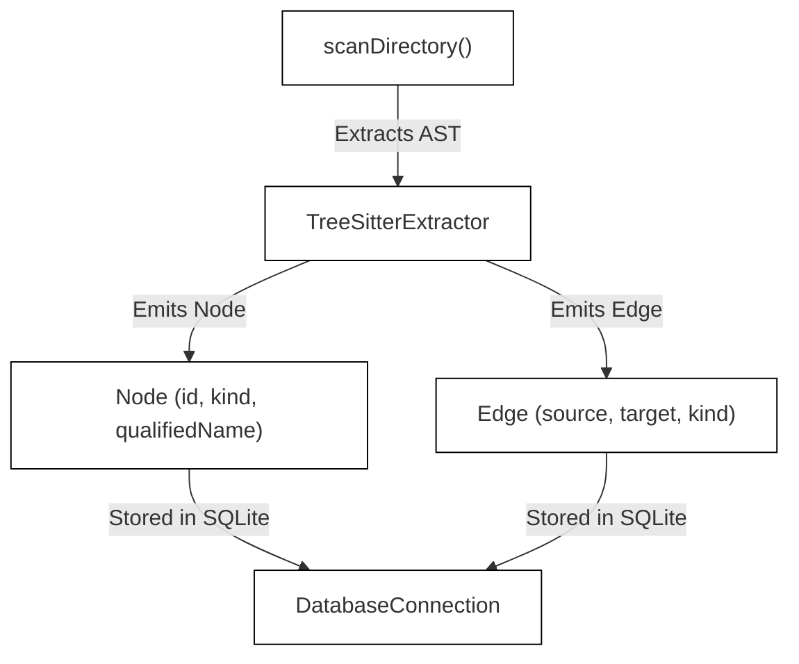
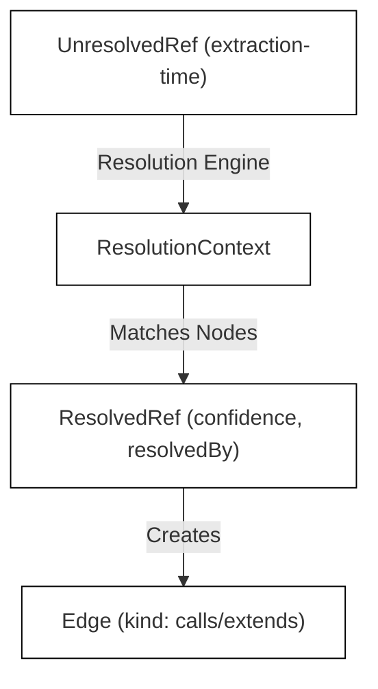

<!-- source: DeepWiki mcp.deepwiki.com · repo colbymchenry/codegraph · page 8.2 Types and Data Contracts · fetched 2026-10-30 -->

# Types and Data Contracts

<details>
<summary>Relevant source files</summary>

The following files were used as context for generating this wiki page:

- [.claude/skills/agent-eval/corpus.json](.claude/skills/agent-eval/corpus.json)
- [__tests__/child-process-windows-hide.test.ts](__tests__/child-process-windows-hide.test.ts)
- [__tests__/security.test.ts](__tests__/security.test.ts)
- [__tests__/ui-trails.test.ts](__tests__/ui-trails.test.ts)
- [src/extraction/grammars.ts](src/extraction/grammars.ts)
- [src/extraction/languages/index.ts](src/extraction/languages/index.ts)
- [src/types.ts](src/types.ts)
- [src/ui-server/api/trail-store.ts](src/ui-server/api/trail-store.ts)
- [src/ui-server/api/trails.ts](src/ui-server/api/trails.ts)
- [src/utils.ts](src/utils.ts)

</details>


## Purpose and Scope

This page provides a technical reference for CodeGraph's exported TypeScript types and core data contracts. It covers the fundamental data structures that govern the knowledge graph (`Node`, `Edge`), the reference resolution pipeline (`UnresolvedRef`, `ResolvedRef`, `ResolutionContext`), the framework extension interface (`FrameworkResolver`), extraction results, and critical runtime utility contracts such as path sanitization, security boundaries, and wire contracts.

Sources: [`src/types.ts:1-261`](), [`src/extraction/grammars.ts:1-54`](), [`src/utils.ts:39-66`]()

---

## Core Graph Entities: Nodes and Edges

CodeGraph models source code as a directed graph consisting of typed `Node` instances (representing code symbols like functions, classes, interfaces, files, and routes) and `Edge` instances (representing relationships like `calls`, `imports`, `extends`, and `navigates`).

### Symbol Kinds and Languages
- **`NodeKind`**: Defined in an iterable `NODE_KINDS` array (`file`, `module`, `class`, `struct`, `interface`, `trait`, `protocol`, `function`, `method`, `property`, `field`, `variable`, `constant`, `enum`, `enum_member`, `type_alias`, `namespace`, `parameter`, `import`, `export`, `route`, `component`, `union`). The array order is part of the native kernel's wire contract and must never be reordered [src/types.ts:22-46]().
- **`EdgeKind`**: Defined in `EDGE_KINDS` (`contains`, `calls`, `imports`, `exports`, `extends`, `implements`, `references`, `type_of`, `returns`, `instantiates`, `overrides`, `decorates`, `navigates`) [src/types.ts:64-78]().
- **`Language`**: Enumerates supported languages in `LANGUAGES`, matched via `EXTENSION_MAP` in `src/extraction/grammars.ts` [src/types.ts:86-130](), [src/extraction/grammars.ts:59-174]().


Sources: [`src/types.ts:22-78`](), [`src/extraction/grammars.ts:59-174](), [`__tests__/security.test.ts:18`]()

---

## Reference Resolution Contracts

The resolution engine transforms raw syntactic references into validated graph edges using project context.

### Node and Edge Interfaces
- **`Node`**: Defines core symbol properties including `id`, `kind`, `name`, `qualifiedName`, `filePath`, `language`, line/column offsets, and metadata like `returnType` [src/types.ts:140-209]().
- **`Edge`**: Defines relationship properties including `source`, `target`, `kind`, `metadata`, and `provenance` (`tree-sitter` | `scip` | `heuristic`) [src/types.ts:214-235]().


Sources: [`src/types.ts:140-235`]()

---

## ResolutionContext and Trail Resolution

`ResolutionContext` provides framework resolvers and matching algorithms with bounded, read-only access to the graph database and file system. Similarly, UI trail resolution (`resolveHop`) re-validates saved hops against the active index [src/ui-server/api/trails.ts:145-191]().

### Key Resolution and Trail Types
- `resolveHop(cg: CodeGraph, hop: StoredHop): WireTrailHop` verifies saved trail elements against current index symbols (`ok`, `moved`, `ambiguous`, `missing`) [src/ui-server/api/trails.ts:69-87](), [src/ui-server/api/trails.ts:145-191]().
- `StoredHop` stores traversal hops using `qualifiedName`, `kind`, and `file` as identity rather than volatile line-based IDs [src/ui-server/api/trail-store.ts:70-80]().

Sources: [`src/ui-server/api/trails.ts:69-191](), [`src/ui-server/api/trail-store.ts:70-80`]()

---

## Framework Resolver Interface

Framework resolvers plug into the resolution pipeline to handle framework-specific conventions (e.g., React Router, Next.js, Angular, Spring). Resolvers implement detection, reference claiming, and custom edge synthesis.

Sources: [`src/extraction/languages/index.ts:40-72`]()

---

## Extraction Results and Security Utilities

CodeGraph enforces strict security boundaries around file parsing and data contracts to prevent path traversal and accidental secret leakage.

### Path Validation and Sandboxing
The `validatePathWithinRoot` utility ensures that file operations remain contained within the project directory, supporting both lexical checks and symlink-aware verification [src/utils.ts:129-162]().

```typescript
export function validatePathWithinRoot(
  projectRoot: string,
  filePath: string,
  options?: { allowSymlinkEscape?: boolean }
): string | null
```

### Config Leaf Nodes
To prevent credentials or sensitive configuration values from polluting AI agent context windows, CodeGraph identifies config leaf nodes (`kind: 'constant'` in `yaml` or `properties`) and restricts value inspection [src/utils.ts:53-66]().

```typescript
export function isConfigLeafNode(node: { kind: string; language?: string }): boolean {
  return node.kind === 'constant' && !!node.language && CONFIG_LEAF_LANGUAGES.has(node.language);
}
```

Sources: [`src/utils.ts:53-66`](), [`src/utils.ts:129-162`]()

---

