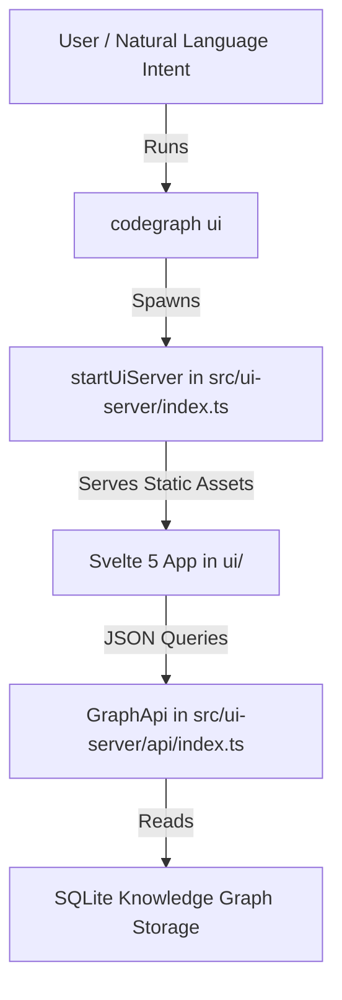
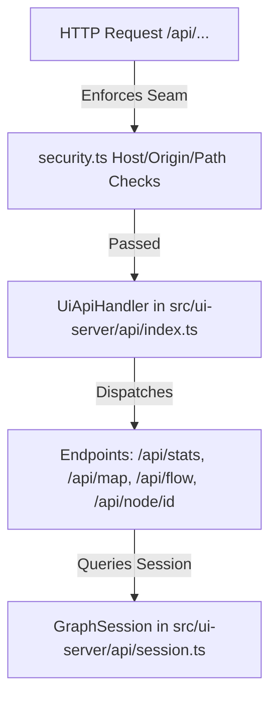
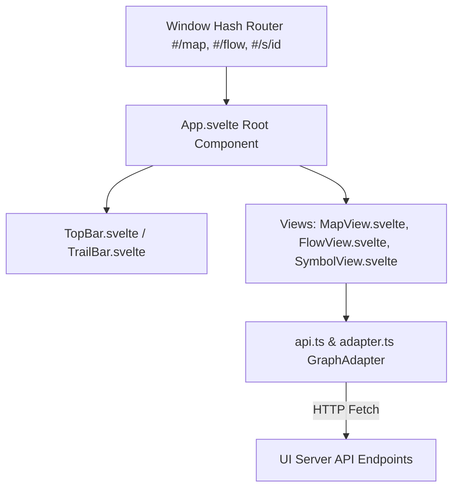
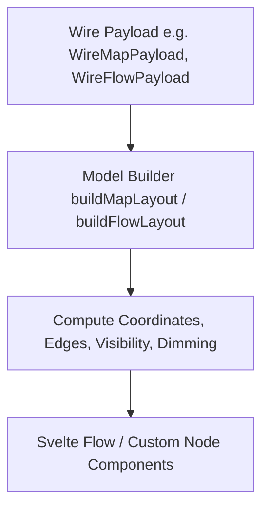

<!-- source: DeepWiki mcp.deepwiki.com · repo colbymchenry/codegraph · page 9 Graph Viewer UI · fetched 2026-10-30 -->

# Graph Viewer UI

Relevant source files

The following files were used as context for generating this wiki page:

- [__tests__/ui-server.test.ts](__tests__/ui-server.test.ts)
- [site/src/content/docs/guides/viewer.md](site/src/content/docs/guides/viewer.md)
- [src/ui-server/api/index.ts](src/ui-server/api/index.ts)
- [src/ui-server/api/respond.ts](src/ui-server/api/respond.ts)
- [src/ui-server/assets.ts](src/ui-server/assets.ts)
- [src/ui-server/constants.ts](src/ui-server/constants.ts)
- [src/ui-server/index.ts](src/ui-server/index.ts)
- [src/ui-server/open-browser.ts](src/ui-server/open-browser.ts)
- [src/ui-server/security.ts](src/ui-server/security.ts)
- [src/ui-server/static.ts](src/ui-server/static.ts)
- [ui/README.md](ui/README.md)
- [ui/src/App.svelte](ui/src/App.svelte)
- [ui/src/components/map/MapSidePanel.svelte](ui/src/components/map/MapSidePanel.svelte)
- [ui/src/components/screens/ScreenEdge.svelte](ui/src/components/screens/ScreenEdge.svelte)
- [ui/src/components/screens/ScreenNode.svelte](ui/src/components/screens/ScreenNode.svelte)
- [ui/src/components/steps/StepNode.svelte](ui/src/components/steps/StepNode.svelte)
- [ui/src/lib/api.ts](ui/src/lib/api.ts)
- [ui/src/lib/navigation.ts](ui/src/lib/navigation.ts)
- [ui/src/lib/router.svelte.ts](ui/src/lib/router.svelte.ts)
- [ui/src/views/FlowView.svelte](ui/src/views/FlowView.svelte)
- [ui/src/views/MapView.svelte](ui/src/views/MapView.svelte)

The Graph Viewer UI provides a local-first web interface for exploring the CodeGraph knowledge graph (`codegraph ui`). It bridges the gap between raw codebase storage and human comprehension by rendering symbol relationships, call stacks, architectural maps, and dependency flows directly in the browser [site/src/content/docs/guides/viewer.md:1-15](), `[ui/README.md:1-11]()`. 

The architecture consists of two main subsystems: an isolated loopback HTTP server (`src/ui-server/`) and a Svelte 5 frontend component architecture (`ui/`) [ui/README.md:1-10](), `[src/ui-server/index.ts:1-15]`.

Sources: `[src/ui-server/index.ts:1-190]()`, `[ui/README.md:1-17]`, `[src/ui-server/api/index.ts:1-43]()`.

---

## 9.1 UI Server and API Endpoints

The HTTP server (`src/ui-server/`) acts as the loopback security boundary for the viewer [__tests__/ui-server.test.ts:1-14](). It ensures safe asset delivery, strict request validation (`Host` header checks, origin validation, and path traversal guards), and provides a comprehensive JSON API (`src/ui-server/api/index.ts`) that serializes graph metrics, symbol details, file outlines, routing maps, and data flows [src/ui-server/index.ts:1-147](), `[src/ui-server/api/index.ts:1-33]()`.

Sources: `[src/ui-server/index.ts:1-190]()`, `[src/ui-server/api/index.ts:1-43]()`, `[__tests__/ui-server.test.ts:1-35]()`.

For full technical specifications regarding the server loopback gating, asset routing, and all thirteen JSON API endpoints (`/api/map`, `/api/flow`, `/api/steps`, `/api/screens`, `/api/node`, `/api/file`, `/api/routes`, `/api/effects`, `/api/entrypoints`, `/api/deadcode`, `/api/trails`, `/api/program`, `/api/when`), see [UI Server and API Endpoints](#9.1).

---

## 9.2 Svelte Frontend Views and Components

The frontend (`ui/`) is built with Svelte 5 and Vite [ui/README.md:1-10](). It functions as both a standalone browser reader (`dist/viewer/`) and a reusable component package (`@colbymchenry/codegraph-ui`) embeddable in hosting applications [ui/README.md:1-12](). Routing is managed via the window hash (`ui/src/lib/router.svelte.ts`) to avoid history-API fallback requirements on the static file server [ui/src/lib/router.svelte.ts:1-7](). Data is fetched strictly through an adapter pattern (`ui/src/lib/adapter.ts`, exposed via `ui/src/lib/api.ts`) [ui/src/lib/api.ts:1-14]().

Sources: `[ui/README.md:1-11]()`, `[ui/App.svelte:1-33]()`, `[ui/src/lib/api.ts:1-15]()`, `[ui/src/lib/router.svelte.ts:1-34]()`.

For details on the application shell, layout views (`MapView`, `FlowView`, `SymbolView`, `FileView`), keyboard shortcuts, and the component library, see [Svelte Frontend Views and Components](#9.2).

---

## 9.3 Steps and Screens Visualization Model

The visualization models (`buildMapLayout`, `buildFlowLayout`, `buildHierarchyModel`) transform raw graph query payloads into spatial structures suitable for rendering engines like Svelte Flow [ui/src/views/MapView.svelte:110-112](), `[ui/src/views/FlowView.svelte:106-107]()`. They handle layer balancing, tier synthesis, branch guard calculations, and truncation logic to ensure that complex call flows or module hierarchies remain readable on standard display sizes [ui/src/views/MapView.svelte:49-58](), `[ui/src/views/FlowView.svelte:51-59]()`.

Sources: `[ui/src/views/MapView.svelte:97-112]()`, `[ui/src/views/FlowView.svelte:86-108]`, `[site/src/content/docs/guides/viewer.md:31-39]()`.

For deep dives into the design specs behind Steps, Screens, and Program models, tier synthesis algorithms, and navigation edges, see [Steps and Screens Visualization Model](#9.3).

---

