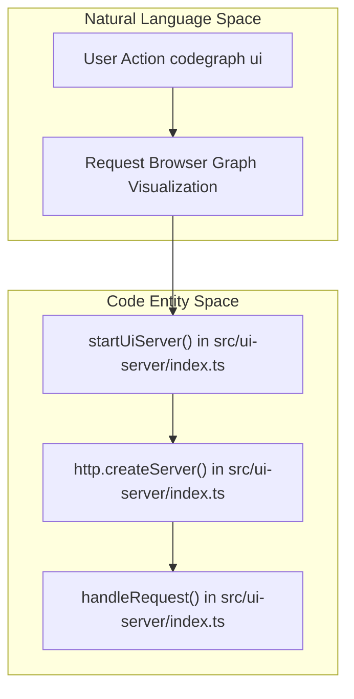
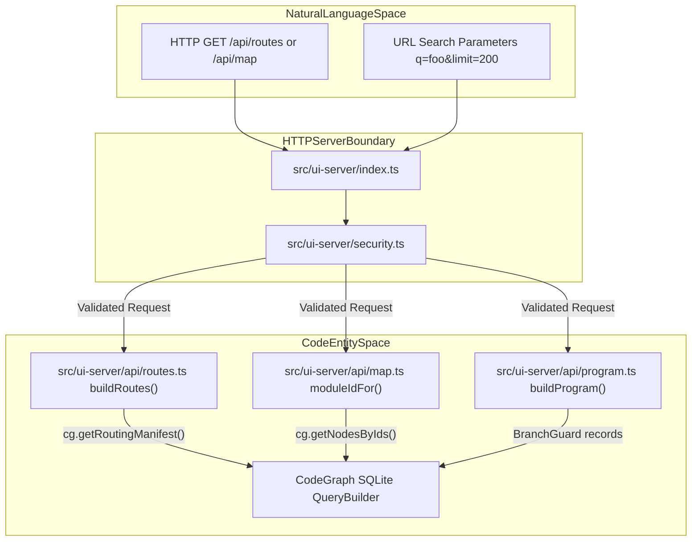
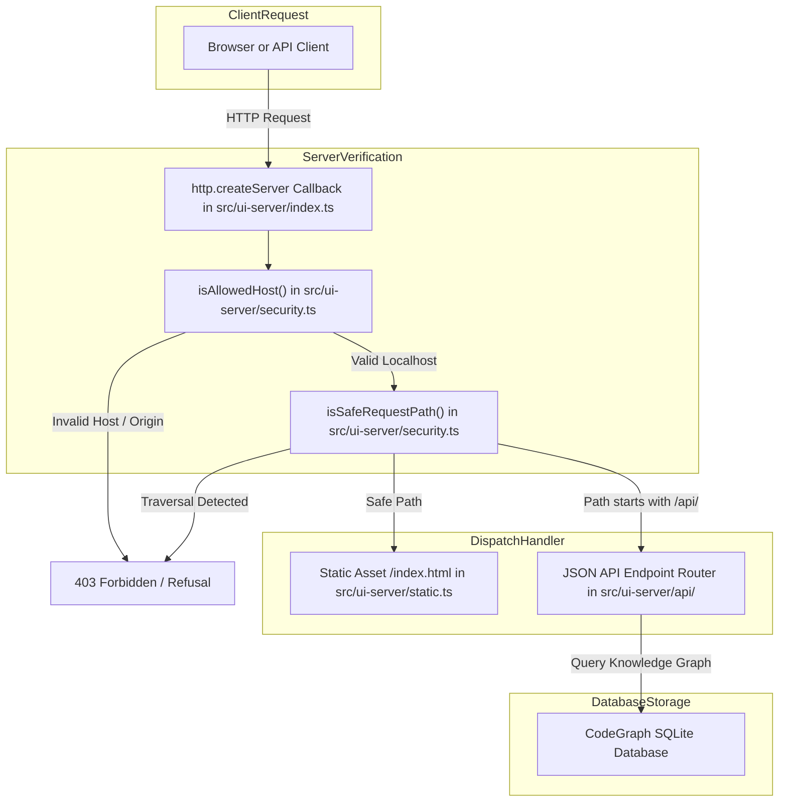

<!-- source: DeepWiki mcp.deepwiki.com · repo colbymchenry/codegraph · page 9.1 UI Server and API Endpoints · fetched 2026-10-30 -->

# UI Server and API Endpoints

Relevant source files

The following files were used as context for generating this wiki page:

- [__tests__/generated-detection.test.ts](__tests__/generated-detection.test.ts)
- [__tests__/swiftui-viewer-noise.test.ts](__tests__/swiftui-viewer-noise.test.ts)
- [__tests__/ui-effects.test.ts](__tests__/ui-effects.test.ts)
- [__tests__/ui-entry-model.test.ts](__tests__/ui-entry-model.test.ts)
- [__tests__/ui-entrypoints-api.test.ts](__tests__/ui-entrypoints-api.test.ts)
- [__tests__/ui-file-model.test.ts](__tests__/ui-file-model.test.ts)
- [__tests__/ui-map-api.test.ts](__tests__/ui-map-api.test.ts)
- [__tests__/ui-map-model.test.ts](__tests__/ui-map-model.test.ts)
- [__tests__/ui-repeated-keys.test.ts](__tests__/ui-repeated-keys.test.ts)
- [__tests__/ui-server-api.test.ts](__tests__/ui-server-api.test.ts)
- [__tests__/ui-server.test.ts](__tests__/ui-server.test.ts)
- [docs/viewer-launch-changelog.md](docs/viewer-launch-changelog.md)
- [src/context/formatter.ts](src/context/formatter.ts)
- [src/extraction/generated-detection.ts](src/extraction/generated-detection.ts)
- [src/ui-server/api/effects.ts](src/ui-server/api/effects.ts)
- [src/ui-server/api/entrypoints.ts](src/ui-server/api/entrypoints.ts)
- [src/ui-server/api/file.ts](src/ui-server/api/file.ts)
- [src/ui-server/api/map.ts](src/ui-server/api/map.ts)
- [src/ui-server/api/node.ts](src/ui-server/api/node.ts)
- [src/ui-server/api/respond.ts](src/ui-server/api/respond.ts)
- [src/ui-server/api/routes.ts](src/ui-server/api/routes.ts)
- [src/ui-server/api/search.ts](src/ui-server/api/search.ts)
- [src/ui-server/api/session.ts](src/ui-server/api/session.ts)
- [src/ui-server/api/source.ts](src/ui-server/api/source.ts)
- [src/ui-server/api/stats.ts](src/ui-server/api/stats.ts)
- [src/ui-server/api/wire.ts](src/ui-server/api/wire.ts)
- [src/ui-server/assets.ts](src/ui-server/assets.ts)
- [src/ui-server/constants.ts](src/ui-server/constants.ts)
- [src/ui-server/index.ts](src/ui-server/index.ts)
- [src/ui-server/open-browser.ts](src/ui-server/open-browser.ts)
- [src/ui-server/security.ts](src/ui-server/security.ts)
- [src/ui-server/static.ts](src/ui-server/static.ts)
- [ui/src/app.css](ui/src/app.css)
- [ui/src/components/TopBar.svelte](ui/src/components/TopBar.svelte)
- [ui/src/components/TrailBar.svelte](ui/src/components/TrailBar.svelte)
- [ui/src/components/file/FileOutline.svelte](ui/src/components/file/FileOutline.svelte)
- [ui/src/components/file/FileRail.svelte](ui/src/components/file/FileRail.svelte)
- [ui/src/components/map/ModuleNode.svelte](ui/src/components/map/ModuleNode.svelte)
- [ui/src/lib/entry-model.ts](ui/src/lib/entry-model.ts)
- [ui/src/lib/file-model.ts](ui/src/lib/file-model.ts)
- [ui/src/lib/map-model.ts](ui/src/lib/map-model.ts)
- [ui/src/views/FileView.svelte](ui/src/views/FileView.svelte)
- [ui/src/views/HomeView.svelte](ui/src/views/HomeView.svelte)

## Purpose and Scope
This page documents the internal architecture and implementation of the CodeGraph UI server and its read-only JSON API (`codegraph ui`). The UI server is a lightweight, dependency-free HTTP server built on Node.js core modules (`node:http`, `node:fs`, `node:path`) designed to run exclusively on the local loopback interface (`127.0.0.1`). It delivers the compiled Svelte frontend assets (`dist/viewer/`) and exposes a structured JSON API mounted under `/api/` to query the indexed knowledge graph, modules, routes, entrypoints, and call flows.

Sources: `[src/ui-server/index.ts:1-64]()`, `[__tests__/ui-server.test.ts:1-35]()`

---

## HTTP Server Core and Initialization
The HTTP server initializes via `startUiServer` in `[src/ui-server/index.ts:169-190]()`. It establishes a loopback-bound server instance using `http.createServer`, managing port fallback logic if the default or requested port is occupied, and enforces strict security headers on all responses.

Sources: `[src/ui-server/index.ts:169-190]`, `[src/ui-server/constants.ts:1-36]()`

---

## Security Layer: Localhost Gating and Path Traversal Protection
Because the UI server exposes source code and knowledge graph metadata, its security posture relies on zero trust toward remote or cross-site contexts. Handled primarily within `[src/ui-server/security.ts]()`, the server enforces:

1. **Loopback Gating**: Rejects any request where the `Host` header does not resolve to `127.0.0.1` or `localhost` on the active port, mitigating DNS rebinding attacks (`[__tests__/ui-server.test.ts:1-13](), [src/ui-server/security.ts:1-50]()`).
2. **Path Traversal Shielding**: `resolveProjectFile` and `resolveStaticAsset` use realpath comparisons (`validatePathWithinRoot`) to guarantee that requested files cannot escape `projectRoot` or `viewerDir`. Any traversal sequence (`/../../secret.txt`) throws a `PathRefusalError` resulting in a `403 Forbidden` response (`[__tests__/ui-server.test.ts:120-175]()`).
3. **Write Method Restrictions**: Read-only mode is strictly enforced. Only `/api/trails` accepts `POST` or `DELETE` methods for saving or removing user-defined trails (`[src/ui-server/index.ts:9-13]()`).
4. **Security Headers**: Every response injects restrictive CSP (`default-src 'none'`), disables MIME-sniffing (`X-Content-Type-Options: nosniff`), and denies framing (`X-Frame-Options: DENY`) (`[src/ui-server/index.ts:146-161]()`).

Sources: `[src/ui-server/security.ts:1-80](), [src/ui-server/index.ts:1-17](), [__tests__/ui-server.test.ts:1-175]()`

---

## Static Asset Serving and Caching
Static files from `viewerDir` are served via `[src/ui-server/static.ts]()`. Hashed asset filenames (e.g., Vite build outputs like `/assets/index-abc123.js`) receive immutable, long-term caching headers (`public, max-age=31536000, immutable`), whereas entry points like `index.html` are served with `no-store` to ensure prompt delivery of UI updates (`[__tests__/ui-server.test.ts:160-165]()`). 

For client-side hash routing, missing paths (such as deep links like `/s/some-symbol-id`) fall back transparently to serving `index.html`, while missing static assets correctly return `404 Not Found` (`[__tests__/ui-server.test.ts:167-175]()`).

Sources: `[src/ui-server/static.ts:1-100](), [__tests__/ui-server.test.ts:135-175]()`

---

## The JSON API Seam and Response Formatting
The JSON API is attached to the server via the `UiApiHandler` interface (`[src/ui-server/index.ts:68-96]()`). API modules utilize helper functions in `[src/ui-server/api/respond.ts]()` to serialize payloads, parse integer/string parameters safely, and issue standard errors (`ApiError`, `badRequest`, `notFound`) formatted as application/json payloads.

Sources: `[src/ui-server/index.ts:68-96](), [src/ui-server/api/respond.ts:1-60]()`

---

## Core API Endpoints Reference

### 1. Repository Map (`GET /api/map`)
The repository map endpoint aggregates files and directories into module boxes and computes inter-module dependencies without running heavy client-side physics simulations.

* **Implementation**: `[src/ui-server/api/map.ts:1-157]()`
* **Data Flow**: Maps each indexed file to path segments based on `depth` (default `1`, max `4`). Loose root files are grouped into a `(root files)` bucket unless they are recognized as façade stems (`index.ts`, `lib.rs`, `__init__.py`, etc.). Link weights count all confident cross-module edges, while layout layering relies exclusively on *declared* edges (imports, inheritance, qualified names) to prevent noisy name matches from inverting architectural layers.

Sources: `[src/ui-server/api/map.ts:1-157](), [__tests__/ui-map-api.test.ts:1-233]()`

### 2. Flow, Steps, and Program (`GET /api/flow`, `GET /api/steps`, `GET /api/program`)
These endpoints provide traversal views of execution paths, downstream call cascades, and statement-level code blocks.

* **Implementation**: `[src/ui-server/api/flow.ts]()`, `[src/ui-server/api/program.ts:1-125]()`
* **Data Flow**: `flow` traverses outward from symbols to calculate dependency tiers. `program` translates walking records into source-ordered blocks, folding control flow statements (`if`, `switch`, `try`, early exits using `BranchGuard` metadata) and helper functions into structured AST-like wire items (`WireBlock`, `WireItem`).

Sources: `[src/ui-server/api/program.ts:1-125]()`

### 3. Routes, Effects, and Entrypoints (`GET /api/routes`, `GET /api/effects`, `GET /api/entrypoints`)
* **Routes (`[src/ui-server/api/routes.ts:1-168]()`)**: Parses the engine's routing manifest, folding duplicate bindings and inline handlers onto unified route nodes while filtering out test files.
* **Effects (`[src/ui-server/api/effects.ts:1-106]()`)**: Scans member call chains against regex rules (`EFFECT_RULES`) categorized by side-effect type (`database`, `response`, `cache`, `auth`, `queue`, etc.) with language gating per family (`js`, `py`, `go`, `cs`, `jvm`, etc.).
* **Entrypoints (`[src/ui-server/api/entrypoints.ts]()`)**: Identifies executable roots, module-level execution statements, and un-callee'd entry structures.

Sources: `[src/ui-server/api/routes.ts:1-168](), [src/ui-server/api/effects.ts:1-106]()`

---

## Architectural Data Flow and Natural Language Mapping

The following diagram illustrates how incoming HTTP requests bridge natural language query paths to concrete code entities and database objects inside the UI server architecture:

Sources: `[src/ui-server/index.ts:1-190](), [src/ui-server/security.ts:1-80](), [src/ui-server/api/routes.ts:139-168]()`

---

## Request Verification and Endpoint Dispatch Lifecycle

Sources: `[src/ui-server/index.ts:180-190](), [src/ui-server/security.ts:1-60](), [src/ui-server/static.ts:1-50]()`

---

