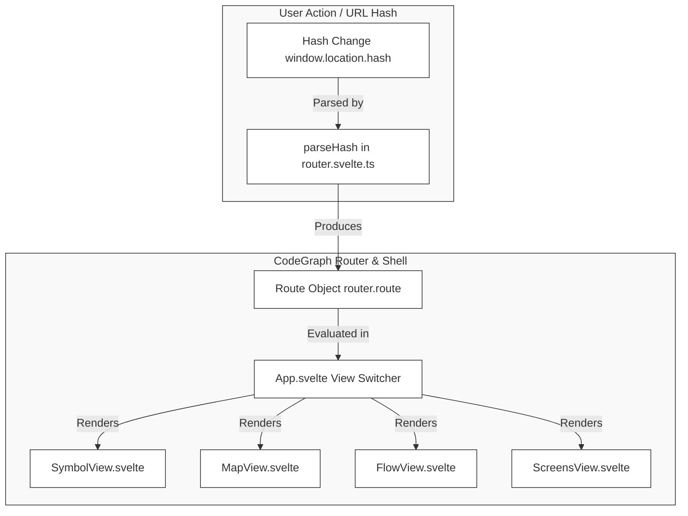

<!-- source: DeepWiki mcp.deepwiki.com · repo colbymchenry/codegraph · page 9.2 Svelte Frontend Views and Components · fetched 2026-10-30 -->

# Svelte Frontend Views and Components

<details>
<summary>Relevant source files</summary>

The following files were used as context for generating this wiki page:

- [__tests__/ui-file-model.test.ts](__tests__/ui-file-model.test.ts)
- [__tests__/ui-server-api.test.ts](__tests__/ui-server-api.test.ts)
- [site/src/content/docs/guides/viewer.md](site/src/content/docs/guides/viewer.md)
- [src/ui-server/api/file.ts](src/ui-server/api/file.ts)
- [src/ui-server/api/index.ts](src/ui-server/api/index.ts)
- [ui/README.md](ui/README.md)
- [ui/src/App.svelte](ui/src/App.svelte)
- [ui/src/app.css](ui/src/app.css)
- [ui/src/components/TopBar.svelte](ui/src/components/TopBar.svelte)
- [ui/src/components/TrailBar.svelte](ui/src/components/TrailBar.svelte)
- [ui/src/components/file/FileOutline.svelte](ui/src/components/file/FileOutline.svelte)
- [ui/src/components/file/FileRail.svelte](ui/src/components/file/FileRail.svelte)
- [ui/src/components/map/MapSidePanel.svelte](ui/src/components/map/MapSidePanel.svelte)
- [ui/src/components/screens/ScreenEdge.svelte](ui/src/components/screens/ScreenEdge.svelte)
- [ui/src/components/screens/ScreenNode.svelte](ui/src/components/screens/ScreenNode.svelte)
- [ui/src/components/steps/StepNode.svelte](ui/src/components/steps/StepNode.svelte)
- [ui/src/lib/api.ts](ui/src/lib/api.ts)
- [ui/src/lib/file-model.ts](ui/src/lib/file-model.ts)
- [ui/src/lib/navigation.ts](ui/src/lib/navigation.ts)
- [ui/src/lib/router.svelte.ts](ui/src/lib/router.svelte.ts)
- [ui/src/views/FileView.svelte](ui/src/views/FileView.svelte)
- [ui/src/views/FlowView.svelte](ui/src/views/FlowView.svelte)
- [ui/src/views/HomeView.svelte](ui/src/views/HomeView.svelte)
- [ui/src/views/MapView.svelte](ui/src/views/MapView.svelte)

</details>


## Purpose and Scope

This document details the architecture, routing, app shell, core views, and component library of the `ui/` Svelte 5 application (`[ui/README.md:1-21]()`). CodeGraph's frontend operates in a dual build configuration: as a standalone browser reader packaged into static assets under `../dist/viewer` for CLI loopback delivery (`codegraph ui`), and as a component library (`@colbymchenry/codegraph-ui`) consumable by external hosts like CodeGraph Pro (`[ui/README.md:1-11]()`). Communication with data layers is entirely mediated by the `GraphAdapter` abstraction layer, decoupling UI components from network transport or direct SQLite access (`[ui/src/lib/api.ts:1-14]`, `[ui/README.md:78-111]()`).

Sources: `[ui/README.md:1-21]`, `[ui/src/lib/api.ts:1-14]`

---

## App Shell and Hash Routing

The application entry point is managed by `[ui/src/App.svelte:1-45]()`, which coordinates root-level effects including project statistics initialization, the real-time SSE live update channel (`live.start()`), keyboard shortcut listeners, and route matching (`[ui/src/App.svelte:34-153]()`).

Routing is implemented via a hash-based router (`[ui/src/lib/router.svelte.ts:1-31]()`). Because navigation relies exclusively on the window location hash (e.g., `#/s/<id>`, `#/file/<path>`, `#/map`), the static file server requires no history-API fallback (`[ui/src/lib/router.svelte.ts:1-7]()`). The `parseHash` function parses parameters (`hl`, `t`, `root`, `depth`, `tests`) and maps URL segments to a strongly-typed `Route` discriminated union (`[ui/src/lib/router.svelte.ts:60-175]()`).


*Diagram 1: Hash routing data flow bridging URL interactions to Svelte views.*

Sources: `[ui/src/App.svelte:1-153]`, `[ui/src/lib/router.svelte.ts:1-175]`

---

## TopBar, TrailBar, and Navigation

The global navigation shell consists of `[ui/src/components/TopBar.svelte:1-89]()` and `[ui/src/components/TrailBar.svelte]()`. 

`TopBar` renders the brand logotype, tab navigation switches (`Screens`, `Steps`, `Entry points`, `Map`, `Symbol`, `Flow`, `Dead code`), the global `SearchPalette` trigger, and project live status indicators (`[ui/src/components/TopBar.svelte:65-89]()`). The `liveNote` computed property observes connectivity state (`live.degraded`, `live.stopped`) to inform users if real-time synchronization has dropped (`[ui/src/components/TopBar.svelte:47-62]()`).

Keyboard shortcuts are globally captured on `window` via `[ui/src/App.svelte:109-153]()`, enabling quick-key navigation (`/` or `Cmd+K` for search, `m` for map, `f` for flow, `e` for entry points, `s` for screens, `d` for dead code, and `[` or `Backspace` for history steps).

```mermaid
graph TD
    subgraph NaturalLanguageSpace["Global UI Controls"]
        A["Keyboard Shortcut /s key"] -->|Captured by| B["onkeydown in App.svelte"]
        C["Search Bar Input / Cmd+K"] -->|Invokes| D["focusSearch in TopBar.svelte"]
    end

    subgraph CodeEntitySpace["Navigation Engine"]
        B -->|Invokes| E["navigate function in navigation.ts"]
        E -->|Updates| F["window.location.hash"]
        D -->|Delegates to| G["SearchPalette.svelte component"]
    end

    classDef default fill:#fff,stroke:#333,stroke-width:1px;
    classDef space fill:#f9f9f9,stroke:#333,stroke-width:1px;
    classNaturalLanguageSpace,CodeEntitySpace space;
```
*Diagram 2: Global UI event handling bridging user keystrokes to navigation actions.*

Sources: `[ui/src/App.svelte:109-153]`, `[ui/src/components/TopBar.svelte:1-174]`

---

## Core Views and Visualization Models

### MapView and Module Architecture
`[ui/src/views/MapView.svelte:1-460]()` renders the repository at a module granularity using Svelte Flow (`@xyflow/svelte`). It consumes payloads from `fetchMap` (`[ui/src/lib/api.ts:183-188]()`) and computes layouts via `buildMapLayout` (`[ui/src/lib/map-model.ts]()`). The accompanying `MapSidePanel` (`[ui/src/components/map/MapSidePanel.svelte:1-185]()`) details repository grouping depth, test module toggles, and dependency/dependent lists for selected nodes (`[ui/src/components/map/MapSidePanel.svelte:71-95]()`).

### FlowView and Path Exploration
`[ui/src/views/FlowView.svelte:1-462]()` illustrates how one symbol reaches another as an ordered sequence of step cards (`FlowCard.svelte`, `FlowLink.svelte`, `FlowEndCap.svelte`). Rather than computing paths on the client, data is fetched via `fetchFlow` (`[ui/src/lib/api.ts:197-200]()`) reflecting the path resolution logic used by MCP tools like `codegraph_explore` (`[ui/src/views/FlowView.svelte:5-14]()`).

### Steps and Screens Views
The Screens view (`[ui/src/views/ScreensView.svelte]()`, rendered via `ScreenNode.svelte` in `[ui/src/components/screens/ScreenNode.svelte:1-75]()`) maps application routing entry points and view transitions. Double-clicking nodes transitions the canvas into the Steps view (`[ui/src/components/steps/StepNode.svelte:1-61]()`), showing conditional execution paths, branch guards, and navigation edges.

Sources: `[ui/src/lib/api.ts:183-200]`, `[ui/src/views/MapView.svelte:1-112]`, `[ui/src/components/map/MapSidePanel.svelte:1-96]`, `[ui/src/views/FlowView.svelte:1-30]`, `[ui/src/components/screens/ScreenNode.svelte:1-65]`, `[ui/src/components/steps/StepNode.svelte:1-30]`

---

## Data Fetching and the GraphAdapter Pattern

All API interactions are funneled through `[ui/src/lib/api.ts:1-53]()`, which acts as a type-safe wrapper around the active `GraphAdapter` (`[ui/src/lib/adapter.ts]()`). 

The `GraphAdapter` interface defines thirteen required methods (`stats`, `search`, `node`, `nodes`, `source`, `file`, `fileCode`, `flow`, `map`, `routes`, `entryPoints`, `deadCode`, `trails`) and optional mutations (`saveTrail`, `deleteTrail`, `events`) (`[ui/README.md:80-101]()`). In the standalone viewer, `createHttpAdapter` executes loopback HTTP requests against `src/ui-server/api/` endpoints (`[ui/README.md:103-111]()`). Host embedding environments supply custom adapters reading directly from local indices without network overhead.

Sources: `[ui/src/lib/api.ts:1-53]`, `[ui/README.md:78-124]`, `[src/ui-server/api/index.ts:1-43]`

---

