# Page: Overview

# Overview

<details>
<summary>Relevant source files</summary>

The following files were used as context for generating this wiki page:

- [CHANGELOG.md](CHANGELOG.md)
- [CLAUDE.md](CLAUDE.md)
- [README.md](README.md)
- [__tests__/extraction.test.ts](__tests__/extraction.test.ts)
- [__tests__/installer.test.ts](__tests__/installer.test.ts)
- [__tests__/resolution.test.ts](__tests__/resolution.test.ts)
- [package-lock.json](package-lock.json)
- [package.json](package.json)
- [src/bin/codegraph.ts](src/bin/codegraph.ts)
- [src/db/queries.ts](src/db/queries.ts)
- [src/extraction/index.ts](src/extraction/index.ts)
- [src/extraction/tree-sitter.ts](src/extraction/tree-sitter.ts)
- [src/index.ts](src/index.ts)
- [src/installer/config-writer.ts](src/installer/config-writer.ts)
- [src/installer/index.ts](src/installer/index.ts)
- [src/mcp/tools.ts](src/mcp/tools.ts)
- [src/resolution/import-resolver.ts](src/resolution/import-resolver.ts)
- [src/resolution/index.ts](src/resolution/index.ts)
- [src/resolution/name-matcher.ts](src/resolution/name-matcher.ts)
- [src/resolution/types.ts](src/resolution/types.ts)

</details>


CodeGraph is a local-first code intelligence system that builds a semantic knowledge graph from source code to accelerate AI-assisted development [README.md:3-4](). By pre-indexing code structure, relationships, and semantics into a local SQLite database, CodeGraph enables AI coding assistants (such as Claude Code, Cursor, and GitHub Copilot) to query the graph directly instead of repeatedly scanning files with raw `grep` or `glob` tool loops [README.md:9-12]().

---

## Purpose and Key Benefits

When AI agents explore a codebase without structural support, they typically launch iterative file-scanning loops that consume significant context window tokens and require numerous tool invocations. CodeGraph shifts this paradigm by maintaining a persistent, real-time code property graph.

**Key Benefits:**
*   **Token Efficiency:** Achieves **30% fewer tokens** consumed per task by retrieving surgical context (e.g., exact method declarations and call sites) rather than dumping full source files [README.md:11-12]().
*   **Fewer Tool Calls:** Reduces tool invocation overhead by **25%** through single-query graph traversal of callers, callees, and impact paths [README.md:11-12]().
*   **Cross-File Precision:** Resolves complex dependencies—including polymorphic method dispatches, framework-specific routing, and import re-exports—via multi-stage reference resolution [src/extraction/tree-sitter.ts:34-45](), [src/resolution/index.ts:1-50]().
*   **100% Local-First:** Operates entirely offline within the project's `.codegraph/` directory with zero external API calls or data exfiltration [README.md:11-12](), [README.md:116-117]().
*   **Smart Deduping:** The exploration engine (`codegraph_explore`) automatically deduplicates code spans already served earlier in the conversation session [CHANGELOG.md:28-30]().

Sources: [README.md:3-12](), [CHANGELOG.md:28-30](), [src/extraction/tree-sitter.ts:34-45]()

---

## High-Level Repository Map

The CodeGraph repository is structured into distinct modular packages and directories:

| Directory / Subsystem | Description & Key Components |
|-----------------------|------------------------------|
| `src/` | Main TypeScript engine, CLI command router (`src/bin/codegraph.ts`), Model Context Protocol (MCP) server (`src/mcp/`), extraction orchestrator (`src/extraction/`), reference resolution engine (`src/resolution/`), and database query builder (`src/db/queries.ts`) [src/bin/codegraph.ts:1-30](), [src/db/queries.ts:1-25](), [src/extraction/index.ts:1-25](). |
| `codegraph-kernel/` | High-performance native Rust extraction kernel used for fast parsing and AST symbol emission [README.md:14-16](), [package.json:29-29](). |
| `ui/` | Svelte-based frontend application for the local browser graph viewer (`ui/src/`) [package.json:19-20](). |
| `site/` | Astro and Starlight documentation site source files and configuration collections. |
| `src/telemetry/` / `telemetry-*` | First-party opt-out telemetry collector, Cloudflare Worker ingest endpoints, and analytics reporting dashboard [src/telemetry/](). |

Sources: [README.md:14-16](), [package.json:19-41](), [src/bin/codegraph.ts:1-30](), [src/db/queries.ts:1-25]()

---

## System Architecture & Data Flow

CodeGraph executes a deterministic multi-stage processing pipeline that converts raw source files into an interconnected network of `Node` and `Edge` database records [src/types.ts:130-280](). 

### System Component Architecture

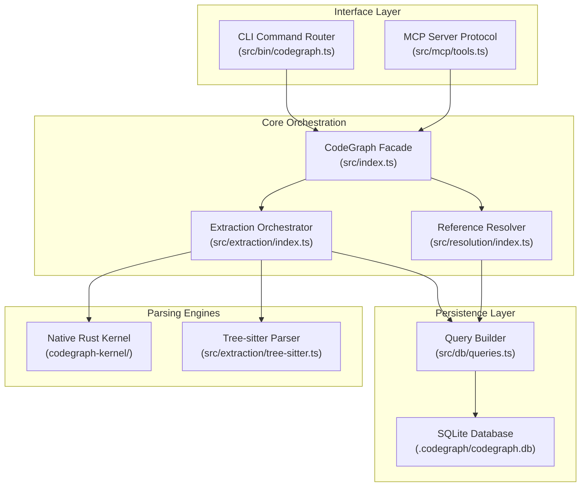

Sources: [src/bin/codegraph.ts:1-30](), [src/index.ts:1-105](), [src/extraction/index.ts:1-25](), [src/resolution/index.ts:1-50](), [src/db/queries.ts:1-25]()

### Pipeline Execution Phases

1.  **Scanning & Parsing:** `scanDirectory` in `src/extraction/index.ts` walks the file tree respecting `.gitignore` rules, feeding source buffers into `extractFromSource` using either the native Rust kernel or `web-tree-sitter` Wasm parsers [src/extraction/index.ts:13-25](), [src/extraction/tree-sitter.ts:40-45]().
2.  **Extraction & Storage:** Extracted symbols become `Node` entities (such as classes, functions, variables, and files) connected by `Edge` entities (such as `contains`, `calls`, `extends`) persisted via `StoreWriter` [src/types.ts:130-228](), [src/extraction/store-writer.ts:1-30]().
3.  **Reference Resolution:** `ReferenceResolver` resolves `UnresolvedReference` entries against stored symbol tables using name matchers, import mappings, and framework-specific resolver plugins [src/resolution/index.ts:1-50](), [src/resolution/name-matcher.ts:1-70]().
4.  **Querying & Traversal:** The MCP server or CLI queries SQLite via `QueryBuilder` using full-text search (FTS5) and graph traversal algorithms to provide surgical context to agents [src/db/queries.ts:1-50](), [src/mcp/tools.ts:1-50]().

Sources: [src/extraction/index.ts:1-50](), [src/extraction/store-writer.ts:1-30](), [src/resolution/index.ts:1-50](), [src/db/queries.ts:1-50](), [src/mcp/tools.ts:1-50]()

---

## Bridging Natural Language to Code Entities

The diagrams below demonstrate how natural language queries translate into code entity traversals within CodeGraph's internal architecture.

### Diagram: Semantic Query Translation Flow

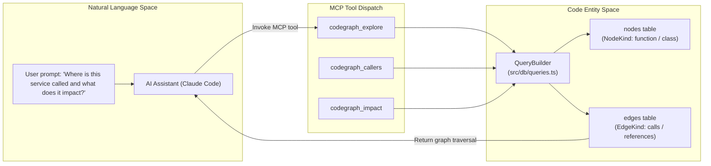

Sources: [src/mcp/tools.ts:1-100](), [src/db/queries.ts:1-100]()

### Diagram: Concrete Symbol Resolution and Traversal

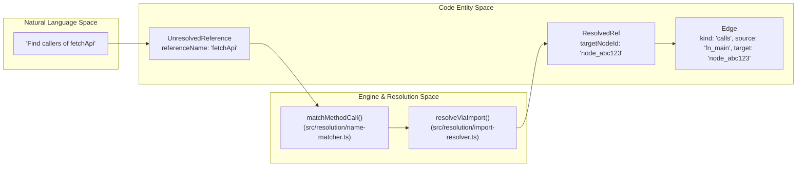

Sources: [src/resolution/name-matcher.ts:60-123](), [src/resolution/import-resolver.ts:1-45](), [src/resolution/index.ts:24-50]()

---

# Page: Getting Started

# Getting Started

<details>
<summary>Relevant source files</summary>

The following files were used as context for generating this wiki page:

- [CLAUDE.md](CLAUDE.md)
- [README.md](README.md)
- [__tests__/installer.test.ts](__tests__/installer.test.ts)
- [package-lock.json](package-lock.json)
- [package.json](package.json)
- [site/src/content/docs/core-concepts/how-it-works.md](site/src/content/docs/core-concepts/how-it-works.md)
- [site/src/content/docs/core-concepts/resolution.md](site/src/content/docs/core-concepts/resolution.md)
- [site/src/content/docs/getting-started/installation.md](site/src/content/docs/getting-started/installation.md)
- [site/src/content/docs/getting-started/introduction.md](site/src/content/docs/getting-started/introduction.md)
- [site/src/content/docs/getting-started/quickstart.md](site/src/content/docs/getting-started/quickstart.md)
- [site/src/content/docs/getting-started/your-first-graph.md](site/src/content/docs/getting-started/your-first-graph.md)
- [site/src/content/docs/guides/framework-routes.md](site/src/content/docs/guides/framework-routes.md)
- [site/src/content/docs/guides/indexing.md](site/src/content/docs/guides/indexing.md)
- [site/src/content/docs/reference/api.md](site/src/content/docs/reference/api.md)
- [site/src/content/docs/reference/integrations.md](site/src/content/docs/reference/integrations.md)
- [site/src/content/docs/reference/mcp-server.md](site/src/content/docs/reference/mcp-server.md)
- [src/bin/codegraph.ts](src/bin/codegraph.ts)
- [src/installer/config-writer.ts](src/installer/config-writer.ts)
- [src/installer/index.ts](src/installer/index.ts)
- [src/mcp/tools.ts](src/mcp/tools.ts)

</details>


This page guides you through initial setup and basic usage of CodeGraph, serving as an entry point to the ecosystem. CodeGraph provides a local-first code intelligence system designed to expose structural AST knowledge to AI assistants via the Model Context Protocol (MCP) [site/src/content/docs/getting-started/introduction.md:1-7]().

For a detailed walkthrough of the interactive installer and supported agent targets, see [Installation](#2.1). For common workflows such as initialization, indexing, and queries, see [Quick Start Guide](#2.2). For configuration options and directory structures, see [Configuration](#2.3).

---

## Overview of Setup Flow

CodeGraph setup connects your AI agent environment (Natural Language Space) to the local knowledge graph database and configuration files (Code Entity Space). 

### System Initialization and Agent Wiring

```mermaid
graph TD
    subgraph "NaturalLanguageSpace"
        User["UserPrompt"]
        AgentTarget["AgentTargetClaudeCursorCodex"]
    end

    subgraph "CodeEntitySpace"
        CLI["codegraphCLI"]
        Installer["src/installer/index.ts"]
        DB[".codegraph/codegraph.db"]
        Config[".codegraph/config.json"]
        McpConfig["AgentConfig/.mcp.json"]
    end

    User -->| "codegraph install" | Installer
    Installer -->| "writeMcpEntry" | McpConfig
    CLI -->| "codegraph init" | DB
    CLI -->| "codegraph init" | Config
    AgentTarget -->| "spawn serve --mcp" | DB
```
Sources: [src/installer/index.ts:1-14](), [src/installer/config-writer.ts:34-40]()

---

## Runtime Query and Search Flow

When an agent interacts with CodeGraph during a task, requests flow from Natural Language Space down through the MCP tools layer into the Code Entity Space knowledge graph and SQLite database.

### Agent Query Execution Model

```mermaid
graph TD
    subgraph "NaturalLanguageSpace"
        AgentPrompt["AgentQueryTask"]
        ToolCall["codegraph_explore"]
    end

    subgraph "CodeEntitySpace"
        MCPHandler["src/mcp/tools.ts"]
        CodeGraphFacade["CodeGraph"]
        QueryPool["QueryPool"]
        SqliteDB["SQLiteDatabase"]
    end

    AgentPrompt -->| "invokes" | ToolCall
    ToolCall -->| "dispatches" | MCPHandler
    MCPHandler -->| "queries" | CodeGraphFacade
    CodeGraphFacade -->| "executes" | QueryPool
    QueryPool -->| "reads" | SqliteDB
```
Sources: [src/mcp/tools.ts:1-25](), [package.json:1-10]()

---

## 2.1 Installation

The installation subsystem uses an interactive installer via `runInstallerWithOptions` to configure global or project-local MCP server integrations [src/installer/index.ts:11-14](). CodeGraph supports a wide array of agent targets through the `AgentTarget` registry, including Claude Code, Cursor, Codex CLI, opencode, Hermes Agent, Gemini CLI, Kiro, Antigravity IDE, and GitHub Copilot (VS Code, CLI, and JetBrains) [README.md:9-39](), [src/installer/index.ts:16-25]().

For detailed walkthroughs covering global vs. local installation scopes, auto-allow permissions, hook configurations, and specific target requirements, see [Installation](#2.1).

Sources: [src/installer/index.ts:11-14](), [README.md:9-39]()

---

## 2.2 Quick Start Guide

Once the CLI is installed and your agent is wired, initializing a project builds the underlying SQLite knowledge graph [site/src/content/docs/guides/indexing.md:6-14](). Running `codegraph init` creates the `.codegraph/` directory and indexes all supported files in a single step [site/src/content/docs/guides/indexing.md:10-13](). During agent sessions, the built-in file watcher and auto-sync policies keep the index fresh without requiring manual intervention [site/src/content/docs/guides/indexing.md:25-41]().

For step-by-step workflows on running your first index, executing queries, and using CodeGraph with Claude Code, see [Quick Start Guide](#2.2).

Sources: [site/src/content/docs/guides/indexing.md:6-41]()

---

## 2.3 Configuration

CodeGraph project behavior is governed by configuration files stored inside the `.codegraph/` directory [site/src/content/docs/getting-started/introduction.md:1-34](). The configuration system handles file exclusion patterns, language-specific parsing rules, deprioritized paths, and multi-repo workspace settings.

For full details on `.codegraph` directory structures, `config.json` parameters, and integration files, see [Configuration](#2.3).

Sources: [site/src/content/docs/getting-started/introduction.md:1-34]()

---

# Page: Installation

# Installation

<details>
<summary>Relevant source files</summary>

The following files were used as context for generating this wiki page:

- [CLAUDE.md](CLAUDE.md)
- [README.md](README.md)
- [__tests__/install-sh-prune.test.ts](__tests__/install-sh-prune.test.ts)
- [__tests__/installer-links-simulated.test.ts](__tests__/installer-links-simulated.test.ts)
- [__tests__/installer-targets.test.ts](__tests__/installer-targets.test.ts)
- [__tests__/installer.test.ts](__tests__/installer.test.ts)
- [__tests__/upgrade.test.ts](__tests__/upgrade.test.ts)
- [install.ps1](install.ps1)
- [install.sh](install.sh)
- [package-lock.json](package-lock.json)
- [package.json](package.json)
- [src/bin/codegraph.ts](src/bin/codegraph.ts)
- [src/installer/config-writer.ts](src/installer/config-writer.ts)
- [src/installer/index.ts](src/installer/index.ts)
- [src/installer/targets/claude.ts](src/installer/targets/claude.ts)
- [src/installer/targets/codex.ts](src/installer/targets/codex.ts)
- [src/installer/targets/copilot-cli.ts](src/installer/targets/copilot-cli.ts)
- [src/installer/targets/copilot-jetbrains.ts](src/installer/targets/copilot-jetbrains.ts)
- [src/installer/targets/copilot-vscode.ts](src/installer/targets/copilot-vscode.ts)
- [src/installer/targets/cursor.ts](src/installer/targets/cursor.ts)
- [src/installer/targets/hermes.ts](src/installer/targets/hermes.ts)
- [src/installer/targets/kiro.ts](src/installer/targets/kiro.ts)
- [src/installer/targets/registry.ts](src/installer/targets/registry.ts)
- [src/installer/targets/shared.ts](src/installer/targets/shared.ts)
- [src/installer/targets/toml.ts](src/installer/targets/toml.ts)
- [src/installer/targets/types.ts](src/installer/targets/types.ts)
- [src/mcp/tools.ts](src/mcp/tools.ts)
- [src/upgrade/index.ts](src/upgrade/index.ts)

</details>


## Purpose and Scope

This page provides a technical walkthrough of installing and configuring CodeGraph for use with AI code assistants. It covers the interactive installer (`runInstallerWithOptions()` in [src/installer/index.ts:86-210]()), the multi-target architecture (`AgentTarget` interface in [src/installer/targets/types.ts:80-120]()), global vs. local installation scopes, auto-allow permission configurations, and hook setup. Supported target systems include Claude Code, Cursor, Codex CLI, opencode, Hermes, Gemini CLI, Kiro, Antigravity IDE, and GitHub Copilot (VS Code, CLI, JetBrains) [README.md:9-10]().

---

## Installation Overview

CodeGraph operates via a thin-installer pattern. The primary package `@colbymchenry/codegraph` acts as a CLI shim [package.json:11-13]() that delegates execution to a precompiled runtime environment complete with `node:sqlite` and extraction kernel assets [package.json:27-27](). 

Installation involves the following architectural phases:
1. **CLI Provisioning**: Installing the executable on the system `PATH` via `npm install -g` [src/installer/index.ts:117-123]() or standalone shell scripts [__tests__/installer-targets.test.ts:38-72]().
2. **Target Resolution**: Detecting and selecting agent targets via `resolveTargetFlag()` and `getTarget()` [src/installer/index.ts:99-99](), [src/installer/targets/registry.ts]().
3. **Scope Determination**: Selecting between `global` (user-wide configuration directories) and `local` (project-scoped `.mcp.json` or equivalent) [src/installer/index.ts:133-162]().
4. **Configuration & Permission Writing**: Invoking `target.install()` to write MCP server declarations, instructions blocks, and permission wildcards [src/installer/targets/types.ts:80-120]().

Sources: [src/installer/index.ts:86-183](), [src/installer/targets/types.ts:80-120](), [package.json:11-27]()

---

## Interactive Installer Workflow

The interactive setup is driven by `runInstallerWithOptions()` inside [src/installer/index.ts:86](), leveraging `@clack/prompts` for the terminal UI [src/installer/index.ts:87]().

### Interactive Installer Execution Map

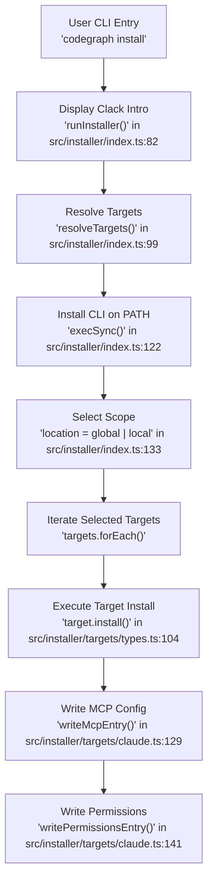

Sources: [src/installer/index.ts:82-174](), [src/installer/targets/claude.ts:125-143](), [src/installer/targets/types.ts:80-120]()

---

## Supported Agent Targets

CodeGraph implements the `AgentTarget` abstraction [src/installer/targets/types.ts:80-120]() to support multiple AI assistants without duplicating configuration plumbing. 

### Target Configuration Table

| Agent Target | Target ID | Primary Config Path | Scope Support |
| :--- | :--- | :--- | :--- |
| **Claude Code** | `claude` | `~/.claude.json` / `./.mcp.json` | Global & Local [src/installer/targets/claude.ts:74-84]() |
| **Cursor** | `cursor` | `~/.cursor/mcp.json` / `./.cursor/mcp.json` | Global & Local |
| **Codex CLI** | `codex` | `$CODEX_HOME/config.toml` / `.codex/config.toml` | Global & Local [src/installer/targets/codex.ts:52-79]() |
| **opencode** | `opencode` | `~/.config/opencode/opencode.jsonc` | Global & Local |
| **Hermes Agent** | `hermes` | Hermes config directory | Global & Local |
| **Gemini CLI** | `gemini` | Gemini MCP config path | Global & Local |
| **Kiro** | `kiro` | Kiro configuration file | Global & Local |
| **Antigravity IDE** | `antigravity` | Antigravity settings path | Global & Local |
| **VS Code (Copilot)** | `copilot-vscode` | `mcp.json` in VS Code User Dir | Global & Local [src/installer/targets/copilot-vscode.ts:80-98]() |
| **GitHub Copilot CLI** | `copilot-cli` | Copilot CLI configuration | Global Only |
| **JetBrains (Copilot)** | `copilot-jetbrains` | JetBrains application directory | Global Only |

### Target Implementation Details
- **Claude Code**: Manages user-scope (`~/.claude.json`) or project-scope (`./.mcp.json`) files [src/installer/targets/claude.ts:74-84](). Automatically migrates legacy `./.claude.json` entries [src/installer/targets/claude.ts:18-20]() and configures auto-allow permissions in `settings.json` [src/installer/targets/claude.ts:139-141]().
- **Codex CLI**: Employs a narrow TOML builder (`upsertTomlTable`) to inject `[mcp_servers.codegraph]` tables into `config.toml` [__tests__/installer-targets.test.ts:25-25]().
- **VS Code (Copilot Chat)**: Writes to `.vscode/mcp.json` locally (pinning absolute `--path` via `buildVscodeServerEntry()`) and user-level `mcp.json` globally (omitting `--path` to prevent workspace resolution errors) [src/installer/targets/copilot-vscode.ts:80-98]().

Sources: [src/installer/targets/types.ts:22-120](), [src/installer/targets/claude.ts:74-141](), [src/installer/targets/copilot-vscode.ts:80-98](), [__tests__/installer-targets.test.ts:25-25]()

---

## Critical Runtime Requirements & WASM Flags

CodeGraph parses code using Tree-sitter WebAssembly modules. On Node.js versions >= 25, V8's Turboshaft optimizing compiler can trigger a fatal Zone out-of-memory exception during grammar parsing [src/bin/codegraph.ts:111-119]().

### Runtime Flag Enforcement Architecture

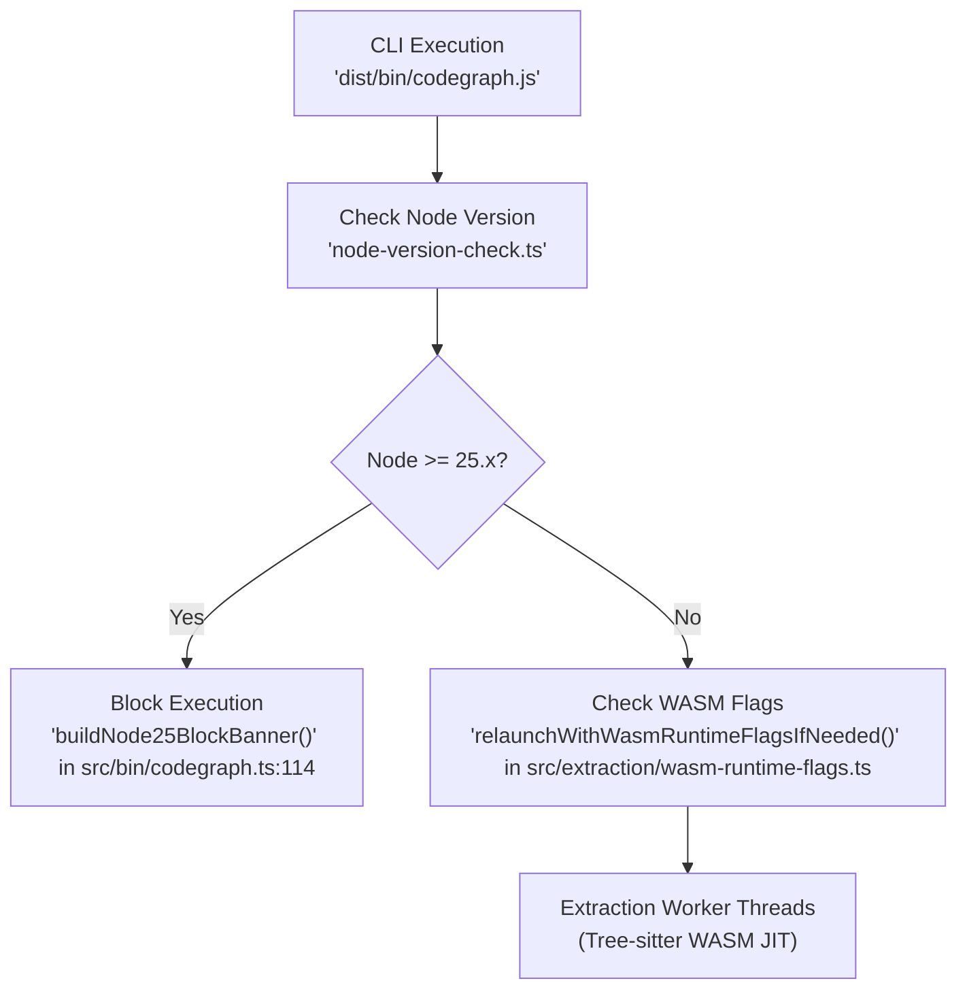

Sources: [src/bin/codegraph.ts:111-131](), [src/extraction/wasm-runtime-flags.ts]()

---

## Hook Configuration

When initializing inside a repository, the installer configures automated synchronization hooks [src/installer/index.ts:28-30]().

- **Git Sync Hooks**: Managed via `installGitSyncHook()` [src/installer/index.ts:30]() to maintain graph freshness across branch switches.
- **Hook Cleanup**: Upgrades automatically remove deprecated hooks (such as legacy `sync-if-dirty` hooks) to prevent runtime invocation failures [src/installer/targets/claude.ts:147-151]().
- **Prompt Hooks**: For Claude Code, an optional `UserPromptSubmit` prompt hook can be installed to inject structural context via `codegraph_explore` [src/installer/targets/claude.ts:157-158](), [src/installer/targets/types.ts:72-78]().

Sources: [src/installer/index.ts:28-30](), [src/installer/targets/claude.ts:147-162](), [src/installer/targets/types.ts:72-78]()

---

## Upgrading and Uninstallation

### Upgrading
CodeGraph supports self-upgrading through the `codegraph upgrade` command [src/bin/codegraph.ts:24-24](). 
- **Detection**: Identifies installation origin (npm package, standalone bundle, or source repository) via path inspection [src/upgrade/index.ts:109-144]().
- **Bundle Execution**: Standalone bundle upgrades re-fetch and execute `install.sh` or `install.ps1` to update vendored binaries in place [src/upgrade/index.ts:35-39]().
- **Windows File Locks**: On Windows platforms, upgrade routines spawn a detached child process to bypass file locks on `node.exe` [src/upgrade/index.ts:20-27]().

### Uninstallation
- **Target Rollback**: Each `AgentTarget` implements an `uninstall(location)` method that surgically removes CodeGraph entries while leaving sibling server configurations intact [src/installer/targets/types.ts:80-120]().
- **Permission Cleanup**: Strips `mcp__codegraph__*` permission wildcards from agent settings files [src/installer/targets/claude.ts:173-180]().

Sources: [src/bin/codegraph.ts:24-24](), [src/upgrade/index.ts:16-39](), [src/installer/targets/types.ts:80-120](), [src/installer/targets/claude.ts:173-180]()

---

# Page: Quick Start Guide

# Quick Start Guide

<details>
<summary>Relevant source files</summary>

The following files were used as context for generating this wiki page:

- [__tests__/cli-ui-command.test.ts](__tests__/cli-ui-command.test.ts)
- [__tests__/viewer-gate.test.ts](__tests__/viewer-gate.test.ts)
- [assets/codegraph-ui-symbol-view.png](assets/codegraph-ui-symbol-view.png)
- [site/astro.config.mjs](site/astro.config.mjs)
- [site/src/content/docs/core-concepts/how-it-works.md](site/src/content/docs/core-concepts/how-it-works.md)
- [site/src/content/docs/core-concepts/resolution.md](site/src/content/docs/core-concepts/resolution.md)
- [site/src/content/docs/getting-started/installation.md](site/src/content/docs/getting-started/installation.md)
- [site/src/content/docs/getting-started/introduction.md](site/src/content/docs/getting-started/introduction.md)
- [site/src/content/docs/getting-started/next-steps.md](site/src/content/docs/getting-started/next-steps.md)
- [site/src/content/docs/getting-started/quickstart.md](site/src/content/docs/getting-started/quickstart.md)
- [site/src/content/docs/getting-started/your-first-graph.md](site/src/content/docs/getting-started/your-first-graph.md)
- [site/src/content/docs/guides/framework-routes.md](site/src/content/docs/guides/framework-routes.md)
- [site/src/content/docs/guides/indexing.md](site/src/content/docs/guides/indexing.md)
- [site/src/content/docs/reference/api.md](site/src/content/docs/reference/api.md)
- [site/src/content/docs/reference/cli.md](site/src/content/docs/reference/cli.md)
- [site/src/content/docs/reference/integrations.md](site/src/content/docs/reference/integrations.md)
- [site/src/content/docs/reference/mcp-server.md](site/src/content/docs/reference/mcp-server.md)
- [src/bin/command-supervision.ts](src/bin/command-supervision.ts)
- [src/bin/viewer-gate.ts](src/bin/viewer-gate.ts)

</details>


This page covers the technical workflows required to initialize projects, execute indexing pipelines, run fundamental queries, and integrate with AI agents like Claude Code via the Model Context Protocol (MCP). It assumes installation is complete [site/src/content/docs/getting-started/installation.md:6-21]().

For deeper architectural context, see [System Architecture Overview](6.1); for configuration parameters, see [Configuration](2.3).

Sources: [site/src/content/docs/getting-started/installation.md:6-21]()

---

## Project Initialization (`codegraph init`)

To attach CodeGraph to a target codebase, the project directory must be initialized. This creates the local `.codegraph/` workspace storing the SQLite database, locks, and indexing metadata [site/src/content/docs/getting-started/quickstart.md:32-37]().

The CLI command `codegraph init` executes project detection, directory creation, and triggers the initial indexing pass synchronously [site/src/content/docs/guides/indexing.md:9-13](). Programmatically, this is handled through the `CodeGraph` facade [site/src/content/docs/reference/api.md:11-17]() and extraction routines [src/extraction/index.ts:41-124]().

### Diagram: Initialization and Extraction Data Flow

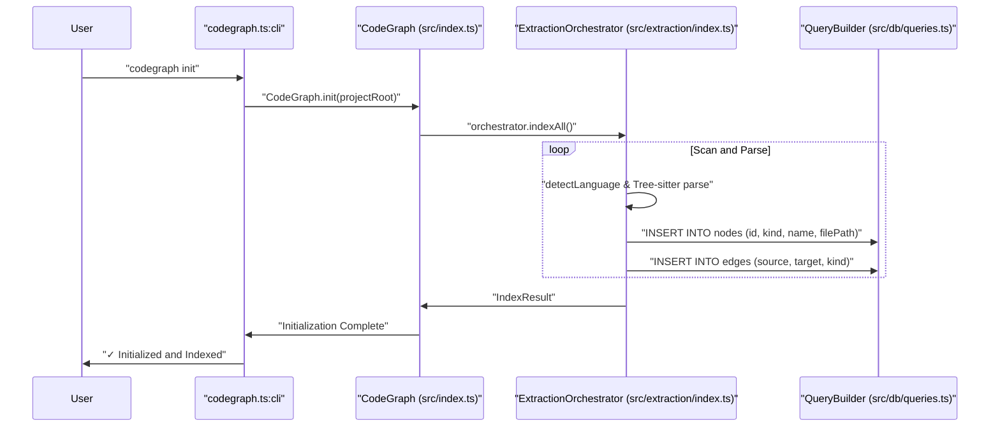

Sources: [site/src/content/docs/getting-started/quickstart.md:32-37](), [site/src/content/docs/guides/indexing.md:9-13](), [site/src/content/docs/reference/api.md:11-17](), [src/extraction/index.ts:41-124]()

---

## Indexing & Incremental Synchronization

CodeGraph manages project state through distinct indexing modes managed by `ExtractionOrchestrator` [src/extraction/index.ts:41-152]().

### Full vs. Incremental Indexing

| Command | Action | Implementation / Target |
|---------|--------|-------------------------|
| `codegraph index` | Full Index | Re-scans all files, re-parses sources, and updates nodes/edges [site/src/content/docs/guides/indexing.md:18]() |
| `codegraph index --force` | Force Re-index | Drops existing tables, clears caches, and rebuilds from scratch [site/src/content/docs/guides/indexing.md:19]() |
| `codegraph sync` | Incremental Sync | Reconciles filesystem diffs (`modifiedAt`, `size`, content hashes) and updates only changed files [src/extraction/index.ts:129-152](), [site/src/content/docs/guides/indexing.md:20]() |

### Auto-Sync with File Watcher

When running under an agent process via `codegraph serve --mcp`, a native file watcher monitors the project root [site/src/content/docs/guides/indexing.md:27-35](). 
1. **Event Capture:** File modifications trigger event delivery [site/src/content/docs/guides/indexing.md:33-35]().
2. **Debounce Windows:** Bursts of edits are coalesced by a configurable debounce timer (default `2000ms`, tunable via `CODEGRAPH_WATCH_DEBOUNCE_MS`) [site/src/content/docs/guides/indexing.md:36-41]().
3. **Staleness Banners:** During the debounce window, any MCP tool response referencing stale files prepends a warning banner, forcing direct file reads if necessary [site/src/content/docs/guides/indexing.md:45-58]().

Sources: [src/extraction/index.ts:41-152](), [site/src/content/docs/guides/indexing.md:15-89]()

---

## CLI Query Operations & Natural Language Translation

Once indexed, developers and scripts can query the graph directly from the command line interface [site/src/content/docs/reference/cli.md:17-23]().

* **Symbol Search:** `codegraph query "<search>"` executes FTS5 full-text search combined with identifier segment matching [site/src/content/docs/reference/cli.md:17]().
* **Call Graphs:** `codegraph callers "<symbol>"` and `codegraph callees "<symbol>"` leverage graph traversal to trace inbound and outbound references [site/src/content/docs/reference/cli.md:21-22]().
* **Impact Analysis:** `codegraph impact "<symbol>"` analyzes downstream dependency disruption caused by modifying a specific code entity [site/src/content/docs/reference/cli.md:23]().

### Diagram: CLI Query Natural Language Space to Code Entity Space

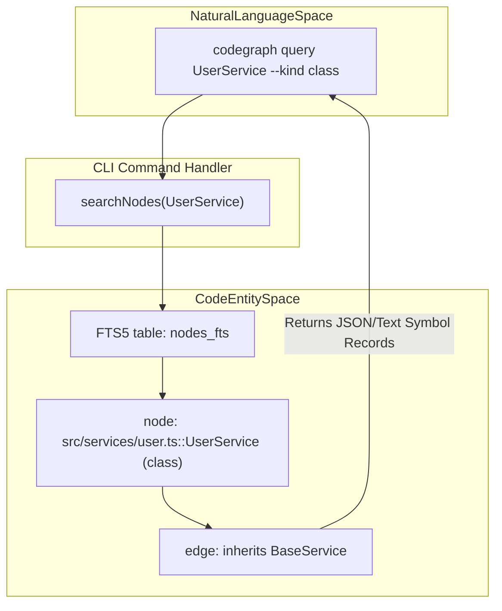

Sources: [site/src/content/docs/reference/cli.md:17-23](), [site/src/content/docs/reference/api.md:19-26]()

---

## Agent Integration & MCP Workflows

CodeGraph exposes semantic code intelligence to AI agents (such as Claude Code, Cursor, and Codex) through the Model Context Protocol (MCP) server [site/src/content/docs/getting-started/introduction.md:6-8]().

### Diagram: MCP Natural Language to Code Entity Space

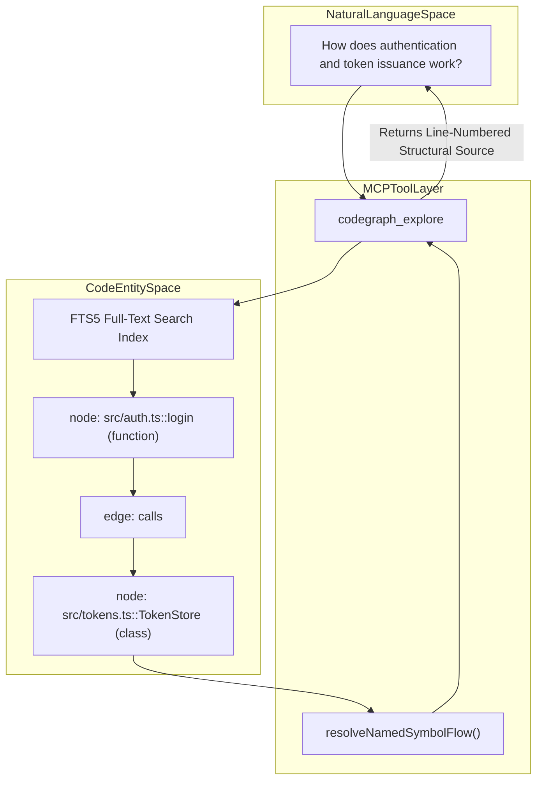

Sources: [site/src/content/docs/getting-started/introduction.md:6-28](), [site/src/content/docs/reference/mcp-server.md:6-18]()

### The `codegraph_explore` Tool

The primary MCP tool, `codegraph_explore`, abstracts complex multi-file lookups into a single call. It evaluates natural language intents, resolves symbol identifiers, traverses relevant edges (`calls`, `imports`, `extends`), and formats surgical, line-numbered source extractions for the agent context window [site/src/content/docs/reference/mcp-server.md:14-18]().

Sources: [site/src/content/docs/reference/mcp-server.md:14-46]()

---

## Maintenance: Upgrading and Uninitializing

* **Upgrading:** Execute `codegraph upgrade` to check for and apply in-place updates based on the original installation vector [site/src/content/docs/reference/cli.md:27]().
* **Uninitializing:** Execute `codegraph uninit` to purge the local `.codegraph/` directory and SQLite database files without altering global agent configurations [site/src/content/docs/reference/cli.md:11](), [site/src/content/docs/getting-started/installation.md:62-70]().

Sources: [site/src/content/docs/reference/cli.md:11](), [site/src/content/docs/reference/cli.md:27](), [site/src/content/docs/getting-started/installation.md:62-70]()

---

# Page: Configuration

# Configuration

<details>
<summary>Relevant source files</summary>

The following files were used as context for generating this wiki page:

- [__tests__/deprioritize-config.test.ts](__tests__/deprioritize-config.test.ts)
- [__tests__/frontload-hook.test.ts](__tests__/frontload-hook.test.ts)
- [__tests__/include-config.test.ts](__tests__/include-config.test.ts)
- [__tests__/include-ignored-config.test.ts](__tests__/include-ignored-config.test.ts)
- [__tests__/js-local-binding-backtracking.test.ts](__tests__/js-local-binding-backtracking.test.ts)
- [__tests__/jsx-child-disambiguation.test.ts](__tests__/jsx-child-disambiguation.test.ts)
- [__tests__/jsx-render-work.test.ts](__tests__/jsx-render-work.test.ts)
- [__tests__/mcp-unindexed.test.ts](__tests__/mcp-unindexed.test.ts)
- [__tests__/multi-repo-workspace.test.ts](__tests__/multi-repo-workspace.test.ts)
- [__tests__/react-router-lazy-barrel.test.ts](__tests__/react-router-lazy-barrel.test.ts)
- [__tests__/schemaless-db-not-initialized.test.ts](__tests__/schemaless-db-not-initialized.test.ts)
- [__tests__/src-build-folders.test.ts](__tests__/src-build-folders.test.ts)
- [__tests__/sync-jsx-import-forwarding.test.ts](__tests__/sync-jsx-import-forwarding.test.ts)
- [__tests__/sync-lazy-route-value.test.ts](__tests__/sync-lazy-route-value.test.ts)
- [site/src/content/docs/getting-started/configuration.md](site/src/content/docs/getting-started/configuration.md)
- [src/db/index.ts](src/db/index.ts)
- [src/directory.ts](src/directory.ts)
- [src/project-config.ts](src/project-config.ts)
- [src/resolution/jsx-code.ts](src/resolution/jsx-code.ts)

</details>


## Purpose and Scope

This page documents the configuration architecture of CodeGraph, detailing how project environments are structured, how zero-config defaults operate, and how optional overrides in `codegraph.json` customize extraction, file filtering, search ranking, and multi-repo workspace composition [src/directory.ts:4-5](), [src/project-config.ts:3-11]().

---

## The `.codegraph` Directory Structure and Environment Isolation

When a project is initialized, CodeGraph creates a local metadata and database directory [src/directory.ts:4-5](). By default, this directory is named `.codegraph`, but it can be overridden via the `CODEGRAPH_DIR` environment variable to support concurrent multi-environment setups (such as Windows-native and WSL sharing a single working tree) [src/directory.ts:25-35]().

### Directory Layout and Implementation

The data directory isolates SQLite database storage, transaction logs, shared memory segments, and daemon lock files from version control [src/directory.ts:187-191](). The active directory name is resolved dynamically by `codeGraphDirName()` and `codeGraphDirNameFor(projectRoot)`, which handle WSL/Windows boundary isolation by falling back to `.codegraph-wsl` when necessary [src/directory.ts:44-65](), [src/directory.ts:107-116](). Initialization state is validated through `isInitialized()`, ensuring that `codegraph.db` exists and carries a valid schema rather than being an empty stub [src/directory.ts:142-156]().

Title: Directory Resolution and Initialization Architecture
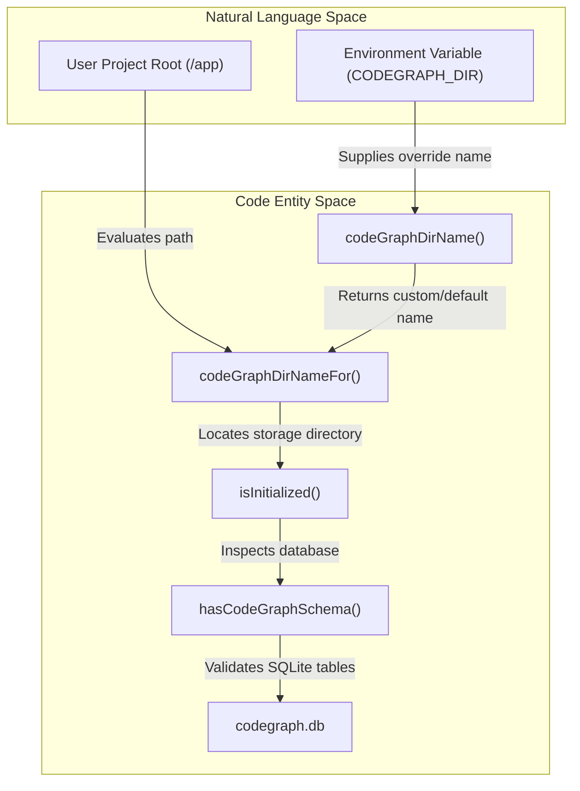
Sources: [src/directory.ts:44-65](), [src/directory.ts:107-116](), [src/directory.ts:142-156]()

| File / Artifact | Purpose | Version Control Status |
|-----------------|---------|------------------------|
| `codegraph.db` | Primary SQLite database storing nodes, edges, and symbol tables [src/directory.ts:99-101]() | Ignored |
| `codegraph.db-wal` | Write-Ahead Log for concurrent read/write access and transactional safety [src/db/index.ts:36-36]() | Ignored |
| `codegraph.db-shm` | Shared memory file for SQLite cache coordination | Ignored |
| `daemon.pid` | Lockfile containing process ID and communication socket metadata [src/directory.ts:23-27]() | Ignored |

Sources: [src/directory.ts:25-35](), [src/db/index.ts:33-48]()

---

## Project-Scoped Configuration (`codegraph.json`)

Projects requiring custom extensions, explicit pruning, or specialized whitelisting can commit an optional `codegraph.json` file at the project root [src/project-config.ts:3-11](). The configuration parser (`parseConfig()`) reads and validates this file, caching parsed values using file modification times (`mtimeMs`) via `cache` to prevent redundant disk reads during hot-path operations like incremental syncs and file watching [src/project-config.ts:96-107](), [src/project-config.ts:144-161]().

### Configuration Interface (`ProjectConfig`)

The `ProjectConfig` interface defines all supported configuration properties [src/project-config.ts:34-85]().

```typescript
export interface ProjectConfig {
  extensions?: Record<string, string>;
  includeIgnored?: string[];
  exclude?: string[];
  include?: string[];
  deprioritize?: string[];
}
```

### Custom File Extensions
For non-standard file extensions mapped to supported languages (e.g., `.dota_lua` for Lua), the `extensions` dictionary overrides or extends built-in language detection rules [src/project-config.ts:9-17](). Invalid or malformed extension keys are normalized via `normalizeExtKey()` and safely ignored without failing extraction [src/project-config.ts:128-137](), [src/project-config.ts:20-24]().

```json
{
  "extensions": {
    ".dota_lua": "lua",
    ".tpl": "php"
  }
}
```

Sources: [src/project-config.ts:3-85](), [src/project-config.ts:128-161]()

---

## File Filtering, Inclusion, Exclusion, and Deprioritization Rules

CodeGraph employs strict filtering layers to ensure that extracted graphs contain application code rather than third-party dependencies, build output, or framework noise [site/src/content/docs/getting-started/configuration.md:8-13]().

### Filtering Precedence

1. **Built-in Skips**: Automatically ignores directories like `node_modules`, `vendor`, `dist`, `build`, `target`, and `.venv` [site/src/content/docs/getting-started/configuration.md:10-10]().
2. **Size Thresholds**: Skips files larger than 1 MB, such as minified bundles or binary assets [site/src/content/docs/getting-started/configuration.md:12-12]().
3. **Gitignore Rules**: Honored via `git ls-files` or by directly parsing `.gitignore` trees through `buildScopeIgnore()` and `buildDefaultIgnore()` [site/src/content/docs/getting-started/configuration.md:11-11](), [__tests__/src-build-folders.test.ts:120-123]().
4. **Explicit Exclusions (`exclude`)**: Gitignore-style patterns in `codegraph.json` take precedence over all other discovery rules, dropping committed directories (like vendored themes) from the index [src/project-config.ts:45-55]().
5. **Whitelisting (`include` / `includeIgnored`)**: Bypasses gitignore restrictions for alternative VCS sources (`include`) or nested repository super-projects (`includeIgnored`) [src/project-config.ts:56-69](), [__tests__/multi-repo-workspace.test.ts:6-22]().
6. **Deprioritization (`deprioritize`)**: Keeps helper, script, or fixture files findable while demoting their ranking so they do not outrank first-party code [src/project-config.ts:70-84]().

Title: Filtering and Configuration Pipeline
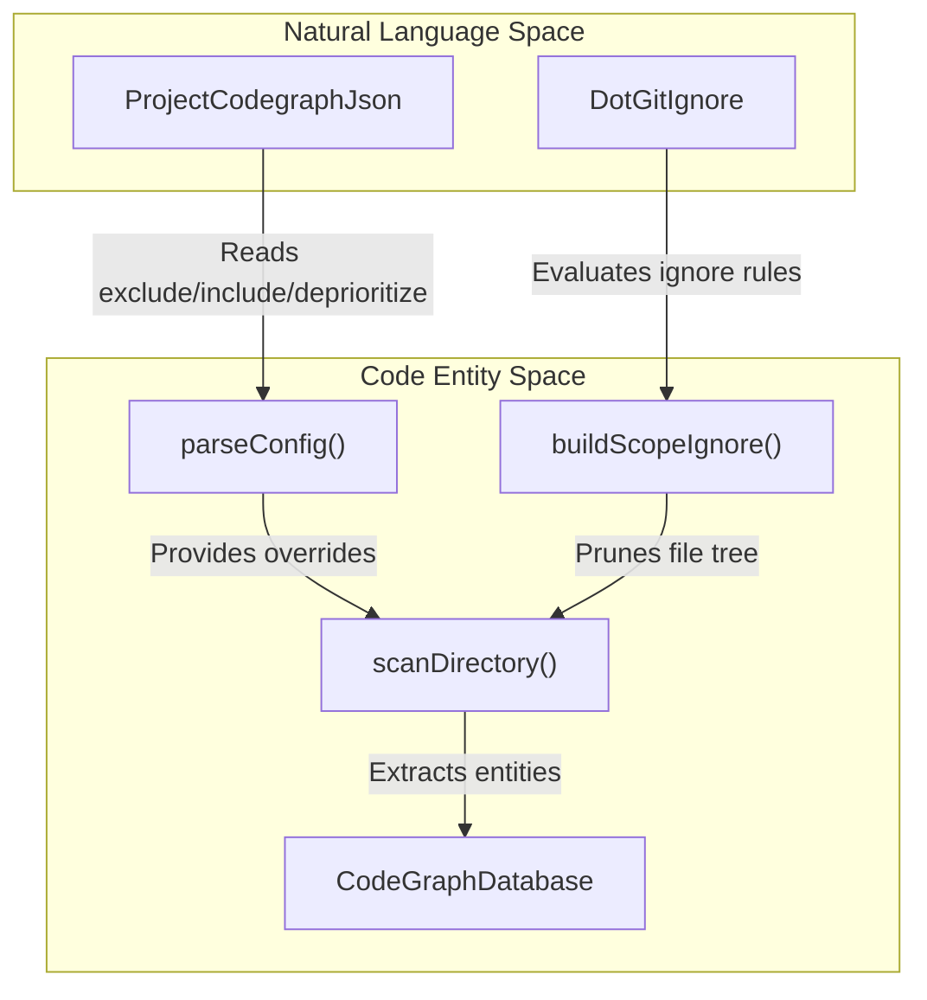
Sources: [src/project-config.ts:34-85](), [__tests__/multi-repo-workspace.test.ts:23-31](), [site/src/content/docs/getting-started/configuration.md:8-13]()

---

## Multi-Repo Workspaces and Nested Git Repositories

By default, `.gitignore` hides nested git repositories within ignored parent directories [__tests__/multi-repo-workspace.test.ts:6-22](). To index workspaces containing multiple independent repositories (super-repos), projects configure `includeIgnored` in `codegraph.json` [src/project-config.ts:37-44](). Functions such as `discoverEmbeddedRepoRoots()` and `findUnindexedIgnoredRepos()` scan and validate opted-in sub-paths [__tests__/multi-repo-workspace.test.ts:29-31]().

Sources: [src/project-config.ts:37-44](), [__tests__/multi-repo-workspace.test.ts:6-22]()

---

## Claude Integration and Agent Files

CodeGraph writes integration blocks into agent instruction files (such as `CLAUDE.md`, `AGENTS.md`, or custom targets) using delimiter fences [src/installer/instructions-template.ts:28-30](). These instructions ensure AI assistants query the knowledge graph via MCP tools rather than executing raw string searches like `grep` or `find`.

```markdown
<!-- CODEGRAPH_START -->
## CodeGraph
In repositories indexed by CodeGraph, use codegraph_explore and related tools before executing raw grep or find commands.
<!-- CODEGRAPH_END -->
```

Sources: [src/installer/instructions-template.ts:10-30](), [src/installer/instructions-template.ts:42-51]()

---

# Page: Core Concepts

# Core Concepts

<details>
<summary>Relevant source files</summary>

The following files were used as context for generating this wiki page:

- [.claude/skills/agent-eval/corpus.json](.claude/skills/agent-eval/corpus.json)
- [src/extraction/grammars.ts](src/extraction/grammars.ts)
- [src/extraction/languages/index.ts](src/extraction/languages/index.ts)
- [src/types.ts](src/types.ts)

</details>


This page explains the fundamental principles underlying CodeGraph's knowledge graph approach. It introduces the core abstractions—nodes, edges, and the graph model—and describes how source code is transformed into a queryable graph structure.

For detailed graph model semantics, see [Knowledge Graph Model](#3.1). For specific language support details, see [Supported Languages](#3.2). For database schema and storage implementation, see [Project Structure and Database](#3.3).

---

## Code Represented as a Knowledge Graph

CodeGraph transforms source code into a **directed graph** where code symbols are nodes and relationships between them are edges. This representation enables structural queries that would be difficult with text-based tools.

### Natural Language to Code Entity Mapping

To bridge high-level intent with concrete implementation, CodeGraph translates natural language queries into traversals over specific code entities defined in the codebase, such as `ExtractionOrchestrator` [src/extraction/index.ts:37-37]() and `CodeGraph` [src/index.ts:149-149]().

Title: "CodeGraph Knowledge Graph Bridging Natural Language to Code Entities"
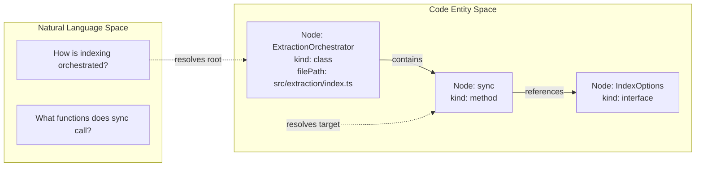

Sources: [src/types.ts:22-46](), [src/types.ts:57-72](), [src/types.ts:132-201](), [src/extraction/index.ts:37-37](), [src/index.ts:149-149]()

This graph structure provides instant answers to questions that would require scanning multiple files with traditional text search:
- **Call graphs**: "What functions does `sync()` call?" [src/extraction/index.ts:111-133]()
- **Dependency analysis**: "What code depends on `QueryBuilder`?" [src/extraction/index.ts:23-23]()
- **Impact analysis**: "If I change `NodeKind`, what breaks?" [src/types.ts:48-48]()

The graph is stored in SQLite and queried using algorithms implemented in the core engine.

Sources: [src/db/queries.ts:216-218](), [src/types.ts:206-227]()

---

## Nodes: Code Symbols

A **node** represents a discrete code symbol—a function, class, method, variable, or other named entity extracted from source code. Each node has a unique ID, type classification, location information, and metadata.

### Node Structure

The `Node` interface defines the structure stored in the database:

Title: "Node Data Structure and Enumeration"
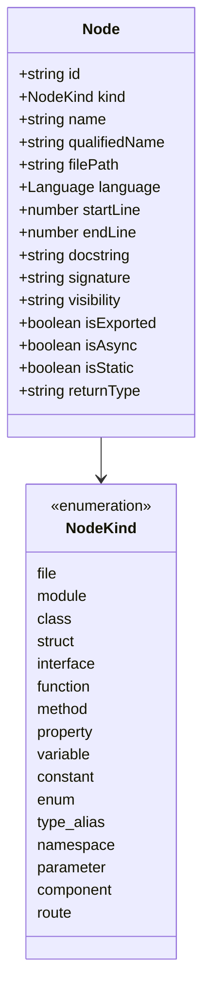

Sources: [src/types.ts:22-46](), [src/types.ts:132-201]()

### Node Kinds

The `NODE_KINDS` array defines all extractable symbol types [src/types.ts:22-46](). CodeGraph supports modern architectural patterns including UI components and HTTP routes.

| Kind | Description | Example Languages |
|------|-------------|-------------------|
| `function` | Top-level function | TypeScript, Python, Go, Rust |
| `method` | Class/struct method | Java, C#, Ruby, Swift |
| `class` | Class definition | TypeScript, Python, Java, C# |
| `struct` | Struct type | Go, Rust, C, Pascal |
| `interface` | Interface/trait/protocol | TypeScript, Java, Go, Rust |
| `property` | Class property/field | TypeScript, C#, Kotlin |
| `variable` | Module-level variable | All languages |
| `constant` | Const/final/immutable | Java `static final`, C# `const` |
| `enum` | Enumeration type | TypeScript, Rust, Java, C# |
| `type_alias` | Type alias/typedef | TypeScript, Rust, Kotlin |
| `namespace` | Namespace/package | C#, PHP, Pascal |
| `component` | UI component | React, Svelte, Vue |
| `route` | HTTP route handler | Express, Laravel, Django |

Sources: [src/types.ts:22-46]()

### Node Identity and Qualified Names

Each node has a deterministic `id` generated by hashing its `qualifiedName` and file path. The `qualifiedName` provides a hierarchical path to the symbol, such as `src/extraction/index.ts::ExtractionOrchestrator.sync`.

Sources: [src/types.ts:132-143](), [src/extraction/index.ts:138-140]()

---

## Edges: Relationships Between Symbols

An **edge** represents a directed relationship between two nodes. Edges capture how code symbols interact: function calls, inheritance, imports, containment, and type references.

### Edge Structure

The `Edge` interface defines relationships between nodes:

Title: "Edge Data Structure and Enumeration"
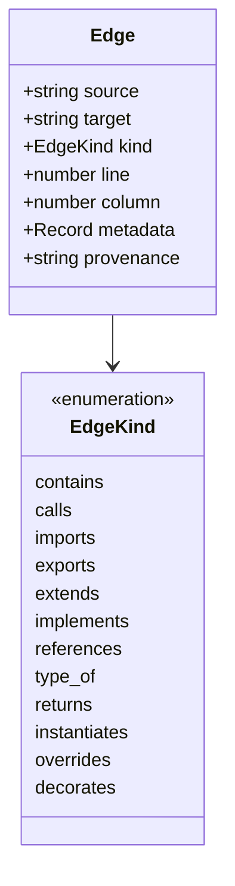

Sources: [src/types.ts:57-72](), [src/types.ts:206-227]()

### Edge Kinds

The `EDGE_KINDS` type enumerates all relationship types [src/types.ts:57-72]():

| Kind | Direction | Meaning | Example |
|------|-----------|---------|---------|
| `contains` | Parent → Child | Symbol contains another | File contains class, class contains method |
| `calls` | Caller → Callee | Function invocation | `sync()` calls `hashContent()` |
| `imports` | Importer → Imported | Module import | `index.ts` imports `detectLanguage` |
| `exports` | File → Symbol | Symbol exported | `index.ts` exports `ExtractionOrchestrator` |
| `extends` | Child → Parent | Class inheritance | `DatabaseError` extends `CodeGraphError` |
| `implements` | Class → Interface | Interface implementation | `SqliteDatabase` implements `DatabaseConnection` |
| `references` | User → Target | Generic reference | `index.ts` references `MAX_FILE_SIZE` |
| `type_of` | Value → Type | Type annotation | Parameter `options` has type `IndexOptions` |
| `returns` | Function → Type | Return type | `sync()` returns `SyncResult` |
| `instantiates` | Caller → Class | Object creation | `new Mutex()` |
| `overrides` | Child → Parent | Method override | Subclass overrides parent method |
| `decorates` | Decorator → Target | Decorator application | `@Injectable` on class |

Sources: [src/types.ts:57-72](), [src/extraction/index.ts:1-133]()

---

## The Data Transformation Pipeline

CodeGraph processes source code through a multi-phase pipeline involving discovery, parsing, and reference resolution.

### Task-Specific Context Bridging

When agents request task context or impact analysis, natural language intents are mapped to exact code entities using the following data flow:

Title: "Task-Specific Query Resolution from Natural Language Space to Code Entity Space"
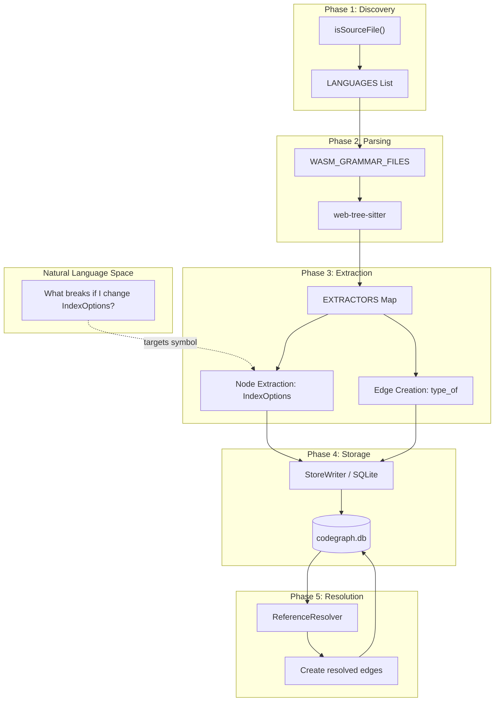

Sources: [src/types.ts:78-121](), [src/extraction/languages/index.ts:40-72](), [src/extraction/grammars.ts:20-53](), [src/extraction/store-writer.ts:26-26]()

### File Discovery and Parsing

The system identifies source files based on the `LANGUAGES` supported [src/types.ts:78-121](). Each file is parsed using `web-tree-sitter` and the appropriate language grammar defined in `WASM_GRAMMAR_FILES` [src/extraction/grammars.ts:20-53]().

Sources: [src/types.ts:78-121](), [src/extraction/grammars.ts:20-53]()

### Node and Edge Extraction

The extraction system uses the `EXTRACTORS` map to apply language-specific logic [src/extraction/languages/index.ts:40-72](). It visits the AST and extracts `Node` and `Edge` objects. References that cannot be resolved immediately (e.g., cross-file calls) are captured as `UnresolvedReference` for the resolution phase [src/types.ts:274-282]().

Sources: [src/extraction/languages/index.ts:40-72](), [src/types.ts:274-282]()

### Storage and Resolution

Data is persisted to a SQLite database via `QueryBuilder` [src/db/queries.ts:216-218](). CodeGraph tracks file hashes in `FileRecord` to support incremental updates via `ExtractionOrchestrator.sync()` [src/types.ts:232-265](), [src/extraction/index.ts:111-133](). The `ReferenceResolver` processes unresolved references to link symbols across the entire project [src/resolution/index.ts:45-48]().

Sources: [src/types.ts:232-265](), [src/db/queries.ts:216-218](), [src/extraction/index.ts:111-133](), [src/resolution/index.ts:45-48]()

---

## Summary

CodeGraph's core concepts focus on transforming static code into a queryable semantic model:

1. **Graph Model**: Nodes represent symbols; Edges represent relationships.
2. **Deterministic Extraction**: AST-based parsing via Tree-sitter ensures accuracy.
3. **Reference Resolution**: Linking symbols across files to build a global graph.
4. **Local-First**: All data stays in the `.codegraph/` directory in a SQLite database.

For detailed exploration of child topics, see:
- [Knowledge Graph Model](#3.1)
- [Supported Languages](#3.2)
- [Project Structure and Database](#3.3)

Sources: [src/types.ts:1-227](), [src/index.ts:4-6]()

---

# Page: Knowledge Graph Model

# Knowledge Graph Model

<details>
<summary>Relevant source files</summary>

The following files were used as context for generating this wiki page:

- [.claude/skills/agent-eval/corpus.json](.claude/skills/agent-eval/corpus.json)
- [CHANGELOG.md](CHANGELOG.md)
- [__tests__/extraction.test.ts](__tests__/extraction.test.ts)
- [__tests__/resolution.test.ts](__tests__/resolution.test.ts)
- [src/db/queries.ts](src/db/queries.ts)
- [src/extraction/grammars.ts](src/extraction/grammars.ts)
- [src/extraction/index.ts](src/extraction/index.ts)
- [src/extraction/languages/index.ts](src/extraction/languages/index.ts)
- [src/extraction/tree-sitter.ts](src/extraction/tree-sitter.ts)
- [src/index.ts](src/index.ts)
- [src/resolution/import-resolver.ts](src/resolution/import-resolver.ts)
- [src/resolution/index.ts](src/resolution/index.ts)
- [src/resolution/name-matcher.ts](src/resolution/name-matcher.ts)
- [src/resolution/types.ts](src/resolution/types.ts)
- [src/types.ts](src/types.ts)

</details>


This page provides a technical deep dive into CodeGraph's knowledge graph data model, explaining how code symbols are represented as **nodes**, how relationships between symbols are represented as **edges**, how database persistence is structured, and how this graph model drives semantic code analysis.

---

## Core Data Model

CodeGraph represents a codebase as a directed property graph where code symbols are nodes and relationships are edges. The schema is defined in TypeScript interfaces that serve as the canonical data contract across all extraction, resolution, and query layers.

### Node and Edge Structure

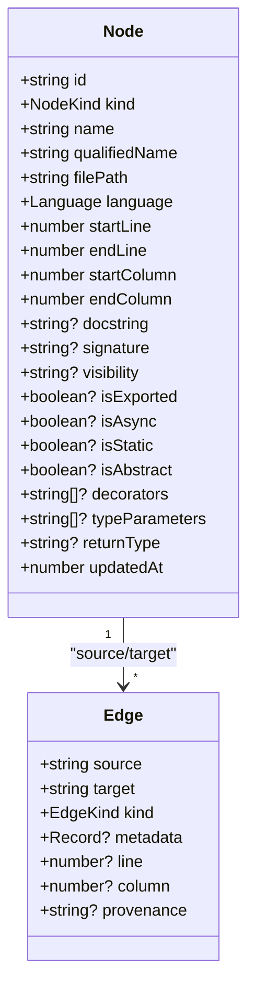

**Sources:** [src/types.ts:133-201](), [src/types.ts:206-227]()

A **`Node`** represents an individual code symbol (such as a function, class, variable, or interface) with attributes capturing its semantic role and precise source location. The unique `id` is typically derived from a hash of the file path and qualified name [src/types.ts:133-134](). The `returnType` attribute captures normalized result types for method returns to assist in receiver-type inference [src/types.ts:190-197]().

An **`Edge`** connects a `source` node to a `target` node with a specific `kind`, alongside optional line/column offsets and a `provenance` tag (`tree-sitter`, `scip`, or `heuristic`) [src/types.ts:206-227]().

---

## Node Kinds

CodeGraph defines 23 distinct node kinds in the `NODE_KINDS` array to categorize every syntactic construct extracted from source files [src/types.ts:22-46]().

### Complete Node Kind Taxonomy

```mermaid
graph TD
    NodeKind["NodeKind"]
    
    Structural["Structural Containers"]
    Declarations["Type Declarations"]
    Callables["Callable Units"]
    DataMembers["Data Members"]
    TypeSystem["Type System"]
    ModuleSystem["Module System"]
    FrameworkSpecific["Framework-Specific"]
    
    NodeKind --> Structural
    NodeKind --> Declarations
    NodeKind --> Callables
    NodeKind --> DataMembers
    NodeKind --> TypeSystem
    NodeKind --> ModuleSystem
    NodeKind --> FrameworkSpecific
    
    Structural --> file["file"]
    Structural --> module["module"]
    Structural --> namespace["namespace"]
    
    Declarations --> class["class"]
    Declarations --> struct["struct"]
    Declarations --> interface["interface"]
    Declarations --> trait["trait"]
    Declarations --> protocol["protocol"]
    Declarations --> enum["enum"]
    
    Callables --> function["function"]
    Callables --> method["method"]
    
    DataMembers --> property["property"]
    DataMembers --> field["field"]
    DataMembers --> variable["variable"]
    DataMembers --> constant["constant"]
    DataMembers --> parameter["parameter"]
    DataMembers --> enum_member["enum_member"]
    
    TypeSystem --> type_alias["type_alias"]
    
    ModuleSystem --> import["import"]
    ModuleSystem --> export["export"]
    
    FrameworkSpecific --> route["route"]
    FrameworkSpecific --> component["component"]
    FrameworkSpecific --> union["union"]
```

**Sources:** [src/types.ts:22-46]()

Each language extractor maps language-specific AST elements into these canonical node kinds. Files themselves are instantiated as `file` nodes [src/types.ts:23]() backed by `FileRecord` metadata [src/types.ts:232-265]().

---

## Edge Kinds

CodeGraph defines 12 fundamental relationship types in `EDGE_KINDS` [src/types.ts:57-70]().

| Kind | Description |
|------|-------------|
| `contains` | Parent contains child (e.g., file → class, class → method) [src/types.ts:58]() |
| `calls` | Function or method invokes another [src/types.ts:59]() |
| `imports` | File imports from another module [src/types.ts:60]() |
| `exports` | File exports a symbol [src/types.ts:61]() |
| `extends` | Class or interface inherits from another [src/types.ts:62]() |
| `implements` | Class conforms to an interface or protocol [src/types.ts:63]() |
| `references` | Generic reference to another symbol [src/types.ts:64]() |
| `type_of` | Variable or parameter has a specific type [src/types.ts:65]() |
| `returns` | Function returns a specific type [src/types.ts:66]() |
| `instantiates` | Code constructs an instance of a class [src/types.ts:67]() |
| `overrides` | Method overrides a parent class implementation [src/types.ts:68]() |
| `decorates` | Decorator or annotation applied to a symbol [src/types.ts:69]() |
| `navigates` | Navigation transition to a screen or route (e.g., framework router actions) [src/types.ts:70]() |

### Value-Reference Edges
A specialized `references` edge variant carrying `metadata: { valueRef: true }` links a function or method to module- or file-scope `constant` or `variable` nodes it reads. This ensures impact analysis correctly identifies functions dependent on configuration constants.

**Sources:** [src/types.ts:57-70]()

---

## Bridge: Natural Language to Code Space

The following diagrams bridge high-level system concepts and tool actions to the concrete code entities and query mechanisms implemented in the repository.

### Entity Relationship Mapping

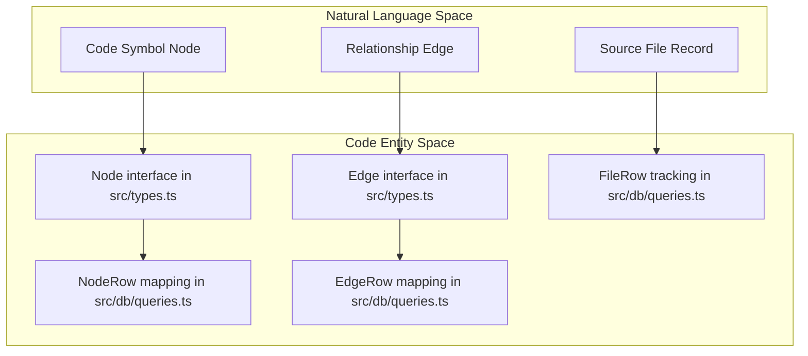

**Sources:** [src/types.ts:133-227](), [src/db/queries.ts:78-152]()

### Retrieval Logic Mapping

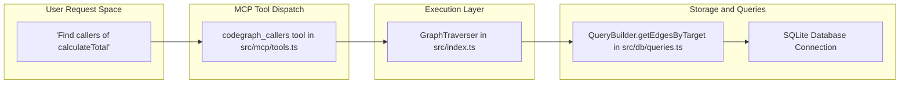

**Sources:** [src/mcp/tools.ts:1-162](), [src/index.ts:149-160](), [src/db/queries.ts:1-100]()

---

## Database Representation

The graph is persisted in a local SQLite database and manipulated through the `QueryBuilder` class [src/db/queries.ts:1-20]().

### Storage Row Mappings
- **`NodeRow`**: Maps snake_case database columns in the `nodes` table to the TypeScript `Node` interface [src/db/queries.ts:78-100]().
- **`EdgeRow`**: Maps the `edges` table to the `Edge` interface [src/db/queries.ts:102-111]().
- **`FileRow`**: Tracks file content hashes, sizes, modification timestamps, and extraction error states [src/db/queries.ts:113-124]().
- **`UnresolvedRefRow`**: Persists reference records (`unresolved_refs`) prior to resolution passes [src/db/queries.ts:126-166]().

### Performance Optimizations
- **FTS5 Full-Text Search**: SQLite FTS5 virtual tables index symbol identifiers and docstrings for rapid text queries [src/db/queries.ts:21-22]().
- **Name Tail Indexing**: The `referenceNameTail` utility extracts the trailing segments of dotted identifiers to accelerate lookup matching [src/db/queries.ts:25]() [src/db/reference-tail.ts:1-20]().

**Sources:** [src/db/queries.ts:1-166]()

---

## Unresolved References and Resolution

During initial file extraction, references to symbols defined externally or in other project files cannot immediately be linked to target node IDs. These are captured as `UnresolvedReference` structures [src/resolution/types.ts:12-35]() and stored in the database [src/db/queries.ts:126-166]().

```mermaid
sequenceDiagram
    participant E as ExtractionOrchestrator
    participant DB as SQLite unresolved_refs
    participant R as ReferenceResolver
    
    E->>E: Parse source via Tree-sitter
    E->>E: Discover call expression
    E->>DB: Insert UnresolvedReference row
    Note over DB: Store reference_name, file_path, line
    R->>DB: Query unresolved table
    R->>R: Execute import resolution and name matching
    R->>DB: Insert resolved Edge
    R->>DB: Delete unresolved row
```

**Sources:** [src/resolution/types.ts:12-35](), [src/db/queries.ts:126-166](), [src/extraction/index.ts:1-24]()

The `ReferenceResolver` coordinates multiple strategies (exact match, import path mapping, qualified name matching, and framework-specific resolvers) to transform unresolved references into valid graph edges [src/index.ts:50-54]().

**Sources:** [src/resolution/types.ts:12-88](), [src/index.ts:50-54]()

---

# Page: Supported Languages

# Supported Languages

<details>
<summary>Relevant source files</summary>

The following files were used as context for generating this wiki page:

- [.claude/skills/agent-eval/corpus.json](.claude/skills/agent-eval/corpus.json)
- [__tests__/cobol-sequence-area-period.test.ts](__tests__/cobol-sequence-area-period.test.ts)
- [__tests__/ui-highlight-bounded.test.ts](__tests__/ui-highlight-bounded.test.ts)
- [docs/grammars/tree-sitter-cobol.md](docs/grammars/tree-sitter-cobol.md)
- [docs/grammars/tree-sitter-cobol.patch](docs/grammars/tree-sitter-cobol.patch)
- [src/extraction/grammars.ts](src/extraction/grammars.ts)
- [src/extraction/languages/index.ts](src/extraction/languages/index.ts)
- [src/extraction/parse-budget.ts](src/extraction/parse-budget.ts)
- [src/extraction/wasm/tree-sitter-cobol.wasm](src/extraction/wasm/tree-sitter-cobol.wasm)
- [src/types.ts](src/types.ts)
- [src/ui-server/highlight/bounded-tokenize.ts](src/ui-server/highlight/bounded-tokenize.ts)
- [src/ui-server/highlight/index.ts](src/ui-server/highlight/index.ts)
- [src/ui-server/highlight/tokenize-worker.ts](src/ui-server/highlight/tokenize-worker.ts)

</details>


This page documents the programming languages supported by CodeGraph's hybrid extraction pipeline, detailing language detection mechanisms, the Tree-sitter grammar system (including vendored grammars and patches in `docs/grammars`), and advanced language-specific extraction features.

## Overview and Scope

CodeGraph supports over 40 programming languages and formats defined in `LANGUAGES` [src/types.ts:86-130](). Extraction is handled through a dual-engine architecture: a high-performance native Rust kernel and a WASM fallback layer using `web-tree-sitter` [src/extraction/grammars.ts:4-7](). Grammars are loaded lazily to minimize V8 memory pressure on large codebases [src/extraction/grammars.ts:5-7]().

Sources: [src/types.ts:86-130](), [src/extraction/grammars.ts:4-7]()

---

## Language Detection System

CodeGraph maps file extensions to language identifiers via `EXTENSION_MAP` [src/extraction/grammars.ts:59-174](). This map handles standard extensions as well as specialized dialects (such as `.ets` for ArkTS [src/extraction/grammars.ts:65-68](), `.xsjs` for SAP HANA JavaScript [src/extraction/grammars.ts:72-74](), and specialized COBOL/VB.NET/Erlang variants).

### Extension Mapping Table

| Extension(s) | Language | Notes / Dialect Handling |
|-------------|----------|--------------------------|
| `.ts`, `.tsx`, `.mts`, `.cts` | `typescript`, `tsx` | Includes ESM and CJS TypeScript extensions [src/extraction/grammars.ts:59-64]() |
| `.ets` | `arkts` | ArkTS (HarmonyOS/OpenHarmony) declarative UI superset [src/extraction/grammars.ts:65-68]() |
| `.js`, `.mjs`, `.cjs`, `.jsx` | `javascript`, `jsx` | Standard JS/JSX and server-side JS (`.xsjs`) [src/extraction/grammars.ts:69-75]() |
| `.cs` | `csharp` | Preprocessor directive blanking applied [src/extraction/languages/index.ts:18]() |
| `.java` | `java` | Lombok member synthesis supported [src/extraction/languages/index.ts:16]() |
| `.kt`, `.kts` | `kotlin` | Extension methods and property initializers [src/extraction/languages/index.ts:22]() |
| `.metal` | `cpp` | Metal Shading Language with `[[attribute]]` pre-parse blanking [src/extraction/grammars.ts:134-136]() |
| `.cu`, `.cuh` | `cpp` | CUDA execution-space specifier handling [src/extraction/grammars.ts:138-143]() |
| `.cbl`, `.cob`, `.cpy` | `cobol` | Vendored grammar with custom patch for `EXEC` blocks and wide mode [docs/grammars/tree-sitter-cobol.md:1-45]() |
| `.vb` | `vbnet` | Trailing newline normalization and modifier scanning [src/extraction/grammars.ts:155-157]() |

Sources: [src/extraction/grammars.ts:59-174](), [src/extraction/languages/index.ts:16-22](), [docs/grammars/tree-sitter-cobol.md:1-45]()

---

## Tree-sitter Grammar System and WASM Integration

The grammar loading layer (`src/extraction/grammars.ts`) maintains `WASM_GRAMMAR_FILES` mapping each supported `GrammarLanguage` to its corresponding `.wasm` file [src/extraction/grammars.ts:21-54](). Request-time parses and queries are guarded by `parseWithinBudget()` to prevent infinite loops in malformed source files or edge-case grammar hangs [src/extraction/parse-budget.ts:14-23]().

```mermaid
graph TB
    subgraph "LanguageDetection"
        FilePath["FilePath"]
        ExtMap["EXTENSION_MAP"]
        LangID["Language"]
    end

    subgraph "GrammarResolution"
        WasmMap["WASM_GRAMMAR_FILES"]
        LazyLoad["loadGrammarsForLanguages()"]
        WasmParser["Parser.init()"]
    end

    subgraph "SafeExecution"
        Budget["parseWithinBudget()"]
        TreeSitter["Parser.parse()"]
    end

    FilePath --> ExtMap
    ExtMap --> LangID
    LangID --> WasmMap
    WasmMap --> LazyLoad
    LazyLoad --> WasmParser
    WasmParser --> Budget
    Budget --> TreeSitter
```
**Diagram: Language Detection to WASM Parsing Flow**

Sources: [src/extraction/grammars.ts:21-54](), [src/extraction/parse-budget.ts:14-23]()

---

## Vendored Grammars and Patches: COBOL Example

Certain enterprise and legacy grammars require custom patches to correctly parse production codebases. For instance, the COBOL grammar (`src/extraction/wasm/tree-sitter-cobol.wasm`) is built from `yutaro-sakamoto/tree-sitter-cobol` with a patch addressing `EXEC` blocks, COPY replacing clauses, single-quote string continuation, and end-of-input sequence area handling [docs/grammars/tree-sitter-cobol.md:1-66]().

Sources: [docs/grammars/tree-sitter-cobol.md:1-66](), [src/extraction/wasm/tree-sitter-cobol.wasm:1-3]()

---

## Language-Specific Extraction Features

Extractors in `src/extraction/languages/` customize AST traversal to extract idiomatic language constructs.

```mermaid
graph LR
    subgraph "NaturalLanguageSpace"
        KotlinSource["fun User.getToken(): String"]
        JavaSource["@Data public class Account { private String name; }"]
    end

    subgraph "ExtractionPipeline"
        Extractors["EXTRACTORS map"]
        KotlinExt["kotlinExtractor"]
        JavaExt["javaExtractor"]
    end

    subgraph "CodeEntitySpace"
        MethodNode["Node(kind:'method', name:'getToken')"]
        SynthGetter["Node(kind:'method', name:'getName')"]
    end

    KotlinSource --> KotlinExt
    JavaSource --> JavaExt
    KotlinExt --> MethodNode
    JavaExt --> SynthGetter
```
## Data Flow: Kotlin Extension Functions to Code Entities

```mermaid
graph LR
    subgraph "NaturalLanguageSpace"
        RawKotlin["fun UserRepository.getToken(): String"]
        KotlinFile["UserRepository.kt"]
    end

    subgraph "ExtractionLogic"
        ParseKotlin["TreeSitterExtractor.parse()"]
        KotlinRet["extractKotlinReturnType()"]
    end

    subgraph "CodeEntitySpace"
        MethodNode["Node(kind:'method', name:'getToken')"]
        QualifiedName["Node.qualifiedName:'UserRepository::getToken'"]
        ContainsEdge["Edge(kind:'contains', from:'UserRepository')"]
    end

    RawKotlin --> KotlinFile
    KotlinFile --> ParseKotlin
    ParseKotlin --> KotlinRet
    KotlinRet --> MethodNode
    MethodNode --> QualifiedName
    MethodNode --> ContainsEdge
```
**Diagram: Kotlin Extension Function Extraction Flow**

Sources: [src/extraction/languages/index.ts:11-39](), [src/types.ts:140-235]()

## Data Flow: Java Lombok Member Synthesis to Code Entities

```mermaid
graph LR
    subgraph "NaturalLanguageSpace"
        JavaSource["@Data public class Account { private String name; }"]
        JavaFile["Account.java"]
    end

    subgraph "ExtractionLogic"
        ParseJava["TreeSitterExtractor.parse()"]
        LombokSyn["synthesizeLombokMembers()"]
        GetterName["lombokGetterName('name')"]
    end

    subgraph "CodeEntitySpace"
        SynthMethod["Node(kind:'method', name:'getName')"]
        Decorators["Node.decorators:['lombok']"]
        ContainsEdge["Edge(kind:'contains', from:'Account')"]
    end

    JavaSource --> JavaFile
    JavaFile --> ParseJava
    ParseJava --> LombokSyn
    LombokSyn --> GetterName
    GetterName --> SynthMethod
    SynthMethod --> Decorators
    SynthMethod --> ContainsEdge
```
**Diagram: Java Lombok Synthesis Data Flow**

Sources: [src/types.ts:140-235]()

---

# Page: Project Structure and Database

# Project Structure and Database

<details>
<summary>Relevant source files</summary>

The following files were used as context for generating this wiki page:

- [__tests__/db-perf.test.ts](__tests__/db-perf.test.ts)
- [__tests__/foundation.test.ts](__tests__/foundation.test.ts)
- [__tests__/frontload-hook.test.ts](__tests__/frontload-hook.test.ts)
- [__tests__/mcp-unindexed.test.ts](__tests__/mcp-unindexed.test.ts)
- [__tests__/pr19-improvements.test.ts](__tests__/pr19-improvements.test.ts)
- [__tests__/schemaless-db-not-initialized.test.ts](__tests__/schemaless-db-not-initialized.test.ts)
- [__tests__/sync-import-binding-retry.test.ts](__tests__/sync-import-binding-retry.test.ts)
- [__tests__/sync-import-member-retry.test.ts](__tests__/sync-import-member-retry.test.ts)
- [__tests__/sync-python-import-binding-retry.test.ts](__tests__/sync-python-import-binding-retry.test.ts)
- [src/db/index.ts](src/db/index.ts)
- [src/db/migrations.ts](src/db/migrations.ts)
- [src/db/reference-tail.ts](src/db/reference-tail.ts)
- [src/db/schema.sql](src/db/schema.sql)
- [src/directory.ts](src/directory.ts)

</details>


This page documents the internal file layout of CodeGraph projects, the SQLite database schema, versioned migrations, file tracking mechanisms, and the incremental synchronization pipeline.

---

## Purpose and Scope

CodeGraph stores all project-specific intelligence—including source code symbols, inter-file relationships, full-text search indices, and resolution states—locally within the project tree. This section details how the data directory is managed, how the SQLite schema is structured and migrated, how database connections are optimized, and how incremental sync updates the graph without full re-indexing.

Sources: [src/directory.ts:1-123](), [src/db/index.ts:1-50]()

---

## The .codegraph Directory and Environment Isolation

Every CodeGraph-initialized project contains a local data directory at its root [src/directory.ts:1-15](). By default, this directory is named `.codegraph/`, but its name can be customized via the `CODEGRAPH_DIR` environment variable [src/directory.ts:44-65]().

### Directory Layout and Cross-Environment Safety

When multiple environments share a working tree (most notably Windows-native and WSL accessing the same mount), sharing a single `.codegraph/` directory can cause SQLite file locking failures or permission conflicts over the 9p/DrvFs bridge [src/directory.ts:31-36]() (issue #995). CodeGraph addresses this via environment overrides and WSL-specific directory selection:

- **`CODEGRAPH_DIR` Override:** If set, `codeGraphDirName()` validates that the override is a plain path segment (no path separators, no `..`, not absolute) and uses it [src/directory.ts:44-65]().
- **WSL Windows Drive Detection:** For projects located on Windows drives under WSL without an explicit `CODEGRAPH_DIR`, `codeGraphDirNameFor()` checks for `.codegraph-wsl/` or an existing `.codegraph/codegraph.db` to prevent cross-environment corruption [src/directory.ts:107-116]().

### Directory Structure Diagram

```mermaid
graph TD
    ProjectRoot["ProjectRoot"] --> CodeGraphDir["CodeGraphDir"]
    CodeGraphDir --> DB["codegraph.db"]
    CodeGraphDir --> DBWal["codegraph.db-wal"]
    CodeGraphDir --> DBShm["codegraph.db-shm"]
    CodeGraphDir --> GitIgnore[".gitignore"]
    CodeGraphDir --> LockFile["codegraph.lock"]

    DB -.->|"SQLite WAL mode"| DBWal
    DB -.->|"Shared memory"| DBShm

    subgraph "Files"
    CodeGraphDir
    DB
    DBWal
    DBShm
    GitIgnore
    LockFile
    end
```

Sources: [src/directory.ts:4-122](), [__tests__/foundation.test.ts:58-71]()

---

## SQLite Database Schema and Migrations

CodeGraph utilizes SQLite (`node:sqlite` DatabaseSync) as its primary storage engine, configured for concurrent reads and writes using Write-Ahead Logging (WAL) [src/db/index.ts:33-36]().

### Schema Architecture

```mermaid
erDiagram
    nodes {
        TEXT id PK
        TEXT kind
        TEXT name
        TEXT qualified_name
        TEXT file_path
        TEXT language
        INTEGER start_line
        INTEGER end_line
        INTEGER start_column
        INTEGER end_column
        TEXT docstring
        TEXT signature
        TEXT visibility
        INTEGER is_exported
        INTEGER is_async
        INTEGER is_static
        INTEGER is_abstract
        TEXT decorators
        TEXT type_parameters
        TEXT return_type
        INTEGER updated_at
    }

    edges {
        INTEGER id PK AUTOINCREMENT
        TEXT source FK
        TEXT target FK
        TEXT kind
        TEXT metadata
        INTEGER line
        INTEGER col
        TEXT provenance
    }

    files {
        TEXT path PK
        TEXT content_hash
        TEXT language
        INTEGER size
        INTEGER modified_at
        INTEGER indexed_at
        INTEGER node_count
        TEXT errors
        INTEGER generated
    }

    unresolved_refs {
        INTEGER id PK AUTOINCREMENT
        TEXT from_node_id FK
        TEXT reference_name
        TEXT reference_kind
        INTEGER line
        INTEGER col
        TEXT candidates
        TEXT file_path
        TEXT language
        TEXT status
        TEXT name_tail
    }

    name_segment_vocab {
        TEXT segment PK
        TEXT name PK
    }

    nodes_fts {
        TEXT id
        TEXT name
        TEXT qualified_name
        TEXT docstring
        TEXT signature
    }

    edges }o--|| nodes : "source"
    edges }o--|| nodes : "target"
    unresolved_refs }o--|| nodes : "from_node_id"
    nodes ||--o{ nodes_fts : "indexed_in"
```

Sources: [src/db/schema.sql:1-160](), [src/db/migrations.ts:1-160]()

### Core Table Definitions

1. **`nodes`**: Stores extracted code symbols (functions, classes, variables, etc.) along with location bounds, signatures, export flags, and `return_type` for receiver-type inference [src/db/schema.sql:20-42]().
2. **`edges`**: Encodes directed relationships between nodes (`source` to `target`) with metadata and provenance. The unique index `idx_edges_identity` on `(source, target, kind, line, col)` enables `INSERT OR IGNORE` to safely deduplicate identical edge writes [src/db/schema.sql:45-56](), [src/db/migrations.ts:82-102]().
3. **`files`**: Tracks file modification states, content hashes, size, and generated-file verdicts (`generated`) used during result ranking [src/db/schema.sql:67-77]().
4. **`unresolved_refs`**: Records cross-file references that could not be immediately resolved. It supports a lifecycle (`pending`, `failed`) and maintains `name_tail` segments so background synchronization passes can retry them when new files are added [src/db/schema.sql:88-101](), [src/db/migrations.ts:123-152]().
5. **`name_segment_vocab`**: Materializes lowercased identifier segments (e.g., `OrderStateMachine` broken into `order`, `state`, `machine`) to support natural language prompt gating [src/db/schema.sql:158-162](), [src/db/migrations.ts:104-121]().

Sources: [src/db/schema.sql:20-162](), [src/db/migrations.ts:30-155]()

### Migration Versioning

Schema changes are managed programmatically via `CURRENT_SCHEMA_VERSION` (currently set to `16`) and an ordered array of migration definitions [src/db/migrations.ts:13-30](). Each migration defines an `up()` function applied sequentially inside transactions when opening an older database [src/db/migrations.ts:18-22]().

Sources: [src/db/migrations.ts:1-40]()

---

## Database Connection, PRAGMAs, and WAL Management

The `DatabaseConnection` class manages connection lifecycles, statement preparation, and PRAGMA configurations [src/db/index.ts:91-118]().

### Connection PRAGMAs and WAL Healing
- **WAL Mode:** `journal_mode = WAL` enables concurrent readers alongside a single active writer [src/db/index.ts:33-36]().
- **Busy Timeout:** Configured to `busy_timeout = 5000` to gracefully handle multi-process write contention between the CLI, MCP server, and auto-sync hooks [src/db/index.ts:34]().
- **Oversized WAL Checkpointing:** At startup, `healOversizedWal()` inspects WAL file sizes and checkpoints/truncates files exceeding limits defined by `WAL_HEAL_THRESHOLD_BYTES` to prevent disk exhaustion [src/db/index.ts:70-87]().

Sources: [src/db/index.ts:33-87]()

---

## Incremental Sync, File Tracking, and Reference Retries

CodeGraph maintains graph freshness through an incremental sync engine that processes modified files, updates nodes/edges via cascade deletions, and retries failed cross-file references.

### Reference Tail Resolution (`reference-tail.ts`)
When references fail to resolve during initial extraction, they are parked in `unresolved_refs` with a `name_tail` derived via `referenceNameTail()` [src/db/reference-tail.ts:40-60](). This function extracts the search key for dotted references, imports, modules, and file paths (e.g., `snippets/price.liquid` mapped to `price.liquid`), allowing subsequent file additions to instantly link pending edges [src/db/reference-tail.ts:40-131](), [__tests__/sync-import-binding-retry.test.ts:1-29]().

Sources: [src/db/reference-tail.ts:40-131](), [__tests__/sync-import-binding-retry.test.ts:1-30]()

---

## Data Flow: Natural Language to Code Entity Space

CodeGraph bridges natural language queries to precise code symbols by combining materialized vocabulary segment indices with FTS5 virtual tables and graph traversal paths.

### Data Flow Diagram: Natural Language to Code Entity Space

```mermaid
graph LR
    NLQuery["UserQuery(NaturalLanguage)"] -->|"SegmentParsing"| VocabLookup["name_segment_vocab"]
    NLQuery -->|"FullTextSearch"| FTSLookup["nodes_fts(FTS5)"]
    
    VocabLookup -->|"MatchSubstring"| CodeNodes["nodes(CodeSymbols)"]
    FTSLookup -->|"JoinOnRowid"| CodeNodes
    
    CodeNodes -->|"TraversalAndExpansion"| CodeEdges["edges(Relationships)"]
    CodeEdges -->|"ImpactAndCallGraph"| TargetEntity["TargetCodeEntity"]

    subgraph "Natural Language Space"
    NLQuery
    end

    subgraph "Code Entity Space"
    CodeNodes
    CodeEdges
    TargetEntity
    end
```

Sources: [src/db/schema.sql:116-162](), [src/db/migrations.ts:104-121]()

---

# Page: CLI Reference

# CLI Reference

<details>
<summary>Relevant source files</summary>

The following files were used as context for generating this wiki page:

- [CLAUDE.md](CLAUDE.md)
- [README.md](README.md)
- [__tests__/cli-ui-command.test.ts](__tests__/cli-ui-command.test.ts)
- [__tests__/installer.test.ts](__tests__/installer.test.ts)
- [__tests__/viewer-gate.test.ts](__tests__/viewer-gate.test.ts)
- [assets/codegraph-ui-symbol-view.png](assets/codegraph-ui-symbol-view.png)
- [package-lock.json](package-lock.json)
- [package.json](package.json)
- [site/astro.config.mjs](site/astro.config.mjs)
- [site/src/content/docs/getting-started/next-steps.md](site/src/content/docs/getting-started/next-steps.md)
- [site/src/content/docs/reference/cli.md](site/src/content/docs/reference/cli.md)
- [src/bin/codegraph.ts](src/bin/codegraph.ts)
- [src/bin/command-supervision.ts](src/bin/command-supervision.ts)
- [src/bin/viewer-gate.ts](src/bin/viewer-gate.ts)
- [src/installer/config-writer.ts](src/installer/config-writer.ts)
- [src/installer/index.ts](src/installer/index.ts)
- [src/mcp/tools.ts](src/mcp/tools.ts)

</details>


This page provides comprehensive documentation for the `codegraph` command-line interface. The CLI is the primary user-facing tool for managing CodeGraph projects, running manual and incremental indexing, executing graph queries, and coordinating background server processes for AI agent integration. As a parent page, this overview covers general architecture and command groups; for detailed technical specifications and deep-dive usage, consult the linked child pages: [Project Management Commands](#4.1), [Indexing Commands](#4.2), [Query Commands](#4.3), and [Server and Hook Commands](#4.4) [src/bin/codegraph.ts:3-25]().

## CLI Architecture and Command Routing

The CodeGraph CLI is implemented as a Commander.js application [src/bin/codegraph.ts:53]() that routes incoming terminal inputs to core subsystem classes such as `CodeGraph` [src/index.ts:149]() and `ExtractionOrchestrator` [src/extraction/index.ts:28](). When invoked with no arguments, it launches the interactive multi-agent installer script [src/bin/codegraph.ts:8-9](). Otherwise, it parses arguments, resolves project roots, and executes the target action.

Title: CLI Command Routing and Subsystem Mapping
```mermaid
graph TB
    CLIEntry["User Input: codegraph CLI<br/>(src/bin/codegraph.ts)"]
    NoArgs{"Arguments empty?"}
    Installer["Interactive Installer<br/>(src/installer/index.ts)"]
    Commander["Commander Router<br/>(src/bin/codegraph.ts:53)"]
    
    subgraph "Natural Language & Command Space"
        InitIntent["Initialize Project"]
        IndexIntent["Build / Sync Index"]
        QueryIntent["Query Code Graph"]
        ServerIntent["Daemon & MCP Server"]
    end
    
    subgraph "Code Entity Space"
        CodeGraphClass["CodeGraph Class<br/>(src/index.ts:149)"]
        Orchestrator["ExtractionOrchestrator<br/>(src/extraction/index.ts:28)"]
        Queries["QueryBuilder<br/>(src/db/queries.ts)"]
        ServerHandle["MCPServer / UI Server<br/>(src/mcp/index.ts)"]
    end

    CLIEntry --> NoArgs
    NoArgs -->|"Yes"| Installer
    NoArgs -->|"No"| Commander
    
    Commander --> InitIntent --> CodeGraphClass
    Commander --> IndexIntent --> Orchestrator
    Commander --> QueryIntent --> Queries
    Commander --> ServerIntent --> ServerHandle
```

Sources: [src/bin/codegraph.ts:1-55](), [src/index.ts:149-160](), [src/extraction/index.ts:25-32]()

## Command Groups Overview

The CLI functionality is partitioned into four major command groups, detailed in their respective child pages:

### Project Management Commands (#4.1)
Covers initialization and metadata checks for local repositories. This group includes `codegraph init` (which sets up the `.codegraph/` directory and bootstraps the SQLite database), `codegraph uninit` (which tears down project configurations), and `codegraph status` (which reports node counts, index health, and staleness) [src/bin/codegraph.ts:11-16]().
* For details, see [Project Management Commands](#4.1).

### Indexing Commands (#4.2)
Manages full and incremental code graph generation. Commands include `codegraph index` (force re-indexing of all source files), `codegraph sync` (incremental updates reconciling file mutations since the last run), and `codegraph upgrade` (in-place binary or package updates) [src/bin/codegraph.ts:13-15]().
* For details, see [Indexing Commands](#4.2).

### Query Commands (#4.3)
Provides direct inspection of the knowledge graph via the terminal. Commands include `codegraph query` (FTS5 and identifier segment searches), `codegraph files` (file layout discovery), `codegraph node` (symbol lookup), and `codegraph context` (task-specific context extraction) [src/bin/codegraph.ts:16-22]().
* For details, see [Query Commands](#4.3).

### Server and Hook Commands (#4.4)
Handles background daemons, MCP protocol servers, and synchronization hooks used by AI coding assistants. This group includes `codegraph serve`, `codegraph mark-dirty`, `codegraph sync-if-dirty`, `codegraph ui`, and `codegraph unlock` [src/bin/codegraph.ts:20-24]().
* For details, see [Server and Hook Commands](#4.4).

Sources: [src/bin/codegraph.ts:8-25]()

## Runtime Safety, Path Resolution, and Supervision

Before executing any subcommand, the CLI enforces strict safety guards, including checks against unsupported Node.js versions (blocking Node 25.x due to V8 WASM JIT issues) and applying runtime flags like `--liftoff-only` [src/bin/codegraph.ts:110-130](). 

Path resolution uses `findNearestCodeGraphRoot()` to traverse upwards from the current working directory until an initialized `.codegraph` store is located [src/bin/codegraph.ts:43](), [src/directory.ts:35-45]().

Title: Project Root Discovery and Database Initialization Flow
```mermaid
graph TD
    CLIInvoke["CLI Command Invocation<br/>(src/bin/codegraph.ts)"]
    FindRoot["findNearestCodeGraphRoot()<br/>(src/directory.ts)"]
    CheckPath{"Path contains<br/>.codegraph/ dir?"}
    WalkUp["Traverse to parent directory"]
    ValidRoot["Resolved Project Root"]
    OpenDb["DatabaseConnection.open()<br/>(src/db/sqlite-adapter.ts)"]
    
    CLIInvoke --> FindRoot
    FindRoot --> CheckPath
    CheckPath -->|"No"| WalkUp --> CheckPath
    CheckPath -->|"Yes"| ValidRoot --> OpenDb
```

Sources: [src/bin/codegraph.ts:110-130](), [src/directory.ts:30-50](), [src/db/sqlite-adapter.ts:1-20]()

---

# Page: Project Management Commands

# Project Management Commands

<details>
<summary>Relevant source files</summary>

The following files were used as context for generating this wiki page:

- [CLAUDE.md](CLAUDE.md)
- [README.md](README.md)
- [__tests__/daemon-install-check.test.ts](__tests__/daemon-install-check.test.ts)
- [__tests__/daemon-older-version.test.ts](__tests__/daemon-older-version.test.ts)
- [__tests__/grammar-load-failure.test.ts](__tests__/grammar-load-failure.test.ts)
- [__tests__/installer.test.ts](__tests__/installer.test.ts)
- [__tests__/status-index-health.test.ts](__tests__/status-index-health.test.ts)
- [__tests__/ts-export-type-star.test.ts](__tests__/ts-export-type-star.test.ts)
- [package-lock.json](package-lock.json)
- [package.json](package.json)
- [src/bin/codegraph.ts](src/bin/codegraph.ts)
- [src/installer/config-writer.ts](src/installer/config-writer.ts)
- [src/installer/index.ts](src/installer/index.ts)
- [src/mcp/tools.ts](src/mcp/tools.ts)
- [src/mcp/version.ts](src/mcp/version.ts)

</details>


This page documents the CLI commands that manage the lifecycle of CodeGraph projects: `init`, `uninit`, and `status`. These commands control project initialization, uninitialization, and inspection of CodeGraph's local index state within the `.codegraph/` directory structure.

---

## Command Overview and Architecture

CodeGraph project management commands translate user intentions entered via the CLI into filesystem, directory validation, and database operations managed by the core CLI router and directory utility modules.

Title: "CLI Project Management Architecture"
```mermaid
graph TD
    subgraph "NaturalLanguageSpace"
        NL_Init["codegraph init"]
        NL_Status["codegraph status"]
        NL_Uninit["codegraph uninit"]
    end

    subgraph "CodeEntitySpace"
        CLI_Entry["src/bin/codegraph.ts"]
        Dir_Check["src/directory.ts:isInitialized()"]
        Dir_Root["src/directory.ts:getCodeGraphDir()"]
        Safe_Check["src/directory.ts:unsafeIndexRootReason()"]
        CG_Class["src/index.ts:CodeGraph"]
    end

    NL_Init --> CLI_Entry
    NL_Status --> CLI_Entry
    NL_Uninit --> CLI_Entry

    CLI_Entry --> Safe_Check
    CLI_Entry --> Dir_Check
    CLI_Entry --> Dir_Root
    CLI_Entry --> CG_Class

    style NL_Init fill:none,stroke:#333,stroke-width:2px
    style CLI_Entry fill:none,stroke:#333,stroke-width:2px
```
Sources: [src/bin/codegraph.ts:11-25](), [src/directory.ts:85-156](), [src/index.ts:149-183]()

---

## Project Lifecycle Flow

The lifecycle of a CodeGraph project transitions through uninitialized, initialized, and synchronized states as managed by CLI commands.

Title: "Project Lifecycle State Machine"
```mermaid
stateDiagram-v2
    state "UninitializedState" as Uninit {
        [*] --> NewDir: "New directory"
    }
    
    state "InitializedState" as Init {
        [*] --> EmptyIndex: "CodeGraph.initSync()"
        EmptyIndex --> Indexed: "codegraph init --index"
        Indexed --> Stale: "Files modified"
        Stale --> Indexed: "CodeGraph.sync()"
    }

    Uninit --> Init: "codegraph init"
    Init --> Uninit: "codegraph uninit"
```
Sources: [src/bin/codegraph.ts:11-25](), [src/directory.ts:85-101](), [src/index.ts:149-183]()

---

## codegraph init

### Purpose
The `init` command creates the local `.codegraph/` directory and initializes the SQLite database schema. It guards against unsafe execution paths (such as the system root or user home directory) using `unsafeIndexRootReason()` [src/directory.ts:126-156]().

Sources: [src/bin/codegraph.ts:11-15](), [src/directory.ts:126-200]()

### Syntax and Implementation Mapping

Title: "Init Command Mapping to Code Entities"
```mermaid
graph LR
    subgraph "NaturalLanguageSpace"
        CmdInit["codegraph init [path]"]
    end

    subgraph "CodeEntitySpace"
        Parse["src/bin/codegraph.ts"]
        Safety["src/directory.ts:unsafeIndexRootReason()"]
        DirCreate["src/directory.ts:getCodeGraphDir()"]
        DBInit["src/index.ts:CodeGraph.initSync()"]
    end

    CmdInit --> Parse
    Parse --> Safety
    Safety --> DirCreate
    DirCreate --> DBInit
```
Sources: [src/bin/codegraph.ts:11-15](), [src/directory.ts:126-200](), [src/index.ts:149-183]()

### Created File Layout
| Path | Description |
|:---|:---|
| `.codegraph/` | Local metadata and index root directory [src/directory.ts:35-56]() |
| `.codegraph/codegraph.db` | SQLite database storing nodes, edges, and file records |
| `.codegraph/.gitignore` | Local exclusion rules ignoring generated index contents [src/directory.ts:192-198]() |

Sources: [src/directory.ts:35-56](), [src/directory.ts:192-198]()

---

## codegraph uninit

### Purpose
The `uninit` command tears down CodeGraph metadata by deleting the `.codegraph/` directory for a project. It verifies initialization state via `isInitialized()` before invoking removal routines.

Sources: [src/bin/codegraph.ts:11-15](), [src/directory.ts:93-101]()

### Execution Flow
1. Validates that the target path contains an active `.codegraph/` directory using `isInitialized()`.
2. Prompts for user confirmation via interactive prompts unless forced.
3. Recursively deletes the `.codegraph/` directory from disk.

Sources: [src/bin/codegraph.ts:11-15](), [src/directory.ts:93-101]()

---

## codegraph status

### Purpose
The `status` command inspects the SQLite database underlying the project knowledge graph, outputting metrics such as total nodes, edges, storage size, index freshness, and index health (including parse errors and missing symbols per issues `#2336` and `#2335`) [__tests__/status-index-health.test.ts:1-164]().

Sources: [src/bin/codegraph.ts:15](), [__tests__/status-index-health.test.ts:1-164]()

### Health Inspection and Metrics Flow

Title: "Status Inspection Mapping"
```mermaid
graph TD
    subgraph "NaturalLanguageSpace"
        NL_Status["codegraph status --json"]
    end

    subgraph "CodeEntitySpace"
        CLI_Status["src/bin/codegraph.ts"]
        InitCheck["src/directory.ts:isInitialized()"]
        HealthCheck["__tests__/status-index-health.test.ts"]
    end

    NL_Status --> CLI_Status
    CLI_Status --> InitCheck
    CLI_Status --> HealthCheck
```
Sources: [src/bin/codegraph.ts:15](), [src/directory.ts:93-101](), [__tests__/status-index-health.test.ts:80-164]()

### Metrics Collected
- **Initialization State**: Verified via `isInitialized()` [src/directory.ts:93-101]().
- **Node & Edge Counts**: Queried from the SQLite database tables.
- **Files with Parse Errors**: Identifies files where parsing failed (e.g., merge conflict markers or syntax issues) [__tests__/status-index-health.test.ts:108-124]().
- **Files Needing Reindex**: Detects rows stored without their associated symbols, prompting a `codegraph sync` [__tests__/status-index-health.test.ts:141-151]().
- **JSON Output**: Supported via `--json` flags for CI and script integration [__tests__/status-index-health.test.ts:87-90]().

Sources: [src/directory.ts:93-101](), [__tests__/status-index-health.test.ts:75-164]()

---

## Project Path Resolution

Commands automatically traverse parent directories using `findNearestCodeGraphRoot()` to locate the nearest `.codegraph/` directory, allowing seamless execution from any nested subdirectory within a repository.

Sources: [src/directory.ts:158-177]()

---

# Page: Indexing Commands

# Indexing Commands

<details>
<summary>Relevant source files</summary>

The following files were used as context for generating this wiki page:

- [__tests__/cli-no-color.test.ts](__tests__/cli-no-color.test.ts)
- [__tests__/cli-sync.test.ts](__tests__/cli-sync.test.ts)
- [__tests__/concurrent-locking.test.ts](__tests__/concurrent-locking.test.ts)
- [__tests__/glyphs.test.ts](__tests__/glyphs.test.ts)
- [__tests__/install-sh-prune.test.ts](__tests__/install-sh-prune.test.ts)
- [__tests__/installer-links-simulated.test.ts](__tests__/installer-links-simulated.test.ts)
- [__tests__/mcp-staleness-banner.test.ts](__tests__/mcp-staleness-banner.test.ts)
- [__tests__/node-sqlite-backend.test.ts](__tests__/node-sqlite-backend.test.ts)
- [__tests__/node-version-check.test.ts](__tests__/node-version-check.test.ts)
- [__tests__/sync.test.ts](__tests__/sync.test.ts)
- [__tests__/upgrade.test.ts](__tests__/upgrade.test.ts)
- [__tests__/watcher.test.ts](__tests__/watcher.test.ts)
- [install.ps1](install.ps1)
- [install.sh](install.sh)
- [src/bin/node-version-check.ts](src/bin/node-version-check.ts)
- [src/installer/targets/copilot-cli.ts](src/installer/targets/copilot-cli.ts)
- [src/sync/index.ts](src/sync/index.ts)
- [src/sync/watcher.ts](src/sync/watcher.ts)
- [src/ui/color.ts](src/ui/color.ts)
- [src/ui/glyphs.ts](src/ui/glyphs.ts)
- [src/ui/shimmer-progress.ts](src/ui/shimmer-progress.ts)
- [src/ui/shimmer-worker.ts](src/ui/shimmer-worker.ts)
- [src/ui/types.ts](src/ui/types.ts)
- [src/upgrade/index.ts](src/upgrade/index.ts)

</details>


This page documents the indexing and synchronization commands in CodeGraph: `codegraph index`, `codegraph sync`, and `codegraph upgrade`. These commands drive the extraction pipeline, manage incremental synchronization, handle progress reporting via the shimmer UI, and support self-updates across different installation methods.

---

## Overview

CodeGraph provides three main commands for building and maintaining the knowledge graph:
- **`codegraph index`**: Executes a full parse of all project files, building the knowledge graph from scratch [src/bin/codegraph.ts:13-13]().
- **`codegraph sync`**: Executes incremental updates, processing only modified, added, or deleted files [src/bin/codegraph.ts:14-14]().
- **`codegraph upgrade`**: Upgrades the CLI installation depending on how CodeGraph was installed [src/bin/codegraph.ts:23-23](), [src/upgrade/index.ts:1-35]().

Sources: [src/bin/codegraph.ts:11-30](), [src/upgrade/index.ts:1-35]()

---

## Command Architecture and Extraction Pipeline

The CLI entry point coordinates with the core engine and worker pools to parse source files and persist entities into SQLite.

**Diagram 1: Natural Language Space to Code Entity Space — Extraction & Progress Data Flow**
```mermaid
flowchart TB
    subgraph Natural_Language_Space ["Natural Language Space: Index & Sync Commands"]
        A["Full Project Indexing"] --> B["Incremental File Sync"]
        B --> C["Progress Feedback & Animation"]
    end

    subgraph Code_Entity_Space ["Code Entity Space"]
        IndexCmd["codegraph index -> src/bin/codegraph.ts"]
        SyncCmd["codegraph sync -> src/bin/codegraph.ts"]
        IndexAll["CodeGraph.indexAll() -> src/index.ts"]
        SyncMethod["CodeGraph.sync() -> src/index.ts"]
        Scanner["getGitVisibleFiles() -> src/extraction/index.ts"]
        WorkerPool["ParseWorkerPool -> src/extraction/parse-pool.ts"]
        Shimmer["createShimmerProgress() -> src/ui/shimmer-progress.ts"]
        Worker["shimmer-worker.js -> src/ui/shimmer-worker.ts"]
        QB["QueryBuilder -> src/db/queries.ts"]
        DB[("codegraph.db -> SQLite")]
    end

    A --> IndexCmd
    B --> SyncCmd
    C --> Shimmer
    IndexCmd --> IndexAll
    SyncCmd --> SyncMethod
    IndexAll --> Scanner
    SyncMethod --> Scanner
    Scanner --> WorkerPool
    WorkerPool --> QB
    QB --> DB
    Shimmer -->|"worker.postMessage()"| Worker
```
Sources: [src/bin/codegraph.ts:11-30](), [src/extraction/index.ts:39-75](), [src/index.ts:139-173](), [src/ui/shimmer-progress.ts:25-129](), [src/ui/shimmer-worker.ts:1-134]()

---

## Progress Reporting and Shimmer UI

During heavy extraction phases, CodeGraph provides interactive progress feedback using `createShimmerProgress` [src/ui/shimmer-progress.ts:25-129]() and a dedicated worker thread `shimmer-worker.ts` [src/ui/shimmer-worker.ts:1-134]().

### Phases
The progress reporter tracks five distinct phases defined in `PHASE_NAMES`:
1. `scanning`: Scanning files
2. `parsing`: Parsing code
3. `storing`: Storing data
4. `resolving`: Resolving refs
5. `linking`: Linking dynamic dispatch [src/ui/shimmer-progress.ts:6-12]()

### Implementation Details
- **TTY Detection**: If `process.stdout.isTTY` is true, CodeGraph spawns `shimmer-worker.js` via `worker_threads` [src/ui/shimmer-progress.ts:28-71]().
- **Direct System Calls**: The shimmer worker writes directly to file descriptor 1 (`writeSync(1, ...)`), bypassing Node's event loop congestion if the main thread is blocked on SQLite operations [src/ui/shimmer-worker.ts:6-21]().
- **Non-TTY Fallback**: When redirected or in CI (`process.stdout.isTTY !== true`), it falls back to `createPlainProgress`, emitting one plain line per phase [src/ui/shimmer-progress.ts:28-30](), [src/ui/shimmer-progress.ts:136-151]().

**Progress Reporting Architecture**
```mermaid
flowchart TB
    subgraph "Main Thread"
        CP["createShimmerProgress() -> src/ui/shimmer-progress.ts"]
        CB["onProgress(progress: IndexProgress)"]
        Print["printPhaseDone()"]
    end

    subgraph "Worker Thread"
        SW["shimmer-worker.js -> src/ui/shimmer-worker.ts"]
        WS["writeSync(1, ...) -> fd 1"]
    end

    CP -->|"worker.postMessage()"| SW
    CB -->|"Updates state"| SW
    SW -->|"Renders frame"| WS
    CP -->|"Phase transition"| Print
```
Sources: [src/ui/shimmer-progress.ts:1-151](), [src/ui/shimmer-worker.ts:1-134]()

---

## The `index` Command

### Syntax and Options
```bash
codegraph index [path] [options]
```
- `--force` (`-f`): Clears the existing database index and rebuilds from scratch [src/bin/codegraph.ts:354-354]().
- `--verbose` (`-v`): Enables verbose logging and detailed output [src/bin/codegraph.ts:355-355]().

### Execution Flow
1. Scans project files using `getGitVisibleFiles()` or file system traversal [src/extraction/index.ts:180-202]().
2. Dispatches file contents in batches to worker threads running Tree-sitter parsers [src/extraction/index.ts:24-24]().
3. Inserts nodes and edges into SQLite via `QueryBuilder` [src/extraction/index.ts:23-23](), [src/db/queries.ts:214-226]().

Sources: [src/extraction/index.ts:43-74](), [src/bin/codegraph.ts:350-417](), [src/db/queries.ts:214-226]()

---

## The `sync` Command and Incremental Updates

### Syntax
```bash
codegraph sync [path] [options]
```

### Change Detection, Locking, and Sync Logic
The `sync` command invokes `CodeGraph.sync()` [src/index.ts:52-52]() to perform incremental updates:
1. **Git Status Check**: Executes `git status --porcelain` to quickly identify added, modified, or removed files [src/extraction/index.ts:205-230]().
2. **Content Hashing**: Compares SHA256 content hashes against the stored records in the `files` table [src/extraction/index.ts:138-140]().
3. **Lock Protection**: If the project database is locked by another writer, sync operations throw `LockUnavailableError` or retry based on configuration [__tests__/sync.test.ts:128-150](), [src/sync/watcher.ts:46-50]().
4. **File Watcher Integration**: The `FileWatcher` class in `src/sync/watcher.ts` monitors file system changes using native `fs.watch` (recursive on macOS/Windows, per-directory inotify on Linux) with adaptive debouncing (`QUICK_SYNC_MAX_PENDING`, `SCOPED_SYNC_MAX_PENDING`) [src/sync/watcher.ts:1-80]().

**Diagram 2: Natural Language Space to Code Entity Space — File Watcher & Incremental Sync**
```mermaid
flowchart TB
    subgraph Natural_Language_Space ["Natural Language Space: File Change & Auto-Sync"]
        FS_Event["File System Event (Save/Create/Delete)"] --> Watcher_Detect["Detect File Change"]
        Watcher_Detect --> Debounce_Check["Adaptive Debounce & Coalescing"]
        Debounce_Check --> Sync_Execution["Execute Incremental Update"]
    end

    subgraph Code_Entity_Space ["Code Entity Space"]
        FSWatch["fs.watch -> src/sync/watcher.ts"]
        WatcherClass["FileWatcher -> src/sync/watcher.ts"]
        PendingSet["pendingFiles Map"]
        SyncCall["CodeGraph.sync() -> src/index.ts"]
        LockCheck["LockUnavailableError -> src/sync/watcher.ts"]
        Parser["extraction pipeline -> src/extraction/index.ts"]
    end

    FS_Event --> FSWatch
    FSWatch --> WatcherClass
    WatcherClass --> PendingSet
    PendingSet --> SyncCall
    SyncCall --> LockCheck
    SyncCall --> Parser
```
Sources: [src/extraction/index.ts:111-280](), [src/bin/codegraph.ts:419-477](), [src/sync/watcher.ts:1-80](), [__tests__/sync.test.ts:128-178]()

---

## The `upgrade` Command

### Syntax
```bash
codegraph upgrade [version] [--check]
```

### Installation Method Detection
`detectInstallMethod` in `src/upgrade/index.ts` determines how CodeGraph was installed by inspecting the running module's filename and path structure [src/upgrade/index.ts:97-146]():
- **Bundle**: Detected by checking for a vendored `node` binary and launcher script relative to the bundle root [src/upgrade/index.ts:130-137](). Unix re-runs `install.sh` [install.sh:1-151](); Windows uses `install.ps1` and `Install-CodeGraphFiles` to rename locked files aside safely [install.ps1:18-90]().
- **NPM**: Detected when running inside a `node_modules` directory (`scope: 'global'` or `'local'`), shelling out to npm [src/upgrade/index.ts:123-127]().
- **NPX**: Detected via `_npx` cache paths [src/upgrade/index.ts:119-121]().
- **Source**: Detected via sibling `package.json` and `.git` directories [src/upgrade/index.ts:139-143]().

Sources: [src/upgrade/index.ts:1-159](), [install.sh:1-151](), [install.ps1:1-132]()

---

# Page: Query Commands

# Query Commands

<details>
<summary>Relevant source files</summary>

The following files were used as context for generating this wiki page:

- [__tests__/adaptive-explore-sizing.test.ts](__tests__/adaptive-explore-sizing.test.ts)
- [__tests__/cli-node-command.test.ts](__tests__/cli-node-command.test.ts)
- [__tests__/context-ranking.test.ts](__tests__/context-ranking.test.ts)
- [__tests__/context.test.ts](__tests__/context.test.ts)
- [__tests__/explore-blast-radius.test.ts](__tests__/explore-blast-radius.test.ts)
- [__tests__/explore-corroboration-ranking.test.ts](__tests__/explore-corroboration-ranking.test.ts)
- [__tests__/explore-long-query.test.ts](__tests__/explore-long-query.test.ts)
- [__tests__/explore-output-budget.test.ts](__tests__/explore-output-budget.test.ts)
- [__tests__/explore-synth-constant-endpoints.test.ts](__tests__/explore-synth-constant-endpoints.test.ts)
- [__tests__/graph.test.ts](__tests__/graph.test.ts)
- [__tests__/node-file-view.test.ts](__tests__/node-file-view.test.ts)
- [src/context/index.ts](src/context/index.ts)
- [src/db/name-substring-index.ts](src/db/name-substring-index.ts)
- [src/graph/queries.ts](src/graph/queries.ts)
- [src/graph/traversal.ts](src/graph/traversal.ts)
- [src/search/query-utils.ts](src/search/query-utils.ts)

</details>


## Purpose and Scope

This page documents the CLI commands for exploring and querying the CodeGraph knowledge graph: `codegraph query`, `codegraph files`, `codegraph node`, `codegraph context`, `codegraph callers`, `codegraph callees`, and `codegraph impact`. These commands provide interactive access to indexed code symbols, file structures, and task-specific context without requiring MCP integration.

For information about programmatic query APIs, see [src/index.ts:1-20](). For MCP tool equivalents used by AI agents, see [src/context/index.ts:1-30]().

**Sources:** [src/context/index.ts:1-22](), [src/search/query-utils.ts:1-15]()

---

## Overview of Query Commands

The query commands provide distinct ways to interact with the indexed codebase:

| Command | Purpose | Primary Use Case | Output Format |
|---------|---------|------------------|---------------|
| `query <search>` | Search for code symbols by name | Finding functions, classes, or specific identifiers | List of matching nodes with scores |
| `files` | Explore project file structure | Understanding codebase organization | Tree, flat list, or language-grouped |
| `node <symbol/file>` | Inspect a specific node or read a source file | Symbol details, location, or Read-parity file view | Source text with line numbers or metadata |
| `context <task>` | Build task-specific context | Gathering relevant code for AI-assisted tasks | Markdown or JSON with code blocks |
| `callers <symbol>`| Find what calls a function | Impact analysis and call graph exploration | List of calling nodes |
| `callees <symbol>`| Find what a function calls | Dependency and implementation exploration | List of called nodes |
| `impact <symbol>` | Analyze affected code | Assessing blast radius of changes | Graph of affected symbols |

All commands require an initialized CodeGraph project (`.codegraph/` directory must exist). They operate as read-only queries and do not modify the index.

**Sources:** [src/context/index.ts:1-35](), [src/search/query-utils.ts:1-20]()

---

## Command Execution Flow

Title: "Query Command Execution Architecture"
```mermaid
flowchart TD
    CLI["CLIEntry"] --> Resolve["findNearestCodeGraphRoot"]
    Resolve --> Check{"isInitialized"}
    Check -->|NotInitialized| Error["ExitWithError"]
    Check -->|Initialized| LoadCG["loadCodeGraph"]
    LoadCG --> OpenDB["CodeGraph.open"]
    
    OpenDB --> QueryCmd["query"]
    OpenDB --> FilesCmd["files"]
    OpenDB --> NodeCmd["node"]
    OpenDB --> ContextCmd["context"]
    
    QueryCmd --> SearchNodes["cg.searchNodes"]
    FilesCmd --> GetFiles["cg.getFiles"]
    NodeCmd --> NodeLookup["findAllSymbols / FileView"]
    ContextCmd --> BuildContext["ContextBuilder.buildContext"]
```

The execution flow begins with path resolution, which walks up parent directories to find the nearest `.codegraph/` directory [src/context/index.ts:8-30](). After validating initialization, the CLI loads the `CodeGraph` module and opens the SQLite database storage backend, then dispatches to the appropriate command handler [src/context/index.ts:8-30](), [src/index.ts:1-25]().

**Sources:** [src/context/index.ts:8-30](), [src/index.ts:1-25]()

---

## codegraph query

### Syntax

```bash
codegraph query <search> [options]

Options:
  -p, --path <path>       Project path (default: current directory)
  -l, --limit <number>    Maximum results (default: 10)
  -k, --kind <kind>       Filter by node kind (function, class, etc.)
  -j, --json              Output as JSON
```

### Search Strategy

The `query` command implements a prefix-aware search using SQLite's FTS5. The query is pre-processed using `extractSearchTerms` to generate stem variants (e.g., `caching` -> `cache`) and split compound identifiers (`camelCase`, `snake_case`) into individual search tokens [src/search/query-utils.ts:156-177]().

**Scoring and Ranking**
The search applies multi-signal scoring:
- **Identifier Match**: Exact matches on symbol names receive a significant boost.
- **Path Relevance**: Matches in the file path are scored based on depth and directory name relevance, down-weighting project root name tokens via `deriveProjectNameTokens` [src/search/query-utils.ts:29-54]().
- **Distinctive Identifiers**: Common dictionary words are filtered using `STOP_WORDS` to avoid noise [src/search/query-utils.ts:60-78]().

**Sources:** [src/search/query-utils.ts:29-177]()

---

## codegraph files

### Syntax

```bash
codegraph files [options]

Options:
  -p, --path <path>           Project path
  --filter <dir>              Filter to files under directory
  --pattern <glob>            Filter files matching glob pattern
  --format <format>           Output format: tree, flat, grouped (default: tree)
  -j, --json                  Output as JSON
```

The `files` command retrieves tracked files from the database storage layer. It respects the project's include and exclude glob patterns configured in the project manifest.

**Sources:** [src/search/query-utils.ts:1-20]()

---

## codegraph node

### Syntax

```bash
codegraph node [name] [options]

Options:
  -p, --path <path>           Project path
  -f, --file <file>           Pin lookup or read file
  -s, --symbols-only          Return structural symbol map for file mode
  -j, --json                  Output as JSON
```

### Implementation Details

The `node` command handles dual modes:
1. **Symbol Mode**: Locates a specific symbol by name, supporting qualification (e.g., `stage_apply::run` or `Session.request`) via `findAllSymbols` and `matchesSymbol` [src/graph/named-symbol-flow.ts:52-124](). If pinned to a file with `-f`, it resolves the exact overload and outputs the source code body fence [__tests__/cli-node-command.test.ts:129-141]().
2. **File-Read Mode**: When passed a file path (or via `-f`), it operates as a Read tool replacement—rendering source content with byte-for-byte `<n>\t<line>` line numbering, offset/limit pagination, blast-radius header info, and safety filters withholding raw secrets from config/properties files [__tests__/node-file-view.test.ts:58-98](). Line-suffixed paths (e.g., `src/util.ts:1-10`) are automatically parsed into read windows [__tests__/cli-node-command.test.ts:70-82]().

Title: "Natural Language to Code Entity Space: Node Pinned Lookup"
```mermaid
flowchart TD
    CLIInput["CLI: codegraph node 'setState' -f 'a/state.ts'"] --> ArgParse["Argument Parser"]
    ArgParse --> FindSym["findAllSymbols(cg, 'setState')"]
    
    subgraph "Code Entity Space"
        NodeMatch["Node: function 'setState' in a/state.ts:1"] --> BodyRead["Source Code Extractor (Line-numbered fence)"]
    end
    
    FindSym --> NodeMatch
    BodyRead --> Output["Console Output with Body & Location"]
```

**Sources:** [src/graph/named-symbol-flow.ts:52-124](), [__tests__/cli-node-command.test.ts:51-141](), [__tests__/node-file-view.test.ts:58-98]()

---

## codegraph context

### Syntax

```bash
codegraph context <task> [options]

Options:
  -p, --path <path>           Project path
  -n, --max-nodes <number>    Maximum nodes to include (default: 20)
  -c, --max-code <number>     Maximum code blocks (default: 5)
  -j, --json                  Output as JSON
```

### Context Building Pipeline

The `context` command coordinates semantic search and graph traversal via the `ContextBuilder` class to construct focused code bundles.

Title: "Natural Language to Code Entity Space: Context Construction"
```mermaid
flowchart TD
    NL["NL Query: 'Fix authenticateUser login flow'"] --> Extract["extractSymbolsFromQuery"]
    Extract --> Search["QueryBuilder.searchNodes"]
    
    subgraph "Code Entity Space"
        Node["Node: function authenticateUser in src/auth.ts:45"] --> Traverser["GraphTraverser.traverseBFS"]
        Traverser --> Edge["Edge: calls -> validateToken in src/token.ts:12"]
    end
    
    Search --> Node
    Edge --> Format["formatContextAsMarkdown"]
    Format --> Output["Structured Markdown / JSON Output"]
```

**Phase 1: Symbol Extraction**
The system identifies potential code symbols using `extractSymbolsFromQuery`, parsing `CamelCase`, `snake_case`, and `dot.notation` while filtering out common English noise words [src/context/index.ts:44-141]().

**Phase 2: Graph Expansion**
Starting from matching search nodes, `GraphTraverser` executes a Breadth-First Search (BFS) prioritizing structural edges (`contains`, `calls`) over raw references [src/graph/traversal.ts:92-99]().

**Sources:** [src/context/index.ts:44-141](), [src/graph/traversal.ts:92-99]()

---

## Callers, Callees, and Impact Commands

### Syntax

```bash
codegraph callers <symbol> [options]
codegraph callees <symbol> [options]
codegraph impact <symbol> [options]
```

- **`callers`**: Aggregates all incoming `calls` and `navigates` edges pointing to the specified symbol across all matching overloads using `findAllSymbols` [src/graph/named-symbol-flow.ts:52-124]().
- **`callees`**: Traverses outgoing call edges from the target symbol to identify downstream dependencies and invoked functions.
- **`impact`**: Performs a traversal across dependency and reference edges to assess the blast radius of changes to a given symbol or file.

**Sources:** [src/graph/named-symbol-flow.ts:52-124](), [src/graph/traversal.ts:1-50]()

---

## Search Implementation and Traversal Details

### Stemming and Expansion
Query terms are expanded via `getStemVariants` to cover suffixes (`-ing`, `-tion`, `-es`, `-ed`, `-er`), ensuring prefix matching succeeds across morphological variations [src/search/query-utils.ts:85-141]().

### Low-Confidence Handling
When queries yield only weak dictionary matches, results include low-confidence markers to inform callers that exploration tools should be preferred over direct context injection [src/context/index.ts:29-30]().

### Traversal Optimization
All graph traversal operations (`traverseBFS` and `traverseDFS`) enforce node budgets (`limit`) and depth ceilings (`maxDepth`), utilizing batch neighbor fetches to prevent $N+1$ SQLite query overhead [src/graph/traversal.ts:13-107]().

**Sources:** [src/search/query-utils.ts:85-141](), [src/context/index.ts:29-30](), [src/graph/traversal.ts:13-107]()

---

# Page: Server and Hook Commands

# Server and Hook Commands

<details>
<summary>Relevant source files</summary>

The following files were used as context for generating this wiki page:

- [__tests__/cli-unlock.test.ts](__tests__/cli-unlock.test.ts)
- [__tests__/daemon-lock-holder.test.ts](__tests__/daemon-lock-holder.test.ts)
- [__tests__/daemon-registry.test.ts](__tests__/daemon-registry.test.ts)
- [__tests__/git-hooks.test.ts](__tests__/git-hooks.test.ts)
- [__tests__/index-command.test.ts](__tests__/index-command.test.ts)
- [__tests__/mcp-nested-repo-projectpath.test.ts](__tests__/mcp-nested-repo-projectpath.test.ts)
- [__tests__/subprocess-timeouts.test.ts](__tests__/subprocess-timeouts.test.ts)
- [__tests__/worktree-detection.test.ts](__tests__/worktree-detection.test.ts)
- [__tests__/writer-lock.test.ts](__tests__/writer-lock.test.ts)
- [src/mcp/daemon-registry.ts](src/mcp/daemon-registry.ts)
- [src/mcp/process-identity.ts](src/mcp/process-identity.ts)
- [src/mcp/writer-lock.ts](src/mcp/writer-lock.ts)
- [src/sync/git-hooks.ts](src/sync/git-hooks.ts)
- [src/sync/worktree.ts](src/sync/worktree.ts)

</details>


This page documents the CodeGraph CLI commands and internal subsystems used for AI agent integration, background process management, and session supervision: `codegraph serve`, `codegraph mark-dirty`, `codegraph sync-if-dirty`, `codegraph ui`, `codegraph unlock`, and `codegraph daemon`. These commands coordinate agent interactions, local file watchers, shared database writer locks, and background graph synchronizations.

---

## 1. Command Reference and Overview

The server and hook commands form a coordinated framework for maintaining code graph freshness across AI assistant sessions and concurrent client processes:

| Command | Purpose | Invocation | Blocking |
|---------|---------|------------|----------|
| `codegraph serve --mcp` | Start Model Context Protocol (MCP) server for AI integration | Agent startup or manual | Yes (runs until terminated) |
| `codegraph mark-dirty [path]` | Record project modification timestamp for deferred sync | PostToolUse hook (Edit/Write tools) | No (async, instant exit) |
| `codegraph sync-if-dirty [path]` | Trigger background synchronization if marked dirty | Stop hook (conversation turn boundary) | No (spawns detached process) |
| `codegraph ui [path]` | Start the local web viewer (Graph Viewer UI) | Manual / Developer workflow | Yes (HTTP server) |
| `codegraph unlock [path]` | Clear stale writer locks or daemon records when wedged | Manual recovery | Yes (synchronous cleanup) |
| `codegraph daemon` | Interactive daemon process manager and liveness registry | Manual (`codegraph daemon` / `list`) | Varies (interactive CLI prompt) |

Sources: [src/bin/codegraph.ts:8-24](), [src/mcp/index.ts:17-35]()

---

## 2. Hook Lifecycle & Background Synchronization

Agent tool integrations (such as Claude Code) execute lightweight hook scripts to signal graph invalidation without blocking conversational latency.

### Hook Execution Flow

Title: "Hook Execution and Deferred Sync Sequence"
```mermaid
sequenceDiagram
    participant User as "User"
    participant AIAssistant as "AIAssistant"
    participant PostToolUseHook as "PostToolUseHook"
    participant StopHook as "StopHook"
    participant markDirtyCmd as "markDirtyCmd"
    participant syncIfDirtyCmd as "syncIfDirtyCmd"
    participant BackgroundSyncProc as "BackgroundSyncProc"
    participant DirtyFile as ".codegraph/.dirty"

    User->>AIAssistant: "Edit source files"
    AIAssistant->>AIAssistant: "Execute Tool: Edit/Write"
    
    rect rgb(240, 248, 255)
        Note over AIAssistant,DirtyFile: "PostToolUse Hook (Async)"
        AIAssistant->>PostToolUseHook: "Trigger PostToolUse"
        PostToolUseHook->>markDirtyCmd: "spawn(async: true)"
        markDirtyCmd->>DirtyFile: "Write timestamp (.dirty)"
        markDirtyCmd-->>PostToolUseHook: "Exit 0 (Instant)"
        PostToolUseHook-->>AIAssistant: "Return control"
    end
    
    User->>AIAssistant: "Turn ends"
    
    rect rgb(255, 248, 240)
        Note over AIAssistant,BackgroundSyncProc: "Stop Hook (Detached)"
        AIAssistant->>StopHook: "Trigger Stop event"
        StopHook->>syncIfDirtyCmd: "spawn(async: false)"
        syncIfDirtyCmd->>DirtyFile: "Check existence"
        alt "Marker Exists"
            syncIfDirtyCmd->>DirtyFile: "Delete marker file first"
            syncIfDirtyCmd->>BackgroundSyncProc: "spawn detached (codegraph sync --quiet)"
            syncIfDirtyCmd-->>StopHook: "Exit 0"
            BackgroundSyncProc->>BackgroundSyncProc: "Update SQLite graph storage"
        else "No Marker"
            syncIfDirtyCmd-->>StopHook: "Exit 0"
        end
        StopHook-->>AIAssistant: "Return control"
    end
```
Sources: [src/bin/codegraph.ts:964-1037](), [src/sync/git-hooks.ts:30-35]()

### `codegraph mark-dirty` and `sync-if-dirty` Implementation
- **`mark-dirty`**: Resolves the target directory, locates the nearest `.codegraph/` root, and writes an epoch timestamp to `.codegraph/.dirty` [src/bin/codegraph.ts:964-981](). It exits immediately to avoid adding overhead to agent loops.
- **`sync-if-dirty`**: Verifies the existence of `.codegraph/.dirty`, unlinks it immediately to prevent race conditions during concurrent runs, and spawns `codegraph sync --quiet` as a fully detached child process [src/bin/codegraph.ts:983-1037]().

Sources: [src/bin/codegraph.ts:964-1037]()

---

## 3. MCP Server Architecture and Modes (`codegraph serve`)

The `codegraph serve --mcp` command launches the Model Context Protocol server. To avoid redundant file watchers and memory overhead across multiple terminal tabs or IDE integrations, the server supports three operational modes:

1. **Direct Mode**: A single-process server running an in-process engine and file watcher. Used when `CODEGRAPH_NO_DAEMON=1` is set or when IPC rendezvous fails [src/mcp/index.ts:19-21]().
2. **Daemon Mode**: A background process bound to a Unix domain socket or Windows named pipe that multiplexes requests from multiple client proxies [src/mcp/index.ts:25-29]().
3. **Proxy Mode**: A thin stdio-to-socket bridge instantiated by AI hosts. It forwards JSON-RPC messages to the shared daemon [src/mcp/proxy.ts:4-19]().

### Process Supervision and Watchdogs
- **PPID Watchdog**: Polls the parent process ID to ensure that if the host IDE or CLI runner is abruptly terminated via `SIGKILL`, the proxy or server does not become an orphaned background zombie [src/mcp/index.ts:31-35](), [src/mcp/proxy.ts:120-120]().
- **Liveness Watchdog**: A dedicated thread monitor (`installMainThreadWatchdog`) terminates processes whose event loops stall during heavy synchronous extractions [src/mcp/index.ts:56-56](), [src/bin/command-supervision.ts:54-78]().
- **WASM Runtime Flags**: Automatically re-executes with `--liftoff-only` via `relaunchWithWasmRuntimeFlagsIfNeeded` to mitigate Tree-sitter V8 memory ceiling constraints [src/bin/codegraph.ts:109-114]().

Sources: [src/mcp/index.ts:17-56](), [src/bin/codegraph.ts:89-114](), [src/mcp/proxy.ts:1-35](), [src/mcp/liveness-watchdog.ts:1-20]()

---

## 4. Shared Daemon Management and Discovery

Daemons coordinate multiple sessions via persistent lockfiles and a global discovery registry.

### Rendezvous Paths and Writer Locks
- **`daemon.pid` & `writer.pid`**: Located in `<root>/.codegraph/`, these lockfiles record the active writer process ID (`DaemonLockInfo` / `WriterLockInfo`) [src/mcp/daemon-registry.ts:5-9](), [src/mcp/writer-lock.ts:33-47]().
- **`writer.pid` Acquisition**: Ensures at most one writer (either a shared daemon or direct-mode engine owning the file watcher) actively synchronizes the database. `tryAcquireWriterLock` attempts atomic file creation (`O_EXCL` / link fallback) and reclaims stale locks if the recorded PID is dead (`isProcessAlive`) [src/mcp/writer-lock.ts:76-152]().
- **Global Daemon Registry**: Each daemon registers itself under `~/.codegraph/daemons/<hash>.json` on startup [src/mcp/daemon-registry.ts:8-9](), [src/mcp/daemon-registry.ts:91-99](). Functions like `listDaemons` and `listVerifiedDaemons` prune records associated with dead PIDs or failed socket identity probes [src/mcp/daemon-registry.ts:114-161]().

Sources: [src/mcp/daemon-registry.ts:5-161](), [src/mcp/writer-lock.ts:33-166]()

### Interactive Daemon Control (`codegraph daemon`)
The interactive CLI daemon manager inspects running daemons across projects, displays uptimes, and safely terminates selected daemon instances (`stopDaemonAt`) [__tests__/daemon-registry.test.ts:99-160](), [src/mcp/daemon-registry.ts:148-161]().

Sources: [src/mcp/daemon-registry.ts:148-161](), [__tests__/daemon-registry.test.ts:99-160]()

---

## 5. Process Supervision, Liveness, and Worktree Awareness

### Command Supervision
Long-running CLI commands (`codegraph index`, `codegraph init --index`) install command supervision to protect against wedged extractions or parent process detachment [__tests__/index-command.test.ts:144-165](). 
- Parent process checks monitor execution state and exit immediately if the invoking shell or host process terminates unexpectedly [src/sync/worktree.ts:40-48]().

Sources: [src/sync/worktree.ts:40-48](), [__tests__/index-command.test.ts:144-165]()

### Git Worktree Awareness
When executing queries or server commands inside a linked git worktree nested under a main checkout (e.g. `.claude/worktrees/<name>/`), the up-walk for `.codegraph/` can inadvertently resolve to the main checkout's index [src/sync/worktree.ts:1-15]().
- `detectWorktreeIndexMismatch` compares `gitWorktreeRoot` and `gitCommonDir` to warn developers when a session borrows an incorrect branch index [src/sync/worktree.ts:93-123]().

Sources: [src/sync/worktree.ts:1-123]()

---

## 6. Architecture & Data Flow Diagrams

### Natural Language Space to Code Entity Space: Tool Execution

Title: "ToolExecutionDataFlow"
```mermaid
graph LR
    subgraph "NaturalLanguageSpace"
        UserPrompt["UserQuery:'Find callers of authenticateUser'"]
        MCPResponse["ToolResultJSONRPC"]
    end

    subgraph "CodeEntitySpace"
        ToolExec["ToolHandler.execute(codegraph_callers)"]
        EngineDispatch["MCPEngine.getToolHandler()"]
        CGCallers["CodeGraph.getCallers()"]
        DBStore["CodeGraphDB (SQLite FTS5 + Edges)"]
    end

    UserPrompt --> ToolExec
    ToolExec --> EngineDispatch
    EngineDispatch --> CGCallers
    CGCallers --> DBStore
    DBStore --> MCPResponse
```
Sources: [src/mcp/engine.ts:1-130](), [src/mcp/tools.ts:1-40]()

### Daemon and Writer Lock Rendezvous Architecture

Title: "DaemonAndWriterLockArchitecture"
```mermaid
graph TB
    subgraph "ClientProcessSpace"
        Proxy["runLocalHandshakeProxy()"]
        ProjectLease["tryAcquireWriterLock()"]
    end

    subgraph "InterProcessCommunication"
        SocketCandidates["getDaemonSocketCandidates(daemon.sock)"]
        WriterLockFile["writer.pid Lockfile"]
        DaemonPidFile["daemon.pid Lockfile"]
    end

    subgraph "ServerDaemonSpace"
        DaemonRun["registerDaemon(DaemonRecord)"]
        MCPEngine["MCPEngine Shared State"]
        FileWatcher["FileWatcher sync/watcher.ts"]
    end

    Proxy --> SocketCandidates
    ProjectLease --> WriterLockFile
    SocketCandidates --> DaemonRun
    WriterLockFile --> MCPEngine
    DaemonPidFile --> DaemonRun
    MCPEngine --> FileWatcher
```
Sources: [src/mcp/daemon-registry.ts:47-99](), [src/mcp/writer-lock.ts:33-152]()

Sources: [src/bin/codegraph.ts:8-24](), [src/mcp/daemon-registry.ts:47-161](), [src/mcp/writer-lock.ts:33-166](), [src/sync/worktree.ts:1-123]()

---

# Page: Claude Code Integration

# Claude Code Integration

<details>
<summary>Relevant source files</summary>

The following files were used as context for generating this wiki page:

- [.cursor/rules/codegraph.mdc](.cursor/rules/codegraph.mdc)
- [CLAUDE.md](CLAUDE.md)
- [README.md](README.md)
- [__tests__/explore-cross-call-dedup.test.ts](__tests__/explore-cross-call-dedup.test.ts)
- [__tests__/explore-session-state.test.ts](__tests__/explore-session-state.test.ts)
- [__tests__/installer.test.ts](__tests__/installer.test.ts)
- [__tests__/mcp-tool-allowlist.test.ts](__tests__/mcp-tool-allowlist.test.ts)
- [package-lock.json](package-lock.json)
- [package.json](package.json)
- [src/bin/codegraph.ts](src/bin/codegraph.ts)
- [src/installer/config-writer.ts](src/installer/config-writer.ts)
- [src/installer/index.ts](src/installer/index.ts)
- [src/installer/instructions-template.ts](src/installer/instructions-template.ts)
- [src/mcp/explore-dedup.ts](src/mcp/explore-dedup.ts)
- [src/mcp/explore-session-state.ts](src/mcp/explore-session-state.ts)
- [src/mcp/server-instructions.ts](src/mcp/server-instructions.ts)
- [src/mcp/tools.ts](src/mcp/tools.ts)

</details>


## Purpose and Scope

This document explains how CodeGraph integrates with AI agents via the Model Context Protocol (MCP). The integration allows AI assistants like Claude Code to query a pre-computed SQLite knowledge graph of symbols, edges, and files rather than performing expensive filesystem scans (`Read` and `Grep`), resulting in significantly fewer tokens and round-trips [src/mcp/tools.ts:1-16](), [src/mcp/server-instructions.ts:20-33]().

This is a parent page providing a high-level architectural overview. For detailed technical specifications, refer to the child pages:
- **Tools**: See [MCP Tools Reference](#5.1) for complete documentation of `codegraph_explore`, `codegraph_search`, `codegraph_context`, tool annotations, and allowlists [src/mcp/tools.ts:1-16](), [__tests__/mcp-tool-allowlist.test.ts:1-63]().
- **Sync & Freshness**: See [Auto-Sync Hooks](#5.2) for details on PostToolUse hooks, file watchers, the mark-dirty mechanism, and staleness banners [src/installer/index.ts:26-44]().
- **Context & Dedup**: See [Context Building for AI](#5.3) for semantic search, graph expansion, explore budgets, and cross-call source deduplication [__tests__/explore-cross-call-dedup.test.ts:1-40]().

Sources: [src/mcp/tools.ts:1-16](), [src/mcp/server-instructions.ts:20-33](), [src/installer/index.ts:26-44](), [__tests__/explore-cross-call-dedup.test.ts:1-40](), [__tests__/mcp-tool-allowlist.test.ts:1-63]()

---

## Overview and Runtime Modes

CodeGraph connects AI coding agents to a local code intelligence backend via the MCP protocol. The system is designed to support multiple agent targets (Claude Code, Cursor, Codex CLI, opencode, Hermes Agent, Gemini CLI, Antigravity IDE, Kiro, and GitHub Copilot) through automated installer wiring [src/installer/index.ts:1-14]().

### Diagram: Runtime Mode Architecture

```mermaid
graph TB
    subgraph "NaturalLanguageSpace"
        Q["UserQuery: how_does_payroll_work"]
        Agent["ClaudeCodeAgent"]
    end

    subgraph "CodeEntitySpace"
        Installer["installer.runInstaller()"]
        Server["ToolHandler.execute()"]
        Graph["CodeGraphStore"]
    end

    Q --> Agent
    Agent -->|"stdio MCP"| Server
    Installer -->|"ConfigWriter"| Agent
    Server --> Graph
```

**Description:** The architecture connects AI agents over standard I/O using the MCP protocol, guided by automated installer configurations that wire up server tools and instructions.

Sources: [src/installer/index.ts:1-14](), [src/mcp/tools.ts:1-16]()

---

## MCP Protocol Implementation and Initialization

During the MCP initialization phase, CodeGraph delivers server metadata and system instructions (`SERVER_INSTRUCTIONS`) to inform the agent's workflow [src/mcp/server-instructions.ts:1-20](). The guidance directs agents to prioritize structured exploration over raw file traversal.

### Diagram: Protocol Handshake Flow

```mermaid
sequenceDiagram
    participant Claude as "ClaudeCodeAgent"
    participant Server as "ToolHandler"
    participant Store as "CodeGraph"

    Claude->>Server: "initialize / listTools"
    Server-->>Claude: "SERVER_INSTRUCTIONS + Tool Schemas"
    Claude->>Server: "codegraph_explore(query)"
    Server->>Store: "Query Symbol Graph"
    Store-->>Server: "Verbatim Source & Call Paths"
    Server-->>Claude: "Structured Response"
```

**Description:** The initialization exchange establishes protocol capabilities and supplies behavioral prompts that instruct the agent to use `codegraph_explore` as a drop-in replacement for file reads.

Sources: [src/mcp/server-instructions.ts:1-43](), [src/mcp/tools.ts:1-16]()

---

## Tool Integration Summary

CodeGraph exposes specialized tools via MCP handlers managed by `ToolHandler` [src/mcp/tools.ts:1-16](). The primary entry point for agents is `codegraph_explore`, which combines verbatim source retrieval, call graph traversal, and impact analysis into a single round-trip [src/mcp/server-instructions.ts:34-43](). Operators can also control exposed tools via allowlist environment variables like `CODEGRAPH_MCP_TOOLS` [__tests__/mcp-tool-allowlist.test.ts:1-27]().

For detailed parameter definitions, tool annotations, and alternative tools (`codegraph_search`, `codegraph_node`, `codegraph_impact`), see [MCP Tools Reference](#5.1).

Sources: [src/mcp/tools.ts:1-16](), [src/mcp/server-instructions.ts:34-43](), [__tests__/mcp-tool-allowlist.test.ts:1-27]()

---

## Auto-Sync and Freshness Management

To ensure AI assistants never reason over outdated code, CodeGraph tracks file mutations via automated integration hooks and installers [src/installer/index.ts:26-44](). When edits occur outside active sync windows, responses include staleness warnings or freshness gating [src/mcp/server-instructions.ts:62-71]().

For implementation details on the mark-dirty mechanism, PostToolUse hooks, and fallback recovery, see [Auto-Sync Hooks](#5.2).

Sources: [src/installer/index.ts:26-44](), [src/mcp/server-instructions.ts:62-71]()

---

## Context Building, Budgets, and Deduplication

CodeGraph builds task-specific contexts by combining semantic search results, graph expansion, and code extraction into constrained output windows [__tests__/explore-cross-call-dedup.test.ts:1-40](). To prevent token bloat during long conversations, session-scoped state tracks previously emitted code ranges and replaces duplicate blocks with concise back-references [__tests__/explore-cross-call-dedup.test.ts:119-152]().

### Diagram: Context Building & Dedup Pipeline

```mermaid
graph TB
    subgraph "NaturalLanguageSpace"
        Query["UserQuery: refactor_payment_service"]
    end

    subgraph "CodeEntitySpace"
        State["ExploreSessionState"]
        Dedup["exploreDedup.dedupeRange()"]
        Handler["ToolHandler"]
    end

    Query --> State
    State --> Dedup
    Dedup -->|"Withhold Duplicates / Emit Pointers"| Handler
```

**Description:** The context building subsystem filters redundant code transmissions using content fingerprints and line range algebra, preserving token budgets for fresh code discovery [__tests__/explore-cross-call-dedup.test.ts:119-152]().

For deep dives into explore budget allocation, diagnostics, and code extraction formatting, see [Context Building for AI](#5.3).

Sources: [__tests__/explore-cross-call-dedup.test.ts:1-152]()

---

# Page: MCP Tools Reference

# MCP Tools Reference

<details>
<summary>Relevant source files</summary>

The following files were used as context for generating this wiki page:

- [.cursor/rules/codegraph.mdc](.cursor/rules/codegraph.mdc)
- [CLAUDE.md](CLAUDE.md)
- [README.md](README.md)
- [__tests__/explore-cross-call-dedup.test.ts](__tests__/explore-cross-call-dedup.test.ts)
- [__tests__/explore-session-state.test.ts](__tests__/explore-session-state.test.ts)
- [__tests__/installer.test.ts](__tests__/installer.test.ts)
- [__tests__/mcp-tool-allowlist.test.ts](__tests__/mcp-tool-allowlist.test.ts)
- [package-lock.json](package-lock.json)
- [package.json](package.json)
- [src/bin/codegraph.ts](src/bin/codegraph.ts)
- [src/installer/config-writer.ts](src/installer/config-writer.ts)
- [src/installer/index.ts](src/installer/index.ts)
- [src/installer/instructions-template.ts](src/installer/instructions-template.ts)
- [src/mcp/explore-dedup.ts](src/mcp/explore-dedup.ts)
- [src/mcp/explore-session-state.ts](src/mcp/explore-session-state.ts)
- [src/mcp/server-instructions.ts](src/mcp/server-instructions.ts)
- [src/mcp/tools.ts](src/mcp/tools.ts)

</details>


## Purpose and Scope

This page provides full technical documentation for all Model Context Protocol (MCP) tools exposed by the CodeGraph server: `codegraph_explore`, `codegraph_search`, `codegraph_context`, `codegraph_callers`, `codegraph_callees`, `codegraph_impact`, `codegraph_node` (including file-read mode), `codegraph_files`, and `codegraph_status`. It also documents tool annotations, validation constraints, and allowlist configurations (`CODEGRAPH_MCP_TOOLS`). These tools establish a low-overhead semantic bridge between AI agent tool calls and the underlying SQLite knowledge graph.

Sources: [src/mcp/tools.ts:1-125](), [src/mcp/server-instructions.ts:20-43]()

## Design Philosophy and Safety Constraints

The MCP tools are engineered to minimize token usage while maximizing semantic information density. To maintain system stability and prevent resource exhaustion under adverse conditions, the `ToolHandler` tier enforces strict validation and output constraints:

- **Output Truncation**: All tool responses are bounded by `MAX_OUTPUT_LENGTH` (15,000 characters) to prevent context bloat [src/mcp/tools.ts:148-148]().
- **Input Length Bounds**: Free-form text fields (`query`, `task`, `symbol`) are capped at `MAX_INPUT_LENGTH` (10,000 characters), while path-like arguments are bounded by `MAX_PATH_LENGTH` (4,096 characters) to protect against malformed payloads or denial-of-service attempts [src/mcp/tools.ts:155-165]().
- **Error Recovery Classification**: Expected or recoverable states—such as an unindexed project (`NotIndexedError`) or WSL shared-index alignment issues (`WslSharedIndexError`)—are returned as success-shaped responses containing descriptive guidance rather than hard JSON-RPC errors (`isError: true`). This prevents client agents from abandoning the MCP integration upon encountering normal operational conditions [src/mcp/tools.ts:92-132]().

Sources: [src/mcp/tools.ts:92-165]()

## Tool Execution Architecture

### MCP Request Flow

This sequence diagram illustrates how a natural language request from an AI agent is translated into a tool invocation and processed by the `CodeGraph` engine.

Title: "MCP Tool Execution Pipeline"
```mermaid
sequenceDiagram
    participant Claude as "ClaudeCode"
    participant Session as "MCPSession"
    participant Handler as "ToolHandler"
    participant Cache as "ProjectCache"
    participant CG as "CodeGraph"
    
    Claude->>Session: "tools/call (codegraph_explore)"
    Session->>Handler: "execute(toolName, args)"
    
    alt Has projectPath parameter
        Handler->>Handler: "getCodeGraph(projectPath)"
        Handler->>Cache: "Check cache for projectPath"
        alt Cache miss
            Handler->>Handler: "findNearestCodeGraphRoot()"
            Handler->>CG: "loadCodeGraph() (Lazy Require)"
            Handler->>Cache: "Store in projectCache"
        end
        Cache-->>Handler: "Return CodeGraph instance"
    else No projectPath
        Handler->>Handler: "Use default cg instance"
    end
    
    Handler->>Handler: "Route to handleExplore/handleSearch/etc"
    Handler->>CG: "cg.buildContext() / cg.searchNodes()"
    CG-->>Handler: "Return Subgraph / SearchResult"
    Handler->>Handler: "formatContext() & proportional allocation"
    Handler-->>Session: "ToolResult"
    Session-->>Claude: "JSON-RPC Response"
```

Sources: [src/mcp/tools.ts:7-51](), [src/index.ts:1-20]()

### Natural Language Space to Code Entity Space Bridge

This diagram illustrates how natural language queries or symbol names supplied by an agent are resolved into concrete code graph entities (`PaySlip`, `calculatePay`) and executed against the kernel index.

Title: "Natural Language to Code Entity Mapping"
```mermaid
graph TD
    NL["Natural Language Query: how does payroll cycle calculate payslips?"] --> ET["codegraph_explore"]
    SYM["Symbol Bag: PaySlip, calculatePay"] --> ET
    
    subgraph "Code Entity Space"
        ET -->|Token Match & FTS5| RS["Symbol Node: class PaySlip"]
        ET -->|AST Traverse| RC["Method Node: fn calculatePay()"]
        RC -->|Call Edge| ED["Dynamic Dispatch Hop: callback"]
    end
    
    RS --> OUT["Verbatim Source + Call Paths + Blast Radius"]
    RC --> OUT
    ED --> OUT
```

Sources: [src/mcp/tools.ts:39-65](), [src/mcp/server-instructions.ts:34-42]()

## Complete Tool Reference

| Tool Name | Purpose | Core Engine API |
|---|---|---|
| `codegraph_explore` | Primary tool for architecture, flow, and code exploration. Returns verbatim source grouped by file with call paths and blast radius. | `CodeGraph.buildContext()` [src/index.ts:58-60]() |
| `codegraph_search` | Rapid symbol lookup by name, partial query, or FTS5 match. | `QueryBuilder.searchNodes()` [src/db/queries.ts:15-20]() |
| `codegraph_context` | Build structured task context for complex refactoring tasks. | `CodeGraph.findRelevantContext()` [src/index.ts:25-27]() |
| `codegraph_callers` | Find all incoming callers and references to a given symbol. | `GraphTraverser.getCallers()` [src/graph/index.ts:1-5]() |
| `codegraph_callees` | Find all outgoing calls and references made by a symbol. | `GraphTraverser.getCallees()` [src/graph/index.ts:1-5]() |
| `codegraph_impact` | Analyze the transitive blast radius of modifying a symbol. | `GraphTraverser.getImpactRadius()` [src/graph/index.ts:1-5]() |
| `codegraph_node` | Retrieve symbol definitions, container outlines, or raw file source. | `QueryBuilder.getNode()` / `fs.readFileSync` [src/db/queries.ts:10-15]() |
| `codegraph_files` | List tracked project files and their metadata. | `QueryBuilder.getFiles()` [src/db/queries.ts:10-15]() |
| `codegraph_status` | Report index health, size, and synchronization state. | `CodeGraph.status()` [src/index.ts:28-30]() |

Sources: [src/mcp/tools.ts:1-125](), [src/index.ts:1-60]()

### Detailed Tool Specifications

#### codegraph_explore
- **Behavior**: Executes semantic expansion across the graph using query terms or symbol bags, combining source code extraction with dynamic-dispatch tracing [src/mcp/server-instructions.ts:34-42]().
- **Adaptive Budgeting**: Allocates byte budgets proportionally using graph mass and relevance scores, filtering out peripheral files that fall below the relevance floor [docs/design/explore-budget-allocation.md:91-125]().

Sources: [src/mcp/server-instructions.ts:34-42]()

#### codegraph_search
- **Behavior**: Performs FTS5 full-text search combined with identifier segment parsing and fuzzy matching to locate symbol nodes across the codebase [src/db/queries.ts:15-25]().

Sources: [src/db/queries.ts:15-25]()

#### codegraph_context
- **Behavior**: Aggregates task-oriented subgraphs, gathering relevant symbols, dependencies, and surrounding code blocks into a cohesive context payload [src/index.ts:25-27]().

Sources: [src/index.ts:25-27]()

#### codegraph_callers & codegraph_callees
- **Behavior**: Traverses `calls` and `references` edges in reverse (`codegraph_callers`) or forward (`codegraph_callees`) directions to map dependency chains [src/types.ts:57-73]().

Sources: [src/types.ts:57-73]()

#### codegraph_impact
- **Behavior**: Executes recursive graph traversal starting from a target symbol to compute the full blast radius of breaking signature changes or modifications [src/index.ts:1-20]().

Sources: [src/index.ts:1-20]()

#### codegraph_node
- **Behavior**: Retrieves a specific node by ID or name. When targeting container node kinds (`class`, `struct`, `interface`, `module`, etc.) with `includeCode=true`, it returns a structural outline (member signatures and line numbers) instead of full method bodies to prevent context bloat [src/mcp/tools.ts:154-156](). Supports fallback file-read modes for reading raw file content when symbol matching fails or file paths are supplied directly.

Sources: [src/mcp/tools.ts:154-156]()

#### codegraph_files & codegraph_status
- **Behavior**: `codegraph_files` queries indexed file records. `codegraph_status` evaluates database health, checks for worktree mismatches, and reports pending file changes [src/sync/worktree.ts:28-34]().

Sources: [src/sync/worktree.ts:28-34]()

## Tool Annotations and Allowlists

The MCP server controls tool exposure via configuration constants and environment variables. By default, the system minimizes initial prompt overhead by exposing a focused tool surface:

- **Default Tool Exposure**: The primary tool surface defaults to `codegraph_explore` alone in standard agent system prompts to maximize information density and reduce token consumption [__tests__/mcp-tool-allowlist.test.ts:20-27]().
- **Extended Tool Access & Allowlists**: Additional tools (`codegraph_search`, `codegraph_callers`, `codegraph_callees`, `codegraph_impact`, `codegraph_node`, `codegraph_files`, `codegraph_status`) remain fully defined in the schema. Operators or evaluation harnesses can trim or expand the exposed tool surface using the `CODEGRAPH_MCP_TOOLS` environment variable (e.g., `CODEGRAPH_MCP_TOOLS=explore,impact`), which filters `ListTools` and enforces defense-in-depth checks on execution [__tests__/mcp-tool-allowlist.test.ts:29-54]().

Sources: [__tests__/mcp-tool-allowlist.test.ts:1-63]()

---

# Page: Auto-Sync Hooks

# Auto-Sync Hooks

<details>
<summary>Relevant source files</summary>

The following files were used as context for generating this wiki page:

- [__tests__/cli-sync.test.ts](__tests__/cli-sync.test.ts)
- [__tests__/git-hooks.test.ts](__tests__/git-hooks.test.ts)
- [__tests__/mcp-freshness-bounds.test.ts](__tests__/mcp-freshness-bounds.test.ts)
- [__tests__/mcp-initialize.test.ts](__tests__/mcp-initialize.test.ts)
- [__tests__/mcp-nested-repo-projectpath.test.ts](__tests__/mcp-nested-repo-projectpath.test.ts)
- [__tests__/mcp-stale-refusal.test.ts](__tests__/mcp-stale-refusal.test.ts)
- [__tests__/mcp-staleness-banner.test.ts](__tests__/mcp-staleness-banner.test.ts)
- [__tests__/mcp-status-freshness.test.ts](__tests__/mcp-status-freshness.test.ts)
- [__tests__/subprocess-timeouts.test.ts](__tests__/subprocess-timeouts.test.ts)
- [__tests__/sync.test.ts](__tests__/sync.test.ts)
- [__tests__/watcher.test.ts](__tests__/watcher.test.ts)
- [__tests__/worker-teardown.test.ts](__tests__/worker-teardown.test.ts)
- [__tests__/worktree-detection.test.ts](__tests__/worktree-detection.test.ts)
- [src/mcp/index-freshness-worker.ts](src/mcp/index-freshness-worker.ts)
- [src/mcp/index-freshness.ts](src/mcp/index-freshness.ts)
- [src/sync/git-hooks.ts](src/sync/git-hooks.ts)
- [src/sync/index.ts](src/sync/index.ts)
- [src/sync/watcher.ts](src/sync/watcher.ts)
- [src/sync/worktree.ts](src/sync/worktree.ts)

</details>


**Purpose**: This page documents CodeGraph's automatic index synchronization system. It explains how CodeGraph maintains index freshness through Claude Code lifecycle hooks (`PostToolUse`, `Stop`, and `UserPromptSubmit`), the `mark-dirty` mechanism, a platform-aware file-watching system (`FileWatcher`), MCP freshness gating and staleness banners, and Git-based synchronization fallbacks.

---

## 1. Overview

CodeGraph employs a multi-layered synchronization strategy to ensure the knowledge graph stays consistent with the local filesystem. This is essential for AI assistants like Claude Code, which modify source files and immediately query the graph for contextual insights.

### Synchronization Layers

| Layer | Trigger Mechanism | Target Component |
|-------|-------------------|------------------|
| **Claude Code Hooks** | `PostToolUse`, `Stop`, `UserPromptSubmit` | `codegraph mark-dirty`, `codegraph sync-if-dirty` |
| **File Watcher** | Native OS file events (`fs.watch`) | `FileWatcher` class in `[src/sync/watcher.ts:1-1158]()` |
| **Freshness Gating** | Tool execution intercept / status check | `measurePendingChanges` in `[src/mcp/index-freshness.ts:1-10]()` |
| **Git Sync Hooks** | `post-commit`, `post-merge`, `post-checkout` | `installGitSyncHook` in `[src/sync/git-hooks.ts:1-34]()` |

Sources: `[src/sync/index.ts:1-33]`, `[src/sync/watcher.ts:1-44]()`

---

## 2. Claude Code Hook System

The integration with AI coding agents leverages lifecycle hooks to detect edits and trigger background index synchronizations, bridging the gap between natural language prompts and the underlying code graph.

### Hook Architecture (Natural Language Space to Code Entity Space)

```mermaid
flowchart TB
    subgraph Natural_Language_Space ["Natural Language Space (Claude Code Session)"]
        User["User Prompt / Edit Action"]
        Agent["Claude Agent Execution"]
        Tool["Tool Call: Edit or Write"]
        Turn["Conversation Turn Complete"]
    end
    
    subgraph Code_Entity_Space ["Code Entity Space (Auto-Sync Hooks)"]
        PostToolUse["PostToolUse Hook"]
        MarkDirty["codegraph mark-dirty"]
        DirtyFile[".codegraph/.dirty Marker"]
        
        StopHook["Stop Hook"]
        SyncIfDirty["codegraph sync-if-dirty"]
        SpawnSync["spawn('codegraph sync', {detached: true})"]
    end
    
    User --> Agent
    Agent --> Tool
    Tool --> PostToolUse
    PostToolUse --> MarkDirty
    MarkDirty -- "writes timestamp" --> DirtyFile
    
    Agent --> Turn
    Turn --> StopHook
    StopHook --> SyncIfDirty
    SyncIfDirty -- "checks/removes" --> DirtyFile
    SyncIfDirty -- "triggers background update" --> SpawnSync
```

Sources: `[src/sync/index.ts:1-34]`, `[__tests__/sync.test.ts:128-178]()`

### PostToolUse and mark-dirty
- **Trigger**: Fires immediately after `Edit` or `Write` tool executions.
- **Implementation**: Invokes `codegraph mark-dirty`, which writes a current timestamp into `.codegraph/.dirty`.
- **Safety**: Exits silently if no `.codegraph` directory is discovered in parent directories.

### Stop and UserPromptSubmit: sync-if-dirty
- **Trigger**: Fires at the conclusion of a conversation turn (`Stop`) or when submitting a new prompt (`UserPromptSubmit`).
- **Implementation**: Executes `codegraph sync-if-dirty`. If the `.dirty` marker file is present, it removes the marker and spawns a detached `codegraph sync` worker using `.unref()`, allowing the CLI hook runner to exit immediately without blocking the agent workflow `[__tests__/sync.test.ts:128-178]()`.

Sources: `[src/sync/index.ts:1-34]`, `[__tests__/sync.test.ts:128-178]()`

---

## 3. Background File Watcher

When the CodeGraph process remains resident (such as in MCP server or daemon mode), `FileWatcher` observes filesystem mutations directly `[src/sync/watcher.ts:1-6]`.

### Platform-Specific Watch Strategies
To avoid file-descriptor exhaustion and kernel overhead on large monorepos, `FileWatcher` adapts its strategy to the host OS `[src/sync/watcher.ts:7-34]`:
- **macOS and Windows**: Utilizes a single recursive `fs.watch(root, { recursive: true })` `[src/sync/watcher.ts:11-12]`. This costs $O(1)$ file descriptors regardless of repository size, preventing system-wide crashes due to `kern.maxfiles` exhaustion `[src/sync/watcher.ts:13-18]()`.
- **Linux**: Since recursive `fs.watch` is unsupported, it watches each non-ignored directory via `inotify` ($O(\text{directories})$) `[src/sync/watcher.ts:19-25]`. Unrelated or excluded paths (`node_modules/`, `dist/`, `.git/`) are filtered out via `buildScopeIgnore` `[src/sync/watcher.ts:27-33]()`.

### Adaptive Debouncing and Fault Tolerance Pipeline

```mermaid
flowchart LR
    subgraph OS_Events ["OS Kernel / File Events"]
        FSEvents["FSEvents / inotify"]
    end

    subgraph Code_Entity_Space ["Code Entity Space (FileWatcher Class)"]
        Ingest["ingestEvent()"]
        Filter["isSourceFile() [src/extraction/]"]
        Pending["pendingFiles Set"]
        Debounce["Adaptive Debouncer [QUICK_SYNC_QUIET_MS=300]"]
        Execute["syncFn() Execution"]
    end

    FSEvents --> Ingest
    Ingest --> Filter
    Filter -- "Valid Source File" --> Pending
    Pending --> Debounce
    Debounce -- "Timer Expired / Threshold Met" --> Execute
```

Sources: `[src/sync/watcher.ts:1-80]`, `[__tests__/watcher.test.ts:1-60]()`

- **Adaptive Debounce**: If pending changes are small ($\le 2$ files, `QUICK_SYNC_MAX_PENDING`), it triggers after a fast 300ms quiet window (`QUICK_SYNC_QUIET_MS`) `[src/sync/watcher.ts:68-73]()`. Large bursts use standard debouncing.
- **Full Scan Ceiling**: If pending changes exceed 500 files (`SCOPED_SYNC_MAX_PENDING`), the watcher triggers a full scan-diff to self-heal coalesced event gaps `[src/sync/watcher.ts:76-80]()`.
- **Error and Lock Recovery**: Tolerates up to 5 consecutive lock contentions (`MAX_LOCK_RETRIES`) or sync failures (`MAX_SYNC_FAILURE_RETRIES`) before degrading auto-sync and notifying via callback `[src/sync/watcher.ts:46-62]()`.

Sources: `[src/sync/watcher.ts:1-1159]`, `[__tests__/watcher.test.ts:1-178]()`

---

## 4. Staleness Banners and Freshness Gating

When code changes outpace index synchronization, CodeGraph enforces strict freshness guarantees to prevent AI agents from consuming outdated graph data.

### Freshness Architecture (Natural Language Space to Code Entity Space)

```mermaid
flowchart TB
    subgraph Natural_Language_Space ["Natural Language Space (AI Agent Query)"]
        Query["MCP Tool Request: codegraph_search / codegraph_explore"]
        AgentAction["Agent Receives Response & Warnings"]
    end

    subgraph Code_Entity_Space ["Code Entity Space (Freshness & Staleness Engine)"]
        ToolHandler["ToolHandler.execute() [src/mcp/tools.ts]"]
        FreshnessCheck["measurePendingChanges() [src/mcp/index-freshness.ts]"]
        HashCheck["Byte-Level Content Hashing"]
        BannerGen["Staleness Banner & Refusal Guard"]
    end

    Query --> ToolHandler
    ToolHandler --> FreshnessCheck
    FreshnessCheck --> HashCheck
    HashCheck -- "Modified/Unsynced Files Detected" --> BannerGen
    BannerGen --> AgentAction
```

Sources: `[src/mcp/index-freshness.ts:1-10]`, `[__tests__/mcp-staleness-banner.test.ts:1-25]`, `[__tests__/mcp-stale-refusal.test.ts:1-20]()`

### Staleness Banners and Footers
- **Per-File Staleness Banner**: When a tool response references files modified since the last index sync, CodeGraph prepends a warning banner (`⚠️ Some files referenced below were edited since the last index sync...`) instructing the agent to read the raw files directly `[__tests__/mcp-staleness-banner.test.ts:106-136]()`.
- **Project Footer**: If changes have occurred elsewhere in the project not directly cited in the response, a footer notice details the count of pending files `[__tests__/mcp-staleness-banner.test.ts:138-159]()`.

### Stale Refusal Guard
In degraded auto-sync states (e.g., resource exhaustion where `fs.watch` failed), CodeGraph applies byte-level content hashing rather than relying on stale metadata or mtime timestamps `[__tests__/mcp-stale-refusal.test.ts:58-60]()`. If a queried symbol or contributing file has unindexed modifications, exploration results explicitly refuse to serve stale AST answers (`cannot answer from this index`) while leaving unaffected source files fully accessible `[__tests__/mcp-stale-refusal.test.ts:52-82]()`.

Sources: `[src/mcp/index-freshness.ts:1-10]`, `[__tests__/mcp-staleness-banner.test.ts:1-160]`, `[__tests__/mcp-stale-refusal.test.ts:1-137]()`

---

## 5. Git Sync Hooks Fallback

When live filesystem watching is restricted or disabled (such as WSL2 `/mnt/` directory mounts where `fs.watch` exhibits poor performance), CodeGraph provides Git hook integration `[src/sync/git-hooks.ts:1-18]()`.

### Git Hook Lifecycle

```mermaid
sequenceDiagram
    participant Git as Git Client
    participant Hook as .git/hooks/post-commit
    participant Sync as codegraph sync (Detached)
    participant DB as SQLite Knowledge Graph

    Git->>Git: Perform commit, merge, or checkout
    Git->>Hook: Execute hook script
    Note over Hook: Wrapped in # >>> codegraph sync hook >>> markers
    Hook->>Sync: Spawn background sync process
    Hook-->>Git: Exit 0 (Non-blocking)
    
    par Background Processing
        Sync->>DB: Scan changed files & update AST
    end
```

Sources: `[src/sync/git-hooks.ts:1-88]()`

- **Management**: Functions `installGitSyncHook`, `removeGitSyncHook`, and `isSyncHookInstalled` manage hook scripts in `.git/hooks/` for `post-commit`, `post-merge`, and `post-checkout` `[src/sync/git-hooks.ts:31-48]()`.
- **Idempotency**: Hooks are injected between distinct marker comments (`# >>> codegraph sync hook >>>`) to preserve any user-defined git hook logic `[src/sync/git-hooks.ts:24-27]`, `[__tests__/git-hooks.test.ts:60-80]()`.
- **Timeouts**: All `git` subprocess executions enforce a strict 5000ms timeout to prevent hanging the main thread `[src/sync/git-hooks.ts:60-61]`, `[src/sync/git-hooks.ts:80-81]()`.

Sources: `[src/sync/git-hooks.ts:1-183]`, `[__tests__/git-hooks.test.ts:1-189]()`

---

## 6. Watch Policy and Git Worktrees

### WSL2 Watch Policy
CodeGraph evaluates system constraints during initialization. On WSL2 `/mnt/` paths, `watchDisabledReason` detects the performance penalty and recommends Git sync hooks as the primary synchronization fallback `[src/sync/index.ts:17]()`.

### Git Worktree Awareness
When repositories use git worktrees nested within main checkouts (e.g., under `.claude/worktrees/`), parent-directory graph resolution can mistakenly borrow the main checkout's index `[src/sync/worktree.ts:1-18]()`.
- **Mismatch Detection**: `detectWorktreeIndexMismatch` compares the current working tree root (`git rev-parse --show-toplevel`) against the resolved `.codegraph` directory owner `[src/sync/worktree.ts:93-123]()`.
- **Agent Notice**: If a mismatch occurs, read tools prefix a compact warning notice informing the agent that results may reflect a different branch or worktree state `[__tests__/worktree-detection.test.ts:149-157]()`.

Sources: `[src/sync/worktree.ts:1-153]`, `[__tests__/worktree-detection.test.ts:1-166]()`

---

# Page: Context Building for AI

# Context Building for AI

<details>
<summary>Relevant source files</summary>

The following files were used as context for generating this wiki page:

- [__tests__/context-ranking.test.ts](__tests__/context-ranking.test.ts)
- [__tests__/context.test.ts](__tests__/context.test.ts)
- [__tests__/explore-allocation-1500.test.ts](__tests__/explore-allocation-1500.test.ts)
- [__tests__/explore-allocation-e2e.test.ts](__tests__/explore-allocation-e2e.test.ts)
- [__tests__/explore-diagnostics.test.ts](__tests__/explore-diagnostics.test.ts)
- [__tests__/explore-exact-target.test.ts](__tests__/explore-exact-target.test.ts)
- [__tests__/explore-isolated-named-cluster.test.ts](__tests__/explore-isolated-named-cluster.test.ts)
- [__tests__/explore-long-query.test.ts](__tests__/explore-long-query.test.ts)
- [__tests__/explore-merged-spine-cluster.test.ts](__tests__/explore-merged-spine-cluster.test.ts)
- [__tests__/explore-named-file-valve.test.ts](__tests__/explore-named-file-valve.test.ts)
- [__tests__/explore-path-pinning.test.ts](__tests__/explore-path-pinning.test.ts)
- [__tests__/explore-proportional-allocation.test.ts](__tests__/explore-proportional-allocation.test.ts)
- [__tests__/explore-relevance-scoring.test.ts](__tests__/explore-relevance-scoring.test.ts)
- [__tests__/explore-reservation-invariant.test.ts](__tests__/explore-reservation-invariant.test.ts)
- [__tests__/explore-same-basename-pin.test.ts](__tests__/explore-same-basename-pin.test.ts)
- [__tests__/fixtures/explore-path-pinning/src/lib/background-image-table.ts](__tests__/fixtures/explore-path-pinning/src/lib/background-image-table.ts)
- [__tests__/fixtures/explore-path-pinning/src/lib/background-store.ts](__tests__/fixtures/explore-path-pinning/src/lib/background-store.ts)
- [__tests__/graph.test.ts](__tests__/graph.test.ts)
- [__tests__/mcp-tool-annotations.test.ts](__tests__/mcp-tool-annotations.test.ts)
- [__tests__/query-paths.test.ts](__tests__/query-paths.test.ts)
- [docs/benchmarks/explore-allocation-ab-1500.md](docs/benchmarks/explore-allocation-ab-1500.md)
- [docs/design/adaptive-explore-sizing.md](docs/design/adaptive-explore-sizing.md)
- [docs/design/dynamic-dispatch-coverage-playbook.md](docs/design/dynamic-dispatch-coverage-playbook.md)
- [docs/design/explore-budget-allocation.md](docs/design/explore-budget-allocation.md)
- [scripts/agent-eval/allocation-fixtures.json](scripts/agent-eval/allocation-fixtures.json)
- [scripts/agent-eval/probe-allocation.mjs](scripts/agent-eval/probe-allocation.mjs)
- [scripts/agent-eval/probe-suite-envelope.mjs](scripts/agent-eval/probe-suite-envelope.mjs)
- [src/context/index.ts](src/context/index.ts)
- [src/db/name-substring-index.ts](src/db/name-substring-index.ts)
- [src/graph/queries.ts](src/graph/queries.ts)
- [src/graph/traversal.ts](src/graph/traversal.ts)
- [src/mcp/explore-diagnostics.ts](src/mcp/explore-diagnostics.ts)
- [src/search/query-paths.ts](src/search/query-paths.ts)
- [src/search/query-utils.ts](src/search/query-utils.ts)

</details>


## Purpose and Scope

This document explains CodeGraph's context building system, which generates task-specific code context for AI assistants. Context building is the primary mechanism enabling CodeGraph to reduce token usage by 30% and tool calls by 25% when used with AI agents like Claude Code [src/mcp/tools.ts:87-88]().

The system takes a natural language task description or precise file path and produces a structured document containing:
- Relevant code symbols discovered through semantic search, identifier extraction, and file path recognition [src/context/index.ts:31-42](), [src/search/query-paths.ts:34-63]().
- Related code discovered through graph traversal and dynamic dispatch synthesis [src/context/index.ts:197-210](), [docs/design/dynamic-dispatch-coverage-playbook.md:45-63]().
- Actual code snippets or structural skeletons extracted adaptively from source files [src/context/index.ts:245-255]().
- Structured metadata about the context, envelope allocation, and diagnostics [src/context/index.ts:25-26](), [src/mcp/explore-diagnostics.ts:12-32]().

---

## Architecture Overview

### Context Building Pipeline

```mermaid
flowchart TB
    Input[""Natural Language Task or Path<br/>'fix auth in src/lib/chat-manager.ts'""]
    
    subgraph "Phase 1: Entry Point Discovery"
        PathExtract[""extractQueryPaths()<br/>Pin files by exact path""]
        ExtractTerms[""extractSymbolsFromQuery()<br/>Split CamelCase/snake_case""]
        Search[""QueryBuilder.searchNodesFTS()<br/>BM25 Ranking""]
        Score[""Score & Rank<br/>kindBonus + pathRelevance""]
    end
    
    subgraph "Phase 2: Graph Expansion"
        EntryNodes[""Entry Point Nodes<br/>Top results by score""]
        Traverse[""GraphTraverser.traverseBFS()<br/>BFS from entries""]
        Synth[""Dynamic Dispatch / Synthesized Edges<br/>Callback/Closure flows""]
        Subgraph[""Build Subgraph<br/>nodes + edges Map""]
    end
    
    subgraph "Phase 3: Adaptive Extraction"
        Allocation[""Proportional Allocation (CG-12)<br/>Relevance-based byte split""]
        Guards[""Displacement Guards (CG-31)<br/>Funded ceiling validation""]
        ReadFiles[""Read source files<br/>fs.readFileSync()""]
        Blocks[""Create CodeBlock[]<br/>content, filePath, language""]
    end
    
    subgraph "Phase 4: Output Formatting"
        Summary[""Generate summary<br/>node counts, files""]
        Format{{"format option"}}
        Markdown[""Markdown output<br/>formatContextAsMarkdown()""]
        JSON[""JSON output<br/>formatContextAsJson()""]
    end
    
    Output[""Context Document<br/>Ready for LLM""]
    
    Input --> PathExtract
    PathExtract -->|pinned files| Allocation
    PathExtract -->|stripped query| ExtractTerms
    ExtractTerms --> Search
    Search --> Score
    Score --> EntryNodes
    
    EntryNodes --> Traverse
    Traverse --> Synth
    Synth --> Subgraph
    
    Subgraph --> Allocation
    Allocation --> Guards
    Guards --> ReadFiles
    ReadFiles --> Blocks
    
    Blocks --> Summary
    Summary --> Format
    Format -->|markdown| Markdown
    Format -->|json| JSON
    Markdown --> Output
    JSON --> Output
```

**Sources:** [src/context/index.ts:181-270](), [src/search/query-utils.ts:145-156](), [src/graph/traversal.ts:34-48](), [src/search/query-paths.ts:34-63]()

---

## Phase 1: Entry Point Discovery & Path Pinning

The system begins by analyzing the incoming query. Agents routinely name files explicitly by path (e.g., SvelteKit bracketed routes like `src/routes/m/projects/[id]/runs/[runId]/+page.svelte`) [src/search/query-paths.ts:4-7](). 

### Path Recognition and Query Stripping
- **Pre-gate (`queryMightContainPaths`)**: Checks cheaply for slashes, dot-extensions, or kebab basenames before parsing [src/search/query-paths.ts:87-91]().
- **Path Resolution (`extractQueryPaths`)**: Resolves path spans against the indexed file list. Resolved paths are pinned as first-class admission items with guaranteed budget, while the path spans are stripped from the query to prevent identifier fragment pollution in FTS [src/search/query-paths.ts:18-32]().
- **Identifier Extraction (`extractSymbolsFromQuery`)**: Recognizes CamelCase, snake_case, SCREAMING_SNAKE, and dot.notation patterns while filtering common English stop words and generic code noise [src/search/query-utils.ts:60-78](), [src/context/index.ts:52-141]().

### Search Strategy and Multi-Signal Scoring

```mermaid
flowchart LR
    Query[""Task Query<br/>'auth.isPackaged'""]
    
    subgraph "Path & Symbol Extraction"
        PathCheck[""extractQueryPaths()<br/>Pin files by path""]
        SymbolExtract[""extractSymbolsFromQuery()<br/>CamelCase / snake_case""]
    end
    
    subgraph "Tiered Search & Scoring"
        FTS[""nodes_fts MATCH<br/>BM25 + prefix matching""]
        KindWeight[""Kind Weighting<br/>functions=1.0, variables=0.2""]
        Penalties[""Generated & Project Discounts<br/>Down-weight boilerplate""]
    end
    
    Results[""Ranked SearchResults<br/>Entry points for graph expansion""]
    
    Query --> PathCheck
    Query --> SymbolExtract
    PathCheck --> Results
    SymbolExtract --> FTS
    FTS --> KindWeight
    KindWeight --> Penalties
    Penalties --> Results
```

**Sources:** [src/search/query-paths.ts:34-91](), [src/context/index.ts:52-141](), [src/search/query-utils.ts:60-78]()

---

## Phase 2: Graph Expansion & Synthesis

CodeGraph expands context by traversing relationships and synthesizing edges for dynamic dispatch patterns.

### Traversal Logic and Entity Mapping

The `ContextBuilder` filters for high-value node kinds (functions, methods, classes, interfaces, routes) and discards low-value structural noise like imports [src/context/index.ts:159-174](). It uses `GraphTraverser.traverseBFS` to explore outward from entry points, enforcing edge-identity and enqueue-once guards to preserve parallel edges [src/graph/traversal.ts:48-145](). Furthermore, `synthesizeCallbackEdges` handles dynamic dispatch patterns such as event emitters and closure collections [docs/design/dynamic-dispatch-coverage-playbook.md:45-92]().

### Bridging Natural Language to Code Entity Space

The diagram below illustrates how natural language terms and paths resolve to concrete code entities in the SQLite database and graph representation:

```mermaid
graph TD
    subgraph "Natural Language Space"
        UserNL[""Query: 'how does PaymentService process and call sendNotification?'""]
    end

    subgraph "Code Entity Space (SQLite nodes table)"
        Svc[""class: [PaymentService]<br/>(src/services/payment.ts)""]
        Proc[""method: [processPayment]<br/>(src/services/payment.ts)""]
        Notifier[""function: [sendNotification]<br/>(src/utils/notify.ts)""]
    end

    subgraph "Graph Edge Space (SQLite edges table)"
        Contains[""edge: [contains]""]
        Calls[""edge: [calls]""]
        SynthEdge[""edge: [synthesized-callback]""]
    end

    UserNL -.->|Path Pin & FTS match| Proc
    Svc -->|Contains| Proc
    Proc -->|Calls| Notifier
    Proc -.->|Dynamic Dispatch / Synthesizer| SynthEdge
    SynthEdge -.->|Resolved Callback| Notifier
```

**Sources:** [src/context/index.ts:159-174](), [src/graph/traversal.ts:48-145](), [docs/design/dynamic-dispatch-coverage-playbook.md:45-92]()

---

## Phase 3: Adaptive & Proportional Allocation

CodeGraph implements **Relevance-Proportional Allocation (CG-12)** and **Displacement Guards (CG-31)** to allocate output byte envelopes among candidate files [src/mcp/explore-diagnostics.ts:96-124]().

### Allocation Mechanics
1. **Relevance Cliff**: Files falling below a relative threshold (`clamp(topScore * 0.2, 1, 10)`) are clipped to pointers rather than full source text [docs/design/explore-budget-allocation.md:120-125]().
2. **Proportional Allowance**: Bytes are reserved per file based on graph mass and relevance score before rendering begins [src/mcp/explore-diagnostics.ts:104-114]().
3. **Funded Ceiling**: Validates that a file rendering a large cluster does not prematurely consume reservations owed to unreached files lower in the rank [src/mcp/explore-diagnostics.ts:115-124]().
4. **Session-Aware Dedup**: Tracks what has already been delivered across an MCP session, replacing repeated blocks with compact back-references (`dedupSavedChars`) [src/mcp/explore-diagnostics.ts:134-136]().

```mermaid
flowchart TB
    Candidates[""Ranked Candidate Files""]
    Cliff[""Relevance Cliff Gate<br/>Drop files below threshold""]
    Proportional[""Proportional Allocator (CG-12)<br/>Reserve bytes per file share""]
    Guard[""Displacement Guard (CG-31)<br/>Check spendable vs funded ceiling""]
    Render[""Render Loop<br/>Whole, Clusters, or Skeletons""]
    Dedup[""Session Dedup (CG-18)<br/>Back-ref previously sent spans""]
    Output[""Final Bounded Envelope<br/>Delivered to Agent""]

    Candidates --> Cliff
    Cliff -->|Passes threshold| Proportional
    Proportional --> Guard
    Guard --> Render
    Render --> Dedup
    Dedup --> Output
```

**Sources:** [src/mcp/explore-diagnostics.ts:96-140](), [docs/design/explore-budget-allocation.md:1-125]()

---

## Phase 4: Output Formatting & De-prioritization

The context building system formats output for optimal LLM consumption and incorporates repository configuration rules.

### Formatting Options
- **Markdown (`formatContextAsMarkdown`)**: Produces structured markdown with file headers, line ranges, and elided structural outlines for large containers [src/context/formatter.ts:1-120]().
- **JSON (`formatContextAsJson`)**: Outputs machine-readable JSON payloads containing full node maps, edge lists, and code blocks for API embedding [src/context/formatter.ts:121-200]().

### Configuration Controls
- **Deprioritization (`deprioritize`)**: Paths configured in `codegraph.json` remain fully indexed for reference queries but receive ranking penalties to ensure core product code surfaces ahead of generated tests or peripheral fixtures.
- **Low-Confidence Signals**: Queries resulting in weak matches or incomplete subgraphs emit a `LOW_CONFIDENCE_MARKER`, prompting the AI assistant to broaden search parameters or execute targeted tool calls [src/context/index.ts:29-30]().

**Sources:** [src/context/formatter.ts:1-200](), [src/context/index.ts:29-30]()

---

# Page: Architecture

# Architecture

<details>
<summary>Relevant source files</summary>

The following files were used as context for generating this wiki page:

- [CHANGELOG.md](CHANGELOG.md)
- [__tests__/extraction.test.ts](__tests__/extraction.test.ts)
- [__tests__/resolution.test.ts](__tests__/resolution.test.ts)
- [src/db/queries.ts](src/db/queries.ts)
- [src/extraction/index.ts](src/extraction/index.ts)
- [src/extraction/tree-sitter.ts](src/extraction/tree-sitter.ts)
- [src/index.ts](src/index.ts)
- [src/resolution/import-resolver.ts](src/resolution/import-resolver.ts)
- [src/resolution/index.ts](src/resolution/index.ts)
- [src/resolution/name-matcher.ts](src/resolution/name-matcher.ts)
- [src/resolution/types.ts](src/resolution/types.ts)

</details>


This document provides a technical deep dive into CodeGraph's internal architecture and implementation. It covers the major subsystems, core components, data flow patterns, and technology choices that enable local-first code intelligence.

For specific architectural subsystems, see:
- [System Architecture Overview](#6.1) — High-level architecture: major subsystems, data flow, CLI/MCP/library interfaces, daemon mode, proxy/engine/session split, worker pools, locking, and how components interact
- [Extraction Pipeline](#6.2) — Detailed explanation of code extraction: file scanning, Tree-sitter parsing, AST visiting, node/edge creation, worker threads, generated-file detection, extraction versioning, and language-specific extractors (including SFC/template extractors)
- [Reference Resolution System](#6.3) — Explain cross-file reference resolution: unresolved references, import resolution, name matching, type/receiver inference, language-specific scoping (Dart, Go, Swift, C++, VB.NET), and confidence scoring
  - [Framework Resolvers](#6.3.1) — Document the framework resolver plugin system and built-in framework resolvers
  - [Dispatch and Callback Synthesizers](#6.3.2) — Explain heuristic edge synthesis for dynamic dispatch and event emitters
- [Storage Layer](#6.4) — Document SQLite schema, QueryBuilder, migrations, caching, prepared statements, WAL mode/valve, store workers, and database optimization
- [Query and Traversal System](#6.5) — Explain graph query capabilities: search (FTS5, identifier segments, pattern matching), traversal algorithms, call graphs, impact analysis, dead code, branch guards, and ranking
- [Native Rust Kernel](#6.6) — Document the native Rust extraction kernel: architecture, supported languages, ABI/buffer wire contract, parity validation harnesses, performance characteristics, and the defer/fallback mechanism to WASM

---

## System Overview

CodeGraph is structured as a layered pipeline that transforms source files into a semantic knowledge graph. The system is designed to be local-first, performing all parsing and indexing on the user's machine without external dependencies. It utilizes `node:sqlite` for its storage backend, ensuring a zero-native-build footprint by leveraging the SQLite engine bundled with Node.js [src/index.ts:27-29]().

### Core Architecture Diagram

This diagram bridges natural language system roles to the specific codebase entities (`src/bin/codegraph.ts`, `CodeGraph`, `ExtractionOrchestrator`, `ReferenceResolver`, `QueryBuilder`) that implement them.

```mermaid
graph TB
    subgraph "PublicInterface"
        CLI["src/bin/codegraph.ts"]
        MCPServer["src/mcp/index.ts"]
        LibraryAPI["src/index.ts"]
    end
    
    subgraph "MCPDaemonArchitecture"
        Proxy["src/mcp/proxy.ts"]
        Daemon["src/mcp/daemon.ts"]
        MCPEngine["src/mcp/engine.ts"]
        MCPSession["src/mcp/session.ts"]
    end
    
    subgraph "ExtractionLayer"
        ExtractionOrchestrator["src/extraction/index.ts"]
        ParseWorker["src/extraction/parse-pool.ts"]
        RustKernel["src/extraction/kernel.ts"]
    end
    
    subgraph "ResolutionLayer"
        ReferenceResolver["src/resolution/index.ts"]
    end
    
    subgraph "StorageLayer"
        SQLite[("codegraph.db")]
        QueryBuilder["src/db/queries.ts"]
    end
    
    CLI --> LibraryAPI
    MCPServer --> Proxy
    Proxy --> Daemon
    Daemon --> MCPEngine
    MCPEngine --> MCPSession
    MCPSession --> LibraryAPI
    
    LibraryAPI --> ExtractionOrchestrator
    LibraryAPI --> ReferenceResolver
    
    ExtractionOrchestrator --> ParseWorker
    ExtractionOrchestrator --> RustKernel
    
    ExtractionOrchestrator --> QueryBuilder
    ReferenceResolver --> QueryBuilder
    QueryBuilder --> SQLite
```

**Sources:** [src/index.ts:139-198](), [src/mcp/index.ts:17-35](), [src/mcp/daemon.ts:1-41](), [src/mcp/proxy.ts:1-19](), [src/extraction/index.ts:23-28]()

---

## Data Model

CodeGraph represents codebases as a directed property graph with core entities defined in `src/types.ts`.

### Core Data Entities

| Entity | Description | Code Pointer |
|------|-----------|-------------|
| **Node** | Represents code symbols like functions, classes, or routes. Includes metadata like `signature`, `docstring`, and `qualifiedName`. | `Node` [src/types.ts:133-202]() |
| **Edge** | Represents relationships like `calls`, `references`, or `implements`. Includes `provenance` (tree-sitter, scip, or heuristic). | `Edge` [src/types.ts:207-228]() |
| **File** | Metadata about tracked files, including `contentHash` for incremental sync and `nodeCount`. | `FileRecord` [src/types.ts:233-260]() |
| **Unresolved** | A reference (e.g., an import or callback) that hasn't been linked to a target node yet. | `UnresolvedReference` [src/types.ts:1-20]() |

### Node and Edge Kinds

CodeGraph supports 40+ programming languages and dialects. The extraction process identifies specific symbol types and their relationships via well-defined union types.

- **Node Kinds**: Includes structural elements like `class`, `function`, `method`, `struct`, `interface`, and specialized constructs like `route` [src/types.ts:22-48]().
- **Edge Kinds**: Relationships ranging from ownership (`contains`) to behavior (`calls`, `instantiates`, `navigates`) and type hierarchy (`extends`, `implements`) [src/types.ts:57-73]().

**Sources:** [src/types.ts:22-260](), [src/db/queries.ts:78-138]()

---

## Subsystem Interactions

### Indexing and Resolution Data Flow

The indexing process is deterministic and derived from AST analysis via Tree-sitter WASM grammars or the native Rust kernel [src/extraction/index.ts:24-27]().

```mermaid
sequenceDiagram
    participant App as "CodeGraph.indexAll()"
    participant EO as "ExtractionOrchestrator"
    participant PW as "ParseWorkerPool"
    participant RK as "materializeKernelResult()"
    participant RR as "ReferenceResolver"
    participant DB as "QueryBuilder"
    
    App->>EO: indexAll()
    loop For each file
        alt Native Kernel Supported
            EO->>RK: materializeKernelResult()
        else WASM Fallback
            EO->>PW: parse file
        end
        EO->>DB: insertNode() & insertUnresolved()
    end
    App->>RR: resolveAll()
    RR->>DB: getUnresolvedReferences()
    loop For each Unresolved
        RR->>RR: Match via ImportResolver/Frameworks
        RR->>DB: insertEdge()
    end
```

**Sources:** [src/extraction/index.ts:78-105](), [src/extraction/kernel.ts:25-25](), [src/resolution/index.ts:1-25](), [src/db/queries.ts:216-225]()

---

## Core Components

### Extraction Pipeline
Manages the extraction of symbols from source files. It uses `web-tree-sitter` for universal cross-platform support and a native Rust kernel for performance on supported platforms [src/extraction/index.ts:24-27](). The pipeline employs a `ParseWorkerPool` to parallelize CPU-bound parsing [src/extraction/index.ts:23-23](). For details, see [Extraction Pipeline](#6.2).

### Reference Resolution System
Orchestrates the linking of symbols across file boundaries. It handles complex patterns like TypeScript path aliases, Go modules, and framework-specific routing, supplemented by framework resolvers and callback synthesizers. For details, see [Reference Resolution System](#6.3).

### Storage Layer
Utilizes SQLite with WAL mode and FTS5 for high-performance symbol searching [src/index.ts:27-29](). The `QueryBuilder` provides prepared statements for all CRUD operations [src/db/queries.ts:1-215](). For details, see [Storage Layer](#6.4).

### Query and Traversal System
Powers the intelligence layer used by AI agents. It implements graph traversal algorithms, call graphs, impact analysis, dead code detection, and ranking mechanisms. For details, see [Query and Traversal System](#6.5).

### Native Rust Kernel
A high-performance extraction kernel written in Rust that provides significant speedups for large codebases [src/extraction/kernel.ts:25-25](). For details, see [Native Rust Kernel](#6.6).

**Sources:** [src/extraction/index.ts:23-75](), [src/resolution/index.ts:1-66](), [src/db/queries.ts:216-235](), [src/index.ts:139-198]()

---

## Integration Interfaces

### MCP Server & Daemon
The `MCPServer` supports a Shared Daemon mode where one background process serves multiple clients over a Unix-domain socket [src/mcp/index.ts:17-29](). This allows multiple agent sessions (e.g., Claude Code, Cursor, Copilot) to share a single file watcher and SQLite handle [src/mcp/daemon.ts:1-41]().

### CLI
The `codegraph` CLI (`src/bin/codegraph.ts`) provides a comprehensive command set for project initialization, indexing, syncing, querying, and serving the MCP interface.

### Library API
The `CodeGraph` class in `src/index.ts` serves as the primary programmatic interface for embedding CodeGraph into Node.js applications, wiring together the database, extraction, resolution, and query layers [src/index.ts:139-198]().

**Sources:** [src/index.ts:139-198](), [src/mcp/index.ts:17-29](), [src/mcp/daemon.ts:1-41](), [src/bin/codegraph.ts:1-30]()

---

# Page: System Architecture Overview

# System Architecture Overview

<details>
<summary>Relevant source files</summary>

The following files were used as context for generating this wiki page:

- [.dockerignore](.dockerignore)
- [__tests__/daemon-client-liveness.test.ts](__tests__/daemon-client-liveness.test.ts)
- [__tests__/daemon-silent-holder.test.ts](__tests__/daemon-silent-holder.test.ts)
- [__tests__/daemon-socket-fallback.test.ts](__tests__/daemon-socket-fallback.test.ts)
- [__tests__/grammar-wasm-bytes.test.ts](__tests__/grammar-wasm-bytes.test.ts)
- [__tests__/index-recovery-off-thread.test.ts](__tests__/index-recovery-off-thread.test.ts)
- [__tests__/liveness-watchdog-projects.test.ts](__tests__/liveness-watchdog-projects.test.ts)
- [__tests__/liveness-watchdog.test.ts](__tests__/liveness-watchdog.test.ts)
- [__tests__/mcp-catchup-gate.test.ts](__tests__/mcp-catchup-gate.test.ts)
- [__tests__/mcp-daemon.test.ts](__tests__/mcp-daemon.test.ts)
- [__tests__/parse-pool.test.ts](__tests__/parse-pool.test.ts)
- [__tests__/proxy-liveness-watchdog.test.ts](__tests__/proxy-liveness-watchdog.test.ts)
- [__tests__/proxy-shutdown.test.ts](__tests__/proxy-shutdown.test.ts)
- [__tests__/query-pool.test.ts](__tests__/query-pool.test.ts)
- [__tests__/startup-handshake.test.ts](__tests__/startup-handshake.test.ts)
- [__tests__/wal-heal.test.ts](__tests__/wal-heal.test.ts)
- [scripts/agent-eval/repro-concurrent-explore.mjs](scripts/agent-eval/repro-concurrent-explore.mjs)
- [scripts/agent-eval/repro-daemon-clients.mjs](scripts/agent-eval/repro-daemon-clients.mjs)
- [scripts/dump-graph.mjs](scripts/dump-graph.mjs)
- [src/extraction/parse-pool.ts](src/extraction/parse-pool.ts)
- [src/mcp/daemon-paths.ts](src/mcp/daemon-paths.ts)
- [src/mcp/daemon.ts](src/mcp/daemon.ts)
- [src/mcp/engine.ts](src/mcp/engine.ts)
- [src/mcp/index.ts](src/mcp/index.ts)
- [src/mcp/liveness-watchdog.ts](src/mcp/liveness-watchdog.ts)
- [src/mcp/project-lifecycle.ts](src/mcp/project-lifecycle.ts)
- [src/mcp/proxy.ts](src/mcp/proxy.ts)
- [src/mcp/query-pool.ts](src/mcp/query-pool.ts)
- [src/mcp/query-worker.ts](src/mcp/query-worker.ts)
- [src/mcp/session.ts](src/mcp/session.ts)
- [src/mcp/startup-handshake.ts](src/mcp/startup-handshake.ts)

</details>


## Purpose and Scope

This document provides a technical overview of CodeGraph's internal architecture, describing the major subsystems, their interactions, and data flows. It covers the entry points (CLI, MCP server, and library API), the core processing pipeline, the shared daemon/proxy/engine split, worker pools, locking mechanisms, and the storage layer.

For detailed information about specific subsystems, see:
- Extraction pipeline implementation: [6.2]()
- Reference resolution system: [6.3]()
- Storage layer details: [6.4]()
- Query and traversal algorithms: [6.5]()

---

## System Entry Points and MCP Runtime Modes

CodeGraph exposes three primary external interfaces that all converge on the core `CodeGraph` orchestrator class (`src/index.ts`) or the shared MCP engine (`src/mcp/engine.ts`).

### Entry Point Architecture

```mermaid
graph TB
    subgraph "NaturalLanguageSpace"
        CLI["codegraph CLI"]
        NPM["Library API"]
        MCP["MCP Server"]
    end
    
    subgraph "CodeEntitySpace"
        BinCli["src/bin/codegraph.ts"]
        LibApi["src/index.ts:CodeGraph"]
        McpIndex["src/mcp/index.ts:MCPServer"]
        McpEngine["src/mcp/engine.ts:MCPEngine"]
        McpSession["src/mcp/session.ts:MCPSession"]
    end
    
    CLI -->|"invokes"| BinCli
    NPM -->|"imports"| LibApi
    MCP -->|"connects"| McpIndex
    
    BinCli -->|"new CodeGraph()"| LibApi
    McpIndex -->|"instantiates"| McpEngine
    McpEngine -->|"spawns"| McpSession
```

**Sources:** [src/bin/codegraph.ts:1-24](), [src/index.ts:139-177](), [src/mcp/index.ts:37-53](), [src/mcp/engine.ts:82-106](), [src/mcp/session.ts:107-130]()

### MCP Runtime Modes

To support concurrent AI agents (such as Claude Code, Cursor, or Codex) without redundant file watching or database contention, the MCP server (`src/mcp/index.ts`) operates in one of three modes:

*   **Direct Mode**: A single process runs one `MCPServer` directly over `stdio`. It is used when opted out via `CODEGRAPH_NO_DAEMON=1`, when no `.codegraph/` directory is reachable, or if daemon bootstrap fails [src/mcp/index.ts:19-22]().
*   **Proxy Mode**: A thin stdio-to-socket pipe (`src/mcp/proxy.ts`) connecting the AI assistant to the shared background daemon. The proxy verifies the daemon version via a hello handshake and runs a PPID watchdog to reap itself if the host process is terminated with `SIGKILL` [src/mcp/index.ts:22-24](), [src/mcp/proxy.ts:4-19]().
*   **Daemon Mode**: A detached background process (`src/mcp/daemon.ts`) running in its own session group that serves multiple proxy connections over a Unix-domain socket or Windows named pipe. All connected sessions share a single `MCPEngine`, a single file watcher (inotify set), and a single SQLite database handle in WAL mode [src/mcp/index.ts:25-29](), [src/mcp/daemon.ts:1-41]().

**Sources:** [src/mcp/index.ts:17-35](), [src/mcp/proxy.ts:4-19](), [src/mcp/daemon.ts:1-41]()

---

## Core Component Architecture and Subsystems

The internal architecture separates graph extraction, reference resolution, storage, and agent interaction into modular subsystems coordinated through `CodeGraph` and `MCPEngine`.

### Subsystem Interaction Mapping

```mermaid
graph TB
    subgraph "SubsystemManagement"
        CG["src/index.ts:CodeGraph"]
        Engine["src/mcp/engine.ts:MCPEngine"]
    end
    
    subgraph "ProcessingAndWorkerPools"
        ParsePool["src/extraction/parse-pool.ts:ParsePool"]
        QueryPool["src/mcp/query-pool.ts:QueryPool"]
    end
    
    subgraph "StorageAndQueries"
        DbConn["src/db/index.ts:DatabaseConnection"]
        QueryBuilder["src/db/queries.ts:QueryBuilder"]
    end
    
    CG -->|"initializes"| DbConn
    CG -->|"uses"| QueryBuilder
    CG -->|"delegates parsing"| ParsePool
    Engine -->|"shares"| CG
    Engine -->|"dispatches reads"| QueryPool
    QueryPool -->|"queries via WAL"| DbConn
```

**Sources:** [src/index.ts:139-177](), [src/mcp/engine.ts:82-106](), [src/extraction/parse-pool.ts:39-45](), [src/mcp/query-pool.ts:155-165]()

### Worker Pools and Concurrency

CodeGraph offloads heavy computational tasks to dedicated worker thread pools to ensure that the main event loop remains responsive:

*   **Parse Worker Pool (`ParsePool`)**: Distributes Tree-sitter AST parsing across multiple worker threads (`src/extraction/parse-pool.ts`). Each worker maintains its own WASM heap and is recycled after a set number of parses (`DEFAULT_RECYCLE_INTERVAL = 250`) to reclaim memory [src/extraction/parse-pool.ts:6-28](), [src/extraction/parse-pool.ts:60-61]().
*   **Query Worker Pool (`QueryPool`)**: Offloads CPU-intensive read-tool executions (such as `codegraph_explore` and `codegraph_search`) in the shared daemon [src/mcp/query-pool.ts:1-24](). It features lazy growth, crash recovery with job retries, and a soft timeout backstop that returns success-shaped busy guidance rather than failing client requests [src/mcp/query-pool.ts:141-153](), [src/mcp/query-pool.ts:155-165]().
*   **Main-Thread Liveness Watchdog (`installMainThreadWatchdog`)**: A separate subprocess monitoring the main event loop via heartbeat checks (`src/mcp/liveness-watchdog.ts`). It includes disk-progress deferral (`progressPaths`), which inspects SQLite WAL file size and modification timestamps to prevent false-positive terminations during heavy synchronous I/O operations [src/mcp/liveness-watchdog.ts:1-52](), [src/mcp/liveness-watchdog.ts:139-152]().

**Sources:** [src/extraction/parse-pool.ts:1-28](), [src/mcp/query-pool.ts:1-24](), [src/mcp/liveness-watchdog.ts:1-52]()

---

## Data Processing Pipeline and Extraction Flow

When a project is indexed or synced, source files travel through a multi-stage pipeline from scanning to SQLite persistence.

### Pipeline Flow Architecture

```mermaid
graph LR
    subgraph "ScanningPhase"
        Scan["src/extraction/index.ts:scanFiles()"]
    end
    
    subgraph "ParsingPhase"
        ParsePool["src/extraction/parse-pool.ts:ParsePool"]
        Parser["src/extraction/tree-sitter.ts:extractFromSource()"]
    end
    
    subgraph "StoragePhase"
        Qb["src/db/queries.ts:QueryBuilder"]
        Db["src/db/index.ts:DatabaseConnection"]
    end
    
    Scan -->|"file list"| ParsePool
    ParsePool -->|"tasks"| Parser
    Parser -->|"AST nodes & edges"| Qb
    Qb -->|"transactions"| Db
```

**Sources:** [src/extraction/index.ts:78-105](), [src/extraction/parse-pool.ts:49-54](), [src/db/queries.ts:216-231]()

---

## Storage Layer and Concurrency Control

The storage layer uses SQLite in WAL mode managed by `DatabaseConnection` (`src/db/index.ts`) and `QueryBuilder` (`src/db/queries.ts`). 

### Concurrency and Locking Mechanisms

*   **In-Process Mutex**: An `indexMutex` inside the `CodeGraph` class prevents concurrent indexing operations within the same process [src/index.ts:155-155]().
*   **Cross-Process File Lock**: A `FileLock` placed at `.codegraph/codegraph.lock` synchronizes writer access across separate CLI invocations or proxy/direct servers [src/index.ts:171-173]().
*   **Daemon Lock Arbitration**: Detached daemons coordinate using atomic `O_EXCL` lockfiles (`.codegraph/daemon.pid`) to ensure exactly one daemon instance runs per project root [src/mcp/daemon.ts:31-33](), [src/mcp/daemon.ts:50-56]().
*   **Project Leasing (`acquireProject`)**: MCP engines manage references to projects using shared leases (`src/mcp/project-lifecycle.ts`), coordinating catch-up syncs, writer slots, and liveness watchdog progress paths [src/mcp/project-lifecycle.ts:38-66](), [src/mcp/project-lifecycle.ts:158-166]().

**Sources:** [src/index.ts:141-173](), [src/mcp/daemon.ts:31-56](), [src/mcp/project-lifecycle.ts:38-66]()

---
Sources: [src/bin/codegraph.ts:1-24](), [src/index.ts:139-177](), [src/mcp/index.ts:17-53](), [src/mcp/engine.ts:82-106](), [src/mcp/proxy.ts:4-19](), [src/mcp/daemon.ts:1-56](), [src/mcp/session.ts:107-130](), [src/extraction/parse-pool.ts:6-61](), [src/mcp/query-pool.ts:1-165](), [src/mcp/liveness-watchdog.ts:1-52](), [src/mcp/project-lifecycle.ts:38-166](), [src/db/queries.ts:216-231]()

---

# Page: Extraction Pipeline

# Extraction Pipeline

<details>
<summary>Relevant source files</summary>

The following files were used as context for generating this wiki page:

- [__tests__/c-cpp-declaration-types.test.ts](__tests__/c-cpp-declaration-types.test.ts)
- [__tests__/c-macro-return-types.test.ts](__tests__/c-macro-return-types.test.ts)
- [__tests__/cfml-create-object.test.ts](__tests__/cfml-create-object.test.ts)
- [__tests__/cfml-embedded-parse-warning.test.ts](__tests__/cfml-embedded-parse-warning.test.ts)
- [__tests__/cfml-include.test.ts](__tests__/cfml-include.test.ts)
- [__tests__/cfml-inheritance-resolution.test.ts](__tests__/cfml-inheritance-resolution.test.ts)
- [__tests__/cpp-declarator-clause-names.test.ts](__tests__/cpp-declarator-clause-names.test.ts)
- [__tests__/cpp-written-scope-class-names.test.ts](__tests__/cpp-written-scope-class-names.test.ts)
- [__tests__/fixtures/kernel-parity/torture.c](__tests__/fixtures/kernel-parity/torture.c)
- [__tests__/fixtures/kernel-parity/torture.cpp](__tests__/fixtures/kernel-parity/torture.cpp)
- [__tests__/fixtures/kernel-parity/torture.py](__tests__/fixtures/kernel-parity/torture.py)
- [__tests__/foundation-enum-macros.test.ts](__tests__/foundation-enum-macros.test.ts)
- [__tests__/function-ref.test.ts](__tests__/function-ref.test.ts)
- [__tests__/generated-detection.test.ts](__tests__/generated-detection.test.ts)
- [__tests__/js-class-expressions.test.ts](__tests__/js-class-expressions.test.ts)
- [__tests__/js-static-override-dispatch.test.ts](__tests__/js-static-override-dispatch.test.ts)
- [__tests__/kernel-ccpp-parity.test.ts](__tests__/kernel-ccpp-parity.test.ts)
- [__tests__/kernel-python-call-fabrication.test.ts](__tests__/kernel-python-call-fabrication.test.ts)
- [__tests__/pascal-delphi-syntax.test.ts](__tests__/pascal-delphi-syntax.test.ts)
- [__tests__/pascal-for-in-var.test.ts](__tests__/pascal-for-in-var.test.ts)
- [__tests__/pascal-nested-routines.test.ts](__tests__/pascal-nested-routines.test.ts)
- [__tests__/pascal-param-attributes.test.ts](__tests__/pascal-param-attributes.test.ts)
- [__tests__/pascal-parenless-calls.test.ts](__tests__/pascal-parenless-calls.test.ts)
- [__tests__/pascal-system-calls.test.ts](__tests__/pascal-system-calls.test.ts)
- [__tests__/python-attr-chain.test.ts](__tests__/python-attr-chain.test.ts)
- [__tests__/python-attr-types.test.ts](__tests__/python-attr-types.test.ts)
- [__tests__/resolver-pool-sizing.test.ts](__tests__/resolver-pool-sizing.test.ts)
- [__tests__/same-file-match-confidence.test.ts](__tests__/same-file-match-confidence.test.ts)
- [__tests__/swiftui-viewer-noise.test.ts](__tests__/swiftui-viewer-noise.test.ts)
- [__tests__/ui-effects.test.ts](__tests__/ui-effects.test.ts)
- [__tests__/ui-entry-model.test.ts](__tests__/ui-entry-model.test.ts)
- [__tests__/ui-entrypoints-api.test.ts](__tests__/ui-entrypoints-api.test.ts)
- [__tests__/vue-tsx-script.test.ts](__tests__/vue-tsx-script.test.ts)
- [__tests__/wal-deferral.test.ts](__tests__/wal-deferral.test.ts)
- [codegraph-kernel/src/ccpp/mod.rs](codegraph-kernel/src/ccpp/mod.rs)
- [codegraph-kernel/src/python.rs](codegraph-kernel/src/python.rs)
- [codegraph-kernel/src/tsjs/mod.rs](codegraph-kernel/src/tsjs/mod.rs)
- [docs/design/ccpp-kernel-port-checklist.md](docs/design/ccpp-kernel-port-checklist.md)
- [docs/design/function-ref-capture.md](docs/design/function-ref-capture.md)
- [src/context/formatter.ts](src/context/formatter.ts)
- [src/db/wal-valve.ts](src/db/wal-valve.ts)
- [src/extraction/cfml-extractor.ts](src/extraction/cfml-extractor.ts)
- [src/extraction/extraction-version.ts](src/extraction/extraction-version.ts)
- [src/extraction/function-ref.ts](src/extraction/function-ref.ts)
- [src/extraction/generated-detection.ts](src/extraction/generated-detection.ts)
- [src/extraction/languages/c-cpp.ts](src/extraction/languages/c-cpp.ts)
- [src/extraction/languages/cfscript.ts](src/extraction/languages/cfscript.ts)
- [src/extraction/languages/javascript.ts](src/extraction/languages/javascript.ts)
- [src/extraction/languages/objc.ts](src/extraction/languages/objc.ts)
- [src/extraction/languages/pascal-preparse.ts](src/extraction/languages/pascal-preparse.ts)
- [src/extraction/languages/pascal-system.ts](src/extraction/languages/pascal-system.ts)
- [src/extraction/languages/pascal.ts](src/extraction/languages/pascal.ts)
- [src/extraction/languages/php.ts](src/extraction/languages/php.ts)
- [src/extraction/languages/typescript.ts](src/extraction/languages/typescript.ts)
- [src/extraction/liquid-extractor.ts](src/extraction/liquid-extractor.ts)
- [src/extraction/parse-worker.ts](src/extraction/parse-worker.ts)
- [src/extraction/sfc-script.ts](src/extraction/sfc-script.ts)
- [src/extraction/store-worker.ts](src/extraction/store-worker.ts)
- [src/extraction/store-writer.ts](src/extraction/store-writer.ts)
- [src/extraction/svelte-extractor.ts](src/extraction/svelte-extractor.ts)
- [src/extraction/syntax-tokens.ts](src/extraction/syntax-tokens.ts)
- [src/extraction/tree-sitter-types.ts](src/extraction/tree-sitter-types.ts)
- [src/extraction/vue-extractor.ts](src/extraction/vue-extractor.ts)
- [src/extraction/wasm/tree-sitter-c.wasm](src/extraction/wasm/tree-sitter-c.wasm)
- [src/extraction/wasm/tree-sitter-cpp.wasm](src/extraction/wasm/tree-sitter-cpp.wasm)
- [src/resolution/alias-binding.ts](src/resolution/alias-binding.ts)
- [src/resolution/js-class-expressions.ts](src/resolution/js-class-expressions.ts)
- [src/resolution/memory-budget.ts](src/resolution/memory-budget.ts)
- [src/resolution/pascal-scope.ts](src/resolution/pascal-scope.ts)
- [src/resolution/resolver-pool.ts](src/resolution/resolver-pool.ts)
- [src/resolution/resolver-worker.ts](src/resolution/resolver-worker.ts)
- [src/resolution/shopify-themes.ts](src/resolution/shopify-themes.ts)
- [src/ui-server/api/effects.ts](src/ui-server/api/effects.ts)
- [src/ui-server/api/entrypoints.ts](src/ui-server/api/entrypoints.ts)
- [src/ui-server/highlight/languages.ts](src/ui-server/highlight/languages.ts)

</details>


## Purpose and Scope

The Extraction Pipeline is the subsystem responsible for transforming source code files into a knowledge graph representation. It scans project directories, parses code using Tree-sitter grammars and native Rust kernel walkers (`codegraph-kernel`), extracts code symbols (functions, classes, methods, variables, etc.) as nodes, and creates edges representing relationships (`contains`, `calls`, `extends`, `references`). This page covers the extraction process from file discovery through AST traversal to node/edge creation, worker thread management, generated-file detection, extraction versioning (`EXTRACTION_VERSION`), and specialized template/SFC extractors.

Sources: [src/extraction/index.ts:37-43](), [src/extraction/extraction-version.ts:1-24](), [src/extraction/parse-worker.ts:1-24]()

---

## Extraction Pipeline Overview

The extraction pipeline executes in sequential phases for each file, managed by the `ExtractionOrchestrator` [src/extraction/index.ts:37-43](). Parsing and extraction logic is primarily executed in a native Rust kernel for performance (`codegraph-kernel`), with a TypeScript fallback (`extractFromSource`) for unsupported platforms or syntax errors [src/extraction/index.ts:27-33]().

**Diagram: Extraction Pipeline Flow**

```mermaid
flowchart TB
    Input["SourceFile"]
    
    subgraph Phase1["Phase 1: File Discovery and Language Detection"]
        Scan["getGitVisibleFiles"]
        Detect["detectLanguage"]
        Check["isLanguageSupported"]
    end
    
    subgraph Phase2["Phase 2: Parallel Parsing and Extraction"]
        Pool["ParseWorkerPool"]
        Kernel["tryKernelExtractRaw"]
        Fallback["extractFromSource"]
        Result["ExtractionResult"]
    end
    
    subgraph Phase3["Phase 3: Storage Preparation"]
        StoreWorker["store-worker.ts"]
        Decode["materializeKernelResult"]
        Finalize["finalizeStoreBundle"]
    end
    
    subgraph Phase4["Phase 4: Database Persistence"]
        SQLite["QueryBuilder.storeFileBundle"]
    end
    
    Input --> Scan
    Scan --> Detect
    Detect --> Check
    Check --> Pool
    Pool --> Kernel
    Kernel -- "Success" --> Result
    Kernel -- "Fail or Unsupported" --> Fallback
    Fallback --> Result
    Result --> StoreWorker
    StoreWorker --> Decode
    Decode --> Finalize
    Finalize --> SQLite
```

Sources: [src/extraction/index.ts:37-106](), [src/extraction/tree-sitter.ts:1-38](), [src/extraction/parse-worker.ts:68-150]()

---

## Phase 1: File Discovery and Language Detection

### File Scanning

The `ExtractionOrchestrator` discovers project files while respecting ignore patterns and size ceilings. Files larger than `MAX_FILE_SIZE_BYTES` are skipped to prevent exhausting memory limits [src/extraction/index.ts:143-147](). The scanner identifies generated files via path patterns (e.g., `.pb.go`, `.g.cs`) and content headers (e.g., `// Code generated ... DO NOT EDIT.`) to down-rank them in search results [src/extraction/generated-detection.ts:46-93](), [src/extraction/generated-detection.ts:159-165]().

### Default Exclusions

CodeGraph excludes common dependency and build directories by default to keep the graph focused on first-party source code [src/extraction/index.ts:163-180]().
- **JS/TS**: `node_modules`, `.next`, `.svelte-kit`, `dist` [src/extraction/index.ts:164-171]().
- **Python**: `__pycache__`, `.venv` [src/extraction/index.ts:175-176]().
- **Build Output**: `build`, `out`, `.output` [src/extraction/index.ts:172-172]().

### Language Detection

The `detectLanguage()` function maps file extensions to language identifiers [src/extraction/grammars.ts:181-191](). It identifies formats including `arkts` (.ets), `erlang` (.erl), and `terraform` (.tf) [src/extraction/grammars.ts:130-172](). Special logic inspects C-style headers (`.h`), which may be C or C++ depending on content signals like `class` or `public:` keywords [__tests__/extraction.test.ts:153-176]().

Sources: [src/extraction/index.ts:143-180](), [src/extraction/grammars.ts:130-191](), [src/extraction/generated-detection.ts:46-165](), [__tests__/extraction.test.ts:153-176]()

---

## Phase 2: Parallel Parsing & Extraction via Worker Threads

Parsing is performed in parallel using `ParseWorkerPool` to maintain responsiveness [src/extraction/parse-pool.ts:2-9]().
1. **Recycling**: Workers are recycled every 250 files (`WORKER_RECYCLE_INTERVAL`) to reclaim non-shrinkable WASM memory [src/extraction/index.ts:68-74]().
2. **Timeouts**: Parses are capped by `PARSE_TIMEOUT_MS` to prevent hanging on malformed files [src/extraction/index.ts:59-65]().
3. **Reset**: Parsers inside workers are reset every 5000 parses (`PARSER_RESET_INTERVAL`) to manage heap growth [src/extraction/parse-worker.ts:67-126]().
4. **Stderr Filtering**: Emscripten `Aborted()` diagnostic noise from WASM crashes is intercepted at `process.stderr.write` to keep the user terminal clean without suppressing real application diagnostics [src/extraction/parse-worker.ts:43-65]().

### Native Rust Kernel (`codegraph-kernel`)

CodeGraph delegates extraction to a native Rust kernel for high-throughput processing:
- **Fast Path**: `tryKernelExtractRaw` extracts flat buffers directly in worker threads and skips structured cloning overhead by passing binary buffers across thread boundaries [src/extraction/parse-worker.ts:101-118]().
- **Parity Architecture**: Language modules like `codegraph-kernel/src/tsjs/mod.rs` and `codegraph-kernel/src/ccpp/mod.rs` replicate the quirk-for-quirk behavior of TypeScript extractors (`TreeSitterExtractor`), verified by parity test suites [codegraph-kernel/src/tsjs/mod.rs:1-12](), [codegraph-kernel/src/ccpp/mod.rs:1-76](), [docs/design/ccpp-kernel-port-checklist.md:1-12]().

Sources: [src/extraction/index.ts:59-74](), [src/extraction/parse-pool.ts:1-121](), [src/extraction/parse-worker.ts:43-150](), [codegraph-kernel/src/tsjs/mod.rs:1-12](), [codegraph-kernel/src/ccpp/mod.rs:1-76]()

---

## Phase 3: Code Element Extraction & Tree-sitter Walkers

When the native kernel is bypassed, the fallback path uses `extractFromSource` via `web-tree-sitter`. Each supported language implements the `LanguageExtractor` interface [src/extraction/tree-sitter-types.ts:71-163]().

### Extractor Context and Hooks

Language extractors interact with the core extractor through `ExtractorContext` [src/extraction/tree-sitter-types.ts:33-62](), which provides methods to:
- `createNode(kind, name, node, extra)`: Mint code entity nodes (`Node`) [src/extraction/tree-sitter-types.ts:35-35]().
- `visitNode(node)`: Dispatch recursive AST visitors [src/extraction/tree-sitter-types.ts:37-37]().
- `visitFunctionBody(body, functionId)`: Walk statements inside functions to discover calls [src/extraction/tree-sitter-types.ts:38-39]().
- `walkInitializer(node, functionId)`: Walk initializers or declaration expressions as executable scope runs [src/extraction/tree-sitter-types.ts:40-47]().
- `addUnresolvedReference(ref)`: Register cross-file reference bindings [src/extraction/tree-sitter-types.ts:48-49]().

Language configurations define node mappings (`functionTypes`, `classTypes`, `methodTypes`, `variableTypes`, `importTypes`, `callTypes`), field name lookups (`nameField`, `bodyField`, `paramsField`), and specialized hooks such as `preParse`, `resolveName`, and `isConst` [src/extraction/tree-sitter-types.ts:71-163](). For instance, C/C++ helpers (`cDeclaratorIdentifier`, `isConstDeclaration`, `unnamedTypeVariableName`, `recoverSingleArgMacroDefinedName`) handle declarator nesting and macro sanitization [src/extraction/languages/c-cpp.ts:13-147]().

**Diagram: Natural Language Space to Code Entity Space (Callback Capture)**

```mermaid
graph TD
    subgraph "NaturalLanguageSpace"
        Q["'Where is targetCb registered as a callback?'"]
    end

    subgraph "CodeEntitySpace"
        FileNode["file:main.ts"]
        CBNode["function:targetCb"]
        EdgeRef["edge:references"]
        CallSite["function:argRegistrar"]
    end

    Q -.-> CBNode
    Q -.-> CallSite

    FileNode -- "contains" --> CallSite
    CallSite -- "references" --> CBNode
    EdgeRef -.-> CallSite
```

Sources: [src/extraction/tree-sitter-types.ts:33-163](), [src/extraction/languages/c-cpp.ts:13-147](), [__tests__/function-ref.test.ts:1-58]()

---

## Phase 4: Generated-File Detection & Extraction Versioning

### Generated-File Detection

CodeGraph flags generated files using heuristic matchers:
- **Header inspection**: Checks for standard banner comments (`@generated`, `DO NOT EDIT`) [src/extraction/generated-detection.ts:46-93]().
- **Minification detection**: Identifies minified bundles via line-length thresholds [src/extraction/generated-detection.ts:159-165]().

### Extraction Versioning

`EXTRACTION_VERSION` tracks the structural depth and shape of extracted nodes and edges [src/extraction/extraction-version.ts:1-24]().
- Bumping `EXTRACTION_VERSION` (currently set to `28`) signals `codegraph status` and `codegraph upgrade` that existing indexes must be rebuilt to incorporate new extractors, resolvers, or syntax rules [src/extraction/extraction-version.ts:15-24]().

Sources: [src/extraction/generated-detection.ts:46-165](), [src/extraction/extraction-version.ts:1-24]()

---

## Phase 5: Specialized Language & Template Extractors

CodeGraph includes specialized extractors for templating languages, Single File Components (SFCs), and dialect-heavy parsers:
- **LiquidExtractor**: Parses Shopify Liquid template files (.liquid) and OS 2.0 JSON templates, extracting section references (`` and `sections/*.liquid` JSON mapping), snippet render calls (``), schemas, and variable assignments (``, ``) [src/extraction/liquid-extractor.ts:1-137]().
- **CfmlExtractor**: Handles ColdFusion Markup Language (.cfc/.cfm), dynamically dispatching modern bare-script files to `cfscript` and tag-based files to tag walkers while parsing embedded expressions in tags (`<cfset>`, `<cfif>`, `#hash#`) [src/extraction/cfml-extractor.ts:57-178]().
- **objcExtractor**: Objective-C extractor handling multi-part selectors (`greet`, `doThing:with:`), receiver types (`extractObjcReturnType`), and properties in interface and implementation blocks [src/extraction/languages/objc.ts:23-144]().
- **VueExtractor, SvelteExtractor & AstroExtractor**: Parse SFC blocks (`<template>`, `<script setup>`, `<style>`), binding template expressions and scopes to backing script definitions [src/extraction/vue-extractor.ts](), [src/extraction/svelte-extractor.ts]().

**Diagram: Natural Language Space to Code Entity Space (Template and SFC Routing)**

```mermaid
graph TD
    subgraph "NaturalLanguageSpace"
        Q["'Where is UserService::save called from Liquid or CFML?'"]
    end

    subgraph "CodeEntitySpace"
        TemplateFile["file:template.liquid"]
        JsonTemplate["file:index.json"]
        SectionRef["reference:sections/hero.liquid"]
        MethodNode["function:save"]
    end

    Q -.-> MethodNode
    TemplateFile -- "contains" --> SectionRef
    JsonTemplate -- "references" --> SectionRef
    SectionRef -.-> MethodNode
```

Sources: [src/extraction/liquid-extractor.ts:1-137](), [src/extraction/cfml-extractor.ts:57-178](), [src/extraction/languages/objc.ts:23-144]()

---

## Phase 6: Storage & Persistence (`StoreWriter`)

The `StoreWriter` coordinates data insertion into the SQLite database [src/extraction/store-writer.ts:4-9]().
1. **Materialization**: `materializeKernelResult` converts raw transfer buffers into JS `Node` and `Edge` objects when framework extractors require inspection [src/extraction/index.ts:27-27]().
2. **Finalization**: `finalizeStoreBundle` validates references and ensures referential integrity [src/extraction/store-writer.ts:35-43]().
3. **Persistence**: `QueryBuilder` executes batched `INSERT` operations for nodes, edges, and unresolved references [src/db/queries.ts:213-230]().

Sources: [src/extraction/index.ts:23-27](), [src/extraction/store-writer.ts:1-121](), [src/db/queries.ts:213-230]()

---

# Page: Reference Resolution System

# Reference Resolution System

<details>
<summary>Relevant source files</summary>

The following files were used as context for generating this wiki page:

- [CHANGELOG.md](CHANGELOG.md)
- [__tests__/ambient-module-imports.test.ts](__tests__/ambient-module-imports.test.ts)
- [__tests__/cpp-alias-inherited-member.test.ts](__tests__/cpp-alias-inherited-member.test.ts)
- [__tests__/cpp-auto-local-receiver.test.ts](__tests__/cpp-auto-local-receiver.test.ts)
- [__tests__/cpp-declared-type-receiver.test.ts](__tests__/cpp-declared-type-receiver.test.ts)
- [__tests__/cpp-global-alias-target.test.ts](__tests__/cpp-global-alias-target.test.ts)
- [__tests__/cpp-gtest-fixture-scope.test.ts](__tests__/cpp-gtest-fixture-scope.test.ts)
- [__tests__/cpp-member-template-returns.test.ts](__tests__/cpp-member-template-returns.test.ts)
- [__tests__/cpp-outside-type-receiver.test.ts](__tests__/cpp-outside-type-receiver.test.ts)
- [__tests__/cpp-overload-constness.test.ts](__tests__/cpp-overload-constness.test.ts)
- [__tests__/cpp-pimpl-member-chains.test.ts](__tests__/cpp-pimpl-member-chains.test.ts)
- [__tests__/cpp-receiver-global-far-library.test.ts](__tests__/cpp-receiver-global-far-library.test.ts)
- [__tests__/cpp-smart-pointer-receiver.test.ts](__tests__/cpp-smart-pointer-receiver.test.ts)
- [__tests__/cpp-undeclared-qualifier.test.ts](__tests__/cpp-undeclared-qualifier.test.ts)
- [__tests__/extraction.test.ts](__tests__/extraction.test.ts)
- [__tests__/override-overload-pairing.test.ts](__tests__/override-overload-pairing.test.ts)
- [__tests__/qualified-name-boundary.test.ts](__tests__/qualified-name-boundary.test.ts)
- [__tests__/resolution.test.ts](__tests__/resolution.test.ts)
- [__tests__/rust-loop-tuple-field-types.test.ts](__tests__/rust-loop-tuple-field-types.test.ts)
- [__tests__/rust-typed-receivers.test.ts](__tests__/rust-typed-receivers.test.ts)
- [__tests__/rust-wrapped-self-calls.test.ts](__tests__/rust-wrapped-self-calls.test.ts)
- [__tests__/sfc-alias-module-imports.test.ts](__tests__/sfc-alias-module-imports.test.ts)
- [__tests__/sync-module-importers.test.ts](__tests__/sync-module-importers.test.ts)
- [__tests__/ts-interface-extends.test.ts](__tests__/ts-interface-extends.test.ts)
- [__tests__/ts-qualified-type-names.test.ts](__tests__/ts-qualified-type-names.test.ts)
- [__tests__/ts-type-reference-scope.test.ts](__tests__/ts-type-reference-scope.test.ts)
- [__tests__/vbnet-bare-member-scope.test.ts](__tests__/vbnet-bare-member-scope.test.ts)
- [__tests__/vbnet-instance-member-refs.test.ts](__tests__/vbnet-instance-member-refs.test.ts)
- [__tests__/vbnet-member-access-scope.test.ts](__tests__/vbnet-member-access-scope.test.ts)
- [__tests__/vbnet-member-access.test.ts](__tests__/vbnet-member-access.test.ts)
- [__tests__/vbnet-project-ties.test.ts](__tests__/vbnet-project-ties.test.ts)
- [__tests__/vbnet-receiver-types.test.ts](__tests__/vbnet-receiver-types.test.ts)
- [__tests__/vbnet-shared-member-refs.test.ts](__tests__/vbnet-shared-member-refs.test.ts)
- [__tests__/vbnet-std-methods.test.ts](__tests__/vbnet-std-methods.test.ts)
- [__tests__/workspace-nested-globs.test.ts](__tests__/workspace-nested-globs.test.ts)
- [__tests__/workspace-package-entries.test.ts](__tests__/workspace-package-entries.test.ts)
- [src/db/queries.ts](src/db/queries.ts)
- [src/extraction/index.ts](src/extraction/index.ts)
- [src/extraction/tree-sitter.ts](src/extraction/tree-sitter.ts)
- [src/index.ts](src/index.ts)
- [src/resolution/ambient-modules.ts](src/resolution/ambient-modules.ts)
- [src/resolution/cpp-namespaces.ts](src/resolution/cpp-namespaces.ts)
- [src/resolution/cpp-supertypes.ts](src/resolution/cpp-supertypes.ts)
- [src/resolution/cpp-type-aliases.ts](src/resolution/cpp-type-aliases.ts)
- [src/resolution/import-resolver.ts](src/resolution/import-resolver.ts)
- [src/resolution/index.ts](src/resolution/index.ts)
- [src/resolution/module-importers.ts](src/resolution/module-importers.ts)
- [src/resolution/name-matcher.ts](src/resolution/name-matcher.ts)
- [src/resolution/override-parameters.ts](src/resolution/override-parameters.ts)
- [src/resolution/rust-scopes.ts](src/resolution/rust-scopes.ts)
- [src/resolution/type-parameters.ts](src/resolution/type-parameters.ts)
- [src/resolution/types.ts](src/resolution/types.ts)
- [src/resolution/vbnet-receivers.ts](src/resolution/vbnet-receivers.ts)
- [src/resolution/workspace-packages.ts](src/resolution/workspace-packages.ts)

</details>


The Reference Resolution System is the post-processing subsystem that transforms unresolved cross-file references into concrete edges in the knowledge graph. During extraction (see [Extraction Pipeline](6.2)), the parser captures references to symbols that cannot be immediately resolved to local node IDs. The reference resolution system applies import resolution, name matching, type and receiver inference, language-specific scoping rules (Dart, Go, Swift, C++, VB.NET), framework resolvers, and callback synthesizers to construct a fully connected dependency graph.

For details on framework-specific resolution rules, see [Framework Resolvers](#6.3.1). For details on heuristic edge synthesis for dynamic dispatch, see [Dispatch and Callback Synthesizers](#6.3.2).

---

## Overview and Resolution Flow

The resolver operates on `UnresolvedRef` structures produced during extraction, matching them against known symbols and files to generate `ResolvedRef` records [src/resolution/types.ts:12-48]().

### Natural Language Space to Code Entity Space: Resolution Architecture

```mermaid
flowchart TD
    subgraph NaturalLanguageSpace["Natural Language & Text Space"]
        UR["UnresolvedRef<br/>referenceName: 'calculateTotal'<br/>filePath: 'src/order.ts'"]
    end

    subgraph CodeEntitySpace["Code Entity Space"]
        RR["ReferenceResolver<br/>src/resolution/index.ts"]
        IMP["importResolver<br/>src/resolution/import-resolver.ts"]
        NM["nameMatcher<br/>src/resolution/name-matcher.ts"]
        FW["FrameworkResolvers<br/>src/resolution/frameworks/"]
        
        FN["Node<br/>id: 'func:src/billing.ts:calculateTotal:42'<br/>name: 'calculateTotal'"]
    end

    UR --> RR
    RR --> IMP
    RR --> NM
    RR --> FW
    
    IMP -->|Import Match| FN
    NM -->|Exact/Fuzzy Match| FN
    FW -->|Route/Hook Match| FN

    classDef default fill:#fff,stroke:#000,stroke-width:1px;
```

Sources: [src/resolution/index.ts:1-25](), [src/resolution/types.ts:12-48](), [src/resolution/import-resolver.ts:1-25]()

---

## Core Resolution Strategies

The resolution orchestrator applies multiple strategies in priority order, backed by cached metadata sets and path alias mappings [src/resolution/index.ts:30-46]().

### 1. Import Resolution
Import resolution traces file imports using language-specific extension rules, barrel files (`index.ts`, `__init__.py`, `mod.rs`), and tsconfig/jsconfig path aliases [src/resolution/import-resolver.ts:11-78](). It validates local monorepo workspace packages to correctly map internal dependencies without falling back to external package stubs [src/resolution/import-resolver.ts:12-14]().

Sources: [src/resolution/import-resolver.ts:1-78]()

### 2. Name Matching and Language-Specific Scoping
When import mappings are absent or ambiguous, name matching resolves symbols using exact matching, qualified name lookups, and language-specific scoping rules [src/resolution/name-matcher.ts:1-18](). To prevent performance degradation on large codebases with ubiquitous method names (e.g., `init`, `render`), an ambiguous name ceiling limits fuzzy fallback matching [src/resolution/name-matcher.ts:47-54]().

Specialized language-specific scoping mechanics include:
*   **Dart:** Resolves dart import prefixes, library visibility scopes, and local block bindings [src/resolution/name-matcher.ts:14-16]().
*   **Go:** Resolves unexported receiver scoping, module package directories, and type-position targets [src/resolution/name-matcher.ts:24]().
*   **Swift:** Handles type path visibility, extended conformances, and scoped method resolution [src/resolution/name-matcher.ts:14]().
*   **C++:** Resolves aliased type names, pointer/reference types, template arguments, include-file relationships, and macro visibility [src/resolution/name-matcher.ts:18-22]().
*   **VB.NET:** Resolves shared member access, project ties, nested types, and receiver type qualifications [src/resolution/name-matcher.ts:17]().

### Natural Language Space to Code Entity Space: Scoping and Disambiguation

```mermaid
flowchart LR
    subgraph NaturalLanguageSpace["Reference Context"]
        REF["UnresolvedRef<br/>referenceName: 'render'<br/>language: 'cpp'"]
    end

    subgraph CodeEntitySpace["Language-Specific Scoping Engine"]
        NM["matchReference<br/>src/resolution/name-matcher.ts"]
        CPP["cppAliasedTypeName<br/>cppIncludedFile<br/>src/resolution/cpp-type-aliases.ts"]
        VB["matchVbTypedCall<br/>vbnet-receivers.ts"]
        DT["matchDartChainLink<br/>dart-local-scope.ts"]
    end

    subgraph TargetSpace["Resolved Entity"]
        NODE["Node<br/>kind: 'method'<br/>qualifiedName: 'Widget::render'"]
    end

    REF --> NM
    NM --> CPP
    NM --> VB
    NM --> DT
    
    CPP --> NODE
    VB --> NODE
    DT --> NODE

    classDef default fill:#fff,stroke:#000,stroke-width:1px;
```

Sources: [src/resolution/name-matcher.ts:1-28](), [src/resolution/cpp-type-aliases.ts:47-60](), [src/resolution/vbnet-receivers.ts:1-17]()

---

## Framework Resolvers

Framework resolvers provide specialized matching logic for web frameworks, UI routers, and component libraries. 

For comprehensive documentation on the plugin system and built-in resolvers (React, React Router, Next.js, Expo Router, Vue/Vue Router, Angular, Svelte/SvelteKit, Astro, Express, NestJS, Laravel, Rails, Spring, Go, Rust, Swift, C#), see [Framework Resolvers](#6.3.1).

Sources: [src/extraction/tree-sitter.ts:42-45]()

---

## Dispatch and Callback Synthesizers

To resolve dynamic dispatch relationships where static target identification fails, CodeGraph runs heuristic synthesis passes after primary resolution.

For details on C function-pointer tables, event emitters, observer channels, framework event buses (MediatR, Sidekiq, Spring, Laravel, Celery), and UI render bridges, see [Dispatch and Callback Synthesizers](#6.3.2).

Sources: [src/resolution/index.ts:49-49]()

---

## Confidence Scoring and Built-in Filtering

The resolution system assigns confidence scores to every resolved reference to guide graph traversal and query ranking [src/resolution/types.ts:40-48]().

### Confidence Scoring Summary

| Resolved By | Confidence | Description |
|---|---|---|
| `file-path` | 0.95 | Exact file path match [src/resolution/name-matcher.ts:82-90]() |
| `import` | 0.90 | Direct import mapping resolution [src/resolution/types.ts:40-48]() |
| `file-path` (suffix) | 0.85 | Suffix match resolved via directory proximity [src/resolution/name-matcher.ts:100-110]() |
| `framework` | 0.70 - 0.90 | Framework-specific pattern resolution (routes, hooks) [src/resolution/types.ts:40-48]() |
| `exact-match` | 0.70 - 0.90 | Unambiguous symbol name match within language family [src/resolution/types.ts:40-48]() |

To eliminate noise in the knowledge graph, standard library packages, language built-ins, and primitive types are explicitly filtered out from emitting unresolved reference targets [src/resolution/index.ts:60-67]().

Sources: [src/resolution/types.ts:40-48](), [src/resolution/name-matcher.ts:60-123](), [src/resolution/index.ts:60-67]()

---

# Page: Framework Resolvers

# Framework Resolvers

<details>
<summary>Relevant source files</summary>

The following files were used as context for generating this wiki page:

- [__tests__/express-heuristic-same-file.test.ts](__tests__/express-heuristic-same-file.test.ts)
- [__tests__/express-inline-function-handler.test.ts](__tests__/express-inline-function-handler.test.ts)
- [__tests__/fastendpoints-routes.test.ts](__tests__/fastendpoints-routes.test.ts)
- [__tests__/flask-url-rules.test.ts](__tests__/flask-url-rules.test.ts)
- [__tests__/frameworks-integration.test.ts](__tests__/frameworks-integration.test.ts)
- [__tests__/frameworks.test.ts](__tests__/frameworks.test.ts)
- [__tests__/integration/full-pipeline.test.ts](__tests__/integration/full-pipeline.test.ts)
- [__tests__/integration/lru-cache.test.ts](__tests__/integration/lru-cache.test.ts)
- [__tests__/integration/mcp-input-limits.test.ts](__tests__/integration/mcp-input-limits.test.ts)
- [__tests__/js-resolution-work.test.ts](__tests__/js-resolution-work.test.ts)
- [__tests__/laravel-controller-strings.test.ts](__tests__/laravel-controller-strings.test.ts)
- [__tests__/laravel-route-paths.test.ts](__tests__/laravel-route-paths.test.ts)
- [__tests__/monorepo-app-frameworks.test.ts](__tests__/monorepo-app-frameworks.test.ts)
- [__tests__/mybatis-extractor-robustness.test.ts](__tests__/mybatis-extractor-robustness.test.ts)
- [__tests__/nestjs-global-prefix.test.ts](__tests__/nestjs-global-prefix.test.ts)
- [__tests__/nestjs-provider-same-file.test.ts](__tests__/nestjs-provider-same-file.test.ts)
- [__tests__/nuxt-navigate-to.test.ts](__tests__/nuxt-navigate-to.test.ts)
- [__tests__/play-nested-projects.test.ts](__tests__/play-nested-projects.test.ts)
- [__tests__/rails-only-except-forms.test.ts](__tests__/rails-only-except-forms.test.ts)
- [__tests__/rails-scoped-routes.test.ts](__tests__/rails-scoped-routes.test.ts)
- [__tests__/react-own-declaration.test.ts](__tests__/react-own-declaration.test.ts)
- [__tests__/react-router-nested-lazy.test.ts](__tests__/react-router-nested-lazy.test.ts)
- [__tests__/react-router.test.ts](__tests__/react-router.test.ts)
- [__tests__/rust-framework-name-scope.test.ts](__tests__/rust-framework-name-scope.test.ts)
- [__tests__/rust-route-handler-line.test.ts](__tests__/rust-route-handler-line.test.ts)
- [__tests__/rust-type-scope.test.ts](__tests__/rust-type-scope.test.ts)
- [__tests__/sync-navigation-retry.test.ts](__tests__/sync-navigation-retry.test.ts)
- [__tests__/vapor-closure-route-body.test.ts](__tests__/vapor-closure-route-body.test.ts)
- [__tests__/vue-module-imports.test.ts](__tests__/vue-module-imports.test.ts)
- [docs/benchmarks/index-drift-cg33.md](docs/benchmarks/index-drift-cg33.md)
- [docs/design/framework-coverage.md](docs/design/framework-coverage.md)
- [scripts/agent-eval/diff-index-drift.mjs](scripts/agent-eval/diff-index-drift.mjs)
- [src/extraction/mybatis-extractor.ts](src/extraction/mybatis-extractor.ts)
- [src/resolution/frameworks/csharp.ts](src/resolution/frameworks/csharp.ts)
- [src/resolution/frameworks/expo-router.ts](src/resolution/frameworks/expo-router.ts)
- [src/resolution/frameworks/express.ts](src/resolution/frameworks/express.ts)
- [src/resolution/frameworks/go.ts](src/resolution/frameworks/go.ts)
- [src/resolution/frameworks/index.ts](src/resolution/frameworks/index.ts)
- [src/resolution/frameworks/java.ts](src/resolution/frameworks/java.ts)
- [src/resolution/frameworks/laravel.ts](src/resolution/frameworks/laravel.ts)
- [src/resolution/frameworks/nestjs.ts](src/resolution/frameworks/nestjs.ts)
- [src/resolution/frameworks/nextjs.ts](src/resolution/frameworks/nextjs.ts)
- [src/resolution/frameworks/play.ts](src/resolution/frameworks/play.ts)
- [src/resolution/frameworks/python.ts](src/resolution/frameworks/python.ts)
- [src/resolution/frameworks/react-router.ts](src/resolution/frameworks/react-router.ts)
- [src/resolution/frameworks/react.ts](src/resolution/frameworks/react.ts)
- [src/resolution/frameworks/ruby.ts](src/resolution/frameworks/ruby.ts)
- [src/resolution/frameworks/rust.ts](src/resolution/frameworks/rust.ts)
- [src/resolution/frameworks/svelte.ts](src/resolution/frameworks/svelte.ts)
- [src/resolution/frameworks/sveltekit-router.ts](src/resolution/frameworks/sveltekit-router.ts)
- [src/resolution/frameworks/swift.ts](src/resolution/frameworks/swift.ts)
- [src/resolution/frameworks/tanstack-router.ts](src/resolution/frameworks/tanstack-router.ts)
- [src/resolution/frameworks/vue-router.ts](src/resolution/frameworks/vue-router.ts)
- [src/resolution/frameworks/vue.ts](src/resolution/frameworks/vue.ts)
- [src/resolution/lru-cache.ts](src/resolution/lru-cache.ts)
- [src/resolution/strip-comments.ts](src/resolution/strip-comments.ts)

</details>


This page documents the framework resolver plugin system in CodeGraph, detailing its architecture, plugin interface, lifecycle methods, and the comprehensive suite of built-in resolvers spanning modern frontend frameworks, backend web servers, and multi-language enterprise runtimes.

---

## 1. Architecture and Plugin System

CodeGraph's reference resolution engine uses framework resolvers to bridge the gap between standard syntax-level symbol matching and high-level framework conventions (such as HTTP routing tables, dependency injection containers, file-system routing, and component lifecycles).

Each resolver conforms to the `FrameworkResolver` contract, which defines project detection, static extractions, and custom reference resolution logic [src/resolution/frameworks/index.ts:43-103]().

```mermaid
graph TD
    ResolutionContext["ResolutionContext"] -->|"detect(context)"| DetectCheck["Detect Framework"]
    DetectCheck -->|"true"| ExtPhase["extract(filePath, content)"]
    ExtPhase -->|"Emits Nodes & References"| GraphStore["Knowledge Graph Store"]
    ResolutionContext -->|"resolve(ref, context)"| ResolvePhase["Resolve UnresolvedRef"]
    ResolvePhase -->|"ResolvedRef"| GraphStore

    classDef default stroke:#000,fill:none;
```
*Diagram 1: Framework Resolver execution lifecycle across detection, extraction, and resolution phases.*

Sources: `src/resolution/frameworks/index.ts:122-130`, `src/resolution/types.ts`

### The `FrameworkResolver` Interface

A framework resolver implements a subset of the following hooks:
- `name`: Unique string identifier for the resolver [src/resolution/frameworks/index.ts:108-117]().
- `languages`: Array of primary languages targeted by the resolver [src/resolution/frameworks/index.ts:136-143]().
- `resolveLanguages`: Optional override for languages whose references are processed by this resolver [src/resolution/frameworks/index.ts:156-165]().
- `detect(context: ResolutionContext): boolean`: Inspects workspace configuration files (`package.json`, `Cargo.toml`, `go.mod`, etc.) or imports to determine if the framework is active [src/resolution/frameworks/index.ts:122-130]().
- `extract(filePath: string, content: string)`: Optional pass to extract framework-specific entities (like `route` nodes or implicit reference links) directly from source text [__tests__/frameworks.test.ts:5-19]().
- `resolve(ref: UnresolvedRef, context: ResolutionContext): ResolvedRef | null`: Maps an unresolved reference to a concrete target node using framework semantics [src/resolution/frameworks/rust.ts:43-102]().
- `claimsReference(name: string): boolean`: Optional opt-in to bypass standard name-existence pre-filters for synthetic reference names (e.g., config prefixes or route action handlers) [src/resolution/frameworks/java.ts:16-22]().

Sources: `src/resolution/frameworks/index.ts:105-176`, `__tests__/frameworks.test.ts:5-20`

---

## 2. Frontend Framework Resolvers

Frontend resolvers manage component hierarchies, file-system routing, state bindings, and framework-specific runtimes (such as React hooks and Svelte runes).

```mermaid
graph TD
    subgraph NaturalLanguage["Natural Language & Framework Space"]
    ReactComp["React Components"]
    NextExpo["Next.js / Expo Router"]
    VueNuxt["Vue / Nuxt Pages"]
    SvelteKit["SvelteKit Routes"]
    end

    subgraph CodeSpace["Code Entity Space"]
    ReactRes["reactResolver"]
    NextExpoRes["nextjsResolver / expoRouterResolver"]
    VueRes["vueResolver / nuxtResolver"]
    SvelteRes["svelteResolver / svelteKitRouterResolver"]
    end

    ReactComp --> ReactRes
    NextExpo --> NextExpoRes
    VueNuxt --> VueRes
    SvelteKit --> SvelteRes

    classDef default stroke:#000,fill:none;
```
*Diagram 2: Mapping frontend architectural patterns to their respective resolver implementations in CodeGraph.*

Sources: `src/resolution/frameworks/index.ts:13-36`, `src/resolution/frameworks/svelte.ts:45-151`

### React, React Router, Next.js, and Expo Router
- **React (`reactResolver`)**: Handles JSX component identification, hook validation, and props-to-state mappings across `.tsx`, `.jsx`, `.ts`, and `.js` files [src/resolution/frameworks/index.ts:50]().
- **React Router (`reactRouterResolver`)**: Maps declarative `<Route path>` definitions to component targets and resolves imperative navigation calls like `history.push('/x')` or `navigate('/x')` into navigation edges [src/resolution/frameworks/index.ts:51-52]().
- **Next.js (`nextjsResolver`)**: Parses `app/**/page.tsx`, `pages/**` layouts, and `route.ts` API endpoints into `route` nodes, while routing `router.push('/x')` and `redirect('/x')` calls [src/resolution/frameworks/index.ts:55]().
- **Expo Router (`expoRouterResolver`)**: Inspects file-system route layout patterns under `app/` and resolves `router.push('/x')` invocations to screen components [src/resolution/frameworks/index.ts:95-96]().

Sources: `src/resolution/frameworks/index.ts:13-15`, `src/resolution/frameworks/svelte.ts:45-190`

### Vue, Angular, Svelte, Astro, and Expo Modules
- **Vue / Nuxt (`vueResolver`, `nuxtResolver`)**: Extracts template bindings, SFC (Single File Component) script setups, store auto-subscriptions, and Nuxt file-system routing (`pages/**`, `server/api/**`) [src/resolution/frameworks/index.ts:21,61-64]().
- **Vue Router (`vueRouterResolver`)**: Resolves `createRouter({ routes })` structures and `router.push({ name })` navigation calls [src/resolution/frameworks/index.ts:17,63-64]().
- **Angular / Angular Router (`angularRouterResolver`)**: Handles Angular module declarations, component decorators, dependency injection tokens, and router configurations [src/resolution/frameworks/index.ts:18,65]().
- **Svelte / SvelteKit (`svelteResolver`, `svelteKitRouterResolver`)**: Resolves Svelte 5 compiler runes (`$state`, `$derived`, `$effect`), store auto-subscriptions (`$storeName`), `$lib/*` aliases, and file-system based `+page.svelte` route nodes [src/resolution/frameworks/svelte.ts:45-190]().
- **Astro (`astroResolver`)**: Extracts frontmatter scripts, component props, and island hydration directives from `.astro` files [src/resolution/frameworks/index.ts:22,66]().
- **Expo Modules (`expoModulesResolver`, `expoModulesJsResolver`)**: Bridges native Swift/Kotlin module DSLs with JavaScript `requireNativeModule()` bindings [src/resolution/frameworks/index.ts:34]().

Sources: `src/resolution/frameworks/index.ts:16-22`, `src/resolution/frameworks/svelte.ts:45-190`

---

## 3. Backend and Full-Stack Framework Resolvers

Backend resolvers handle controller mapping, HTTP verb routing, ORM models, configuration injection, and dependency container wiring.

```mermaid
graph TD
    subgraph BackendFrameworks["Backend Ecosystem"]
    EX["Express / Fastify"]
    NX["NestJS"]
    LV["Laravel"]
    RL["Rails"]
    SP["Spring Boot"]
    GO["Go Gin / Chi / Fiber"]
    RS["Rust Actix / Axum"]
    SW["Swift Vapor / SwiftUI"]
    CS[".NET ASP.NET Core"]
    end

    subgraph Resolvers["Framework Resolvers"]
    EX_R["expressResolver"]
    NX_R["nestjsResolver"]
    LV_R["laravelResolver"]
    RL_R["railsResolver"]
    SP_R["springResolver"]
    GO_R["goResolver"]
    RS_R["rustResolver"]
    SW_R["vaporResolver / uikitResolver"]
    CS_R["aspnetResolver"]
    end

    EX --> EX_R
    NX --> NX_R
    LV --> LV_R
    RL --> RL_R
    SP --> SP_R
    GO --> GO_R
    RS --> RS_R
    SW --> SW_R
    CS --> CS_R

    classDef default stroke:#000,fill:none;
```
*Diagram 3: Backend framework resolver dispatch hierarchy.*

Sources: `src/resolution/frameworks/index.ts:43-86`, `src/resolution/frameworks/express.ts:104-128`, `src/resolution/frameworks/csharp.ts:12-69`

### Node.js (Express & NestJS)
- **Express (`expressResolver`)**: Scans `package.json` for express/fastify/koa dependencies [src/resolution/frameworks/express.ts:108-111](). It parses inline handler bodies via `handlerCallNames()` and extracts response replies (`res.json()`, `reply.send()`) to form precise endpoint contracts [src/resolution/frameworks/express.ts:59-102]().
- **NestJS (`nestjsResolver`)**: Handles decorator-based routing across HTTP (`@Controller` + `@Get`), GraphQL (`@Resolver` + `@Query`), Microservices (`@MessagePattern`), and WebSockets (`@WebSocketGateway`) [src/resolution/frameworks/nestjs.ts:4-9](). It joins class-level and method-level route prefixes and resolves injected providers using convention-based suffixes (`*.service.ts`) [src/resolution/frameworks/nestjs.ts:82-114]().

Sources: `src/resolution/frameworks/express.ts:104-128`, `src/resolution/frameworks/nestjs.ts:1-114`

### PHP, Ruby, and Java
- **Laravel (`laravelResolver`)**: Parses PHP routing files, controller strings (`Controller@action`), service container bindings, and Eloquent model relationships [src/resolution/frameworks/laravel.ts:10,180]().
- **Rails (`railsResolver`)**: Resolves Ruby on Rails convention over configuration patterns, including `config/routes.rb` mappings to controllers and ActiveModel associations [src/resolution/frameworks/rails.ts]().
- **Spring Boot (`springResolver`)**: Parses `pom.xml`, `build.gradle`, or `build.gradle.kts` for Spring dependencies [src/resolution/frameworks/java.ts:24-41](). It resolves configuration property bindings (`@Value("${...}")` and `@ConfigurationProperties`) via relaxed binding rules and maps `@Service`, `@Repository`, and `@RestController` dependency injections [src/resolution/frameworks/java.ts:61-146]().

Sources: `src/resolution/frameworks/laravel.ts`, `src/resolution/frameworks/ruby.ts`, `src/resolution/frameworks/java.ts:12-146`

### Go, Rust, Swift, and C#
- **Go (`goResolver`)**: Inspects `go.mod` files and `.go` sources [src/resolution/frameworks/go.ts:17-27](). Extracts routes from frameworks like Gin, Chi, and Fiber via pattern matching on router methods (`v1.GET`, `mux.HandleFunc`) and resolves package-scoped service and handler names [src/resolution/frameworks/go.ts:45-164]().
- **Rust (`rustResolver`)**: Detects `Cargo.toml` projects [src/resolution/frameworks/rust.ts:38-41](). Extracts Actix-web attribute macros (`#[get("/path")]`) and Axum chained route calls (`.route("/path", get(handler))`), using scope verification to prevent namespace pollution [src/resolution/frameworks/rust.ts:104-177]().
- **Swift (`swiftUIResolver`, `uikitResolver`, `vaporResolver`)**: Handles SwiftUI view structures, UIKit view controllers and delegates, and Vapor server-side Swift routing [src/resolution/frameworks/swift.ts:1-206]().
- **C# / ASP.NET (`aspnetResolver`)**: Detects `.csproj` and `Program.cs` signatures [src/resolution/frameworks/csharp.ts:19-69](). Extracts controller route prefixes (`[Route("api/[controller]")]`) and action verbs (`[HttpGet]`, `[HttpPost]`), resolving DTOs, ViewModels, and dependency-injected services [src/resolution/frameworks/csharp.ts:71-137]().

Sources: `src/resolution/frameworks/go.ts:13-168`, `src/resolution/frameworks/rust.ts:34-177`, `src/resolution/frameworks/swift.ts:16-206`, `src/resolution/frameworks/csharp.ts:12-137`

---

## 4. Data Flow and Resolution Mechanics

When the query engine or indexing pipeline encounters an unresolved reference (`UnresolvedRef`), it queries applicable framework resolvers through `detectFrameworks()` and `getResolvingFrameworks()` [src/resolution/frameworks/index.ts:122-164]().

1. **Language Filtering**: Resolvers specify `languages` or `resolveLanguages` to ensure cross-language pollution does not occur (e.g., preventing a Go logger rule from intercepting a TypeScript method call) [src/resolution/frameworks/index.ts:136-164]().
2. **Confidence Scoring**: Each returned `ResolvedRef` includes a confidence score (typically ranging from `0.7` to `1.0`) reflecting whether the resolution was derived from precise framework AST extraction, file convention heuristics, or workspace manifests [src/resolution/frameworks/swift.ts:53,95]().
3. **Registry Mutation**: Custom framework resolvers can be injected at runtime using `registerFrameworkResolver()`, which manages deduplication by resolver name [src/resolution/frameworks/index.ts:167-176]().

Sources: `src/resolution/frameworks/index.ts:122-176`, `src/resolution/frameworks/swift.ts:42-87`

---

## Sources

- `src/resolution/types.ts`
- `src/resolution/frameworks/index.ts`
- `src/resolution/frameworks/express.ts`
- `src/resolution/frameworks/nestjs.ts`
- `src/resolution/frameworks/java.ts`
- `src/resolution/frameworks/go.ts`
- `src/resolution/frameworks/rust.ts`
- `src/resolution/frameworks/swift.ts`
- `src/resolution/frameworks/csharp.ts`
- `src/resolution/frameworks/svelte.ts`
- `__tests__/frameworks.test.ts`
- `__tests__/frameworks-integration.test.ts`

---

# Page: Dispatch and Callback Synthesizers

# Dispatch and Callback Synthesizers

<details>
<summary>Relevant source files</summary>

The following files were used as context for generating this wiki page:

- [__tests__/angular-router.test.ts](__tests__/angular-router.test.ts)
- [__tests__/c-fnptr-synthesizer.test.ts](__tests__/c-fnptr-synthesizer.test.ts)
- [__tests__/explore-allocation-1500.test.ts](__tests__/explore-allocation-1500.test.ts)
- [__tests__/explore-allocation-e2e.test.ts](__tests__/explore-allocation-e2e.test.ts)
- [__tests__/explore-diagnostics.test.ts](__tests__/explore-diagnostics.test.ts)
- [__tests__/explore-isolated-named-cluster.test.ts](__tests__/explore-isolated-named-cluster.test.ts)
- [__tests__/explore-merged-spine-cluster.test.ts](__tests__/explore-merged-spine-cluster.test.ts)
- [__tests__/explore-named-file-valve.test.ts](__tests__/explore-named-file-valve.test.ts)
- [__tests__/explore-proportional-allocation.test.ts](__tests__/explore-proportional-allocation.test.ts)
- [__tests__/explore-relevance-scoring.test.ts](__tests__/explore-relevance-scoring.test.ts)
- [__tests__/explore-reservation-invariant.test.ts](__tests__/explore-reservation-invariant.test.ts)
- [__tests__/laravel-event-synthesizer.test.ts](__tests__/laravel-event-synthesizer.test.ts)
- [__tests__/mcp-tool-annotations.test.ts](__tests__/mcp-tool-annotations.test.ts)
- [__tests__/mediatr-dispatch-synthesizer.test.ts](__tests__/mediatr-dispatch-synthesizer.test.ts)
- [__tests__/operator-method-names.test.ts](__tests__/operator-method-names.test.ts)
- [__tests__/sidekiq-dispatch-synthesizer.test.ts](__tests__/sidekiq-dispatch-synthesizer.test.ts)
- [__tests__/spring-event-synthesizer.test.ts](__tests__/spring-event-synthesizer.test.ts)
- [codegraph-kernel/src/cfnptr.rs](codegraph-kernel/src/cfnptr.rs)
- [docs/benchmarks/explore-allocation-ab-1500.md](docs/benchmarks/explore-allocation-ab-1500.md)
- [docs/design/dispatch-synthesizer-backlog.md](docs/design/dispatch-synthesizer-backlog.md)
- [docs/design/dynamic-dispatch-coverage-playbook.md](docs/design/dynamic-dispatch-coverage-playbook.md)
- [docs/design/explore-budget-allocation.md](docs/design/explore-budget-allocation.md)
- [scripts/agent-eval/allocation-fixtures.json](scripts/agent-eval/allocation-fixtures.json)
- [scripts/agent-eval/probe-allocation.mjs](scripts/agent-eval/probe-allocation.mjs)
- [scripts/agent-eval/probe-suite-envelope.mjs](scripts/agent-eval/probe-suite-envelope.mjs)
- [src/mcp/explore-diagnostics.ts](src/mcp/explore-diagnostics.ts)
- [src/resolution/angular-template-synthesizer.ts](src/resolution/angular-template-synthesizer.ts)
- [src/resolution/c-feature-variants.ts](src/resolution/c-feature-variants.ts)
- [src/resolution/c-fnptr-synthesizer.ts](src/resolution/c-fnptr-synthesizer.ts)
- [src/resolution/callback-synthesizer.ts](src/resolution/callback-synthesizer.ts)
- [src/resolution/frameworks/angular-router.ts](src/resolution/frameworks/angular-router.ts)
- [src/resolution/frameworks/expo-modules.ts](src/resolution/frameworks/expo-modules.ts)
- [src/resolution/go-func-field-synthesizer.ts](src/resolution/go-func-field-synthesizer.ts)
- [src/resolution/react-router-synthesizer.ts](src/resolution/react-router-synthesizer.ts)
- [src/ui-server/api/route-roots.ts](src/ui-server/api/route-roots.ts)
- [src/ui-server/api/screens.ts](src/ui-server/api/screens.ts)

</details>


This page documents CodeGraph's heuristic edge synthesis subsystem (`src/resolution/`), which resolves dynamic dispatch, framework event buses, callback patterns, and cross-tier calls that static AST visitors cannot resolve directly.

---

## 1. Overview of Heuristic Synthesis

Static code extraction builds containment (`contains`), import (`imports`), and direct call (`calls`) edges by visiting syntactic constructs. However, dynamic dispatch mechanisms—such as string-keyed event emitters, C function-pointer tables, reflection-based framework messaging, command registries, and cross-tier wire protocols—hide the true call graph behind indirection. 

CodeGraph closes these gaps via whole-graph passes executed immediately after base symbol and import resolution `[src/resolution/callback-synthesizer.ts:18-23()]`. Every synthesized edge is explicitly tagged with `provenance: 'heuristic'` and carries metadata identifying the specific synthesizer and strategy that produced it.

```mermaid
graph TD
    subcode["SourceFiles"] --> parser["BaseExtractionPipeline"]
    parser --> basegraph["BaseResolutionPass"]
    basegraph --> synth["HeuristicSynthesisPasses"]
    synth -->| "fn-pointer-dispatch" | c_edges["CFunctionPointerEdges"]
    synth -->| "object-registry" | reg_edges["CommandBusEdges"]
    synth -->| "laravel-event / spring-event" | bus_edges["FrameworkEventBusEdges"]
    synth -->| "rtk-query" | rtk_edges["RTKQueryEdges"]
    synth -->| "tier-synthesizer" | tier_edges["CrossTierEdges"]
    c_edges --> final["UnifiedKnowledgeGraph"]
    reg_edges --> final
    bus_edges --> final
    rtk_edges --> final
    tier_edges --> final

    classDef default fill:none,stroke:#000,stroke-width:1px;
```
*Figure 1: High-level data flow for heuristic edge synthesis.*

Sources: `src/resolution/callback-synthesizer.ts:1-23`, `docs/design/dispatch-synthesizer-backlog.md:1-50`

---

## 2. C/C++ Function-Pointer Dispatch Synthesizer

C and C++ implement polymorphism via function pointers embedded in structs or raw arrays `[src/resolution/c-fnptr-synthesizer.ts:1-13()]`. Synthesizing edges across these boundaries requires identifying structural initializers and matching them with indirect calls.

### Implementation and the Fuse-Then-Link Architecture

The C function-pointer synthesizer (`src/resolution/c-fnptr-synthesizer.ts`) operates via a **fuse-then-link** architecture to eliminate redundant file re-reading on large codebases `[src/resolution/c-fnptr-synthesizer.ts:51-82()]`:

1. **Extraction Sweep:** Each file is read and stripped of comments once `[src/resolution/c-fnptr-synthesizer.ts:58-66()]`. It collects typedef names, struct field declarations, resolved include paths, and lightweight survival filter tokens.
2. **Struct-Layout Linking:** Deferred field types are classified against complete global typedef sets to establish layout precedence `[src/resolution/c-fnptr-synthesizer.ts:67-71()]`.
3. **Registration and Dispatch:** Files passing survival filters are evaluated for positional/designated initializers (`.fn = cmd_add`) and indirect calls (`p->fn(argv)`) `[src/resolution/c-fnptr-synthesizer.ts:72-78()]`.

```mermaid
graph TD
    file["CSourceFile"] --> sweep["ExtractionSweep:SingleStripAndScan"]
    sweep --> filters["SurvivalFiltersAndRawFacts"]
    filters --> linker["StructLayoutLinker"]
    linker --> reg["RegistrationMatcher"]
    linker --> disp["DispatchMatcher"]
    reg --> edge["SynthesizedEdge:fn-pointer-dispatch"]
    disp --> edge

    classDef default fill:none,stroke:#000,stroke-width:1px;
```
*Figure 2: C Function-Pointer Dispatch Resolution.*

Sources: `src/resolution/c-fnptr-synthesizer.ts:1-121`, `__tests__/c-fnptr-synthesizer.test.ts:1-173`, `codegraph-kernel/src/cfnptr.rs:1-87`

---

## 3. EventEmitter, Field-Backed Observers, and Closure Collections

Dynamic languages (TypeScript, JavaScript, Swift, Kotlin) use event emitters, observer lists, and closure collections for decoupled communication `[src/resolution/callback-synthesizer.ts:1-23()]`.

### Phase 1: Field-Backed Observers and Closure Collections
* **Field-Backed Observers:** Matches registrar methods (`onUpdate(cb) { this.callbacks.add(cb); }`) with dispatcher methods (`triggerUpdate() { for (cb of this.callbacks) cb(); }`) sharing the same field and file context `[src/resolution/callback-synthesizer.ts:7-12()]`.
* **Closure Collections:** Scans Swift/Kotlin codebases for collection properties populated via `.append()` / `.push()` and iterated via trailing closures containing element invocations (`coll.forEach { $0() }`) `[src/resolution/callback-synthesizer.ts:69-89()]`. The element-invoke gate (`$0(` / `it(`) ensures high precision across files and classes `[src/resolution/callback-synthesizer.ts:85-105()]`.

### Phase 2: String-Keyed EventEmitters
* Matches registration statements (`this.on('mount', onmount)`) against emission points (`fn.emit('mount', this)`) based on string literal keys `[src/resolution/callback-synthesizer.ts:13-17()]`.
* Generic event names (such as `'error'` or `'data'`) exceeding `EVENT_FANOUT_CAP` (6 handlers/dispatchers) are automatically skipped to prevent combinatorial explosions without type signatures `[src/resolution/callback-synthesizer.ts:46-54()]`.

```mermaid
graph TD
    reg["Registration:emitter.on('mount',onmount)"] --> chan["EventChannel:mount"]
    emit["Dispatch:emitter.emit('mount',payload)"] --> chan
    chan --> check["FanoutCheck:CountLessThanOrEqualTo6"]
    check -->| "Passed" | edge["SynthesizedEdge:calls"]

    classDef default fill:none,stroke:#000,stroke-width:1px;
```
*Figure 3: String-Keyed EventEmitter Channel Resolution.*

Sources: `src/resolution/callback-synthesizer.ts:1-105`

---

## 4. Framework Event Bus Synthesizers

Framework-specific event buses decouple message publication from execution using types, annotations, or configuration maps.

```mermaid
graph TD
    subcode["FrameworkDispatchSite"] --> mediatR["MediatRSendPublish:CSharp"]
    subcode --> spring["publishEvent:JavaSpring"]
    subcode --> sidekiq["perform_async:RubySidekiq"]
    subcode --> laravel["event_new_X:PHPLaravel"]

    mediatrR --> mediatR_res["MatchIRequestT_to_IRequestHandlerHandle"]
    spring --> spring_res["MatchEventType_to_EventListenerMethod"]
    sidekiq --> sidekiq_res["MatchWorkerClass_to_performMethod"]
    laravel --> laravel_res["MatchEventClass_to_handleOrListenMap"]

    mediatrR_res --> out["SynthesizedEdge:provenance_heuristic"]
    spring_res --> out
    sidekiq_res --> out
    laravel_res --> out

    classDef default fill:none,stroke:#000,stroke-width:1px;
```
*Figure 4: Framework Event Bus Resolution bridging domain names to handler methods.*

### MediatR Dispatch Synthesizer (C#)
Resolves `_mediator.Send(x)` or `_mediator.Publish(x)` calls to the corresponding `Handle` method of `IRequestHandler<T>` or `INotificationHandler<T>` implementations `[__tests__/mediatr-dispatch-synthesizer.test.ts:1-12()]`.

### Spring Application Events (Java)
Bridges `publisher.publishEvent(new OrderShippedEvent())` calls to listener methods carrying `@EventListener` or implementing `ApplicationListener<T>` `[__tests__/spring-event-synthesizer.test.ts:1-13()]`.

### Sidekiq Job Dispatch (Ruby)
Links `WorkerClass.perform_async(...)`, `.perform_in`, and `.perform_at` invocations to `WorkerClass#perform` instance methods, gated by `include Sidekiq::Worker` or `Sidekiq::Job` declarations `[__tests__/sidekiq-dispatch-synthesizer.test.ts:1-11()]`.

### Laravel Event Dispatch (PHP)
Bridges `event(new SongLiked($id))` statements to listener `handle()` methods using parameter typehints or the `EventServiceProvider` `$listen` map `[__tests__/laravel-event-synthesizer.test.ts:7-98()]`.

Sources: `__tests__/mediatr-dispatch-synthesizer.test.ts:1-129`, `__tests__/spring-event-synthesizer.test.ts:1-133`, `__tests__/sidekiq-dispatch-synthesizer.test.ts:1-129`, `__tests__/laravel-event-synthesizer.test.ts:1-170`

---

## 5. UI Render Bridges, Command Registries, and RTK Query

CodeGraph synthesizes edges for object registries, Redux Toolkit Query endpoints, and UI render bridges to maintain complete flow integrity across application layers.

* **Name->Class Registry / Command Bus:** Matches object-literal registries `{ key: Handler }` with computed-key dispatches `reg[var]()`, linking dispatcher functions to handler execution methods `[docs/design/dispatch-synthesizer-backlog.md:51-58()]`.
* **RTK Query:** Extracts endpoint definitions (`createApi`) into virtual function nodes and bridges generated hooks (`useGetXQuery`) to their corresponding endpoint handlers using naming conventions `[docs/design/dispatch-synthesizer-backlog.md:51-58()]`.
* **Cross-Tier / UI Render Bridges:** The tier synthesizer (`src/resolution/tier-synthesizer.ts`) links client-side fetch/axios calls and event emissions to server endpoints and message queues across network boundaries `[src/resolution/tier-synthesizer.ts:1-54()]`.

Sources: `docs/design/dispatch-synthesizer-backlog.md:1-58`, `src/resolution/tier-synthesizer.ts:1-54`

---

# Page: Storage Layer

# Storage Layer

<details>
<summary>Relevant source files</summary>

The following files were used as context for generating this wiki page:

- [__tests__/db-perf.test.ts](__tests__/db-perf.test.ts)
- [__tests__/foundation.test.ts](__tests__/foundation.test.ts)
- [__tests__/generated-flag-index.test.ts](__tests__/generated-flag-index.test.ts)
- [__tests__/migrations-synthesis-json.test.ts](__tests__/migrations-synthesis-json.test.ts)
- [__tests__/pr19-improvements.test.ts](__tests__/pr19-improvements.test.ts)
- [__tests__/resolver-pool-sizing.test.ts](__tests__/resolver-pool-sizing.test.ts)
- [__tests__/sqlite-open-error.test.ts](__tests__/sqlite-open-error.test.ts)
- [__tests__/sync-import-binding-retry.test.ts](__tests__/sync-import-binding-retry.test.ts)
- [__tests__/sync-import-member-retry.test.ts](__tests__/sync-import-member-retry.test.ts)
- [__tests__/sync-python-import-binding-retry.test.ts](__tests__/sync-python-import-binding-retry.test.ts)
- [__tests__/sync-synthesis-inputs.test.ts](__tests__/sync-synthesis-inputs.test.ts)
- [__tests__/wal-deferral.test.ts](__tests__/wal-deferral.test.ts)
- [__tests__/wsl-shared-index.test.ts](__tests__/wsl-shared-index.test.ts)
- [src/db/migrations.ts](src/db/migrations.ts)
- [src/db/node-sqlite.ts](src/db/node-sqlite.ts)
- [src/db/open-error.ts](src/db/open-error.ts)
- [src/db/reference-tail.ts](src/db/reference-tail.ts)
- [src/db/schema.sql](src/db/schema.sql)
- [src/db/sqlite-adapter.ts](src/db/sqlite-adapter.ts)
- [src/db/synthesis-stage.ts](src/db/synthesis-stage.ts)
- [src/db/wal-valve.ts](src/db/wal-valve.ts)
- [src/extraction/parse-worker.ts](src/extraction/parse-worker.ts)
- [src/extraction/store-worker.ts](src/extraction/store-worker.ts)
- [src/extraction/store-writer.ts](src/extraction/store-writer.ts)
- [src/resolution/memory-budget.ts](src/resolution/memory-budget.ts)
- [src/resolution/resolver-pool.ts](src/resolution/resolver-pool.ts)
- [src/resolution/resolver-worker.ts](src/resolution/resolver-worker.ts)

</details>


## Purpose and Scope

The Storage Layer is responsible for persisting the knowledge graph to disk and providing efficient query interfaces. This document covers the SQLite database schema, the `QueryBuilder` implementation, caching strategies, prepared statement management, WAL mode, store workers, and database optimization.

CodeGraph follows a local-first approach, storing data in a SQLite database located at `.codegraph/codegraph.db` [src/db/index.ts:12-13](), [__tests__/foundation.test.ts:51-53](). The schema version is currently at version `16` [src/db/migrations.ts:13]().

Sources: [src/db/index.ts:1-5](), [__tests__/foundation.test.ts:1-14](), [src/db/migrations.ts:10-15]()

---

## SQLite Database Foundation

CodeGraph uses **SQLite** as its persistence layer, specifically leveraging the built-in `node:sqlite` module available in Node.js 22.5+ [src/db/sqlite-adapter.ts:8-11](). This provides a native, high-performance C-backed database without requiring external binary dependencies or WASM fallbacks [src/db/sqlite-adapter.ts:41-49]().

### Database Adapter Architecture

The `SqliteDatabase` and `SqliteBackend` interfaces provide a `better-sqlite3`-compatible surface area, allowing the rest of the codebase to remain agnostic of the underlying driver implementation [src/db/sqlite-adapter.ts:4-6, 13-33]().

```mermaid
graph TB
    subgraph "Code Entity Space"
        CodeGraph["Class: CodeGraph<br/>src/index.ts"]
        QueryBuilder["Class: QueryBuilder<br/>src/db/queries.ts"]
        DatabaseConnection["Class: DatabaseConnection<br/>src/db/index.ts"]
    end
    
    subgraph "Adapter Layer"
        NodeSqliteAdapter["Class: NodeSqliteAdapter<br/>src/db/sqlite-adapter.ts"]
        SqliteDatabase["Interface: SqliteDatabase"]
    end
    
    subgraph "Native Layer"
        DatabaseSync["Module: node:sqlite<br/>(DatabaseSync)"]
    end
    
    subgraph "Storage"
        DBFile["File: codegraph.db<br/>(SQLite WAL mode)"]
    end
    
    CodeGraph --> DatabaseConnection
    CodeGraph --> QueryBuilder
    DatabaseConnection --> NodeSqliteAdapter
    QueryBuilder --> NodeSqliteAdapter
    NodeSqliteAdapter -- "implements" --> SqliteDatabase
    NodeSqliteAdapter --> DatabaseSync
    DatabaseSync --> DBFile
```

**Diagram: Storage Layer Component Mapping**

Sources: [src/db/sqlite-adapter.ts:50-128](), [src/db/index.ts:72-91](), [src/db/index.ts:131-137]()

### Concurrency and Background Management Architecture

To bridge natural language data ingestion workflows with low-latency agent queries, CodeGraph utilizes concurrent database interactions bounded by a WAL valve and parallel resolver workers.

```mermaid
graph TB
    subgraph "Natural Language & Ingestion Space"
        BulkExtraction["Function: extractFromSource<br/>src/extraction/tree-sitter.ts"]
        StorePipeline["Module: Store Worker<br/>src/extraction/store-worker.ts"]
    end

    subgraph "Code Entity Space"
        Valve["Class: WalCheckpointValve<br/>src/db/wal-valve.ts"]
        Pool["Class: ResolverPool<br/>src/resolution/resolver-pool.ts"]
        DBConn["Class: DatabaseConnection<br/>src/db/index.ts"]
    end

    subgraph "Storage Engine"
        WAL["File: codegraph.db-wal"]
        MainDB["File: codegraph.db"]
    end

    BulkExtraction --> StorePipeline
    StorePipeline --> DBConn
    DBConn --> WAL
    Valve -- "checks growth & runs PASSIVE checkpoint" --> WAL
    WAL -- "backfills" --> MainDB
    Pool -- "reads read-only batches" --> MainDB
```

**Diagram: Concurrency and WAL Valve Architecture**

Sources: [src/db/wal-valve.ts:1-138](), [src/resolution/resolver-pool.ts:1-156](), [src/extraction/parse-worker.ts:70-128]()

### Performance Tuning
Upon initialization or opening, the `DatabaseConnection` class applies specific PRAGMAs to optimize for AI-assistant workloads [src/db/index.ts:30-45]():

- **WAL Mode**: `journal_mode = WAL` is enabled to allow concurrent reads while a write is in progress [src/db/index.ts:33]().
- **Busy Timeout**: `busy_timeout = 5000` (5 seconds) is set first to ensure the process waits for locks rather than failing immediately [src/db/index.ts:23, 31]().
- **Synchronous**: `synchronous = NORMAL` provides a balance between integrity and write speed [src/db/index.ts:34]().
- **Memory Optimization**: `temp_store = MEMORY` and `mmap_size = 268435456` (256 MB) reduce disk I/O for temporary operations [src/db/index.ts:36-37]().
- **Page Cache**: `cache_size = -64000` (64 MB) keeps hot segments of the graph in memory [src/db/index.ts:35]().
- **WAL Healing**: `journal_size_limit` is set to `WAL_HEAL_THRESHOLD_BYTES` (default 64MB) to prevent the WAL file from growing indefinitely after crashes [src/db/index.ts:44, 58-67]().

Sources: [src/db/index.ts:16-67](), [src/db/sqlite-adapter.ts:92-108]()

---

## Database Schema and Migrations

The schema is defined in `src/db/schema.sql` and managed via a versioned migration system [src/db/schema.sql:1-9](), [src/db/migrations.ts:1-13](). Current schema version is `16` [src/db/migrations.ts:13]().

### Core Tables

```mermaid
erDiagram
    "Table: nodes" ||--o{ "Table: edges" : "source/target"
    "Table: files" ||--o{ "Table: nodes" : "file_path"
    "Table: nodes" ||--o{ "Table: unresolved_refs" : "from_node_id"
    
    "Table: nodes" {
        text id PK
        text kind "NodeKind"
        text name
        text qualified_name
        text file_path
        text language
        int start_line
        int is_exported
        text return_type
        int updated_at
    }
    
    "Table: edges" {
        int id PK
        text source FK
        text target FK
        text kind "EdgeKind"
        text metadata "JSON"
        text provenance
    }
    
    "Table: files" {
        text path PK
        text content_hash
        int size
        int modified_at
        int indexed_at
        int generated
    }
    
    "Table: unresolved_refs" {
        int id PK
        text from_node_id FK
        text reference_name
        text reference_kind
        text file_path
        text language
        text status
        text name_tail
    }

    "Table: name_segment_vocab" {
        text segment PK
        text name PK
    }
```

**Diagram: Database Schema (Code Entities)**

#### `nodes` Table
Stores code symbols (functions, classes, variables) with location, signatures, docstrings, and visibility properties [src/db/schema.sql:20-42](). It includes a full-text search (FTS5) virtual table `nodes_fts` with triggers for automatic synchronization [src/db/schema.sql:117-143]().

#### `edges` Table
Represents directed relationships between nodes (`calls`, `references`, `imports`, etc.). The `provenance` column tracks the edge's origin [src/db/schema.sql:45-56](). A unique index `idx_edges_identity` prevents duplicate edge rows during batch insertion [src/db/migrations.ts:98-99]().

#### `files` Table
Tracks source files, hashes, modification timestamps, and index status [src/db/schema.sql:67-77](). The `generated` column stores extraction verdicts to rank search results [src/db/schema.sql:76]().

#### `unresolved_refs` Table
Temporary storage for references found during extraction that require cross-file resolution [src/db/schema.sql:88-101](). The `status` column tracks the lifecycle (`pending` vs `failed`), and `name_tail` optimizes retry matching for dotted references [src/db/schema.sql:98-99](), [src/db/migrations.ts:125-151]().

#### `name_segment_vocab` Table
A specialized lookup table for prose-word to symbol-name mapping, enabling natural-language prompt verification by materializing lowercased segments of symbol names [src/db/schema.sql:158-162](). Version 16 further optimizes module member tails via dedicated expression indexes [src/db/migrations.ts:8-15]().

Sources: [src/db/schema.sql:1-175](), [src/db/migrations.ts:1-172]()

---

## QueryBuilder Implementation and Caching

The `QueryBuilder` class provides a high-level API for knowledge graph operations, abstracting prepared statements and result mapping.

### Caching and Performance
- **Node Cache**: `QueryBuilder` maintains an internal LRU cache to accelerate repeated entity lookups [__tests__/db-perf.test.ts:88-98]().
- **Cache Invalidation**: `insertNode` (and `INSERT OR REPLACE` statements) invalidates corresponding LRU cache entries to prevent serving stale node payloads [__tests__/db-perf.test.ts:161-175]().
- **Batch Lookups**: `getNodesByIds` leverages the internal cache and performs chunked database queries (default chunk size: 500) to avoid SQLite parameter bounds [__tests__/db-perf.test.ts:38-86]().
- **Batch Deletion**: `deleteResolvedReferences` chunks ID lists exceeding `SQLITE_MAX_VARIABLE_NUMBER` limits [__tests__/db-perf.test.ts:117-138]().

Sources: [__tests__/db-perf.test.ts:1-175]()

---

## WAL Checkpoint Valve

To handle bulk indexing efficiently on constrained storage, CodeGraph implements a `WalCheckpointValve` [src/db/wal-valve.ts:1-3]().

### Growth Management
During bulk indexing, SQLite's default `wal_autocheckpoint` interval is disabled to turn random B-tree page writes into sequential WAL appends [src/db/wal-valve.ts:5-10](). The valve monitors WAL growth and triggers off-thread `PASSIVE` checkpoints when thresholds are crossed [src/db/wal-valve.ts:17-21]().

- **Soft Threshold**: Defaults to 256MB (or dynamically scaled based on database file size), triggering background checkpoints [src/db/wal-valve.ts:50, 103-107]().
- **Hard Cap**: At 2× the soft threshold, the valve applies backpressure, pausing writer threads until a full backfill completes [src/db/wal-valve.ts:52, 115]().
- **Baseline Tracking**: Growth is measured against `sizeAtLastFullBackfill` rather than absolute file size to account for WAL frame recycling [src/db/wal-valve.ts:23-32, 117-120]().
- **Fail-Closed Abort**: If a pinned reader prevents checkpoints from progressing while past limits, the valve throws a `WalValveAbortError` rather than risking unbounded disk expansion [src/db/wal-valve.ts:46-54, 63-76]().

Sources: [src/db/wal-valve.ts:1-138](), [__tests__/wal-deferral.test.ts:1-11]()

---

## Store Workers and Database Optimization

1.  **Bulk Loading**: `DatabaseConnection.beginBulkNodeLoad()` temporarily drops FTS triggers during mass inserts to bypass per-row tokenization overhead, followed by `endBulkNodeLoad()` which rebuilds the FTS index wholesale [src/db/index.ts:171-183]().
2.  **Atomic Recreate**: `CodeGraph.recreate` recovers poisoned or oversized indexes by unlinking the database files rather than executing slow in-place DELETE statements [__tests__/foundation.test.ts:193-213]().
3.  **Store Workers**: Extraction and storage phases utilize dedicated worker threads (`store-worker.ts`, `parse-worker.ts`) to offload heavy payload decoding and database serialization from the main control loop.
4.  **Parallel Resolution**: `ResolverPool` distributes reference resolution workloads across worker processes running in `readOnly` mode, avoiding write-lock contention with background checkpointing [src/resolution/resolver-pool.ts:1-10](), [src/resolution/resolver-worker.ts:4-9]().

Sources: [src/db/index.ts:171-183](), [src/resolution/resolver-pool.ts:1-10](), [__tests__/foundation.test.ts:193-213]()

---

# Page: Query and Traversal System

# Query and Traversal System

<details>
<summary>Relevant source files</summary>

The following files were used as context for generating this wiki page:

- [__tests__/cli-definition-grouping.test.ts](__tests__/cli-definition-grouping.test.ts)
- [__tests__/context-ranking.test.ts](__tests__/context-ranking.test.ts)
- [__tests__/context.test.ts](__tests__/context.test.ts)
- [__tests__/dead-code.test.ts](__tests__/dead-code.test.ts)
- [__tests__/explore-exact-target.test.ts](__tests__/explore-exact-target.test.ts)
- [__tests__/explore-long-query.test.ts](__tests__/explore-long-query.test.ts)
- [__tests__/explore-path-pinning.test.ts](__tests__/explore-path-pinning.test.ts)
- [__tests__/explore-same-basename-pin.test.ts](__tests__/explore-same-basename-pin.test.ts)
- [__tests__/fixtures/explore-path-pinning/src/lib/background-image-table.ts](__tests__/fixtures/explore-path-pinning/src/lib/background-image-table.ts)
- [__tests__/fixtures/explore-path-pinning/src/lib/background-store.ts](__tests__/fixtures/explore-path-pinning/src/lib/background-store.ts)
- [__tests__/flow-directed-exact-names.test.ts](__tests__/flow-directed-exact-names.test.ts)
- [__tests__/flow-named-implementation.test.ts](__tests__/flow-named-implementation.test.ts)
- [__tests__/graph.test.ts](__tests__/graph.test.ts)
- [__tests__/no-silent-fuzzy-symbol.test.ts](__tests__/no-silent-fuzzy-symbol.test.ts)
- [__tests__/query-paths.test.ts](__tests__/query-paths.test.ts)
- [__tests__/symbol-lookup-go-packages.test.ts](__tests__/symbol-lookup-go-packages.test.ts)
- [__tests__/symbol-lookup.test.ts](__tests__/symbol-lookup.test.ts)
- [__tests__/ts-ambient-exports.test.ts](__tests__/ts-ambient-exports.test.ts)
- [docs/design/adaptive-explore-sizing.md](docs/design/adaptive-explore-sizing.md)
- [src/context/index.ts](src/context/index.ts)
- [src/db/name-substring-index.ts](src/db/name-substring-index.ts)
- [src/graph/dead-code.ts](src/graph/dead-code.ts)
- [src/graph/go-package.ts](src/graph/go-package.ts)
- [src/graph/named-symbol-flow.ts](src/graph/named-symbol-flow.ts)
- [src/graph/queries.ts](src/graph/queries.ts)
- [src/graph/symbol-lookup.ts](src/graph/symbol-lookup.ts)
- [src/graph/traversal.ts](src/graph/traversal.ts)
- [src/search/query-paths.ts](src/search/query-paths.ts)
- [src/search/query-utils.ts](src/search/query-utils.ts)
- [src/ui-server/api/deadcode.ts](src/ui-server/api/deadcode.ts)

</details>


The Query and Traversal System provides the core graph analysis capabilities of CodeGraph, enabling efficient search, navigation, and relationship analysis across the code knowledge graph. This system transforms natural language queries and technical analysis requests into optimized database operations, advanced graph algorithms, and context-aware symbol lookups.

Sources: [src/context/index.ts:1-6](), [src/graph/traversal.ts:1-5]()

---

## Search Operations Architecture & Natural Language Mapping

CodeGraph implements a multi-tier search strategy using structured parsing, Full-Text Search (FTS5) with BM25 ranking, identifier segments, and pattern matching to maximize result quality.

### Search Strategy Flow

Title: Search Strategy Flow
```mermaid
flowchart TD
    Query[/"User Query: 'kind:function auth'"/]
    Parse["parseQuery()<br/>Extract filters & text"]
    PathPin["extractQueryPaths()<br/>Pin files by path/kebab"]
    Extract["extractSearchTerms()<br/>Tokenize & Stemming"]
    FTS["searchNodesFTS()<br/>SQLite FTS5 with BM25"]
    FTSCheck{"FTS<br/>results?"}
    Like["searchNodesLike()<br/>Pattern matching with LIKE"]
    Score["Multi-signal scoring:<br/>+ kindBonus()<br/>+ scorePathRelevance()"]
    Results[/"SearchResult[] with scores"/]
    
    Query --> Parse
    Parse --> PathPin
    PathPin --> Extract
    Extract --> FTS
    FTS -->|"Yes"| Score
    FTS -->|"No results"| Like
    Like --> Score
    Score --> Results
```

Sources: [src/db/queries.ts:537-587](), [src/search/query-parser.ts:66-147](), [src/search/query-utils.ts:156-188](), [src/search/query-paths.ts:28-42]()

### Structured Query Parsing, Path Pinning, and Identifier Segments

Natural language inputs are parsed into structured filters via `parseQuery` [src/search/query-parser.ts:66-147](). To handle agent-specified file paths that traditional tokenizers shred, `extractQueryPaths` maps paths and extension-less kebab basenames against the indexed file list [src/search/query-paths.ts:60-137]().

To bridge the gap between "Natural Language Space" and "Code Entity Space", CodeGraph materializes identifier name segments into `name_segment_vocab` (e.g., `OrderStateMachine` split into `order`, `state`, `machine`) [src/search/identifier-segments.ts:1-14]().

Title: Natural Language to Code Entity Space Mapping via Identifier Segments
```mermaid
flowchart LR
    Prose[/"Natural Language: 'order state machine'"/]
    Extract["extractSearchTerms()<br/>Tokenize & Stemming"]
    Vocab["name_segment_vocab<br/>(SQLite Table)"]
    Graph["nodes Table<br/>(Symbol Definitions)"]
    Entity["OrderStateMachine<br/>(Node)"]

    Prose --> Extract
    Extract -->|"Lookup segments"| Vocab
    Vocab -->|"Join on node_id"| Graph
    Graph --> Entity
```

Sources: [src/search/query-utils.ts:85-142](), [src/search/identifier-segments.ts:1-136](), [src/db/queries.ts:537-587]()

Title: Natural Language to Code Entity Space Mapping via Path Pinning
```mermaid
flowchart LR
    Task[/"Prose + Path: 'scroll logic in src/routes/.../+page.svelte'"/]
    PreGate["queryMightContainPaths()<br/>Cheap Pre-Gate Filter"]
    ExtractPath["extractQueryPaths()<br/>Resolve against Indexed Files"]
    Pinned["Pinned Files Array<br/>(Guaranteed Admission)"]
    Nodes["File Nodes & Symbols<br/>(Code Entity Space)"]

    Task --> PreGate
    PreGate -->|"Matches path/kebab"| ExtractPath
    ExtractPath --> Pinned
    Pinned --> Nodes
```

Sources: [src/search/query-paths.ts:34-91](), [src/search/query-paths.ts:138-150]()

---

## Graph Traversal Algorithms

The `GraphTraverser` class [src/graph/traversal.ts:34-39]() implements breadth-first search (`traverseBFS`) [src/graph/traversal.ts:48-145]() and depth-first search (`traverseDFS`) [src/graph/traversal.ts:154-177]() over the code knowledge graph.

### BFS Traversal and Optimization

`traverseBFS` explores the graph layer by layer while preventing duplicate enqueuing via an explicit `enqueued` set and deduplicating edges via `seenEdges` [src/graph/traversal.ts:58-71](). It prioritizes structural edges (`contains`, `calls`) over external reference edges [src/graph/traversal.ts:96-99]().

Title: BFS Traversal Flow
```mermaid
flowchart TD
    Start["traverseBFS(startId, options)"]
    Queue["Dequeue Node & Check Depth"]
    Edges["Get Adjacent Edges"]
    Sort["Sort by Priority:<br/>contains -> calls -> others"]
    Batch["Batch Fetch Neighbor Nodes"]
    Enqueue["Enqueue Unvisited Nodes<br/>(Enqueued Set Guard)"]
    Record["Record Unique Edges"]

    Start --> Queue
    Queue --> Edges
    Edges --> Sort
    Sort --> Batch
    Batch --> Enqueue
    Enqueue --> Record
    Record -->|"Next Iteration"| Queue
```

Sources: [src/graph/traversal.ts:48-145]()

---

## Call Graphs, Impact Analysis, and Dead Code

CodeGraph provides specialized graph views and analysis tools for architectural exploration.

### Call Graphs and Impact Analysis
- **Call Graphs**: `getCallGraph` retrieves call hierarchies and edge paths around focal functions [__tests__/graph.test.ts:213-228]().
- **Impact Analysis**: `getImpactRadius` performs a reverse traversal along incoming reference and call edges to determine the blast radius of potential modifications [src/graph/traversal.ts:478-525]().

### Dead Code Analysis
The dead code subsystem (`src/graph/dead-code.ts`) differentiates between unreferenced symbols (`unreferenced` fact) and genuine dead code (`dead` inference) by applying subtractive heuristic filters [src/graph/dead-code.ts:1-100]():
1. **Exports**: Exported symbols or ambient declarations (`declare module`, `declare global`) [src/graph/dead-code.ts:21-25]().
2. **Tests & Generation**: Symbols in test files, generated sources, or headers (`.h`, `.d.ts`) [src/graph/dead-code.ts:26-28]().
3. **Framework Bindings**: Decorated functions (`@app.route`, `@Component`), overridden members, or framework callback hooks (`ngOnInit`, `constructor`) [src/graph/dead-code.ts:29-46]().
4. **Resolution Gaps & Twin Symbols**: Unresolved reference records or situations where a same-name twin symbol was called instead [src/graph/dead-code.ts:53-68]().

Title: Dead Code Subtractive Filtering
```mermaid
flowchart TD
    Candidates["All Function/Method/Class Nodes"]
    ZeroIn["Filter: Zero Incoming Edges"]
    FilterExport["Exclude Exported / Ambient Symbols"]
    FilterTest["Exclude Test & Generated Files"]
    FilterFramework["Exclude Decorated / Overridden / Hooks"]
    FilterTwin["Exclude Same-Name Twin Collisions"]
    Report[/"DeadCodeReport Entries"/]

    Candidates --> ZeroIn
    ZeroIn --> FilterExport
    FilterExport --> FilterTest
    FilterTest --> FilterFramework
    FilterFramework --> FilterTwin
    FilterTwin --> Report
```

Sources: [src/graph/traversal.ts:336-525](), [src/graph/dead-code.ts:1-124](), [__tests__/graph.test.ts:213-228]()

---

## Context Building, Branch Guards, and Multi-Signal Ranking

The `ContextBuilder` integrates search results with graph traversal to construct task-specific contexts for AI agents [src/context/index.ts:1-6]().

### Multi-Signal Ranking and Project Token Weighting
- **Project Name Down-weighting**: Tokens matching the overall project name or package module are filtered via `deriveProjectNameTokens` to prevent lexical inflation [src/search/query-utils.ts:29-54]().
- **Deprioritization**: Paths matching user-configured `deprioritize` patterns are discounted in ranking [src/project-config.ts:70-84]().

### Branch Guards and High-Value Filtering
During graph traversal and context assembly, the system restricts nodes to `HIGH_VALUE_NODE_KINDS` (functions, methods, classes, interfaces, structs) while ignoring low-density structures like imports [src/context/index.ts:167-170](). Branch guards and budget limits (e.g., `maxNodes`, `maxCodeBlocks`, `traversalDepth`) control the exploration scope [src/context/index.ts:151-160]().

Title: Context Building Pipeline
```mermaid
flowchart LR
    Query[/"User Natural Language Task"/]
    Search["findRelevantContext()<br/>FTS5 & Path Pinned Search"]
    Expand["GraphTraverser<br/>BFS Expansion (Depth 1-2)"]
    Filter["Filter HIGH_VALUE_NODE_KINDS<br/>(Exclude Imports)"]
    Format["Format Context<br/>(Markdown / JSON Output)"]

    Query --> Search
    Search --> Expand
    Expand --> Filter
    Filter --> Format
```

Sources: [src/context/index.ts:151-170](), [src/search/query-utils.ts:29-54](), [src/graph/traversal.ts:48-145]()

---

# Page: Native Rust Kernel

# Native Rust Kernel

<details>
<summary>Relevant source files</summary>

The following files were used as context for generating this wiki page:

- [__tests__/erlang-arity-resolution.test.ts](__tests__/erlang-arity-resolution.test.ts)
- [__tests__/erlang-behaviour-synthesizer.test.ts](__tests__/erlang-behaviour-synthesizer.test.ts)
- [__tests__/expo-router.test.ts](__tests__/expo-router.test.ts)
- [__tests__/expression-receiver-calls.test.ts](__tests__/expression-receiver-calls.test.ts)
- [__tests__/fixtures/kernel-parity/ScalaCompanions.scala](__tests__/fixtures/kernel-parity/ScalaCompanions.scala)
- [__tests__/fixtures/kernel-parity/TortureTry.swift](__tests__/fixtures/kernel-parity/TortureTry.swift)
- [__tests__/fixtures/kernel-parity/TortureWrappedCalls.swift](__tests__/fixtures/kernel-parity/TortureWrappedCalls.swift)
- [__tests__/fixtures/kernel-parity/torture.go](__tests__/fixtures/kernel-parity/torture.go)
- [__tests__/fixtures/kernel-parity/torture.js](__tests__/fixtures/kernel-parity/torture.js)
- [__tests__/fixtures/kernel-parity/torture.rs](__tests__/fixtures/kernel-parity/torture.rs)
- [__tests__/fixtures/kernel-parity/torture.swift](__tests__/fixtures/kernel-parity/torture.swift)
- [__tests__/fixtures/kernel-parity/torture.tsx](__tests__/fixtures/kernel-parity/torture.tsx)
- [__tests__/go-defined-type-refs.test.ts](__tests__/go-defined-type-refs.test.ts)
- [__tests__/go-type-alias.test.ts](__tests__/go-type-alias.test.ts)
- [__tests__/kernel-grammar-parity.test.ts](__tests__/kernel-grammar-parity.test.ts)
- [__tests__/kernel-ruby-parity.test.ts](__tests__/kernel-ruby-parity.test.ts)
- [__tests__/kernel-rustlang-parity.test.ts](__tests__/kernel-rustlang-parity.test.ts)
- [__tests__/kernel-scaffold.test.ts](__tests__/kernel-scaffold.test.ts)
- [__tests__/kernel-scala-parity.test.ts](__tests__/kernel-scala-parity.test.ts)
- [__tests__/kernel-swift-parity.test.ts](__tests__/kernel-swift-parity.test.ts)
- [__tests__/kernel-tsjs-parity.test.ts](__tests__/kernel-tsjs-parity.test.ts)
- [__tests__/library-receiver-calls.test.ts](__tests__/library-receiver-calls.test.ts)
- [__tests__/new-expression-receiver.test.ts](__tests__/new-expression-receiver.test.ts)
- [__tests__/objc-file-scope-variables.test.ts](__tests__/objc-file-scope-variables.test.ts)
- [__tests__/objc-implementation-docs.test.ts](__tests__/objc-implementation-docs.test.ts)
- [__tests__/param-default-calls.test.ts](__tests__/param-default-calls.test.ts)
- [__tests__/react-wrapper-initializers.test.ts](__tests__/react-wrapper-initializers.test.ts)
- [__tests__/ruby-namespaced-receiver.test.ts](__tests__/ruby-namespaced-receiver.test.ts)
- [__tests__/ruby-singleton-methods.test.ts](__tests__/ruby-singleton-methods.test.ts)
- [__tests__/rust-receiver-chains.test.ts](__tests__/rust-receiver-chains.test.ts)
- [__tests__/swift-type-path-calls.test.ts](__tests__/swift-type-path-calls.test.ts)
- [__tests__/swift-wrapped-call-receivers.test.ts](__tests__/swift-wrapped-call-receivers.test.ts)
- [__tests__/sync-typed-local-member-retry.test.ts](__tests__/sync-typed-local-member-retry.test.ts)
- [__tests__/tauri-command-dead-code.test.ts](__tests__/tauri-command-dead-code.test.ts)
- [__tests__/ts-array-annotated-receivers.test.ts](__tests__/ts-array-annotated-receivers.test.ts)
- [__tests__/ts-this-field-element.test.ts](__tests__/ts-this-field-element.test.ts)
- [codegraph-kernel/Cargo.lock](codegraph-kernel/Cargo.lock)
- [codegraph-kernel/Cargo.toml](codegraph-kernel/Cargo.toml)
- [codegraph-kernel/build.rs](codegraph-kernel/build.rs)
- [codegraph-kernel/grammars/scala/parser.c](codegraph-kernel/grammars/scala/parser.c)
- [codegraph-kernel/grammars/scala/scanner.c](codegraph-kernel/grammars/scala/scanner.c)
- [codegraph-kernel/grammars/swift/LICENSE](codegraph-kernel/grammars/swift/LICENSE)
- [codegraph-kernel/grammars/swift/parser.c](codegraph-kernel/grammars/swift/parser.c)
- [codegraph-kernel/grammars/swift/scanner.c](codegraph-kernel/grammars/swift/scanner.c)
- [codegraph-kernel/grammars/swift/tree_sitter/alloc.h](codegraph-kernel/grammars/swift/tree_sitter/alloc.h)
- [codegraph-kernel/grammars/swift/tree_sitter/array.h](codegraph-kernel/grammars/swift/tree_sitter/array.h)
- [codegraph-kernel/src/docstring.rs](codegraph-kernel/src/docstring.rs)
- [codegraph-kernel/src/go.rs](codegraph-kernel/src/go.rs)
- [codegraph-kernel/src/langs.rs](codegraph-kernel/src/langs.rs)
- [codegraph-kernel/src/lib.rs](codegraph-kernel/src/lib.rs)
- [codegraph-kernel/src/ruby.rs](codegraph-kernel/src/ruby.rs)
- [codegraph-kernel/src/rustlang.rs](codegraph-kernel/src/rustlang.rs)
- [codegraph-kernel/src/scala.rs](codegraph-kernel/src/scala.rs)
- [codegraph-kernel/src/swift.rs](codegraph-kernel/src/swift.rs)
- [codegraph-kernel/src/tsjs/extractors.rs](codegraph-kernel/src/tsjs/extractors.rs)
- [docs/design/ruby-kernel-port-checklist.md](docs/design/ruby-kernel-port-checklist.md)
- [docs/design/rust-kernel-migration-plan.md](docs/design/rust-kernel-migration-plan.md)
- [docs/design/rust-lang-kernel-port-checklist.md](docs/design/rust-lang-kernel-port-checklist.md)
- [docs/design/scala-kernel-port-checklist.md](docs/design/scala-kernel-port-checklist.md)
- [docs/design/swift-kernel-port-checklist.md](docs/design/swift-kernel-port-checklist.md)
- [scripts/kernel-parity.mjs](scripts/kernel-parity.mjs)
- [src/extraction/kernel/index.ts](src/extraction/kernel/index.ts)
- [src/extraction/languages/erlang.ts](src/extraction/languages/erlang.ts)
- [src/extraction/languages/go.ts](src/extraction/languages/go.ts)
- [src/extraction/languages/ruby.ts](src/extraction/languages/ruby.ts)
- [src/extraction/languages/rust.ts](src/extraction/languages/rust.ts)
- [src/extraction/languages/scala.ts](src/extraction/languages/scala.ts)
- [src/extraction/tree-sitter-helpers.ts](src/extraction/tree-sitter-helpers.ts)
- [src/extraction/wasm/tree-sitter-scala.wasm](src/extraction/wasm/tree-sitter-scala.wasm)
- [src/resolution/js-builtins.ts](src/resolution/js-builtins.ts)
- [src/resolution/ruby-constant-paths.ts](src/resolution/ruby-constant-paths.ts)

</details>


The **Native Rust Kernel** (`codegraph-kernel`) is a high-performance extraction engine built in Rust using `napi-rs` [docs/design/rust-kernel-migration-plan.md:1-18](). It replaces the Tree-sitter parse-and-extract walk inside indexing workers, removing the overhead of the JavaScript-to-WASM memory boundary and accelerating symbol graph extraction across all supported languages [codegraph-kernel/src/go.rs:1-14]().

## Architecture

The kernel operates as a native drop-in replacement for the TypeScript-based `TreeSitterExtractor`. Using a "Single Boundary Crossing" design, the TypeScript host passes the source text and file path to the native layer, which executes the AST traversal and returns flat, typed binary buffers [codegraph-kernel/src/go.rs:107-182]().

### Data Flow and Boundary
Parallelization is managed by the TypeScript worker pool, which invokes the kernel function `extract()` or language-specific walkers independently on worker threads [codegraph-kernel/src/go.rs:107-120]().

### System Entity Map
The following diagram bridges natural language subsystems to code entities across the TypeScript host and Rust kernel boundary.

**Diagram: TS-to-Rust Entity Mapping**
```mermaid
graph TD
    subgraph "TypeScript Host Space"
        [TreeSitterExtractor] -- "tryKernelExtract()" --> [KernelRouter]
        [KernelRouter] -- "extractFromSource()" --> [IndexModule]
        [IndexModule] -- "napi.extract()" --> [NativeBridge]
        [DecodeBuffers] -- "decodes" --> [ExtractBuffers]
    end

    subgraph "Rust Kernel Space"
        [NativeBridge] -- "calls" --> [WalkerModules]
        [WalkerModules] -- "populates" --> [BufferTables]
        [BufferTables] -- "serializes to" --> [EmitOutStruct]
    end

    [NativeBridge] --> [codegraph-kernel/src/go.rs:107-120]
    [WalkerModules] --> [codegraph-kernel/src/go.rs:168-171]
    [EmitOutStruct] --> [codegraph-kernel/src/go.rs:175-181]
    [BufferTables] --> [codegraph-kernel/src/go.rs:15-18]
```
Sources: [codegraph-kernel/src/go.rs:15-18](), [src/extraction/kernel/index.ts:1-25](), [codegraph-kernel/src/go.rs:107-120]()

## ABI Wire Contract

To minimize serialization overhead and cross-language allocation penalties, the kernel communicates using five flat tables (buffers) per file [codegraph-kernel/src/go.rs:175-181]().

| Buffer | Description |
| :--- | :--- |
| `meta` | File-level metadata (ABI version, line counts, timing metrics). |
| `nodes` | Fixed-width rows representing code symbols (`NodeRow`: kind, position, visibility, flags) [codegraph-kernel/src/go.rs:146-163](). |
| `edges` | Graph relationships between nodes (`EdgeRow`: source, target, kind) [codegraph-kernel/src/go.rs:178](). |
| `refs` | Unresolved references for cross-file name resolution (`RefRow`) [codegraph-kernel/src/go.rs:179](). |
| `arena` | Contiguous string storage holding string segments, names, signatures, and docstrings (`Arena`) [codegraph-kernel/src/go.rs:143-145](). |

Sources: [codegraph-kernel/src/go.rs:15-18](), [codegraph-kernel/src/go.rs:143-181]()

## Language Support & Routing

Routing to the kernel is managed via a per-language policy defined in TypeScript [src/extraction/kernel/index.ts:31-38](). A language is added to `DEFAULT_ROUTED` only after completing a byte-parity equivalence gate [src/extraction/kernel/index.ts:31-38]().

### Supported Languages
The following languages are routed to the native kernel by default:
*   **Web & Scripting:** `typescript`, `tsx`, `javascript`, `jsx`, `ruby`, `lua`, `luau` [src/extraction/kernel/index.ts:38-46](), [src/extraction/kernel/index.ts:62-67](), [src/extraction/kernel/index.ts:96-97]()
*   **Systems & Backend:** `c`, `cpp`, `rust`, `go`, `java`, `python` [src/extraction/kernel/index.ts:38-56]()
*   **Enterprise & Mobile:** `csharp`, `php`, `swift`, `kotlin`, `scala`, `dart` [src/extraction/kernel/index.ts:57-113]()

### Pre-Parse Hoisting
For languages requiring macro blanking or conditional compilation handling (such as `c`, `cpp`, and `csharp`), the `preParse` hook executes in TypeScript before invoking the kernel via `preParsedSource` [src/extraction/kernel/index.ts:138-141](). This ensures both the native and WASM paths receive identical offset-preserving source text.

Sources: [src/extraction/kernel/index.ts:31-141](), [codegraph-kernel/src/rustlang.rs:1-15]()

## Defer & Fallback Mechanism

The kernel maintains a strict graph-neutrality policy. If the native parser encounters unrecoverable parse tree errors, it gracefully defers to the WASM extraction engine [src/extraction/kernel/index.ts:33-36]().

### Per-File Deferral
A file defers to WASM if `has_error()` evaluates to true on the root Tree-sitter node [codegraph-kernel/src/go.rs:117-119](). This is necessary because error recovery behavior differs between UTF-8 (Native Rust) and UTF-16 (WASM) environments. Deferring ensures canonical error recovery [src/extraction/kernel/index.ts:33-36](). For macro-heavy C/C++ or conditional Swift codebases, macro expansion errors trigger per-file deferral by policy [scripts/kernel-parity.mjs:15-20]().

### Parity Validation Harnesses
Parity is strictly enforced via `scripts/kernel-parity.mjs`, which runs both extraction paths and diffs canonicalized `ExtractionResult` multisets [scripts/kernel-parity.mjs:3-9]().
*   **Grammar Parity:** Vitest suites assert that native and WASM grammars share identical node-kind and structural field extractions [__tests__/kernel-tsjs-parity.test.ts:45-55]().
*   **Behavioral Parity:** Parity sweeps ensure zero diffs on major repositories before enabling a language by default [scripts/kernel-parity.mjs:111-117]().

**Diagram: Extraction Pipeline with Fallback**
```mermaid
graph TD
    [FileSource] --> [preParsedSource]
    [preParsedSource] --> [tryKernelExtract]
    [tryKernelExtract] -- "native.extract()" --> [RustKernel]
    [RustKernel] -- "has_error() == true" --> [DeferToWasm]
    [RustKernel] -- "Success" --> [FlatBuffers]
    [FlatBuffers] -- "decodeExtractBuffers()" --> [ExtractionResult]
    [DeferToWasm] -- "extractFromSource()" --> [WasmExtractor]
    [WasmExtractor] --> [ExtractionResult]
    
    [RustKernel] --> [codegraph-kernel/src/go.rs:117-119]
    [DeferToWasm] --> [src/extraction/kernel/index.ts:33-36]
    [ExtractionResult] --> [src/extraction/kernel/index.ts:21]
```
Sources: [src/extraction/kernel/index.ts:31-36](), [src/extraction/kernel/index.ts:21](), [scripts/kernel-parity.mjs:3-20](), [codegraph-kernel/src/go.rs:117-119]()

## Performance Characteristics

Migration to the native kernel yields measurable improvements across all performance benchmarks:
*   **Memory Efficiency:** Direct-to-store decoding prevents the main thread from materializing full intermediate Node objects, drastically reducing garbage collection pressure [docs/design/rust-kernel-migration-plan.md:28-31]().
*   **Throughput:** Large repositories such as `dubbo` (Java, 441k rows) and `django` (Python, 360k rows) achieve byte-identical output with significantly lower CPU overhead [docs/design/rust-kernel-migration-plan.md:25-33]().
*   **Specialized Walkers:** Bespoke per-language walkers (such as `codegraph-kernel/src/go.rs` and `codegraph-kernel/src/rustlang.rs`) bypass general query engines where query matching cannot express precise syntax semantics [codegraph-kernel/src/go.rs:1-14](), [codegraph-kernel/src/rustlang.rs:1-7]().

Sources: [docs/design/rust-kernel-migration-plan.md:25-70](), [codegraph-kernel/src/go.rs:1-14](), [codegraph-kernel/src/rustlang.rs:1-7]()

---

# Page: Development Guide

# Development Guide

<details>
<summary>Relevant source files</summary>

The following files were used as context for generating this wiki page:

- [AGENTS.md](AGENTS.md)
- [__tests__/go-func-field-dispatch.test.ts](__tests__/go-func-field-dispatch.test.ts)
- [__tests__/synthesized-hop.test.ts](__tests__/synthesized-hop.test.ts)
- [docs/AGENTS.md](docs/AGENTS.md)
- [src/graph/synthesized-hop.ts](src/graph/synthesized-hop.ts)
- [src/installer/targets/gemini.ts](src/installer/targets/gemini.ts)
- [src/installer/targets/opencode.ts](src/installer/targets/opencode.ts)
- [ui/package.json](ui/package.json)

</details>


This page serves as the entry point for developers contributing to CodeGraph (`@colbymchenry/codegraph`). It outlines the overall architecture, repository organization, and standard development workflows. As a parent page, it provides a high-level overview of development practices and links to detailed child pages for building, testing, extending language support, and running agent benchmarks.

For information on using CodeGraph programmatically, see [Library API Reference](#8). For CLI usage, refer to [CLI Reference](#4).

---

## Repository Architecture & Subsystem Map

CodeGraph is organized around a layered codebase where core extraction, resolution, and traversal systems communicate through a unified SQLite store [AGENTS.md:7-12](). The system bridges natural language concepts and agent tool calls to precise AST nodes, database queries, and parser workers [AGENTS.md:60-75]().

### Diagram: Subsystem Architecture Mapping

```mermaid
graph TB
    subgraph Natural_Language_Space ["Natural Language Space"]
        AI_AGENT["AI Agent Interactions<br/>\"Claude Code or Cursor\""]
        CLI_USER["CLI Operations<br/>\"codegraph_index or serve\""]
    end

    subgraph Code_Entity_Space ["Code Entity Space"]
        API["CodeGraphFacade<br/>src/index.ts"]
        CLI_BIN["CliBinEntry<br/>src/bin/codegraph.ts"]
        ORCH["ExtractionOrchestrator<br/>src/extraction/orchestrator.ts"]
        RESOLV["ReferenceResolver<br/>src/resolution/resolver.ts"]
        TRAV["GraphTraverser<br/>src/graph/traverser.ts"]
        STORE["DatabaseConnection<br/>src/db/sqlite-adapter.ts"]
    end

    AI_AGENT --> API
    CLI_USER --> CLI_BIN
    CLI_BIN --> API
    API --> ORCH
    API --> RESOLV
    API --> TRAV
    ORCH --> STORE
    RESOLV --> STORE
    TRAV --> STORE
```

**Sources:** [AGENTS.md:7-75](), [src/index.ts:1-40]()

---

## Building from Source

Building CodeGraph requires Node.js (`>=20.0.0 <25.0.0`) [AGENTS.md:58-59]() and npm [package.json:1-60](). The build process compiles TypeScript source files, copies necessary SQL schemas and WebAssembly grammars, and prepares runtime assets into the `dist/` directory [AGENTS.md:16-34]().

### Diagram: Build Pipeline Workflow

```mermaid
graph LR
    subgraph Natural_Language_Space ["Natural Language Space"]
        DEV["Developer Workflow<br/>\"npm run build\""]
    end

    subgraph Code_Entity_Space ["Code Entity Space"]
        TS_SRC["TypeScriptSources<br/>src/**/*.ts"]
        TSC["TypeScriptCompiler<br/>tsc"]
        COPY["AssetCopyScript<br/>package.json"]
        DIST["DistributionFolder<br/>dist/"]
        SCHEMA["SqlSchemaSource<br/>src/db/schema.sql"]
        WASM["WasmGrammars<br/>src/extraction/wasm/"]
    end

    DEV --> TS_SRC
    TS_SRC --> TSC
    TSC --> DIST
    SCHEMA --> COPY
    WASM --> COPY
    COPY --> DIST
```

**Sources:** [AGENTS.md:16-34](), [package.json:37-43]()

For comprehensive instructions on building from source, setting up local dependencies, native kernel compilation, and packaging release artifacts, see [Building from Source](#7.1).

**Sources:** [AGENTS.md:16-34](), [package.json:37-43]()

---

## Testing Infrastructure

CodeGraph relies on a robust test suite powered by Vitest [package.json:50-60]() covering unit extractions, reference resolution, integration workflows, and kernel parity suites [docs/AGENTS.md:7-19](). Tests are organized into workspace projects separating Node engine tests from browser-targeted UI packages [AGENTS.md:50-57]().

For details on running test suites, configuring fixtures, security tests, and executing targeted test patterns, see [Testing](#7.2).

**Sources:** [AGENTS.md:50-57](), [package.json:50-60](), [docs/AGENTS.md:7-19]()

---

## Extending Language Support

CodeGraph parses codebases deterministically using Tree-sitter [AGENTS.md:9-10](). Adding support for a new programming language involves obtaining or patching Tree-sitter grammars, configuring language extractors under `src/extraction/languages/`, and integrating verification steps [docs/AGENTS.md:7-19]().

For a complete walkthrough on integrating new grammars, implementing language extractors, and using the addition workflow, see [Adding Language Support](#7.3).

**Sources:** [AGENTS.md:9-10](), [docs/AGENTS.md:7-19]()

---

## Agent Evaluation Harness and Benchmarks

To ensure high retrieval quality and prevent regressions in AI assistant context building, CodeGraph includes an agent evaluation harness located in `scripts/agent-eval/` [docs/AGENTS.md:7-19](). This harness benchmarks retrieval accuracy, query latency, and token efficiency across defined A/B test arms and automated evaluation judges [docs/AGENTS.md:7-19]().

For details on running evaluation scripts, interpreting benchmark metrics, and analyzing reports under `docs/benchmarks`, see [Agent Evaluation Harness and Benchmarks](#7.4).

**Sources:** [docs/AGENTS.md:7-19]()

---

# Page: Building from Source

# Building from Source

<details>
<summary>Relevant source files</summary>

The following files were used as context for generating this wiki page:

- [.github/workflows/release.yml](.github/workflows/release.yml)
- [BUNDLING.md](BUNDLING.md)
- [__tests__/bundle-launcher.test.ts](__tests__/bundle-launcher.test.ts)
- [__tests__/mcp-startup-orphan.test.ts](__tests__/mcp-startup-orphan.test.ts)
- [__tests__/npm-shim.test.ts](__tests__/npm-shim.test.ts)
- [__tests__/prepare-release.test.ts](__tests__/prepare-release.test.ts)
- [__tests__/synthesis-progress.test.ts](__tests__/synthesis-progress.test.ts)
- [__tests__/wasm-runtime-flags.test.ts](__tests__/wasm-runtime-flags.test.ts)
- [scripts/build-bundle.sh](scripts/build-bundle.sh)
- [scripts/npm-sdk.js](scripts/npm-sdk.js)
- [scripts/npm-shim.js](scripts/npm-shim.js)
- [scripts/pack-npm.sh](scripts/pack-npm.sh)
- [scripts/prepare-release.mjs](scripts/prepare-release.mjs)
- [src/extraction/wasm-runtime-flags.ts](src/extraction/wasm-runtime-flags.ts)
- [src/mcp/early-ppid.ts](src/mcp/early-ppid.ts)

</details>


## Purpose and Scope

This page provides full technical documentation for building CodeGraph from source code. It covers system dependencies, TypeScript compilation, static asset copying, native Rust kernel compilation, WASM runtime flags, platform bundling scripts (`scripts/build-bundle.sh`), the npm shim self-heal mechanism (`scripts/npm-shim.js`), and the end-to-end release workflow (`.github/workflows/release.yml`, `install.sh`, `install.ps1`) [package.json:22-36](), [.github/workflows/release.yml:1-141](), [scripts/build-bundle.sh:1-148]().

---

## System Dependencies and Prerequisites

Building CodeGraph requires specific runtime environments, package managers, and compilation tooling to handle both the TypeScript/Node.js application layer and the native Rust extraction kernel.

| Requirement | Version Constraint / Target | Purpose | Code Reference |
|-------------|----------------------------|---------|----------------|
| Node.js | `>=20.0.0 <25.0.0` | Runtime environment; Node.js `>=22.5` preferred for `node:sqlite`. | [package.json:65-67]() |
| npm | `>=11.5.0` | Package manager supporting OIDC trusted publishing. | [.github/workflows/release.yml:100-102]() |
| Rust / Cargo | Latest Stable | Compiling the native extraction kernel `.node` modules. | [.github/workflows/release.yml:38-41]() |
| Git | Any recent version | Source control management and version detection. | [src/upgrade/index.ts:139-143]() |

The Node.js version constraint is strictly enforced. If execution detects unsupported runtimes or versions outside the allowed range, initialization halts [package.json:65-67]().

Sources: [package.json:65-67](), [.github/workflows/release.yml:38-102](), [src/upgrade/index.ts:139-143]()

---

## Repository Structure and Cloning

Clone the repository to begin local development:

```bash
git clone https://github.com/colbymchenry/codegraph.git
cd codegraph
```

The repository layout distributes responsibilities across dedicated directories:
- `src/` — TypeScript source code for the core graph engine, MCP server, and CLI [package.json:22]()
- `ui/` — Svelte frontend application workspace [package.json:19-21]()
- `codegraph-kernel/` — Rust source code for the native extraction kernel [.github/workflows/release.yml:32-41]()
- `scripts/` — Build, bundling, and release utility scripts [package.json:16]()
- `dist/` — Compiled JavaScript and assets output directory [package.json:15]()

Sources: [package.json:15-22](), [.github/workflows/release.yml:32-41]()

---

## TypeScript Compilation and Asset Copying

The build process compiles TypeScript source files into `dist/`, copies database schemas and tree-sitter WASM grammars, and builds the UI workspace [package.json:22-36]().

### Build Commands
Executing `npm run build` performs the following canonical script pipeline [package.json:23-27]():
1. `tsc` — Compiles TypeScript files from `src/` into `dist/`.
2. `npm run copy-assets` — Invokes a Node script that ensures `dist/db/` exists, copies `src/db/schema.sql`, and synchronizes all `.wasm` files from `src/extraction/wasm/` to `dist/extraction/wasm/` [package.json:27]().
3. `npm run build:ui` — Compiles the Svelte workspace in `ui/` and verifies asset output via `scripts/check-ui-build.mjs` [package.json:24]().
4. `chmod 755 dist/bin/codegraph.js` — Sets execution permissions on the CLI entry point [package.json:23]().

### Build Pipeline Architecture

```mermaid
flowchart TD
    subgraph "NaturalLanguageSpace"
        BuildTarget["BuildFromSource"]
        CopyAssetTask["CopyStaticAssets"]
    end

    subgraph "CodeEntitySpace"
        NpmBuild["npm run build [package.json:23]"]
        TscCompile["tsc [package.json:23]"]
        CopyScript["copy-assets [package.json:27]"]
        SchemaSql["src/db/schema.sql [package.json:27]"]
        WasmDir["src/extraction/wasm/*.wasm [package.json:27]"]
        DistDir["dist/ [package.json:15]"]
    end

    BuildTarget --> NpmBuild
    NpmBuild --> TscCompile
    NpmBuild --> CopyScript
    TscCompile --> DistDir
    CopyAssetTask --> CopyScript
    SchemaSql --> CopyScript
    WasmDir --> CopyScript
    CopyScript --> DistDir
```

Sources: [package.json:15-36]()

---

## Native Extraction Kernel and WASM Builds

CodeGraph combines a pure-JavaScript/WASM extraction fallback with a native Rust extraction kernel (`codegraph-kernel`) for high-performance symbol parsing [.github/workflows/release.yml:32-41](), [scripts/build-bundle.sh:82-98]().

### Kernel Compilation
Kernel prebuilds are compiled using `scripts/build-kernel.sh` for specific target triples (e.g., `aarch64-apple-darwin`, `x86_64-unknown-linux-gnu`) [.github/workflows/release.yml:43-55](). Vendored-grammar C languages (such as Kotlin, Lua, Scala, and Dart) compile their parser components via the `cc` Rust crate during this phase [.github/workflows/release.yml:38-41]().

### WASM Runtime Flags (`--liftoff-only`)
Tree-sitter grammars are large WebAssembly modules. On Node.js `>=22`, V8's "turboshaft" optimizing compiler can exhaust its internal compilation Zone arena, triggering a fatal process termination (`Fatal process out of memory: Zone`) [src/extraction/wasm-runtime-flags.ts:4-10](). 

To prevent this, CodeGraph enforces the `--liftoff-only` V8 flag across all launch paths [src/extraction/wasm-runtime-flags.ts:41]():
- Defined in `WASM_RUNTIME_FLAGS` [src/extraction/wasm-runtime-flags.ts:41]()
- Applied by bundles via `scripts/build-bundle.sh` [scripts/build-bundle.sh:113-121]() and `scripts/npm-shim.js` [scripts/npm-shim.js:105-107]()
- Automatically re-executed if missing via `relaunchWithWasmRuntimeFlagsIfNeeded()` [src/extraction/wasm-runtime-flags.ts:119-137]()

Sources: [.github/workflows/release.yml:32-55](), [scripts/build-bundle.sh:82-98](), [src/extraction/wasm-runtime-flags.ts:1-137]()

---

## Platform Bundling Scripts

The `scripts/build-bundle.sh` script packages CodeGraph into a self-contained archive containing an official Node.js runtime, compiled application code, production dependencies, and an optional native kernel module [scripts/build-bundle.sh:1-148]().

### Bundling Pipeline Steps
1. **Runtime Fetching:** Downloads the official Node.js distribution (default `v24.22.1`) for the target platform (e.g., `darwin-arm64`, `linux-x64`, `win32-x64`) [scripts/build-bundle.sh:23-55]().
2. **App Staging:** Copies `dist/` into `STAGE/lib/dist` and verifies UI build outputs using `scripts/check-ui-build.mjs` [scripts/build-bundle.sh:82-94]().
3. **Dependency Pruning:** Installs production-only dependencies via `npm ci --omit=dev --ignore-scripts` inside the stage directory, omitting dev-only workspaces [scripts/build-bundle.sh:95-102]().
4. **Kernel Inclusion:** Checks for a prebuilt `codegraph-kernel.node` binary and copies it into `STAGE/lib/kernel/` if present [scripts/build-bundle.sh:111-122]().
5. **Launcher Generation:** Generates platform-specific launchers (`bin/codegraph`, `bin/codegraph.cmd`) configured with `--liftoff-only` and `--disable-warning=ExperimentalWarning` [scripts/build-bundle.sh:124-142]().

Sources: [scripts/build-bundle.sh:1-148]()

---

## Release Workflow and Installer Scripts

CodeGraph release engineering uses GitHub Actions workflows, shell installers (`install.sh`), PowerShell installers (`install.ps1`), and runtime upgrade handlers (`src/upgrade/index.ts`) [ .github/workflows/release.yml:1-141](), [install.sh:1-151](), [install.ps1:1-132](), [src/upgrade/index.ts:1-146]().

### Release Workflow (`.github/workflows/release.yml`)
The GitHub Actions workflow automates release execution:
1. **Kernel Job:** Runs a matrix across macOS, Linux, and Windows runners to compile native prebuilds (`codegraph-kernel.node`), uploading artifacts via `actions/upload-artifact` [.github/workflows/release.yml:42-69]().
2. **Release Job:** Authenticates via OIDC trusted publishing (avoiding static tokens), synchronizes version numbers in `package-lock.json`, executes `npm ci`, and publishes archives and npm packages [.github/workflows/release.yml:71-141]().

### Standalone Installers & Self-Heal
- **Unix Installer (`install.sh`):** Downloads target archives into `~/.codegraph/versions/<version>`, creates symlinks at `~/.local/bin/codegraph`, and prunes stale version directories [install.sh:71-116]().
- **Windows Installer (`install.ps1`):** Unpacks bundles into staging paths and executes atomic file replacement via `Install-CodeGraphFiles`, handling locked file scenarios by renaming replaced binaries aside (`.old-<token>`) [install.ps1:19-89]().
- **npm Shim & Self-Heal (`scripts/npm-shim.js`):** Resolves optional platform dependencies (`@colbymchenry/codegraph-<platform>-<arch>`). If mirrors or proxies omit optional dependencies, it triggers a network self-heal fallback, downloading the matching archive directly from GitHub Releases into `~/.codegraph/bundles` [scripts/npm-shim.js:9-148]().

### Bundle Execution and Installer Architecture

```mermaid
flowchart TD
    subgraph "NaturalLanguageSpace"
        UserInstall["InstallCodeGraphBundle"]
        SelfHealProc["SelfHealMissingOptionalDep"]
    end

    subgraph "CodeEntitySpace"
        UnixInstallScript["install.sh [install.sh:71]"]
        WinInstallScript["install.ps1 [install.ps1:111]"]
        WinSwapFunc["Install-CodeGraphFiles [install.ps1:19]"]
        NpmShimLauncher["scripts/npm-shim.js [scripts/npm-shim.js:44]"]
        UpgradeModule["src/upgrade/index.ts [src/upgrade/index.ts:97]"]
    end

    UserInstall --> UnixInstallScript
    UserInstall --> WinInstallScript
    WinInstallScript --> WinSwapFunc
    SelfHealProc --> NpmShimLauncher
    UnixInstallScript --> UpgradeModule
```

Sources: [.github/workflows/release.yml:1-141](), [install.sh:1-151](), [install.ps1:1-132](), [scripts/npm-shim.js:1-148](), [src/upgrade/index.ts:1-146]()

---

# Page: Testing

# Testing

<details>
<summary>Relevant source files</summary>

The following files were used as context for generating this wiki page:

- [__tests__/child-process-windows-hide.test.ts](__tests__/child-process-windows-hide.test.ts)
- [__tests__/cli-affected-test-conventions.test.ts](__tests__/cli-affected-test-conventions.test.ts)
- [__tests__/global-setup-dist.test.ts](__tests__/global-setup-dist.test.ts)
- [__tests__/global-setup-dist.ts](__tests__/global-setup-dist.ts)
- [__tests__/global-setup-home-sandbox.ts](__tests__/global-setup-home-sandbox.ts)
- [__tests__/is-test-file.test.ts](__tests__/is-test-file.test.ts)
- [__tests__/npm-sdk.test.ts](__tests__/npm-sdk.test.ts)
- [__tests__/security.test.ts](__tests__/security.test.ts)
- [__tests__/setup-home-sandbox.ts](__tests__/setup-home-sandbox.ts)
- [__tests__/test-home-sandbox.test.ts](__tests__/test-home-sandbox.test.ts)
- [__tests__/ts-field-classification.test.ts](__tests__/ts-field-classification.test.ts)
- [__tests__/ui-trails.test.ts](__tests__/ui-trails.test.ts)
- [__tests__/unittest-named-files.test.ts](__tests__/unittest-named-files.test.ts)
- [__tests__/unittests-directories.test.ts](__tests__/unittests-directories.test.ts)
- [src/ui-server/api/trail-store.ts](src/ui-server/api/trail-store.ts)
- [src/ui-server/api/trails.ts](src/ui-server/api/trails.ts)
- [src/utils.ts](src/utils.ts)
- [vitest.config.mts](vitest.config.mts)
- [vitest.workspace.mts](vitest.workspace.mts)

</details>


This page documents CodeGraph's test infrastructure, test organization, and how to run and write tests. Testing is implemented using **Vitest** and covers the extraction pipeline, reference resolution, the foundation layer (database, configuration), security validation, kernel parity suites, fixtures, and integration scenarios. It also details the `agent-eval` suite used for benchmarking AI assistant performance and retrieval quality.

---

## Test Framework and Setup

CodeGraph uses **Vitest** as its test framework [vitest.config.mts:1-11](). Vitest provides native TypeScript support and handles the asynchronous nature of Tree-sitter and SQLite operations.

### Test Configuration and Scripts

The test environment is configured via `vitest.config.mts` and `vitest.workspace.mts`. To prevent tests from polluting the host system, the test runner sets up a throwaway home sandbox per test file (`setup-home-sandbox.ts`), overrides node execution checks (`CODEGRAPH_ALLOW_UNSAFE_NODE: '1'`), and disables telemetry (`CODEGRAPH_TELEMETRY: '0'`) [vitest.config.mts:18-42](). Furthermore, V8 flags for Tree-sitter grammar memory management are injected into test forks via `poolOptions` to prevent compiler Zone exhaustion and worker crashes (`Fatal process out of memory: Zone`) [vitest.config.mts:44-58]().

| Script | Command | Purpose |
|--------|---------|---------|
| `test` | `vitest run` | Run all tests once |
| `test:watch` | `vitest` | Run tests in watch mode |
| `test:coverage` | `vitest run --coverage` | Generate coverage report using V8 provider [vitest.config.mts:59-63]() |
| `test:eval` | `vitest run __tests__/evaluation/` | Run evaluation benchmarks |

Sources: [vitest.config.mts:1-64]()

---

## Sandboxing and Global Setup

To ensure test isolation and reproducibility across different developer machines and continuous integration runners, CodeGraph relies on robust global setup and test-file sandboxing.

### Home Directory Sandbox (`setup-home-sandbox.ts`)
The sandbox setup gives every engine test file a throwaway home directory [__tests__/setup-home-sandbox.ts:1-23](). This prevents tests from reading or writing to the developer's real global state (such as Claude prompt hooks in `~/.claude/settings.json`, daemon registries, or agent configs) [__tests__/setup-home-sandbox.ts:1-10](). 
*   `os.homedir()` is redirected by overriding `HOME`, `USERPROFILE`, `HOMEDRIVE`, and `HOMEPATH` [__tests__/setup-home-sandbox.ts:40-47]().
*   Per-agent environment overrides (`CLAUDE_CONFIG_DIR`, `CODEX_HOME`, `COPILOT_HOME`, `HERMES_HOME`) are explicitly cleared [__tests__/setup-home-sandbox.ts:57-59]().
*   Git's global configuration is pinned to a seeded sandbox file (`GIT_CONFIG_GLOBAL`) with preset test user credentials [__tests__/setup-home-sandbox.ts:61-65]().

### Dist Prereq Assurance (`global-setup-dist.ts`)
Suites that spawn the built CLI or viewer rely on a current `dist/` build [vitest.config.mts:15-17](). The `ensureTestDist` utility verifies and rebuilds code in dependency order (engine before viewer) upon detecting missing outputs or modified source files [__tests__/global-setup-dist.test.ts:33-82]().

Sources: [__tests__/setup-home-sandbox.ts:1-74](), [__tests__/test-home-sandbox.test.ts:1-91](), [__tests__/global-setup-dist.test.ts:1-98](), [vitest.config.mts:15-20]()

---

## Foundation, Security, and Upgrade Tests

### Foundation Layer Testing
The foundation tests validate the core lifecycle of a CodeGraph project, including:
*   **Initialization:** Ensuring `CodeGraph.initSync` creates the `.codegraph` directory, the SQLite database, and a `.gitignore` that masks transient files [__tests__/foundation.test.ts:46-71]().
*   **Project Recovery:** Testing the `CodeGraph.recreate` method, which discards a poisoned or oversized index and returns a fresh instance, ensuring the old database file is unlinked [__tests__/foundation.test.ts:157-204]().
*   **Database Operations:** Verifying schema creation, database stats reporting, and maintenance operations like `optimize()` and `clear()` [__tests__/foundation.test.ts:109-152]().

### Security Infrastructure
Security tests in `__tests__/security.test.ts` validate critical protection mechanisms:
*   **FileLock:** Tests cross-process locking (`FileLock`) to prevent index corruption, including stale lock detection for dead PIDs, live holder protection past stale timestamps, and idempotent release behavior [__tests__/security.test.ts:32-153]().
*   **Path Traversal & Symlink Escape:** Validates `validatePathWithinRoot` and `lexicalPathWithinRoot` to ensure the system never operates on sensitive system directories or follows symlinks that escape the project root (issue #527) [__tests__/security.test.ts:138-230](), [src/utils.ts:96-160]().

### Upgrade Tests
Tests in `__tests__/upgrade.test.ts` verify the self-update and install-method detection logic across bundles, global/local npm installations, npx caches, and source checkouts [__tests__/upgrade.test.ts:32-153]().

Sources: [__tests__/foundation.test.ts:1-204](), [__tests__/security.test.ts:1-230](), [src/utils.ts:39-160](), [__tests__/upgrade.test.ts:1-165]()

---

## Extraction, Parity Suites, and Fixtures

### Kernel Parity and Language Extractors
Extraction tests verify that the Tree-sitter-based pipeline (and native kernel extractors when available) correctly identifies symbols and relationships across languages. 
*   **Go Interface Embedding:** Tests in `__tests__/go-interface-embedding.test.ts` ensure embedded interfaces and constraints are correctly parsed into `extends` references across both WebAssembly and native kernel backends [__tests__/go-interface-embedding.test.ts:1-201]().
*   **Go Implements Satisfaction:** Tests in `__tests__/go-implements-embedding.test.ts` validate implicit interface satisfaction involving method sets and embedded structs [__tests__/go-implements-embedding.test.ts:1-176]().
*   **JS/TS Resolution Work Bounds:** Tests in `__tests__/js-resolution-work.test.ts` pin performance properties, ensuring destructuring and minified bundles execute bounded parsing work [__tests__/js-resolution-work.test.ts:24-162]().
*   **Test File Convention Heuristics:** Tests in `__tests__/is-test-file.test.ts` and `__tests__/cli-affected-test-conventions.test.ts` verify that `isTestFile` and `codegraph affected` correctly recognize multi-ecosystem test patterns (such as Kotlin source sets `jvmTest/`, Swift `Tests/`, Go `_test.go`, and Google C++ `_unittest.cc` suites) [__tests__/is-test-file.test.ts:1-128](), [__tests__/cli-affected-test-conventions.test.ts:1-80]().

Sources: [__tests__/go-interface-embedding.test.ts:1-201](), [__tests__/go-implements-embedding.test.ts:1-176](), [__tests__/js-resolution-work.test.ts:1-171](), [__tests__/is-test-file.test.ts:1-128](), [__tests__/cli-affected-test-conventions.test.ts:1-80]()

---

## Integration Testing: Full Pipeline

The integration suite in `__tests__/integration/full-pipeline.test.ts` exercises the complete "happy path" of a CodeGraph project using a synthetic project generator [__tests__/integration/full-pipeline.test.ts:1-73]().

### End-to-End Flow
The primary integration test [__tests__/integration/full-pipeline.test.ts:85-177]() validates:
1.  **Init:** Initialize a project with specific include/exclude patterns [__tests__/integration/full-pipeline.test.ts:90-92]().
2.  **Index:** Run `indexAll()` and verify file and node counts [__tests__/integration/full-pipeline.test.ts:96-102]().
3.  **Resolve:** Wire up cross-file call edges via `resolveReferences()` [__tests__/integration/full-pipeline.test.ts:110-116]().
4.  **Query:** Perform symbol searches and verify caller/callee traversal [__tests__/integration/full-pipeline.test.ts:118-133]().
5.  **Sync:** Perform simultaneous Add, Modify, and Remove operations and verify the graph reflects changes [__tests__/integration/full-pipeline.test.ts:143-173]().

Additionally, feature-specific end-to-end suites like `__tests__/ui-trails.test.ts` validate complex workflows (such as viewer saved trails surviving re-indexing and write boundary security checks) [__tests__/ui-trails.test.ts:1-201]().

Sources: [__tests__/integration/full-pipeline.test.ts:1-181](), [__tests__/ui-trails.test.ts:1-201]()

---

## Agent Evaluation Harness (`scripts/agent-eval/`)

The `agent-eval` suite benchmarks CodeGraph's impact on AI assistant performance using the real `claude` CLI. It focuses on three primary feedback metrics: **Residual Context Occupancy**, **Explore Sufficiency**, and **Allocation Efficiency** [docs/benchmarks/agent-eval-feedback-metrics.md:1-13]().

### The Three Feedback Metrics

| Metric | Code Reference | Description |
| :--- | :--- | :--- |
| **Residual Occupancy** | `parseSession` [scripts/agent-eval/parse-run.mjs:102]() | Measures tokens still resident in the window at the end of a run [docs/benchmarks/residual-context-occupancy.md:8-10](). |
| **Explore Sufficiency** | `classifySufficiency` [scripts/agent-eval/parse-run.mjs:300]() | Buckets what the agent did *next* after an explore call [docs/benchmarks/explore-sufficiency.md:8-21](). |
| **Allocation Efficiency** | `computeAllocation` [scripts/agent-eval/parse-run.mjs:500]() | Share of returned bytes for files the agent's final answer actually cited [docs/benchmarks/explore-allocation-efficiency.md:8-15](). |

### A/B Testing Infrastructure
*   **`run-all.sh`**: Primary entry point for with-vs-without CodeGraph A/B testing [scripts/agent-eval/run-all.sh:1-7]().
*   **`ab-new-vs-baseline.sh`**: Compares two versions of the CodeGraph engine on the same task [scripts/agent-eval/ab-new-vs-baseline.sh:2-14]().
*   **`bench-readme.sh`**: Runs the 7-repo README benchmark corpus [scripts/agent-eval/bench-readme.sh:1-6]().

Sources: [scripts/agent-eval/run-all.sh:1-149](), [scripts/agent-eval/ab-new-vs-baseline.sh:1-130](), [scripts/agent-eval/parse-run.mjs:1-600](), [docs/benchmarks/agent-eval-feedback-metrics.md:1-73]()

---

## Data Flow: Evaluation & Integration

### Natural Language to Code Entity Mapping
This diagram bridges natural language evaluation queries to the underlying code entities stored in SQLite tables via CodeGraph query and traversal components.

Title: "NaturalLanguageToCodeEntityMapping"
```mermaid
graph LR
    subgraph "NaturalLanguageSpace"
        UserQuery[""How does bulk indexing work?""]
        EvalCase["EvalTestCase"]
    end

    subgraph "CodeIntelligenceSpace"
        CG["CodeGraph.findRelevantContext"]
        Search["SearchEngine.search"]
        Traverse["Graph.expand"]
    end

    subgraph "CodeEntitySpaceSQLite"
        Nodes["nodes_table"]
        Edges["edges_table"]
        FTS["nodes_fts"]
    end

    UserQuery --> EvalCase
    EvalCase --> CG
    CG --> Search
    CG --> Traverse
    Search --> FTS
    Traverse --> Edges
    FTS --> Nodes
    Edges --> Nodes
```

Sources: [__tests__/evaluation/test-cases.ts:66-71](), [src/db/queries.ts:20-116]()

### Agent-Eval Processing Flow
This diagram illustrates how raw execution logs are processed through evaluation parser functions to generate side-by-side benchmark comparison reports.

Title: "AgentEvalProcessingFlow"
```mermaid
graph TD
    subgraph "ExecutionPhase"
        RunAll["run-all.sh"]
        Claude["ClaudeCLI"]
        Logs["run-headless-with.jsonl"]
    end

    subgraph "AnalysisPhase"
        ParseRun["parseSession"]
        Suff["classifySufficiency"]
        Alloc["computeAllocation"]
        Occ["OccupancyCalculation"]
    end

    subgraph "Reporting"
        Compare["compare-arms.mjs"]
        Table["SideBySideComparison"]
    end

    RunAll --> Claude
    Claude --> Logs
    Logs --> ParseRun
    ParseRun --> Suff
    ParseRun --> Alloc
    ParseRun --> Occ
    Suff --> Compare
    Alloc --> Compare
    Occ --> Compare
    Compare --> Table
```

Sources: [scripts/agent-eval/run-all.sh:93-124](), [scripts/agent-eval/parse-run.mjs:102-132](), [docs/benchmarks/agent-eval-feedback-metrics.md:75-111]()

---

# Page: Adding Language Support

# Adding Language Support

<details>
<summary>Relevant source files</summary>

The following files were used as context for generating this wiki page:

- [.claude/skills/add-lang/SKILL.md](.claude/skills/add-lang/SKILL.md)
- [.claude/skills/agent-eval/corpus.json](.claude/skills/agent-eval/corpus.json)
- [__tests__/add-lang-check-grammar.test.ts](__tests__/add-lang-check-grammar.test.ts)
- [__tests__/cobol-sequence-area-period.test.ts](__tests__/cobol-sequence-area-period.test.ts)
- [__tests__/ui-highlight-bounded.test.ts](__tests__/ui-highlight-bounded.test.ts)
- [docs/grammars/tree-sitter-cobol.md](docs/grammars/tree-sitter-cobol.md)
- [docs/grammars/tree-sitter-cobol.patch](docs/grammars/tree-sitter-cobol.patch)
- [scripts/add-lang/bench.sh](scripts/add-lang/bench.sh)
- [scripts/add-lang/check-grammar.mjs](scripts/add-lang/check-grammar.mjs)
- [scripts/add-lang/dump-ast.mjs](scripts/add-lang/dump-ast.mjs)
- [scripts/add-lang/verify-extraction.mjs](scripts/add-lang/verify-extraction.mjs)
- [src/extraction/grammars.ts](src/extraction/grammars.ts)
- [src/extraction/languages/index.ts](src/extraction/languages/index.ts)
- [src/extraction/parse-budget.ts](src/extraction/parse-budget.ts)
- [src/extraction/wasm/tree-sitter-cobol.wasm](src/extraction/wasm/tree-sitter-cobol.wasm)
- [src/types.ts](src/types.ts)
- [src/ui-server/highlight/bounded-tokenize.ts](src/ui-server/highlight/bounded-tokenize.ts)
- [src/ui-server/highlight/index.ts](src/ui-server/highlight/index.ts)
- [src/ui-server/highlight/tokenize-worker.ts](src/ui-server/highlight/tokenize-worker.ts)

</details>


This page provides a technical guide for developers extending CodeGraph to support additional programming languages. It covers obtaining and patching Tree-sitter grammars (including WebAssembly artifacts and health-checking scripts), configuring the `LanguageExtractor` interface, wiring the language across core modules, utilizing the `/add-lang` skill workflow, and executing verification and benchmarking steps.

## Overview

CodeGraph uses [Tree-sitter](https://tree-sitter.github.io/tree-sitter/) WebAssembly (WASM) grammars for universal cross-platform parsing. Extraction is performed via a multi-language pipeline that maps Abstract Syntax Tree (AST) nodes to the CodeGraph knowledge model.

The language support system is centralized across several core modules:
- `src/types.ts`: Defines the `Language` union and default file include patterns [src/types.ts:86-131]().
- `src/extraction/grammars.ts`: Handles grammar loading, caching, and file extension mapping (`EXTENSION_MAP`, `WASM_GRAMMAR_FILES`) [src/extraction/grammars.ts:21-54]().
- `src/extraction/tree-sitter-types.ts`: Interface definitions for `LanguageExtractor`.
- `src/extraction/languages/`: Directory containing per-language extraction logic and the registry barrel (`src/extraction/languages/index.ts`) [src/extraction/languages/index.ts:40-72]().

Sources: [src/types.ts:86-131](), [src/extraction/grammars.ts:21-54](), [src/extraction/languages/index.ts:40-72]()

---

## Language Support Architecture

The following diagram illustrates how natural language queries bridge through the extraction pipeline and grammar runtimes to resolve code entities in the knowledge graph.

**Diagram: Natural Language Space to Code Entity Space Mapping**
```mermaid
graph TD
    subgraph "Natural_Language_Query_Space"
        Q[""How does the caching system work?""]
    end

    subgraph "Extraction_Pipeline"
        TS["TreeSitterExtractor"]
        LE["LanguageExtractor"]
        AST["Tree-sitter AST"]
        WASM["WebAssembly Grammar Runtime"]
    end

    subgraph "Code_Entity_Space"
        Node["Node (kind: 'method', name: 'evict')"]
        Edge["Edge (kind: 'calls')"]
        Ref["UnresolvedReference"]
    end

    Q -->|"findRelevantContext()"| Node
    TS --> WASM
    WASM --> LE
    LE -->|"maps"| AST
    AST -->|"createNode()"| Node
    AST -->|"addUnresolvedReference()"| Ref
```

Sources: [.claude/skills/add-lang/SKILL.md:1-37](), [src/extraction/grammars.ts:1-7]()

---

## The `add-lang` Skill Workflow

Adding a new language follows a rigorous, end-to-end autonomous workflow defined in the developer skill toolkit [.claude/skills/add-lang/SKILL.md:1-139](). 

### Step 1 — Resolve and Short-Circuit
Check whether the language is already wired by inspecting the `LANGUAGES` constant in `src/types.ts` and the `EXTRACTORS` map in `src/extraction/languages/index.ts` [.claude/skills/add-lang/SKILL.md:39-45](). If already supported, skip directly to benchmarking.

### Step 2 — Grammar Acquisition and Health Check
Verify whether an official WASM grammar exists in `tree-sitter-wasms` or if a grammar must be vendored into `src/extraction/wasm/` [src/extraction/grammars.ts:21-54](), [.claude/skills/add-lang/SKILL.md:47-78](). 

Before writing any extractor code, run the grammar health-checking harness to catch heap corruption bugs or ABI mismatches:
```bash
node scripts/add-lang/check-grammar.mjs <lang> path/to/valid-sample.<ext>
```
The script runs the grammar in a child process under indexing's V8 flags (`--liftoff-only`), parsing a valid sample repeatedly to detect shared-heap corruption, parsing failures, memory exhaustion, or hanging [scripts/add-lang/check-grammar.mjs:43-52](). If a grammar fails, a newer or patched ABI 14/15 build must be vendored [src/extraction/wasm/]() [.claude/skills/add-lang/SKILL.md:67-78]().

### Step 3 — Discover AST Node Types
Use the AST dump utility with a representative sample source file to analyze node frequencies and field names (`name:`, `parameters:`, `body:`, `return_type:`) [.claude/skills/add-lang/SKILL.md:80-93]():
```bash
node scripts/add-lang/dump-ast.mjs <lang> path/to/sample.<ext>
```

### Step 4 — Wiring the Language (Four Essential Files)
Integrating a new language requires updating four core files (and occasionally a fifth core touch):
1. **`src/types.ts`**: Add the language token to the `LANGUAGES` const and ensure default file include patterns are configured [src/types.ts:86-131](), [.claude/skills/add-lang/SKILL.md:99-103]().
2. **`src/extraction/grammars.ts`**: Register the WASM filename in `WASM_GRAMMAR_FILES`, map file extensions in `EXTENSION_MAP`, and update vendored path branches if necessary [src/extraction/grammars.ts:21-174](), [.claude/skills/add-lang/SKILL.md:104-110]().
3. **`src/extraction/languages/<lang>.ts`**: Implement and export the `LanguageExtractor` interface defining node types (`functionTypes`, `classTypes`, `methodTypes`, `importTypes`, `callTypes`, etc.) and visitor hooks [.claude/skills/add-lang/SKILL.md:111-118]().
4. **`src/extraction/languages/index.ts`**: Import the new extractor and add it to the `EXTRACTORS` record map [src/extraction/languages/index.ts:11-72](), [.claude/skills/add-lang/SKILL.md:119-121]().

Sources: [.claude/skills/add-lang/SKILL.md:39-121](), [scripts/add-lang/check-grammar.mjs:1-65]()

---

## Advanced Extraction Techniques

### Pre-Parse Transformation
Some grammars require text-level modifications prior to parsing to bypass structural limitations or syntax quirks:
- **C#**: `blankCsharpPreprocessorDirectives` replaces conditional compilation directives (`#if`, `#elif`, `#else`, `#endif`) with whitespace while preserving line offsets, preventing AST detachment inside enum member lists [src/extraction/languages/csharp.ts:6-33]().
- **VB.NET**: Appends a trailing newline to files lacking it, avoiding end-of-file parse errors [src/extraction/languages/vbnet.ts:10-14]().
- **COBOL**: Normalizes free-format code structures, pads sequence areas, and handles single-quote string continuations [docs/grammars/tree-sitter-cobol.md:28-45]().

### Member Synthesis
For languages with compile-time or annotation-driven member generation, CodeGraph synthesizes nodes that do not explicitly appear in the source AST:
- **Java (Lombok)**: Inspects class- and field-level annotations (`@Getter`, `@Setter`, `@Data`, `@Value`, `@Builder`, and `@Slf4j`) to generate getter/setter methods and log fields programmatically [src/extraction/languages/java.ts:48-117]().
- **Kotlin & Scala**: Extractors handle extension functions, companion object constants, and type references via dedicated visitor hooks [src/extraction/languages/kotlin.ts:17-43](), [src/extraction/languages/scala.ts:27-45]().

Sources: [src/extraction/languages/csharp.ts:6-33](), [src/extraction/languages/java.ts:48-117](), [docs/grammars/tree-sitter-cobol.md:28-45]()

---

## Verification and Testing

New language support must be verified against real-world repositories to guarantee high retrieval quality and precise symbol resolution.

**Diagram: Verification Workflow and Data Flow**
```mermaid
graph TD
    subgraph "Verification_Execution"
        Script["verify-extraction.mjs"]
        Bench["bench.sh / agent-eval"]
    end

    subgraph "Extraction_Output"
        DB["codegraph.db"]
    end

    subgraph "Sanity_Checks"
        SQL["sqlite3 queries on nodes and edges"]
        Qual["qualified_name check"]
    end

    subgraph "Retrieval_Validation"
        API["CodeGraph.open() & findRelevantContext()"]
        Corpus["Corpus Repositories in corpus.json"]
    end

    Script --> DB
    DB --> SQL
    SQL --> Qual
    Qual --> API
    API --> Corpus
    Bench --> Corpus
```

Sources: [.claude/skills/add-lang/SKILL.md:130-139](), [.claude/skills/agent-eval/corpus.json:1-64]()

### Verification Steps
1. **Build and Test Loop**: Run `npm run build` to compile TypeScript and copy WASM assets into `dist/`, then execute extraction verification on a sample repository [.claude/skills/add-lang/SKILL.md:130-139]() [src/extraction/grammars.ts:1-7]():
   ```bash
   npm run build
   node scripts/add-lang/verify-extraction.mjs <sample-repo> <lang>
   ```
2. **Corpus Benchmarking**: Add popular real-world repositories across size tiers to `.claude/skills/agent-eval/corpus.json` and execute A/B retrieval evaluations [.claude/skills/agent-eval/corpus.json:1-25](), [.claude/skills/add-lang/SKILL.md:33-35]().

Sources: [.claude/skills/add-lang/SKILL.md:130-139](), [.claude/skills/agent-eval/corpus.json:1-25]()

---

# Page: Agent Evaluation Harness and Benchmarks

# Agent Evaluation Harness and Benchmarks

<details>
<summary>Relevant source files</summary>

The following files were used as context for generating this wiki page:

- [.claude/skills/agent-eval/SKILL.md](.claude/skills/agent-eval/SKILL.md)
- [__tests__/explore-named-symbol-render.test.ts](__tests__/explore-named-symbol-render.test.ts)
- [__tests__/fixtures/kernel-parity/Torture.java](__tests__/fixtures/kernel-parity/Torture.java)
- [__tests__/fixtures/kernel-parity/TortureRecord.java](__tests__/fixtures/kernel-parity/TortureRecord.java)
- [__tests__/fixtures/kernel-parity/torture.kt](__tests__/fixtures/kernel-parity/torture.kt)
- [__tests__/fixtures/tail-render-ts/README.md](__tests__/fixtures/tail-render-ts/README.md)
- [__tests__/fixtures/tail-render-ts/package.json](__tests__/fixtures/tail-render-ts/package.json)
- [__tests__/fixtures/tail-render-ts/src/components/ChatComposer.ts](__tests__/fixtures/tail-render-ts/src/components/ChatComposer.ts)
- [__tests__/fixtures/tail-render-ts/src/lib/message-builder.ts](__tests__/fixtures/tail-render-ts/src/lib/message-builder.ts)
- [__tests__/fixtures/tail-render-ts/src/lib/session-store.ts](__tests__/fixtures/tail-render-ts/src/lib/session-store.ts)
- [__tests__/fixtures/tail-render-ts/src/lib/socket.ts](__tests__/fixtures/tail-render-ts/src/lib/socket.ts)
- [__tests__/fixtures/tail-render-ts/types/worker-configuration.d.ts](__tests__/fixtures/tail-render-ts/types/worker-configuration.d.ts)
- [__tests__/java-records.test.ts](__tests__/java-records.test.ts)
- [codegraph-kernel/src/java.rs](codegraph-kernel/src/java.rs)
- [codegraph-kernel/src/kotlin.rs](codegraph-kernel/src/kotlin.rs)
- [docs/SEARCH_QUALITY_LOOP.md](docs/SEARCH_QUALITY_LOOP.md)
- [docs/benchmarks/agent-eval-feedback-metrics.md](docs/benchmarks/agent-eval-feedback-metrics.md)
- [docs/benchmarks/answer-directly-vs-explore-agent.md](docs/benchmarks/answer-directly-vs-explore-agent.md)
- [docs/benchmarks/call-sequence-analysis.md](docs/benchmarks/call-sequence-analysis.md)
- [docs/benchmarks/explore-allocation-efficiency.md](docs/benchmarks/explore-allocation-efficiency.md)
- [docs/benchmarks/explore-cluster-starvation-cg36.md](docs/benchmarks/explore-cluster-starvation-cg36.md)
- [docs/benchmarks/explore-noise-epic-cg24.md](docs/benchmarks/explore-noise-epic-cg24.md)
- [docs/benchmarks/explore-sufficiency.md](docs/benchmarks/explore-sufficiency.md)
- [docs/benchmarks/explore-tail-render-cg38.md](docs/benchmarks/explore-tail-render-cg38.md)
- [docs/benchmarks/residual-context-occupancy.md](docs/benchmarks/residual-context-occupancy.md)
- [scripts/agent-eval/ab-new-vs-baseline.sh](scripts/agent-eval/ab-new-vs-baseline.sh)
- [scripts/agent-eval/audit.sh](scripts/agent-eval/audit.sh)
- [scripts/agent-eval/bench-readme.sh](scripts/agent-eval/bench-readme.sh)
- [scripts/agent-eval/compare-arms.mjs](scripts/agent-eval/compare-arms.mjs)
- [scripts/agent-eval/no-cli-shim.sh](scripts/agent-eval/no-cli-shim.sh)
- [scripts/agent-eval/parse-bench-readme.mjs](scripts/agent-eval/parse-bench-readme.mjs)
- [scripts/agent-eval/parse-run.mjs](scripts/agent-eval/parse-run.mjs)
- [scripts/agent-eval/parse-session.mjs](scripts/agent-eval/parse-session.mjs)
- [scripts/agent-eval/run-all.sh](scripts/agent-eval/run-all.sh)
- [src/extraction/languages/java.ts](src/extraction/languages/java.ts)
- [src/extraction/languages/kotlin.ts](src/extraction/languages/kotlin.ts)

</details>


## Purpose and Scope

This page documents the agent evaluation harness located in `scripts/agent-eval/` and the benchmark documentation/reports in `docs/benchmarks/`. The harness is engineered to measure, compare, and benchmark retrieval quality, token usage, context occupancy, and explore efficiency for AI coding assistants (such as Claude Code) interacting with CodeGraph via the Model Context Protocol (MCP) [scripts/agent-eval/run-all.sh:1-5](), [docs/benchmarks/agent-eval-feedback-metrics.md:1-16](). It details execution scripts, A/B arm topologies, feedback metrics collection (`parse-run.mjs`), offload evaluation frameworks, judges, and empirical findings from the README and multi-turn corpus benchmarks.

Sources: `scripts/agent-eval/run-all.sh:1-5`, `docs/benchmarks/agent-eval-feedback-metrics.md:1-16`

---

## Harness Script Infrastructure

The evaluation infrastructure provides shell and Node.js automation to test CodeGraph under controlled environments. These scripts isolate variables, enforce strict MCP configs, pre-warm daemon instances, and record precise stream-json telemetry.

### Core Execution Scripts

- `scripts/agent-eval/run-all.sh`: Orchestrates With/Without A/B testing [scripts/agent-eval/run-all.sh:1-149](). It launches Claude Code with `--strict-mcp-config`, configuring the `codegraph` MCP server in the "with" arm and an empty MCP configuration in the "without" arm [scripts/agent-eval/run-all.sh:5-72](). It supports multi-turn sessions by splitting questions separated by `||` and resuming sessions using session IDs [scripts/agent-eval/run-all.sh:18-24, 82-120]().
- `scripts/agent-eval/ab-new-vs-baseline.sh`: Isolates retrieval and steering changes by running two different builds of CodeGraph (the current working tree `HEAD` vs a git `[baseline-ref]`) against identical task prompts [scripts/agent-eval/ab-new-vs-baseline.sh:1-59](). Both arms run with CodeGraph enabled, pre-warming persistent local daemons via `serve --mcp` to eliminate cold-start re-exec latencies [scripts/agent-eval/ab-new-vs-baseline.sh:12-32, 102-107]().
- `scripts/agent-eval/bench-readme.sh`: Automates multi-turn benchmark campaigns across the 7 README repositories (`vscode`, `excalidraw`, `django`, `tokio`, `okhttp`, `gin`, `alamofire`) [scripts/agent-eval/bench-readme.sh:1-48](), [scripts/agent-eval/parse-bench-readme.mjs:1-23]().

### Attribution and Isolation Controls

To prevent test contamination, the harness neutralizes ambient prompt hooks and CLI shell-outs:
- **Prompt Hook Neutralization**: Sets `CODEGRAPH_NO_PROMPT_HOOK=1` to prevent local user prompt hooks from injecting ambient context into the "without" arm or double-injecting into the "with" arm [scripts/agent-eval/run-all.sh:49-54]().
- **CLI Shim**: Invokes `cg_no_cli_setup` from `scripts/agent-eval/no-cli-shim.sh` to sanitize `PATH` and block absolute-path invocations of the `codegraph` binary via Bash tool calls [scripts/agent-eval/run-all.sh:55-62](). This guarantees that retrieval happens strictly through the designated MCP channel rather than untracked shell commands.

```mermaid
graph TD
    subgraph "NaturalLanguageSpace"
    A["UserPromptTurns"] --> B["runAllScript[scripts/agent-eval/run-all.sh:1-150]"]
    C["TaskPrompt"] --> D["abNewVsBaselineScript[scripts/agent-eval/ab-new-vs-baseline.sh:1-162]"]
    end

    subgraph "CodeEntitySpace"
    B --> E["mcpCodegraphJson[scripts/agent-eval/run-all.sh:69-71]"]
    B --> F["mcpEmptyJson[scripts/agent-eval/run-all.sh:72-72]"]
    E --> G["codegraphServe[src/bin/codegraph.js]"]
    D --> H["prewarmDaemon[scripts/agent-eval/ab-new-vs-baseline.sh:102-107]"]
    end
```

Sources: `scripts/agent-eval/run-all.sh:1-150`, `scripts/agent-eval/ab-new-vs-baseline.sh:1-162`, `scripts/agent-eval/bench-readme.sh:1-49`

---

## Transcript Parsers and Feedback Metrics Engine

The evaluation engine measures retrieval performance using three core feedback metrics derived from raw stream-json session logs: **Residual Context Occupancy (CG-7)**, **Explore Sufficiency (CG-8)**, and **Allocation Efficiency (CG-9)** [docs/benchmarks/agent-eval-feedback-metrics.md:1-14]().

### Transcript Parsing (`parse-run.mjs`)

The `scripts/agent-eval/parse-run.mjs` script processes raw JSONL log files [scripts/agent-eval/parse-run.mjs:1-115](). It handles multi-segment session concatenation [scripts/agent-eval/parse-run.mjs:6-10](), filters duplicate assistant events emitted across multiple content blocks by deduplicating `message.id` [scripts/agent-eval/parse-run.mjs:46-50](), and computes exact token counts from prompt deltas [scripts/agent-eval/parse-run.mjs:36-44]().

```
ctx_k = usage.input_tokens + cache_read_input_tokens + cache_creation_input_tokens
gap_k = ctx_k - ctx_{k-1}
```

This measured delta is split across assistant outputs and tool results proportional to their character lengths, accounting for dense source payloads (measured empirically at ~2.3 characters per token) [scripts/agent-eval/parse-run.mjs:36-45]().

```mermaid
graph TD
    subgraph "NaturalLanguageSpace"
    A["RawJSONLLogs"] --> B["parseRunScript[scripts/agent-eval/parse-run.mjs:1-1402]"]
    end

    subgraph "CodeEntitySpace"
    B --> C["parseSession[scripts/agent-eval/parse-run.mjs:102-1402]"]
    C --> D["classifySufficiency[scripts/agent-eval/parse-run.mjs:1-1402]"]
    C --> E["computeAllocation[scripts/agent-eval/parse-run.mjs:1-1402]"]
    C --> F["occupancyStats[scripts/agent-eval/parse-run.mjs:1-1402]"]
    end
```

Sources: `scripts/agent-eval/parse-run.mjs:1-1402`, `scripts/agent-eval/parse-session.mjs:1-131`, `scripts/agent-eval/parse-bench-readme.mjs:1-239`

---

## The Three Explore Feedback Metrics

### 1. Residual Context Occupancy (CG-7)
Measures how many tokens of the context window a tool's responses still occupy once the task is completed [docs/benchmarks/residual-context-occupancy.md:1-10](). While single-question runs measure throughput, occupancy measures the *stock* of token consumption left in the context window, which penalizes subsequent turns in multi-turn sessions [docs/benchmarks/residual-context-occupancy.md:12-18](). The harness compares CodeGraph's residual footprint against file-access residuals (`Read` + `Grep` + `Glob` + `Bash`) in the comparison arm [docs/benchmarks/residual-context-occupancy.md:50-68]().

### 2. Explore Sufficiency (CG-8)
Evaluates whether a `codegraph_explore` response was sufficient by observing the agent's immediate next action [docs/benchmarks/explore-sufficiency.md:1-13](). Next actions are classified into discrete buckets:
- `explore again`: Insufficient; the response failed to answer [docs/benchmarks/explore-sufficiency.md:15-18]().
- `Read a file we returned`: Allocation error; correct file, but wrong byte selection [docs/benchmarks/explore-sufficiency.md:15-19]().
- `Read a file we did not return`: Recall error; the required file never surfaced [docs/benchmarks/explore-sufficiency.md:15-20]().
- `Grep/Glob`: Recall search proxy; agent is still hunting [docs/benchmarks/explore-sufficiency.md:15-21]().
- `moved on / answered`: Sufficient retrieval [docs/benchmarks/explore-sufficiency.md:15-22]().

### 3. Allocation Efficiency (CG-9)
Calculates the proportion of returned bytes that corresponded to files actually cited by the agent's final answer [docs/benchmarks/explore-allocation-efficiency.md:1-15]().

```
allocation efficiency = bytes returned for files the final answer cited / all bytes returned
```

Citations are tracked via explicit path mentions in code spans or symbol definitions matching header definitions in the returned file envelopes [docs/benchmarks/explore-allocation-efficiency.md:68-95]().

Sources: `docs/benchmarks/agent-eval-feedback-metrics.md:1-125`, `docs/benchmarks/residual-context-occupancy.md:1-143`, `docs/benchmarks/explore-sufficiency.md:1-181`, `docs/benchmarks/explore-allocation-efficiency.md:1-201`

---

## Offload Evaluations and Judges

The evaluation suite includes advanced matrix scripts and LLM-as-a-judge harnesses to validate offloaded workflows and prompt configurations [scripts/agent-eval/offload-eval-judge.mjs]().
- **Offload Matrix Harnesses**: Scripts like `offload-eval-matrix.sh`, `offload-eval-3arm.sh`, and `offload-eval-frontload-matrix.sh` test various prompt injection patterns and pre-indexing strategies across test corpuses.
- **Automated Judges**: `offload-eval-judge.mjs` evaluates assistant output correctness against ground-truth files (`offload-eval-ground-truth.json`), grading adherence, code correctness, and factual retrieval accuracy without human intervention.

Sources: `scripts/agent-eval/offload-eval-judge.mjs`, `scripts/agent-eval/offload-eval-matrix.sh`, `scripts/agent-eval/offload-eval-3arm.sh`

---

## Benchmark Reports and Campaign Findings

The repository maintains detailed benchmark reports and post-mortem analysis documents under `docs/benchmarks/`:

- **Explore Noise Epic (CG-24)**: Investigates a degraded index root cause ("Index drift") where incremental sync divergence inflated edge weights [docs/benchmarks/explore-noise-epic-cg24.md:1-35](). Documents shipped fixes including bounded cluster overshoots (CG-30), displacement guards (CG-31), generated file banner detection (CG-25), and convergence of incremental sync (CG-33/35) [docs/benchmarks/explore-noise-epic-cg24.md:40-52]().
- **Direct vs. Explore Agent A/B**: Evaluates whether answering questions directly via CodeGraph in the main session bloat context compared to spawning disposable Explore sub-agents [docs/benchmarks/answer-directly-vs-explore-agent.md:1-13](). Proves that CodeGraph maintains a scale-invariant main-session context (~47k–50k tokens) across repositories ranging from Excalidraw (643 files) to VS Code (~10.7k files) with zero file reads and ~28% fewer total tokens, invalidating older guidance that forced subagent delegation [docs/benchmarks/answer-directly-vs-explore-agent.md:38-92]().

Sources: `docs/benchmarks/explore-noise-epic-cg24.md:1-113`, `docs/benchmarks/answer-directly-vs-explore-agent.md:1-98`

---

# Page: Library API Reference

# Library API Reference

<details>
<summary>Relevant source files</summary>

The following files were used as context for generating this wiki page:

- [CHANGELOG.md](CHANGELOG.md)
- [__tests__/extraction.test.ts](__tests__/extraction.test.ts)
- [__tests__/resolution.test.ts](__tests__/resolution.test.ts)
- [src/db/queries.ts](src/db/queries.ts)
- [src/extraction/index.ts](src/extraction/index.ts)
- [src/extraction/tree-sitter.ts](src/extraction/tree-sitter.ts)
- [src/index.ts](src/index.ts)
- [src/resolution/import-resolver.ts](src/resolution/import-resolver.ts)
- [src/resolution/index.ts](src/resolution/index.ts)
- [src/resolution/name-matcher.ts](src/resolution/name-matcher.ts)
- [src/resolution/types.ts](src/resolution/types.ts)

</details>


This document provides an overview of the programmatic Node.js API for embedding CodeGraph into custom tools, editors, or automated agent pipelines [src/index.ts:1-6](). CodeGraph can be imported as a library to build, query, and analyze semantic knowledge graphs programmatically [src/index.ts:157-190]().

For detailed documentation on the primary facade class, see [CodeGraph Facade API](#8.1). For reference on the core type definitions, data contracts, and exported utility helpers, see [Types and Data Contracts](#8.2).

---

## Installation & Imports

CodeGraph is distributed as an npm package that provides high-level abstractions over the underlying SQLite database and Tree-sitter parsing engine [src/index.ts:1-6](). 

Install the package via npm:

```bash
npm install @colbymchenry/codegraph
```

### SDK Architecture

The programmatic entry point re-exports the core `CodeGraph` class alongside essential building blocks for embedded consumers who wish to drive the graph directly (such as opening raw database connections or running prepared queries) [src/index.ts:74-108]().

```typescript
import { CodeGraph, Node, Edge, IndexResult } from '@colbymchenry/codegraph';
```

Sources: [src/index.ts:1-6](), [src/index.ts:74-108]()

---

## Programmatic API Overview

The CodeGraph library API coordinates multiple internal subsystems—such as `ExtractionOrchestrator` for parsing source files, `ReferenceResolver` for cross-file symbol linking, `GraphTraverser` for relational analysis, and `ContextBuilder` for constructing AI task context [src/index.ts:157-190]().

### Natural Language Space to Code Entity Space

```mermaid
graph TB
    subgraph "NaturalLanguageSpace"
        Task["TaskDescription/Query"]
    end

    subgraph "LibraryAPIFacade"
        CodeGraphClass["CodeGraph<br/>[src/index.ts:157-190]()"]
    end

    subgraph "CoreEngineSubsystems"
        ExtractionOrchestratorClass["ExtractionOrchestrator<br/>[src/extraction/index.ts:1-42]()"]
        ReferenceResolverClass["ReferenceResolver<br/>[src/resolution/index.ts:1-55]()"]
        GraphTraverserClass["GraphTraverser<br/>[src/graph/index.ts]()"]
        ContextBuilderClass["ContextBuilder<br/>[src/context/index.ts]()"]
    end

    subgraph "DatabaseAndStorageLayer"
        QueryBuilderClass["QueryBuilder<br/>[src/db/queries.ts:1-10]()"]
        DatabaseConnectionClass["DatabaseConnection<br/>[src/db/index.ts]()"]
    end

    Task --> CodeGraphClass
    CodeGraphClass --> ExtractionOrchestratorClass
    CodeGraphClass --> ReferenceResolverClass
    CodeGraphClass --> GraphTraverserClass
    CodeGraphClass --> ContextBuilderClass
    ExtractionOrchestratorClass --> QueryBuilderClass
    ReferenceResolverClass --> QueryBuilderClass
    GraphTraverserClass --> QueryBuilderClass
    ContextBuilderClass --> QueryBuilderClass
    QueryBuilderClass --> DatabaseConnectionClass
```
*Figure 1: Bridging high-level API invocations to internal system components.*

Sources: [src/index.ts:157-190](), [src/extraction/index.ts:1-42](), [src/db/queries.ts:1-10]()

---

## Sub-Topics and Child Reference

For detailed method signatures, parameter options, and concrete code implementations, refer to the following dedicated child pages:

- **[CodeGraph Facade API](#8.1)**: Covers `CodeGraph.init()`, `CodeGraph.open()`, `CodeGraph.openSync()`, `CodeGraph.recreate()`, indexing routines (`indexAll`, `indexFiles`, `sync`), search/query operations, graph traversals (`getCallers`, `getCallees`, `getImpactRadius`), and instance lifecycle/locking semantics [src/index.ts:112-190]().
- **[Types and Data Contracts](#8.2)**: Covers exported runtime structures including `Node`, `Edge`, `NodeKind`, `UnresolvedReference`, `ResolutionContext`, and helper utilities [src/index.ts:74-108]().

Sources: [src/index.ts:74-108](), [src/index.ts:112-190]()

---

## Error Handling

The library exports specialized error classes to distinguish between configuration, database, parsing, and query failures [src/index.ts:92-104]():

- `CodeGraphError`: Base class for all internal CodeGraph exceptions [src/index.ts:92]()
- `FileError`: Issues reading, validating, or accessing source files [src/index.ts:93]()
- `ParseError`: AST generation failures during Tree-sitter parsing [src/index.ts:94]()
- `DatabaseError`: SQLite constraint violations or query execution issues [src/index.ts:95]()
- `SearchError`: FTS5 query parsing or execution failures [src/index.ts:96]()

Sources: [src/index.ts:92-104]()

---

# Page: CodeGraph Facade API

# CodeGraph Facade API

<details>
<summary>Relevant source files</summary>

The following files were used as context for generating this wiki page:

- [CHANGELOG.md](CHANGELOG.md)
- [__tests__/cli-unlock.test.ts](__tests__/cli-unlock.test.ts)
- [__tests__/daemon-lock-holder.test.ts](__tests__/daemon-lock-holder.test.ts)
- [__tests__/daemon-registry.test.ts](__tests__/daemon-registry.test.ts)
- [__tests__/extraction.test.ts](__tests__/extraction.test.ts)
- [__tests__/index-command.test.ts](__tests__/index-command.test.ts)
- [__tests__/resolution.test.ts](__tests__/resolution.test.ts)
- [__tests__/writer-lock.test.ts](__tests__/writer-lock.test.ts)
- [src/db/queries.ts](src/db/queries.ts)
- [src/extraction/index.ts](src/extraction/index.ts)
- [src/extraction/tree-sitter.ts](src/extraction/tree-sitter.ts)
- [src/index.ts](src/index.ts)
- [src/mcp/daemon-registry.ts](src/mcp/daemon-registry.ts)
- [src/mcp/process-identity.ts](src/mcp/process-identity.ts)
- [src/mcp/writer-lock.ts](src/mcp/writer-lock.ts)
- [src/resolution/import-resolver.ts](src/resolution/import-resolver.ts)
- [src/resolution/index.ts](src/resolution/index.ts)
- [src/resolution/name-matcher.ts](src/resolution/name-matcher.ts)
- [src/resolution/types.ts](src/resolution/types.ts)

</details>


## Purpose and Scope
The CodeGraph Facade API provides the primary programmatic Node.js interface for embedding CodeGraph into external tools, SDKs, or custom extensions. Centered around the `CodeGraph` class [src/index.ts:157](), this API orchestrates project initialization, database lifecycle management, multithreaded code extraction, incremental synchronization, and semantic graph querying.

Sources: `[src/index.ts:157-196]()`

---

## 1. Lifecycle and Initialization Semantics

The `CodeGraph` class manages project state through strict static factory methods and instance lifecycle controls. Because CodeGraph instances interact with SQLite storage [src/db/index.ts:72-158]() and file locks [src/index.ts:187](), direct instantiation via the constructor is private. Consumers must initialize or open projects using asynchronous or synchronous factory functions.

### Initialization Methods

- `CodeGraph.init(projectRoot: string, options?: InitOptions): Promise<CodeGraph>`: Initializes a new CodeGraph project directory structure (e.g., `.codegraph/`), sets up the SQLite schema via `DatabaseConnection.initialize`, and optionally executes an initial full codebase index when `options.index` is set to `true` [src/index.ts:109-115]() and `src/db/index.ts:103-158]().
- `CodeGraph.open(projectRoot: string, options?: OpenOptions): Promise<CodeGraph>`: Asynchronously opens an existing project. It acquires a file lock, verifies schema compatibility, and optionally triggers a `sync()` operation if `options.sync` is enabled [src/index.ts:119-126]().
- `CodeGraph.openSync(projectRoot: string, options?: OpenOptions): CodeGraph`: Synchronous variant of `open()`, used where async/await execution boundaries are impractical.
- `CodeGraph.recreate(projectRoot: string, options?: InitOptions): Promise<CodeGraph>`: Drops existing database files via `removeDatabaseFiles` [src/index.ts:31]() and re-runs initialization from scratch.

### Lifecycle and Locking Architecture

To prevent cross-process corruption between CLI commands, MCP daemon servers [src/mcp/tools.ts](), and background git hooks, CodeGraph relies on a dual-layer locking mechanism: an in-process `Mutex` for asynchronous re-entrancy protection and a filesystem-level `FileLock` targeting `codegraph.lock` inside the project's data directory [src/index.ts:171-189]().

Diagram: Initialization and File Locking Workflow
```mermaid
graph TD
    UserCommand["User Initialization Request"] -->|Invokes| InitMethod["CodeGraph.init / open"]
    InitMethod -->|Acquires| FileLock["FileLock (src/index.ts:187)"]
    InitMethod -->|Connects| DBConn["DatabaseConnection (src/db/index.ts)"]
    DBConn -->|Initializes Schema| SQLite["SQLite Storage (.codegraph/codegraph.db)"]
    SQLite -->|Wires Layers| CodeGraphInst["CodeGraph Instance (src/index.ts:157)"]

    subgraph "Code Entity Space"
      InitMethod
      FileLock
      DBConn
      SQLite
      CodeGraphInst
    end

    Sources: ["src/index.ts:157-191", "src/db/index.ts:30-158"]
```

Sources: `[src/index.ts:109-191](), [src/db/index.ts:30-158]()`

---

## 2. Indexing and Synchronization Operations

CodeGraph provides distinct execution paths for bulk indexing and incremental file reconciliation, driven by `ExtractionOrchestrator` [src/extraction/index.ts:42-124]() and background worker pools [src/extraction/parse-pool.ts]().

### Indexing Methods

- `indexAll(options?: IndexOptions): Promise<IndexResult>`: Performs a full codebase scan. It discovers all eligible source files, dispatches parsing tasks to the `ParseWorkerPool`, coordinates AST extraction, stores symbols via `StoreWriter`, and invokes reference resolution passes [src/extraction/index.ts:42-124](). Progress is surfaced via `options.onProgress` callback [src/index.ts:133-134]().
- `indexFiles(paths: string[], options?: IndexOptions): Promise<IndexResult>`: Restricts extraction and graph updates to a specific subset of relative file paths.
- `sync(options?: IndexOptions): Promise<SyncResult>`: Reconciles changes since the last index state. It scans modified, added, or deleted files using file stats and content hashes, updating the graph incrementally without rebuilding unaffected modules [src/extraction/index.ts:129-152]().

Diagram: Code Extraction and Indexing Pipeline
```mermaid
graph TD
    UserAction["Developer Index Request"] -->|Calls| IndexCall["CodeGraph.indexAll / indexFiles"]
    IndexCall -->|Delegates to| Orch["ExtractionOrchestrator (src/extraction/index.ts)"]
    Orch -->|Dispatches Parsing| WorkerPool["ParseWorkerPool (src/extraction/parse-pool.ts)"]
    WorkerPool -->|Parses via Tree-sitter| Wasm["WASM Grammars (src/extraction/grammars.ts)"]
    Wasm -->|Yields Extractions| Writer["StoreWriter (src/extraction/store-writer.ts)"]
    Writer -->|Commits Nodes & Edges| QueryBuilder["QueryBuilder (src/db/queries.ts)"]

    subgraph "Code Entity Space"
      IndexCall
      Orch
      WorkerPool
      Wasm
      Writer
      QueryBuilder
    end

    Sources: ["src/index.ts:149-196", "src/extraction/index.ts:1-42", "src/db/queries.ts:1-30"]
```

Sources: `[src/index.ts:131-142](), [src/extraction/index.ts:41-152]()`

---

## 3. Querying and Traversal APIs

Once a graph is built and synchronized, the `CodeGraph` facade exposes methods to query symbols, traverse relationships, and assemble contextual packages for AI assistants.

- **Symbol and Text Search**: Leverages SQLite FTS5 indexes and identifier segmentation (`QueryBuilder`) to locate nodes, classes, functions, and variables matching specific lexical or structural patterns [src/db/queries.ts:1-26]() and [src/index.ts:33]().
- **Graph Traversal**: Utilizes `GraphTraverser` and `GraphQueryManager` to compute call graphs, callee trees, impact analysis, and dependency paths [src/index.ts:58]().
- **Context Construction**: Uses `ContextBuilder` to assemble task-specific token bundles required by agent MCP tools [src/index.ts:60]().

Sources: `[src/index.ts:30-70](), [src/db/queries.ts:1-26]()`

---

## 4. Lifecycle Cleanup and Disconnection

To release file descriptors, terminate background worker threads, and clear locks, instances should be closed cleanly when embedding tasks conclude.

- `.close()`: Flushes WAL checkpoints, releases the `FileLock`, terminates worker pools, and closes the underlying `DatabaseConnection`.

Sources: `[src/index.ts:2400-2511]()`

---

# Page: Types and Data Contracts

# Types and Data Contracts

<details>
<summary>Relevant source files</summary>

The following files were used as context for generating this wiki page:

- [.claude/skills/agent-eval/corpus.json](.claude/skills/agent-eval/corpus.json)
- [__tests__/child-process-windows-hide.test.ts](__tests__/child-process-windows-hide.test.ts)
- [__tests__/security.test.ts](__tests__/security.test.ts)
- [__tests__/ui-trails.test.ts](__tests__/ui-trails.test.ts)
- [src/extraction/grammars.ts](src/extraction/grammars.ts)
- [src/extraction/languages/index.ts](src/extraction/languages/index.ts)
- [src/types.ts](src/types.ts)
- [src/ui-server/api/trail-store.ts](src/ui-server/api/trail-store.ts)
- [src/ui-server/api/trails.ts](src/ui-server/api/trails.ts)
- [src/utils.ts](src/utils.ts)

</details>


## Purpose and Scope

This page provides a technical reference for CodeGraph's exported TypeScript types and core data contracts. It covers the fundamental data structures that govern the knowledge graph (`Node`, `Edge`), the reference resolution pipeline (`UnresolvedRef`, `ResolvedRef`, `ResolutionContext`), the framework extension interface (`FrameworkResolver`), extraction results, and critical runtime utility contracts such as path sanitization, security boundaries, and wire contracts.

Sources: [`src/types.ts:1-261`](), [`src/extraction/grammars.ts:1-54`](), [`src/utils.ts:39-66`]()

---

## Core Graph Entities: Nodes and Edges

CodeGraph models source code as a directed graph consisting of typed `Node` instances (representing code symbols like functions, classes, interfaces, files, and routes) and `Edge` instances (representing relationships like `calls`, `imports`, `extends`, and `navigates`).

### Symbol Kinds and Languages
- **`NodeKind`**: Defined in an iterable `NODE_KINDS` array (`file`, `module`, `class`, `struct`, `interface`, `trait`, `protocol`, `function`, `method`, `property`, `field`, `variable`, `constant`, `enum`, `enum_member`, `type_alias`, `namespace`, `parameter`, `import`, `export`, `route`, `component`, `union`). The array order is part of the native kernel's wire contract and must never be reordered [src/types.ts:22-46]().
- **`EdgeKind`**: Defined in `EDGE_KINDS` (`contains`, `calls`, `imports`, `exports`, `extends`, `implements`, `references`, `type_of`, `returns`, `instantiates`, `overrides`, `decorates`, `navigates`) [src/types.ts:64-78]().
- **`Language`**: Enumerates supported languages in `LANGUAGES`, matched via `EXTENSION_MAP` in `src/extraction/grammars.ts` [src/types.ts:86-130](), [src/extraction/grammars.ts:59-174]().

```mermaid
graph TD
  CodeExtraction["scanDirectory()"] -->|Extracts AST| TreeSitterExtractor["TreeSitterExtractor"]
  TreeSitterExtractor -->|Emits Node| NodeStruct["Node (id, kind, qualifiedName)"]
  TreeSitterExtractor -->|Emits Edge| EdgeStruct["Edge (source, target, kind)"]
  NodeStruct -->|Stored in SQLite| SqliteStore["DatabaseConnection"]
  EdgeStruct -->|Stored in SQLite| SqliteStore

  classDef default stroke:#000,fill:#fff;
```
Sources: [`src/types.ts:22-78`](), [`src/extraction/grammars.ts:59-174](), [`__tests__/security.test.ts:18`]()

---

## Reference Resolution Contracts

The resolution engine transforms raw syntactic references into validated graph edges using project context.

### Node and Edge Interfaces
- **`Node`**: Defines core symbol properties including `id`, `kind`, `name`, `qualifiedName`, `filePath`, `language`, line/column offsets, and metadata like `returnType` [src/types.ts:140-209]().
- **`Edge`**: Defines relationship properties including `source`, `target`, `kind`, `metadata`, and `provenance` (`tree-sitter` | `scip` | `heuristic`) [src/types.ts:214-235]().

```mermaid
graph TD
  UnresolvedRef["UnresolvedRef (extraction-time)"] -->|Resolution Engine| ResolutionContext["ResolutionContext"]
  ResolutionContext -->|Matches Nodes| ResolvedRef["ResolvedRef (confidence, resolvedBy)"]
  ResolvedRef -->|Creates| EdgeInstance["Edge (kind: calls/extends)"]

  classDef default stroke:#000,fill:#fff;
```
Sources: [`src/types.ts:140-235`]()

---

## ResolutionContext and Trail Resolution

`ResolutionContext` provides framework resolvers and matching algorithms with bounded, read-only access to the graph database and file system. Similarly, UI trail resolution (`resolveHop`) re-validates saved hops against the active index [src/ui-server/api/trails.ts:145-191]().

### Key Resolution and Trail Types
- `resolveHop(cg: CodeGraph, hop: StoredHop): WireTrailHop` verifies saved trail elements against current index symbols (`ok`, `moved`, `ambiguous`, `missing`) [src/ui-server/api/trails.ts:69-87](), [src/ui-server/api/trails.ts:145-191]().
- `StoredHop` stores traversal hops using `qualifiedName`, `kind`, and `file` as identity rather than volatile line-based IDs [src/ui-server/api/trail-store.ts:70-80]().

Sources: [`src/ui-server/api/trails.ts:69-191](), [`src/ui-server/api/trail-store.ts:70-80`]()

---

## Framework Resolver Interface

Framework resolvers plug into the resolution pipeline to handle framework-specific conventions (e.g., React Router, Next.js, Angular, Spring). Resolvers implement detection, reference claiming, and custom edge synthesis.

Sources: [`src/extraction/languages/index.ts:40-72`]()

---

## Extraction Results and Security Utilities

CodeGraph enforces strict security boundaries around file parsing and data contracts to prevent path traversal and accidental secret leakage.

### Path Validation and Sandboxing
The `validatePathWithinRoot` utility ensures that file operations remain contained within the project directory, supporting both lexical checks and symlink-aware verification [src/utils.ts:129-162]().

```typescript
export function validatePathWithinRoot(
  projectRoot: string,
  filePath: string,
  options?: { allowSymlinkEscape?: boolean }
): string | null
```

### Config Leaf Nodes
To prevent credentials or sensitive configuration values from polluting AI agent context windows, CodeGraph identifies config leaf nodes (`kind: 'constant'` in `yaml` or `properties`) and restricts value inspection [src/utils.ts:53-66]().

```typescript
export function isConfigLeafNode(node: { kind: string; language?: string }): boolean {
  return node.kind === 'constant' && !!node.language && CONFIG_LEAF_LANGUAGES.has(node.language);
}
```

Sources: [`src/utils.ts:53-66`](), [`src/utils.ts:129-162`]()

---

# Page: Graph Viewer UI

# Graph Viewer UI

<details>
<summary>Relevant source files</summary>

The following files were used as context for generating this wiki page:

- [__tests__/ui-server.test.ts](__tests__/ui-server.test.ts)
- [site/src/content/docs/guides/viewer.md](site/src/content/docs/guides/viewer.md)
- [src/ui-server/api/index.ts](src/ui-server/api/index.ts)
- [src/ui-server/api/respond.ts](src/ui-server/api/respond.ts)
- [src/ui-server/assets.ts](src/ui-server/assets.ts)
- [src/ui-server/constants.ts](src/ui-server/constants.ts)
- [src/ui-server/index.ts](src/ui-server/index.ts)
- [src/ui-server/open-browser.ts](src/ui-server/open-browser.ts)
- [src/ui-server/security.ts](src/ui-server/security.ts)
- [src/ui-server/static.ts](src/ui-server/static.ts)
- [ui/README.md](ui/README.md)
- [ui/src/App.svelte](ui/src/App.svelte)
- [ui/src/components/map/MapSidePanel.svelte](ui/src/components/map/MapSidePanel.svelte)
- [ui/src/components/screens/ScreenEdge.svelte](ui/src/components/screens/ScreenEdge.svelte)
- [ui/src/components/screens/ScreenNode.svelte](ui/src/components/screens/ScreenNode.svelte)
- [ui/src/components/steps/StepNode.svelte](ui/src/components/steps/StepNode.svelte)
- [ui/src/lib/api.ts](ui/src/lib/api.ts)
- [ui/src/lib/navigation.ts](ui/src/lib/navigation.ts)
- [ui/src/lib/router.svelte.ts](ui/src/lib/router.svelte.ts)
- [ui/src/views/FlowView.svelte](ui/src/views/FlowView.svelte)
- [ui/src/views/MapView.svelte](ui/src/views/MapView.svelte)

</details>


The Graph Viewer UI provides a local-first web interface for exploring the CodeGraph knowledge graph (`codegraph ui`). It bridges the gap between raw codebase storage and human comprehension by rendering symbol relationships, call stacks, architectural maps, and dependency flows directly in the browser [site/src/content/docs/guides/viewer.md:1-15](), `[ui/README.md:1-11]()`. 

The architecture consists of two main subsystems: an isolated loopback HTTP server (`src/ui-server/`) and a Svelte 5 frontend component architecture (`ui/`) [ui/README.md:1-10](), `[src/ui-server/index.ts:1-15]`.

```mermaid
graph TD
  User["User / Natural Language Intent"] -->|Runs| CLI["codegraph ui"]
  CLI -->|Spawns| Server["startUiServer in src/ui-server/index.ts"]
  Server -->|Serves Static Assets| Frontend["Svelte 5 App in ui/"]
  Frontend -->|JSON Queries| API["GraphApi in src/ui-server/api/index.ts"]
  API -->|Reads| DB["SQLite Knowledge Graph Storage"]
```
Sources: `[src/ui-server/index.ts:1-190]()`, `[ui/README.md:1-17]`, `[src/ui-server/api/index.ts:1-43]()`.

---

## 9.1 UI Server and API Endpoints

The HTTP server (`src/ui-server/`) acts as the loopback security boundary for the viewer [__tests__/ui-server.test.ts:1-14](). It ensures safe asset delivery, strict request validation (`Host` header checks, origin validation, and path traversal guards), and provides a comprehensive JSON API (`src/ui-server/api/index.ts`) that serializes graph metrics, symbol details, file outlines, routing maps, and data flows [src/ui-server/index.ts:1-147](), `[src/ui-server/api/index.ts:1-33]()`.

```mermaid
graph TD
  Request["HTTP Request /api/..."] -->|Enforces Seam| Security["security.ts Host/Origin/Path Checks"]
  Security -->|Passed| Handler["UiApiHandler in src/ui-server/api/index.ts"]
  Handler -->|Dispatches| Endpoints["Endpoints: /api/stats, /api/map, /api/flow, /api/node/id"]
  Endpoints -->|Queries Session| Session["GraphSession in src/ui-server/api/session.ts"]
```
Sources: `[src/ui-server/index.ts:1-190]()`, `[src/ui-server/api/index.ts:1-43]()`, `[__tests__/ui-server.test.ts:1-35]()`.

For full technical specifications regarding the server loopback gating, asset routing, and all thirteen JSON API endpoints (`/api/map`, `/api/flow`, `/api/steps`, `/api/screens`, `/api/node`, `/api/file`, `/api/routes`, `/api/effects`, `/api/entrypoints`, `/api/deadcode`, `/api/trails`, `/api/program`, `/api/when`), see [UI Server and API Endpoints](#9.1).

---

## 9.2 Svelte Frontend Views and Components

The frontend (`ui/`) is built with Svelte 5 and Vite [ui/README.md:1-10](). It functions as both a standalone browser reader (`dist/viewer/`) and a reusable component package (`@colbymchenry/codegraph-ui`) embeddable in hosting applications [ui/README.md:1-12](). Routing is managed via the window hash (`ui/src/lib/router.svelte.ts`) to avoid history-API fallback requirements on the static file server [ui/src/lib/router.svelte.ts:1-7](). Data is fetched strictly through an adapter pattern (`ui/src/lib/adapter.ts`, exposed via `ui/src/lib/api.ts`) [ui/src/lib/api.ts:1-14]().

```mermaid
graph TD
  Hash["Window Hash Router #/map, #/flow, #/s/id"] --> App["App.svelte Root Component"]
  App --> TopBar["TopBar.svelte / TrailBar.svelte"]
  App --> Views["Views: MapView.svelte, FlowView.svelte, SymbolView.svelte"]
  Views --> ApiAdapter["api.ts & adapter.ts GraphAdapter"]
  ApiAdapter -->|HTTP Fetch| ServerAPI["UI Server API Endpoints"]
```
Sources: `[ui/README.md:1-11]()`, `[ui/App.svelte:1-33]()`, `[ui/src/lib/api.ts:1-15]()`, `[ui/src/lib/router.svelte.ts:1-34]()`.

For details on the application shell, layout views (`MapView`, `FlowView`, `SymbolView`, `FileView`), keyboard shortcuts, and the component library, see [Svelte Frontend Views and Components](#9.2).

---

## 9.3 Steps and Screens Visualization Model

The visualization models (`buildMapLayout`, `buildFlowLayout`, `buildHierarchyModel`) transform raw graph query payloads into spatial structures suitable for rendering engines like Svelte Flow [ui/src/views/MapView.svelte:110-112](), `[ui/src/views/FlowView.svelte:106-107]()`. They handle layer balancing, tier synthesis, branch guard calculations, and truncation logic to ensure that complex call flows or module hierarchies remain readable on standard display sizes [ui/src/views/MapView.svelte:49-58](), `[ui/src/views/FlowView.svelte:51-59]()`.

```mermaid
graph TD
  WirePayload["Wire Payload e.g. WireMapPayload, WireFlowPayload"] --> ModelBuilder["Model Builder buildMapLayout / buildFlowLayout"]
  ModelBuilder --> LayoutComputation["Compute Coordinates, Edges, Visibility, Dimming"]
  LayoutComputation --> Renderer["Svelte Flow / Custom Node Components"]
```
Sources: `[ui/src/views/MapView.svelte:97-112]()`, `[ui/src/views/FlowView.svelte:86-108]`, `[site/src/content/docs/guides/viewer.md:31-39]()`.

For deep dives into the design specs behind Steps, Screens, and Program models, tier synthesis algorithms, and navigation edges, see [Steps and Screens Visualization Model](#9.3).

---

# Page: UI Server and API Endpoints

# UI Server and API Endpoints

<details>
<summary>Relevant source files</summary>

The following files were used as context for generating this wiki page:

- [__tests__/generated-detection.test.ts](__tests__/generated-detection.test.ts)
- [__tests__/swiftui-viewer-noise.test.ts](__tests__/swiftui-viewer-noise.test.ts)
- [__tests__/ui-effects.test.ts](__tests__/ui-effects.test.ts)
- [__tests__/ui-entry-model.test.ts](__tests__/ui-entry-model.test.ts)
- [__tests__/ui-entrypoints-api.test.ts](__tests__/ui-entrypoints-api.test.ts)
- [__tests__/ui-file-model.test.ts](__tests__/ui-file-model.test.ts)
- [__tests__/ui-map-api.test.ts](__tests__/ui-map-api.test.ts)
- [__tests__/ui-map-model.test.ts](__tests__/ui-map-model.test.ts)
- [__tests__/ui-repeated-keys.test.ts](__tests__/ui-repeated-keys.test.ts)
- [__tests__/ui-server-api.test.ts](__tests__/ui-server-api.test.ts)
- [__tests__/ui-server.test.ts](__tests__/ui-server.test.ts)
- [docs/viewer-launch-changelog.md](docs/viewer-launch-changelog.md)
- [src/context/formatter.ts](src/context/formatter.ts)
- [src/extraction/generated-detection.ts](src/extraction/generated-detection.ts)
- [src/ui-server/api/effects.ts](src/ui-server/api/effects.ts)
- [src/ui-server/api/entrypoints.ts](src/ui-server/api/entrypoints.ts)
- [src/ui-server/api/file.ts](src/ui-server/api/file.ts)
- [src/ui-server/api/map.ts](src/ui-server/api/map.ts)
- [src/ui-server/api/node.ts](src/ui-server/api/node.ts)
- [src/ui-server/api/respond.ts](src/ui-server/api/respond.ts)
- [src/ui-server/api/routes.ts](src/ui-server/api/routes.ts)
- [src/ui-server/api/search.ts](src/ui-server/api/search.ts)
- [src/ui-server/api/session.ts](src/ui-server/api/session.ts)
- [src/ui-server/api/source.ts](src/ui-server/api/source.ts)
- [src/ui-server/api/stats.ts](src/ui-server/api/stats.ts)
- [src/ui-server/api/wire.ts](src/ui-server/api/wire.ts)
- [src/ui-server/assets.ts](src/ui-server/assets.ts)
- [src/ui-server/constants.ts](src/ui-server/constants.ts)
- [src/ui-server/index.ts](src/ui-server/index.ts)
- [src/ui-server/open-browser.ts](src/ui-server/open-browser.ts)
- [src/ui-server/security.ts](src/ui-server/security.ts)
- [src/ui-server/static.ts](src/ui-server/static.ts)
- [ui/src/app.css](ui/src/app.css)
- [ui/src/components/TopBar.svelte](ui/src/components/TopBar.svelte)
- [ui/src/components/TrailBar.svelte](ui/src/components/TrailBar.svelte)
- [ui/src/components/file/FileOutline.svelte](ui/src/components/file/FileOutline.svelte)
- [ui/src/components/file/FileRail.svelte](ui/src/components/file/FileRail.svelte)
- [ui/src/components/map/ModuleNode.svelte](ui/src/components/map/ModuleNode.svelte)
- [ui/src/lib/entry-model.ts](ui/src/lib/entry-model.ts)
- [ui/src/lib/file-model.ts](ui/src/lib/file-model.ts)
- [ui/src/lib/map-model.ts](ui/src/lib/map-model.ts)
- [ui/src/views/FileView.svelte](ui/src/views/FileView.svelte)
- [ui/src/views/HomeView.svelte](ui/src/views/HomeView.svelte)

</details>


## Purpose and Scope
This page documents the internal architecture and implementation of the CodeGraph UI server and its read-only JSON API (`codegraph ui`). The UI server is a lightweight, dependency-free HTTP server built on Node.js core modules (`node:http`, `node:fs`, `node:path`) designed to run exclusively on the local loopback interface (`127.0.0.1`). It delivers the compiled Svelte frontend assets (`dist/viewer/`) and exposes a structured JSON API mounted under `/api/` to query the indexed knowledge graph, modules, routes, entrypoints, and call flows.

Sources: `[src/ui-server/index.ts:1-64]()`, `[__tests__/ui-server.test.ts:1-35]()`

---

## HTTP Server Core and Initialization
The HTTP server initializes via `startUiServer` in `[src/ui-server/index.ts:169-190]()`. It establishes a loopback-bound server instance using `http.createServer`, managing port fallback logic if the default or requested port is occupied, and enforces strict security headers on all responses.

```mermaid
graph TD
    subgraph "Natural Language Space"
        NL_User["User Action codegraph ui"]
        NL_Intent["Request Browser Graph Visualization"]
    end

    subgraph "Code Entity Space"
        StartServer["startUiServer() in src/ui-server/index.ts"]
        CreateHttp["http.createServer() in src/ui-server/index.ts"]
        HandleReq["handleRequest() in src/ui-server/index.ts"]
    end

    NL_User --> NL_Intent
    NL_Intent --> StartServer
    StartServer --> CreateHttp
    CreateHttp --> HandleReq
```
Sources: `[src/ui-server/index.ts:169-190]`, `[src/ui-server/constants.ts:1-36]()`

---

## Security Layer: Localhost Gating and Path Traversal Protection
Because the UI server exposes source code and knowledge graph metadata, its security posture relies on zero trust toward remote or cross-site contexts. Handled primarily within `[src/ui-server/security.ts]()`, the server enforces:

1. **Loopback Gating**: Rejects any request where the `Host` header does not resolve to `127.0.0.1` or `localhost` on the active port, mitigating DNS rebinding attacks (`[__tests__/ui-server.test.ts:1-13](), [src/ui-server/security.ts:1-50]()`).
2. **Path Traversal Shielding**: `resolveProjectFile` and `resolveStaticAsset` use realpath comparisons (`validatePathWithinRoot`) to guarantee that requested files cannot escape `projectRoot` or `viewerDir`. Any traversal sequence (`/../../secret.txt`) throws a `PathRefusalError` resulting in a `403 Forbidden` response (`[__tests__/ui-server.test.ts:120-175]()`).
3. **Write Method Restrictions**: Read-only mode is strictly enforced. Only `/api/trails` accepts `POST` or `DELETE` methods for saving or removing user-defined trails (`[src/ui-server/index.ts:9-13]()`).
4. **Security Headers**: Every response injects restrictive CSP (`default-src 'none'`), disables MIME-sniffing (`X-Content-Type-Options: nosniff`), and denies framing (`X-Frame-Options: DENY`) (`[src/ui-server/index.ts:146-161]()`).

Sources: `[src/ui-server/security.ts:1-80](), [src/ui-server/index.ts:1-17](), [__tests__/ui-server.test.ts:1-175]()`

---

## Static Asset Serving and Caching
Static files from `viewerDir` are served via `[src/ui-server/static.ts]()`. Hashed asset filenames (e.g., Vite build outputs like `/assets/index-abc123.js`) receive immutable, long-term caching headers (`public, max-age=31536000, immutable`), whereas entry points like `index.html` are served with `no-store` to ensure prompt delivery of UI updates (`[__tests__/ui-server.test.ts:160-165]()`). 

For client-side hash routing, missing paths (such as deep links like `/s/some-symbol-id`) fall back transparently to serving `index.html`, while missing static assets correctly return `404 Not Found` (`[__tests__/ui-server.test.ts:167-175]()`).

Sources: `[src/ui-server/static.ts:1-100](), [__tests__/ui-server.test.ts:135-175]()`

---

## The JSON API Seam and Response Formatting
The JSON API is attached to the server via the `UiApiHandler` interface (`[src/ui-server/index.ts:68-96]()`). API modules utilize helper functions in `[src/ui-server/api/respond.ts]()` to serialize payloads, parse integer/string parameters safely, and issue standard errors (`ApiError`, `badRequest`, `notFound`) formatted as application/json payloads.

Sources: `[src/ui-server/index.ts:68-96](), [src/ui-server/api/respond.ts:1-60]()`

---

## Core API Endpoints Reference

### 1. Repository Map (`GET /api/map`)
The repository map endpoint aggregates files and directories into module boxes and computes inter-module dependencies without running heavy client-side physics simulations.

* **Implementation**: `[src/ui-server/api/map.ts:1-157]()`
* **Data Flow**: Maps each indexed file to path segments based on `depth` (default `1`, max `4`). Loose root files are grouped into a `(root files)` bucket unless they are recognized as façade stems (`index.ts`, `lib.rs`, `__init__.py`, etc.). Link weights count all confident cross-module edges, while layout layering relies exclusively on *declared* edges (imports, inheritance, qualified names) to prevent noisy name matches from inverting architectural layers.

Sources: `[src/ui-server/api/map.ts:1-157](), [__tests__/ui-map-api.test.ts:1-233]()`

### 2. Flow, Steps, and Program (`GET /api/flow`, `GET /api/steps`, `GET /api/program`)
These endpoints provide traversal views of execution paths, downstream call cascades, and statement-level code blocks.

* **Implementation**: `[src/ui-server/api/flow.ts]()`, `[src/ui-server/api/program.ts:1-125]()`
* **Data Flow**: `flow` traverses outward from symbols to calculate dependency tiers. `program` translates walking records into source-ordered blocks, folding control flow statements (`if`, `switch`, `try`, early exits using `BranchGuard` metadata) and helper functions into structured AST-like wire items (`WireBlock`, `WireItem`).

Sources: `[src/ui-server/api/program.ts:1-125]()`

### 3. Routes, Effects, and Entrypoints (`GET /api/routes`, `GET /api/effects`, `GET /api/entrypoints`)
* **Routes (`[src/ui-server/api/routes.ts:1-168]()`)**: Parses the engine's routing manifest, folding duplicate bindings and inline handlers onto unified route nodes while filtering out test files.
* **Effects (`[src/ui-server/api/effects.ts:1-106]()`)**: Scans member call chains against regex rules (`EFFECT_RULES`) categorized by side-effect type (`database`, `response`, `cache`, `auth`, `queue`, etc.) with language gating per family (`js`, `py`, `go`, `cs`, `jvm`, etc.).
* **Entrypoints (`[src/ui-server/api/entrypoints.ts]()`)**: Identifies executable roots, module-level execution statements, and un-callee'd entry structures.

Sources: `[src/ui-server/api/routes.ts:1-168](), [src/ui-server/api/effects.ts:1-106]()`

---

## Architectural Data Flow and Natural Language Mapping

The following diagram illustrates how incoming HTTP requests bridge natural language query paths to concrete code entities and database objects inside the UI server architecture:

```mermaid
graph TD
    subgraph "NaturalLanguageSpace"
        NL_Req["HTTP GET /api/routes or /api/map"]
        NL_Query["URL Search Parameters q=foo&limit=200"]
    end

    subgraph "HTTPServerBoundary"
        Server["src/ui-server/index.ts"]
        Security["src/ui-server/security.ts"]
    end

    subgraph "CodeEntitySpace"
        ApiRouter["src/ui-server/api/routes.ts buildRoutes()"]
        MapAgg["src/ui-server/api/map.ts moduleIdFor()"]
        ProgFold["src/ui-server/api/program.ts buildProgram()"]
        Store["CodeGraph SQLite QueryBuilder"]
    end

    NL_Req --> Server
    NL_Query --> Server
    Server --> Security
    Security -->|"Validated Request"| ApiRouter
    Security -->|"Validated Request"| MapAgg
    Security -->|"Validated Request"| ProgFold
    
    ApiRouter -->|"cg.getRoutingManifest()"| Store
    MapAgg -->|"cg.getNodesByIds()"| Store
    ProgFold -->|"BranchGuard records"| Store
```
Sources: `[src/ui-server/index.ts:1-190](), [src/ui-server/security.ts:1-80](), [src/ui-server/api/routes.ts:139-168]()`

---

## Request Verification and Endpoint Dispatch Lifecycle

```mermaid
graph TD
    subgraph "ClientRequest"
        Client["Browser or API Client"]
    end

    subgraph "ServerVerification"
        Receive["http.createServer Callback in src/ui-server/index.ts"]
        CheckHost["isAllowedHost() in src/ui-server/security.ts"]
        CheckPath["isSafeRequestPath() in src/ui-server/security.ts"]
    end

    subgraph "DispatchHandler"
        StaticServe["Static Asset /index.html in src/ui-server/static.ts"]
        ApiEndpoint["JSON API Endpoint Router in src/ui-server/api/"]
    end

    subgraph "DatabaseStorage"
        SQLite["CodeGraph SQLite Database"]
    end

    Client -->|"HTTP Request"| Receive
    Receive --> CheckHost
    CheckHost -->|"Invalid Host / Origin"| Reject403["403 Forbidden / Refusal"]
    CheckHost -->|"Valid Localhost"| CheckPath
    CheckPath -->|"Traversal Detected"| Reject403
    CheckPath -->|"Safe Path"| StaticServe
    CheckPath -->|"Path starts with /api/"| ApiEndpoint
    ApiEndpoint -->|"Query Knowledge Graph"| SQLite
```
Sources: `[src/ui-server/index.ts:180-190](), [src/ui-server/security.ts:1-60](), [src/ui-server/static.ts:1-50]()`

---

# Page: Svelte Frontend Views and Components

# Svelte Frontend Views and Components

<details>
<summary>Relevant source files</summary>

The following files were used as context for generating this wiki page:

- [__tests__/ui-file-model.test.ts](__tests__/ui-file-model.test.ts)
- [__tests__/ui-server-api.test.ts](__tests__/ui-server-api.test.ts)
- [site/src/content/docs/guides/viewer.md](site/src/content/docs/guides/viewer.md)
- [src/ui-server/api/file.ts](src/ui-server/api/file.ts)
- [src/ui-server/api/index.ts](src/ui-server/api/index.ts)
- [ui/README.md](ui/README.md)
- [ui/src/App.svelte](ui/src/App.svelte)
- [ui/src/app.css](ui/src/app.css)
- [ui/src/components/TopBar.svelte](ui/src/components/TopBar.svelte)
- [ui/src/components/TrailBar.svelte](ui/src/components/TrailBar.svelte)
- [ui/src/components/file/FileOutline.svelte](ui/src/components/file/FileOutline.svelte)
- [ui/src/components/file/FileRail.svelte](ui/src/components/file/FileRail.svelte)
- [ui/src/components/map/MapSidePanel.svelte](ui/src/components/map/MapSidePanel.svelte)
- [ui/src/components/screens/ScreenEdge.svelte](ui/src/components/screens/ScreenEdge.svelte)
- [ui/src/components/screens/ScreenNode.svelte](ui/src/components/screens/ScreenNode.svelte)
- [ui/src/components/steps/StepNode.svelte](ui/src/components/steps/StepNode.svelte)
- [ui/src/lib/api.ts](ui/src/lib/api.ts)
- [ui/src/lib/file-model.ts](ui/src/lib/file-model.ts)
- [ui/src/lib/navigation.ts](ui/src/lib/navigation.ts)
- [ui/src/lib/router.svelte.ts](ui/src/lib/router.svelte.ts)
- [ui/src/views/FileView.svelte](ui/src/views/FileView.svelte)
- [ui/src/views/FlowView.svelte](ui/src/views/FlowView.svelte)
- [ui/src/views/HomeView.svelte](ui/src/views/HomeView.svelte)
- [ui/src/views/MapView.svelte](ui/src/views/MapView.svelte)

</details>


## Purpose and Scope

This document details the architecture, routing, app shell, core views, and component library of the `ui/` Svelte 5 application (`[ui/README.md:1-21]()`). CodeGraph's frontend operates in a dual build configuration: as a standalone browser reader packaged into static assets under `../dist/viewer` for CLI loopback delivery (`codegraph ui`), and as a component library (`@colbymchenry/codegraph-ui`) consumable by external hosts like CodeGraph Pro (`[ui/README.md:1-11]()`). Communication with data layers is entirely mediated by the `GraphAdapter` abstraction layer, decoupling UI components from network transport or direct SQLite access (`[ui/src/lib/api.ts:1-14]`, `[ui/README.md:78-111]()`).

Sources: `[ui/README.md:1-21]`, `[ui/src/lib/api.ts:1-14]`

---

## App Shell and Hash Routing

The application entry point is managed by `[ui/src/App.svelte:1-45]()`, which coordinates root-level effects including project statistics initialization, the real-time SSE live update channel (`live.start()`), keyboard shortcut listeners, and route matching (`[ui/src/App.svelte:34-153]()`).

Routing is implemented via a hash-based router (`[ui/src/lib/router.svelte.ts:1-31]()`). Because navigation relies exclusively on the window location hash (e.g., `#/s/<id>`, `#/file/<path>`, `#/map`), the static file server requires no history-API fallback (`[ui/src/lib/router.svelte.ts:1-7]()`). The `parseHash` function parses parameters (`hl`, `t`, `root`, `depth`, `tests`) and maps URL segments to a strongly-typed `Route` discriminated union (`[ui/src/lib/router.svelte.ts:60-175]()`).

```mermaid
graph TD
    subgraph NaturalLanguageSpace["User Action / URL Hash"]
        A["Hash Change window.location.hash"] -->|Parsed by| B["parseHash in router.svelte.ts"]
    end

    subgraph CodeEntitySpace["CodeGraph Router & Shell"]
        B -->|Produces| C["Route Object router.route"]
        C -->|Evaluated in| D["App.svelte View Switcher"]
        D -->|Renders| E["SymbolView.svelte"]
        D -->|Renders| F["MapView.svelte"]
        D -->|Renders| G["FlowView.svelte"]
        D -->|Renders| H["ScreensView.svelte"]
    end

    classDef default fill:#fff,stroke:#333,stroke-width:1px;
    classDef space fill:#f9f9f9,stroke:#333,stroke-width:1px;
    class NaturalLanguageSpace,CodeEntitySpace space;
```
*Diagram 1: Hash routing data flow bridging URL interactions to Svelte views.*

Sources: `[ui/src/App.svelte:1-153]`, `[ui/src/lib/router.svelte.ts:1-175]`

---

## TopBar, TrailBar, and Navigation

The global navigation shell consists of `[ui/src/components/TopBar.svelte:1-89]()` and `[ui/src/components/TrailBar.svelte]()`. 

`TopBar` renders the brand logotype, tab navigation switches (`Screens`, `Steps`, `Entry points`, `Map`, `Symbol`, `Flow`, `Dead code`), the global `SearchPalette` trigger, and project live status indicators (`[ui/src/components/TopBar.svelte:65-89]()`). The `liveNote` computed property observes connectivity state (`live.degraded`, `live.stopped`) to inform users if real-time synchronization has dropped (`[ui/src/components/TopBar.svelte:47-62]()`).

Keyboard shortcuts are globally captured on `window` via `[ui/src/App.svelte:109-153]()`, enabling quick-key navigation (`/` or `Cmd+K` for search, `m` for map, `f` for flow, `e` for entry points, `s` for screens, `d` for dead code, and `[` or `Backspace` for history steps).

```mermaid
graph TD
    subgraph NaturalLanguageSpace["Global UI Controls"]
        A["Keyboard Shortcut /s key"] -->|Captured by| B["onkeydown in App.svelte"]
        C["Search Bar Input / Cmd+K"] -->|Invokes| D["focusSearch in TopBar.svelte"]
    end

    subgraph CodeEntitySpace["Navigation Engine"]
        B -->|Invokes| E["navigate function in navigation.ts"]
        E -->|Updates| F["window.location.hash"]
        D -->|Delegates to| G["SearchPalette.svelte component"]
    end

    classDef default fill:#fff,stroke:#333,stroke-width:1px;
    classDef space fill:#f9f9f9,stroke:#333,stroke-width:1px;
    classNaturalLanguageSpace,CodeEntitySpace space;
```
*Diagram 2: Global UI event handling bridging user keystrokes to navigation actions.*

Sources: `[ui/src/App.svelte:109-153]`, `[ui/src/components/TopBar.svelte:1-174]`

---

## Core Views and Visualization Models

### MapView and Module Architecture
`[ui/src/views/MapView.svelte:1-460]()` renders the repository at a module granularity using Svelte Flow (`@xyflow/svelte`). It consumes payloads from `fetchMap` (`[ui/src/lib/api.ts:183-188]()`) and computes layouts via `buildMapLayout` (`[ui/src/lib/map-model.ts]()`). The accompanying `MapSidePanel` (`[ui/src/components/map/MapSidePanel.svelte:1-185]()`) details repository grouping depth, test module toggles, and dependency/dependent lists for selected nodes (`[ui/src/components/map/MapSidePanel.svelte:71-95]()`).

### FlowView and Path Exploration
`[ui/src/views/FlowView.svelte:1-462]()` illustrates how one symbol reaches another as an ordered sequence of step cards (`FlowCard.svelte`, `FlowLink.svelte`, `FlowEndCap.svelte`). Rather than computing paths on the client, data is fetched via `fetchFlow` (`[ui/src/lib/api.ts:197-200]()`) reflecting the path resolution logic used by MCP tools like `codegraph_explore` (`[ui/src/views/FlowView.svelte:5-14]()`).

### Steps and Screens Views
The Screens view (`[ui/src/views/ScreensView.svelte]()`, rendered via `ScreenNode.svelte` in `[ui/src/components/screens/ScreenNode.svelte:1-75]()`) maps application routing entry points and view transitions. Double-clicking nodes transitions the canvas into the Steps view (`[ui/src/components/steps/StepNode.svelte:1-61]()`), showing conditional execution paths, branch guards, and navigation edges.

Sources: `[ui/src/lib/api.ts:183-200]`, `[ui/src/views/MapView.svelte:1-112]`, `[ui/src/components/map/MapSidePanel.svelte:1-96]`, `[ui/src/views/FlowView.svelte:1-30]`, `[ui/src/components/screens/ScreenNode.svelte:1-65]`, `[ui/src/components/steps/StepNode.svelte:1-30]`

---

## Data Fetching and the GraphAdapter Pattern

All API interactions are funneled through `[ui/src/lib/api.ts:1-53]()`, which acts as a type-safe wrapper around the active `GraphAdapter` (`[ui/src/lib/adapter.ts]()`). 

The `GraphAdapter` interface defines thirteen required methods (`stats`, `search`, `node`, `nodes`, `source`, `file`, `fileCode`, `flow`, `map`, `routes`, `entryPoints`, `deadCode`, `trails`) and optional mutations (`saveTrail`, `deleteTrail`, `events`) (`[ui/README.md:80-101]()`). In the standalone viewer, `createHttpAdapter` executes loopback HTTP requests against `src/ui-server/api/` endpoints (`[ui/README.md:103-111]()`). Host embedding environments supply custom adapters reading directly from local indices without network overhead.

Sources: `[ui/src/lib/api.ts:1-53]`, `[ui/README.md:78-124]`, `[src/ui-server/api/index.ts:1-43]`

---

# Page: Steps and Screens Visualization Model

# Steps and Screens Visualization Model

<details>
<summary>Relevant source files</summary>

The following files were used as context for generating this wiki page:

- [__tests__/angular-router.test.ts](__tests__/angular-router.test.ts)
- [__tests__/branch-guards-languages.test.ts](__tests__/branch-guards-languages.test.ts)
- [__tests__/branch-guards.test.ts](__tests__/branch-guards.test.ts)
- [__tests__/operator-method-names.test.ts](__tests__/operator-method-names.test.ts)
- [__tests__/ui-program-model.test.ts](__tests__/ui-program-model.test.ts)
- [__tests__/ui-steps-api-servers.test.ts](__tests__/ui-steps-api-servers.test.ts)
- [__tests__/ui-steps-api.test.ts](__tests__/ui-steps-api.test.ts)
- [__tests__/ui-steps-cross-tier.test.ts](__tests__/ui-steps-cross-tier.test.ts)
- [__tests__/ui-steps-model.test.ts](__tests__/ui-steps-model.test.ts)
- [__tests__/ui-steps-program.test.ts](__tests__/ui-steps-program.test.ts)
- [docs/design/codegraph-ui-design-spec.md](docs/design/codegraph-ui-design-spec.md)
- [docs/plans/2026-08-28-steps-and-screens-for-apis-and-web.md](docs/plans/2026-08-28-steps-and-screens-for-apis-and-web.md)
- [src/graph/branch-guards.ts](src/graph/branch-guards.ts)
- [src/resolution/angular-template-synthesizer.ts](src/resolution/angular-template-synthesizer.ts)
- [src/resolution/c-feature-variants.ts](src/resolution/c-feature-variants.ts)
- [src/resolution/frameworks/angular-router.ts](src/resolution/frameworks/angular-router.ts)
- [src/resolution/frameworks/expo-modules.ts](src/resolution/frameworks/expo-modules.ts)
- [src/resolution/go-func-field-synthesizer.ts](src/resolution/go-func-field-synthesizer.ts)
- [src/resolution/react-router-synthesizer.ts](src/resolution/react-router-synthesizer.ts)
- [src/resolution/tier-synthesizer.ts](src/resolution/tier-synthesizer.ts)
- [src/ui-server/api/program.ts](src/ui-server/api/program.ts)
- [src/ui-server/api/route-roots.ts](src/ui-server/api/route-roots.ts)
- [src/ui-server/api/screens.ts](src/ui-server/api/screens.ts)
- [src/ui-server/api/steps.ts](src/ui-server/api/steps.ts)
- [src/ui-server/api/when.ts](src/ui-server/api/when.ts)
- [ui/src/components/steps/StepsKey.svelte](ui/src/components/steps/StepsKey.svelte)
- [ui/src/lib/program-model.ts](ui/src/lib/program-model.ts)
- [ui/src/lib/screens-model.ts](ui/src/lib/screens-model.ts)
- [ui/src/lib/steps-model.ts](ui/src/lib/steps-model.ts)
- [ui/src/lib/wire.ts](ui/src/lib/wire.ts)
- [ui/src/views/ScreensView.svelte](ui/src/views/ScreensView.svelte)
- [ui/src/views/StepsView.svelte](ui/src/views/StepsView.svelte)

</details>


This page provides a deep technical dive into the design specification and implementation of CodeGraph's visualization models: the **Steps**, **Screens**, and **Program** order models powering `codegraph ui`. It covers backend endpoint construction, query-time branch guard derivation, navigation edge synthesis, cross-tier integration, and client-side model builders.

---

## 1. UI Server API Endpoints and Data Flow

The visualization subsystem relies on server-side computation performed on-demand by HTTP endpoints located in `src/ui-server/api/`. Rather than serving raw, unconstrained node-link graphs, these endpoints synthesize task-specific workflows from the SQLite storage layer.

The `/api/steps` endpoint implemented in `src/ui-server/api/steps.ts` accepts an anchor symbol, screen, or endpoint and walks forward over `calls`, `instantiates`, `navigates`, and `references` edges [src/ui-server/api/steps.ts:1-40](). It folds plumbing (such as helpers, middleware, and intermediate components) into `via` links while classifying nodes into discrete step kinds: `anchor`, `screen`, `trigger`, `bridge`, `event`, `store`, and `effect` [src/ui-server/api/steps.ts:58-60]().

Diagram: Data Flow from Natural Language Route to Code Symbols (`src/ui-server/api/steps.ts`)
```mermaid
graph TD
    User[""UserClientApp"" -->|GET /api/steps?anchor=ReviewScreen| UIHandler[""src/ui-server/api/steps.ts""]
    UIHandler -->|Query Graph Nodes & Edges| SQLStore[""SQLiteDatabase Storage Layer""]
    UIHandler -->|Read AST via Tree-sitter| GuardModule[""src/graph/branch-guards.ts""]
    UIHandler -->|Return WireStepsPayload| SvelteClient[""ui/src/views/StepsView.svelte""]
```
Sources: `src/ui-server/api/steps.ts:1-50](), ui/src/views/StepsView.svelte:1-55]()`

---

## 2. Branch Guards and Condition Derivation

Branch conditions (`WHEN` predicates) are not pre-computed or stored in the SQLite database index. Instead, they are derived dynamically from the source AST at query time by `src/graph/branch-guards.ts` [src/graph/branch-guards.ts:1-30](). 

When an edge or step is evaluated, the system walks from the innermost AST node at the call site position up to the enclosing function boundary. It records every branching construct encountered:
* `if`, `else`, and `else if` statements
* Ternary arms (`?` and `:`)
* `switch` cases
* Logical disjunctions and conjunctions (`&&`, `||`)
* Exception handling (`catch` clauses)
* Early-exit guards (`if (x) return`, Swift `guard x else { return }`) [src/graph/branch-guards.ts:42-69]()

The `BranchGuard` interface captures the condition text, negation state, guard form, 1-based source line, and the enclosing fork identity (`branch`) [src/graph/branch-guards.ts:47-69](). 

The `guardLabel` utility function serializes these guards into a readable predicate string, formatting negated comparisons (e.g., flipping `err != nil` to `err == nil`) and managing operator precedence [src/graph/branch-guards.ts:86-115]().

Diagram: AST Inspection and Guard Serialization (`src/graph/branch-guards.ts`)
```mermaid
graph TD
    CallSite[""CallSiteLocation (line, col)""] -->|Inspect AST| ASTWalk[""guardsForFile AST Traversal""]
    ASTWalk -->|Extract Constructs| IfCheck[""if / switch / ternary / catch Parser""]
    IfCheck -->|Build BranchGuard Objects| GuardStruct[""BranchGuard[] Array""]
    GuardStruct -->|Serialize and Negate| GuardLabel[""guardLabel() Predicate String""]
```
Sources: `src/graph/branch-guards.ts:1-115]()`

---

## 3. Navigation Edges and Framework Resolution

The **Screens** tab relies on two primary graph elements: `route` nodes (representing endpoints or page components) and `navigates` edges (representing programmatic or declarative transitions between them) [src/ui-server/api/screens.ts:1-15]().

Framework resolvers (such as React Router, Next.js, Expo Router, Vue Router, SvelteKit, and Angular Router) inspect routing tables and component trees during extraction and resolution [src/resolution/frameworks/angular-router.ts:1-45](). For instance, Angular Router routes defined via `Routes` arrays are parsed into `route` nodes by `src/resolution/frameworks/angular-router.ts` [src/resolution/frameworks/angular-router.ts:1-65]().

Navigation calls such as `router.navigate(['/article', slug])` initially resolve to no symbol because their target is a literal path string [src/resolution/frameworks/angular-router.ts:36-42](). The framework's resolution pass intercepts these references, matches paths against the route table, and synthesizes typed `navigates` edges [src/ui-server/api/screens.ts:1-24]().

Diagram: Framework Navigation Resolution Flow (`src/resolution/frameworks/angular-router.ts`)
```mermaid
graph TD
    SourceCode[""AngularRouterSource (router.navigate)""] -->|Extraction| UnresolvedRef[""UnresolvedRef Route Target""]
    UnresolvedRef -->|Framework Resolution| AngularRes[""src/resolution/frameworks/angular-router.ts""]
    RouteTable[""Route Table Definitions""] --> AngularRes
    AngularRes -->|Match Href & Route| NavEdge[""Synthesized Navigates Edge""]
    NavEdge --> ScreensTab[""ui/src/views/ScreensView.svelte""]
```
Sources: `src/resolution/frameworks/angular-router.ts:1-65](), src/ui-server/api/screens.ts:1-35]()`

---

## 4. Tier Synthesis and Cross-Boundary Bridges

CodeGraph bridges disparate technology tiers (e.g., frontend client applications communicating with backend REST/GraphQL APIs or microservices) via cross-tier synthesis [docs/plans/2026-08-28-steps-and-screens-for-apis-and-web.md:1-50](). 

When a frontend module executes an HTTP client call or when a framework router registers an endpoint, the framework resolver maps outgoing request routes to corresponding backend endpoint handlers. Similarly, background job producers are linked to their respective consumer handlers.

Diagram: Cross-Tier Request Bridge (`src/ui-server/api/steps.ts`)
```mermaid
graph TD
    ClientFetch[""FrontendClientCall (client.post)""] -->|Tier Synthesizer| NetworkBridge[""Cross-Tier Bridge Resolver""]
    NetworkBridge -->|Match Route Endpoint| BackendHandler[""src/ui-server/api/routes.ts Endpoint Handler""]
    BackendHandler --> ServiceLayer[""Service Logic Layer""]
    ServiceLayer --> Database[""SQLite or ORM Storage Layer""]
```
Sources: `src/ui-server/api/steps.ts:40-53](), docs/plans/2026-08-28-steps-and-screens-for-apis-and-web.md:1-55]()`

---

## 5. Client-Side Model Builders and Svelte Views

The Svelte frontend in `ui/src/` transforms raw wire payloads from the UI server into interactive canvas representations using `@xyflow/svelte` [ui/src/views/StepsView.svelte:1-54](). 

Client-side model builders handle layout, clustering, and edge routing:
* `ui/src/lib/steps-model.ts`: Constructs graph node and edge maps for the Steps view, computing neighborhood reach, trigger words, and step pair identifiers [ui/src/views/StepsView.svelte:43-53]().
* `ui/src/lib/screens-model.ts`: Handles screen positioning, edge collision reduction, and label placement for navigation transitions [ui/src/views/StepsView.svelte:40]().
* `ui/src/lib/program-model.ts`: Organizes execution flow in chronological order rather than spatial distance, allowing handlers to be read in code execution sequence [ui/src/views/StepsView.svelte:54](), [ui/src/lib/program-model.ts:1-32]().

Diagram: Frontend Model Transformation (`ui/src/lib/program-model.ts`)
```mermaid
graph TD
    WirePayload[""WireStepsPayload (/api/steps)""] -->|Input| StepsModel[""ui/src/lib/steps-model.ts Builder""]
    ProgramPayload[""Program Order Data (/api/program)""] -->|Input| ProgramModel[""ui/src/lib/program-model.ts Builder""]
    StepsModel --> XYFlow[""SvelteFlow Canvas Engine (StepsView.svelte)""]
    ProgramModel --> XYFlow
    XYFlow --> RenderNodes[""Interactive Nodes (StepNode, ForkPoint)""]
```
Sources: `ui/src/views/StepsView.svelte:1-54](), ui/src/lib/program-model.ts:1-32]()`

---

# Page: Documentation Site

# Documentation Site

<details>
<summary>Relevant source files</summary>

The following files were used as context for generating this wiki page:

- [site/src/content/docs/core-concepts/how-it-works.md](site/src/content/docs/core-concepts/how-it-works.md)
- [site/src/content/docs/core-concepts/resolution.md](site/src/content/docs/core-concepts/resolution.md)
- [site/src/content/docs/getting-started/installation.md](site/src/content/docs/getting-started/installation.md)
- [site/src/content/docs/getting-started/introduction.md](site/src/content/docs/getting-started/introduction.md)
- [site/src/content/docs/getting-started/quickstart.md](site/src/content/docs/getting-started/quickstart.md)
- [site/src/content/docs/getting-started/your-first-graph.md](site/src/content/docs/getting-started/your-first-graph.md)
- [site/src/content/docs/guides/framework-routes.md](site/src/content/docs/guides/framework-routes.md)
- [site/src/content/docs/guides/indexing.md](site/src/content/docs/guides/indexing.md)
- [site/src/content/docs/reference/api.md](site/src/content/docs/reference/api.md)
- [site/src/content/docs/reference/integrations.md](site/src/content/docs/reference/integrations.md)
- [site/src/content/docs/reference/mcp-server.md](site/src/content/docs/reference/mcp-server.md)

</details>


The documentation site for CodeGraph is built using [Astro](https://astro.build/) and the [Starlight](https://starlight.astro.build/) documentation framework, located entirely within the `site/` directory [site/astro.config.mjs:1-96](). It compiles structured Markdown and MDX files into a static, high-performance documentation portal deployed to GitHub Pages. This page provides a high-level overview of the documentation portal, its content organization, and its relationship to the in-repo design notes.

---

## 10.1 Site Content and Structure

The user-facing documentation is organized into logical content collections under `site/src/content/docs/`, driving the navigation sidebar defined in `site/astro.config.mjs:53-93` [site/astro.config.mjs:53-93](). These collections span foundational getting-started guides, core concepts, operational guides, and comprehensive API/CLI references.

For full details on the content collections, Starlight sidebar configurations, custom theme components, and static build/deployment pipelines, see [Site Content and Structure](#10.1).

```mermaid
graph TD
    AstroConfig["site/astro.config.mjs"] --> StarlightInt["starlight() integration"]
    StarlightInt --> SidebarNav["sidebar collections"]
    SidebarNav --> GS["getting-started/"]
    SidebarNav --> CC["core-concepts/"]
    SidebarNav --> Guides["guides/"]
    SidebarNav --> Ref["reference/"]
    StarlightInt --> StaticBuild["Static Build / dist/"]
```
*Diagram 1: High-level mapping of Astro configuration and documentation content collections.*

Sources: `site/astro.config.mjs:1-96` [site/astro.config.mjs:1-96]()

---

## 10.2 In-Repo Design Notes and Plans

CodeGraph maintains a clear division between user-facing documentation in `site/` and internal engineering records stored directly in the repository under `docs/`. These in-repo artifacts include architectural design notes, implementation plans, Tree-sitter grammar patches (`docs/grammars`), and rigorous benchmark evaluation reports (`docs/benchmarks`).

For details on how port checklists, coverage playbooks, and benchmark reports guide development and track technical debt, see [In-Repo Design Notes and Plans](#10.2).

```mermaid
graph TD
    RepoRoot["CodeGraph Repository"] --> UserSite["site/ (Public Docs)"]
    RepoRoot --> InternalDocs["docs/ (Engineering Records)"]
    InternalDocs --> Design["docs/design/"]
    InternalDocs --> Plans["docs/plans/"]
    InternalDocs --> Grammars["docs/grammars/"]
    InternalDocs --> Benchmarks["docs/benchmarks/"]
```
*Diagram 2: Architectural separation between public documentation site and in-repo engineering artifacts.*

Sources: `site/astro.config.mjs:1-96` [site/astro.config.mjs:1-96](), `site/src/content/docs/getting-started/introduction.md:1-35` [site/src/content/docs/getting-started/introduction.md:1-34]()

---

# Page: Site Content and Structure

# Site Content and Structure

<details>
<summary>Relevant source files</summary>

The following files were used as context for generating this wiki page:

- [__tests__/cli-ui-command.test.ts](__tests__/cli-ui-command.test.ts)
- [__tests__/viewer-gate.test.ts](__tests__/viewer-gate.test.ts)
- [assets/codegraph-ui-symbol-view.png](assets/codegraph-ui-symbol-view.png)
- [site/astro.config.mjs](site/astro.config.mjs)
- [site/src/content/docs/core-concepts/how-it-works.md](site/src/content/docs/core-concepts/how-it-works.md)
- [site/src/content/docs/core-concepts/resolution.md](site/src/content/docs/core-concepts/resolution.md)
- [site/src/content/docs/getting-started/installation.md](site/src/content/docs/getting-started/installation.md)
- [site/src/content/docs/getting-started/introduction.md](site/src/content/docs/getting-started/introduction.md)
- [site/src/content/docs/getting-started/next-steps.md](site/src/content/docs/getting-started/next-steps.md)
- [site/src/content/docs/getting-started/quickstart.md](site/src/content/docs/getting-started/quickstart.md)
- [site/src/content/docs/getting-started/your-first-graph.md](site/src/content/docs/getting-started/your-first-graph.md)
- [site/src/content/docs/guides/framework-routes.md](site/src/content/docs/guides/framework-routes.md)
- [site/src/content/docs/guides/indexing.md](site/src/content/docs/guides/indexing.md)
- [site/src/content/docs/reference/api.md](site/src/content/docs/reference/api.md)
- [site/src/content/docs/reference/cli.md](site/src/content/docs/reference/cli.md)
- [site/src/content/docs/reference/integrations.md](site/src/content/docs/reference/integrations.md)
- [site/src/content/docs/reference/mcp-server.md](site/src/content/docs/reference/mcp-server.md)
- [src/bin/command-supervision.ts](src/bin/command-supervision.ts)
- [src/bin/viewer-gate.ts](src/bin/viewer-gate.ts)

</details>


This document details the architecture, organization, and configuration of the CodeGraph documentation site, located entirely within the `site/` directory [site/astro.config.mjs:1-96](). Built using [Astro](https://astro.build/) and the [Starlight](https://starlight.astro.build/) documentation framework, the site compiles structured Markdown and MDX files into a static, high-performance portal deployed to GitHub Pages [site/astro.config.mjs:5-9]().

---

## 1. Content Collections and Organization

The documentation content resides under `site/src/content/docs/`, organized into logical categories matching the Starlight sidebar configuration defined in `site/astro.config.mjs:53-93` [site/astro.config.mjs:53-93](). 

The primary content collections include:
- **Getting Started**: Foundational guides covering installation (`site/src/content/docs/getting-started/installation.md`), quick start (`site/src/content/docs/getting-started/quickstart.md`), configuration, and introduction (`site/src/content/docs/getting-started/introduction.md`) [site/astro.config.mjs:55-63]() [site/src/content/docs/getting-started/introduction.md:1-34]().
- **Core Concepts**: Architectural models, knowledge graph representations, and resolution mechanisms [site/astro.config.mjs:66-72]().
- **Guides**: Operational workflows such as indexing (`site/src/content/docs/guides/indexing.md`), project syncing, viewer usage, and framework routing [site/astro.config.mjs:74-81]() [site/src/content/docs/guides/indexing.md:1-101]().
- **Reference**: API specs, CLI command references (`site/src/content/docs/reference/cli.md`), MCP server tools, and supported languages [site/astro.config.mjs:83-91]() [site/src/content/docs/reference/cli.md:1-72]().

```mermaid
graph TD
    Config["site/astro.config.mjs"] --> Sidebar["sidebar property"]
    Sidebar --> GS["Getting Started" / "getting-started/"]
    Sidebar --> CC["Core Concepts" / "core-concepts/"]
    Sidebar --> Guide["Guides" / "guides/"]
    Sidebar --> Ref["Reference" / "reference/"]
    
    GS --> Intro["introduction.md"]
    GS --> Quick["quickstart.md"]
    GS --> Install["installation.md"]
    
    Ref --> CLI["cli.md"]
    Ref --> MCP["mcp-server.md"]
    Ref --> API["api.md"]
```
*Diagram 1: Content Hierarchy Mapping between `site/astro.config.mjs` sidebar definitions and Markdown source files.*

Sources: `site/astro.config.mjs:53-93` [site/astro.config.mjs:53-93](), `site/src/content/docs/getting-started/introduction.md:1-35` [site/src/content/docs/getting-started/introduction.md:1-34]()

---

## 2. Navigation Configuration in `astro.config.mjs`

The sidebar navigation structure, site title, description, and asset overrides are centrally configured in `site/astro.config.mjs` [site/astro.config.mjs:1-96](). Starlight consumes this configuration to generate routing tables and render the sidebar elements dynamically.

Key structural properties in `site/astro.config.mjs` include:
- `site` and `base`: Configured for GitHub Pages hosting under the repository subpath `/codegraph` (`site: 'https://colbymchenry.github.io'`, `base: '/codegraph'`) [site/astro.config.mjs:7-9]().
- `sidebar`: An array of labeled category groups mapping directly to Markdown paths under `site/src/content/docs/` [site/astro.config.mjs:53-93]().
- `components`: Overrides default Starlight components with specialized implementations like `./src/components/SiteTitle.astro` and `./src/components/SocialIcons.astro` [site/astro.config.mjs:39-44]().

```mermaid
graph TD
    Config["site/astro.config.mjs"] --> Starlight["starlight() integration"]
    Starlight --> Theme["Theme Injection" / "theme.css"]
    Starlight --> Comps["Custom Components" / "SiteTitle.astro"]
    Starlight --> Highlight["Expressive Code" / "github-light/dark"]
    Config --> Output["Static HTML Output" / "dist/"]
```
*Diagram 2: Build Pipeline and Configuration Translation for Starlight assets involving `site/astro.config.mjs`.*

Sources: `site/astro.config.mjs:1-96` [site/astro.config.mjs:1-96]()

---

## 3. Build, Theme, and Deployment Architecture

The documentation site build process is orchestrated by Astro through `site/astro.config.mjs` [site/astro.config.mjs:1-96](). 

Technical characteristics of the build pipeline include:
- **Theme & Styling**: Integrates Google Fonts (`@fontsource-variable/archivo`, `@fontsource/ibm-plex-mono`) and custom CSS bindings (`./src/styles/theme.css`) [site/astro.config.mjs:32-38](). Light theme enforcement is injected via head scripts [site/astro.config.mjs:16-24]().
- **Expressive Code**: Configures dual light/dark themes (`github-light`, `github-dark`) with customized borders and monospace font bindings (`IBM Plex Mono`) [site/astro.config.mjs:45-52]().
- **Separation from In-Repo Design Notes**: CodeGraph maintains a strict architectural separation between user-facing documentation (`site/`) and internal engineering records (`docs/` design notes, protocol wire specifications, and benchmark reports) [site/astro.config.mjs:1-96]() [site/src/content/docs/getting-started/introduction.md:1-34]().

Sources: `site/astro.config.mjs:1-96` [site/astro.config.mjs:1-96](), `site/src/content/docs/getting-started/introduction.md:1-35` [site/src/content/docs/getting-started/introduction.md:1-34]()

---

# Page: In-Repo Design Notes and Plans

# In-Repo Design Notes and Plans

<details>
<summary>Relevant source files</summary>

The following files were used as context for generating this wiki page:

- [.claude/skills/agent-eval/SKILL.md](.claude/skills/agent-eval/SKILL.md)
- [__tests__/explore-allocation-1500.test.ts](__tests__/explore-allocation-1500.test.ts)
- [__tests__/explore-allocation-e2e.test.ts](__tests__/explore-allocation-e2e.test.ts)
- [__tests__/explore-diagnostics.test.ts](__tests__/explore-diagnostics.test.ts)
- [__tests__/explore-isolated-named-cluster.test.ts](__tests__/explore-isolated-named-cluster.test.ts)
- [__tests__/explore-merged-spine-cluster.test.ts](__tests__/explore-merged-spine-cluster.test.ts)
- [__tests__/explore-named-file-valve.test.ts](__tests__/explore-named-file-valve.test.ts)
- [__tests__/explore-proportional-allocation.test.ts](__tests__/explore-proportional-allocation.test.ts)
- [__tests__/explore-relevance-scoring.test.ts](__tests__/explore-relevance-scoring.test.ts)
- [__tests__/explore-reservation-invariant.test.ts](__tests__/explore-reservation-invariant.test.ts)
- [__tests__/kernel-grammar-parity.test.ts](__tests__/kernel-grammar-parity.test.ts)
- [__tests__/kernel-scaffold.test.ts](__tests__/kernel-scaffold.test.ts)
- [__tests__/mcp-tool-annotations.test.ts](__tests__/mcp-tool-annotations.test.ts)
- [codegraph-kernel/Cargo.lock](codegraph-kernel/Cargo.lock)
- [codegraph-kernel/Cargo.toml](codegraph-kernel/Cargo.toml)
- [codegraph-kernel/src/langs.rs](codegraph-kernel/src/langs.rs)
- [codegraph-kernel/src/lib.rs](codegraph-kernel/src/lib.rs)
- [docs/benchmarks/agent-eval-feedback-metrics.md](docs/benchmarks/agent-eval-feedback-metrics.md)
- [docs/benchmarks/answer-directly-vs-explore-agent.md](docs/benchmarks/answer-directly-vs-explore-agent.md)
- [docs/benchmarks/call-sequence-analysis.md](docs/benchmarks/call-sequence-analysis.md)
- [docs/benchmarks/explore-allocation-ab-1500.md](docs/benchmarks/explore-allocation-ab-1500.md)
- [docs/benchmarks/explore-allocation-efficiency.md](docs/benchmarks/explore-allocation-efficiency.md)
- [docs/benchmarks/explore-sufficiency.md](docs/benchmarks/explore-sufficiency.md)
- [docs/benchmarks/residual-context-occupancy.md](docs/benchmarks/residual-context-occupancy.md)
- [docs/design/dynamic-dispatch-coverage-playbook.md](docs/design/dynamic-dispatch-coverage-playbook.md)
- [docs/design/explore-budget-allocation.md](docs/design/explore-budget-allocation.md)
- [docs/design/rust-kernel-migration-plan.md](docs/design/rust-kernel-migration-plan.md)
- [scripts/agent-eval/allocation-fixtures.json](scripts/agent-eval/allocation-fixtures.json)
- [scripts/agent-eval/probe-allocation.mjs](scripts/agent-eval/probe-allocation.mjs)
- [scripts/agent-eval/probe-suite-envelope.mjs](scripts/agent-eval/probe-suite-envelope.mjs)
- [scripts/kernel-parity.mjs](scripts/kernel-parity.mjs)
- [src/extraction/kernel/index.ts](src/extraction/kernel/index.ts)
- [src/mcp/explore-diagnostics.ts](src/mcp/explore-diagnostics.ts)

</details>


## Purpose and Scope
This document serves as a technical guide to the in-repo documentation system housed under `docs/design`, `docs/plans`, `docs/grammars`, and `docs/benchmarks`. These directories contain the authoritative architectural plans, feature coverage playbooks, grammar vendor notes, and agent evaluation reports that drive CodeGraph's development lifecycle. Developers and automated agents use these documents to track port migrations (such as the native Rust extraction kernel), enforce grammar parity between WebAssembly and native runtimes, systematically close static analysis coverage gaps, and evaluate retrieval performance.

Sources:
- `docs/design/rust-kernel-migration-plan.md:1-12` []()
- `docs/design/dynamic-dispatch-coverage-playbook.md:1-14` []()

---

## Design Port Checklists and Migration Plans
The `docs/design/` directory contains migration roadmaps and architectural specs for major subsystems. A prominent example is the Rust extraction kernel migration plan (`docs/design/rust-kernel-migration-plan.md`), which outlines milestones R1 through R6 (and follow-on R7a/R7b ports) for transitioning CPU-intensive tree-sitter extraction paths from WebAssembly to a native `napi-rs` extension (`codegraph-kernel`) [docs/design/rust-kernel-migration-plan.md:1-38]().

Routing policy is managed TypeScript-side in `src/extraction/kernel/index.ts`, which defines `DEFAULT_ROUTED` languages and implements per-file safety valves (such as falling back to WASM if parse trees contain syntax errors) [src/extraction/kernel/index.ts:1-51](). The native kernel interface is exposed via `codegraph-kernel/src/lib.rs`, exporting flat-buffer extraction contracts and batched helpers like `cfnptr_scan_files` [codegraph-kernel/src/lib.rs:1-183]().

### Diagram: Kernel Routing and Extraction Natural Language to Code Entity Mapping
```mermaid
graph TD
    subgraph "Natural_Language_Space"
        NL_Migration[""Rust_Kernel_Migration_Milestones_R1_to_R7""]
        NL_Routing[""Default_Routed_Language_Policy""]
    end
    subgraph "Code_Entity_Space"
        Code_Index[""src/extraction/kernel/index.ts:DEFAULT_ROUTED""]
        Code_Lib[""codegraph-kernel/src/lib.rs:extract_from_source""]
        Code_Decode[""src/extraction/kernel/decode.ts:decodeExtractBuffers""]
    end
    NL_Migration --> Code_Index
    NL_Routing --> Code_Lib
    Code_Lib --> Code_Decode
```
*Figure 1: Mapping natural language migration plans to concrete kernel routing and buffer decoding code entities.*

Sources:
- `docs/design/rust-kernel-migration-plan.md:1-38` []()
- `src/extraction/kernel/index.ts:1-51` []()
- `codegraph-kernel/src/lib.rs:1-183` []()

---

## Coverage Playbooks and Feature Synthesis
The repository utilizes coverage playbooks to systematically eliminate static extraction gaps. The Dynamic-Dispatch Coverage Playbook (`docs/design/dynamic-dispatch-coverage-playbook.md`) targets indirect calls, attribute-based descriptors, string-keyed event emitters, and closure-collection dispatches across languages [docs/design/dynamic-dispatch-coverage-playbook.md:1-63](). It defines two primary mitigation mechanisms:
1. **Framework Resolvers**: Resolve named references (`claimsReference` on `FrameworkResolver`) [docs/design/dynamic-dispatch-coverage-playbook.md:53-77]().
2. **Callback Synthesizers**: Whole-graph passes (`src/resolution/callback-synthesizer.ts`) that correlate registrar and dispatcher channels to synthesize execution edges [docs/design/dynamic-dispatch-coverage-playbook.md:54-91]().

Complementing coverage playbooks, telemetry and diagnostic plans like `docs/design/explore-budget-allocation.md` document how tool output budgets are enforced. The allocation diagnostic instrument (`src/mcp/explore-diagnostics.ts`) measures per-file relevance scores, graph mass, and byte quotas when `CODEGRAPH_EXPLORE_DEBUG` is active, ensuring zero production overhead when disabled [src/mcp/explore-diagnostics.ts:1-35]().

### Diagram: Dynamic Dispatch and Explore Diagnostics Natural Language to Code Entity Mapping
```mermaid
graph TD
    subgraph "Natural_Language_Space"
        NL_Dispatch[""Dynamic_Dispatch_Coverage_Playbook""]
        NL_Budget[""Explore_Budget_Allocation_Diagnostics""]
    end
    subgraph "Code_Entity_Space"
        Code_Synth[""src/resolution/callback-synthesizer.ts:synthesizeCallbackEdges""]
        Code_Diag[""src/mcp/explore-diagnostics.ts:ExploreDiagnostics""]
        Code_Explore[""src/mcp/tools.ts:handleExplore""]
    end
    NL_Dispatch --> Code_Synth
    NL_Budget --> Code_Diag
    Code_Diag --> Code_Explore
```
*Figure 2: Associating feature playbooks and budget allocation concepts with their respective callback synthesizers and diagnostic telemetry modules.*

Sources:
- `docs/design/dynamic-dispatch-coverage-playbook.md:1-92` []()
- `docs/design/explore-budget-allocation.md:1-35` []()
- `src/mcp/explore-diagnostics.ts:1-35` []()

---

## Grammar Systems and Parity Validation Harnesses
Because CodeGraph supports dual extraction paths (native Rust kernel versus WebAssembly fallbacks), maintaining grammar revision parity is critical. The grammar registry in `codegraph-kernel/src/langs.rs` maps string identifiers to native tree-sitter grammars (leveraging vendored C sources or crates.io dependencies) [codegraph-kernel/src/langs.rs:1-107](). 

Parity is enforced automatically by test harnesses and validation scripts:
- **Grammar-Source Parity Test**: `__tests__/kernel-grammar-parity.test.ts` loads both the WebAssembly parser and the native kernel `grammarInfo()`, asserting identical ABI versions, node-kind counts, and field ID mappings [__tests__/kernel-grammar-parity.test.ts:1-70]().
- **Extraction Parity Harness**: `scripts/kernel-parity.mjs` runs both extraction paths over test files, canonicalizing nodes, edges, and references to catch behavioral gaps before merging native ports [scripts/kernel-parity.mjs:1-154]().

Sources:
- `codegraph-kernel/src/langs.rs:1-107` []()
- `__tests__/kernel-grammar-parity.test.ts:1-70` []()
- `scripts/kernel-parity.mjs:1-24` []()

---

## Benchmark Reports and Agent Evaluation Infrastructure
The `docs/benchmarks/` directory houses empirical reports assessing retrieval quality, excalidraw/gin corpus runs, and feedback metrics [docs/benchmarks/residual-context-occupancy.md:1-37](). A key performance indicator documented in `docs/benchmarks/residual-context-occupancy.md` is **residual context occupancy**, which measures how many tokens of an agent's context window tool responses consume over multi-turn sessions after answering a question [docs/benchmarks/residual-context-occupancy.md:1-21]().

The evaluation harness measures token delta calculations directly from assistant request payloads (`usage.input_tokens + cache_read_input_tokens + cache_creation_input_tokens`), distinguishing tool result density (such as line-numbered source code averaging ~2.2–2.3 chars/token) from generic conversation prose [docs/benchmarks/residual-context-occupancy.md:73-95]().

Sources:
- `docs/benchmarks/residual-context-occupancy.md:1-98` []()

---

# Page: Telemetry Infrastructure

# Telemetry Infrastructure

<details>
<summary>Relevant source files</summary>

The following files were used as context for generating this wiki page:

- [TELEMETRY.md](TELEMETRY.md)
- [__tests__/telemetry-optout.test.ts](__tests__/telemetry-optout.test.ts)
- [__tests__/telemetry.test.ts](__tests__/telemetry.test.ts)
- [docs/design/telemetry.md](docs/design/telemetry.md)
- [src/telemetry/index.ts](src/telemetry/index.ts)

</details>


## Purpose and Scope

CodeGraph is a local-first code intelligence system designed with the core principle that user source code never leaves the local machine. The telemetry infrastructure provides aggregate, anonymous usage statistics to guide feature prioritization (such as language extractors and agent integrations) while strictly preserving user privacy. 

This page provides a high-level overview of the telemetry system, encompassing the client-side collector, ingest worker, and analytics dashboard. For detailed implementation mechanics, refer to the respective child pages:
- [Telemetry Ingest Worker](#11.1)
- [Telemetry Dashboard](#11.2)
- [Client Telemetry Collector](#11.3)

Sources: [docs/design/telemetry.md:7-13](), [TELEMETRY.md:3-9]()

## Privacy and Guarantees

The telemetry system operates under a strict auditable contract defined in [docs/design/telemetry.md:9-13]() and summarized in [TELEMETRY.md:43-98](). Key guarantees include:
- **No Source Code:** File paths, repository names, symbol names, search queries, or content-derived strings are never collected [TELEMETRY.md:87-92]().
- **No IP Addresses:** Client IP addresses are never read or stored at the edge or downstream [docs/design/telemetry.md:28-31]().
- **First-Party Storage:** Events are written exclusively to a private Cloudflare D1 database. The ingest worker makes no outbound network requests to third-party analytics vendors [docs/design/telemetry.md:32-33]().
- **Local Aggregation:** Usage events are aggregated locally into daily rollups before transmission [src/telemetry/index.ts:21-23]().

Telemetry opt-out follows a strict precedence order evaluated in `src/telemetry/index.ts`:
1. `DO_NOT_TRACK=1` environment variable [TELEMETRY.md:20]()
2. `CODEGRAPH_TELEMETRY=0|1` environment variable [TELEMETRY.md:19]()
3. Global configuration file at `~/.codegraph/telemetry.json` [TELEMETRY.md:23]()
4. Default: **On** (gated by an initial stderr notice) [TELEMETRY.md:24-26]()

Sources: [docs/design/telemetry.md:26-38](), [TELEMETRY.md:10-42](), [src/telemetry/index.ts:21-23]()

## System Architecture

The following diagram illustrates the flow of anonymous telemetry from local processes through the network edge to storage and analytics, bridging natural language concepts to concrete code entities.

### Telemetry Data Flow Architecture
```mermaid
graph TD
    subgraph "NaturalLanguageSpace"
        CLI["CLI/MCP Process"] --> TelemetryClass["src/telemetry/index.ts: Telemetry"]
        TelemetryClass --> QueueFile["~/.codegraph/telemetry-queue.jsonl"]
    end

    subgraph "CodeEntitySpace"
        QueueFile --> IngestWorker["telemetry-worker/src/index.ts: fetch()"]
        IngestWorker --> D1Store[("Cloudflare D1 Database")]
        RollupCron["telemetry-worker/src/rollup.ts: runNightly()"] --> D1Store
        DashboardAPI["telemetry-dashboard/src/api.ts: router"] --> D1Store
    end

    subgraph "AdminSpace"
        BrowserUser["Admin Browser"] --> DashboardAPI
    end
```
Sources: [src/telemetry/index.ts:30-41](), [docs/design/telemetry.md:4-6]()

## Component Overview

### Telemetry Ingest Worker
The Cloudflare Worker hosted at `telemetry.getcodegraph.com` validates incoming JSON batches against a strict allowlist (`install`, `index`, `usage_rollup`, `uninstall`), strips unknown properties, and batches writes to Cloudflare D1 [docs/design/telemetry.md:41-43](). 

For details, see [Telemetry Ingest Worker](#11.1).
Sources: [docs/design/telemetry.md:41-43](), [TELEMETRY.md:101-108]()

### Telemetry Dashboard
The private analytics dashboard hosted at `stats.getcodegraph.com` reads from pre-computed daily rollup tables in D1 to render administrative chart panels and metrics without scanning raw event logs [docs/design/telemetry.md:5]().

For details, see [Telemetry Dashboard](#11.2).
Sources: [docs/design/telemetry.md:5]()

### Client Telemetry Collector
The client package (`src/telemetry/`) manages local usage aggregation, consent resolution, fallback queueing in `telemetry-queue.jsonl`, and opportunistic fire-and-forget transmissions [src/telemetry/index.ts:1-23]().

For details, see [Client Telemetry Collector](#11.3).
Sources: [src/telemetry/index.ts:1-23](), [docs/design/telemetry.md:3-6]()

## Data Lifecycle and Storage

Telemetry data transitions through local buffering, ingest sanitization, nightly rollups, and retention pruning.

| Phase | Description | Code Entity / Mechanism |
| :--- | :--- | :--- |
| **Buffering** | Offline or pending events accumulate locally in JSONL format. | `telemetry-queue.jsonl` [__tests__/telemetry-optout.test.ts:15]() |
| **Ingestion** | Incoming payloads undergo allowlist validation and sanitization. | `sanitizeEvent` [docs/design/telemetry.md:41-43]() |
| **Rollup** | A nightly cron job aggregates raw events into daily statistics. | `runNightly` [docs/design/telemetry.md:4-5]() |
| **Retention** | Raw individual events are purged after a 90-day window. | `retentionDays` [docs/design/telemetry.md:102-106]() |

Sources: [docs/design/telemetry.md:100-106](), [__tests__/telemetry-optout.test.ts:15]()

### Event to Storage Mapping
```mermaid
classDiagram
    class Telemetry {
        +recordUsage(kind, name)
        +recordLifecycle(event, props)
        +persistSync()
        +flushNow()
    }
    class IngestWorker {
        +fetch(request)
        +validateAllowlist()
        +sanitizeEvent()
    }
    class D1DatabaseSchema {
        +events TABLE
        +usage_rollup TABLE
        +daily_dim_counts TABLE
        +machine_first_seen TABLE
    }

    Telemetry --> IngestWorker : "POST /v1/events"
    IngestWorker --> D1DatabaseSchema : "INSERT INTO events"
```
Sources: [src/telemetry/index.ts:105-122](), [docs/design/telemetry.md:41-43](), [docs/design/telemetry.md:98-101]()

## Related Pages
* [Telemetry Ingest Worker](#11.1) — Detailed event schema, allowlist validation, and D1 storage mechanics.
* [Telemetry Dashboard](#11.2) — API endpoints, authentication, and chart visualizations.
* [Client Telemetry Collector](#11.3) — Emitted events, opt-out flags, and privacy-by-default behavior.

---

# Page: Telemetry Ingest Worker

# Telemetry Ingest Worker

<details>
<summary>Relevant source files</summary>

The following files were used as context for generating this wiki page:

- [TELEMETRY.md](TELEMETRY.md)
- [__tests__/telemetry-optout.test.ts](__tests__/telemetry-optout.test.ts)
- [__tests__/telemetry.test.ts](__tests__/telemetry.test.ts)
- [docs/design/telemetry.md](docs/design/telemetry.md)
- [src/telemetry/index.ts](src/telemetry/index.ts)

</details>


## Purpose and Scope
This page documents the Cloudflare Worker hosted at `telemetry.getcodegraph.com`, which serves as the server-side infrastructure for CodeGraph's anonymous usage telemetry system. The scope covers the event schema definitions, strict allowlist validation logic, Cloudflare D1 storage models, nightly rollup cron operations, retention windows, database migrations, and deployment procedures implemented in `telemetry-worker/` [docs/design/telemetry.md:1-6](), [TELEMETRY.md:1-8]().

---

## System Architecture & Data Flow

The telemetry ingestion pipeline is engineered around a zero-trust boundary. Client environments aggregate events locally via `src/telemetry/index.ts` and submit them via batched HTTP POST requests to the edge endpoint `https://telemetry.getcodegraph.com/v1/events` [src/telemetry/index.ts:30-36](), [docs/design/telemetry.md:39-53]().

Diagram: Ingest and Storage Pipeline (Natural Language to Code)
```mermaid
graph TD
    ClientEngine[""ClientCollector(src/telemetry/index.ts)""] -->|""POST/v1/events""| IngestHandler["""TelemetryWorker(telemetry-worker/src/index.ts)""]
    IngestHandler -->|""sanitizeEvent()""| SanitizeFunc["""ValidationAllowlist(telemetry-worker/src/index.ts)""]
    SanitizeFunc -->|""D1 Insert""| D1Database["""CloudflareD1(events)"""]
    CronTrigger["""CronTrigger(00:30 UTC)"""] -->|""runNightly()""| RollupModule["""RollupWorker(telemetry-worker/src/rollup.ts)""]
    RollupModule -->|""Aggregate""| D1Database
```
**Sources:** [src/telemetry/index.ts:30-38](), [docs/design/telemetry.md:39-53](), [TELEMETRY.md:101-108]()

---

## Event Schema & Allowlist Validation

The worker enforces a strict allowlist. Any event type or property not explicitly declared in the telemetry design contract and worker validation code is discarded [docs/design/telemetry.md:41-43](), [TELEMETRY.md:6-8](). Schema version 2 dropped the legacy `sqlite_backend` field since `node:sqlite` is now the universal backend [src/telemetry/index.ts:33-36](), [docs/design/telemetry.md:64-65]().

### Supported Event Types

| Event Name | Purpose | Key Properties & Constraints |
| :--- | :--- | :--- |
| `install` | Tracks installation outcome and targets. | `scope` (`local`/`global`), `kind` (`fresh`/`upgrade`/`reinstall`), `targets` (token array) [docs/design/telemetry.md:69-70]() |
| `index` | Tracks project indexing scale and languages. | `languages` (token array), `file_count_bucket`, `duration_bucket` [docs/design/telemetry.md:71-73]() |
| `usage_rollup` | Aggregates CLI and MCP tool usage counts. | `kind` (`mcp_tool`/`cli_command`), `name` (token), `count`, `error_count`, `client_name` [docs/design/telemetry.md:74-78]() |
| `uninstall` | Tracks user churn signals. | `targets` (token array) [docs/design/telemetry.md:92]() |

### Envelope Validation
Every batch submission includes an envelope validated against strict type checks:
* `codegraph_version`: Sanitized token string [docs/design/telemetry.md:61]()
* `os` / `arch`: Operating system and architecture identifiers [docs/design/telemetry.md:62]()
* `node_major`: Major Node version integer [docs/design/telemetry.md:63]()
* `ci`: Boolean flag indicating execution within a CI environment [docs/design/telemetry.md:64]()
* `schema_version`: Version number (currently `2`) [docs/design/telemetry.md:65]()

**Sources:** [src/telemetry/index.ts:33-36](), [docs/design/telemetry.md:54-98](), [TELEMETRY.md:43-74]()

---

## Storage & Cloudflare D1 Database

Data is stored exclusively in the `codegraph-telemetry` Cloudflare D1 database bound as `env.DB` [docs/design/telemetry.md:111-112](), [TELEMETRY.md:109-115](). 

Diagram: Database Layout and Interaction (Natural Language to Code)
```mermaid
graph TD
    WorkerProcess["""TelemetryWorker(telemetry-worker/src/index.ts)""] -->|""BatchInsert""| EventsTable["""D1Events(events)"""]
    WorkerProcess -->|""UpsertCounters""| UsageDaily["""D1Usage(usage_daily)"""]
    CronRollup["""RollupModule(telemetry-worker/src/rollup.ts)""] -->|""ReadBatch""| EventsTable
    CronRollup -->|""WriteRollups""| RollupTables["""D1Rollups(daily_*)"""]
```
**Sources:** [docs/design/telemetry.md:99-106](), [TELEMETRY.md:117-125]()

### Failure Handling & Volume Constraints
* **Fail-Silent Design**: D1 write errors are caught and logged as counts to Workers Logs without ever returning an error response to the client (`204 No Content` is always returned on valid HTTP payload reception) [__tests__/telemetry.test.ts:18-24](), [TELEMETRY.md:104-108]().
* **Database Size Limits**: Cloudflare D1 imposes a 10 GB database cap on the Workers Paid tier. Raw events expire after a 90-day retention window to stay within this limit [docs/design/telemetry.md:101-106](), [TELEMETRY.md:122-123]().

**Sources:** [docs/design/telemetry.md:99-106](), [TELEMETRY.md:109-126](), [__tests__/telemetry.test.ts:18-24]()

---

## Nightly Rollup and Retention Cron (`rollup.ts`)

A scheduled Cloudflare Worker cron trigger runs nightly at **00:30 UTC**, invoking `runNightly()` inside `telemetry-worker/src/rollup.ts` [docs/design/telemetry.md:4-5]().

### Cron Workflow
1. **Purge Phase**: Deletes raw event rows older than `retentionDays` (90 days) from the `events` table [docs/design/telemetry.md:101-103](), [TELEMETRY.md:122-123]().
2. **Rollup Phase**: Summarizes completed UTC days into daily aggregate tables and updates `machine_first_seen` [docs/design/telemetry.md:123-125]().
3. **Catch-Up Mechanism**: Automatically scans for any missing past rollups to ensure resilience against temporary worker execution failures [docs/design/telemetry.md:4-6]().

**Sources:** [docs/design/telemetry.md:99-106](), [TELEMETRY.md:122-126]()

---

## Privacy Guarantees

The ingest worker and database design guarantee complete anonymity:
* **No IP Address Logging**: The edge runtime never inspects or records the client's IP address [docs/design/telemetry.md:30-31](), [TELEMETRY.md:92-93]().
* **Zero Outbound Requests**: The worker makes no external network calls; data remains entirely within the first-party Cloudflare infrastructure [docs/design/telemetry.md:32-33](), [TELEMETRY.md:111-115]().
* **Random Machine Identifiers**: The `machine_id` is a purely client-generated random UUIDv4 stored locally in `~/.codegraph/telemetry.json` and bears no hardware fingerprint [docs/design/telemetry.md:34](), [TELEMETRY.md:94-96]().

**Sources:** [docs/design/telemetry.md:26-38](), [TELEMETRY.md:87-98]()

---

## Deployment & Migrations

Deployments are managed via Wrangler and target `telemetry.getcodegraph.com`.

### Migration Commands
Database migrations stored in `telemetry-worker/migrations/` are applied sequentially [docs/design/telemetry.md:4-6](), [TELEMETRY.md:117-120]():
```bash
npm run db:migrate:local     # Apply migrations to local .wrangler state
npm run db:migrate           # Apply migrations to remote codegraph-telemetry D1 database
npm run db:migrations        # List applied migrations remotely
npm run db:sql "select count(*) from events"
```
**Sources:** [docs/design/telemetry.md:4-6](), [TELEMETRY.md:117-120]()

---

# Page: Telemetry Dashboard

# Telemetry Dashboard

<details>
<summary>Relevant source files</summary>

The following files were used as context for generating this wiki page:

- [TELEMETRY.md](TELEMETRY.md)
- [__tests__/telemetry-optout.test.ts](__tests__/telemetry-optout.test.ts)
- [__tests__/telemetry.test.ts](__tests__/telemetry.test.ts)
- [docs/design/telemetry.md](docs/design/telemetry.md)
- [src/telemetry/index.ts](src/telemetry/index.ts)

</details>


The Telemetry Dashboard (`stats.getcodegraph.com`) is a private, first-party administrative analytics interface built to consume aggregate usage metrics without compromising CodeGraph's local-first privacy guarantees [docs/design/telemetry.md:9-13](), [telemetry-dashboard/README.md:3-8]().

## Overview and Architecture

The dashboard serves as the visualization layer for telemetry data stored in Cloudflare D1 via the ingest worker [`telemetry-worker/src/index.ts`](). It queries rollups (`daily_*`, `machine_days`, `machine_first_seen`) directly rather than raw event streams to maintain high performance and isolate resource contention [telemetry-dashboard/src/api.ts:5-10]().

```mermaid
graph TD
    subgraph "IngestPipeline"
        Client["CLI/MCPClient"] -->|"POST /v1/events"| Worker["telemetry-worker/src/index.ts"]
        Worker -->|"d1.batch()"| DB[(("Cloudflare D1"))]
        Cron["rollup.ts runNightly()"] -->|"Aggregates"| DB
    end
    subgraph "DashboardServer"
        Browser["DashboardUI app.js"] -->|"GET /api/*"| IndexTS["telemetry-dashboard/src/index.ts"]
        IndexTS -->|"Auth Check"| AuthTS["telemetry-dashboard/src/auth.ts"]
        AuthTS -->|"Forward Valid"| ApiTS["telemetry-dashboard/src/api.ts"]
        ApiTS -->|"SQL Select"| DB
    end

    classDef code font-family:monospace;
    class Worker,IndexTS,AuthTS,ApiTS code;
```
**Sources:** [docs/design/telemetry.md:1-6](), [telemetry-worker/src/index.ts:1-18](), [telemetry-dashboard/src/api.ts:5-14]()

## Authentication Mechanism

Administrative access is protected by a lightweight shared-password session mechanism implemented directly in the Cloudflare Worker [telemetry-dashboard/README.md:3-8](). 

### Key Security Properties
- **Constant-Time Comparison**: Passwords are verified using SHA-256 digests and timing-safe equal checks to prevent side-channel timing leaks [telemetry-dashboard/README.md:84-85]().
- **HMAC-Signed Cookies**: Sessions are stored in `cg_admin_session` cookies containing a signed assertion (`base64url(payload).base64url(HMAC-SHA256)`). There is no server-side session store [telemetry-dashboard/README.md:86-87]().
- **Revocation**: The session payload embeds a password fingerprint; rotating `ADMIN_PASSWORD` instantly invalidates all issued cookies [telemetry-dashboard/README.md:90-91]().
- **Rate Limiting**: Login endpoints cap attempts per IP address using transient memory limits [telemetry-dashboard/README.md:92-94]().

**Sources:** [telemetry-dashboard/README.md:82-94]()

## API Endpoints

The dashboard backend exposes a read-only JSON API under `/api/*`, all governed by the date range parameters `?from=YYYY-MM-DD&to=YYYY-MM-DD` [telemetry-dashboard/README.md:34-39]().

| Endpoint | Description | Cache Policy |
| :--- | :--- | :--- |
| `/api/meta` | Data freshness, latest rollup day, and stall indicators. | Private, max-age=60 |
| `/api/summary` | Aggregate metrics (production users, active/new machines, tool calls). | Private, max-age=300 [telemetry-dashboard/src/api.ts:48]() |
| `/api/timeseries` | Dense daily points for metric series (installs, tool calls, duration buckets). | Private, max-age=300 [telemetry-dashboard/src/api.ts:48]() |
| `/api/breakdown` | Dimension slices (`os`, `arch`, `version`, `language`, `target`, `name`, etc.). | Private, max-age=300 [telemetry-dashboard/src/api.ts:48]() |
| `/api/activation` | Funnel metrics mapping install events to first-index activation windows. | Private, max-age=300 [telemetry-dashboard/src/api.ts:48]() |
| `/api/retention` | Day 0–14 cohort retention curves. | Private, max-age=300 [telemetry-dashboard/src/api.ts:48]() |
| `/api/health` | Liveness check and latest event/rollup markers. | `no-store` [telemetry-dashboard/scripts/smoke-api.sh:91-92]() |

**Sources:** [telemetry-dashboard/README.md:41-49](), [telemetry-dashboard/src/api.ts:48-55]()

## Chart Panels and Fixtures

The dashboard frontend [`telemetry-dashboard/public/app.js`]() coordinates a grid of chart panels that fetch data independently [telemetry-dashboard/public/app.js:1-19](). To facilitate local validation, a comprehensive fixture defines deterministic test datasets representing 12 machines across 10 days [telemetry-dashboard/scripts/fixture.sql:1-32]().

```mermaid
graph TD
    subgraph "FrontendUI"
        AppJS["telemetry-dashboard/public/app.js"] -->|"fetch()"| ApiTS["telemetry-dashboard/src/api.ts"]
        ApiTS -->|"Query daily_*"| Database[(("D1 Database"))]
    end
    subgraph "FixtureValidation"
        SeedSQL["telemetry-dashboard/scripts/fixture.sql"] -->|"Seed Local DB"| Database
        SmokeScript["telemetry-dashboard/scripts/smoke-api.sh"] -->|"Assert Expected vs Actual"| AppJS
    end

    classDef code font-family:monospace;
    class AppJS,ApiTS,SeedSQL,SmokeScript code;
```
**Sources:** [telemetry-dashboard/public/app.js:1-22](), [telemetry-dashboard/scripts/fixture.sql:1-12](), [telemetry-dashboard/scripts/smoke-api.sh:1-10]()

## Local Development Workflow and Smoke Testing

Developers run the dashboard locally using Wrangler with isolated D1 database bindings [telemetry-dashboard/README.md:95-109](). Automated test suites verify both API invariants and end-to-end integration:
- `npm run seed`: Applies `telemetry-dashboard/scripts/fixture.sql` to the local wrangler state [telemetry-dashboard/scripts/fixture.sql:5-11]().
- `./scripts/smoke-api.sh`: Starts a local wrangler instance, authenticates against the fixture, and asserts expected metric totals against [`telemetry-dashboard/scripts/smoke-api.sh`]().
- `./scripts/smoke-cutover.sh`: Validates the complete pipeline from ingest worker through nightly rollups to dashboard API endpoints [telemetry-worker/scripts/smoke-cutover.sh:1-14]().

**Sources:** [telemetry-dashboard/README.md:95-110](), [telemetry-dashboard/scripts/smoke-api.sh:1-15](), [telemetry-worker/scripts/smoke-cutover.sh:1-18]()

## System-to-Code Mappings

```mermaid
graph LR
    subgraph "NaturalLanguageSpace"
        N1["DashboardAuthentication"]
        N2["AnalyticsAPIEndpoints"]
        N3["ChartDataAggregation"]
        N4["TestFixtureDefinitions"]
    end

    subgraph "CodeEntitySpace"
        N1 --> C1["telemetry-dashboard/src/auth.ts"]
        N2 --> C2["telemetry-dashboard/src/index.ts"]
        N3 --> C3["telemetry-dashboard/src/api.ts"]
        N4 --> C4["telemetry-dashboard/scripts/fixture.sql"]
    end

    classDef code font-family:monospace;
    class C1,C2,C3,C4 code;
```
**Sources:** [telemetry-dashboard/src/auth.ts:1-20](), [telemetry-dashboard/src/api.ts:1-30](), [telemetry-dashboard/scripts/fixture.sql:1-15]()

```mermaid
graph LR
    subgraph "NaturalLanguageSpace"
        NL1["FrontendDashboardApp"]
        NL2["IngestWorkerValidation"]
        NL3["NightlyRollupCron"]
        NL4["CutoverIntegrationPipeline"]
    end

    subgraph "CodeEntitySpace"
        NL1 --> CE1["telemetry-dashboard/public/app.js"]
        NL2 --> CE2["telemetry-worker/src/index.ts"]
        NL3 --> CE3["telemetry-worker/src/rollup.ts"]
        NL4 --> CE4["telemetry-worker/scripts/smoke-cutover.sh"]
    end

    classDef code font-family:monospace;
    class CE1,CE2,CE3,CE4 code;
```
**Sources:** [telemetry-dashboard/public/app.js:1-25](), [telemetry-worker/src/index.ts:1-20](), [telemetry-worker/scripts/smoke-cutover.sh:1-20]()

---

# Page: Client Telemetry Collector

# Client Telemetry Collector

<details>
<summary>Relevant source files</summary>

The following files were used as context for generating this wiki page:

- [TELEMETRY.md](TELEMETRY.md)
- [__tests__/telemetry-optout.test.ts](__tests__/telemetry-optout.test.ts)
- [__tests__/telemetry.test.ts](__tests__/telemetry.test.ts)
- [docs/design/telemetry.md](docs/design/telemetry.md)
- [src/telemetry/index.ts](src/telemetry/index.ts)

</details>


## Purpose and Scope

The `src/telemetry/` module implements CodeGraph's client-side telemetry collection layer [src/telemetry/index.ts:1-](). Its primary objective is to capture anonymous usage statistics—such as command execution counts, language presence during indexing, active agent integrations, prompt hook decision funnels, and lifecycle events—while strictly adhering to a privacy-by-default design model [TELEMETRY.md:3-6](). 

This page documents the internal mechanics of the telemetry collector, including core runtime invariants, the precedence hierarchy for consent and opt-out mechanisms (`CODEGRAPH_TELEMETRY` and `DO_NOT_TRACK`), envelope and event schemas (including Claude Code prompt hook telemetry), and the local daily aggregation/coalescing pipeline.

Sources: [TELEMETRY.md:1-9](), [src/telemetry/index.ts:1-24](), [docs/design/telemetry.md:1-8]()

---

## Architectural Invariants

The `Telemetry` class operates under four strict runtime invariants implemented in `src/telemetry/index.ts`:

1. **Synchronous Exit Appends & Opportunistic Networking**: Usage metrics are aggregated in memory. Disk writes occur via a compact synchronous append when the process exits (ensuring compatibility with `process.exit()` where `beforeExit` hooks are bypassed). Network transmits occur opportunistically on startup of long-running processes, via daemon intervals, or bounded awaits during CLI initialization [src/telemetry/index.ts:8-12]().
2. **Zero Stdout Pollution**: Standard output (`stdout`) is strictly reserved for the MCP protocol channel. All notices, warnings, and debug logs originating from telemetry are routed exclusively to standard error (`stderr`) [src/telemetry/index.ts:13-14]().
3. **Off is Off**: When disabled, the collector records no events, opens no network sockets, and transmits no pings. Disabling telemetry immediately purges any buffered or unsent data queues [src/telemetry/index.ts:15-17]().
4. **Fail-Silent Behavior**: Network timeouts, down endpoints, or full disk states result in silent abandonment of the operation. Telemetry never enters retry loops or surfaces errors to the user or AI agent [src/telemetry/index.ts:18-19]().

Sources: [src/telemetry/index.ts:1-23]()

---

## Consent Hierarchy and Opt-Out Mechanism

CodeGraph evaluates telemetry consent by checking environment variables and persistent configuration files in a strict precedence order. This logic is exposed through `Telemetry.getStatus()` [src/telemetry/index.ts:97-103]() and tested in `__tests__/telemetry.test.ts` [__tests__/telemetry.test.ts:54-81]().

Title: Consent Evaluation State Machine
```mermaid
graph TD
    Start["TelemetryStatus Check"] --> CheckDNT["Env DO_NOT_TRACK == 1?"]
    CheckDNT -->|Yes| OffDNT["Enabled: false decidedBy: DO_NOT_TRACK"]
    CheckDNT -->|No| CheckEnv["Env CODEGRAPH_TELEMETRY set?"]
    CheckEnv -->|Equals 0| OffEnv["Enabled: false decidedBy: CODEGRAPH_TELEMETRY"]
    CheckEnv -->|Equals 1| OnEnv["Enabled: true decidedBy: CODEGRAPH_TELEMETRY"]
    CheckEnv -->|Unset| CheckConfig["Read ~/.codegraph/telemetry.json"]
    CheckConfig -->|File Exists| ConfigState["Enabled: config.enabled decidedBy: config"]
    CheckConfig -->|Missing| DefaultState["Enabled: true decidedBy: default"]

    classDef default fill:#fff,stroke:#333,stroke-width:1px;
    class Start,CheckDNT,CheckEnv,CheckConfig default;
```
*Figure 1: Consent evaluation order spanning environment variables and configuration files in `Telemetry.getStatus()` [src/telemetry/index.ts:97-103]().*

Sources: [TELEMETRY.md:12-37](), [src/telemetry/index.ts:89-103](), [__tests__/telemetry.test.ts:54-81]()

---

## Event Types and Envelope Schema

Every telemetry payload sent to `https://telemetry.getcodegraph.com/v1/events` [src/telemetry/index.ts:30]() consists of a standardized envelope paired with one of four event types [TELEMETRY.md:45-71]().

### Envelope Properties
- `machine_id`: A random UUID minted on the first transmission, stored in `~/.codegraph/telemetry.json` [TELEMETRY.md:49,94]().
- `codegraph_version`: Current semantic version string of the package [TELEMETRY.md:50]().
- `os` / `arch`: Platform identifiers from Node's `os` module [TELEMETRY.md:51]().
- `node_major`: Major Node.js runtime version [TELEMETRY.md:52]().
- `ci`: Boolean flag indicating whether the `CI` environment variable was detected [TELEMETRY.md:53]().
- `schema_version`: Pinned integer version (currently `2`, reflecting removal of redundant SQLite backend fields) [TELEMETRY.md:54](), [src/telemetry/index.ts:33-36]().

### Event Payloads
1. **`install`**: Emitted during `codegraph install` [TELEMETRY.md:58](). Includes targeted agents (`["claude", "cursor", ...]`), installation scope (`global` vs `local`), and install kind (`fresh`, `upgrade`, `rerun`).
2. **`index`**: Emitted when an index or re-index completes via `recordIndexEvent` [src/telemetry/index.ts:66-82](). Contains language names present, along with coarse buckets for file count (`bucketFileCount`) and duration (`bucketDuration`) [TELEMETRY.md:61-63](), [src/telemetry/index.ts:47-59]().
3. **`usage_rollup`**: Aggregated daily lines per tool/command name, call count, error count, and MCP client metadata (`cn`, `cv`) [src/telemetry/index.ts:106-114](). Additionally, the Claude Code prompt hook records its gate decision outcomes as `cli_command` counters named `prompt-hook-gate-<outcome>` (e.g., `high-keyword`, `high-token`, `medium-segment`, `nudge-projects`, `noop-shape`, `noop-no-index`, `noop-unverified`, `noop-explore-keyword`, `noop-explore-token`, `noop-vocab-empty`), capturing evaluation telemetry without ever reading prompt content [docs/design/telemetry.md:79-91]().
4. **`uninstall`**: Emitted when `codegraph uninstall` or `uninit` runs, tracking removed agent targets [TELEMETRY.md:71]().

Sources: [TELEMETRY.md:43-71](), [src/telemetry/index.ts:33-82](), [docs/design/telemetry.md:75-93]()

---

Data Flow and Local Aggregation

To prevent high-volume tracking of individual operations, `src/telemetry/index.ts` aggregates usage metrics locally into daily rollups. Only completed UTC days are transmitted [src/telemetry/index.ts:21-22]().

Title: Telemetry Aggregation and Transmission Pipeline
```mermaid
graph TD
    Record["Client Code Calls recordUsage() or recordLifecycle()"] --> CheckConsent["Telemetry.isEnabled() Check"]
    CheckConsent -->|Disabled| Drop["Drop Event / No-op"]
    CheckConsent -->|Enabled| MemoryBuffer["Append to In-Memory Buffer"]
    MemoryBuffer --> ProcessExit["Process Exit or Flush Trigger"]
    ProcessExit --> Coalesce["coalesceLines() merges calls and errors by day, kind, name, client"]
    Coalesce --> Persist["Append to ~/.codegraph/telemetry-queue.jsonl"]
    Persist --> CheckCompleted["Filter for Completed UTC Days Only"]
    CheckCompleted --> SendHTTP["HTTP POST to TELEMETRY_ENDPOINT"]

    classDef default fill:#fff,stroke:#333,stroke-width:1px;
    class Record,CheckConsent,MemoryBuffer,Coalesce,Persist,SendHTTP default;
```
*Figure 2: Data flow pipeline from local recording to ingestion via `coalesceLines()` [src/telemetry/index.ts:133-153]() and `flushNow()`.*

Sources: [TELEMETRY.md:72-74](), [src/telemetry/index.ts:133-168](), [__tests__/telemetry.test.ts:156-172]()

---

# Page: Glossary

# Glossary

<details>
<summary>Relevant source files</summary>

The following files were used as context for generating this wiki page:

- [.claude/skills/agent-eval/corpus.json](.claude/skills/agent-eval/corpus.json)
- [CHANGELOG.md](CHANGELOG.md)
- [__tests__/daemon-client-liveness.test.ts](__tests__/daemon-client-liveness.test.ts)
- [__tests__/daemon-silent-holder.test.ts](__tests__/daemon-silent-holder.test.ts)
- [__tests__/daemon-socket-fallback.test.ts](__tests__/daemon-socket-fallback.test.ts)
- [__tests__/extraction.test.ts](__tests__/extraction.test.ts)
- [__tests__/mcp-daemon.test.ts](__tests__/mcp-daemon.test.ts)
- [__tests__/proxy-liveness-watchdog.test.ts](__tests__/proxy-liveness-watchdog.test.ts)
- [__tests__/proxy-shutdown.test.ts](__tests__/proxy-shutdown.test.ts)
- [__tests__/resolution.test.ts](__tests__/resolution.test.ts)
- [src/db/queries.ts](src/db/queries.ts)
- [src/extraction/grammars.ts](src/extraction/grammars.ts)
- [src/extraction/index.ts](src/extraction/index.ts)
- [src/extraction/languages/index.ts](src/extraction/languages/index.ts)
- [src/extraction/tree-sitter.ts](src/extraction/tree-sitter.ts)
- [src/index.ts](src/index.ts)
- [src/mcp/daemon-paths.ts](src/mcp/daemon-paths.ts)
- [src/mcp/daemon.ts](src/mcp/daemon.ts)
- [src/mcp/engine.ts](src/mcp/engine.ts)
- [src/mcp/index.ts](src/mcp/index.ts)
- [src/mcp/proxy.ts](src/mcp/proxy.ts)
- [src/mcp/session.ts](src/mcp/session.ts)
- [src/resolution/import-resolver.ts](src/resolution/import-resolver.ts)
- [src/resolution/index.ts](src/resolution/index.ts)
- [src/resolution/name-matcher.ts](src/resolution/name-matcher.ts)
- [src/resolution/types.ts](src/resolution/types.ts)
- [src/types.ts](src/types.ts)

</details>


This page defines codebase-specific terms, domain concepts, jargon, and abbreviations used throughout the CodeGraph system. It serves as a comprehensive reference for terminology found in the source code, database schemas, and documentation.

---

## Core Entities and Data Model

### Node
A **Node** represents a discrete code symbol extracted from source files, such as a function, class, interface, method, struct, or file.
*   **Implementation**: Defined by the `Node` interface in [src/types.ts:132-201]().
*   **Key Attributes**: Includes a unique `id` (hash combining file path, kind, name, and line), `kind`, `name`, `qualifiedName`, and location coordinates (`startLine`, `startColumn`, `endLine`, `endColumn`) [src/types.ts:134-161]().

### Edge
An **Edge** represents a directed relationship between two nodes in the knowledge graph.
*   **Implementation**: Defined by the `Edge` interface in [src/types.ts:206-227]().
*   **Kinds**: Relationships include `contains`, `calls`, `imports`, `extends`, `implements`, and `type_of` [src/types.ts:57-70]().
*   **Provenance**: Tracks how an edge was generated or verified (e.g., precise import mapping, exact name match, or heuristic synthesis) [src/types.ts:226]().

### Unresolved Reference
An **Unresolved Reference** is a symbol reference extracted from code during parsing that has not yet been bound to a target node ID.
*   **Implementation**: Defined by the `UnresolvedRef` interface in [src/resolution/types.ts:12-35]().
*   **Purpose**: Enables parallel, file-level extraction without requiring the entire project graph or all symbols to be loaded in memory simultaneously.

**Sources:**
* [src/types.ts:132-227]()
* [src/resolution/types.ts:12-35]()

---

## Node and Edge Kinds

### Node Kinds
Symbols are categorized into specific types defined in `NODE_KINDS` [src/types.ts:22-46]().
*   **Container Kinds**: Parent symbols that encapsulate other nodes, such as `class`, `struct`, `interface`, `trait`, `protocol`, `enum`, `namespace`, and `module` [src/types.ts:25-36]().
*   **Specialized Kinds**: Includes `route` (web endpoints), `component` (UI elements), `type_alias`, and `file` [src/types.ts:38-44]().

### Edge Kinds
Edges define the semantics of code interactions [src/types.ts:57-70]().
*   `contains`: Parent-child containment (e.g., file contains a class, class contains a method) [src/types.ts:58]().
*   `calls`: Function or method invocation [src/types.ts:59]().
*   `imports`: Module or file dependency [src/types.ts:60]().
*   `extends` / `implements`: Inheritance and interface realization relationships [src/types.ts:61-62]().

**Sources:**
* [src/types.ts:22-70]()

---

## Resolution and Matching Jargon

### Ambiguous Name Ceiling
To prevent O($K^2$) performance degradation in large codebases with thousands of identically-named definitions (such as vendored themes or third-party UI component libraries), fuzzy name matching declines to score symbols defined more times than `AMBIGUOUS_NAME_CEILING` (default: 500) [src/resolution/name-matcher.ts:28-47]().
*   **Configuration**: Tunable via the `CODEGRAPH_AMBIGUOUS_NAME_CEILING` environment variable [src/resolution/name-matcher.ts:48-54]().

### Provenance
Metadata attached to edges or resolution results recording the exact strategy or mechanism that established a relationship (e.g., `exact-match`, `import`, `qualified-name`, `framework`, or `fuzzy`) [src/resolution/types.ts:48]().

### Deferral
The mechanism by which complex type inference or chained-method resolutions (such as fluent API builder patterns or deep type parameter bounds) are postponed to a secondary resolution pass after all primary declarations and basic imports are loaded into the graph [src/resolution/index.ts:80-92]().

### Buffer Contract v1
The binary wire protocol and memory layout used by the native Rust extraction kernel (`codegraph-kernel`) to pass extracted nodes, edges, and parse buffers across the FFI boundary to Node.js via `napi-rs`.

### Brace Scopes
A lightweight structural scanner used during C/C++ parsing and macro expansion that tracks block boundaries (`{` and `}`) to resolve out-of-line method definitions and member scoping without performing heavy AST re-allocations [src/extraction/tree-sitter.ts:24-25]().

### Segment Vocab
The tokenization and vocabulary dictionary used for identifier segmentation (splitting camelCase, snake_case, and kebab-case identifiers into discrete searchable tokens for SQLite FTS5 searches) [src/search/identifier-segments.ts]().

Diagram: Natural Language Space to Code Entity Space Resolution
```mermaid
graph TD
    subgraph "Natural-Language-Space"
        UserQuery[""Find the implementation of user login""]
    end

    subgraph "Context-Orchestration"
        NS[""extractQueryPaths()""]
        QB[""QueryBuilder.searchNodes()""]
    end

    subgraph "Code-Entity-Space"
        NodeTable[""Node (src/types.ts)""]
        Matcher[""matchReference()""]
        Resolver[""ReferenceResolver""]
    end

    UserQuery --> NS
    NS -- "Normalized Tokens" --> QB
    QB --> NodeTable
    NodeTable --> Matcher
    Matcher --> Resolver
```
*Sources: [src/types.ts:132-201](), [src/resolution/index.ts:1-10](), [src/db/queries.ts:21-27]()*

**Sources:**
* [src/resolution/name-matcher.ts:28-54]()
* [src/extraction/tree-sitter.ts:24-25]()
* [src/resolution/types.ts:40-50]()

---

## Architectural and Operational Concepts

### Explore Budget
An adaptive numeric budget calculated by the context builder that determines the maximum recommended number of tool explorations or subgraph expansions for a given agent task, preventing token exhaustion and infinite context loops.

### Writer Lock
A file-system-level mutual exclusion lock (`codegraph.lock`) placed inside the `.codegraph/` directory to prevent concurrent write operations and race conditions across multiple processes (e.g., CLI commands, background MCP servers, auto-sync file watchers, and Git hooks) [src/index.ts:187-190]().

### Daemon, Proxy, and Direct Modes
*   **Direct Mode**: The CLI or SDK directly opens the SQLite database and performs queries or indexing in-process.
*   **Daemon Mode**: A long-running background process spawned by the MCP server or CLI that holds the database connection, monitors file changes, and serves requests.
*   **Proxy Mode**: The lightweight MCP front-end routing client requests through the background daemon or spawning it lazily when needed [src/mcp/daemon.ts]().

### WAL Valve
A checkpoint management utility (`WalCheckpointValve`) that controls SQLite Write-Ahead Log (WAL) flushing thresholds, checkpointing frequency, and disk space usage during heavy bulk-indexing operations [src/index.ts:31]().

### Framework Resolvers
A pluggable system of language-specific and framework-aware matchers that inspect routing annotations and dependency structures (e.g., Express, Next.js, NestJS, Spring, Laravel, Rails) to synthesize connection edges between URLs/routes and handler functions [src/resolution/index.ts:39-48]().

### Synthesizers
Heuristic rule engines (Dispatch and Callback Synthesizers) that infer control flow and callback relationships for dynamic dispatch patterns, such as event emitters, framework event buses, function-pointer tables, and UI render bridges [src/resolution/callback-synthesizer.ts:40]().

Diagram: Extraction Pipeline Architecture and Kernel Wire Contract
SourceFile --> DetectLang --> NativeKernel --> BufferContractV1 --> StoreWriter
*Sources: [src/extraction/index.ts:20-28](), [src/extraction/tree-sitter.ts:40-41]()*

**Sources:**
* [src/index.ts:31-190]()
* [src/resolution/index.ts:39-48]()
* [src/resolution/callback-synthesizer.ts:40]()

---

## Telemetry and Viewer Concepts

### Telemetry Terms
*   **Opt-out Collector**: First-party telemetry client that records anonymous CLI usage metrics while respecting `CODEGRAPH_TELEMETRY=0`, `DO_NOT_TRACK=1`, or `codegraph telemetry off` [CHANGELOG.md:14-15]().
*   **Ingest Worker**: Cloudflare Worker endpoint (`telemetry.getcodegraph.com`) responsible for validating event schemas and storing anonymized telemetry in a D1 database with automatic 90-day retention rollups.

### Viewer Steps and Screens
*   **Steps Model**: A graph visualization construct used by the local web UI (`codegraph ui` / `ui/`) that linearizes complex execution flows and branch guards into chronological or logical navigation steps [ui/src/lib/steps-model.ts]().
*   **Screens Model**: UI visualization abstraction representing screen-level or route-level component trees mapped from front-end framework routes to underlying data models [ui/src/lib/screens-model.ts]().

**Sources:**
* [CHANGELOG.md:14-15]()
* [ui/src/lib/steps-model.ts]()
* [ui/src/lib/screens-model.ts]()