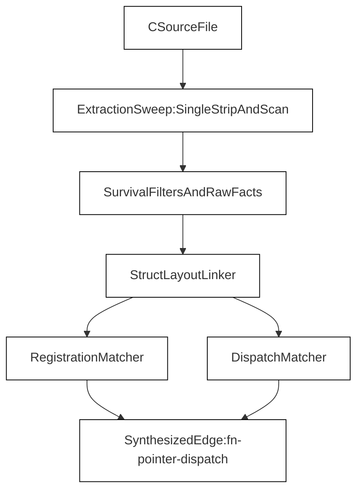
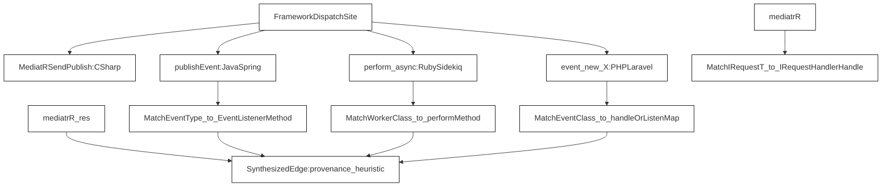

<!-- source: DeepWiki mcp.deepwiki.com · repo colbymchenry/codegraph · extra page Dispatch and Callback Synthesizers · fetched 2026-10-30 -->

# Dispatch and Callback Synthesizers

<details>
<summary>Relevant source files</summary>

The following files were used as context for generating this wiki page:

- [__tests__/angular-router.test.ts](__tests__/angular-router.test.ts)
- [__tests__/c-fnptr-synthesizer.test.ts](__tests__/c-fnptr-synthesizer.test.ts)
- [__tests__/explore-allocation-1500.test.ts](__tests__/explore-allocation-1500.test.ts)
- [__tests__/explore-allocation-e2e.test.ts](__tests__/explore-allocation-e2e.test.ts)
- [__tests__/explore-diagnostics.test.ts](__tests__/explore-diagnostics.test.ts)
- [__tests__/explore-isolated-named-cluster.test.ts](__tests__/explore-isolated-named-cluster.test.ts)
- [__tests__/explore-merged-spine-cluster.test.ts](__tests__/explore-merged-spine-cluster.test.ts)
- [__tests__/explore-named-file-valve.test.ts](__tests__/explore-named-file-valve.test.ts)
- [__tests__/explore-proportional-allocation.test.ts](__tests__/explore-proportional-allocation.test.ts)
- [__tests__/explore-relevance-scoring.test.ts](__tests__/explore-relevance-scoring.test.ts)
- [__tests__/explore-reservation-invariant.test.ts](__tests__/explore-reservation-invariant.test.ts)
- [__tests__/laravel-event-synthesizer.test.ts](__tests__/laravel-event-synthesizer.test.ts)
- [__tests__/mcp-tool-annotations.test.ts](__tests__/mcp-tool-annotations.test.ts)
- [__tests__/mediatr-dispatch-synthesizer.test.ts](__tests__/mediatr-dispatch-synthesizer.test.ts)
- [__tests__/operator-method-names.test.ts](__tests__/operator-method-names.test.ts)
- [__tests__/sidekiq-dispatch-synthesizer.test.ts](__tests__/sidekiq-dispatch-synthesizer.test.ts)
- [__tests__/spring-event-synthesizer.test.ts](__tests__/spring-event-synthesizer.test.ts)
- [codegraph-kernel/src/cfnptr.rs](codegraph-kernel/src/cfnptr.rs)
- [docs/benchmarks/explore-allocation-ab-1500.md](docs/benchmarks/explore-allocation-ab-1500.md)
- [docs/design/dispatch-synthesizer-backlog.md](docs/design/dispatch-synthesizer-backlog.md)
- [docs/design/dynamic-dispatch-coverage-playbook.md](docs/design/dynamic-dispatch-coverage-playbook.md)
- [docs/design/explore-budget-allocation.md](docs/design/explore-budget-allocation.md)
- [scripts/agent-eval/allocation-fixtures.json](scripts/agent-eval/allocation-fixtures.json)
- [scripts/agent-eval/probe-allocation.mjs](scripts/agent-eval/probe-allocation.mjs)
- [scripts/agent-eval/probe-suite-envelope.mjs](scripts/agent-eval/probe-suite-envelope.mjs)
- [src/mcp/explore-diagnostics.ts](src/mcp/explore-diagnostics.ts)
- [src/resolution/angular-template-synthesizer.ts](src/resolution/angular-template-synthesizer.ts)
- [src/resolution/c-feature-variants.ts](src/resolution/c-feature-variants.ts)
- [src/resolution/c-fnptr-synthesizer.ts](src/resolution/c-fnptr-synthesizer.ts)
- [src/resolution/callback-synthesizer.ts](src/resolution/callback-synthesizer.ts)
- [src/resolution/frameworks/angular-router.ts](src/resolution/frameworks/angular-router.ts)
- [src/resolution/frameworks/expo-modules.ts](src/resolution/frameworks/expo-modules.ts)
- [src/resolution/go-func-field-synthesizer.ts](src/resolution/go-func-field-synthesizer.ts)
- [src/resolution/react-router-synthesizer.ts](src/resolution/react-router-synthesizer.ts)
- [src/ui-server/api/route-roots.ts](src/ui-server/api/route-roots.ts)
- [src/ui-server/api/screens.ts](src/ui-server/api/screens.ts)

</details>


This page documents CodeGraph's heuristic edge synthesis subsystem (`src/resolution/`), which resolves dynamic dispatch, framework event buses, callback patterns, and cross-tier calls that static AST visitors cannot resolve directly.

---

## 1. Overview of Heuristic Synthesis

Static code extraction builds containment (`contains`), import (`imports`), and direct call (`calls`) edges by visiting syntactic constructs. However, dynamic dispatch mechanisms—such as string-keyed event emitters, C function-pointer tables, reflection-based framework messaging, command registries, and cross-tier wire protocols—hide the true call graph behind indirection. 

CodeGraph closes these gaps via whole-graph passes executed immediately after base symbol and import resolution `[src/resolution/callback-synthesizer.ts:18-23()]`. Every synthesized edge is explicitly tagged with `provenance: 'heuristic'` and carries metadata identifying the specific synthesizer and strategy that produced it.

```mermaid
graph TD
    subcode["SourceFiles"] --> parser["BaseExtractionPipeline"]
    parser --> basegraph["BaseResolutionPass"]
    basegraph --> synth["HeuristicSynthesisPasses"]
    synth -->| "fn-pointer-dispatch" | c_edges["CFunctionPointerEdges"]
    synth -->| "object-registry" | reg_edges["CommandBusEdges"]
    synth -->| "laravel-event / spring-event" | bus_edges["FrameworkEventBusEdges"]
    synth -->| "rtk-query" | rtk_edges["RTKQueryEdges"]
    synth -->| "tier-synthesizer" | tier_edges["CrossTierEdges"]
    c_edges --> final["UnifiedKnowledgeGraph"]
    reg_edges --> final
    bus_edges --> final
    rtk_edges --> final
    tier_edges --> final

    classDef default fill:none,stroke:#000,stroke-width:1px;
```
*Figure 1: High-level data flow for heuristic edge synthesis.*

Sources: `src/resolution/callback-synthesizer.ts:1-23`, `docs/design/dispatch-synthesizer-backlog.md:1-50`

---

## 2. C/C++ Function-Pointer Dispatch Synthesizer

C and C++ implement polymorphism via function pointers embedded in structs or raw arrays `[src/resolution/c-fnptr-synthesizer.ts:1-13()]`. Synthesizing edges across these boundaries requires identifying structural initializers and matching them with indirect calls.

### Implementation and the Fuse-Then-Link Architecture

The C function-pointer synthesizer (`src/resolution/c-fnptr-synthesizer.ts`) operates via a **fuse-then-link** architecture to eliminate redundant file re-reading on large codebases `[src/resolution/c-fnptr-synthesizer.ts:51-82()]`:

1. **Extraction Sweep:** Each file is read and stripped of comments once `[src/resolution/c-fnptr-synthesizer.ts:58-66()]`. It collects typedef names, struct field declarations, resolved include paths, and lightweight survival filter tokens.
2. **Struct-Layout Linking:** Deferred field types are classified against complete global typedef sets to establish layout precedence `[src/resolution/c-fnptr-synthesizer.ts:67-71()]`.
3. **Registration and Dispatch:** Files passing survival filters are evaluated for positional/designated initializers (`.fn = cmd_add`) and indirect calls (`p->fn(argv)`) `[src/resolution/c-fnptr-synthesizer.ts:72-78()]`.


*Figure 2: C Function-Pointer Dispatch Resolution.*

Sources: `src/resolution/c-fnptr-synthesizer.ts:1-121`, `__tests__/c-fnptr-synthesizer.test.ts:1-173`, `codegraph-kernel/src/cfnptr.rs:1-87`

---

## 3. EventEmitter, Field-Backed Observers, and Closure Collections

Dynamic languages (TypeScript, JavaScript, Swift, Kotlin) use event emitters, observer lists, and closure collections for decoupled communication `[src/resolution/callback-synthesizer.ts:1-23()]`.

### Phase 1: Field-Backed Observers and Closure Collections
* **Field-Backed Observers:** Matches registrar methods (`onUpdate(cb) { this.callbacks.add(cb); }`) with dispatcher methods (`triggerUpdate() { for (cb of this.callbacks) cb(); }`) sharing the same field and file context `[src/resolution/callback-synthesizer.ts:7-12()]`.
* **Closure Collections:** Scans Swift/Kotlin codebases for collection properties populated via `.append()` / `.push()` and iterated via trailing closures containing element invocations (`coll.forEach { $0() }`) `[src/resolution/callback-synthesizer.ts:69-89()]`. The element-invoke gate (`$0(` / `it(`) ensures high precision across files and classes `[src/resolution/callback-synthesizer.ts:85-105()]`.

### Phase 2: String-Keyed EventEmitters
* Matches registration statements (`this.on('mount', onmount)`) against emission points (`fn.emit('mount', this)`) based on string literal keys `[src/resolution/callback-synthesizer.ts:13-17()]`.
* Generic event names (such as `'error'` or `'data'`) exceeding `EVENT_FANOUT_CAP` (6 handlers/dispatchers) are automatically skipped to prevent combinatorial explosions without type signatures `[src/resolution/callback-synthesizer.ts:46-54()]`.

```mermaid
graph TD
    reg["Registration:emitter.on('mount',onmount)"] --> chan["EventChannel:mount"]
    emit["Dispatch:emitter.emit('mount',payload)"] --> chan
    chan --> check["FanoutCheck:CountLessThanOrEqualTo6"]
    check -->| "Passed" | edge["SynthesizedEdge:calls"]

    classDef default fill:none,stroke:#000,stroke-width:1px;
```
*Figure 3: String-Keyed EventEmitter Channel Resolution.*

Sources: `src/resolution/callback-synthesizer.ts:1-105`

---

## 4. Framework Event Bus Synthesizers

Framework-specific event buses decouple message publication from execution using types, annotations, or configuration maps.


*Figure 4: Framework Event Bus Resolution bridging domain names to handler methods.*

### MediatR Dispatch Synthesizer (C#)
Resolves `_mediator.Send(x)` or `_mediator.Publish(x)` calls to the corresponding `Handle` method of `IRequestHandler<T>` or `INotificationHandler<T>` implementations `[__tests__/mediatr-dispatch-synthesizer.test.ts:1-12()]`.

### Spring Application Events (Java)
Bridges `publisher.publishEvent(new OrderShippedEvent())` calls to listener methods carrying `@EventListener` or implementing `ApplicationListener<T>` `[__tests__/spring-event-synthesizer.test.ts:1-13()]`.

### Sidekiq Job Dispatch (Ruby)
Links `WorkerClass.perform_async(...)`, `.perform_in`, and `.perform_at` invocations to `WorkerClass#perform` instance methods, gated by `include Sidekiq::Worker` or `Sidekiq::Job` declarations `[__tests__/sidekiq-dispatch-synthesizer.test.ts:1-11()]`.

### Laravel Event Dispatch (PHP)
Bridges `event(new SongLiked($id))` statements to listener `handle()` methods using parameter typehints or the `EventServiceProvider` `$listen` map `[__tests__/laravel-event-synthesizer.test.ts:7-98()]`.

Sources: `__tests__/mediatr-dispatch-synthesizer.test.ts:1-129`, `__tests__/spring-event-synthesizer.test.ts:1-133`, `__tests__/sidekiq-dispatch-synthesizer.test.ts:1-129`, `__tests__/laravel-event-synthesizer.test.ts:1-170`

---

## 5. UI Render Bridges, Command Registries, and RTK Query

CodeGraph synthesizes edges for object registries, Redux Toolkit Query endpoints, and UI render bridges to maintain complete flow integrity across application layers.

* **Name->Class Registry / Command Bus:** Matches object-literal registries `{ key: Handler }` with computed-key dispatches `reg[var]()`, linking dispatcher functions to handler execution methods `[docs/design/dispatch-synthesizer-backlog.md:51-58()]`.
* **RTK Query:** Extracts endpoint definitions (`createApi`) into virtual function nodes and bridges generated hooks (`useGetXQuery`) to their corresponding endpoint handlers using naming conventions `[docs/design/dispatch-synthesizer-backlog.md:51-58()]`.
* **Cross-Tier / UI Render Bridges:** The tier synthesizer (`src/resolution/tier-synthesizer.ts`) links client-side fetch/axios calls and event emissions to server endpoints and message queues across network boundaries `[src/resolution/tier-synthesizer.ts:1-54()]`.

Sources: `docs/design/dispatch-synthesizer-backlog.md:1-58`, `src/resolution/tier-synthesizer.ts:1-54`

---

