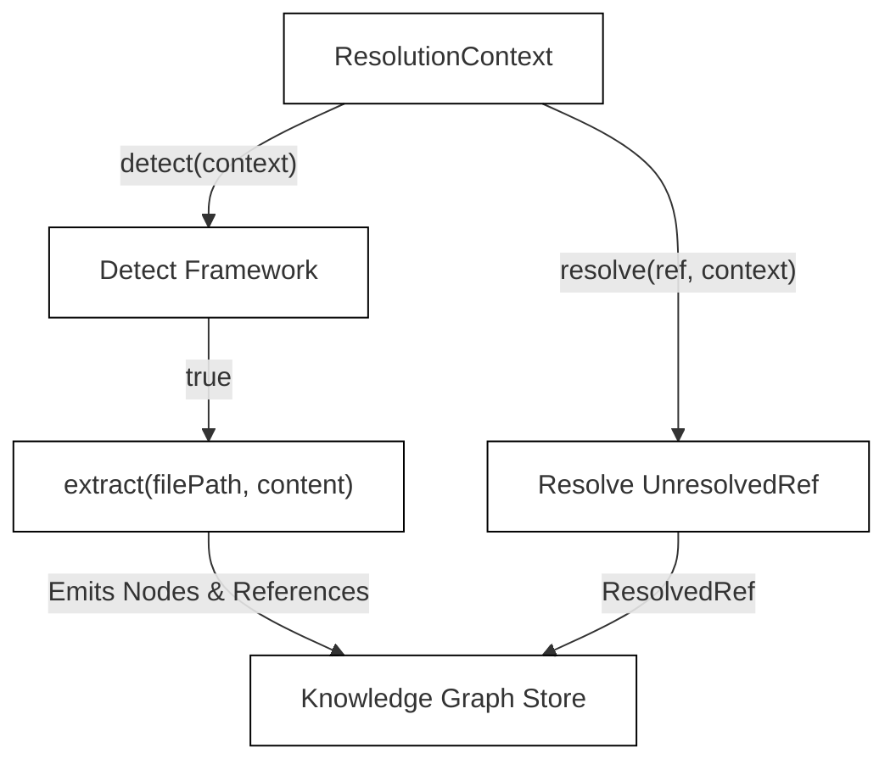
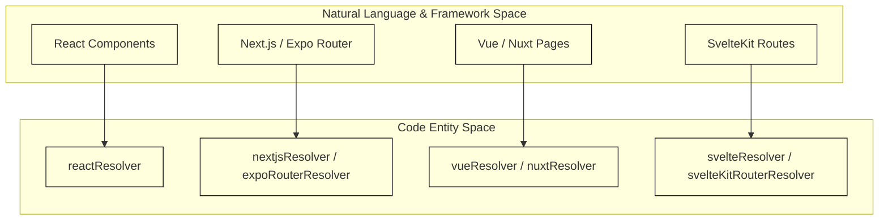
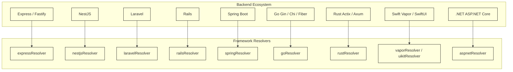

<!-- source: DeepWiki mcp.deepwiki.com · repo colbymchenry/codegraph · extra page Framework Resolvers · fetched 2026-10-30 -->

# Framework Resolvers

Relevant source files

The following files were used as context for generating this wiki page:

- [__tests__/express-heuristic-same-file.test.ts](__tests__/express-heuristic-same-file.test.ts)
- [__tests__/express-inline-function-handler.test.ts](__tests__/express-inline-function-handler.test.ts)
- [__tests__/fastendpoints-routes.test.ts](__tests__/fastendpoints-routes.test.ts)
- [__tests__/flask-url-rules.test.ts](__tests__/flask-url-rules.test.ts)
- [__tests__/frameworks-integration.test.ts](__tests__/frameworks-integration.test.ts)
- [__tests__/frameworks.test.ts](__tests__/frameworks.test.ts)
- [__tests__/integration/full-pipeline.test.ts](__tests__/integration/full-pipeline.test.ts)
- [__tests__/integration/lru-cache.test.ts](__tests__/integration/lru-cache.test.ts)
- [__tests__/integration/mcp-input-limits.test.ts](__tests__/integration/mcp-input-limits.test.ts)
- [__tests__/js-resolution-work.test.ts](__tests__/js-resolution-work.test.ts)
- [__tests__/laravel-controller-strings.test.ts](__tests__/laravel-controller-strings.test.ts)
- [__tests__/laravel-route-paths.test.ts](__tests__/laravel-route-paths.test.ts)
- [__tests__/monorepo-app-frameworks.test.ts](__tests__/monorepo-app-frameworks.test.ts)
- [__tests__/mybatis-extractor-robustness.test.ts](__tests__/mybatis-extractor-robustness.test.ts)
- [__tests__/nestjs-global-prefix.test.ts](__tests__/nestjs-global-prefix.test.ts)
- [__tests__/nestjs-provider-same-file.test.ts](__tests__/nestjs-provider-same-file.test.ts)
- [__tests__/nuxt-navigate-to.test.ts](__tests__/nuxt-navigate-to.test.ts)
- [__tests__/play-nested-projects.test.ts](__tests__/play-nested-projects.test.ts)
- [__tests__/rails-only-except-forms.test.ts](__tests__/rails-only-except-forms.test.ts)
- [__tests__/rails-scoped-routes.test.ts](__tests__/rails-scoped-routes.test.ts)
- [__tests__/react-own-declaration.test.ts](__tests__/react-own-declaration.test.ts)
- [__tests__/react-router-nested-lazy.test.ts](__tests__/react-router-nested-lazy.test.ts)
- [__tests__/react-router.test.ts](__tests__/react-router.test.ts)
- [__tests__/rust-framework-name-scope.test.ts](__tests__/rust-framework-name-scope.test.ts)
- [__tests__/rust-route-handler-line.test.ts](__tests__/rust-route-handler-line.test.ts)
- [__tests__/rust-type-scope.test.ts](__tests__/rust-type-scope.test.ts)
- [__tests__/sync-navigation-retry.test.ts](__tests__/sync-navigation-retry.test.ts)
- [__tests__/vapor-closure-route-body.test.ts](__tests__/vapor-closure-route-body.test.ts)
- [__tests__/vue-module-imports.test.ts](__tests__/vue-module-imports.test.ts)
- [docs/benchmarks/index-drift-cg33.md](docs/benchmarks/index-drift-cg33.md)
- [docs/design/framework-coverage.md](docs/design/framework-coverage.md)
- [scripts/agent-eval/diff-index-drift.mjs](scripts/agent-eval/diff-index-drift.mjs)
- [src/extraction/mybatis-extractor.ts](src/extraction/mybatis-extractor.ts)
- [src/resolution/frameworks/csharp.ts](src/resolution/frameworks/csharp.ts)
- [src/resolution/frameworks/expo-router.ts](src/resolution/frameworks/expo-router.ts)
- [src/resolution/frameworks/express.ts](src/resolution/frameworks/express.ts)
- [src/resolution/frameworks/go.ts](src/resolution/frameworks/go.ts)
- [src/resolution/frameworks/index.ts](src/resolution/frameworks/index.ts)
- [src/resolution/frameworks/java.ts](src/resolution/frameworks/java.ts)
- [src/resolution/frameworks/laravel.ts](src/resolution/frameworks/laravel.ts)
- [src/resolution/frameworks/nestjs.ts](src/resolution/frameworks/nestjs.ts)
- [src/resolution/frameworks/nextjs.ts](src/resolution/frameworks/nextjs.ts)
- [src/resolution/frameworks/play.ts](src/resolution/frameworks/play.ts)
- [src/resolution/frameworks/python.ts](src/resolution/frameworks/python.ts)
- [src/resolution/frameworks/react-router.ts](src/resolution/frameworks/react-router.ts)
- [src/resolution/frameworks/react.ts](src/resolution/frameworks/react.ts)
- [src/resolution/frameworks/ruby.ts](src/resolution/frameworks/ruby.ts)
- [src/resolution/frameworks/rust.ts](src/resolution/frameworks/rust.ts)
- [src/resolution/frameworks/svelte.ts](src/resolution/frameworks/svelte.ts)
- [src/resolution/frameworks/sveltekit-router.ts](src/resolution/frameworks/sveltekit-router.ts)
- [src/resolution/frameworks/swift.ts](src/resolution/frameworks/swift.ts)
- [src/resolution/frameworks/tanstack-router.ts](src/resolution/frameworks/tanstack-router.ts)
- [src/resolution/frameworks/vue-router.ts](src/resolution/frameworks/vue-router.ts)
- [src/resolution/frameworks/vue.ts](src/resolution/frameworks/vue.ts)
- [src/resolution/lru-cache.ts](src/resolution/lru-cache.ts)
- [src/resolution/strip-comments.ts](src/resolution/strip-comments.ts)

This page documents the framework resolver plugin system in CodeGraph, detailing its architecture, plugin interface, lifecycle methods, and the comprehensive suite of built-in resolvers spanning modern frontend frameworks, backend web servers, and multi-language enterprise runtimes.

---

## 1. Architecture and Plugin System

CodeGraph's reference resolution engine uses framework resolvers to bridge the gap between standard syntax-level symbol matching and high-level framework conventions (such as HTTP routing tables, dependency injection containers, file-system routing, and component lifecycles).

Each resolver conforms to the `FrameworkResolver` contract, which defines project detection, static extractions, and custom reference resolution logic [src/resolution/frameworks/index.ts:43-103]().

*Diagram 1: Framework Resolver execution lifecycle across detection, extraction, and resolution phases.*

Sources: `src/resolution/frameworks/index.ts:122-130`, `src/resolution/types.ts`

### The `FrameworkResolver` Interface

A framework resolver implements a subset of the following hooks:
- `name`: Unique string identifier for the resolver [src/resolution/frameworks/index.ts:108-117]().
- `languages`: Array of primary languages targeted by the resolver [src/resolution/frameworks/index.ts:136-143]().
- `resolveLanguages`: Optional override for languages whose references are processed by this resolver [src/resolution/frameworks/index.ts:156-165]().
- `detect(context: ResolutionContext): boolean`: Inspects workspace configuration files (`package.json`, `Cargo.toml`, `go.mod`, etc.) or imports to determine if the framework is active [src/resolution/frameworks/index.ts:122-130]().
- `extract(filePath: string, content: string)`: Optional pass to extract framework-specific entities (like `route` nodes or implicit reference links) directly from source text [__tests__/frameworks.test.ts:5-19]().
- `resolve(ref: UnresolvedRef, context: ResolutionContext): ResolvedRef | null`: Maps an unresolved reference to a concrete target node using framework semantics [src/resolution/frameworks/rust.ts:43-102]().
- `claimsReference(name: string): boolean`: Optional opt-in to bypass standard name-existence pre-filters for synthetic reference names (e.g., config prefixes or route action handlers) [src/resolution/frameworks/java.ts:16-22]().

Sources: `src/resolution/frameworks/index.ts:105-176`, `__tests__/frameworks.test.ts:5-20`

---

## 2. Frontend Framework Resolvers

Frontend resolvers manage component hierarchies, file-system routing, state bindings, and framework-specific runtimes (such as React hooks and Svelte runes).

*Diagram 2: Mapping frontend architectural patterns to their respective resolver implementations in CodeGraph.*

Sources: `src/resolution/frameworks/index.ts:13-36`, `src/resolution/frameworks/svelte.ts:45-151`

### React, React Router, Next.js, and Expo Router
- **React (`reactResolver`)**: Handles JSX component identification, hook validation, and props-to-state mappings across `.tsx`, `.jsx`, `.ts`, and `.js` files [src/resolution/frameworks/index.ts:50]().
- **React Router (`reactRouterResolver`)**: Maps declarative `<Route path>` definitions to component targets and resolves imperative navigation calls like `history.push('/x')` or `navigate('/x')` into navigation edges [src/resolution/frameworks/index.ts:51-52]().
- **Next.js (`nextjsResolver`)**: Parses `app/**/page.tsx`, `pages/**` layouts, and `route.ts` API endpoints into `route` nodes, while routing `router.push('/x')` and `redirect('/x')` calls [src/resolution/frameworks/index.ts:55]().
- **Expo Router (`expoRouterResolver`)**: Inspects file-system route layout patterns under `app/` and resolves `router.push('/x')` invocations to screen components [src/resolution/frameworks/index.ts:95-96]().

Sources: `src/resolution/frameworks/index.ts:13-15`, `src/resolution/frameworks/svelte.ts:45-190`

### Vue, Angular, Svelte, Astro, and Expo Modules
- **Vue / Nuxt (`vueResolver`, `nuxtResolver`)**: Extracts template bindings, SFC (Single File Component) script setups, store auto-subscriptions, and Nuxt file-system routing (`pages/**`, `server/api/**`) [src/resolution/frameworks/index.ts:21,61-64]().
- **Vue Router (`vueRouterResolver`)**: Resolves `createRouter({ routes })` structures and `router.push({ name })` navigation calls [src/resolution/frameworks/index.ts:17,63-64]().
- **Angular / Angular Router (`angularRouterResolver`)**: Handles Angular module declarations, component decorators, dependency injection tokens, and router configurations [src/resolution/frameworks/index.ts:18,65]().
- **Svelte / SvelteKit (`svelteResolver`, `svelteKitRouterResolver`)**: Resolves Svelte 5 compiler runes (`$state`, `$derived`, `$effect`), store auto-subscriptions (`$storeName`), `$lib/*` aliases, and file-system based `+page.svelte` route nodes [src/resolution/frameworks/svelte.ts:45-190]().
- **Astro (`astroResolver`)**: Extracts frontmatter scripts, component props, and island hydration directives from `.astro` files [src/resolution/frameworks/index.ts:22,66]().
- **Expo Modules (`expoModulesResolver`, `expoModulesJsResolver`)**: Bridges native Swift/Kotlin module DSLs with JavaScript `requireNativeModule()` bindings [src/resolution/frameworks/index.ts:34]().

Sources: `src/resolution/frameworks/index.ts:16-22`, `src/resolution/frameworks/svelte.ts:45-190`

---

## 3. Backend and Full-Stack Framework Resolvers

Backend resolvers handle controller mapping, HTTP verb routing, ORM models, configuration injection, and dependency container wiring.

*Diagram 3: Backend framework resolver dispatch hierarchy.*

Sources: `src/resolution/frameworks/index.ts:43-86`, `src/resolution/frameworks/express.ts:104-128`, `src/resolution/frameworks/csharp.ts:12-69`

### Node.js (Express & NestJS)
- **Express (`expressResolver`)**: Scans `package.json` for express/fastify/koa dependencies [src/resolution/frameworks/express.ts:108-111](). It parses inline handler bodies via `handlerCallNames()` and extracts response replies (`res.json()`, `reply.send()`) to form precise endpoint contracts [src/resolution/frameworks/express.ts:59-102]().
- **NestJS (`nestjsResolver`)**: Handles decorator-based routing across HTTP (`@Controller` + `@Get`), GraphQL (`@Resolver` + `@Query`), Microservices (`@MessagePattern`), and WebSockets (`@WebSocketGateway`) [src/resolution/frameworks/nestjs.ts:4-9](). It joins class-level and method-level route prefixes and resolves injected providers using convention-based suffixes (`*.service.ts`) [src/resolution/frameworks/nestjs.ts:82-114]().

Sources: `src/resolution/frameworks/express.ts:104-128`, `src/resolution/frameworks/nestjs.ts:1-114`

### PHP, Ruby, and Java
- **Laravel (`laravelResolver`)**: Parses PHP routing files, controller strings (`Controller@action`), service container bindings, and Eloquent model relationships [src/resolution/frameworks/laravel.ts:10,180]().
- **Rails (`railsResolver`)**: Resolves Ruby on Rails convention over configuration patterns, including `config/routes.rb` mappings to controllers and ActiveModel associations [src/resolution/frameworks/rails.ts]().
- **Spring Boot (`springResolver`)**: Parses `pom.xml`, `build.gradle`, or `build.gradle.kts` for Spring dependencies [src/resolution/frameworks/java.ts:24-41](). It resolves configuration property bindings (`@Value("${...}")` and `@ConfigurationProperties`) via relaxed binding rules and maps `@Service`, `@Repository`, and `@RestController` dependency injections [src/resolution/frameworks/java.ts:61-146]().

Sources: `src/resolution/frameworks/laravel.ts`, `src/resolution/frameworks/ruby.ts`, `src/resolution/frameworks/java.ts:12-146`

### Go, Rust, Swift, and C#
- **Go (`goResolver`)**: Inspects `go.mod` files and `.go` sources [src/resolution/frameworks/go.ts:17-27](). Extracts routes from frameworks like Gin, Chi, and Fiber via pattern matching on router methods (`v1.GET`, `mux.HandleFunc`) and resolves package-scoped service and handler names [src/resolution/frameworks/go.ts:45-164]().
- **Rust (`rustResolver`)**: Detects `Cargo.toml` projects [src/resolution/frameworks/rust.ts:38-41](). Extracts Actix-web attribute macros (`#[get("/path")]`) and Axum chained route calls (`.route("/path", get(handler))`), using scope verification to prevent namespace pollution [src/resolution/frameworks/rust.ts:104-177]().
- **Swift (`swiftUIResolver`, `uikitResolver`, `vaporResolver`)**: Handles SwiftUI view structures, UIKit view controllers and delegates, and Vapor server-side Swift routing [src/resolution/frameworks/swift.ts:1-206]().
- **C# / ASP.NET (`aspnetResolver`)**: Detects `.csproj` and `Program.cs` signatures [src/resolution/frameworks/csharp.ts:19-69](). Extracts controller route prefixes (`[Route("api/[controller]")]`) and action verbs (`[HttpGet]`, `[HttpPost]`), resolving DTOs, ViewModels, and dependency-injected services [src/resolution/frameworks/csharp.ts:71-137]().

Sources: `src/resolution/frameworks/go.ts:13-168`, `src/resolution/frameworks/rust.ts:34-177`, `src/resolution/frameworks/swift.ts:16-206`, `src/resolution/frameworks/csharp.ts:12-137`

---

## 4. Data Flow and Resolution Mechanics

When the query engine or indexing pipeline encounters an unresolved reference (`UnresolvedRef`), it queries applicable framework resolvers through `detectFrameworks()` and `getResolvingFrameworks()` [src/resolution/frameworks/index.ts:122-164]().

1. **Language Filtering**: Resolvers specify `languages` or `resolveLanguages` to ensure cross-language pollution does not occur (e.g., preventing a Go logger rule from intercepting a TypeScript method call) [src/resolution/frameworks/index.ts:136-164]().
2. **Confidence Scoring**: Each returned `ResolvedRef` includes a confidence score (typically ranging from `0.7` to `1.0`) reflecting whether the resolution was derived from precise framework AST extraction, file convention heuristics, or workspace manifests [src/resolution/frameworks/swift.ts:53,95]().
3. **Registry Mutation**: Custom framework resolvers can be injected at runtime using `registerFrameworkResolver()`, which manages deduplication by resolver name [src/resolution/frameworks/index.ts:167-176]().

Sources: `src/resolution/frameworks/index.ts:122-176`, `src/resolution/frameworks/swift.ts:42-87`

---

## Sources

- `src/resolution/types.ts`
- `src/resolution/frameworks/index.ts`
- `src/resolution/frameworks/express.ts`
- `src/resolution/frameworks/nestjs.ts`
- `src/resolution/frameworks/java.ts`
- `src/resolution/frameworks/go.ts`
- `src/resolution/frameworks/rust.ts`
- `src/resolution/frameworks/swift.ts`
- `src/resolution/frameworks/csharp.ts`
- `src/resolution/frameworks/svelte.ts`
- `__tests__/frameworks.test.ts`
- `__tests__/frameworks-integration.test.ts`

---

