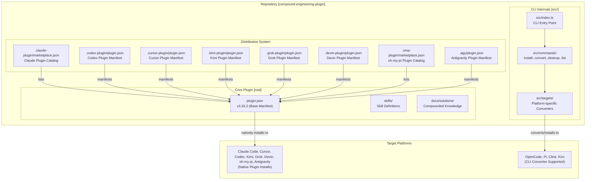
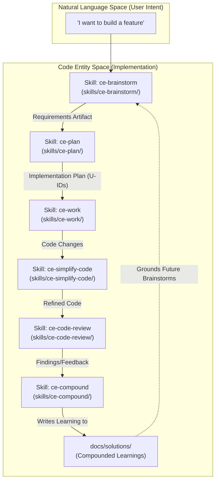

<!-- source: DeepWiki mcp.deepwiki.com · repo EveryInc/compound-engineering-plugin · page 1 Overview · fetched 2026-10-30 -->

# Overview

Relevant source files

The following files were used as context for generating this wiki page:

- [.agents/skills/ce-skill-work/SKILL.md](.agents/skills/ce-skill-work/SKILL.md)
- [.agents/skills/ce-skill-work/references/edit-skill.md](.agents/skills/ce-skill-work/references/edit-skill.md)
- [.agents/skills/ce-skill-work/references/evaluate.md](.agents/skills/ce-skill-work/references/evaluate.md)
- [.agents/skills/ce-skill-work/references/new-skill.md](.agents/skills/ce-skill-work/references/new-skill.md)
- [.agents/skills/ce-skill-work/references/respond-to-review.md](.agents/skills/ce-skill-work/references/respond-to-review.md)
- [.agents/skills/ce-skill-work/references/review-skill.md](.agents/skills/ce-skill-work/references/review-skill.md)
- [.agy/plugin.json](.agy/plugin.json)
- [.claude-plugin/marketplace.json](.claude-plugin/marketplace.json)
- [.claude-plugin/plugin.json](.claude-plugin/plugin.json)
- [.codex-plugin/plugin.json](.codex-plugin/plugin.json)
- [.cursor-plugin/plugin.json](.cursor-plugin/plugin.json)
- [.devin-plugin/plugin.json](.devin-plugin/plugin.json)
- [.github/.release-please-manifest.json](.github/.release-please-manifest.json)
- [.github/release-please-config.json](.github/release-please-config.json)
- [.grok-plugin/plugin.json](.grok-plugin/plugin.json)
- [.kimi-plugin/plugin.json](.kimi-plugin/plugin.json)
- [.omp-plugin/marketplace.json](.omp-plugin/marketplace.json)
- [AGENTS.md](AGENTS.md)
- [CHANGELOG.md](CHANGELOG.md)
- [CLAUDE.md](CLAUDE.md)
- [README.md](README.md)
- [docs/solutions/skill-design/portable-agent-skill-authoring.md](docs/solutions/skill-design/portable-agent-skill-authoring.md)
- [docs/solutions/skill-design/size-driven-skill-restructure.md](docs/solutions/skill-design/size-driven-skill-restructure.md)
- [docs/specs/cursor.md](docs/specs/cursor.md)
- [package.json](package.json)
- [plugin.json](plugin.json)
- [src/release/components.ts](src/release/components.ts)
- [src/release/metadata.ts](src/release/metadata.ts)
- [src/release/types.ts](src/release/types.ts)
- [tests/release-components.test.ts](tests/release-components.test.ts)
- [tests/release-metadata.test.ts](tests/release-metadata.test.ts)
- [tests/release-preview.test.ts](tests/release-preview.test.ts)

This document introduces the `compound-engineering-plugin` repository, explaining its dual nature as both a comprehensive AI development plugin catalog and a cross-platform CLI tool for plugin distribution. For installation instructions, see [Installation and Setup](#1.1). For detailed directory structure, see [Repository Structure](#1.2).

## Purpose and Scope

The `compound-engineering-plugin` repository serves two distinct purposes:

1.  **Compound Engineering Plugin** — A comprehensive AI-powered development toolkit implementing the compound engineering philosophy. Version `3.33.2` includes a broad catalog of skills; specialist behavior is encapsulated within skills as skill-local prompt assets `[package.json:2-3]()`, `[.codex-plugin/plugin.json:1-45]()`.
2.  **Cross-Platform CLI Tool** — A Bun/TypeScript CLI used to convert and install plugins across multiple AI coding platforms. It provides commands for `install`, `convert`, and `cleanup` `[package.json:21-23]()`.

The repository contains the core plugin source, the CLI tool source, and supporting infrastructure for distribution and documentation.

**Sources:** `[package.json:1-30]()`, `[.codex-plugin/plugin.json:1-45]()`

## Repository Architecture

The repository implements a dual-identity architecture: it serves as both a plugin distribution system and a cross-platform CLI tool.

**Diagram 1: Repository Structure and Distribution Model**

The CLI tool (`[package.json:20-23]()`) provides the `install`, `convert`, `cleanup`, and `list` commands that transform the plugin format for platforms that do not yet support native marketplace installs. Supported target platforms include `OpenCode`, `Pi`, `Cline`, and `Kiro` `[package.json:7-15]()`.

**Sources:** `[package.json:1-41]`, `[.claude-plugin/plugin.json:1-20]`, `[.codex-plugin/plugin.json:1-45]`, `[.cursor-plugin/plugin.json:1-25]`, `[.kimi-plugin/plugin.json:1-25]`, `[.grok-plugin/plugin.json:1-21]`, `[.devin-plugin/plugin.json:1-20]`, `[.agy/plugin.json]()`

## The Compounding Engineering Philosophy

**Core Principle:** Each unit of engineering work should make subsequent units easier—not harder `[README.md:110-111]()`.

Traditional development accumulates technical debt. Compounding engineering inverts this through a workflow that emphasizes planning and review (80%) over raw execution (20%) `[README.md:117-118]()`. Knowledge is captured as "Learnings" in `docs/solutions/` to ensure future sessions start with better context.

**Diagram 2: Bridging User Intent to Compounding Code Entities**

The philosophy manifests in the core loop commands. `/ce-brainstorm` defines requirements, `/ce-plan` creates implementation-ready plans, `/ce-work` executes them, `/ce-simplify-code` refines code, `/ce-code-review` reviews, and `/ce-compound` captures the resulting knowledge `[README.md:129-135]()`.

**Sources:** `[README.md:110-135]()`

## Architecture and Components

The plugin follows an agent-native architecture where specialist behavior lives inside skills as prompt assets.

**Component Inventory:**

| Category | Role | Purpose | Example |
| :--- | :--- | :--- | :--- |
| **Skills** | Orchestrator | User-facing entry points | `ce-plan`, `ce-work` |
| **Prompt Assets** | Specialist | Internal personas (security, reviewer) | Internal to skills |
| **CLI Commands** | Utility | Installation and maintenance `[package.json:21-23]()` | `install`, `cleanup` |

Skills are the primary entry points, often invoked as slash commands `[README.md:113-114]()`. They orchestrate sub-agents to manage cost and performance.

**Sources:** `[package.json:21-23]`, `[README.md:113-135]()`

## Cross-Platform Distribution

The repository supports a wide range of AI coding environments. While some use native installs, others rely on the CLI for conversion.

| Target Platform | Installation Method |
| :--- | :--- |
| **Claude Code** | Native marketplace install `[README.md:25-34]()` |
| **Cursor** | Native plugin marketplace `[README.md:36-41]()` |
| **Grok Bot** | Uses Cursor account plugin library `[README.md:44-55]()` |
| **Codex App/CLI** | Native plugin marketplace or CLI `[README.md:58-104]()` |
| **OpenCode / Pi / Cline / Kiro / Antigravity / Devin** | CLI-based conversion and install `[README.md:105]()` |

The CLI tool also includes a `cleanup` command to migrate from legacy Bun-only installs to native plugin systems `[package.json:22]()`. For details, see [Installation and Setup](#1.1).

**Sources:** `[package.json:7-23]`, `[.cursor-plugin/plugin.json:1-25]`, `[README.md:25-105]()`

## Release and Documentation Pipeline

*   **Versioning:** The repository uses a linked versioning strategy (currently `3.33.2`) across all manifests `[package.json:3]`, `[.github/.release-please-manifest.json:2]()`.
*   **Metadata Sync:** The `release:sync-metadata` script ensures consistency between `plugin.json`, marketplace catalogs, and documentation `[package.json:35]()`.
*   **Changelog:** All major features and bug fixes are tracked in the root `CHANGELOG.md` `[CHANGELOG.md:1-136]()`.

**Sources:** `[package.json:3-35]`, `[.github/.release-please-manifest.json:1-5]`, `[CHANGELOG.md:1-136]()`

---

