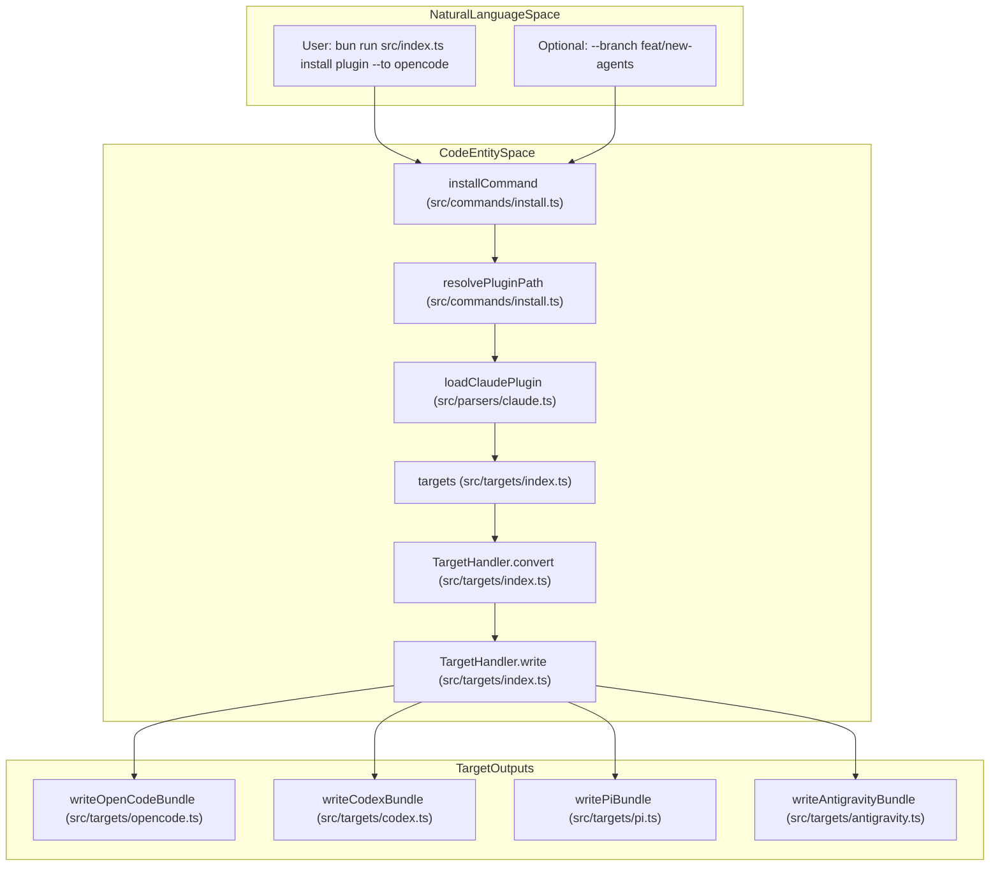
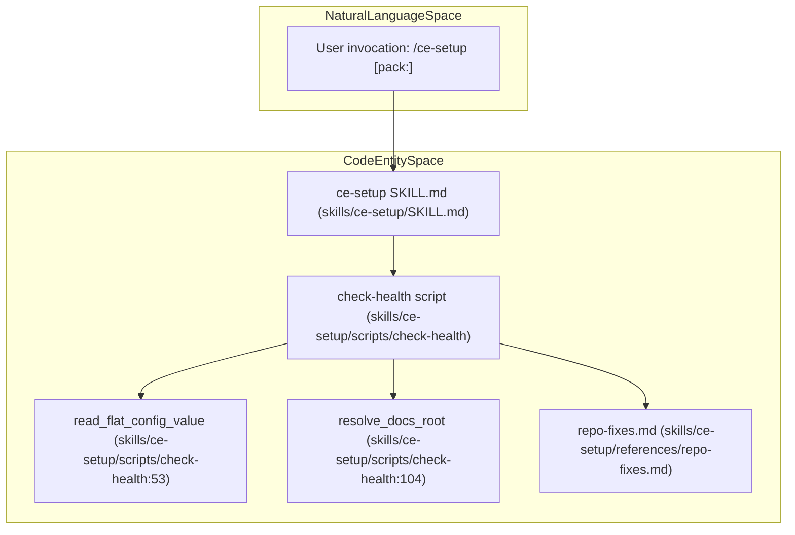

<!-- source: DeepWiki mcp.deepwiki.com · repo EveryInc/compound-engineering-plugin · page 1.1 Installation and Setup · fetched 2026-10-30 -->

# Installation and Setup

<details>
<summary>Relevant source files</summary>

The following files were used as context for generating this wiki page:

- [.compound-engineering/config.example.yaml](.compound-engineering/config.example.yaml)
- [CONTRIBUTING.md](CONTRIBUTING.md)
- [assets/demo/README.md](assets/demo/README.md)
- [assets/demo/compound-loop.gif](assets/demo/compound-loop.gif)
- [assets/demo/compound-loop.tape](assets/demo/compound-loop.tape)
- [bun.lock](bun.lock)
- [docs/guides/configuration.md](docs/guides/configuration.md)
- [docs/install/upgrading.md](docs/install/upgrading.md)
- [skills/ce-setup/SKILL.md](skills/ce-setup/SKILL.md)
- [skills/ce-setup/references/config-template.yaml](skills/ce-setup/references/config-template.yaml)
- [skills/ce-setup/references/legacy-codex-tool-map.md](skills/ce-setup/references/legacy-codex-tool-map.md)
- [skills/ce-setup/references/repo-fixes.md](skills/ce-setup/references/repo-fixes.md)
- [skills/ce-setup/scripts/check-health](skills/ce-setup/scripts/check-health)
- [src/commands/convert.ts](src/commands/convert.ts)
- [src/commands/install.ts](src/commands/install.ts)
- [src/commands/plugin-path.ts](src/commands/plugin-path.ts)
- [src/index.ts](src/index.ts)
- [src/targets/index.ts](src/targets/index.ts)
- [tests/cli.test.ts](tests/cli.test.ts)
- [tests/helpers/acpx-pin.ts](tests/helpers/acpx-pin.ts)
- [tests/plugin-path.test.ts](tests/plugin-path.test.ts)
- [tests/resolve-output.test.ts](tests/resolve-output.test.ts)
- [tests/skill-eval-cell/extract.test.ts](tests/skill-eval-cell/extract.test.ts)
- [tests/skill-eval-cell/path-shim.test.ts](tests/skill-eval-cell/path-shim.test.ts)
- [tests/skill-eval-cell/path-shim.ts](tests/skill-eval-cell/path-shim.ts)
- [tests/skills/ce-resolve-pr-feedback-script-dir.test.ts](tests/skills/ce-resolve-pr-feedback-script-dir.test.ts)
- [tests/skills/ce-setup-check-health.test.ts](tests/skills/ce-setup-check-health.test.ts)
- [tests/skills/fenced-blocks.ts](tests/skills/fenced-blocks.ts)
- [tests/skills/flatten-safety.test.ts](tests/skills/flatten-safety.test.ts)

</details>


This document provides a technical guide for installing the **compound-engineering-plugin** and the **compound-plugin CLI tool**. It covers installation across multiple AI coding environments, marketplace catalogs, the `.cline` install script, and the Bun CLI converter targets, alongside the project initialization mechanics (`ce-setup` skill, `check-health` script, and configuration keys).

## Purpose and Scope

The installation and setup subsystem satisfies two distinct deployment patterns:
1.  **Native Host Plugins**: Distributing marketplace-compatible manifests and skill catalogs directly into hosts with built-in plugin architectures (e.g., Claude Code, Cursor, Codex native plugins) [src/commands/install.ts:112-114]().
2.  **CLI Conversion and Synchronization**: Using the Bun/TypeScript CLI (`src/commands/install.ts` and `src/commands/convert.ts`) to parse, transform, and map Claude plugin structures into target configurations for hosts lacking native manifest support (OpenCode, Pi, Kiro, Antigravity) [src/commands/install.ts:28-32](), [src/targets/index.ts:48-76]().

Sources: [src/commands/install.ts:1-32](), [src/targets/index.ts:48-76]()

## Installation Across Hosts

The repository supports native installation for primary agent hosts and CLI-assisted conversions for secondary runtimes.

### Claude Code and Cursor
Claude Code and Cursor consume plugin catalogs via native marketplace commands. The plugin layout is governed by root manifests and host-specific directories [src/commands/install.ts:94-95]().
```text
/plugin marketplace add EveryInc/compound-engineering-plugin
/plugin install compound-engineering
```
Sources: [.claude-plugin/plugin.json:1-20](), [.cursor-plugin/plugin.json:1-25](), [src/commands/install.ts:94-95]()

### Codex
Codex supports native plugin installs or standalone CLI generation via `src/commands/install.ts` [src/commands/install.ts:71-76]().
```bash
bun run src/index.ts install compound-engineering --to codex
```
When using `--include-skills`, the CLI emits standalone skills and commands alongside agents [src/commands/install.ts:71-76](). It also strips legacy tool maps using `stripCodexAgentsToolMap` [src/commands/install.ts:151-152]().

Sources: [.codex-plugin/plugin.json:1-45](), [src/commands/install.ts:71-76](), [src/commands/install.ts:151-152]()

### OpenCode, Pi, Kiro, and Antigravity
These environments use the `compound-plugin` CLI with the `targets` registry (`src/targets/index.ts`) [src/targets/index.ts:48-76]().
*   **OpenCode**: Maps permissions (`none`, `broad`, `from-commands`) into `opencode.json` [src/commands/install.ts:15-16]().
*   **Pi**: Writes agent bundles to `~/.pi/agent` or `piHome` [src/commands/install.ts:97]().
*   **Antigravity**: Emits compliant `plugin.json` bundles [src/targets/index.ts:70-74]().
*   **Kiro**: Transforms configurations to utilize localized skill paths [tests/cli.test.ts:85-98]().

```bash
bun run src/index.ts install compound-engineering --to all
```
Sources: [src/commands/install.ts:15-16](), [src/commands/install.ts:97](), [src/targets/index.ts:48-76](), [tests/cli.test.ts:85-98]()

### Cline
Cline utilizes a dedicated shell script located at `.cline/scripts/install-skills.sh` to clone the repository and configure skills locally [tests/cline-install-skills.test.ts:10-11]().
```bash
git clone https://github.com/EveryInc/compound-engineering-plugin.git ~/.cline/plugins/compound-engineering
~/.cline/plugins/compound-engineering/.cline/scripts/install-skills.sh
```
Sources: [.cline/INSTALL.md:1-10](), [.cline/scripts/install-skills.sh:1-10](), [docs/specs/cline.md:1-10]()

Sources: [src/commands/install.ts:107-154](), [src/targets/index.ts:48-76]()

## CLI Tool Architecture and Installation Pipeline

The Bun CLI parses Claude-style plugins, normalizes metadata, and delegates writing to target handlers (`TargetHandler`) defined in `src/targets/index.ts` [src/targets/index.ts:37-46]().

Title: "CLI Installation and Conversion Flow"

Sources: [src/commands/install.ts:1-181](), [src/targets/index.ts:37-76]()

The `TargetHandler` interface requires a `convert` function mapping `ClaudePlugin` to a target bundle, and a `write` function persisting it under a resolved `TargetScope` (`global` or `workspace`) [src/targets/index.ts:11-46]().

Sources: [src/commands/install.ts:82-181](), [src/targets/index.ts:11-46]()

## The `ce-setup` Skill and `check-health` Script

Once installed, project initialization and environment validation are driven by the `ce-setup` skill (`skills/ce-setup/SKILL.md`) and its bundled diagnostic script (`skills/ce-setup/scripts/check-health`) [skills/ce-setup/SKILL.md:3](), [skills/ce-setup/scripts/check-health:2-3]().

### Core Diagnostic Functions
The `check-health` script implements lightweight shell parsers to inspect local configurations without external dependencies:
*   `read_flat_config_value()`: Extracts top-level YAML configuration keys using `awk`, stripping inline comments and surrounding quotes [skills/ce-setup/scripts/check-health:53-73]().
*   `resolve_real_best_effort()`: Resolves symlink-followed absolute paths across incomplete directory trees to prevent path traversal [skills/ce-setup/scripts/check-health:80-95]().
*   `resolve_docs_root()`: Validates the configured artifact root, ensuring it remains repo-relative, stays within repository boundaries, and never falls back silently upon error [skills/ce-setup/scripts/check-health:104-158]().

Title: "ce-setup Diagnostic and Remediation Pipeline"

Sources: [skills/ce-setup/SKILL.md:1-90](), [skills/ce-setup/scripts/check-health:53-158]()

Sources: [skills/ce-setup/SKILL.md:1-90](), [skills/ce-setup/scripts/check-health:1-158]()

## Configuration Surface: `config-template.yaml` and `config.local.yaml`

Project-level behaviors are controlled via `.compound-engineering/config.yaml` (team defaults, copied from `config-template.yaml`) and optional `.compound-engineering/config.local.yaml` (user-specific overrides) [skills/ce-setup/references/config-template.yaml:1-5]().

### Configuration Keys and Precedence
1.  **Ordinary Keys**: Read first from `config.local.yaml`, then `config.yaml`, falling back to skill defaults [docs/guides/configuration.md:9]().
2.  **`docs_root`**: Relocates all CE artifact trees (`solutions`, `plans`, etc.) from `docs/` to a repo-relative path [skills/ce-setup/references/config-template.yaml:25](). It is read **exclusively** from tracked `config.yaml` (local overrides are ignored) and fails closed if invalid [skills/ce-setup/scripts/check-health:104-123](), [docs/guides/configuration.md:10]().
3.  **Product Pulse**: Settings for metric tracking, analytics sources (`posthog`, `mixpanel`), and tracing (`sentry`) [skills/ce-setup/references/config-template.yaml:31-44]().
4.  **Model Elevation and Outputs**: Configures model aliases for reasoning-heavy phases (`plan_model`, `brainstorm_model`) and exclusive output formats (`plan_output: html|md`) [skills/ce-setup/references/config-template.yaml:57-75]().
5.  **PR Teaching and Babysit Handoff**: Toggles conceptual teaching sections in PR descriptions and standing auto-babysit loops [skills/ce-setup/references/config-template.yaml:85-94]().

Sources: [skills/ce-setup/references/config-template.yaml:1-110](), [docs/guides/configuration.md:1-72]()

---

