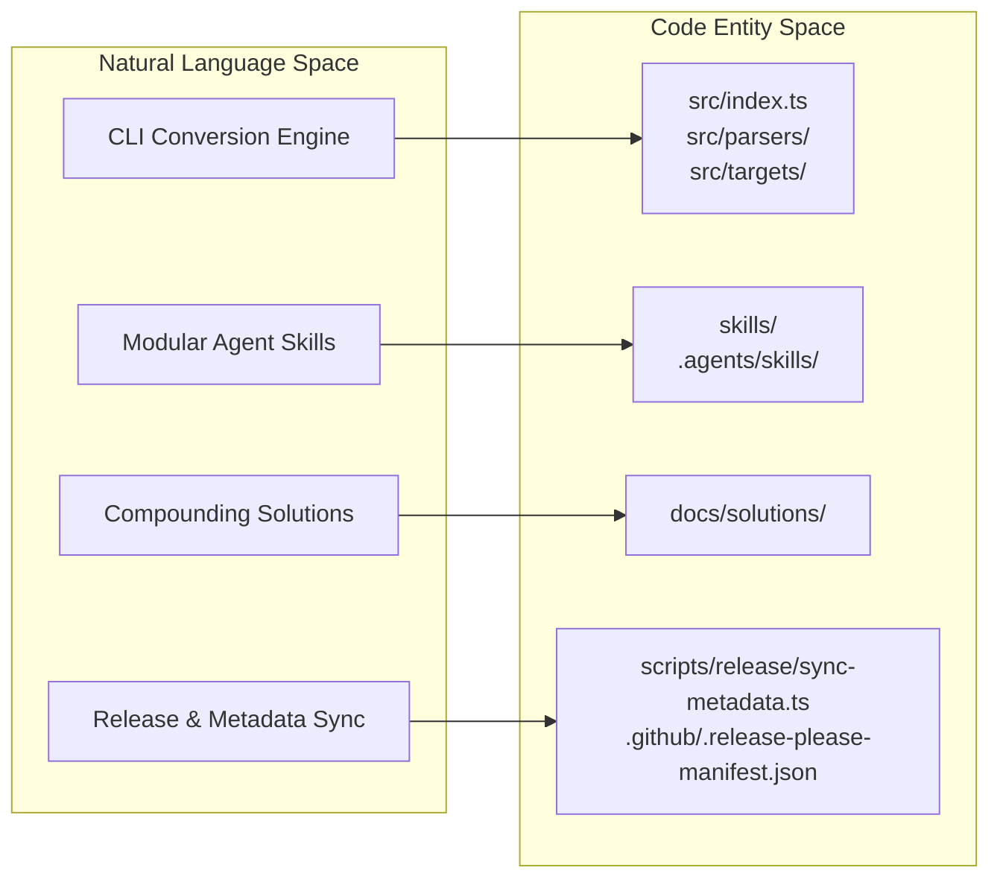
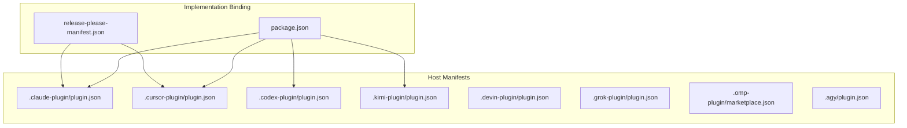

<!-- source: DeepWiki mcp.deepwiki.com · repo EveryInc/compound-engineering-plugin · page 1.2 Repository Structure · fetched 2026-10-30 -->

# Repository Structure

Relevant source files

The following files were used as context for generating this wiki page:

- [.agents/skills/ce-skill-work/SKILL.md](.agents/skills/ce-skill-work/SKILL.md)
- [.agents/skills/ce-skill-work/references/edit-skill.md](.agents/skills/ce-skill-work/references/edit-skill.md)
- [.agents/skills/ce-skill-work/references/evaluate.md](.agents/skills/ce-skill-work/references/evaluate.md)
- [.agents/skills/ce-skill-work/references/new-skill.md](.agents/skills/ce-skill-work/references/new-skill.md)
- [.agents/skills/ce-skill-work/references/respond-to-review.md](.agents/skills/ce-skill-work/references/respond-to-review.md)
- [.agents/skills/ce-skill-work/references/review-skill.md](.agents/skills/ce-skill-work/references/review-skill.md)
- [.agy/plugin.json](.agy/plugin.json)
- [.claude-plugin/plugin.json](.claude-plugin/plugin.json)
- [.codex-plugin/plugin.json](.codex-plugin/plugin.json)
- [.cursor-plugin/plugin.json](.cursor-plugin/plugin.json)
- [.devin-plugin/plugin.json](.devin-plugin/plugin.json)
- [.github/.release-please-manifest.json](.github/.release-please-manifest.json)
- [.grok-plugin/plugin.json](.grok-plugin/plugin.json)
- [.kimi-plugin/plugin.json](.kimi-plugin/plugin.json)
- [.omp-plugin/marketplace.json](.omp-plugin/marketplace.json)
- [AGENTS.md](AGENTS.md)
- [CHANGELOG.md](CHANGELOG.md)
- [CLAUDE.md](CLAUDE.md)
- [assets/explainer/ce-explainer.js](assets/explainer/ce-explainer.js)
- [docs/solutions/skill-design/portable-agent-skill-authoring.md](docs/solutions/skill-design/portable-agent-skill-authoring.md)
- [docs/solutions/skill-design/size-driven-skill-restructure.md](docs/solutions/skill-design/size-driven-skill-restructure.md)
- [docs/specs/cursor.md](docs/specs/cursor.md)
- [package.json](package.json)
- [plugin.json](plugin.json)
- [site/_includes/jekyll_vitepress/head_end.html](site/_includes/jekyll_vitepress/head_end.html)
- [site/index.md](site/index.md)

This page documents the physical organization of the `compound-engineering-plugin` repository, including directory hierarchies, file locations, platform manifests, and the architectural mapping between natural language requirements and code entities.

## Purpose and Scope

The repository serves as a multi-component workspace containing:
1. **Plugin Content:** The core logic of the `compound-engineering` plugin, defined as a collection of modular skills and prompt assets [AGENTS.md:3-5](), [package.json:12-14]().
2. **Cross-Platform CLI:** A Bun/TypeScript tool (`src/`) that parses, converts, and installs Claude Code plugins into other agent platform formats (OpenCode, Codex, Pi, etc.) [AGENTS.md:6-6](), [package.json:20-24]().
3. **Distribution Infrastructure:** Marketplace catalogs and platform-specific manifests (`.claude-plugin/`, `.cursor-plugin/`, etc.) [AGENTS.md:7-8](), [package.json:28-31]().
4. **Knowledge Base:** A structured repository of engineering solutions and architectural patterns (`docs/solutions/`) [AGENTS.md:54-56](), [docs/solutions/skill-design/portable-agent-skill-authoring.md:1-22]().

Sources: [AGENTS.md:3-9](), [package.json:7-15]()

## Top-Level Directory Layout

```mermaid
graph TB
    root["Repository Root"]

    root --> skills["skills/"]
    root --> src["src/"]
    root --> docs["docs/"]
    root --> manifests["Platform Manifests"]
    root --> scripts["scripts/"]
    root --> tests["tests/"]
    root --> assets["assets/"]
    root --> site["site/"]

    skills --> skill_dirs["ce-plan/, ce-work/, etc.<br/>(Skill source)"]
    skills --> skill_subdirs["SKILL.md, references/, scripts/"]

    src --> cli_core["CLI entry, Parsers,<br/>Converters, Target Writers"]

    docs --> solutions["solutions/<br/>(Knowledge Base)"]
    docs --> skill_docs["skills/<br/>(User Documentation)"]

    manifests --> claude[".claude-plugin/"]
    manifests --> cursor[".cursor-plugin/"]
    manifests --> codex[".codex-plugin/"]
    manifests --> kimi[".kimi-plugin/"]
    manifests --> devin[".devin-plugin/"]
    manifests --> grok[".grok-plugin/"]
    manifests --> omp[".omp-plugin/"]
    manifests --> agy[".agy/"]
    manifests --> agents[".agents/"]
    manifests --> opencode[".opencode/"]
    manifests --> pi[".pi/"]

    scripts --> release["release/"]
    scripts --> codex_dev["codex-dev.ts"]

    tests --> test_files["Converter, Writer,<br/>and CLI tests"]
    tests --> skill_eval_cell["skill-eval-cell/"]

    site --> jekyll_config["_config.yml"]
    site --> jekyll_data["_data/"]
    site --> jekyll_includes["_includes/"]
    site --> jekyll_plugins["_plugins/"]

    assets --> demo["demo/"]
```

*Figure 1: High-level repository directory hierarchy showing core module partitions.*

Sources: [AGENTS.md:3-9](), [package.json:7-15](), [package.json:19-27]()

## Natural Language to Code Entity Mapping

To bridge conceptual architectural intent with physical codebase artifacts, the table and diagram below map logical subsystems to their exact implementation files.

*Figure 2: Architectural bridge associating functional domain concepts with source control entities.*

Sources: [AGENTS.md:3-8](), [package.json:20-24](), [.github/.release-please-manifest.json:1-5]()

## Core Components: Skills (`skills/`) and CLI Source (`src/`)

The repository partitions executable capabilities into author-maintained skills and TypeScript CLI tooling.

### Plugin Skills (`skills/`)
The `skills/` directory contains the authoritative source for the plugin's skills [package.json:12-14](). Each skill is housed in its own directory containing a `SKILL.md` file (runtime instructions) and optional `references/` (specialist prompt assets) or `scripts/` (bundled executables) [docs/solutions/skill-design/portable-agent-skill-authoring.md:38-49](), [AGENTS.md:44-44]().

### CLI Source Code (`src/`)
Managed via Bun and implemented in TypeScript, `src/` drives conversion, installation, and cleanup routines [package.json:18-24](). Key modules include:
* `src/index.ts`: CLI entry point routing `install`, `convert`, `cleanup`, and `list` commands [package.json:20-24]().
* `src/utils/`: Shared utility modules, including `frontmatter.ts` for parsing markdown metadata.
* `src/targets/`: Platform-specific writer implementations (OpenCode, Codex, Pi, etc.).
* `src/parsers/`: Format parsers such as `claude.ts`.
* `src/release/`: Release metadata synchronization logic.

Sources: [package.json:18-24](), [docs/solutions/skill-design/portable-agent-skill-authoring.md:38-49]()

## Platform Manifests and Marketplace Metadata

Platform interoperability is maintained through host-specific dot-directories that house plugin configuration manifests.

*Figure 3: Platform manifest inventory and metadata linkage.*

Each `plugin.json` or `marketplace.json` file declares host-specific metadata such as `name`, `version`, `description`, `author`, and keywords [plugin.json:1-20](). Extended interfaces in Codex and Kimi define UI rendering hints, default prompt suggestions, and capabilities [.codex-plugin/plugin.json:21-44](), [.kimi-plugin/plugin.json:18-24]().

Sources: [.github/.release-please-manifest.json:1-5](), [plugin.json:1-20](), [.codex-plugin/plugin.json:21-44]()

## Knowledge Base and Documentation (`docs/` and `site/`)

The repository embeds institutional memory and publishing infrastructure across two distinct directories:
* `docs/solutions/`: The compounding engine storing solution logs and pattern design docs [docs/solutions/skill-design/portable-agent-skill-authoring.md:1-22]().
* `site/`: A Jekyll-based documentation site containing configuration (`_config.yml`), data (`_data/`), layout partials (`_includes/`), custom plugins (`_plugins/ce_relative_urls.rb`), and automated test suites [package.json:37-40]().

Sources: [package.json:37-40](), [docs/solutions/skill-design/portable-agent-skill-authoring.md:1-22]()

## Testing and Evaluation Harness (`tests/`)

Verification logic is partitioned into functional test suites and evaluation cells:
* `tests/skill-eval-cell/`: Houses the skill evaluation cell harness, executing scenarios via `run.ts`, packaging with `pack.ts`, and grading via `judge.ts` [package.json:30-32]().
* `scripts/run-tests.ts`: Orchestrates parallel test execution across the repository test corpus [package.json:25](), [AGENTS.md:15]().

Sources: [package.json:25-32](), [AGENTS.md:15-18]()

## Release Automation and Metadata Synchronization (`scripts/`)

Release management relies on structured automation scripts and manifests:
* `.github/.release-please-manifest.json`: Defines component versions across the root package and marketplace plugins [.github/.release-please-manifest.json:1-5]().
* `scripts/release/sync-metadata.ts`: Validates and writes component counts and version strings across host manifests [package.json:35]().
* `scripts/release/validate.ts`: Enforces consistency between the plugin inventory and documentation tables [package.json:36]().

Sources: [package.json:34-36](), [.github/.release-please-manifest.json:1-5]()

---

