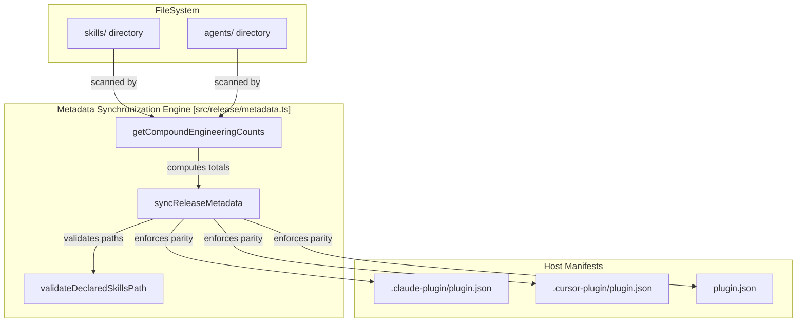
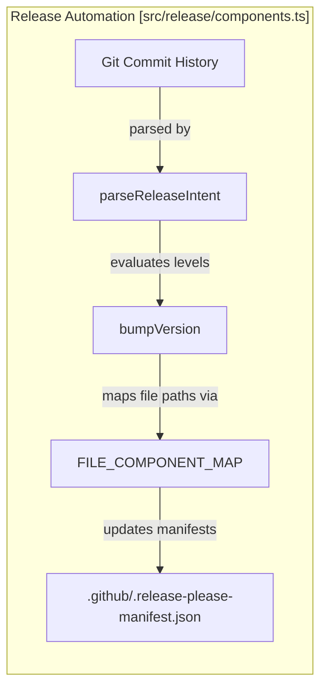

<!-- source: DeepWiki mcp.deepwiki.com · repo EveryInc/compound-engineering-plugin · page 10 Repository Infrastructure · fetched 2026-10-30 -->

# Repository Infrastructure

Relevant source files

The following files were used as context for generating this wiki page:

- [.agy/plugin.json](.agy/plugin.json)
- [.claude-plugin/marketplace.json](.claude-plugin/marketplace.json)
- [.claude-plugin/plugin.json](.claude-plugin/plugin.json)
- [.codex-plugin/plugin.json](.codex-plugin/plugin.json)
- [.cursor-plugin/plugin.json](.cursor-plugin/plugin.json)
- [.devin-plugin/plugin.json](.devin-plugin/plugin.json)
- [.github/.release-please-manifest.json](.github/.release-please-manifest.json)
- [.github/release-please-config.json](.github/release-please-config.json)
- [.grok-plugin/plugin.json](.grok-plugin/plugin.json)
- [.kimi-plugin/plugin.json](.kimi-plugin/plugin.json)
- [.omp-plugin/marketplace.json](.omp-plugin/marketplace.json)
- [CHANGELOG.md](CHANGELOG.md)
- [README.md](README.md)
- [package.json](package.json)
- [plugin.json](plugin.json)
- [src/release/components.ts](src/release/components.ts)
- [src/release/metadata.ts](src/release/metadata.ts)
- [src/release/types.ts](src/release/types.ts)
- [tests/release-components.test.ts](tests/release-components.test.ts)
- [tests/release-metadata.test.ts](tests/release-metadata.test.ts)
- [tests/release-preview.test.ts](tests/release-preview.test.ts)

This page provides a high-level overview of the supporting infrastructure that powers the `compound-engineering-plugin` repository, including marketplace catalogs, the Jekyll documentation site, automated metadata synchronization, versioning and release pipelines, and continuous integration. 

The repository serves as a multi-platform distribution hub for AI engineering skills, managing native distribution across multiple agent hosts while ensuring that versioning, metadata, and documentation remain perfectly synchronized. For deep technical details on specific subsystems, refer to the child pages linked throughout this document.

Sources: [README.md:1-18](), [src/release/components.ts:11-50]()

---

## 1. Marketplace Catalog and Host Manifests

The repository maintains independent marketplace catalogs and host-specific plugin manifests for platforms such as Claude Code, Cursor, Codex, Kimi, and Grok. This structure enables native installation across diverse agent ecosystems without requiring end-users to invoke custom CLI installation tools.

For details on per-host `marketplace.json` and `plugin.json` configurations, schema parity requirements, and validation rules, see [Marketplace Catalog and Host Manifests](#10.1).

Sources: [.claude-plugin/marketplace.json:1-29](), [.codex-plugin/plugin.json:1-45](), [.cursor-plugin/plugin.json:1-25]()

---

## 2. Documentation Site

The project hosts a Jekyll-based static documentation site located in the `site/` directory, providing a browsable reference for all available skills and workflows. It integrates guides from `docs/guides/`, custom routing plugins such as `site/_plugins/ce_relative_urls.rb`, and automated link-checking workflows.

For details on the Jekyll configuration, Rake tasks, asset pipelines, and deployment workflows, see [Documentation Site](#10.2).

Sources: [package.json:37-40](), [README.md:1-12]()

---

## 3. Metadata Synchronization

To prevent version drift across diverse host manifests, the repository relies on programmatic metadata synchronization. The synchronization engine scans the filesystem for component counts, validates declared paths, and propagates version increments across all registered plugin manifests.

For details on `scripts/release/sync-metadata.ts`, drift detection logic, and release validation invariants, see [Metadata Synchronization](#10.3).

Sources: [src/release/metadata.ts:190-257](), [src/release/components.ts:186-221]()

---

## 4. Versioning and Release Pipeline

Releases are managed via `release-please` using a multi-component mapping configuration. Commit intent is parsed to determine bump levels (major, minor, or patch), and file changes are mapped to distinct release components via `FILE_COMPONENT_MAP`.

For details on release-please configuration, release workflows, and manual GitHub release runbooks, see [Versioning and Release Pipeline](#10.4).

Sources: [src/release/components.ts:11-126](), [.github/.release-please-manifest.json:1-5]()

---

## 5. CI Pipeline

Continuous integration is orchestrated via GitHub Actions workflows (such as `.github/workflows/ci.yml`). The CI suite executes test matrices across platforms, utilizes a parallel runner script (`scripts/run-tests.ts`), and guards against environment-specific pitfalls like native Windows path issues and Bun worker constraints.

For details on the CI test matrix, parallel test execution, and runner architecture, see [CI Pipeline](#10.5).

Sources: [package.json:25-41](), [README.md:9-10]()

---

